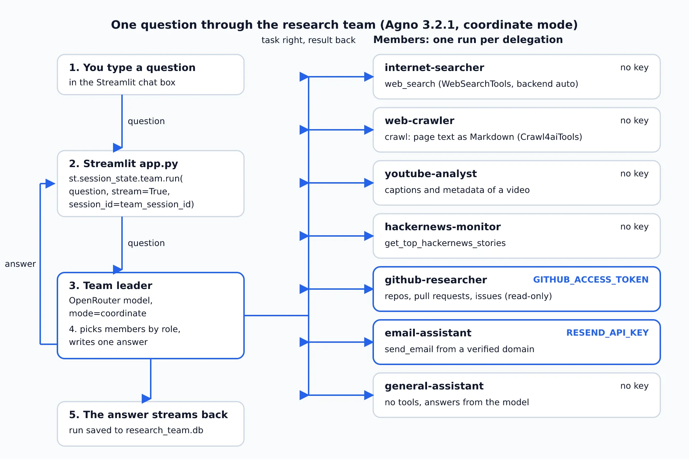
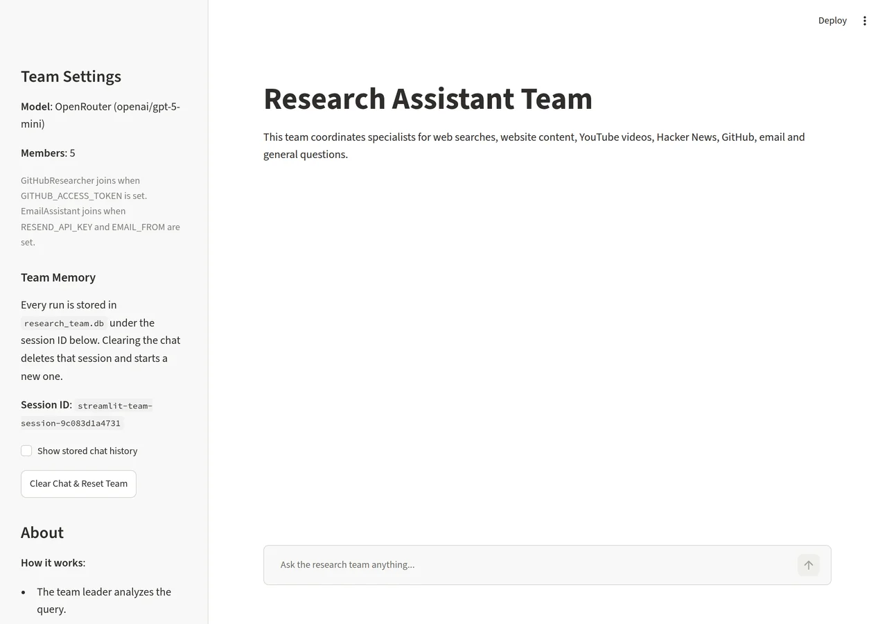
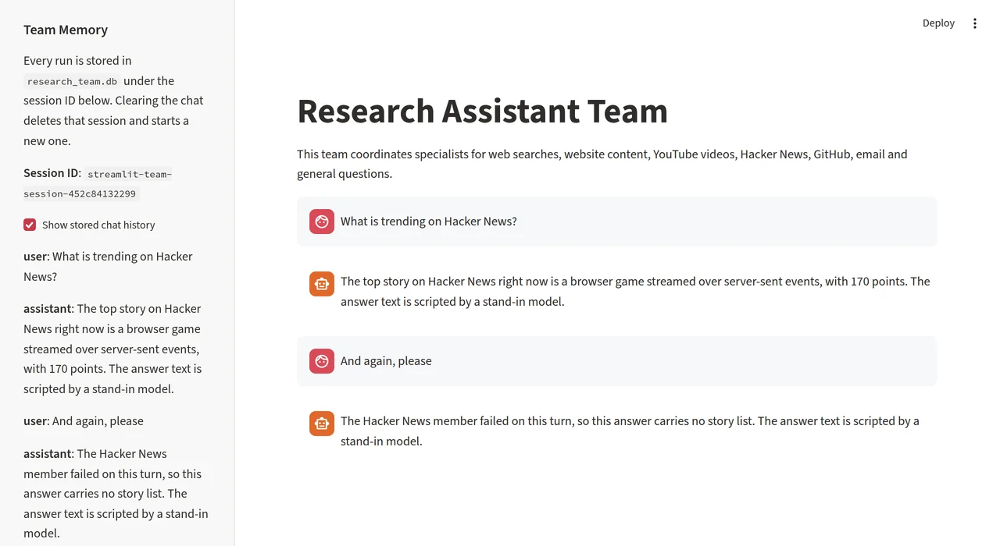
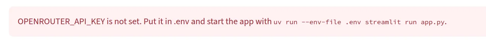
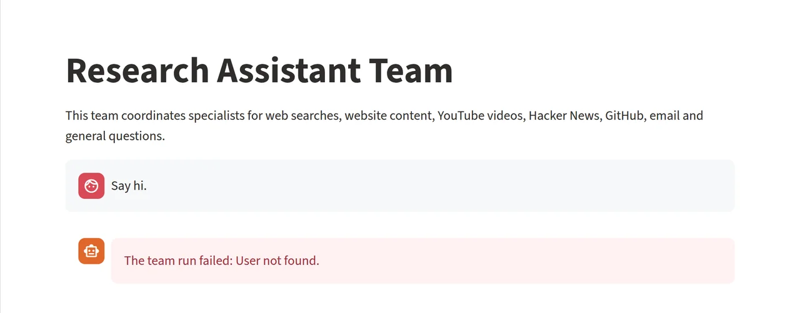

import Accordion from "@components/widgets/Accordion.astro";
import ListCheck from "@components/widgets/ListCheck.astro";
import Notice from "@components/widgets/Notice.astro";
import YouTubeEmbed from "@components/widgets/YouTubeEmbed.astro";

An Agno team is one `Team` object with a leader model and member agents. With `mode="coordinate"` the leader delegates to members by role, then writes one answer. This tutorial builds seven members behind a Streamlit chat, on Agno 3.2.1.

The members search the web, read pages, fetch YouTube captions, list Hacker News stories, query GitHub, send email and answer general questions. Every browser session gets its own chat history in a SQLite file. If you have not built a single Agno agent yet, read [Agno get started](/agno-get-start/) first.

<Notice type="info" title="How this code was checked">
I checked every line of the code against Agno 3.2.1 and Streamlit 1.67.0 on 2026-11-27, in a venv on my lab machine. The lab has no OpenRouter key, so I ran no model call and no model answer appears below. I exercised delegation, events, history, retries and errors with a scripted stand-in model, and the error paths with the real OpenRouter class and an invalid key.
</Notice>

<YouTubeEmbed
  url="https://www.youtube.com/embed/WWCE7INpWfs"
  label="Building Your AI Research Squad with Agno, Streamlit, and uv"
/>

## Which Agno parameters changed since version 1?

Eight parameters that Agno 1.x code passed to `Agent` and `Team` changed name or disappeared. Agno 2.0.0 did that on 2025-09-09, and 3.2.1 keeps the 2.0 names.

| Agno 1.x | Agno 3.2.1 | Note |
|---|---|---|
| `add_history_to_messages=True` | `add_history_to_context=True` | Needs a `db` and a `session_id` |
| `num_history_responses=3` | `num_history_runs=3` | |
| `add_datetime_to_instructions=True` | `add_datetime_to_context=True` | |
| `success_criteria="..."` | Removed | Put the rule in `instructions`, cap it with `tool_call_limit` |
| `enable_agentic_context=True` | Removed | Leader history is `add_history_to_context` plus a database |
| `enable_team_history=True` | `add_team_history_to_members=True` | |
| `num_of_interactions_from_history=5` | `num_history_runs=5` | |
| `show_tool_calls=False` | Removed | |
| `from agno.run.response import RunResponse` | `from agno.run.team import TeamRunEvent` | `run()` returns `TeamRunOutput`, or events with `stream=True` |

The full list is in the [Agno v2.0 changelog](https://docs.agno.com/other/v2-changelog).

## What do you need before you start?

One OpenRouter key runs the app. The GitHub and email members add two keys and a sender address, and the other four tools need nothing.

| Member | Tool | Package | Key or setting |
|---|---|---|---|
| Leader and all members | `OpenRouter` model | comes with the install below | `OPENROUTER_API_KEY` |
| internet-searcher | `WebSearchTools` | `ddgs` | none |
| web-crawler | `Crawl4aiTools` | `crawl4ai` and a Playwright browser | none |
| youtube-analyst | `YouTubeTools` | `youtube-transcript-api` | none |
| hackernews-monitor | `HackerNewsTools` | part of Agno | none |
| github-researcher | `GithubTools` | `PyGithub` | `GITHUB_ACCESS_TOKEN` |
| email-assistant | `ResendTools` | `resend` | `RESEND_API_KEY`, `EMAIL_FROM`, `EMAIL_TO` |

`GithubTools()` without a token raises `ValueError: GitHub access token is required` when it is built, so that member joins only when the token is set. The GitHub docs list Metadata, Issues and Pull requests as separate permissions on a fine-grained token, each with a read-only setting. That read-only set is what I would give a member whose four functions only read. Resend needs a key plus a sender address on a domain you verified in Resend.

<Notice type="warning" title="Two members act outside the app">
EmailAssistant sends real email when the model decides to, and the full GitHub toolkit exposes 39 functions, including `delete_repository`. The code below keeps four read-only GitHub functions and builds those two members only when their keys are set.
</Notice>

## How do you set up the project with uv?

`uv init` creates the project and one `uv add` line installs Agno with the SQLite extra, Streamlit and the tool packages. Keys go into a `.env` file that `uv run` loads with its env file flag.

```bash
uv init --name ai-research-team --python 3.12
cd ai-research-team
uv add "agno[sqlite]" streamlit ddgs crawl4ai youtube-transcript-api resend PyGithub
```

The dependency block of the `pyproject.toml` that produced, on uv 0.9.28:

```toml
dependencies = [
    "agno[sqlite]>=3.2.1",
    "crawl4ai>=0.9.6",
    "ddgs>=9.16.1",
    "pygithub>=2.10.0",
    "resend>=2.56.2",
    "streamlit>=1.67.0",
    "youtube-transcript-api>=1.2.5",
]
```

`agno[sqlite]` matters. Without it `from agno.db.sqlite import SqliteDb` fails with `ModuleNotFoundError: No module named 'sqlalchemy'`, and the team has no chat history. `duckduckgo-search` is not in the list. Agno's `DuckDuckGoTools` raises `ImportError` and names `ddgs` as the missing package.

Put the keys in `.env`:

```text
OPENROUTER_API_KEY=sk-or-v1-your-key
GITHUB_ACCESS_TOKEN=github_pat_your-token
RESEND_API_KEY=re_your-key
EMAIL_FROM=research@your-verified-domain.example
EMAIL_TO=you@example.com
```

Add two lines to the `.gitignore` that `uv init` created:

```text
.env
research_team.db*
```

`uv run` does not read that file on its own. I checked it in a throwaway project with a one-line `.env`:

```bash
uv run python -c "import os; print('DEMO_KEY =', os.getenv('DEMO_KEY'))"
uv run --env-file .env python -c "import os; print('DEMO_KEY =', os.getenv('DEMO_KEY'))"
```

```text
DEMO_KEY = None
DEMO_KEY = demo-value-123
```

uv 0.9.28 rejects an `env-file` key under `[tool.uv]` in `pyproject.toml` as an unknown field, so the flag stays on the command line. If you are new to uv, [uv get started](/uv-get-start/) covers projects and [uv run scripts](/uv-run-scripts-guide/) covers single files.

Streamlit 1.67.0 also sends usage statistics by default. A `.streamlit/config.toml` in the project turns that off:

```toml
[browser]
gatherUsageStats = false
```

### Check the install without spending tokens

```bash
uv run python -c "import agno, streamlit; print(agno.__version__, streamlit.__version__)"
```

```text
3.2.1 1.67.0
```

The four tools that need no key also run without a model. Save this as `check_tools.py` and run it with `uv run python check_tools.py`:

```python
import warnings

warnings.simplefilter("ignore")

from agno.tools.crawl4ai import Crawl4aiTools
from agno.tools.hackernews import HackerNewsTools
from agno.tools.websearch import WebSearchTools
from agno.tools.youtube import YouTubeTools

VIDEO = "https://www.youtube.com/watch?v=WWCE7INpWfs"
print("web search:", WebSearchTools(enable_news=False).web_search("Agno agent framework", max_results=1)[:160])
print("hacker news:", HackerNewsTools(enable_get_user_details=False).get_top_hackernews_stories(num_stories=1)[:160])
print("youtube data:", YouTubeTools(enable_get_video_captions=False, enable_get_video_timestamps=False).get_youtube_video_data(VIDEO)[:160])
print("youtube captions:", YouTubeTools(enable_get_video_data=False, enable_get_video_timestamps=False).get_youtube_video_captions(VIDEO)[:160])
print("crawl:", Crawl4aiTools(max_length=160).crawl("https://docs.agno.com/teams/overview"))
```

Output from my lab, trimmed:

```text
web search: [
  {
    "title": "Agno: The Agent Platform That Builds Itself",
    "href": "https://www.agno.com/",
hacker news: [{"by": "mday404", "descendants": 58, "id": 50667726, ...
youtube data: {
    "title": "Building Your AI Research Squad with Agno, Streamlit, and uv",
youtube captions: Error getting captions for video: ...
crawl: [](https://docs.agno.com/)
Search…
```

A tool that fails returns its error text to the model instead of raising, as the captions line shows. YouTube refused the transcript, and its error names requests from a cloud provider IP as the usual cause. Crawl4AI found the Chromium build that Playwright 1.65.2 expects already on the machine, so I did not run `crawl4ai-setup` from the Agno docs.

### app.py, part 1: imports, keys and session state

The five code parts below, in order, are the whole `app.py`.

```python
# app.py
import os
from uuid import uuid4

import streamlit as st

from agno.agent import Agent
from agno.db.sqlite import SqliteDb
from agno.models.openrouter import OpenRouter
from agno.run.agent import RunEvent
from agno.run.team import TeamRunEvent
from agno.team import Team
from agno.tools.crawl4ai import Crawl4aiTools
from agno.tools.github import GithubTools
from agno.tools.hackernews import HackerNewsTools
from agno.tools.resend import ResendTools
from agno.tools.websearch import WebSearchTools
from agno.tools.youtube import YouTubeTools

st.set_page_config(page_title="Research Assistant Team", page_icon="RS", layout="wide")

# --- Configuration ---
# `uv run --env-file .env` puts the .env file into the process environment.
OPENROUTER_API_KEY = os.getenv("OPENROUTER_API_KEY")
GITHUB_ACCESS_TOKEN = os.getenv("GITHUB_ACCESS_TOKEN")
RESEND_API_KEY = os.getenv("RESEND_API_KEY")
EMAIL_FROM = os.getenv("EMAIL_FROM")
EMAIL_TO = os.getenv("EMAIL_TO")

if not OPENROUTER_API_KEY:
    st.error(
        "OPENROUTER_API_KEY is not set. Put it in .env and start the app with "
        "`uv run --env-file .env streamlit run app.py`."
    )
    st.stop()

# --- Model ---
# One model object. Every member without its own model inherits a copy of it.
model = OpenRouter(id="openai/gpt-5-mini", retries=2, exponential_backoff=True)
model_name = "OpenRouter (openai/gpt-5-mini)"

# --- Session State ---
# Streamlit reruns this script after every interaction. The team lives in
# session_state, so it is built once per browser session.
def new_session_id():
    """One id per browser session. It names the stored runs in research_team.db."""
    return f"streamlit-team-session-{uuid4().hex[:12]}"


if "team_session_id" not in st.session_state:
    st.session_state.team_session_id = new_session_id()
if "messages" not in st.session_state:
    st.session_state.messages = []
```

`openrouter/optimus-alpha` is not in the [OpenRouter catalog](https://openrouter.ai/api/v1/models) on 2026-11-27, and its model endpoint lists zero endpoints. `openai/gpt-5-mini` is the id from Agno's OpenRouter docs and is in the catalog with a 400,000 token context and tool support. `OPENROUTER_API_KEY` comes from the environment, so the code passes no key.

## How does an Agno team in coordinate mode work?

The leader model sees the `id`, `name` and `role` of every member in its system message and calls `delegate_task_to_member(member_id, task)` for the ones it picks. Each delegated member runs as a separate agent with its own system message and tools, and the leader writes the final answer from their results.

This is the roster as the lab captured it from the leader's prompt:

```text
<team_members>
<member id="internet-searcher" name="InternetSearcher">
  Role: Find current information on the web
</member>
<member id="web-crawler" name="WebCrawler">
  Role: Read the content of a web page from its URL
</member>
...
</team_members>
```

The same prompt tells the leader that it works in coordinate mode and that a member's output is evidence, not the answer. That is why `role` does the routing and why every member below carries an explicit `id`. Without an `id`, Agno generates one at run time.



Coordinate is one of four modes:

| Mode | Setting | What happens | Cost | Use it when |
|---|---|---|---|---|
| Coordinate | `mode="coordinate"` (default) | The leader picks members and writes one answer | Leader calls for selection and synthesis, on top of each member run | Sub-tasks need different tools |
| Route | `mode="route"` | One member answers, no synthesis step | One leader call for the selection and one member run | Every question has one owner |
| Broadcast | `mode="broadcast"` | Every member gets the same task, the leader merges | Every member runs, one after another in a sync run and together in an async run | You want several takes on one question |
| Tasks | `mode="tasks"` | The leader works through a task list until done or `max_iterations` (10) | Leader and member calls repeat until the list is done or the limit stops the run | The job has several ordered steps |

The leader and the members make separate model calls, so every delegation costs time and tokens. When the order of the steps is fixed, I use an [Agno Workflow](/agno-workflow-writing-team/) instead.

## How do you define the seven agents?

Each member is an `Agent` with an `id`, a `name`, a `role`, optional `tools` and `instructions`. Members without a `model` inherit a copy of the team's model.

```python
# --- Agent Definitions ---
# Shared settings: each member remembers its own earlier turns. The team's telemetry flag
# does not reach the members, so it is turned off here as well.
member_defaults = {"add_history_to_context": True, "num_history_runs": 3, "telemetry": False}

search_agent = Agent(
    id="internet-searcher",
    name="InternetSearcher",
    role="Find current information on the web",
    tools=[WebSearchTools(enable_search=True, enable_news=False, fixed_max_results=5)],
    instructions=[
        "Use web_search for anything that needs a current source.",
        "Cite the URL behind every claim you take from a result.",
    ],
    add_datetime_to_context=True,
    markdown=True,
    **member_defaults,
)

crawler_agent = Agent(
    id="web-crawler",
    name="WebCrawler",
    role="Read the content of a web page from its URL",
    tools=[Crawl4aiTools(max_length=None)],
    instructions=[
        "Use crawl to read the URLs you are given.",
        "Summarize the key points and include the URL.",
    ],
    markdown=True,
    **member_defaults,
)

youtube_agent = Agent(
    id="youtube-analyst",
    name="YouTubeAnalyst",
    role="Get captions and metadata of a YouTube video",
    tools=[YouTubeTools(enable_get_video_timestamps=False)],
    instructions=[
        "Use get_youtube_video_captions and get_youtube_video_data for YouTube URLs.",
        "Summarize the key points and include the video URL.",
    ],
    markdown=True,
    **member_defaults,
)

email_agent = (
    Agent(
        id="email-assistant",
        name="EmailAssistant",
        role="Send an email with the findings",
        tools=[ResendTools(from_email=EMAIL_FROM, api_key=RESEND_API_KEY)],
        instructions=[
            "Send an email only when the user asks for one.",
            f"The default recipient is {EMAIL_TO}. Use the recipient from the query when it names one.",
            "Include URLs and links clearly.",
        ],
        markdown=True,
        **member_defaults,
    )
    if RESEND_API_KEY and EMAIL_FROM
    else None
)

github_agent = (
    Agent(
        id="github-researcher",
        name="GitHubResearcher",
        role="Search GitHub repositories, pull requests and issues",
        # Read-only subset: the full toolkit also exposes delete_repository and create_issue.
        tools=[
            GithubTools(
                access_token=GITHUB_ACCESS_TOKEN,
                include_tools=["search_repositories", "get_repository", "get_pull_requests", "list_issues"],
            )
        ],
        instructions=[
            "Search repositories or list pull requests based on the query.",
            "Include repository URLs and summarize the findings briefly.",
        ],
        add_datetime_to_context=True,
        markdown=True,
        **member_defaults,
    )
    if GITHUB_ACCESS_TOKEN
    else None
)

hackernews_agent = Agent(
    id="hackernews-monitor",
    name="HackerNewsMonitor",
    role="Fetch the top stories on Hacker News",
    tools=[HackerNewsTools(enable_get_user_details=False)],
    instructions=[
        "Fetch top stories with get_top_hackernews_stories.",
        "Summarize the discussions and include the story URLs.",
    ],
    add_datetime_to_context=True,
    markdown=True,
    **member_defaults,
)

general_agent = Agent(
    id="general-assistant",
    name="GeneralAssistant",
    role="Answer general questions that fit no other member",
    instructions=[
        "Answer general questions directly.",
        "When the query asks for a summary, combine the specialist findings.",
    ],
    markdown=True,
    add_history_to_context=True,
    num_history_runs=5,
    telemetry=False,
)

# The two members that need their own keys join only when the key is set.
members = [search_agent, crawler_agent, youtube_agent, hackernews_agent, general_agent]
if github_agent is not None:
    members.append(github_agent)
if email_agent is not None:
    members.append(email_agent)
```

| Parameter | Default | What it does here |
|---|---|---|
| `id` | Generated from the name at run time | The exact string the leader passes to `delegate_task_to_member` |
| `name` | None | Shown in the roster |
| `role` | None | The text the leader matches a task against |
| `tools` | None | Toolkits whose function names the model calls |
| `instructions` | None | Added to the member's system message |
| `add_datetime_to_context` | `False` | Adds a line with the current time |
| `add_history_to_context` | `False` | Adds the member's own earlier runs from the team session |
| `num_history_runs` | 3 | How many of those runs |
| `markdown` | `False` | Adds "Use markdown to format your answers." |
| `telemetry` | `True` | Posts a per-run record to os-api.agno.com unless set to `False` |

The instructions name the tool functions on purpose. The model picks a function by name, and `duckduckgo_search` and `web_crawler` are not registered in 3.2.1. The search functions are `web_search` and `search_news`, and the crawl function is `crawl`. A member can also carry tools from an MCP server, as in [Context7 MCP with Agno](/agno-mcp-tools-context7/).

I use `WebSearchTools` instead of `DuckDuckGoTools` because of what the two returned from my lab. `DuckDuckGoTools` is a subclass of `WebSearchTools` that only fixes the backend to duckduckgo.

| Class | Backend | Result in the lab for `Agno agent framework` | Trade-off |
|---|---|---|---|
| `DuckDuckGoTools` | `duckduckgo` | `No results found` | One backend, so one refusal leaves the member with nothing |
| `WebSearchTools` | `auto` | Results in two runs | The automatic backend picks itself, and the two runs returned different first hits |

## How do you build the team?

`Team(mode="coordinate", members=members, db=SqliteDb(...))` builds it. The `db` is what makes chat history work, because Agno stores each run under the `session_id` you pass to `run()`.

```python
# --- Team ---
def initialize_team():
    """Build the team. Called once per browser session and again after a reset."""
    return Team(
        name="ResearchAssistantTeam",
        model=model,
        mode="coordinate",
        members=members,
        instructions=[
            "Analyze the query and assign tasks to the specialists.",
            "Delegate based on task type:",
            "Web searches: internet-searcher",
            "URL content: web-crawler",
            "YouTube videos: youtube-analyst",
            "Hacker News: hackernews-monitor",
            "GitHub queries: github-researcher",
            "Emails: email-assistant",
            "General questions and synthesis: general-assistant",
            "Answer from the earlier turns in your context when the query refers to them.",
            "Synthesize the member responses into one answer and cite sources.",
            "Once you have enough information, answer directly. Delegate at most 7 times per request.",
        ],
        # Memory: runs are stored per session_id; the leader gets the last 5 runs back.
        db=SqliteDb(db_file="research_team.db"),
        add_history_to_context=True,
        num_history_runs=5,
        # Members get the last 3 team turns and the responses of members that ran before them.
        add_team_history_to_members=True,
        num_team_history_runs=3,
        share_member_interactions=True,
        # Hard cap on delegations per question. The next one returns "Tool call limit reached".
        tool_call_limit=7,
        markdown=True,
        telemetry=False,
    )


if "team" not in st.session_state:
    st.session_state.team = initialize_team()
```

| Parameter | Default | Here | Cost or trade-off |
|---|---|---|---|
| `mode` | `coordinate` | `"coordinate"` | Leader calls for selection and synthesis |
| `db` | None | `SqliteDb(db_file="research_team.db")` creates the tables `agno_sessions` and `agno_runs` | One file that grows with every run |
| `add_history_to_context` | `False` | `True`, the leader gets earlier runs | Earlier messages, tool calls included, go into every leader prompt |
| `num_history_runs` | 3 | 5 | More runs add more tokens to every question |
| `add_team_history_to_members` | `False` | `True`, member tasks start with the input and response of earlier runs | Longer member prompts |
| `num_team_history_runs` | 3 | 3 | Default kept |
| `share_member_interactions` | `False` | `True`, later members see earlier members' task and response from the same run | A later member's task grows with every earlier response |
| `tool_call_limit` | None | 7, one delegation per member at most | A refused delegation returns an error string to the leader |
| `stream_member_events` | `True` | Left at the default so member errors reach the app | The stream also carries member text, so the loop must filter |
| `markdown` | `False` | `True` | One more instruction in every prompt |
| `telemetry` | `True` | `False`, on the team and on every member | None |
| `retries` | 0 | Left at 0, retries sit on the model object | A run-level retry repeats the whole run |

`success_criteria` no longer exists. The last instruction and `tool_call_limit` do its job in 3.2.1. With the limit at 3 in the lab, the fourth delegation came back as "Tool call limit reached. Tool call delegate_task_to_member not executed. Don't try to execute it again." For a team behind a bot instead of a web page, see [the Discord bot built on an Agno team](/create-your-own-ai-agent/).

## How does the Streamlit app stream the answer?

`team.run(question, stream=True, session_id=...)` returns an iterator of events. Append text only from `TeamRunEvent.run_content`, because the team forwards member events too and they would otherwise end up in the leader's bubble.

The lab run below had the leader delegate once, then answer. The first content event is the member's:

```text
RunStartedEvent
ModelRequestStartedEvent
RunContentEvent  event='RunContent' content='HN member: three stories'
ModelRequestCompletedEvent
RunContentCompletedEvent
RunCompletedEvent
RunContentEvent  event='TeamRunContent' content='LEADER FINAL ONE'
```

A failed run does not raise. It yields one error event whose `content` is the error message, so the loop handles three event types.

```python
# --- Streamlit UI ---
st.title("Research Assistant Team")
st.markdown(
    "This team coordinates specialists for web searches, website content, "
    "YouTube videos, Hacker News, GitHub, email and general questions."
)

# Display chat messages from history
for message in st.session_state.messages:
    with st.chat_message(message["role"]):
        st.markdown(message["content"])

# Handle user input
user_query = st.chat_input("Ask the research team anything...")

if user_query:
    # Add user message to chat history
    st.session_state.messages.append({"role": "user", "content": user_query})

    # Display user message
    with st.chat_message("user"):
        st.markdown(user_query)

    # Display team response (streaming)
    with st.chat_message("assistant"):
        message_placeholder = st.empty()
        full_response = ""
        member_errors = []
        team_error = None
        try:
            response_stream = st.session_state.team.run(
                user_query, stream=True, session_id=st.session_state.team_session_id
            )

            for event in response_stream:
                # The leader's answer arrives as TeamRunContent chunks.
                if event.event == TeamRunEvent.run_content and isinstance(event.content, str):
                    full_response += event.content
                    message_placeholder.markdown(full_response + "▌")  # Add cursor effect
                # Member runs are forwarded too. Their text is not the answer, their errors matter.
                elif event.event == RunEvent.run_error:
                    member_errors.append(f"{event.agent_name}: {event.content}")
                elif event.event == TeamRunEvent.run_error:
                    team_error = event.content

            if team_error:
                message_placeholder.empty()
                st.error(f"The team run failed: {team_error}")
            else:
                message_placeholder.markdown(full_response)  # Final response without cursor
            for failure in member_errors:
                st.warning(f"Member failed, the answer may be incomplete: {failure}")

            # Add the outcome to Streamlit's chat history
            if team_error:
                st.session_state.messages.append({"role": "assistant", "content": f"Error: {team_error}"})
            else:
                st.session_state.messages.append({"role": "assistant", "content": full_response})

        except Exception as e:
            message_placeholder.empty()
            st.exception(e)
```



## How does memory flow between Streamlit and Agno?

Streamlit keeps what the screen shows and Agno keeps what the model reads. `st.session_state.messages` holds the bubbles, `research_team.db` holds every run, and the session id joins the two.


| Store | Holds | Trade-off |
|---|---|---|
| `st.session_state.messages` | The bubbles | Lost when the tab closes, never sent to the model |
| `st.session_state.team` | The `Team` object | Built again on every reset |
| `st.session_state.team_session_id` | The name of the stored session | New after each reset |
| `research_team.db` | One row per session in `agno_sessions`, one row per leader or member run in `agno_runs` | Stays on disk and grows with every run until you delete the file |

On the next question the leader's messages start with the earlier user, assistant, tool and assistant messages of the last five runs. A member task gets the input and response of earlier runs in front of it. This is a member's user message as the lab captured it with a two-member team and scripted texts:

```text
<team_history_context>
[run-1]
input: USER QUESTION RUN 1
response: LEADER FINAL RUN 1

[run-2]
input: USER QUESTION RUN 2
response: LEADER FINAL RUN 2

</team_history_context>


task three A
```

A member delegated later in the same run also sees what the members before it returned:

```text
<member_interaction_context>
See below interactions with other team members.
Member: HackerNewsMonitor
Task: task three A
Response: HN member: three stories

</member_interaction_context>
```

Each member also gets its own earlier runs, because of `add_history_to_context=True` in `member_defaults`. The sidebar shows what is stored:

```python
# --- Sidebar ---
with st.sidebar:
    st.title("Team Settings")
    st.markdown(f"**Model**: {model_name}")
    st.markdown(f"**Members**: {len(members)}")
    st.caption(
        "GitHubResearcher joins when GITHUB_ACCESS_TOKEN is set. "
        "EmailAssistant joins when RESEND_API_KEY and EMAIL_FROM are set."
    )

    # Memory information
    st.subheader("Team Memory")
    st.markdown(
        "Every run is stored in `research_team.db` under the session ID below. "
        "Clearing the chat deletes that session and starts a new one."
    )
    st.markdown(f"**Session ID**: `{st.session_state.team_session_id}`")

    # Memory debug section
    if st.checkbox("Show stored chat history", value=False):
        team = st.session_state.team
        # get_chat_history() raises "Session not found" for a session that has no run yet.
        if team.get_session(session_id=st.session_state.team_session_id) is None:
            st.info("No stored turns yet. Ask the team something first.")
        else:
            history = team.get_chat_history(session_id=st.session_state.team_session_id)
            # Tool-call messages carry no text; keep the user and assistant turns only.
            for turn in history:
                if turn.content:
                    st.markdown(f"**{turn.role}**: {turn.content}")

    # Clear chat button
    if st.button("Clear Chat & Reset Team"):
        st.session_state.team.delete_session(session_id=st.session_state.team_session_id)
        st.session_state.messages = []
        st.session_state.team_session_id = new_session_id()
        st.session_state.team = initialize_team()
        st.rerun()

    st.title("About")
    st.markdown(
        "**How it works**:\n"
        "- The team leader analyzes the query.\n"
        "- Tasks go to the specialists (Searcher, Crawler, YouTube Analyst, Email, GitHub, Hacker News, General).\n"
        "- The leader synthesizes the responses into one answer.\n"
        "- Each browser session has its own memory.\n\n"
        "**Example queries**:\n"
        '- "What are the latest AI breakthroughs?"\n'
        '- "Crawl https://www.agno.com and summarize the homepage."\n'
        '- "Summarize the YouTube video: https://www.youtube.com/watch?v=WWCE7INpWfs"\n'
        '- "Draft an email to contact@example.com introducing our research services."\n'
        '- "Find popular AI repositories on GitHub created in the last month."\n'
        '- "What is trending on Hacker News today?"\n'
        '- "What was the first question I asked you?" (tests memory)'
    )
```



The screenshot comes from the real app with the OpenRouter line swapped for the scripted stand-in, so the answer text is scripted. `get_chat_history()` returns the tool-call messages too, with no text, so the loop skips them. The check with `get_session()` is there because `get_chat_history()` raises `Exception: Session not found` for a session that has no run yet. The reset button deletes the current session and starts a new id, and the file itself stays on disk.

## What does a question cost in model calls?

A question with no delegation is one leader call. One delegation adds a leader call and a member run, so three calls at least.

Seven delegations in one question were 15 calls in the lab, eight from the leader and seven from the members. I counted the prompts with Agno's `count_tokens` (tiktoken) on the configuration above:

| Caller | System message | Tool schemas | Whole first prompt | Tools |
|---|---|---|---|---|
| Leader | 659 | 89 | 750 | 1 |
| internet-searcher | 78 | 62 | 145 | 1 |
| web-crawler | 58 | 55 | 156 | 1 |
| youtube-analyst | 67 | 113 | 242 | 2 |
| hackernews-monitor | 79 | 54 | 215 | 1 |
| general-assistant | 53 | 0 | 154 | 0 |
| github-researcher | 78 | 472 | 670 | 4 |
| email-assistant | 70 | 52 | 262 | 1 |

The provider bills every call on input and output tokens, so the number of members, the size of their tool schemas and the history set the bill. A member that calls a tool makes at least two calls, one to choose the function and one to write its answer. History grows the leader's prompt with every question. With one delegation per question the leader's first prompt went from 751 to 867 tokens over five questions. With seven delegations per question, the prompts of one question went from 8,486 to 12,924 tokens over three questions.

`tool_call_limit=7` caps delegations per question. `num_history_runs` and `num_team_history_runs` cap what earlier runs add, and the Agno docs list `max_tool_calls_from_history` for dropping old tool results from the leader's history. Prompt caching depends on the model and the provider, as Agno's OpenRouter page notes, and the member system messages repeat on every call.

## How do you run it?

Start Streamlit through uv with the env file, then open the URL it prints. The lab run on port 8461 printed this:

```bash
streamlit run app.py --server.headless true --server.address 127.0.0.1 --server.port 8461
```

```text
  You can now view your Streamlit app in your browser.

  URL: http://127.0.0.1:8461
```

Without those flags Streamlit serves on its default port, 8501. On your own machine the command is:

```bash
uv run --env-file .env streamlit run app.py
```

<ListCheck>
<ul>
<li>The sidebar shows `Members: 7` with all five variables set, and `Members: 5` with the model key alone.</li>
<li>`curl http://localhost:8501/_stcore/health` answers `ok` while the app runs.</li>
<li>Ask two questions, tick "Show stored chat history", and the four stored turns appear under the checkbox.</li>
<li>Ask "What was the first question I asked you?" and the leader should answer from its stored history.</li>
</ul>
</ListCheck>

Agno sends usage data by default as well. In 3.2.1 `telemetry` is `True` on every agent and team. The record goes to `https://os-api.agno.com` and holds the model provider, the model id, the database type and the member count. The code sets `telemetry=False` on the team and on every member, because the team flag does not reach the members. The environment variable `AGNO_TELEMETRY=false` overrides the flag on agents and teams.

## What fails, and what does it look like?

Most failures show up as text in the chat, not as a stack trace. This is what the app rendered in the lab for each case.

| Failure | What you see | Fix |
|---|---|---|
| No `OPENROUTER_API_KEY` | A red box on an empty page | Set the key in `.env` and start with the env file flag |
| Invalid OpenRouter key | "The team run failed: User not found." | Create a new key on the OpenRouter keys page |
| Model id that no provider serves | A 404 `not_found` error, per the OpenRouter error table (not run in the lab) | Pick an id from the catalog |
| Rate limit (429) | A log line per attempt, then a `TeamRunError` event when the retries run out | `retries=2, exponential_backoff=True` on the model |
| A member's model fails | A yellow box, and the leader still answers | Keep `stream_member_events` at its default and watch `RunEvent.run_error` |
| A tool fails | The model gets the error text as the tool result and carries on | Check that tool's key |
| `exponential_backoff=True` without `retries` | One call, then the error | Set `retries` on the model object |



Without a key, Agno's error text is `OPENROUTER_API_KEY not set. Please set the OPENROUTER_API_KEY environment variable.`, and the app stops before the chat renders because of its own check. With an invalid key the real OpenRouter class answered 401 and the stream carried one `TeamRunError` event with `User not found.`:



The model object retries a rate limit. With `retries=2` and `exponential_backoff=True`, a scripted 429 produced the log lines `Model provider error during stream (attempt 1/3)` and `Retrying in 1s...`, then `(attempt 2/3)` and `Retrying in 2s...`. The model object does not retry a 401. The log said `Non-retryable model provider error` after one call.

A member that fails does not stop the team. When the stand-in model answered 429 for the Hacker News member, the leader received an empty result and wrote its answer. The app showed "Member failed, the answer may be incomplete: HackerNewsMonitor: 429 rate limit hit". That box belongs to the run that produced it, so the next rerun removes it.

A tool that raises hands the error to the model and the run continues. The GitHub member with a bad token got this as its tool result:

```text
{"error": "401 {\"message\": \"Bad credentials\", \"documentation_url\": \"https://docs.github.com/rest\", \"status\": \"401\"}"}
```

GitHub limits requests per hour and adds secondary limits for too many concurrent requests, and OpenRouter documents 429 as `rate_limit_exceeded` with a `Retry-After` header. To compare a second framework, start with [Google ADK](/google-adk-start/).

## FAQ

<Accordion label="Why does Agno code written for version 1 fail on a current install?" group="faq">
Agno 2.0.0 renamed `add_history_to_messages` to `add_history_to_context` and removed `success_criteria`, `enable_agentic_context`, `enable_team_history` and `show_tool_calls`. Agno 3.2.1 keeps the 2.0 names. The table at the top of this page maps each old parameter to its replacement.
</Accordion>

<Accordion label="Which keys does the app need?" group="faq">
`OPENROUTER_API_KEY` is the only one the app insists on. `GITHUB_ACCESS_TOKEN` adds the GitHub member, and `RESEND_API_KEY` with `EMAIL_FROM` adds the email member. Web search, crawl, YouTube metadata and Hacker News run with no key at all.
</Accordion>

<Accordion label="Why does the team need a database for chat history?" group="faq">
Agno stores every run under the `session_id` passed to `run()`, and `add_history_to_context=True` reads those rows back on the next question. Without a `db` there is nothing to read. `SqliteDb(db_file="research_team.db")` from the `agno[sqlite]` extra is what this app uses.
</Accordion>

<Accordion label="How many model calls does one question cost?" group="faq">
One leader call with no delegation, three with one delegation, and 15 with seven. Each delegated member runs as its own agent, so every member adds its system message and tool schemas to the bill. `tool_call_limit` on the `Team` caps the number of delegations per question.
</Accordion>

<Accordion label="Does exponential_backoff=True retry on its own?" group="faq">
No. `retries` defaults to 0, so `exponential_backoff=True` changes nothing until you set `retries` on the same object. On the model, `OpenRouter(id="openai/gpt-5-mini", retries=2, exponential_backoff=True)` waits 1 second and then 2 seconds between attempts.
</Accordion>

<Accordion label="Why do member answers show up in the leader's bubble?" group="faq">
`stream_member_events` defaults to `True`, so the stream carries the member `RunContent` events next to the leader's `TeamRunContent` events. Append text only when `event.event == TeamRunEvent.run_content`, or set `stream_member_events=False` on the team.
</Accordion>

<Accordion label="Why does the chat say User not found?" group="faq">
OpenRouter answers 401 with that text when the key is unknown or revoked. Agno turns it into one `TeamRunError` event instead of an exception, and the app shows it as "The team run failed: User not found.". Create a new key, put it in `.env`, and restart with the env file flag.
</Accordion>

<Accordion label="Do Agno and Streamlit send usage data?" group="faq">
Both do by default. Agno 3.2.1 sets `telemetry=True` and posts a per-run record to os-api.agno.com. Streamlit 1.67.0 sets `browser.gatherUsageStats` to true. Set `telemetry=False` on the team and every member, or `AGNO_TELEMETRY=false` in the environment, and add a `.streamlit/config.toml` with `gatherUsageStats = false`.
</Accordion>
