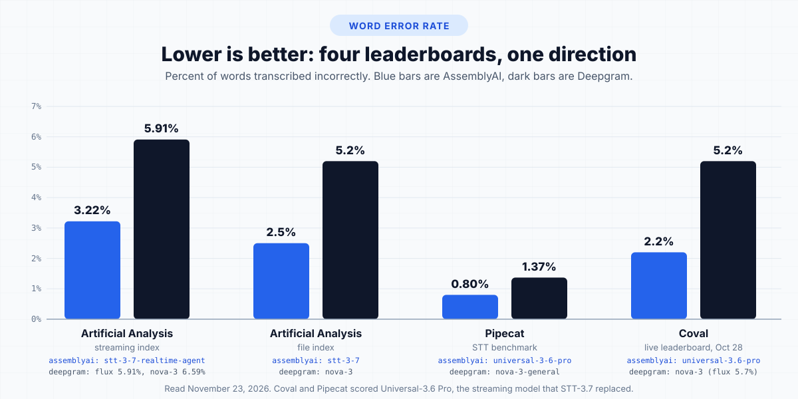
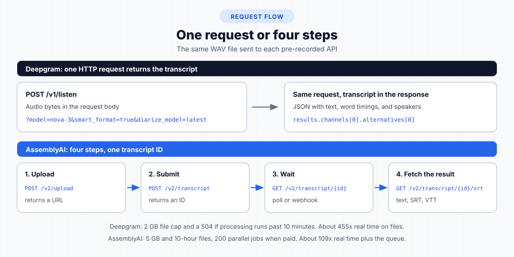

import Button from "@components/widgets/Button.astro";
import Notice from "@components/widgets/Notice.astro";
import ListCheck from "@components/widgets/ListCheck.astro";
import Accordion from "@components/widgets/Accordion.astro";

*Disclosure: this guide contains referral links. If you buy through them, I may earn a commission at no extra cost to you.*

[AssemblyAI](https://go.bitdoze.com/assemblyai) made 3 errors in 562 words on the six files I sent to both services. Deepgram made 13 on the same files and answered about four times faster. I ran every file three times on each service. For scale beyond 562 words, this article also lines up four public leaderboards, both price lists, and the documented limits.

## The short version

AssemblyAI made about four times fewer word errors on my six files and leads all four public leaderboards I checked, and it costs less for file transcription. Deepgram answered in 1.0 to 1.9 seconds where AssemblyAI took 5.1 to 7.2. It also returns a transcript from one HTTP request instead of a job queue. It gives new accounts $200 in credit instead of $50 and includes speaker labels in the batch price. Choose by what your pipeline lacks: accuracy or throughput.

| | AssemblyAI | Deepgram |
|---|---|---|
| Wrong words on my six files (562 words, lower is better) | 3 | 13 |
| Voices labelled on a five-speaker file | 5 of 5 | 4 of 5 |
| Answer time on my files (11 to 64 s clips) | 5.1 to 7.2 s | 1.0 to 1.9 s |
| Word error rate, Artificial Analysis file index (Nov 2026) | 2.5% | 5.2% |
| File processing speed, same test | 109x real time | 455x real time |
| File price per hour | $0.21 | $0.26 monolingual, $0.31 multilingual |
| Streaming price per hour | $0.30 Realtime, $0.45 Realtime-Agent | $0.29 Nova-3, $0.39 Flux |
| Speaker labels on files | +$0.02 per hour | Included |
| Free credit, no card | $50 | $200 |
| File request flow | Upload, submit, poll or webhook | One HTTP request |
| Largest file | 10 hours, 5 GB | 2 GB, with a 10-minute processing cap |
| Languages | 32 on STT-3.7, 99 with Universal-2 | 60+ on the Nova models |
| HIPAA BAA | Self-service | Through sales |
| On your own hardware | Streaming only, $50,000 commitment | Enterprise, NVIDIA GPUs |

### AssemblyAI (best for accuracy, speaker labels, and long files)

**Verdict:** 3 errors in 562 test words against Deepgram's 13, first place on all four public leaderboards, and 5 of 5 voices labelled.

- **Best for:** Names, numbers, and product terms that must come out right, meetings with several speakers, and recordings over 2 GB.
- **Strengths:** Writes `kubectl` and `/var/log/syslog` as spelled, takes 10-hour files, offers a self-service HIPAA BAA, and starts new accounts with $50 in credit.
- **Trade-offs:** 5.1 to 7.2 seconds of queue on every short file, and an upload, submit, and poll flow instead of one call.
- **Pricing:** $0.21 per hour for files, +$0.02 for speaker labels, $0.30 to $0.45 per session hour for streaming.

### Deepgram (best for throughput and one-call scripts)

**Verdict:** 13 errors in 562 test words, answered in 1.0 to 1.9 seconds, with diarization included in the batch price.

- **Best for:** Big file backlogs, many live streams, audio that must run on your own GPUs, and scripts that should stay one `curl` long.
- **Strengths:** 455 times real time on files, one HTTP request per file, $200 in free credit, and endpoints in the US, EU, Australia, and India.
- **Trade-offs:** Writes tool names as they sound (`KubeControl`, `engine x`), merged two of five voices on my file, and caps files at 2 GB.
- **Pricing:** $0.26 per hour for files with diarization included, $0.29 to $0.47 per session hour for streaming.

<Button text="Try AssemblyAI ($50 Free Credit)" link="https://go.bitdoze.com/assemblyai" variant="solid" color="blue" size="md" icon="arrow-right" />

## Which is more accurate, AssemblyAI or Deepgram?

AssemblyAI, on every public leaderboard I checked and on my own files. Vendor benchmarks disagree by design. Deepgram's comparison page claims 30% lower word error rate than AssemblyAI, and AssemblyAI's benchmark page puts its models ahead of Deepgram on every set it publishes. Both companies ran those tests themselves. Leaderboards run by someone else score the two services the same way every time:

| Source | Audio tested | AssemblyAI | Deepgram |
|---|---|---|---|
| [Artificial Analysis](https://artificialanalysis.ai/speech-to-text/streaming), streaming (Nov 2026) | Agent calls, Parliament speech, earnings calls | 3.22% (`assemblyai-stt-3-7-realtime-agent`) | 5.91% (Flux), 6.59% (Nova-3 Realtime) |
| [Artificial Analysis](https://artificialanalysis.ai/speech-to-text/non-streaming), files (Nov 2026) | About 8 hours from the same three sets | 2.5% (`assemblyai-stt-3-7`) | 5.2% (Nova-3) |
| [Pipecat STT benchmark](https://github.com/pipecat-ai/stt-benchmark) (Nov 2026) | 1,000 short voice-agent turns | 0.80% (`universal-3-6-pro`) | 1.37% (`nova-3-general`) |
| [Coval live leaderboard](https://www.coval.ai/blog/best-speech-to-text-providers-in-2026-independent-benchmarks-and-how-to-choose/) (30 days to Oct 28, 2026) | Voice-agent turns plus six noisy conditions | 2.2% (Universal 3.6 Pro) | 5.2% (Nova 3), 5.7% (Flux) |



The chart lines the four rows up. Each test uses different audio, and two of them scored older AssemblyAI models that STT-3.7 replaced on November 17, 2026. The gap runs from 0.6 to 3.4 percentage points, and no leaderboard puts Deepgram ahead. Deepgram's closest result is Pipecat's, where the difference is 0.57 points against a 0.25 point band that Pipecat treats as statistical noise. Deepgram also [announced in October 2026](https://techcrunch.com/2026/10/29/deepgram-acquires-pipecat-maker-daily-to-bolster-its-voice-ai-infrastructure) that it is acquiring Daily, the company behind Pipecat, so that row deserves the least weight.

None of the four is a per-language comparison. For other languages, run your own sample. AssemblyAI's vendor-run table shows a far wider gap on code-switched speech (6.20% against 49.43%), and Deepgram's page publishes no per-language numbers to compare against it.

AssemblyAI's own pre-recorded benchmark agrees with the third-party direction: STT-3.7 at 6.53% word error rate against Nova-3 at 9.78% on verbatim-reference English, with diarization error of 12.05% against 17.40%. Deepgram's comparison page, which claims the opposite, carries a November 2025 date and names no test set.

## My six files: AssemblyAI made 3 errors, Deepgram 13

Public leaderboards cover thousands of clips. I wanted numbers from audio I could describe word by word, so I built six files that each have an exact reference:

- A 50-second incident readout from a synthetic voice, with DevOps tool names in spoken form ("cube control", "engine X", "var log syslog"), two fillers, and one spoken self-correction. Clean, then mixed with pink noise 10 dB under the speech.
- A 23-second dialogue between two synthetic voices, six turns.
- Ten LibriSpeech sentences from five real speakers, shuffled so that each speaker comes back after two others have spoken.
- A 20-second Spanish clip from a synthetic voice.
- The 11-second 1961 JFK recording from the OpenAI Whisper repository.

The scorer lowercases, strips punctuation, expands digits into words, maps a few spellings (`nginx` to `engine x`, `mr` to `mister`), and drops fillers. Fillers go because Deepgram removes "um" and "uh" by default while AssemblyAI keeps them.

| File | Length | Scored words | AssemblyAI errors | Deepgram errors |
|---|---|---|---|---|
| JFK recording | 11 s | 22 | 0 | 0 |
| DevOps readout, clean | 50 s | 133 | 1 | 4 |
| DevOps readout, pink noise at -10 dB | 50 s | 133 | 1 | 4 |
| Two-voice dialogue | 23 s | 64 | 1 | 2 |
| Spanish clip | 20 s | 47 | 0 | 0 |
| Ten sentences, five real speakers | 64 s | 163 | 0 | 3 |
| Total | 218 s | 562 | 3 | 13 |

That is 0.5% against 2.3% word error rate. Both services detected Spanish on the Spanish clip and transcribed it without an error. Here is every mistake, read by hand from the transcripts:

- **AssemblyAI, 3 errors:** wrote "cache proxy" where the script says "cached proxy", on both readouts, and dropped the "I" in "I think so" in the dialogue.
- **Deepgram, 13 errors:** wrote "VarLogs syslog" for "var log syslog" (two wrong words on each readout), "Postgres connection stayed healthy" where the script says "connections" (each readout), "cache proxy" (each readout), "smoke test" for "smoke tests" and the same dropped "I" in the dialogue, and on the real-speech file "Sertus" for "Syrtis" and "as much as announced" for "as much as an ounce".

Four of the sixteen errors are the same ones. The rest split into two groups. Deepgram lost three words on read speech from five real voices where AssemblyAI lost none, and it rewrote one path.

Tool names are a separate score from word error rate. A scorer has to decide what "correct" means for a name that is spoken one way and written another.

| What the audio says | AssemblyAI wrote | Deepgram wrote |
|---|---|---|
| "cube control" | `kubectl` | `KubeControl` |
| "engine X" | `Nginx` | `engine x` |
| "var log syslog" | `/var/log/syslog` | `VarLogs syslog` |
| "two hundred milliseconds" | `200 milliseconds` | `two hundred milliseconds` |
| "Postgres", "PagerDuty", "Helm", "Terraform" | same spelling | same spelling |

AssemblyAI writes the tool name the way it is spelled in a terminal. Deepgram writes what it hears. That costs Deepgram almost nothing in word error rate once spellings are mapped, but a search for `kubectl` or `nginx` will not find its transcript. For meeting notes that hardly matters. For a support call where someone reads out a command, it does.

Two honest limits on this test. Clean read speech is easy for both services, and one 50-second readout carries most of Deepgram's errors. Treat the 3 against 13 as a direction that matches the leaderboards, not as a rate you can extrapolate. Your own vocabulary is where a gap will show, which is why the script below is the same one that produced the table.

Deepgram returned the same text on all three runs of every file. AssemblyAI's words were also the same on every run, while punctuation, letter case, and number formatting moved between runs (`200ms` twice, `two hundred milliseconds` once).

### Answer time on the same files

| File | AssemblyAI | Deepgram |
|---|---|---|
| JFK recording (11 s) | 5.6 s | 1.0 s |
| DevOps readout, clean (50 s) | 6.0 s | 1.9 s |
| DevOps readout, noisy (50 s) | 6.7 s | 1.9 s |
| Dialogue (23 s) | 5.2 s | 1.7 s |
| Spanish clip (20 s) | 5.1 s | 1.2 s |
| Five speakers (64 s) | 7.2 s | 1.9 s |

Mean of two timed runs each, measured from the start of the upload to the final text, with AssemblyAI polled once a second. Its upload took 0.9 to 1.8 seconds and the rest was queue and polling, so an 11-second clip waited almost as long as a 64-second one. Deepgram's time barely moved with file length on clips this short.

## Which is faster, AssemblyAI or Deepgram?

Deepgram, on files and on live audio.

For long files, [Artificial Analysis](https://artificialanalysis.ai/speech-to-text/non-streaming) measures how many seconds of audio each service transcribes per second on 10-minute recordings: 455 for Nova-3 and 109 for STT-3.7. A one-hour file is about 8 seconds of processing on Deepgram and about 33 seconds on AssemblyAI. On my files the queue added a flat 4 to 6 seconds to AssemblyAI, whatever the length.

One [r/speechtech post](https://www.reddit.com/r/speechtech/comments/1s6tt4c/benchmarked_speaker_diarization_for_swedish/) from March 2026 timed a 2 hour 22 minute Swedish meeting with six speakers: Deepgram finished in 64.5 seconds, AssemblyAI in 218. That run predates STT-3.7 and it is one recording, but it matches the direction of the leaderboard numbers.

For live audio, the ranking holds and the margin shrinks:

| Measurement | AssemblyAI | Deepgram |
|---|---|---|
| Artificial Analysis, time to final text after speech ends (agent-call set) | 102 ms (Realtime-Agent) | 41 ms (Flux), 61 ms (Nova-3 Realtime) |
| Coval, p50 / p95 time to final text | 106 / 222 ms (Universal 3.6 Pro) | 99 / 165 ms (Flux), 86 ms average (Nova 3) |
| Pipecat, median / P95 time to final text | 307 / 401 ms (Universal-3.6 Pro) | 247 / 298 ms (Nova-3) |

The rows disagree on the size of the numbers because their clocks start at different moments. Artificial Analysis starts its timer when a voice-activity detector marks the end of speech. Pipecat and Coval time more of the pipeline, so both services look slower there. Deepgram returns final text sooner in all three, by a factor of 1.7 to 2.5 on Artificial Analysis and by less on the other two. I did not stream audio to either service, so these rows are their measurements, not mine.

For a voice agent, the transcript is one term in a sum that also includes your LLM and your text-to-speech. A 60 ms difference inside a 700 ms reply is small. A misheard account number is not.

Turn detection is a separate speed question. Deepgram's Flux STT decides inside the model when the caller has finished speaking, and Deepgram built it for that job. AssemblyAI's Realtime-Agent model does the same with low-latency end-of-turn decisions. Both bill streaming by connection time, so close the socket when the call ends.

## Run the same test on your own files

These two scripts produced the table above. The first sends one WAV file to both services with the settings I used. The second scores the two transcripts against a reference you trust, such as a transcript you corrected by hand:

```bash
export ASSEMBLYAI_API_KEY=your_key
export DEEPGRAM_API_KEY=your_key
file=meeting.wav

# AssemblyAI: upload, submit, poll
url=$(curl -s -X POST https://api.assemblyai.com/v2/upload \
  -H "authorization: $ASSEMBLYAI_API_KEY" \
  --data-binary @"$file" | jq -r '.upload_url // empty')
[ -z "$url" ] && { echo "AssemblyAI upload failed"; exit 1; }
job=$(jq -n --arg url "$url" '{
  audio_url: $url,
  speech_models: ["assemblyai-stt-3-7"],
  language_detection: true,
  speaker_labels: true
}')
id=$(curl -s -X POST https://api.assemblyai.com/v2/transcript \
  -H "authorization: $ASSEMBLYAI_API_KEY" \
  -H "content-type: application/json" \
  -d "$job" | jq -r '.id // empty')
[ -z "$id" ] && { echo "AssemblyAI submit failed"; exit 1; }
while :; do
  curl -s https://api.assemblyai.com/v2/transcript/$id \
    -H "authorization: $ASSEMBLYAI_API_KEY" > aai.json
  case "$(jq -r .status aai.json)" in
    completed) break ;;
    error) jq -r .error aai.json; exit 1 ;;
  esac
  sleep 2
done
jq -r .text aai.json > aai.txt

# Deepgram: one request
curl -s -X POST \
  "https://api.deepgram.com/v1/listen?model=nova-3&smart_format=true&detect_language=true&diarize_model=latest&utterances=true" \
  -H "Authorization: Token $DEEPGRAM_API_KEY" \
  -H "Content-Type: audio/wav" \
  --data-binary @"$file" \
  | jq -r '.results.channels[0].alternatives[0].transcript' > dg.txt
```

The scorer normalizes the way my scoring did: digits become words, a few spellings map to their spoken form, and fillers are ignored. Add `es` as the last argument for a Spanish reference.

```python
# usage: python3 wer.py reference.txt aai.txt dg.txt [es]
import re
import sys

EN = "zero one two three four five six seven eight nine ten eleven twelve thirteen fourteen fifteen sixteen seventeen eighteen nineteen".split()
ES = "cero uno dos tres cuatro cinco seis siete ocho nueve diez once doce trece catorce quince dieciseis diecisiete dieciocho diecinueve veinte".split()
EN_TENS = {20: "twenty", 30: "thirty", 40: "forty", 50: "fifty", 60: "sixty", 70: "seventy", 80: "eighty", 90: "ninety"}
ES_TENS = {30: "treinta", 40: "cuarenta", 50: "cincuenta", 60: "sesenta", 70: "setenta", 80: "ochenta", 90: "noventa"}
SPELLING = {
    "kubectl": "kube control", "kubecontrol": "kube control", "cube": "kube", "nginx": "engine x",
    "postgresql": "postgres", "pagerduty": "pagerduty", "mr": "mister", "corncakes": "corn cakes",
    "ms": "milliseconds", "ok": "okay", "k8s": "kubernetes", "rollback": "roll back", "maxmemory": "max memory",
}
PHRASES = {("auto", "scaling"): "autoscaling", ("re", "run"): "rerun", ("pager", "duty"): "pagerduty",
           ("time", "outs"): "timeouts"}
FILLERS = {"um", "uh", "er", "ah", "hmm"}


def number_words(value, spanish=False):
    ones, tens = (ES, ES_TENS) if spanish else (EN, EN_TENS)
    if value < 20:
        return ones[value]
    if value < 100:
        return tens[value // 10 * 10] + ("" if value % 10 == 0 else " " + ones[value % 10])
    if value < 1000:
        rest = "" if value % 100 == 0 else " " + number_words(value % 100, spanish)
        return ones[value // 100] + (" cien" if spanish else " hundred") + rest
    rest = "" if value % 1000 == 0 else " " + number_words(value % 1000, spanish)
    return ones[value // 1000] + (" mil" if spanish else " thousand") + rest


def words(path, spanish=False):
    text = open(path, encoding="utf-8").read().lower().replace("-", " ").replace("/", " ")
    out = []
    for token in re.findall(r"[0-9]+|[a-záéíóúñü']+", text):
        if token.isdigit():
            out.extend(number_words(int(token), spanish).split())
        else:
            out.extend(SPELLING.get(token.strip("'"), token.strip("'")).split())
    for (left, right), replacement in PHRASES.items():
        while left + " " + right in " ".join(out):
            out = " ".join(out).replace(left + " " + right, replacement).split()
    return [t for t in out if t not in FILLERS]


def wer(reference, hypothesis):
    row = list(range(len(hypothesis) + 1))
    for i, ref_word in enumerate(reference, 1):
        previous, row[0] = row[0], i
        for j, hyp_word in enumerate(hypothesis, 1):
            current = min(row[j] + 1, row[j - 1] + 1, previous + (ref_word != hyp_word))
            previous, row[j] = row[j], current
    return row[-1]


reference, assemblyai, deepgram = (words(p, len(sys.argv) > 4) for p in sys.argv[1:4])
print(f"words in reference:        {len(reference)}")
print(f"AssemblyAI wrong words:    {wer(reference, assemblyai)}")
print(f"Deepgram wrong words:      {wer(reference, deepgram)}")
```

Put your own product names in the test file, in the form people say them. That is where the two services separated the most on my audio, and it is the part no public leaderboard can test for you. If your source is a video rather than a WAV file, my [YouTube to SRT guide](/transcribe-youtube-video-srt-assemblyai/) covers the download and audio extraction steps.

## Which is cheaper, AssemblyAI or Deepgram?

AssemblyAI at list price, $0.21 against $0.26 an hour for files, until Deepgram's $200 credit and Growth discount close the gap.

List prices from the [AssemblyAI](https://www.assemblyai.com/pricing) and [Deepgram](https://deepgram.com/pricing) pricing pages, checked on November 23, 2026:

| Item | AssemblyAI | Deepgram |
|---|---|---|
| Files, English | $0.21/hr | $0.26/hr ($0.0043/min) |
| Files, multilingual model | $0.21/hr for 32 languages, $0.15/hr on Universal-2 for 99 | $0.31/hr ($0.0052/min) |
| Streaming | $0.30/hr Realtime, $0.45/hr Realtime-Agent | $0.29/hr Nova-3, $0.35/hr Nova-3 multilingual, $0.39/hr Flux English, $0.47/hr Flux multilingual |
| Speaker labels, files | +$0.02/hr | Included |
| Speaker labels, streaming | +$0.12/hr | +$0.12/hr ($0.0020/min) |
| Keyterms | +$0.05/hr on files, included on streams | +$0.078/hr ($0.0013/min) |
| Summaries and sentiment | +$0.02/hr each | Per token: $0.0003 per 1k input, $0.0006 per 1k output |
| Entity detection | +$0.08/hr | +$0.102/hr ($0.0017/min) |
| Voice agent platform | Realtime-Agent + LLM Gateway + TTS, priced per layer | Voice Agent API from $0.075/min ($4.50/hr) |
| Free credit | $50 | $200, does not expire |
| Volume discount | Contact sales | Growth: $4,000 per year prepaid, up to 20% off |

| Hours of files per month | AssemblyAI | AssemblyAI + speaker labels | Deepgram Nova-3 (labels included) |
|---|---|---|---|
| 10 | $2.10 | $2.30 | $2.58 |
| 100 | $21.00 | $23.00 | $25.80 |
| 500 | $105.00 | $115.00 | $129.00 |

Four things to know before you compare the two columns:

1. Deepgram marks several of its own rates as promotional, including Nova-3 monolingual streaming at $0.0048 a minute, down from $0.0077. AssemblyAI's page lists no promotional rates.
2. Deepgram's Growth plan discounts list prices by up to 20 percent for a $4,000 annual prepay. At that rate, Nova-3 batch lands at $0.216 an hour, within a cent of AssemblyAI's list price.
3. Both services bill multichannel audio per channel. A one-hour stereo call costs two hours on either one.
4. Deepgram's $200 credit covers about 775 hours of Nova-3 batch, against 238 hours from AssemblyAI's $50.

Both services bill streaming by connection time, so an open WebSocket with nobody talking still costs money.

## Which is better for speaker diarization?

AssemblyAI on my files: 5 of 5 voices labelled against Deepgram's 4 of 5.

Both services label speakers on files and on live audio, and they differ in price and in output shape more than in capability.

| | AssemblyAI | Deepgram |
|---|---|---|
| How to enable | `speaker_labels: true` | `diarize_model=latest` (`diarize=true` is deprecated) |
| Speaker count control | `speakers_expected` for an exact count, `speaker_options` for a range | None in its diarization docs |
| Output | `utterances` array, one letter per speaker (A, B, C) | A numeric `speaker` on every word, plus `utterances=true` to group turns |
| Confidence per label | Optional, `speaker_options.include_speaker_confidence` | Yes on files (`speaker_confidence`) |
| Price, files | +$0.02/hr | Included |
| Price, streaming | +$0.12/hr | +$0.12/hr |

Both services split the two-voice dialogue into six clean turns. On the ten-sentence file with five real voices, AssemblyAI returned five labels in the right order on all ten segments and every word carried the right speaker. Deepgram returned four labels: it gave the first voice and the fifth voice the same number, which left 8 of 10 segments and 81% of words right.

The speaker count is optional on AssemblyAI. I ran the five-voice file four ways: the default, a range of 2 to 6, and an exact 5 all produced the same correct labels. An exact 3, which is wrong, collapsed three voices into one label, which is what the docs warn about.

At larger scale the evidence is thinner. AssemblyAI's own benchmark has diarization error of 12.05% against Deepgram's 17.40% across six meeting datasets. The Reddit post I cited earlier is the only third-party side-by-side I found. On that Swedish meeting both services detected 6 of 6 speakers, and Deepgram's time accuracy against a pyannote reference was 1.7 points higher. A [2025 thread](https://old.reddit.com/r/speechtech/comments/1hz3h5a/best_production_stt_apis_with_highest_accuracy/) has two developers describing Deepgram mixing up two similar male voices, and one of them switched to AssemblyAI over it.

Read that as "test your own meetings". Diarization accuracy depends on how alike your speakers sound, and ten read sentences prove less than a conference call would.

## Features and limits compared

| | AssemblyAI | Deepgram |
|---|---|---|
| File models | `assemblyai-stt-3-7`, `universal-2` | `nova-3-general`, `nova-3-medical`, `nova-3-pharma`, hosted Whisper Large |
| Streaming models | Realtime, Realtime-Agent | Nova-3, Flux STT |
| Largest file | 10 hours, 5 GB (2.2 GB through the upload endpoint) | 2 GB, and a 504 if processing runs past 10 minutes |
| Parallel file jobs | 5 on free accounts, 200+ when paid, overflow is queued | 50 per project on its rate-limit page, a 429 beyond that |
| Streaming concurrency | 200 new sessions per minute, growing 10 percent per minute under load | 150 concurrent on pay-as-you-go, 225 on Growth |
| Custom vocabulary | Up to 1,000 keyterms and a 1,500-word prompt | Up to 100 keyterms and language hints |
| Summaries, sentiment, topics | Per-hour add-ons plus an LLM gateway with 65 models | Audio intelligence billed per token, English only |
| Redaction | Text +$0.08/hr, audio +$0.05/hr | +$0.12/hr |
| Text-to-speech | AssemblyAI-TTS-1, $15 per 1M characters | Aura-2 at $30 and Flux TTS at $45 per 1M characters |
| Voice agent platform | Assemble Realtime-Agent, LLM Gateway, and TTS; the old Voice Agent API retires Feb 1, 2027 | Voice Agent API with a managed LLM from $0.075/min |
| Regions | US, EU | US, EU, Australia, India |
| Self-hosted | Streaming only, $50,000 upfront commitment | Enterprise only, NVIDIA GPUs, Docker or Kubernetes |

Two rows in that table decide most migrations. Deepgram's 2 GB file limit and 10-minute processing cap rule out long video files until you extract the audio, while AssemblyAI takes 10-hour recordings in one job. AssemblyAI's queue takes 200 parallel jobs before it slows down, while Deepgram answers 50 concurrent file requests per project and rejects the rest until you go to Enterprise.

## Which one is HIPAA compliant, and where does the audio run?

Both offer a Business Associate Agreement, and both offer an EU endpoint. AssemblyAI's BAA is self-service and Deepgram's goes through its sales team.

The two services start from opposite defaults on training data. Deepgram enrolls every request in its Model Improvement Program and retains the audio, unless you send `mip_opt_out=true` on that request. Deepgram can process retained data outside your region for model improvement. AssemblyAI asks you to opt out once in the dashboard. After that it keeps no audio or transcripts for streaming, Sync, and Dictation. For files, it deletes uploaded audio within 24 to 48 hours and transcripts after 30 days unless you delete them sooner.

Both hold SOC 2 Type 2. Deepgram adds endpoints in Australia and India, CCPA, PCI, and FIPS 140-3 images for self-hosting. For on-premises batch transcription, only Deepgram sells that, on Enterprise terms with NVIDIA GPUs. AssemblyAI's self-hosted stack covers streaming and starts at a $50,000 commitment.

## Developer experience: four steps or one request



Deepgram takes one request. AssemblyAI takes four steps and gives you a job ID, webhooks, and 200 parallel jobs in return.

The diagram is the difference I notice most when writing shell scripts. Deepgram's pre-recorded API is one call:

```bash
curl -s -X POST \
  "https://api.deepgram.com/v1/listen?model=nova-3&smart_format=true&diarize_model=latest&utterances=true" \
  -H "Authorization: Token $DEEPGRAM_API_KEY" \
  -H "Content-Type: audio/wav" \
  --data-binary @meeting.wav \
  | jq -r '.results.utterances[] | "Speaker \(.speaker): \(.transcript)"'
```

AssemblyAI splits the same job into an upload, a submit, and a poll or webhook. The upload, submit, and poll steps are in my script above and in the [AssemblyAI review](/assemblyai-review/). The job design earns its keep at scale. AssemblyAI stores each transcript by ID, a webhook fires when each one is ready, and 200 jobs run in parallel without your script holding 200 HTTP connections open. Two details are easy to get wrong on a first attempt: the `authorization` header takes the raw key with no `Bearer` prefix, and the upload needs `--data-binary @file`.

The rest of the tooling is comparable. Both ship Python and JavaScript SDKs, a browser playground, and an MCP server that lets Claude or Cursor call the API. Deepgram also has a CLI, and AssemblyAI mints temporary tokens so a browser or mobile app can stream without seeing your key.

## AssemblyAI or Deepgram: which should you pick?

Pick AssemblyAI for accuracy and speaker labels, Deepgram for throughput and deployment options.


<ListCheck>

<ul>
  <li>Pick AssemblyAI when names, numbers, and product terms have to be right. It made 3 errors in 562 words on my files against Deepgram's 13, leads every leaderboard above, and writes <code>kubectl</code> and <code>/var/log/syslog</code> as they are spelled.</li>
  <li>Pick AssemblyAI for meetings with several speakers, 10-hour recordings, or a HIPAA BAA you need without a procurement cycle.</li>
  <li>Pick Deepgram when throughput sets your costs: huge file backlogs, thousands of concurrent live streams, or scripts that should stay one <code>curl</code> long.</li>
  <li>Pick Deepgram when the audio has to run on your own GPUs or inside Australia or India.</li>
  <li>Pick neither when audio must stay on your LAN and a free local model is accurate enough. <a href="/openai-whisper-alternatives/">Speaches</a> and <code>whisper.cpp</code> cost nothing to run.</li>
</ul>

</ListCheck>

If you are moving off `whisper-1` before February 2027, read both services against the local options in my [Whisper alternatives guide](/openai-whisper-alternatives/) first. Fish Audio answered my short clips about six times faster than AssemblyAI at a higher error rate, and the [Fish Audio review](/fish-audio-review/) covers its text-to-speech side.

## Frequently asked questions

<Accordion label="Which is more accurate, AssemblyAI or Deepgram?" group="faq" expanded="true">
AssemblyAI. On my six files it made 3 errors in 562 words against Deepgram's 13. It also leads every public leaderboard I checked, with 2.5% against 5.2% word error rate on files and 3.22% against 5.91% to 6.59% on streams on Artificial Analysis. Your own vocabulary is where a gap shows, so run one real recording through both.
</Accordion>

<Accordion label="Which is cheaper, AssemblyAI or Deepgram?" group="faq">
AssemblyAI at list price: $0.21 an hour for files against Deepgram's $0.26, and speaker labels cost $0.23 against $0.26 all in. Deepgram gives new accounts $200 in credit against $50. Its Growth plan also cuts up to 20 percent off for a $4,000 annual prepay, which brings batch price level with AssemblyAI.
</Accordion>

<Accordion label="Which is faster, AssemblyAI or Deepgram?" group="faq">
Deepgram. On my six files it answered in 1.0 to 1.9 seconds and AssemblyAI in 5.1 to 7.2, because AssemblyAI's batch endpoint queues every file. Artificial Analysis measured Nova-3 at 455 times real time on files against 109 for AssemblyAI. Deepgram's streaming models return final text in 41 to 61 ms against 102 ms for AssemblyAI's Realtime-Agent.
</Accordion>

<Accordion label="Which is better for speaker diarization?" group="faq">
On my files, AssemblyAI. It labelled all five voices on a ten-sentence file correctly, where Deepgram merged two voices into one label. Both split a two-voice dialogue into six clean turns. Deepgram includes diarization in its batch price, AssemblyAI charges $0.02 an hour for it and lets you set an expected speaker count. Test both on your own meetings.
</Accordion>

<Accordion label="Is Deepgram HIPAA compliant?" group="faq">
Yes. Deepgram signs a Business Associate Agreement for Enterprise customers, and you request it through its sales team. AssemblyAI lets you sign a BAA from the dashboard on pay-as-you-go.
</Accordion>

<Accordion label="Can I self-host AssemblyAI or Deepgram?" group="faq">
Deepgram sells self-hosted containers on Enterprise terms, for NVIDIA GPUs, in Docker or Kubernetes. AssemblyAI's self-hosted stack covers streaming only and requires an upfront commitment of $50,000. Neither offers a self-hosted version of its file transcription API at self-service prices.
</Accordion>

<Accordion label="What do developers on Reddit say about AssemblyAI vs Deepgram?" group="faq">
The threads I found split the same way as the benchmarks. A March 2026 benchmark post on r/speechtech found Deepgram about three times faster on a long meeting with similar diarization accuracy. An older thread has developers describing Deepgram mixing up similar-sounding male voices. Neither is a controlled test, and both predate AssemblyAI's STT-3.7 models.
</Accordion>

<Accordion label="Are AssemblyAI and Deepgram better than Whisper?" group="faq">
On the Artificial Analysis file index, AssemblyAI-STT-3.7 at 2.5% beats every hosted Whisper listed, while Deepgram Nova-3 at 5.2% trails Whisper Large v3 on fal.ai at 4.1%. Whisper Large v3 is open weight, so you can also run it yourself for free with [faster-whisper or whisper.cpp](/openai-whisper-alternatives/), at a slower speed.
</Accordion>

<Accordion label="Do AssemblyAI and Deepgram have free tiers?" group="faq">
Neither has a free monthly plan. AssemblyAI gives new accounts $50 in credit and Deepgram gives $200, both without a card. After the credit runs out you pay per hour or per minute of audio.
</Accordion>

<Button text="Try AssemblyAI ($50 Free Credit)" link="https://go.bitdoze.com/assemblyai" variant="solid" color="blue" size="md" icon="arrow-right" />

## Related articles

- [AssemblyAI review](/assemblyai-review/): accuracy on six test files, full pricing, and the streaming and dictation APIs
- [Transcribe a YouTube video to text and SRT](/transcribe-youtube-video-srt-assemblyai/): the same API turning videos into transcripts, subtitles, and chapters
- [OpenAI Whisper alternatives tested](/openai-whisper-alternatives/): AssemblyAI and Fish Audio on the same audio, plus local servers
- [Fish Audio review](/fish-audio-review/): voice cloning, text-to-speech, and the creative suite
- [Fish Audio vs ElevenLabs](/fish-audio-vs-elevenlabs/): the voice generation side of the comparison
- [Best free AI meeting note-takers](/best-free-ai-meeting-notetakers/): local and cloud options for meeting notes
