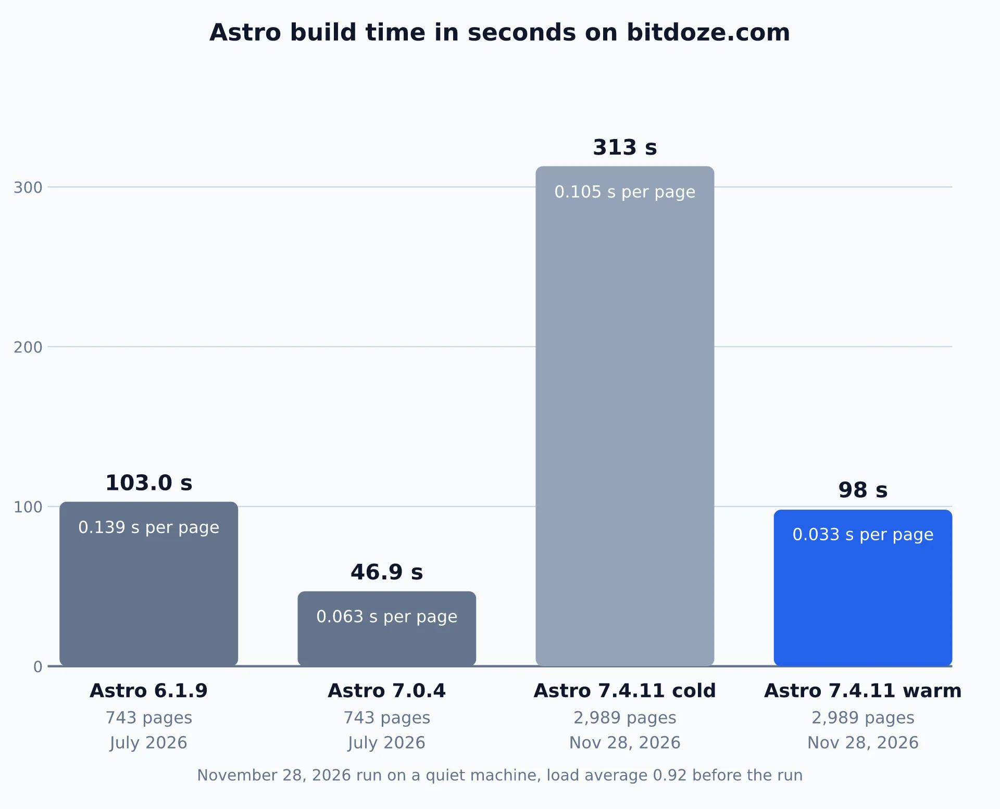
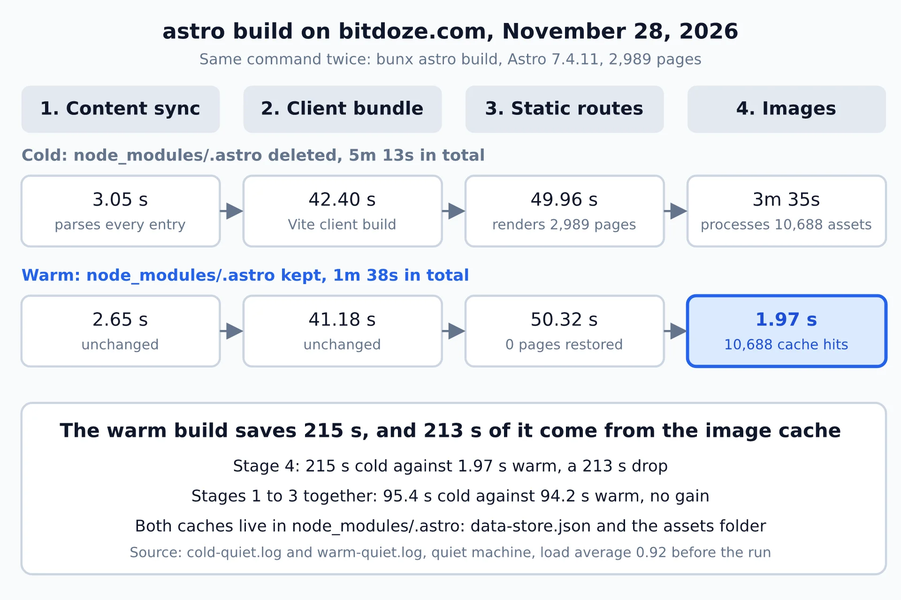
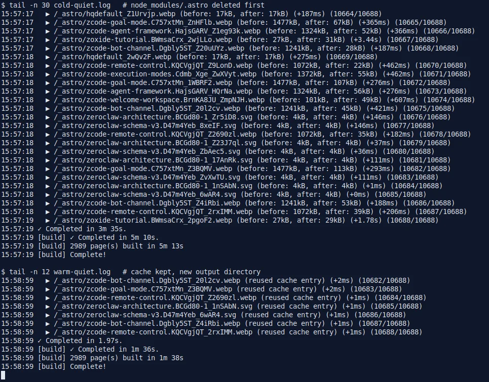

import Notice from "@components/widgets/Notice.astro";
import { Picture } from "astro:assets";
import Accordion from "@components/widgets/Accordion.astro";
import cfAstro6 from "../../assets/images/26/07/astro-6-cloudflare-page-build.webp";
import cfAstro7 from "../../assets/images/26/07/astro-7-cloudflare-pages-build.webp";

Astro 7, stable since June 22, 2026, cut this site's build from 103 seconds to 47 seconds on 743 pages with no config change. The "faster" in the release notes isn't marketing fluff. The `.astro` compiler, the piece that turns your components into HTML and JS, got rewritten from Go to Rust. I wanted a real number instead of a changelog promise, so I rebuilt this exact site, all 743 pages, on Astro 6 and again on Astro 7, right before and right after running the upgrade.

Same content, same machine, same `astro.config.mjs`. Here's the actual CLI output, what's behind the jump, and how I used the upgrade as an excuse to fix a few long-standing issues in my [Astro blog theme](https://github.com/bitdoze/bitdoze-astro-theme) too. A November rerun on a site four times larger, now on Astro 7.4.11, follows the benchmark.

If you're starting a blog from zero instead of upgrading an existing one, the [free Astro + Cloudflare guide](/build-astro-blog-free/) now assumes Astro 7 from the first `npm install`.

## How much faster is Astro 7 than Astro 6?

On this site's 743 pages, Astro 7.0.4 built in 46.92 s against 103.00 s on Astro 6.1.9, 2.2 times faster with no config change.

Both runs are `bun run build:ci` against the same repository, back to back, with only the dependency versions changed in between.

**Astro 6.1.9:**

```
08:32:14 [build] ✓ Completed in 101.77s.
08:32:14 [build] 743 page(s) built in 103.00s
08:32:14 [build] Complete!
```

**Astro 7.0.4:**

```
09:29:06 [build] ✓ Completed in 45.08s.
09:29:06 [build] 743 page(s) built in 46.92s
09:29:06 [build] Complete!
```

| Metric | Astro 6 | Astro 7 | Change |
|---|---|---|---|
| `✓ Completed in` | 101.77s | 45.08s | 2.3x faster |
| `page(s) built in` (743 pages) | 103.00s | 46.92s | 2.2x faster |
| Seconds per page | 0.139 | 0.063 | -55% |
| Pages per second | ~7.2 | ~15.8 | +120% |

Nothing else moved between the two runs. No new caching, no config tweaks, no fewer pages. The version bump alone cut the build in half.

Astro 7.4.0 added a `--timings` flag that prints the same kind of breakdown for your own project, so you can see which stage to tune first:

```bash
astro build --timings
```

## How fast is a 2,989-page site on Astro 7.4.11?

On November 28, 2026, this site at 2,989 pages built in 313 s cold and 98 s warm on Astro 7.4.11. The warm build takes 31% of the cold one, and the image cache accounts for 213 s of the 215 s saved.

The site now has 2,989 pages, four times the 743 of the July benchmark. It runs Astro 7.4.11 on Node v24.17.0 and Bun 1.3.14, with 8 cores and 15 GB RAM. The machine was quiet, with a load average of 0.92 before the run. With `node_modules/.astro` deleted first, `bunx astro build` took 316 s wall clock and reported `2989 page(s) built in 5m 13s`. The same command ran straight after, with the cache present and a new output directory, so no page came from a previous output. It took 100 s wall clock and reported `1m 38s`. Per page that is 0.105 s cold and 0.033 s warm, against 0.139 s on Astro 6 and 0.063 s on 7.0.4.

| Build | Pages | Date | Build time | Seconds per page |
|---|---|---|---|---|
| Astro 6.1.9 | 743 | July 2026 | 103.00 s | 0.139 |
| Astro 7.0.4 | 743 | July 2026 | 46.92 s | 0.063 |
| Astro 7.4.11, cold (cache deleted) | 2,989 | Nov 28, 2026 | 313 s | 0.105 |
| Astro 7.4.11, warm (cache kept) | 2,989 | Nov 28, 2026 | 98 s | 0.033 |



*Four builds of bitdoze.com: the July 2026 benchmark on 743 pages and the November 28, 2026 run on 2,989 pages, with seconds per page inside each bar.*

## What does a cold build do that a warm build skips?

A cold build processes all 10,688 image assets, which took 215 s. A warm build reuses the cached image entries in 1.97 s, while content sync, the client bundle and page rendering take about the same time either way.

The stage times in the two logs tell the story. Content sync took 3.05 s cold and 2.65 s warm, the Vite client build 42.40 s and 41.18 s, and static routes 49.96 s and 50.32 s. Optimized images went from 3m 35s to 1.97 s because every one of the 10,688 assets logged `reused cache entry`. Both caches live in `node_modules/.astro`: the content layer's `data-store.json` and the image cache. On this site the content cache saved nothing measurable, and 213 s of the 215 s difference came from images.



*Cold against warm on Astro 7.4.11: three stages stay flat, the image stage drops from 215 s to 1.97 s.*

The last lines of both logs:



*Terminal capture of `tail -n 30 cold-quiet.log` and `tail -n 12 warm-quiet.log`, November 28, 2026.*

To repeat the measurement on your own site, run the build twice with two output directories so the second run restores nothing:

```bash
rm -rf node_modules/.astro
bunx astro build --outDir /tmp/dist-cold
bunx astro build --outDir /tmp/dist-warm
```

For the tuning steps beyond the version bump (collections, image settings, Node flags), see [Astro build speed optimization](/astro-ssg-build-optimization/).

## It's faster on Cloudflare Pages too

The CLI log above is the clean, controlled number. What you feel is how long a deploy takes, so I pulled the Cloudflare Pages build logs for this site from both versions too.

**Astro 6, Cloudflare Pages:**

<Picture formats={["webp"]} fallbackFormat="webp" src={cfAstro6} alt="Cloudflare Pages build log for bitdoze.com on Astro 6, finishing in about 7 minutes" />

**Astro 7, Cloudflare Pages:**

<Picture formats={["webp"]} fallbackFormat="webp" src={cfAstro7} alt="Cloudflare Pages build log for bitdoze.com on Astro 7, finishing in about 2 minutes" />

| Where | Astro 6 | Astro 7 |
|---|---|---|
| Local `astro build` (743 pages) | 103.00s | 46.92s |
| Cloudflare Pages build | ~7 min | ~2 min |

Cloudflare's number covers more than the compiler: cloning the repo, installing dependencies, running the build, then uploading and deploying the output. It still dropped from about 7 minutes to about 2 minutes, and that's the number that matters: Cloudflare Pages counts the whole build, the `astro build` step included.

## Which Cloudflare Pages settings does Astro 7 need?

The Astro preset on Cloudflare Pages runs `npm run build` into `dist`, and Astro 7 needs no change there. Set the Node version yourself, because Astro raised its minimum twice since 7.0.0.

| Setting | Value | Where |
|---|---|---|
| Framework preset | Astro | project creation |
| Build command | `npm run build` | Settings, Build |
| Build output directory | `dist` | Settings, Build |
| Node version | 22.23.4 or newer | `NODE_VERSION` variable, or a `.node-version` or `.nvmrc` file |
| Build cache | Enable, caches `node_modules/.astro` | Settings, Build, Build cache |

Astro 7.0.0 asked for Node 22.12.0, 7.4.0 raised that to 22.22.0, and 7.4.2 raised it again to 22.23.4 (the `engines` field of the 7.4.11 package). The default Node on the V3 build system is 22.23.4, so a project on V3 without a pin passes today and breaks on the next bump. A pin avoids that.

Build caching is off until you enable it. When on, Pages saves `node_modules/.astro` and restores it on the next build, so the image cache survives deploys. It needs the V2 or V3 build system, keeps 10 GB per project, and purges entries seven days after their last read. A blog that deploys daily keeps the cache; one that deploys monthly pays the 215 s image step each time. Bun on Pages, including the install step, is covered in [how to migrate Astro to Bun on Cloudflare Pages](/migrate-astro-bun/).

## Why is Astro 7 faster?

The `.astro` compiler was rewritten in Rust and became the default in 7.0.0, and Vite 8 with its Rolldown bundler replaced Vite 7. Both changes are internal to the toolchain, so there is nothing to configure.

What shipped in 7.0.0, per the [Astro changelog](https://github.com/withastro/astro/blob/main/packages/astro/CHANGELOG.md):

- **The compiler is now Rust.** Astro's `.astro`-to-HTML/JS compiler was rewritten from Go to Rust and ships as `@astrojs/compiler-rs`. Paired with the Rust-based Markdown pipeline that already landed in Astro 6.4, content-heavy sites get the biggest win, and most of this site's 743 pages are Markdown/MDX posts running straight through that pipeline.
- **Vite 8 underneath.** Astro 7 runs on Vite 8, which keeps leaning on Rolldown, Vite's Rust-based bundler, for more of the build.
- **Nothing to configure.** Both changes are internal to the toolchain. I didn't touch a single option in `astro.config.mjs` to get the speedup.

Later minors added more, and none of them change the build command. The release dates come from the npm registry, checked on November 28, 2026:

| Version | Released | What landed |
|---|---|---|
| 7.1.0 | July 16, 2026 | `deferRender` loader option to defer Markdown rendering until a page needs it; `experimental.collectionStorage: 'chunked'` splits the data store |
| 7.2.0 | Aug 6, 2026 | `experimental.incrementalBuild` with `cacheKey`; `digest` on content entries; `astro preview --background` |
| 7.3.0 | Sept 3, 2026 | Image services and cache providers receive the logger; incremental builds keep the cache when `build.concurrency` is above 1 |
| 7.4.0 | Oct 15, 2026 | `astro build --timings`; `experimental.redirectPage`; minimum Node 22.22.0 |
| 7.4.2 | patch | Minimum Node 22.23.4 |

The newest release on November 28, 2026 is 7.4.13. There is no 7.5 yet.

<Notice type="warning" title="One breaking change to check before you upgrade">
Astro 7's compiler no longer silently fixes invalid HTML the way the old one did. Unclosed tags like `<div>Hello` and unterminated attributes now throw a build error instead of being auto-corrected. Run a full `astro build` locally right after upgrading. If something breaks, the error points at the exact file and line, and it's almost always one stray tag the old compiler had been quietly patching over.
</Notice>

## Upgrading your own project

Astro's own tool does most of the work:

```bash
npx @astrojs/upgrade
```

Three things to check once it finishes:

1. **Node.js 22.23.4 or newer.** Astro 7 raised the minimum Node version in 7.0.0 (22.12.0), again in 7.4.0 (22.22.0) and in 7.4.2 (22.23.4). Check this on your machine and on whatever CI or hosting platform builds your site. A stale Node version on the host is the most common way a passing local build fails to deploy.
2. **Vite pins.** If your `package.json` has an `overrides` or `resolutions` entry pinning Vite to v7, bump it to v8. Astro 7 requires Vite 8, and a stale pin will hold it back without a build error that obviously points at the real cause.
3. **Old experimental flags.** The Go compiler is gone, so `experimental.rustCompiler` no longer exists and can be deleted. `experimental.incrementalBuild` (7.2.0) and `experimental.svgOptimizer` are still experimental under 7.4.11 and still under `experimental`.

Then build once locally before you push. If the stricter parser flags anything, fix that one tag and you're done.

## What I changed on bitdoze.com

The 743-page benchmark above is this actual blog. The relevant part of the `package.json` diff:

| Package | Before | After |
|---|---|---|
| astro | 6.1.9 | 7.0.4 |
| @astrojs/mdx | 5.0.4 | 7.0.0 |
| @tailwindcss/vite | 4.2.4 | 4.3.2 |
| sharp | 0.34.5 | 0.35.2 |
| typescript | 5.9.3 | 6.0.3 |

I also flipped on `dangerouslyProcessSVG: true` in the image config. Every post on this blog uses an SVG for its hero image, this one included, and that setting lets Astro's `<Image>` and `<Picture formats={["webp"]} fallbackFormat="webp">` components run those SVGs through the same processing pipeline as raster images instead of passing them through untouched.

On November 28, 2026 the site runs `7.4.11` with `experimental.incrementalBuild: true` (skip rendering pages whose `cacheKey` and dependencies are unchanged) and `experimental.svgOptimizer`. `dangerouslyProcessSVG` still exists in 7.4.11 with a default of `false`, but this config no longer sets it: `image.layout`, `image.breakpoints` and `image.responsiveStyles` now generate the responsive markup.

## I updated the Bitdoze Astro Theme too

A lot of readers here start from the [Bitdoze Astro Theme](https://github.com/bitdoze/bitdoze-astro-theme) instead of a blank Astro project, so I moved it to Astro 7 as well and used the occasion to fix a few things that had been bugging me for a while:

- **Dependency bump:** Astro 6.1.9 → 7.0.3, `@astrojs/mdx` 5 → 7, Vite 7.3.2 → 8.1.0, Tailwind CSS 4.2.4 → 4.3.2.
- **A real test suite.** Vitest now covers the slug and publication logic, and `npm run verify` runs `astro check`, the tests, and a production build in one command.
- **One function decides what's public.** A new `isPublishedPost()` helper centralizes the draft and future-date check that used to be copy-pasted across pages, RSS, and search.
- **Slugs no longer piggyback on canonical URLs.** There's now an explicit `slug` field in frontmatter. Previously the route was derived from the `canonical` URL, so changing your canonical could silently change your route too.
- **A stricter content schema.** `description`, `date`, and at least one author are required at build time now instead of quietly falling back to empty defaults.
- **A sitemap fix.** Tag pages and the 404 page no longer sneak into the sitemap.
- **Pinned to Node 22.12** with a `.node-version` file, so CI and every contributor build against the runtime Astro 7 expects.

None of that shows up in a release title, but it's the difference between a theme that happens to build and one where the routing and publishing rules are enforced. If you're running the theme, pull the latest `main` and run `npm run verify` before you deploy.

On November 28, 2026 the theme's `package.json` declares `astro` `^7.3.2`, `vite` `^8.2.2` and `@astrojs/mdx` `^8.0.1`, so it tracks 7.x.

## Should you upgrade now?

For most content sites, yes. The performance gain is real and free, you don't rewrite anything to get it.

The only risk is the stricter HTML parsing, and that risk is self-limiting: it either builds clean or hands you a precise error to fix. Run the upgrade command, check your Node version and any Vite pin, build locally, then ship. On 7.4.11 also enable the Cloudflare build cache: on this site it saved 213 s of the 215 s between cold and warm.

## Related articles

- [Build a free blog with Astro & Cloudflare](/build-astro-blog-free/)
- [Astro build speed optimization: 35 to 127 pages/second](/astro-ssg-build-optimization/)
- [Deploy an Astro blog to Cloudflare](/deploy-astrojs-cloudflare/)
- [Astro DB with Bunny Database](/astro-db-bunny-database/)
- [Migrate Astro to Bun on Cloudflare Pages](/migrate-astro-bun/)
- [Astro vs Next.js vs TanStack Start: which wins in 2026?](/astro-vs-nextjs-vs-tanstack-start-which-wins/)

## FAQ

<Accordion label="How do I upgrade a site from Astro 6 to 7?" group="faq">
Run `npx @astrojs/upgrade`, confirm Node 22.23.4 or newer with `node -v`, and remove any Vite 7 pin from `package.json`. Then run `astro build` once locally. On this site the version bump alone took the build from 103.00 s to 46.92 s on 743 pages.
</Accordion>

<Accordion label="Is it safe to delete node_modules/.astro?" group="faq">
Yes. Astro rebuilds the directory on the next `astro build` or `astro dev`. It holds `data-store.json` (the content layer) and the image cache, nothing you edit by hand. The price is a cold build: 313 s against 98 s for this site on November 28, 2026. Delete it when content looks stale or after a large Astro upgrade.
</Accordion>

<Accordion label="Why is a warm Astro build faster?" group="faq">
Because the image cache in `node_modules/.astro` still matches the source files. On bitdoze.com the image stage took 215 s cold and 1.97 s warm, with 10,688 assets logged as `reused cache entry`. Content sync, the client bundle and page rendering took 95.4 s cold and 94.2 s warm, so the cache saves them nothing.
</Accordion>

<Accordion label="What does experimental.incrementalBuild do?" group="faq">
It skips rendering pages from `getStaticPaths()` whose `cacheKey` and module dependencies are unchanged, and restores them from `node_modules/.astro`. It arrived in 7.2.0. In CI that directory must persist between builds. The warm run of November 28, 2026 on this site restored 0 pages, so its 98 s came from the image cache, not from skipped pages.
</Accordion>

<Accordion label="Does Cloudflare Pages cache node_modules/.astro?" group="faq">
Only with build caching enabled under Settings, Build, Build cache. Pages then saves and restores `node_modules/.astro` for Astro projects on the V2 or V3 build system. The cache holds 10 GB per project and is purged seven days after its last read.
</Accordion>

<Accordion label="How many pages per second does Astro 7 build?" group="faq">
On this site, 15.8 pages per second on 743 pages with Astro 7.0.4, against 7.2 on Astro 6.1.9. On 2,989 pages with 7.4.11 it built 9.5 pages per second cold and 30.5 warm on November 28, 2026. The cold number includes 215 s of image processing.
</Accordion>

<Accordion label="Does the stricter Astro 7 compiler break existing sites?" group="faq">
Only files with invalid HTML break. Since 7.0.0 the Rust compiler throws a build error on an unclosed tag or an unterminated attribute instead of fixing it, and the error names the file and line. Run `astro build` once after upgrading and fix each reported tag.
</Accordion>

<Accordion label="Which Node version does Astro 7.4 need?" group="faq">
Node 22.23.4 or newer, per the `engines` field of `astro` 7.4.11. The minimum was 22.12.0 in 7.0.0, 22.22.0 in 7.4.0 and 22.23.4 since 7.4.2. On Cloudflare Pages set `NODE_VERSION` or commit a `.node-version` file.
</Accordion>
