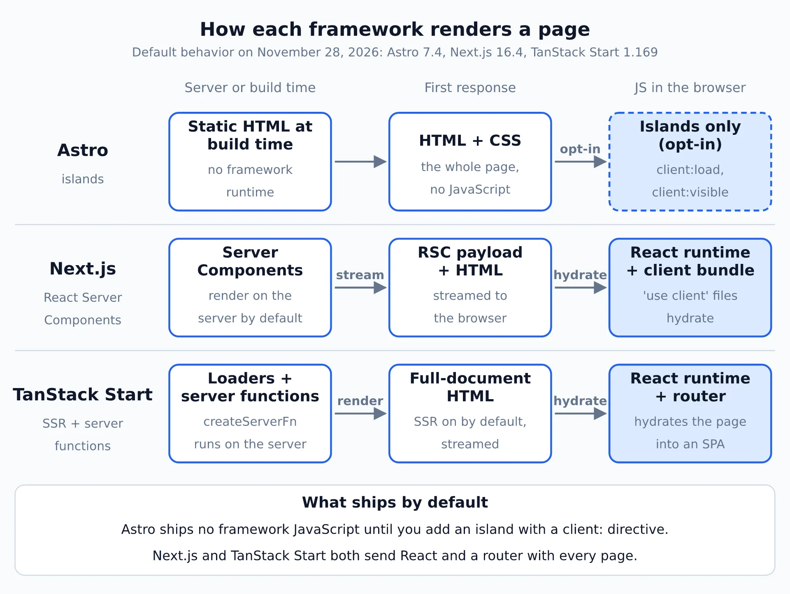
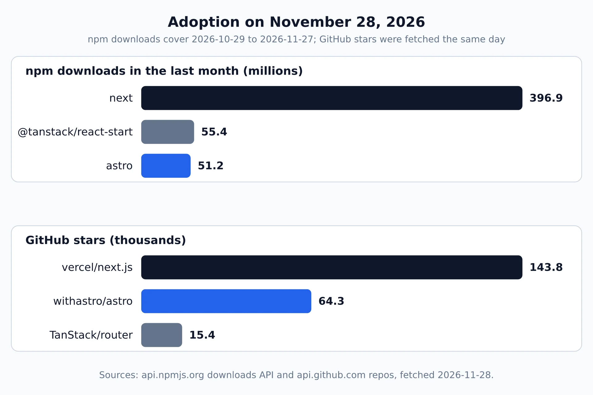
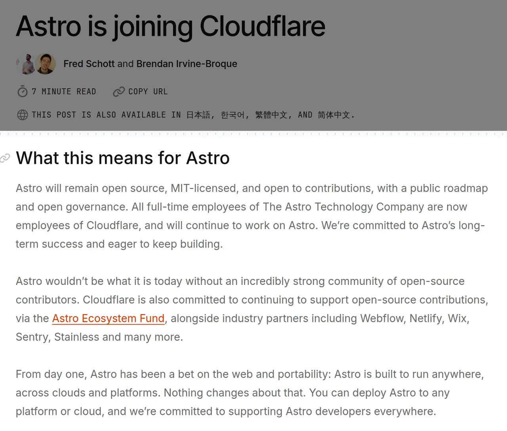
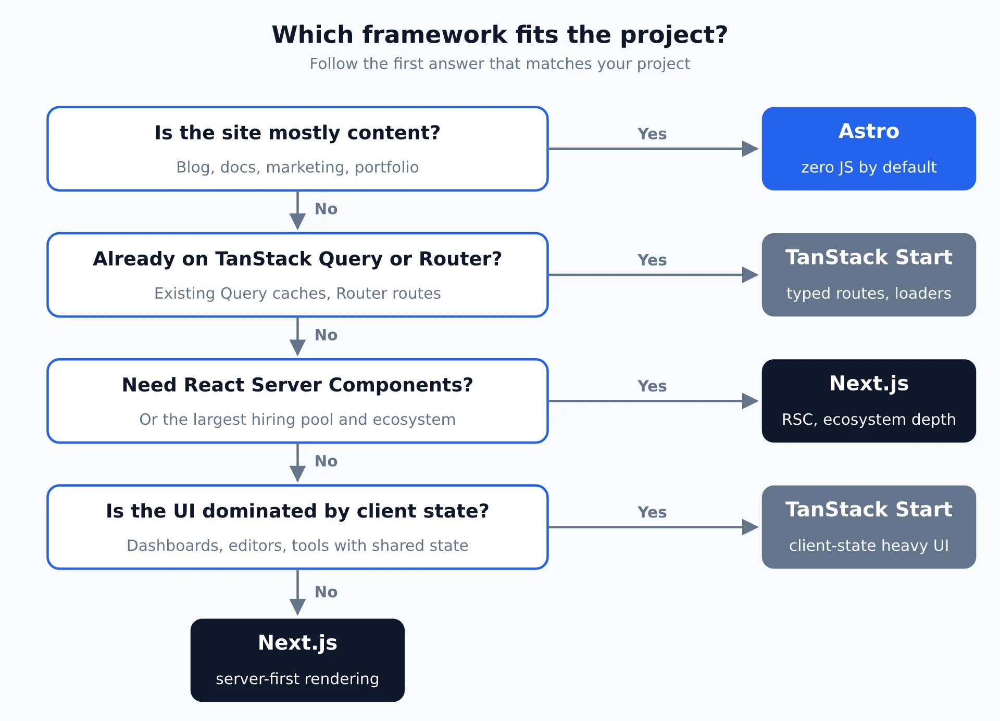

import Button from "@components/widgets/Button.astro";
import Notice from "@components/widgets/Notice.astro";
import ListCheck from "@components/widgets/ListCheck.astro";
import Accordion from "@components/widgets/Accordion.astro";
import Tabs from "@components/widgets/Tabs.astro";
import Tab from "@components/widgets/Tab.astro";

Astro wins for content sites, Next.js for React apps built on Server Components, TanStack Start for per-user apps that need typed routes. Stable on November 28, 2026: Astro 7.4.13, Next.js 16.4.6, TanStack Start 1.169.7.

Stop asking "which framework is best." Start asking "what am I building."

**Astro**, **Next.js** and **TanStack Start** are the three clear contenders in the meta-framework space of 2026. Astro is content-first, ships zero JavaScript by default, and has Cloudflare behind it since January 2026. Next.js is the React full-stack workhorse, RSC-first and tuned for Vercel. TanStack Start is the challenger built on developer control, type safety and Vite.

Most comparisons cover two of these. This one puts all three side by side with public measurements, hosting prices checked on November 28, 2026, and a decision framework. No fanboy advocacy. No false winner.

<ListCheck>
**What you'll get from this article:**
- Public measurements across all three frameworks
- Hosting cost breakdowns at 10K, 50K, and 100K monthly visitors
- A decision framework based on project type, not hype
- Honest tradeoffs, and each framework loses somewhere
</ListCheck>

## The state of meta-frameworks in 2026

The [State of JS 2025 survey](https://2025.stateofjs.com/en-US/libraries/meta-frameworks/) puts Astro at the top of meta-framework satisfaction, 39 points ahead of Next.js. Next.js still dominates usage at 60-70% adoption, but its satisfaction keeps falling. TanStack Start was not on the ballot because it was still in beta at launch, and respondents wrote it in as the top "other" answer. It then won "Breakthrough of the Year" at the [2026 Open Source Awards](https://tanstack.com/blog/tanstack-open-source-awards-2026).

A lot shipped in the twelve months to November 2026:

| Date | Framework | What changed |
|------|-----------|--------------|
| October 21, 2025 | Next.js | [Next.js 16](https://nextjs.org/blog/next-16) makes Turbopack the default bundler and adds Cache Components and `proxy.ts` |
| January 16, 2026 | Astro | [Cloudflare announces](https://blog.cloudflare.com/astro-joins-cloudflare/) that The Astro Technology Company is joining Cloudflare |
| March 10, 2026 | Astro | [Astro 6](https://astro.build/blog/astro-6/) ships a new dev server on Vite's Environment API, a Fonts API, CSP and Live Content Collections |
| March 18, 2026 | Next.js | [16.2](https://nextjs.org/blog/nextjs-across-platforms) ships a stable Adapter API, built with OpenNext, Netlify and Cloudflare |
| June 22, 2026 | Astro | [Astro 7](https://astro.build/blog/astro-7/) moves the compiler and Markdown pipeline to Rust and builds 15-61% faster |
| October 6, 2026 | Next.js | [16.4](https://nextjs.org/blog/next-16-4) turns Cache Components on for every new app |
| October 13, 2026 | TanStack Start | [1.0 is declared stable](https://tanstack.com/blog/tanstack-start-1-0) |

### What changed since 2025

Cloudflare announced on January 16, 2026 that The Astro Technology Company, the company behind Astro, is joining Cloudflare. Astro stays MIT-licensed and open source, keeps its open governance and roadmap, and still deploys to every hosting target. All full-time Astro employees moved to Cloudflare. This is the same dynamic Vercel has with Next.js, but on the other side of the aisle.

Astro shipped two majors in 2026, Astro 6 on March 10 and Astro 7 on June 22. Next.js went from 16.0 to 16.4 in the same span: 16.2 added a stable Adapter API, and 16.4 turned Cache Components on for new apps.

TanStack Start went from v1 RC on September 23, 2025 to a stable 1.0 on October 13, 2026. The Inngest team reported an [83% drop in local dev time](https://inngest.com/blog/migrating-off-nextjs-tanstack-start) after migrating off Next.js.

<Notice type="info" title="The 2026 meta-framework scene at a glance">
Three frameworks backed by three different models: Astro by Cloudflare, Next.js by Vercel, TanStack Start by the bootstrapped TanStack LLC and its sponsors. Each bet is valid. The question is which bet matches your project.
</Notice>

## Three frameworks, three philosophies

The choice isn't about features. It's about what each framework believes the web is. Astro bets the web is content, so it optimizes for static delivery. Next.js bets the web is applications, so it optimizes for React server rendering. TanStack Start bets the web is data, so it optimizes for type-safe client-server communication.

These are different bets, and the tradeoffs flow from them.

### Astro: content first, zero JS by default

- **Verdict:** the default pick for blogs, docs and marketing sites.
- **Best for:** content pages that need a few interactive widgets.
- **Trade-offs:** islands run in isolation, so shared state between widgets needs wiring by hand.
- **Pricing:** MIT license; static hosting is free on Cloudflare.

Astro uses an islands architecture: pages ship as static HTML by default, and interactive components hydrate only where you explicitly mark them with a `client:*` directive. The docs state the default plainly: Astro renders every UI component to HTML and CSS and strips the client-side JavaScript. A typical Astro blog ships 0KB of JavaScript to the browser. Zero.

The framework is also framework-agnostic. You can use React, Vue, Svelte, Solid, Preact, or Lit, and mix them on the same page. Content Collections provide structured, type-safe content management with Zod schemas (Zod 4 since Astro 6).

Astro 6 shipped on March 10, 2026 with the Vite Environment API for dev/prod parity and a built-in Content Security Policy. Live Content Collections arrived in the same release, for data that changes without a rebuild. Astro 7 followed on June 22, 2026 with a Rust compiler and Vite 8.

Notable users include Microsoft, Google, Porsche, Cloudflare, OpenAI and NBC News, going by the [Astro homepage](https://astro.build/). You can [deploy an Astro blog on Cloudflare](/deploy-astrojs-cloudflare/) in minutes. Astro's database layer is worth a look too; see how [Astro DB works with Bunny Database](/astro-db-bunny-database/).

<Tabs>
<Tab name="Quick start">
```bash
# Create a new Astro project
npm create astro@latest

# Build
npm run build
```
</Tab>
<Tab name="Island architecture">
```astro
---
import LikeButton from '../components/LikeButton.tsx';
import Comments from '../components/Comments.vue';
---
<article>
  <h1>My Blog Post</h1>
  <p>Static content here, zero JS shipped for this part.</p>
  <LikeButton client:load initialLikes={42} />
  <Comments client:visible postId="123" />
</article>
```
</Tab>
<Tab name="Astro CSP config">
```js
// astro.config.mjs
import { defineConfig } from 'astro/config';
import cloudflare from '@astrojs/cloudflare';
import react from '@astrojs/react';
import tailwindcss from '@tailwindcss/vite';

export default defineConfig({
  output: 'static',
  adapter: cloudflare(),
  integrations: [react()],
  vite: {
    plugins: [tailwindcss()],
  },
  security: {
    csp: true,
  },
});
```
</Tab>
</Tabs>

### Next.js: the React full-stack default

- **Verdict:** the default pick for React teams building applications.
- **Best for:** SaaS products and dashboards that lean on Server Components.
- **Trade-offs:** the server/client boundary and the cache layers take weeks to internalize.
- **Pricing:** MIT license; Vercel Pro costs $20 per seat a month, or run it on any Node server.

Next.js is the 800-pound gorilla. At 143,753 GitHub stars and 60-70% meta-framework adoption, it's the default choice for React teams. The App Router, React Server Components, and streaming SSR are all designed to make full-stack React development feel cohesive.

Next.js 16 landed on October 21, 2025. Turbopack is now the default bundler (2-5x faster builds). Cache Components let you opt into caching with `"use cache"` directives instead of relying on the old implicit caching layers. Since 16.4 (October 6, 2026), every new `create-next-app` project starts with them on. React Compiler support means automatic memoization when you switch it on. A new `proxy.ts` replaces the confusing `middleware.ts` pattern.

The pain points are real though. RSC boundaries remain the #1 source of confusion: understanding where code runs (server? client? both?) takes weeks to internalize. The App Router's patterns (layouts, `loading.tsx`, `error.tsx`, parallel routes, intercepting routes) are powerful but dense. Self-hosting improved in 16.2, which shipped a stable Adapter API; Vercel's own adapter is open source and uses the same public contract.

Next.js 16 also made `params` and `searchParams` Promises, so a page awaits them:

```tsx
// app/blog/[slug]/page.tsx
export default async function BlogPost({ params }: { params: Promise<{ slug: string }> }) {
  const { slug } = await params;
  const post = await getPost(slug);
  return (
    <article>
      <h1>{post.title}</h1>
      <div>{post.content}</div>
    </article>
  );
}
```

Next.js 16 Cache Components config:

```ts
// next.config.ts
const nextConfig = {
  cacheComponents: true,
};
export default nextConfig;
```

### TanStack Start: developer control over convention

- **Verdict:** the pick for React apps with heavy client state and a team that wants typed routes.
- **Best for:** dashboards, internal tools and SaaS frontends that render per user.
- **Trade-offs:** a smaller ecosystem, fewer tutorials, and more setup if the team is new to TanStack Query.
- **Pricing:** MIT license; hosting costs the same as any Node app.

TanStack Start takes a different approach: explicit server work instead of a server-owned component tree. Every component is an ordinary React component that renders on the server and hydrates on the client. You put work on the server with a route `loader` or a `createServerFn` call. Each route chooses its rendering: `ssr: true` (the default) renders on the server, `'data-only'` runs only the loaders there, and `false` renders in the browser. Version 1.0 has been stable since October 13, 2026.

The selling point is the type system. Type-safe file-based routing catches param errors at compile time. `createServerFn` makes server boundaries explicit, with no guessing where code runs. Isomorphic loaders work with TanStack Query for data fetching and caching. Search param validation via Zod prevents runtime errors from malformed URLs.

TanStack Start builds with Vite 8 or Rsbuild. The docs list Cloudflare Workers, Netlify and Railway as official hosting partners, plus Nitro presets for Vercel, a plain Node server, Docker and Bun. No vendor lock-in. For a first project, follow [getting started with TanStack Start and Convex](/tanstack-start-get-start/), or build a [TanStack Start todo app with Drizzle](/tanstack-start-bunny-database-drizzle/) to see it in action.

```tsx
import { createServerFn } from '@tanstack/react-start';
import { z } from 'zod';

export const createPost = createServerFn({ method: 'POST' })
  .validator(z.object({ title: z.string().min(1) }))
  .middleware([authMiddleware])
  .handler(async ({ data, context }) => {
    return db.posts.create({ title: data.title });
  });
```

Type-safe route with loader:

```tsx
export const Route = createFileRoute('/dashboard/')({
  loader: async () => {
    const data = await fetchDashboardData();
    return data;
  },
  component: DashboardPage,
});
```

## Which framework ships the least JavaScript?

Astro ships the least: a page with no islands sends no JavaScript, while Next.js and TanStack Start both send a React runtime and a router with every page. In the HTTP Archive data that Astro publishes, 71% of Astro sites had good Core Web Vitals against 35% of Next.js sites.

How much JavaScript each framework ships by default has real consequences. Every kilobyte affects Time to Interactive, Core Web Vitals, and in the end your SEO rankings and user retention.



*Rendering models on November 28, 2026. Astro ships islands only, Next.js ships React plus Client Components, TanStack Start ships React plus its router.*

### What ships by default

Astro ships 0KB by default. The framework strips client-side JavaScript from every component unless you mark it as an island with a `client:*` directive. For a typical blog page, that's it.

Next.js ships its React runtime plus page JavaScript. Even with React Server Components reducing what goes to the client, a page still loads React, the router and the hydration client. The vendors publish no baseline figure, so look at measured numbers, and read them as app-specific.

A same-app comparison published on October 18, 2026 measured a Next.js 16.4.2 product page at 135 KB of gzipped JavaScript. The same page built with TanStack Start 1.169.3 came in at 109 KB. A June 2026 comparison with TanStack's experimental Server Components switched on measured 193 KB against 116 KB. Treat both as app-specific, not as framework constants.

| Metric | Astro | Next.js | TanStack Start |
|--------|-------|---------|----------------|
| JavaScript by default | none (islands only) | React runtime, router, RSC hydration client | React runtime, router |
| Measured client JS, gzip (same-app test, October 2026) | 0KB without islands | 135 KB | 109 KB |
| Sites with good Core Web Vitals (HTTP Archive) | 71% | 35% | not listed |

The vitals shares come from the HTTP Archive and Chrome UX Report data shown on the [Astro homepage](https://astro.build/) on November 28, 2026. The client JavaScript totals come from [Waseem Anjum's same-app benchmark](https://www.fabwaseem.com/blog/tanstack-start-vs-nextjs) and from [LogRocket's RSC comparison](https://blog.logrocket.com/tanstack-start-rsc-vs-next-js-rsc-performance-dx-production-readiness/).

These numbers are for simple content sites and small apps. As interactive island count grows in Astro, or as client components increase in the others, the gap narrows. But the baseline advantage is real.

<Notice type="warning" title="Benchmarks are context-dependent">
These numbers describe small test apps. Complex app benchmarks look very different. Astro's advantage shrinks as interactive island count grows: a dashboard with 20 React islands ships a lot more JS than a blog with zero.
</Notice>

You can [deploy Astro on a VPS](/deploy-astro-on-vps/) and measure the vitals in production.

### Build speed benchmarks

Astro 7 builds 15-61% faster than Astro 6 in the project's own benchmarks, and Markdown-heavy sites gain the most because the Markdown pipeline moved to Rust. The [Astro 7 benchmark on a 743-page site](/astro-7-faster-builds/) shows the result on this blog: 103 seconds on Astro 6, 47 seconds on Astro 7. The [Astro build speed optimization guide](/astro-ssg-build-optimization/) covers the other levers.

Next.js 16 with Turbopack is 2-5x faster than the old Webpack builds. TanStack Start builds with Vite 8. In the same-app test quoted above, `next build` took 4.86 seconds and the Start build took 1.26 seconds. The dev server served the first page in 2.96 seconds on Next.js and 1.52 seconds on Start.

## Developer experience and learning curve

Performance numbers are measurable. DX compounds over months of daily development. The best framework on paper isn't best if your team fights it every sprint.

### Astro's mental model

Astro has the simplest mental model of the three: HTML + CSS + islands. The `.astro` file format uses frontmatter for logic and HTML-like template syntax for markup. If you know HTML, you can read an Astro file.

Framework agnosticism means your team isn't locked into React. A Vue developer can contribute Svelte components to the same Astro project. Content Collections give you type-safe content with schema validation, the best native DX for content management in any framework.

The caveat: once you need heavy interactivity, the island model adds coordination overhead. Islands run in isolation from each other, so shared state between two widgets means wiring a store or a framework context by hand. That is where Next.js and TanStack Start have natural advantages.

If you're learning Astro, check out the [best Astro.js courses](/best-astrojs-online-courses/) for structured learning paths.

### Next.js complexity tax

Next.js pays for its power with complexity. The RSC mental model, understanding the server/client boundary, is the #1 source of confusion for new and experienced developers alike. App Router patterns (layouts, `loading.tsx`, `error.tsx`, parallel routes, intercepting routes) are powerful but dense.

Caching has historically been the worst pain point. Without Cache Components, the App Router stacks four caches (request memoization, the Data Cache, the Full Route Cache and the Router Cache), each with its own invalidation rules. Next.js 16 improves this with Cache Components and clearer APIs like `updateTag` and `revalidateTag`, but the learning curve is still steep.

The tradeoff: once you learn it, the ecosystem depth is hard to beat. More tutorials, more Stack Overflow answers, more third-party integrations, and the largest hiring pool of any meta-framework.

### TanStack Start type safety

TanStack Start feels closest to "plain React" with server capabilities bolted on. There's no new mental model to learn: it's React components, React hooks, and TanStack Query. Components render on the server and hydrate on the client, and Server Components stay an experimental opt-in.

The real differentiator is type-safe routing. Compile-time param validation catches URL bugs before they hit production. `createServerFn` makes server boundaries explicit: you define a function, mark it as a server function, and the types tell you exactly what's available. No implicit boundaries, no guessing.

The tradeoff: smaller ecosystem, fewer tutorials, steeper initial setup if you're new to TanStack Query. Best fit for senior teams comfortable with thinner but well-designed primitives.

<Tabs>
<Tab name="Astro">
```astro
---
// Astro: data fetching in frontmatter
const posts = await fetch('https://api.example.com/posts')
  .then(r => r.json());
---
<ul>
  {posts.map(post => <li>{post.title}</li>)}
</ul>
```
</Tab>
<Tab name="Next.js">
```tsx
// Next.js: Server Component, async by default
export default async function PostsPage() {
  const posts = await fetch('https://api.example.com/posts')
    .then(r => r.json());
  return (
    <ul>
      {posts.map(post => <li>{post.title}</li>)}
    </ul>
  );
}
```
</Tab>
<Tab name="TanStack Start">
```tsx
// TanStack Start: route loader
export const Route = createFileRoute('/posts/')({
  loader: async () => {
    const posts = await fetch('https://api.example.com/posts')
      .then(r => r.json());
    return posts;
  },
  component: PostsPage,
});

function PostsPage() {
  const posts = Route.useLoaderData();
  return (
    <ul>
      {posts.map(post => <li key={post.id}>{post.title}</li>)}
    </ul>
  );
}
```
</Tab>
</Tabs>

## Ecosystem and community health

Ecosystem size matters for longevity. Satisfaction matters for daily happiness. Here's how the three stack up, with stars and downloads fetched on November 28, 2026:

| Dimension | Astro | Next.js | TanStack Start |
|-----------|-------|---------|----------------|
| GitHub stars | 64,283 (`withastro/astro`) | 143,753 (`vercel/next.js`) | 15,388 (`TanStack/router` monorepo) |
| npm downloads, last month | 51.2 million (`astro`) | 396.9 million (`next`) | 55.4 million (`@tanstack/react-start`) |
| State of JS 2025 usage | ~25-30% | ~60-70% | ~4% write-in |
| Satisfaction (State of JS 2025) | #1 (39pt lead) | Declining | N/A (too new) |
| Integrations | Growing (Tailwind, MDX, Strapi) | Largest (everything React) | Small but TanStack ecosystem |
| Hiring pool | Small-medium | Very large | Small |
| Backing | Cloudflare since January 2026 | Vercel | TanStack LLC, bootstrapped, plus sponsors |



*npm downloads for October 29 to November 27, 2026, and GitHub stars, both fetched from the public APIs on November 28, 2026.*

Download counts include CI runs and package mirrors, so read them as a scale signal rather than as user counts. `@tanstack/react-router`, which every Start app also installs, added 113.1 million downloads in the same period.

<Notice type="info" title="Ecosystem is more than star count">
Next.js has the largest ecosystem, but Astro's satisfaction lead and Cloudflare backing suggest shifting momentum. TanStack's community is small but passionate. It mirrors where Next.js was in 2017 before it became the default. The "Breakthrough of the Year" award in June 2026 marks real community confidence.
</Notice>

## How much does each framework cost to host?

A static Astro site is free to host at any traffic level on Cloudflare, which serves static asset requests free and unlimited. Next.js and TanStack Start need a server once they render on the server, from $5 a month on Cloudflare Workers Paid or the price of a small VPS.

This is the section most framework comparisons skip. Hosting costs are the hidden decision factor: you pick a framework, build your app, and then discover your hosting bill at 50K visitors is $500/month.

### Static content sites (10K-100K visitors)

Astro static deploys are cheap to host, but "free at any scale" depends on the host. Cloudflare serves static asset requests free and unlimited on both its free and paid plans. Vercel Hobby includes 100 GB of data transfer a month and does not sell extra on the free plan. Netlify's Free plan carries a 300-credit limit, and bandwidth costs 20 credits per GB. GitHub Pages has a soft limit of 100 GB a month.

Next.js on Vercel Hobby ($0) works for small sites, but the limits arrive fast. Hobby includes 1M CDN requests, 100 GB of data transfer, 1M function invocations and 4 hours of function CPU a month. Once you exceed the free tier, Pro starts at $20/month per seat plus a $20 monthly usage credit.

TanStack Start renders on the server by default, so it needs a server or a serverless platform from day one. Standard Node hosting runs $4-20/month on any VPS. Cloudflare Workers Paid costs $5 a month with 10 million requests included, and the free tier allows 100,000 requests a day with 10 ms of CPU time per request.

Sources, all checked on November 28, 2026: [Cloudflare Workers pricing](https://developers.cloudflare.com/workers/platform/pricing/), [Cloudflare Pages pricing](https://developers.cloudflare.com/pages/functions/pricing/), [Vercel pricing](https://vercel.com/pricing), [Netlify pricing](https://www.netlify.com/pricing/) and [GitHub Pages limits](https://docs.github.com/en/pages/getting-started-with-github-pages/github-pages-limits).

### Full-stack apps at scale

Here's where it gets expensive. Vercel bills requests, CPU time and data transfer, not users, so the table below is an estimate of Vercel Pro spend by monthly active users, not a quote:

| Monthly Active Users | Vercel Cost | Self-Hosted VPS |
|---------------------|-------------|-----------------|
| 10K | $0-50/month | $4-10/month |
| 50K | $230-1,180/month | $10-20/month |
| 100K | $560-2,250/month | $20-40/month |

Read the Vercel column against the [price list](https://vercel.com/pricing). Pro includes 10M CDN requests and 1 TB of data transfer a month, then charges $2 per 1M requests and $0.15 per GB. Function invocations bill at $0.60 per 1M, and Fluid compute bills active CPU from $0.128 an hour.

<Notice type="warning" title="Vercel costs scale fast">
At 50K MAU you could be paying $1,180/month on Vercel Pro. A $20/month Hetzner VPS handles the same traffic. The convenience tax is real. Factor this into your framework decision before you build.
</Notice>

Check [Hetzner Cloud pricing](/hetzner-cloud-cost-optimized-plans/) for concrete VPS cost data.

### Self-hosting and Docker

All three frameworks run in Docker. The difference is what the build produces and what the server needs.

**Astro**: a static build is a folder of files that goes anywhere: a CDN, a $4 VPS with Nginx, S3. On-demand rendering needs an adapter. `@astrojs/node` in standalone mode starts with `node ./dist/server/entry.mjs`.

**Next.js**: needs a Node server. `next start` serves the app on any VPS, and image optimization, `proxy.ts` and Cache Components work there without Vercel-specific setup. Several instances need a shared cache handler and one server-function encryption key.

**TanStack Start**: a Vite build with Nitro outputs a self-contained server. Start it with `node .output/server/index.mjs`. No platform-specific behavior to worry about.

| Framework | Build output | Start command |
|-----------|--------------|---------------|
| Astro (static) | `dist/` | any static file server or CDN |
| Astro (on-demand rendering) | `dist/server/entry.mjs` | `node ./dist/server/entry.mjs` |
| Next.js | `.next/` | `next start` |
| TanStack Start (Vite with Nitro) | `.output/server/index.mjs` | `node .output/server/index.mjs` |

The outputs and commands come from the [@astrojs/node](https://docs.astro.build/en/guides/integrations-guide/node/), [Next.js self-hosting](https://nextjs.org/docs/app/guides/self-hosting) and [TanStack Start hosting](https://tanstack.com/start/latest/docs/framework/react/guide/hosting) guides. For Dockerfiles and reverse proxy steps, follow [hosting Node.js apps on CloudPanel](/install-cloudpanel-host-nodejs/) or [deploying TanStack Start on a VPS with Dokploy](/tanstack-start-dokploy-deploy/).

The PaaS middle ground: tools like Coolify, Railway, and Render offer Vercel-like convenience without the Vercel price tag. If you want one-click deploys on your own infrastructure, check [Coolify as a self-hosted alternative](/coolify-install-heroku-alternative/).

## The Cloudflare factor: what Astro's acquisition means

Cloudflare [announced on January 16, 2026](https://blog.cloudflare.com/astro-joins-cloudflare/) that The Astro Technology Company is joining Cloudflare. Astro stays MIT-licensed and open source, keeps its open governance and roadmap, and still deploys to every platform. For a static Astro site, nothing about hosting changes.



*Cloudflare's announcement of January 16, 2026 with its "What this means for Astro" section. The hero image between the two crops is left out.*

One change did land in the adapter. Since v13, `@astrojs/cloudflare` targets Workers only and no longer supports Cloudflare Pages, and since Astro 6 it runs `workerd` during development and prerendering. A static site is unaffected because it needs no adapter.

Cloudflare's incentive is clear: make Astro the best framework on Cloudflare Workers. This mirrors Vercel's relationship with Next.js. We're heading toward a duopoly: Vercel-optimized against Cloudflare-optimized.

The risk: will Astro become Cloudflare-first the way Next.js is Vercel-first? Will platform-specific features create soft lock-in?

The reassurance: Astro's island architecture and framework-agnostic philosophy are platform-neutral by design. Astro's static-first approach means the output is just files. Files go anywhere.

Cloudflare's investment likely means faster development and tighter integration with Workers. The 2026 record so far: Astro 6 in March, Astro 7 in June, and Astro 7.4 in October with a `--timings` flag that shows where a build spends its time. In August 2026, Matthew Phillips took over as Project Steward from Fred Schott. For the Astro community, the backing is a net positive, as long as you keep deploying to non-Cloudflare platforms too.

<Notice type="info" title="The corporate backing dynamic">
Vercel backs Next.js: deep integration, but vendor lock-in risk. Cloudflare backs Astro: the same dynamic on a different platform. TanStack LLC backs TanStack Start, funded by a bootstrapped company and sponsors such as Cloudflare, Netlify and Vercel. Each model has tradeoffs.
</Notice>

You can [deploy an Astro blog on Cloudflare](/deploy-astrojs-cloudflare/) today to see the integration in practice.

## Is TanStack Start production-ready?

Yes, TanStack [declared Start 1.0 stable on October 13, 2026](https://tanstack.com/blog/tanstack-start-1-0), and the docs now open with the line "TanStack Start is stable". Only its React Server Components support stays experimental and off by default.

The 1.0 release commits the team to the APIs: type-safe routing, full-document SSR with streaming, server functions, server routes and middleware. `@tanstack/react-start` 1.169 is the first stable release, and it requires Vite 8. The release-candidate phase ran from September 23, 2025 to that date, longer than the team had planned.

Production use is documented. MakerKit sells a SaaS starter on TanStack Start in Drizzle, Prisma and Supabase variants. [Appwrite rebuilt its Console and website on Start](https://appwrite.io/blog/post/announcing-console-iv), more than 600 documentation pages included, and hosts Start apps on Appwrite Sites. The [Breakthrough of the Year award](https://tanstack.com/blog/tanstack-open-source-awards-2026) at the June 2026 Open Source Awards came the same year.

<ListCheck>
**TanStack Start production readiness:**
- Type-safe routing: stable
- Server functions (`createServerFn`): stable
- Streaming SSR: stable
- Docker and Node deployment: stable
- TanStack Query integration: the same Query library the rest of the React ecosystem uses
- React Server Components: experimental, off by default
- Large plugin ecosystem: not yet
- Enterprise hiring pool: not yet
</ListCheck>

Honest take: if you're a startup shipping fast with a senior team comfortable with TanStack primitives, TanStack Start is viable today. If you need enterprise hiring guarantees, a large plugin ecosystem, or your team is mostly junior developers, wait 6-12 months for the ecosystem to mature.

## When to choose which framework

There is no universal winner. The right choice depends on what you're building, who's building it, and where it runs.



*Decision path for picking between Astro, Next.js and TanStack Start. The first matching answer wins.*

### Choose Astro when

You're building content sites: blogs, documentation, marketing pages, portfolios. Performance and Core Web Vitals are non-negotiable. You want minimal JavaScript. Your team uses multiple frameworks (React + Vue). Budget is tight, and static hosting on Cloudflare is free at any scale. You want the simplest mental model with the lowest learning curve.

### Choose Next.js when

You're building complex web applications: SaaS products, e-commerce platforms, dashboards. You need React Server Components, streaming, ISR. Your team is React-only and values ecosystem depth. Vercel deployment is acceptable or preferred. You need the largest hiring pool for scaling your engineering team.

### Choose TanStack Start when

You're building applications with complex client-side state. The RSC mental model creates friction for your team. Type-safe routing is a priority. You want deploy-anywhere flexibility without vendor lock-in. Your team has senior engineers comfortable with thinner but well-designed primitives. You're already invested in the TanStack Query/Router ecosystem.

## Migration considerations

What if you pick wrong? Switching costs are real but manageable.

Astro to Next.js: moderate effort. Rewrite `.astro` templates as React components, adopt the RSC model, move static content logic into Server Components.

Next.js to Astro: moderate effort. Strip server logic, move interactivity into islands, convert App Router pages to Astro pages. Content-heavy sites migrate easier than app-heavy ones.

Next.js to TanStack Start: lower effort. Both are React, but routing patterns and server function approaches differ. You'll rewrite route definitions and replace RSC patterns with loaders + server functions. TanStack publishes a [migration guide from Next.js](https://tanstack.com/start/latest/docs/framework/react/migrate-from-next-js).

TanStack Start to Next.js: moderate effort. Lose type-safe routing, adopt RSC patterns, restructure data fetching around Server Components.

<Notice type="success" title="The best migration is the one you don't need">
Choosing the right framework upfront saves weeks of refactoring. If you're 80% content, start with Astro; you can always add an SPA subdomain later. If you're 80% app, start with Next.js or TanStack Start. Use the decision framework above.
</Notice>

## Verdict

There is no single winner. There are three strong frameworks for three different bets on the web.

**Astro** wins for content sites. Zero JS by default, the best Core Web Vitals share of the three, free static hosting on Cloudflare, and Cloudflare backing since January 2026. If you're building a blog, docs site, or marketing page, this is the obvious choice.

**Next.js** wins for complex React applications. The ecosystem depth, hiring pool, and RSC model are unmatched for teams building SaaS products, e-commerce platforms, or enterprise dashboards. Budget for the hosting bill and accept the learning curve.

**TanStack Start** wins for developer control. Type-safe routing, explicit server boundaries, deploy-anywhere flexibility, and a stable 1.0 since October 13, 2026. Best for senior teams who want thin, well-designed primitives without vendor lock-in. Wait for ecosystem maturity if your team needs guardrails.

Check the stable versions before you scaffold. On November 28, 2026 they were Astro 7.4.13, Next.js 16.4.6 and TanStack Start 1.169.7.

## FAQ

<Accordion label="Which framework ships the least JavaScript for a content site?" group="faq" expanded="true">
Astro. A page with no islands ships 0KB of JavaScript because Astro strips client-side scripts from every component you do not mark with a `client:*` directive. Next.js and TanStack Start both send React and a router: a same-app test in October 2026 measured 135 KB gzipped for Next.js 16.4.2 and 109 KB for TanStack Start 1.169.3.
</Accordion>

<Accordion label="Can TanStack Start realistically replace Next.js for a SaaS product?" group="faq">
Yes, if your team is comfortable with TanStack primitives and you don't need the Next.js ecosystem depth. TanStack Start 1.0 has been stable since October 13, 2026, and Appwrite runs its Console and website on it. The gap is in ecosystem: fewer third-party integrations, fewer tutorials, a smaller hiring pool.
</Accordion>

<Accordion label="Is Astro enough for a project that might grow into an app?" group="faq">
Yes, up to a point. Astro's islands let you add interactivity incrementally: drop in a React widget here, a Svelte component there. But if your project becomes 80%+ interactive, you'll feel the friction of island coordination overhead. At that point, a framework designed for apps (Next.js or TanStack Start) is the better foundation.
</Accordion>

<Accordion label="How do the three compare with a headless CMS?" group="faq">
All three work with Strapi, Sanity, Contentful, and other headless CMSs. Astro's Content Collections have the best native DX for content fetching, with type-safe schemas validated by Zod 4. Next.js integrates via Server Components and `fetch()`. TanStack Start uses route loaders with TanStack Query caching.
</Accordion>

<Accordion label="What's the cheapest way to host a Next.js app?" group="faq">
Self-host on a Hetzner VPS with Docker. A CX23 (2 vCPU, 4 GB RAM) lists at €5.99 a month plus VAT. Build with `next build`, run with `next start` behind a reverse proxy, and skip Vercel Pro unless you specifically need its edge features or preview deployments. Vercel Hobby stops at 100 GB of data transfer a month.
</Accordion>

<Accordion label="Is the Cloudflare acquisition good or bad for Astro?" group="faq">
Good so far. The license stays MIT, governance and the roadmap stay open, and Astro still deploys to every platform. One change already landed: since v13 the Cloudflare adapter targets Workers only and no longer supports Cloudflare Pages. Keep deploying to non-Cloudflare platforms to keep that promise honest.
</Accordion>

<Accordion label="Is TanStack Start stable enough for production?" group="faq">
Yes. TanStack declared Start 1.0 stable on October 13, 2026, and `@tanstack/react-start` 1.169 is the first stable release. The docs still mark React Server Components as experimental and off by default, so build on SSR, loaders and `createServerFn` rather than on Server Components.
</Accordion>

<Accordion label="Which version of each framework is stable right now?" group="faq">
On November 28, 2026 the stable releases were Astro 7.4.13 (published November 18, 2026), Next.js 16.4.6 (November 9, 2026) and TanStack Start 1.169.7 (November 19, 2026). Check with `npm view astro version`, `npm view next version` or `npm view @tanstack/react-start version` before you start a project.
</Accordion>

<Button text="More dev tools articles" link="/categories/tools/" variant="solid" color="blue" size="lg" icon="arrow-right" />
