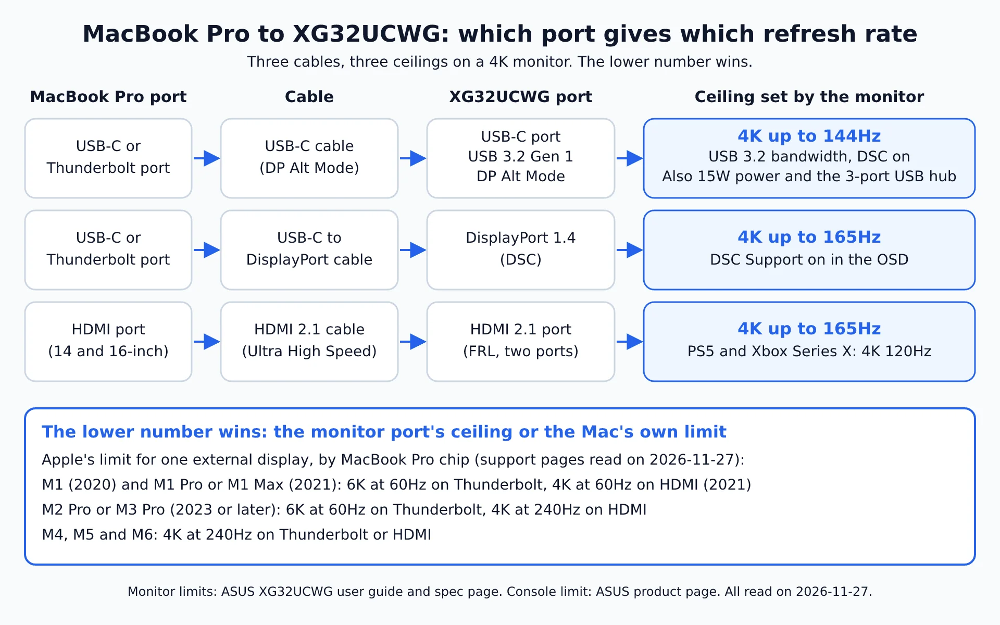

import Accordion from "@components/widgets/Accordion.astro";
import Button from "@components/widgets/Button.astro";
import ListCheck from "@components/widgets/ListCheck.astro";
import Notice from "@components/widgets/Notice.astro";
import YouTubeEmbed from "@components/widgets/YouTubeEmbed.astro";

The ASUS ROG Strix OLED XG32UCWG is the 32-inch 4K OLED I recommend for text-heavy work on a Mac. Its TrueBlack Glossy WOLED panel gives sharp text and deep blacks, and ASUS rates the coating at 38% fewer reflections than earlier glossy WOLEDs. It takes my 4.6 out of 5 rating. The weak points are a USB-C port that delivers 15W and an SDR brightness of 250 cd/m2.

The hands-on notes come from my first week with the monitor, before this review went live on 2025-09-26. It was my first OLED, and I ran it from a MacBook Pro M1 for productivity and DevOps work, with some gaming. The Dell UltraSharp IPS on my desk is the reference for the comparisons. Specifications come from ASUS's [product page](https://rog.asus.com/us/monitors/27-to-31-5-inches/rog-strix-oled-xg32ucwg/), [spec pages](https://rog.asus.com/us/monitors/27-to-31-5-inches/rog-strix-oled-xg32ucwg/spec) and [user guide](https://dlcdnets.asus.com/pub/ASUS/LCD%20Monitors/XG32UCWG/XG32UCWG_English.pdf), and from Apple's support pages, all read on 2026-11-27.

<Notice type="warning" title="Affiliate Disclosure">
Some links in this review are affiliate links. If you buy through them, we may earn a small commission at no extra cost to you. This helps us keep testing and updating these recommendations.
</Notice>

| My rating | Score |
|---|---|
| Console gaming | 9.2 out of 10 |
| Office work | 8.5 out of 10 |
| Photo and video editing | 9.0 out of 10 |
| Brightness | 7.0 out of 10 |
| Response time | 9.8 out of 10 |
| HDR picture | 9.0 out of 10 |
| SDR picture | 9.9 out of 10 |
| Overall | 4.6 out of 5 |

Of ASUS's three 32-inch OLEDs, this is the one I would call the value pick. Prices move, so I leave figures out and let the button open the current listing.

<Button text="Check XG32UCWG" link="/go/asus-xg32ucwg/" size="lg" color="blue" variant="solid" />

## XG32UCWG video review

The video review covers the same monitor, and the [32-inch 4K OLED monitor guide](/best-32-inch-oled-monitors-guide/) sets it against eight others.

<YouTubeEmbed
  url="https://www.youtube.com/embed/AYqm6mD5TPw"
  label="ASUS ROG Strix OLED XG32UCWG Review"
/>

## Specs, stand and box contents

The XG32UCWG is a 31.5-inch WOLED panel at 3840 x 2160, or 140 pixels per inch. It runs 4K at up to 165Hz and 1920 x 1080 at up to 330Hz.

| Spec | XG32UCWG | Source |
|---|---|---|
| Panel | 31.5-inch WOLED, 3840 x 2160, TrueBlack Glossy surface | [ROG spec page](https://rog.asus.com/us/monitors/27-to-31-5-inches/rog-strix-oled-xg32ucwg/spec) |
| Refresh rate | 165Hz at 4K, 330Hz at 1920 x 1080 | spec page |
| Response time and contrast | 0.03 ms (GTG), 1,500,000:1 | [global spec page](https://rog.asus.com/monitors/27-to-31-5-inches/rog-strix-oled-xg32ucwg/spec) |
| Color | 99% DCI-P3, 10 bit, Delta E below 2 | [product page](https://rog.asus.com/us/monitors/27-to-31-5-inches/rog-strix-oled-xg32ucwg/) |
| Brightness | 250 cd/m2 SDR, 1,300 cd/m2 HDR peak | [user guide](https://dlcdnets.asus.com/pub/ASUS/LCD%20Monitors/XG32UCWG/XG32UCWG_English.pdf), global spec page |
| HDR | VESA DisplayHDR 400 True Black, HDR10 | spec page, global spec page |
| Video inputs | DisplayPort 1.4 (DSC) x 1, HDMI 2.1 (FRL) x 2, USB-C with DP Alt Mode x 1 | spec page |
| USB | 3x USB 3.2 Gen 1 Type-A, 1x USB 3.2 Gen 1 Type-B for upstream, 15W (5V, 3A) on USB-C | global spec page, user guide |
| Audio | No speakers, earphone jack | global spec page |
| Stand | 110 mm of height, tilt from -5° to +20°, swivel of 25° each way | user guide |
| Mount | VESA 100 x 100 mm, 1/4-inch tripod socket on top of the stand | spec page, user guide |
| Size and weight | 71.4 x 56.1 x 18.8 cm with stand, 6.6 kg | spec page |
| Warranty | 3 years, panel burn-in included | spec page |

ASUS rates the stand 45% smaller than those on the previous XG monitors. Its adjustment numbers disagree: the US product page shows 80 mm and 15°, the guide and the global spec page 110 mm and 25°. I go with the guide.

The guide lists a ROG wall mount kit in the box, and the [desk setup gadgets guide](/best-desk-setup-gadgets-2027/) covers VESA arms if you want the monitor off the desk.

Check the box for cables. The guide marks the HDMI, USB Type-C and USB A-to-B cables as optional, and the US spec page lists a DisplayPort cable alone.

## How bright is the XG32UCWG?

ASUS lists 250 cd/m2 for SDR and 1,300 cd/m2 for the HDR peak, with a note that the peak can vary after color calibration. In my week the panel ran dimmer than the Dell UltraSharp IPS on my desk, which is why brightness scores 7.0 and nothing else drops below 8.5.

`Power Saving Mode`, under `System Setup > Power Setting`, "may cause limited luminance performance" in the guide's words, and needs HDR off first. `Uniform Brightness`, under `Image`, keeps the maximum brightness from changing with the size of the bright area on screen.

For my desk, which has a window in front of it, the SDR level carried a full workday. Dark mode in a terminal and an editor stayed comfortable across 8 hour sessions.

## Is the TrueBlack Glossy coating usable in a bright room?

For me it was, with the window in front of the desk on sunny days. Reflections stayed low enough that I stopped noticing them at work.

ASUS describes TrueBlack Glossy as a zero-haze optical layer with an anti-reflective stack, and says it cuts ambient reflections by 38% compared with the previous generation of glossy WOLEDs.

The two ROG Swift models next to it use other surfaces. The comparison table further down lists all three.

The two panel types make color in different ways. WOLED sends white light through color filters. QD-OLED starts from blue light and a layer of quantum dots, which ASUS says gives more color volume at high brightness. The spec pages put the WOLED models at 1,300 cd/m2 HDR peak and the QD-OLED model at 1,000 cd/m2, so "QD-OLED is the brighter one" is not a rule.

For cleaning, the guide wants a microfiber cloth, dry first and then lightly sprayed with purified water, never the screen. No alcohol, ammonia, window cleaner or paper towels. The shipping film has to come off before first use, because it traps heat.

## How clear is text on this WOLED panel?

It is the sharpest text I have had on a desk, and better than the Dell UltraSharp IPS.

The 3840 x 2160 grid on 31.5 inches gives 140 pixels per inch. The Clear Pixel Edge algorithm reduces the green and red fringing that shows up on text and lines, and this panel uses the RGWB subpixel layout. You can switch the algorithm under `Image` in the OSD.

On macOS, the scaled modes I used looked right and text stayed sharp. To see more modes, open System Settings, click Displays and turn on "Show all resolutions" where it appears. [Apple](https://support.apple.com/guide/mac-help/change-your-displays-resolution-mchl86d72b76/mac) notes that a scaled resolution can affect performance. Its [MacBook Pro guide](https://support.apple.com/guide/macbook-pro/connect-an-external-display-apd8cdd74f57/mac) adds that scaled modes above the native resolution can remove some refresh rate and HDR modes.

For color work, the `sRGB Cal. Mode` locks contrast, gamma and saturation. ASUS rates the panel at Delta E below 2. Color accuracy held up for professional tasks, which is why photo and video editing scores 9.0.

## Which MacBook Pro port gives which refresh rate?

DisplayPort and HDMI 2.1 reach 4K at 165Hz on this monitor, and USB-C reaches 4K at 144Hz with the USB 3.2 setting and DSC on. Apple's limit for your Mac's chip caps each one from above.



The guide gives 144Hz for the `USB 3.2` setting of `Type-C Bandwidth` with `DSC Support` on, and no figure for the `USB 2.0` setting. The spec page's signal table lists 48 to 165Hz for HDMI, DisplayPort and Type-C in 4K mode.

DSC is Display Stream Compression, and on this monitor it is the `DSC Support` toggle under `System Setup`. The Apple pages never mention it and state the result per port, for one external display:

| MacBook Pro chip | Thunderbolt or USB-C | HDMI | Apple's page |
|---|---|---|---|
| M1, 13-inch 2020 | one display up to 6K at 60Hz | no HDMI port | [13-inch M1 specs](https://support.apple.com/kb/SP824?locale=en_US) |
| M1 Pro and M1 Max, 2021 | up to 6K at 60Hz | one display up to 4K at 60Hz | [14-inch](https://support.apple.com/en-us/111902) and [16-inch](https://support.apple.com/en-us/111901) specs |
| M2 Pro or M3 Pro, 2023 or later | up to 6K at 60Hz | up to 8K at 60Hz or 4K at 240Hz | [M2 Pro or M3 Pro](https://support.apple.com/en-us/149476) |
| M3 | up to 6K at 60Hz | up to 4K at 144Hz | [M3](https://support.apple.com/en-us/149477) |
| M4, M4 Pro, M4 Max, M5, M6 | up to 4K at 240Hz | up to 4K at 240Hz | [M4 and M4 Pro](https://support.apple.com/en-us/149474), [M4 Max](https://support.apple.com/en-us/149473), [M5](https://support.apple.com/en-us/149463), [M6](https://support.apple.com/en-us/149456) |

[Apple](https://support.apple.com/en-us/102236) adds VRR support for the 2023 and later M2 Pro, M3 Pro, M2 Max and M3 Max machines. It tells you to use an Ultra High Speed 48 Gbps HDMI cable with no adapter between the Mac and the monitor.

An M4 or M5 on DisplayPort or HDMI gets 165Hz, and 144Hz on USB-C. For the M1 line, Apple's pages top out at 60Hz. My M1 listed more than one refresh rate in System Settings, and I did not record which, so go by Apple's page for your model.

## How do you connect a MacBook Pro to the XG32UCWG?

Plug a USB-C cable that carries video into the monitor's USB-C port, set two OSD options, then pick the refresh rate in System Settings. The MacBook Pro keeps its own charger, because the port delivers 15W.

### Setup

1. Connect the cable from the Mac to the monitor's USB-C port. Use a full-featured USB-C cable or a Thunderbolt cable, not a charge-only one.
2. On the monitor, open `Input Select` and pick `USB-C`, or leave `Auto Input Detection` on.
3. Under `System Setup`, set `Type-C Bandwidth` to `USB 3.2` for the USB hub and up to 4K at 144Hz, and turn `DSC Support` on.
4. On the Mac, open System Settings, click Displays and choose the refresh rate.

To verify, open System Settings, Displays and check which refresh rates it lets you choose, per [Apple](https://support.apple.com/en-us/102555). HDR worked after I enabled it in system settings.

### When the monitor stays dark or runs slow

[Apple's troubleshooting page](https://support.apple.com/en-us/102501) names the causes, and each has a fix:

- The cable or adapter does not support the mode, or the mode exceeds what the chip can drive. A USB-C adapter has to be compliant with DisplayPort Alt Mode, Thunderbolt 3 or Thunderbolt 4.
- The monitor hangs off a hub or dock. Connect it to a port on the Mac itself.
- The Mac asked whether to allow the accessory and got no for an answer. Say yes.
- The Mac does not see the monitor. Unplug it and its power, reconnect, or hold Option in Displays to show Detect Displays.

### Charging and docks

The guide gives the port's output as 15W (5V, 3A). Apple ships the 13-inch M1 with a 61W adapter and the 2021 14-inch with 67W or 96W. On my desk the MacBook Pro stayed on its own charger.

The port is USB 3.2 Gen 1 with DP Alt Mode, not Thunderbolt, and so are the three USB-A ports on the hub. That suits a keyboard, not an NVMe SSD, which belongs in a [Thunderbolt 5 NVMe enclosure](/best-tb5-nvme-enclosures/) on the Mac.

For more ports and one-cable charging, start with the [Thunderbolt 5 dock guide for MacBook Pro](/best-tb5-dock-macbook-pro/). My [ASUS DC510 review](/asus-thunderbolt-5-dock-dc510-review/), the [CalDigit TS5 vs Anker Prime TB5](/caldigit-ts5-vs-anker-prime-tb5/) comparison and the [ASUS vs Razer Thunderbolt 5](/asus-vs-razer-thunderbolt-5-comparison/) piece go deeper on single docks. The [Mac mini dock guide](/best-mac-mini-dock/) covers Apple's desktop.

## How do you update the firmware?

Copy the firmware file from ASUS's support page onto a FAT32 USB drive and start the update from the monitor's buttons. It takes about 5 to 6 minutes and needs no Windows PC.

The [BIOS and Firmware page](https://rog.asus.com/us/monitors/27-to-31-5-inches/rog-strix-oled-xg32ucwg/helpdesk_bios/) listed four versions on 2026-11-27. MCM102 was the newest when this review went live, and three updates have landed since.

| Version | Release date | What ASUS says it changes |
|---|---|---|
| MCM105 | 2026-05-20 | System stability, HDR consistency and high refresh rate performance. Fixes an over-bright screen after a quick power cycle in HDR mode, a wrong startup logo with Frame Rate Boost on, and tunes pixel cleaning |
| MCM104 | 2026-02-26 | A pixel cleaning prompt at power off, separate color settings for SDR and HDR, separate brightness memory for ELMB on and off, a smarter Dynamic Crosshair, no flicker on HDR transitions with DisplayWidget Center, and a DDC/CI fix |
| MCM103 | 2025-11-20 | OLED Time Track no longer counts after power off. Updates that stopped at 66%. A smoother update process |
| MCM102 | 2025-09-02 | Occasional flash when playing HDR videos |

The page lists a SHA-256 for each zip. I pulled MCM105 into a temp directory on 2026-11-27, and `sha256sum` printed the hash the page shows:

```bash
sha256sum ASUS_XG32UCWG_MCM105.zip
```

```text
5a499464499fd043b3e4b453bc36b60c8d82f988a208b036e347c60de3535803  ASUS_XG32UCWG_MCM105.zip
```

The zip carries two update routes, each with its own PDF of steps:

```bash
unzip -l ASUS_XG32UCWG_MCM105.zip
```

```text
Archive:  ASUS_XG32UCWG_MCM105.zip
  Length      Date    Time    Name
---------  ---------- -----   ----
        0  2026-04-08 18:47   USBFlashDriveUpdate/
   228980  2025-10-09 13:12   USBFlashDriveUpdate/XG32UCWG USB Type A FW update SOP.pdf
  2965888  2026-04-08 08:28   USBFlashDriveUpdate/XG32UCWG.bin
        0  2026-04-08 18:46   OneKeyUpdate/
 24185216  2026-04-07 13:04   OneKeyUpdate/ASUS_XG32UCWG_MCM105.exe
   345948  2025-10-09 13:31   OneKeyUpdate/XG32UCWG Series FW Update SOP.pdf
---------                     -------
 27726032                     6 files
```

The USB route needs only a FAT32 drive, so it suits a Mac-only desk. Its PDF of steps says:

1. Format a USB drive as FAT32.
2. Copy `XG32UCWG.bin` to the root of the drive and plug it into the USB upgrade port marked in that PDF.
3. With the monitor on and connected to an input, run `System Setup > All Reset`.
4. Hold the five-way button down and the Close button together for more than 5 seconds. The update takes about 5 to 6 minutes.
5. When the completion message appears, switch the monitor off and on at the socket, then run All Reset again.
6. Confirm under `System Setup > Information > FW Version`. It should read MCM105.

The `OneKeyUpdate` folder holds a Windows program that needs Windows 10 or 11, a USB cable into the monitor's upstream port and a run as administrator.

<Notice type="warning" title="Do not cut the power during an update">
Leave the power cord in the socket until the completion message appears. A unit still on MCM102 can hit the failure MCM103 fixed, an update that stops at 66%. If the OneKey tool does not see the monitor, close it, power the monitor off and on, and open it again.
</Notice>

## How does OLED Care Pro protect the panel?

OLED Care Pro watches for an empty chair and for a picture that does not change, and answers each with a dark screen or a small shift. A pixel cleaning cycle then recalibrates the panel when you switch the monitor off.

| Setting | What it does, per the guide |
|---|---|
| Neo Proximity Sensor | Blanks the screen when the sensor detects nothing within 60 cm to 120 cm for the time set in `Screen Off`, and restores the picture when you return. Set it to 120 cm if you wear black or dark clothes, and keep objects out of the band in front of it |
| Pixel Cleaning | Takes about 6 minutes, starts on its own when you turn the monitor off, and stops if you power on again. Leave the power cord in the socket until it ends |
| Screen Saver | Lowers brightness when the picture does not change |
| Screen Move | Shifts the pixels on a schedule, at several levels |
| Auto Logo Brightness | Dims static logos |
| Taskbar detection, outer dimming, global dimming, Target mode | Product page items: they dim the taskbar area, the brightest regions, the whole screen, or everything but one pinned window |
| OLED Usage Info | Shows hours on (`OLED Time Track`), the cleaning count (`Pixel Clean Times`) and time since the last cleaning (`Pixel Clean Interval`) |

During pixel cleaning the power LED flashes orange. ASUS also fits a custom heatsink and an internal airflow path, and the warranty runs 3 years with panel burn-in included.

MCM104 added a pixel cleaning prompt at power off, and the power key interrupts the cleaning.

My days run 8 hours and more on static text, the case the burn-in warnings are about. I would leave the sensor, Pixel Cleaning and Screen Move on and stop thinking about it.

## Is it good for gaming and consoles?

On a PC it is: 4K at 165Hz with a 0.03 ms response over DisplayPort or HDMI 2.1. ASUS's page pairs a PlayStation 5 or Xbox Series X with the monitor at 4K 120Hz over HDMI 2.1 VRR.

I bought the monitor for productivity and it games well. Response time scores 9.8 and console gaming 9.2.

| Mode | Resolution and refresh rate | Where it fits |
|---|---|---|
| Native | 3840 x 2160 at up to 165Hz | AAA and single-player games, and the mode I work in |
| Frame Rate Boost | 1920 x 1080 at up to 330Hz | Competitive shooters. Hotkey on the Close button by default |
| 27-inch or 24.5-inch simulation | A smaller picture area inside the panel | Games you know from a smaller monitor |

ELMB works only at 82Hz, or at 165Hz with Frame Rate Boost on. VRR works with AMD FreeSync Premium Pro and NVIDIA G-SYNC and spans 48 to 165Hz, or 48 to 330Hz with Frame Rate Boost on. OLED Anti-Flicker holds the rate inside 120 to 165Hz on High or 75 to 165Hz on Middle. PIP and PBP run at 60Hz without HDR.

HDR has four modes in the OSD: Gaming HDR, Cinema HDR, Console HDR and DisplayHDR 400 True Black. HDR picture scores 9.0. True blacks and a 1,500,000:1 contrast ratio carry it, even at the lower full-screen brightness.

The AI Assistant adds Dynamic Crosshair, which recolors the crosshair to contrast with the background, and Dynamic Shadow Boost, which lifts dark areas of a scene.

## XG32UCWG vs PG32UCDP vs PG32UCDMR

ASUS sells three 32-inch OLEDs, each with a different panel or surface. The numbers come from the [XG32UCWG](https://rog.asus.com/monitors/27-to-31-5-inches/rog-strix-oled-xg32ucwg/spec), [PG32UCDP](https://rog.asus.com/monitors/27-to-31-5-inches/rog-swift-oled-pg32ucdp/spec) and [PG32UCDMR](https://rog.asus.com/monitors/27-to-31-5-inches/rog-swift-oled-pg32ucdmr/spec) spec pages, and the verdicts are mine.

| Model | Panel and surface | Top refresh rate | HDR peak | USB-C power | My verdict |
|---|---|---|---|---|---|
| XG32UCWG | WOLED, TrueBlack Glossy | 4K 165Hz, FHD 330Hz | 1,300 cd/m2 | 15W | The one for productivity and text clarity, and the value pick of the three in my view |
| PG32UCDP | WOLED, Anti-Glare | 4K 240Hz, FHD 480Hz | 1,300 cd/m2 | 90W | The one for a bright room and a one-cable MacBook Pro, with 240Hz for competitive play |
| PG32UCDMR | QD-OLED, Anti-Reflection | 4K 240Hz | 1,000 cd/m2 | 90W | The one for color volume in games, with Dolby Vision and DisplayPort 2.1 added |

<Button text="Matte WOLED: the PG32UCDP" link="/go/asus-pg32ucdp/" size="md" color="green" variant="outline" />

<Button text="QD-OLED: the PG32UCDMR" link="/go/asus-pg32ucdmr/" size="md" color="purple" variant="outline" />

## DisplayWidget Center and KVM

DisplayWidget Center is ASUS's desktop app for the OSD. It moves brightness, picture modes, the OLED Care settings and the KVM switch to a mouse, imports and exports settings, and flags new firmware. AI Visual needs it.

ASUS's [DisplayWidget Center page](https://www.asus.com/us/content/monitor-software-osd-displaywidgetcenter/) lists downloads for Windows 11 or later and for macOS 12 or later, and warns that it "supports select models". The macOS package on 2026-11-27 was version 1.5.3.4. I found no supported list that names the XG32UCWG for macOS, and ASUS's [how-to FAQ](https://www.asus.com/us/support/faq/1050223/) still describes Windows only. Treat macOS support as unconfirmed.

The monitor has a KVM switch with Auto KVM Detection, so one keyboard and mouse follow the input you switch to. I don't use it, so I can't say how the handoff feels.

## Verdict: who should buy the XG32UCWG

I would buy it again for a Mac-driven workday with gaming on the side. The coating kept reflections down with a window in front of the screen. OLED Care Pro and the 3-year burn-in warranty answer the burn-in worry, and the brightness score of 7.0 is the cost.

Buy it if these four are true for you:

<ListCheck>
<ul>
<li>Your hours are mostly text and code.</li>
<li>Your room lets you shade the screen from direct light.</li>
<li>You accept a second cable for the MacBook Pro's charger.</li>
<li>You want a 4K OLED whose warranty covers burn-in.</li>
</ul>
</ListCheck>

Look at another monitor if any of these is you:

| If this is you | Look at |
|---|---|
| You want one cable to the MacBook Pro | PG32UCDP, which delivers 90W on USB-C |
| You want 240Hz | PG32UCDP or PG32UCDMR, both 4K 240Hz |
| Your Mac is an M1 and 60Hz would bother you | Apple's page for your model first, since it lists 60Hz as the M1 ceiling |

<Button text="Get the XG32UCWG on Amazon" link="/go/asus-xg32ucwg/" size="xl" color="blue" variant="solid" icon="arrow-right" iconPosition="right" />

## FAQ

<Accordion label="Does the XG32UCWG charge a MacBook Pro over USB-C?" group="faq">
No. The port delivers 15W (5V, 3A) per the user guide, against the 61W adapter of the 13-inch M1 and the 67W or 96W adapters of the 2021 14-inch. Keep the MacBook Pro's charger connected.
</Accordion>

<Accordion label="What refresh rate does the USB-C port reach?" group="faq">
Up to 4K at 144Hz, with `Type-C Bandwidth` on `USB 3.2` and `DSC Support` on. DisplayPort and the two HDMI 2.1 ports reach 4K at 165Hz. What the Mac sends on top of that depends on its chip.
</Accordion>

<Accordion label="Does the XG32UCWG have speakers?" group="faq">
No. The spec page lists "Speaker: No". There is an earphone jack, and it works when an HDMI, DisplayPort or USB-C cable carries the signal.
</Accordion>

<Accordion label="Is DisplayWidget Center available on macOS?" group="faq">
ASUS lists a macOS build for version 12 or later on its DisplayWidget Center page, and the package on 2026-11-27 was 1.5.3.4. The same page says it "supports select models", and no list I found names the XG32UCWG for macOS.
</Accordion>

<Accordion label="How long does pixel cleaning take?" group="faq">
About 6 minutes, per the user guide. It starts when you turn the monitor off, the power LED flashes orange while it runs, and the power cord stays in until it ends.
</Accordion>

<Accordion label="Can a PS5 or Xbox Series X use 165Hz on it?" group="faq">
No. ASUS's product page pairs the monitor with a PlayStation 5 or Xbox Series X at 4K 120Hz over HDMI 2.1 VRR. The 165Hz ceiling is for a PC on DisplayPort or HDMI 2.1.
</Accordion>
