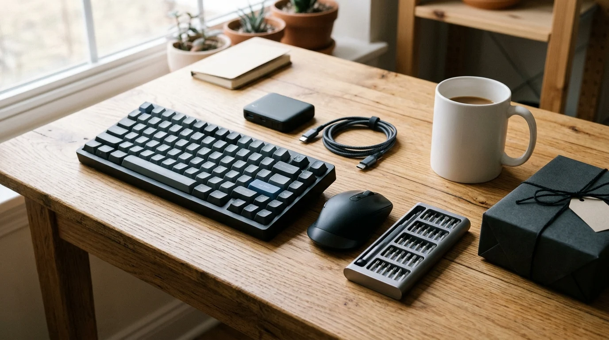

import Notice from "@components/widgets/Notice.astro";
import Accordion from "@components/widgets/Accordion.astro";
import Button from "@components/widgets/Button.astro";
import AmazonProduct from "@components/widgets/AmazonProduct.astro";

Pinterest and Reddit desk-setup photos have a habit of hiding the hardware that does the actual work. Everybody notices the walnut tabletop and the wallpaper on the monitor. Almost nobody points out the $50 gas-spring arm holding the monitor six inches above the wood, or the asymmetric light bar keeping the room from feeling like an interrogation cell at 9 PM.

I spend eight to ten hours a day at a desk running a Mac mini hooked up to a couple of homelab boxes. Same rule here as in our [main 2027 tech gadgets guide](/best-tech-gadgets-2027/): no shelfware, no plastic novelties that end up in a drawer by February. Every pick below fixes a physical annoyance—neck height, desk clutter, wrist strain, evening glare, or cable sprawl. Prices were verified on Amazon on November 18, 2026.

<Notice type="warning" title="Affiliate disclosure">
Some links below use `/go/` affiliate redirects to Amazon. Buying through them earns a small commission at no extra cost to you and helps fund the hardware we test.
</Notice>

## Quick picks

| Gadget | Pick | Price (Nov 18) | Why it earns desk space |
| --- | --- | :---: | --- |
| Dual monitor arm | [HUANUO FlowLift Dual Arm](/go/huanuo-flowlift-dual/) | $49.99 | Gets two 13–32" screens off their plastic stands for $50 |
| Monitor light bar | [BenQ ScreenBar Pro](/go/benq-screenbar-pro/) | ~$139 | Zero-glare asymmetric desk light with ultrasonic auto-on/off |
| Macro & audio controller | [Elgato Stream Deck +](/go/elgato-stream-deck-plus/) | ~$180 | Four physical rotary dials + 8 LCD keys for calls, audio & scripts |
| Low-profile mechanical keyboard | [Keychron K3 Max (QMK/VIA)](/go/keychron-k3-max/) | ~$110 | Slim 75% mechanical board with 2.4GHz + Bluetooth + browser remapping |
| Ergonomic productivity mouse | [Logitech MX Master 4](/go/logitech-mx-master-4/) | ~$119 | Electromagnetic free-spin scroll wheel + horizontal thumb wheel |
| Active noise-canceling headphones | [Sony WH-1000XM6](/go/sony-wh-1000xm6/) | ~$378 | 12-mic QN3 ANC chip + folding hinge returns for open-room focus |
| Rear monitor bias lighting | [Govee Smart Light Bars (RGBICWW)](/go/govee-smart-light-bars/) | $54.99 | Warm-white + RGB wall wash that cuts eye contrast at night |
| Secondary / travel display | [Arzopa A1 15.6" USB-C Monitor](/go/arzopa-a1-monitor/) | $79.99 | Single-cable 1080p IPS auxiliary screen for terminals or Slack |
| Scratch & archive SSD | [Samsung T9 2TB Portable SSD](/go/samsung-t9-2tb/) | ~$169 | Rugged 2,000MB/s USB-C drive for active video and VM projects |
| High-output desk/bag power bank | [Anker Laptop Power Bank 25K (165W)](/go/anker-laptop-power-bank/) | $97.99 | Two built-in retractable USB-C cables + 100W laptop charging |
| E-ink notepad & PDF reader | [Amazon Kindle Scribe (32GB)](/go/kindle-scribe/) | $499.99 | 11-inch 300ppi glare-free e-ink sketchpad and technical reader |
| Gear & backpack trackers | [Apple AirTag 4-Pack](/go/apple-airtag-4-pack/) | ~$75–99 | UWB Precision Finding for your laptop bag, tech pouch, and keys |

---

## 1. HUANUO FlowLift Dual Monitor Arm ($49.99)

**$49.99** · 4.6★ across 2,992 ratings · Amazon's Choice

If your monitor is still sitting on the V-shaped plastic stand it came with in the box, start here. Factory monitor stands eat a ten-inch deep footprint right where your keyboard, notebook, or audio interface wants to sit, and almost none of them lift the top bezel high enough to keep your neck straight.

The [HUANUO FlowLift Dual Monitor Arm](/go/huanuo-flowlift-dual/) clamps to the back edge of your desk (or bolts through a grommet hole) and floats two 13-to-32-inch VESA displays (up to 19.8 lbs per arm) on gas springs. Suddenly the entire center surface of your desk opens up, you can slide your keyboard forward when writing on paper, and you can pull a secondary display inward at an angle that doesn't twist your spine.

<AmazonProduct
  productName="HUANUO FlowLift Dual Monitor Stand (Gas Spring, 13–32 Inch)"
  productDescription="Dual gas-spring articulating monitor mount supporting two 13 to 32-inch VESA (75×75 / 100×100mm) displays up to 19.8 lbs each, with C-clamp and grommet base hardware included."
  productFeatures={[
    "Holds two 13–32 inch displays (4.4 to 19.8 lbs per arm, VESA 75×75 & 100×100)",
    "Gas-spring height adjustment with +85°/-45° tilt, 180° swivel, and 360° portrait rotation",
    "Includes both C-clamp (desks 0.39\"–3.35\" thick) and grommet mount kit",
    "Integrated cable channels route DisplayPort and power cords down the arms"
  ]}
  productLink="/go/huanuo-flowlift-dual/"
  productImage="https://m.media-amazon.com/images/I/61vE3NcfMOL._AC_SL1500_.jpg"
  productRating={4.6}
  recommendedBadge="Best Under-$50 Desk Upgrade"
  importantConsiderations={[
    "Adjust the Allen-key gas tension screw AFTER mounting the monitor—out of the box the spring feels stiff until weight is on it",
    "Avoid clamping directly onto hollow honeycomb IKEA paper-core desktops (like the Linnmon) without a $12 steel reinforcement plate"
  ]}
  pros={[
    "Reclaims ~30% of usable desktop surface area immediately",
    "Costs $49.99 for dual gas-spring arms that used to run $150+"
  ]}
  cons={[
    "Leave 4 inches of clearance behind the desk if you push the elbows back",
    "Not rated for 49-inch super-ultrawides (stick to ≤32 inches per arm)"
  ]}
/>

---

## 2. BenQ ScreenBar Pro Monitor Light Bar (~$139)

**~$139** (or **$39.95** for the budget [Quntis Monitor Light Bar](/go/quntis-monitor-light-bar/))

Traditional desk lamps waste space and bounce reflections off glossy or semi-gloss OLED panels. A monitor light bar clips directly over the top bezel alongside your webcam and shines a flat wedge of light straight down onto your keyboard and desk mat.

The reason the [BenQ ScreenBar Pro](/go/benq-screenbar-pro/) costs more than generic LED bars is its **asymmetric optical reflector**: zero light spills backward onto the display glass, and the LEDs stay recessed so they never shine into your eyes. The Pro model also adds an ultrasonic presence sensor that turns the lamp on when you sit down and shuts it off five minutes after you walk away, plus a wide clamp that clears curved monitors and thick rear backplates (like the panels in our [32-inch 4K OLED monitor guide](/best-32-inch-oled-monitors-guide/)). If $139 feels steep for a desk light, grab the **$39.95** [Quntis Monitor Light Bar](/go/quntis-monitor-light-bar/)—it delivers 80% of the benefit at a third of the price.

<Button text="Check BenQ ScreenBar Pro on Amazon" link="/go/benq-screenbar-pro/" variant="solid" color="blue" size="md" icon="arrow-right" />

---

## 3. Elgato Stream Deck + (~$180)

**~$180** · 8 customizable LCD keys + 4 push rotary dials + touch strip

Ignore the "Stream" branding in the name; ninety percent of the people I know using an [Elgato Stream Deck +](/go/elgato-stream-deck-plus/) never open Twitch. What makes the **Plus** model so much better for a workday desk than the classic 15-button grid is the row of **four physical metal rotary dials** at the bottom.

You can map Dial 1 to master system volume, Dial 2 to Spotify/Apple Music independent of your Zoom call volume (via Elgato's included Wave Link virtual audio mixer), Dial 3 to your BenQ/Govee desk brightness, and Dial 4 to timeline scrubbing or brush size. Above the dials sit eight dynamic LCD buttons for instant mic mute with a red/green state indicator, triggering Home Assistant scenes, firing off Docker build scripts, or jumping between window layouts.

<AmazonProduct
  productName="Elgato Stream Deck + (Studio Controller with Dials)"
  productDescription="Tactile desktop control surface with 8 customizable LCD macro keys, 4 360-degree push-button rotary encoders, a swipeable LCD touch strip, and full Wave Link digital audio mixing software."
  productFeatures={[
    "8 programmable LCD keys + 4 notched metal rotary dials with push function",
    "Interactive touch strip displays real-time volume levels, mic status, or clock",
    "Unlocks Elgato Wave Link multi-channel virtual audio mixer on macOS and Windows",
    "Hundreds of community plugins: Home Assistant, VS Code, Zoom, Teams, Spotify, OBS"
  ]}
  productLink="/go/elgato-stream-deck-plus/"
  productImage="https://m.media-amazon.com/images/I/61r9w2sT8jL._AC_SL1500_.jpg"
  productRating={4.7}
  pros={[
    "Physical volume and per-app audio mixing dials beat keyboard function keys every time",
    "Visual mic-mute confirmation on the LCD strip saves you on daily video calls"
  ]}
  cons={[
    "Needs a persistent USB connection and the background Stream Deck daemon running",
    "If you don't want the dials, the smaller 8-key Stream Deck Neo is half the price (~$90)"
  ]}
/>

---

## 4. Keychron K3 Max Low-Profile QMK/VIA Wireless Keyboard (~$110)

**~$110** · 75% compact layout · 2.4GHz wireless + 3-device Bluetooth + USB-C wired

Full-height mechanical keyboards often force you to use a thick wrist rest just to keep your palms at a neutral angle, while flat laptop-style scissor keyboards feel dead after an hour of typing. The [Keychron K3 Max](/go/keychron-k3-max/) hits the sweet spot between the two: low-profile Gateron mechanical switches in an ultra-slim aluminum-top 75% frame that keeps a dedicated function row and arrow cluster without eating mouse space.

Crucially, the **Max** generation adds two features the older K3 lacked: a **1000Hz 2.4GHz wireless dongle** (so it never lags waking from Bluetooth sleep) and full **QMK / VIA firmware support**. Open `usevia.app` in any Chromium browser, plug the keyboard in, and remap Caps Lock to Control/Escape or build macros directly onto the board's flash memory with zero bloatware installed on your work laptop.

<Button text="Check Keychron K3 Max price" link="/go/keychron-k3-max/" variant="outline" color="blue" size="md" icon="arrow-right" />

---

## 5. Logitech MX Master 4 Ergonomic Wireless Mouse (~$119)

**~$119** · MagSpeed electromagnetic wheel + thumb horizontal scroll

There is a reason the MX Master silhouette shows up in almost every developer and designer desk photo. The combination of the sculpted thumb rest, the **MagSpeed electromagnetic main scroll wheel** (which shifts automatically from ratcheted line-by-line steps to a silent free-spin that flies through a 4,000-line log file), and the dedicated **metal thumb wheel** for horizontal timeline and spreadsheet scrolling hasn't been matched by gaming brands. The [Logitech MX Master 4](/go/logitech-mx-master-4/) keeps that exact ergonomic shell, upgrades the sensor tracking and quiet micro-switches, and pairs across up to three machines via Bluetooth or Logi Bolt.

<Button text="Check Logitech MX Master 4 price" link="/go/logitech-mx-master-4/" variant="outline" color="blue" size="md" icon="arrow-right" />

---

## 6. Sony WH-1000XM6 Noise-Canceling Headphones (~$378)

**~$378** · QN3 12-microphone ANC processor + folding hinge returns

Even the cleanest desk setup falls apart when the neighbor starts a leaf blower or two people are talking in the kitchen behind you. Sony's [WH-1000XM6](/go/sony-wh-1000xm6/) fixed the single biggest complaint from the XM5 generation by **bringing back the compact folding hinge** so the earcups actually collapse into a small travel case again. Under the hood, the new QN3 processor drives 12 noise-canceling microphones (specifically tuned against mid-frequency human voices in offices and cafes) plus 6 AI-beamforming call mics so you sound clear on Slack huddles without wearing a boom headset.

<Button text="Check Sony WH-1000XM6 price" link="/go/sony-wh-1000xm6/" variant="outline" color="blue" size="md" icon="arrow-right" />

---

## 7. Govee Smart Light Bars RGBICWW ($54.99)

**$54.99** · 4.6★ across 7,400+ ratings · Matter, Alexa & Google Home compatible

While the BenQ ScreenBar illuminates your desk surface in front of the monitor, [Govee's RGBICWW Smart Light Bars](/go/govee-smart-light-bars/) sit hidden behind your display and wash the wall with soft ambient light. If you hate rainbow gamer lighting, ignore the RGB colors entirely and set their dedicated warm-white (`WW`) LED channel to 2700K–3500K every evening. Having a soft wall glow behind a bright monitor softens pupil contrast in a dark room and noticeably reduces late-night eye fatigue.

<AmazonProduct
  productName="Govee Smart Light Bars RGBICWW (2-Pack)"
  productDescription="Pair of Wi-Fi + Bluetooth rear monitor ambient light bars featuring independent RGBIC color segments plus dedicated warm-white LEDs for evening bias lighting."
  productFeatures={[
    "Dedicated warm-white channel + multi-zone RGBIC ambient wall wash",
    "Includes upright desk stands and adhesive rear-monitor mounting brackets",
    "Voice, app, and smart-home integration (Alexa, Google Assistant, Matter)",
    "Physical inline controller puck for quick power and mode switching"
  ]}
  productLink="/go/govee-smart-light-bars/"
  productImage="https://m.media-amazon.com/images/I/41pKFXxSonL._AC_SL1500_.jpg"
  productRating={4.6}
  pros={[
    "$54.99 pair transforms evening desk contrast and wall ambiance",
    "Tucks completely out of sight behind a 27-inch or 32-inch monitor"
  ]}
  cons={[
    "Advanced color scenes require the Govee mobile app",
    "Wall plug adapter block is slightly chunky on tight power strips"
  ]}
/>

---

## 8. Arzopa A1 15.6-Inch USB-C Portable Monitor ($79.99)

**$79.99** · 4.5★ across 2,100+ ratings · Single-cable USB-C DisplayPort

Not every desk wants two giant 32-inch panels side by side. A lot of developers and writers prefer one dead-center primary monitor with a small 15.6-inch "dashboard screen" tucked below it at a 45-degree angle for terminal logs, Spotify, Grafana dashboards, or Slack.

At **$79.99**, the [Arzopa A1 15.6-inch 1080p IPS monitor](/go/arzopa-a1-monitor/) runs power and video over a single USB-C cable from your computer or [Thunderbolt 5 dock](/best-thunderbolt-5-docks-guide/), weighs 1.6 lbs, and folds flat into your backpack whenever you take your laptop on the road.

<Button text="Check Arzopa A1 Monitor price" link="/go/arzopa-a1-monitor/" variant="outline" color="blue" size="md" icon="arrow-right" />

---

## 9. Samsung T9 2TB Portable SSD (~$169)

**~$169** · Up to 2,000MB/s · Textured drop-resistant rubber shell

Even with a [fast 10GbE homelab NAS](/best-nas-homelab-docker-proxmox/), you still want a pocket SSD on the desk for scratch video timelines, local VM images, and off-site project backups. The [Samsung T9 2TB](/go/samsung-t9-2tb/) wraps a 2TB NVMe drive in a grippy, shock-absorbing rubberized shell that won't slide off a wood desk.

**One technical caveat worth knowing before buying:** the T9 hits its full **2,000MB/s** rating over **USB 3.2 Gen 2x2 (20Gbps)**, which many modern Windows and Linux motherboards support natively. Apple Silicon Macs do not support the 2x2 lane-bonding spec on their Thunderbolt ports, so on a Mac the T9 runs at 10Gbps (~1,000MB/s). If you're on a Mac and need 3,000–6,000MB/s, step up to one of our tested [80Gbps Thunderbolt 5 NVMe enclosures](/best-tb5-nvme-enclosures/) instead.

<Button text="Check Samsung T9 2TB SSD price" link="/go/samsung-t9-2tb/" variant="outline" color="blue" size="md" icon="arrow-right" />

---

## 10. Anker Laptop Power Bank 25,000mAh 165W ($97.99)

**$97.99** · 4.4★ across 12,800+ ratings · Two built-in retractable USB-C cables

Most desk cable clutter comes from temporary charging cords draped across the front of the desk for phones, iPads, headphones, and visiting laptops. The [Anker 25,000mAh 165W Laptop Power Bank](/go/anker-laptop-power-bank/) has **two retractable USB-C cables built straight into the chassis** (one top strap, one pull-out 2.3-foot cord) plus a real-time color watt/percentage display. Leave it on the corner of your desk to top up devices without loose cables, then drop it in your backpack when you head to the airport—its 90Wh capacity sits safely under the 100Wh FAA carry-on limit while still delivering a full 100W fast charge to a MacBook Pro.

<Button text="Check Anker 165W Power Bank price" link="/go/anker-laptop-power-bank/" variant="outline" color="blue" size="md" icon="arrow-right" />

---

## 11. Amazon Kindle Scribe 32GB ($499.99)

**$499.99** (or **$24.30** for the reusable [Rocketbook Core](/go/rocketbook-core/))

If your desk accumulates five half-filled legal pads and sticky notes every month, an e-ink tablet is the cleanest cure. The [Amazon Kindle Scribe (32GB)](/go/kindle-scribe/) pairs an 11-inch, 300ppi glare-free e-ink screen with a battery-free electromagnetic stylus that feels remarkably close to pen on paper. Use it to sketch system diagrams, annotate long PDF whitepapers away from browser distractions, and read technical books at night with zero blue-light glare. And if $499 is more than you want to spend on digital notes, grab the **$24.30** [Rocketbook Core](/go/rocketbook-core/) reusable notebook instead.

<Button text="Check Kindle Scribe on Amazon" link="/go/kindle-scribe/" variant="outline" color="blue" size="md" icon="arrow-right" />

---

## 12. Apple AirTag 4-Pack (~$75–99)

**~$75–99** · 4.8★ across 144,000+ ratings · Ultra-Wideband Precision Finding

Once your mobile desk kit carries a laptop, a portable monitor, a 165W power bank, a 2TB SSD, and a pair of Sony XM6 headphones, the bag under your desk is easily worth $2,500+. Dropping one [Apple AirTag](/go/apple-airtag-4-pack/) inside the false lining of your backpack, one in your cable tech pouch, one on your keys, and one in your luggage takes five minutes and gives you centimeter-accurate Ultra-Wideband tracking across Apple's global Find My network.

<Button text="Check Apple AirTag 4-Pack price" link="/go/apple-airtag-4-pack/" variant="outline" color="blue" size="md" icon="arrow-right" />

---

## FAQ

<Accordion label="What is the single best desk setup upgrade under $100?" group="faq" expanded="true">
Start with the **HUANUO FlowLift Dual Monitor Arm ($49.99)**. Getting your monitor(s) off bulky factory stands immediately opens up the entire middle of your desk and puts the screen at proper eye level. Pair it with the **$39.95 Quntis Monitor Light Bar** (or the **$54.99 Govee Light Bars** behind the screen) and you've completely transformed both ergonomics and evening lighting for right around $90–105 total.
</Accordion>

<Accordion label="Is the $139 BenQ ScreenBar Pro really worth it over a $40 monitor light bar?" group="faq">
If you use a glossy or semi-gloss OLED monitor, or a deep curved ultrawide, yes. Cheaper light bars use a simple diffused LED strip that can spill a faint reflection band across the top third of a glossy panel, whereas BenQ's patented asymmetric reflector cuts screen glare to zero and includes an ultrasonic auto-on/off presence sensor. On a standard matte IPS monitor, however, the $39.95 Quntis bar gets you 80% of the way there.
</Accordion>

<Accordion label="Is an Elgato Stream Deck + useful if I never stream video?" group="faq">
Very much so. Think of it as a physical macro and audio mixing console for your desk. Having four metal rotary dials dedicated to master volume, background music volume, mic gain/mute, and screen or room brightness—plus eight LCD keys for launching scripts, switching audio outputs, or toggling Home Assistant lights—turns repetitive mouse clicks into instant muscle memory.
</Accordion>

<Accordion label="In what order should I upgrade a work-from-home desk?" group="faq">
Fix your physical contact points and posture first: **1) Monitor arm** (sets eye height and clears desk depth), **2) Chair**, **3) Mouse and keyboard** (your hands touch them for 2,000 hours a year), and **4) Task and bias lighting** (ScreenBar + rear Govee bars). Save control surfaces, secondary screens, and decorative touches for last.
</Accordion>

## Bottom line

A great desk setup isn't about copying a minimalist photo where nobody appears to own a power cord. It's about removing daily physical friction: floating your panels on the **$49.99** [HUANUO FlowLift Dual Monitor Arm](/go/huanuo-flowlift-dual/), cutting evening glare with a [BenQ ScreenBar Pro](/go/benq-screenbar-pro/) and [Govee Smart Light Bars](/go/govee-smart-light-bars/), and putting a [Keychron K3 Max](/go/keychron-k3-max/) and [Logitech MX Master 4](/go/logitech-mx-master-4/) under your hands.

Building out the rest of your workstation? Check our tested guides to the [best 32-inch 4K OLED monitors](/best-32-inch-oled-monitors-guide/), [Thunderbolt 5 docks](/best-thunderbolt-5-docks-guide/), [developer everyday-carry gadgets](/best-gadgets-for-developers-2027/), and [gifts for homelab owners](/tech-gifts-homelab-owners/).
