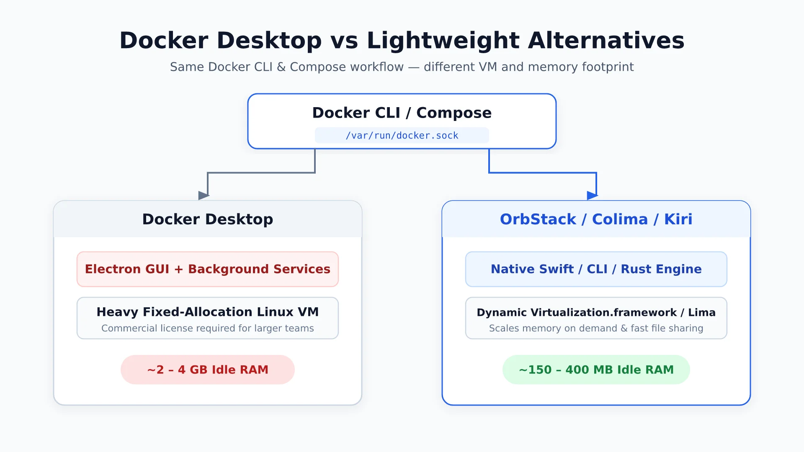
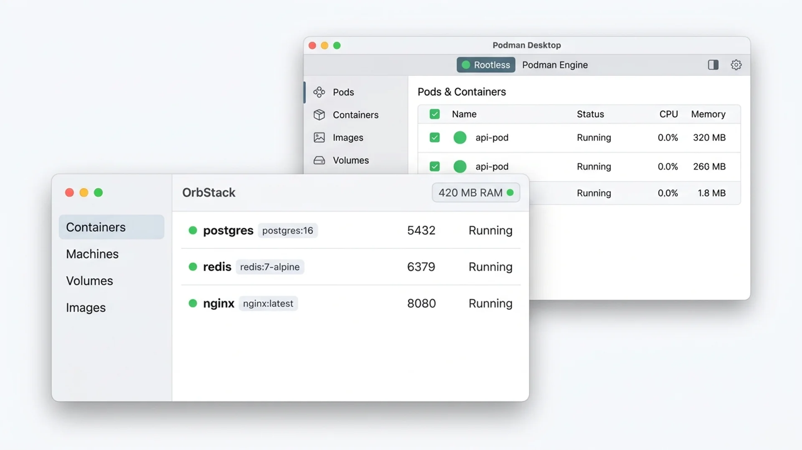

import Notice from "@components/widgets/Notice.astro";
import Tabs from "@components/widgets/Tabs.astro";
import Tab from "@components/widgets/Tab.astro";
import ListCheck from "@components/widgets/ListCheck.astro";
import Accordion from "@components/widgets/Accordion.astro";

**OrbStack** is the fastest drop-in replacement for Docker Desktop on macOS, while **Colima** (MIT) and **Podman Desktop** (Apache-2.0) are the top free open-source choices if you want zero commercial licensing. Most developers switch after hitting either heavy idle RAM usage on MacBooks or Docker's commercial seat rules (free for personal use and businesses under 250 employees and $10M annual revenue, paid above that).

In 2026 the options are genuinely better than they used to be. OrbStack matured into the Mac default, Colima stayed lean and free, Podman Desktop closed most Compose gaps, and a brand-new Rust runtime called **Kiri** landed in beta with a very different architecture. Here is how they compare on licensing, real day-to-day trade-offs, and switching without breaking your existing `docker compose` files.

## Quick comparison (November 2026)



| Tool | License & Commercial Price | Platforms | Engine / Architecture | GUI | Local Kubernetes |
|---|---|---|---|---|---|
| **OrbStack** | Proprietary; free personal, **$8/user/mo** commercial ($96/yr) | macOS only | Custom lightweight VM + Docker engine | Native macOS app | Built-in single-node k8s |
| **Colima** | **MIT** (free for all use) | macOS, Linux | Lima VM + Docker or containerd | None (CLI only) | `colima start --kubernetes` (k3s) |
| **Kiri (0.2.2 beta)** | Free during beta (proprietary) | macOS, Windows (WSL2), Linux native | Single Rust daemon calling `clone3` (no per-container shim) | Native AppKit / Win32 | `kiri k8s start` (k3s, ~20s) |
| **Podman Desktop** | **Apache-2.0** (free for all use) | macOS, Windows, Linux | Podman (rootless, daemonless) | Electron app | Via kind / minikube plugins |
| **Rancher Desktop** | **Apache-2.0** (free for all use) | macOS, Windows, Linux | Lima / WSL2 + containerd or `dockerd` | Electron app | Built-in k3s (pick exact version) |

If you run **Linux** as your daily workstation, pause before installing any of these: native Docker Engine (`docker-ce`) is free, has no VM overhead, and needs no desktop wrapper at all. Everything below matters primarily on macOS and Windows (or Linux teams wanting Podman's rootless model or Kiri's daemon).

## 1. OrbStack: the easiest drop-in on macOS



If you use a Mac and want to delete Docker Desktop in five minutes without changing a single script, OrbStack is still the lowest-friction swap. It starts in a couple of seconds, returns unused RAM to macOS cleanly, supports Rosetta for `linux/amd64` images on Apple Silicon, and gives every container an automatic `*.orb.local` hostname with HTTPS.

The Linux machines feature (`orb create ubuntu`) is an underrated bonus. Instead of running separate VMs for testing Ansible playbooks or Linux-only packages, you get fast Linux shells sharing your Mac filesystem.

The two catches are simple: it is **macOS only** (useless for a mixed Mac/Windows engineering team), and commercial/freelance use costs **$8/user/month** ($96/year). For a solo developer running personal projects, it is free. For a company trying to get away from per-seat fees, OrbStack trades one invoice for a cheaper invoice rather than eliminating it.

## 2. Colima: free, open source, and terminal-first

Colima (`brew install colima docker docker-compose`) wraps Lima and gives you a standard Docker daemon over a Docker context (`colima`). No Electron app, no login nag screen, no commercial license restrictions, MIT licensed.

```bash
brew install colima docker docker-compose
colima start --cpu 4 --memory 8 --vm-type vz --vz-rosetta --mount-type virtiofs
docker context use colima
```

Using `--vm-type vz --mount-type virtiofs` on Apple Silicon makes bind-mount speed close to OrbStack's. Without those flags, Colima falls back to slower defaults, which is where most complaints about Colima file I/O come from.

The catch is that Colima expects you to live in the terminal. There is no GUI for inspecting volumes or browsing container logs, though pairing it with Lazydocker or a self-hosted UI like [Dockhand or Arcane](/arcane-vs-dockhand/) solves that quickly. On a team where engineers are comfortable with the CLI and finance wants $0 per seat, Colima is hard to argue against.

## 3. Kiri (0.2.2 beta): the fast newcomer written in Rust

[Kiri](https://runkiri.com/) caught a lot of attention on Hacker News in November 2026 because it rethinks how a container runtime talks to the kernel. Docker Desktop and OrbStack pass every `docker run` through five layers (`docker` CLI, `dockerd`, `containerd`, `containerd-shim`, `runc`) and keep a shim process alive per running container. Kiri collapses that into a single Rust daemon inside a minimal VM on macOS (WSL2 on Windows, native `clone3` on Linux) with no per-container shim.

According to Kiri's own Apple Silicon benchmarks (2 CPUs / 8 GB limit per engine), `docker run --rm alpine true` takes **22 ms** on Kiri compared to **152 ms** on Colima, **178 ms** on Docker Desktop, and **279 ms** on OrbStack, with a ~15 MB idle daemon and 112 ms VM cold boot. It speaks the Docker Engine API directly, so `docker`, `docker compose`, and `buildx` keep working unchanged, and it adds nice extras:

- Automatic `myapp.kiri.local` HTTPS domains per container or Compose service
- `kiri k8s start` for a local k3s cluster and `kiri machine create` for Linux VMs
- `kiri share web` to publish a local container to a temporary public HTTPS link on `runkiri.cloud` (handy for testing webhooks or showing a client a branch)
- One-step migration of existing images and volumes from Docker Desktop or OrbStack on macOS

The honest caveat: Kiri is **0.2.2 beta**, closed-source, and pricing after beta is not published yet. Test it on your personal machine if you want the fastest container startup on a Mac, and keep Colima or Podman Desktop as your stable fallback for client or team work until Kiri hits 1.0 and publishes clear commercial terms.

## 4. Podman Desktop: free GUI + rootless security

Podman Desktop (Apache-2.0) is the right move when your team has Windows and macOS laptops, refuses to pay per-seat runtime fees, and wants a visual UI. Because Podman runs rootless and daemonless by default, a compromised container cannot escalate through a root-owned daemon socket. I went deeper into the engine differences in [Podman vs Docker](/podman-vs-docker/).

Podman Desktop ships a Docker compatibility socket so most `docker` CLI commands and Compose files work, and it handles Kubernetes YAML generation (`podman generate kube`) natively.

Where Podman still trips people up: Testcontainers, older `docker-compose` scripts expecting Docker-specific networking quirks, and bind-mount UID mapping inside rootless containers. Always run your actual project's Compose stack and CI test suite on Podman before mandating it across a team.

## 5. Rancher Desktop: best if local Kubernetes version matching matters

If your day job revolves around matching a specific production k3s/Kubernetes version locally, Rancher Desktop (Apache-2.0, macOS/Windows/Linux) lets you pick exact Kubernetes releases from a dropdown and choose between `containerd` (with `nerdctl`) or `dockerd` (Moby). For plain Docker Compose work it feels heavier than Colima or OrbStack, which is why I only reach for it when k8s is the primary job.

## Switching cleanly without losing your workflow

<Tabs>
<Tab name="macOS (Colima)">

```bash
# 1. Stop and quit Docker Desktop first (so port bindings don't collide)
# 2. Install CLI tools + Colima
brew install colima docker docker-compose docker-buildx

# 3. Start with Apple Virtualization.framework + VirtioFS
colima start --cpu 4 --memory 8 --disk 60 --vm-type vz --vz-rosetta --mount-type virtiofs

# 4. Verify docker CLI points at Colima
docker context ls
docker run --rm hello-world
```

</Tab>
<Tab name="macOS (OrbStack / Kiri)">

Both OrbStack (`brew install --cask orbstack`) and Kiri (`.dmg` from `runkiri.com`) set up their own Docker context automatically and offer an import button to copy existing images and volumes out of Docker Desktop. After importing, verify which context is active before deleting Docker Desktop:

```bash
docker context ls
docker compose version
```

</Tab>
<Tab name="Windows & Cross-Platform (Podman)">

```powershell
# Windows via winget
winget install RedHat.Podman-Desktop

# Initialize the Podman machine (WSL2 on Windows)
podman machine init --cpus 4 --memory 8192
podman machine start
```

Enable **Docker Compatibility** in Podman Desktop's settings if your scripts invoke `docker` directly instead of `podman`.

</Tab>
</Tabs>

<Notice type="info" title="What actually breaks during a Docker Desktop migration">
Images and named volumes do **not** magically transfer when you switch runtimes (unless you use OrbStack's or Kiri's import wizard). Dump any local databases with `pg_dump` or `mysqldump` first, and check any script that hardcodes `/var/run/docker.sock` instead of reading `DOCKER_HOST` or the active Docker context. Brush up on context and cleanup commands in my [Docker commands cheat sheet](/docker-commands/).
</Notice>

## Which one should you pick?

<ListCheck>
<ul>
<li><b>Solo developer on macOS:</b> OrbStack (free for personal use, rock solid). Try Kiri 0.2.2 if you want to experiment with faster startup and built-in container sharing.</li>
<li><b>Mac developer who wants 100% open source:</b> Colima with `--vm-type vz --mount-type virtiofs`.</li>
<li><b>Mixed Mac + Windows team avoiding per-seat licenses:</b> Podman Desktop (or Rancher Desktop if you need pinned Kubernetes versions).</li>
<li><b>Linux desktop or home server:</b> None of the above. Install native Docker Engine and run your services directly as shown in my [home server Docker stack](/docker-containers-home-server/).</li>
</ul>
</ListCheck>

## FAQ

<Accordion label="Do I actually need to pay for Docker Desktop?" group="faq" expanded="true">
Only if you use it at a commercial company with 250+ employees or more than $10 million in annual revenue. Personal projects, open-source work, education, and small businesses below both thresholds remain free under Docker's subscription terms.
</Accordion>

<Accordion label="Is OrbStack free for freelance or company work?" group="faq">
No. OrbStack is free for personal, non-commercial use only. Freelance, business, and commercial work requires OrbStack Pro at $8/user/month ($96/year), with a 30-day grace period.
</Accordion>

<Accordion label="Will my docker-compose.yml files still work on Colima or Kiri?" group="faq">
Yes. Both Colima (with the default Docker runtime) and Kiri answer the standard Docker Engine API, so `docker compose up -d` works with your existing files unchanged. The main thing to check is hardcoded socket paths (`/var/run/docker.sock`), since alternative runtimes place their socket in a different path exposed via `docker context`.
</Accordion>

<Accordion label="Can Kiri replace OrbStack today?" group="faq">
For personal experiments, yes, and its single-daemon design is genuinely fast. For daily work you depend on, treat Kiri 0.2.2 as beta software: wait for a 1.0 release and published post-beta licensing terms before standardizing a team on it.
</Accordion>
