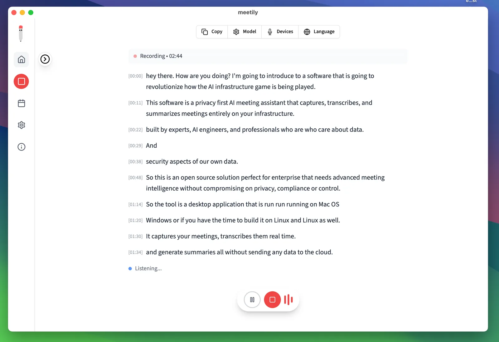
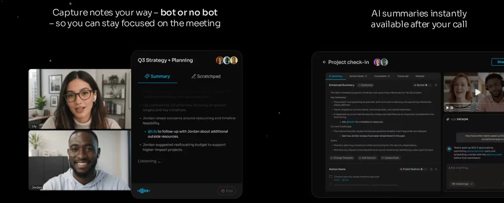
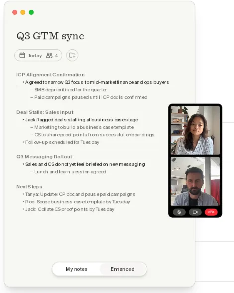
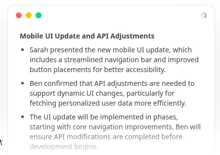
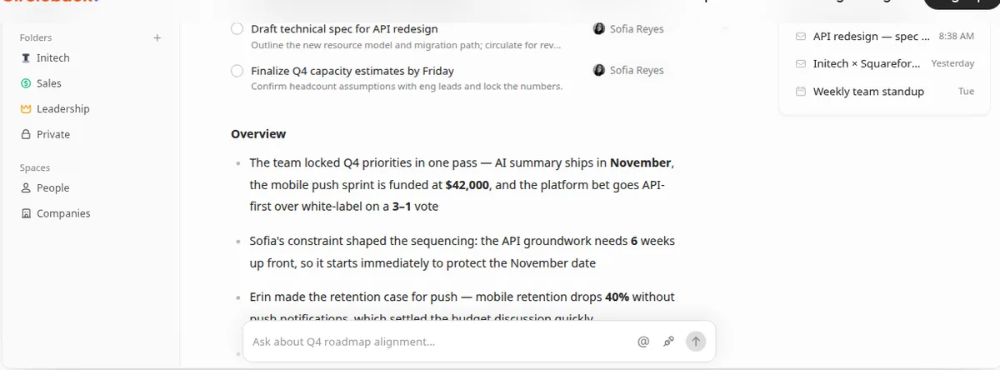
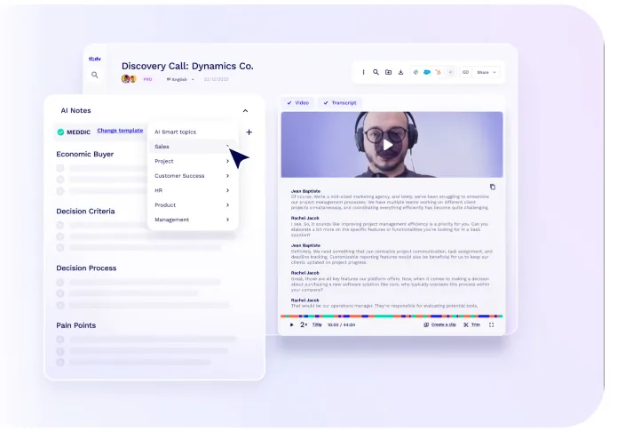
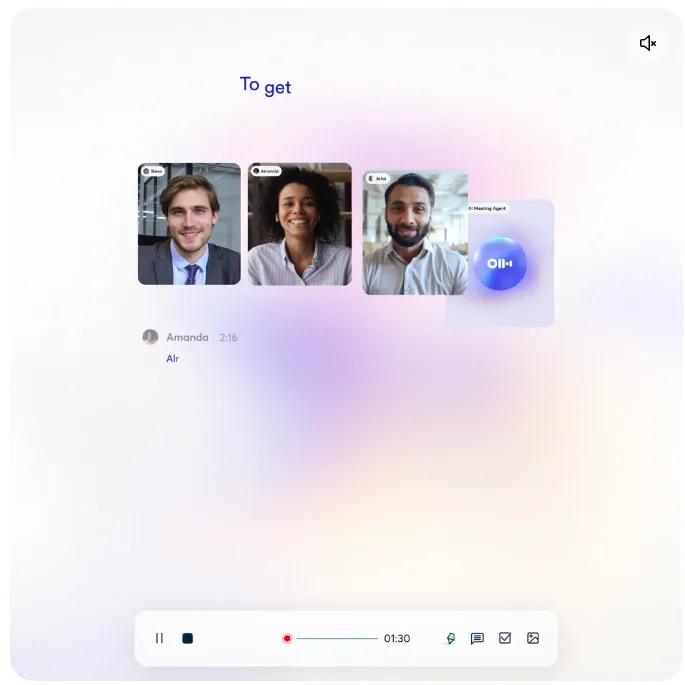
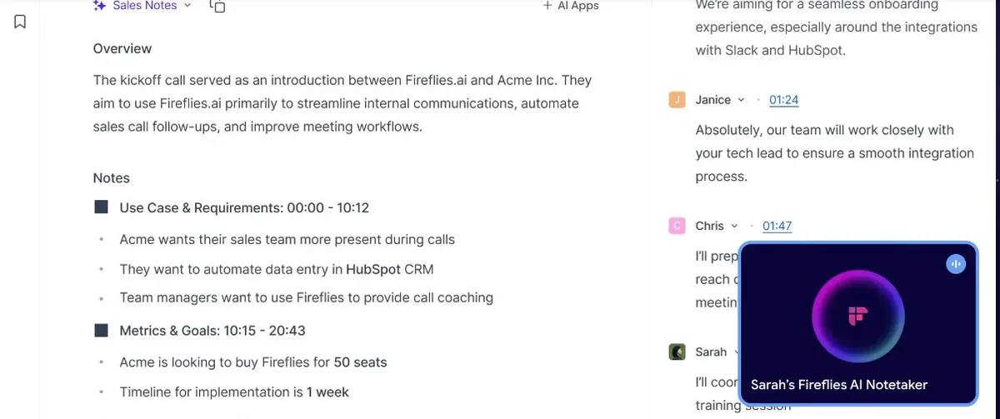
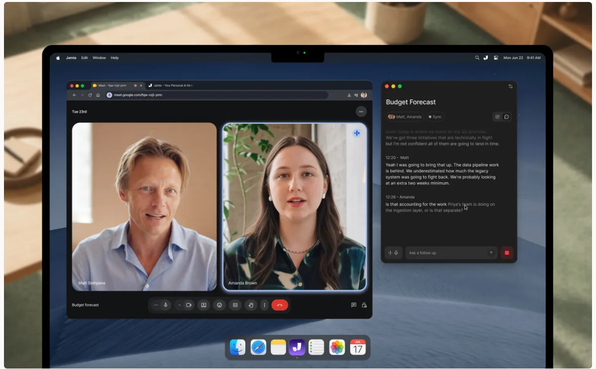
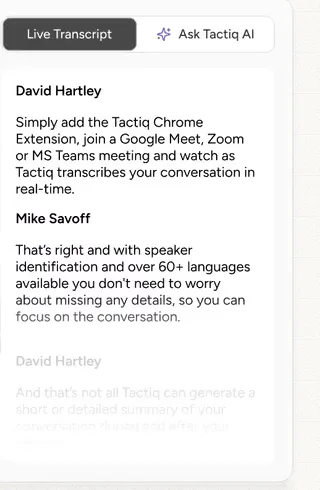

import Button from "@components/widgets/Button.astro";
import Notice from "@components/widgets/Notice.astro";
import ListCheck from "@components/widgets/ListCheck.astro";
import Accordion from "@components/widgets/Accordion.astro";
import Tabs from "@components/widgets/Tabs.astro";
import Tab from "@components/widgets/Tab.astro";

Meeting transcription used to cost real money. Otter wanted $17 a month, Fireflies $10, Fathom $16, and if you had calls every day you paid it, because taking notes while also participating in a meeting is miserable. In 2026 the math changed: free tiers got genuinely useful, a few open-source tools now do everything locally, and "bot-free" recording went from a niche feature to the thing every vendor advertises.

This roundup covers the free meeting note-takers worth installing for Zoom, Google Meet, and Teams calls. It's the companion piece to my [free dictation apps roundup](/best-free-dictation-apps/): dictation is *your* voice into a text field, this is *everyone's* voice into a summary. Some of these are honestly free. Some are free in the way a buffet's first plate is free. I've flagged which is which.

**In a hurry?** [Meetily](#meetily) or [Anarlog](#anarlog) if you want everything local and free forever, [Fathom](#fathom) for the most generous cloud plan, [Granola](#granola) or [Circleback](#circleback) if you don't want a bot joining your calls.

## Quick comparison

| App | Free tier in one line | Bot-free? | Where it runs | The catch |
|---|---|---|---|---|
| [Meetily](#meetily) | Free Community Edition | Yes, always | Mac, Win, Linux | Weak diarization in CE |
| [Fathom](#fathom) | Unlimited recordings + transcription | Mac (3.0), Win alpha | Mac, Win | Advanced summaries, action items are paid |
| [Granola](#granola) | Unlimited meetings, 30-day history | Yes, always | Mac, Win, iOS, Android | Cloud processing, history locks |
| [Anarlog](#anarlog) | Unlimited on-device transcription | Yes, always | Mac, Win, Linux | Manual speaker labels on free |
| [Circleback](#circleback) | Unlimited meetings + members | Bot or bot-free | Mac, Win, mobile | 30-day history, then locked |
| [tl;dv](#tldv) | Unlimited recordings + transcripts | Bot or bot-free | Mac, Win, web | Full AI notes on 10 meetings, ever |
| [Otter](#otter-basic) | 300 min/mo, 30 min per call | Bot or record yourself | Web, Mac, Win, mobile | Stingiest limits here |
| [Fireflies](#fireflies-free) | Unlimited only with auto-join on | Chrome extension | Web, Mac, Win | Free = the bot joins everything |
| [Jamie](#jamie) | 10 AI notes/mo, 30-min cap | Yes, always | Mac, Win, iOS, Android | Tight caps, EU-first |
| [Tactiq](#tactiq) | 10 transcripts/mo, 5 AI credits | Yes, captions | Chrome extension | No recordings, just captions |

## Meetily

[Meetily](/meetily-self-hosted-ai-meeting-assistant/) is the open-source answer to the whole category, and the one I'd start with if "free" is the point. MIT-licensed, ~32k GitHub stars, runs on Mac, Windows, and Linux, and captures system audio plus your mic as separate tracks, so no "Notetaker Bot has joined" ever appears in your call.



Transcription runs locally on Parakeet or Whisper models. Summaries go through Ollama (fully local) or your own API keys for Claude, Groq, or any OpenAI-compatible endpoint. Everything lands in a local SQLite database, and a built-in editor produces Markdown exports.

The honest tradeoffs, from the [full Meetily review](/meetily-self-hosted-ai-meeting-assistant/): speaker diarization in the Community Edition is weak on busy calls, Ollama summaries get vague on hour-long meetings unless you throw a 32B+ model at them, there's no calendar auto-join, no mobile app, and Linux means a source build. A Pro tier exists now for GPU-accelerated transcription on Windows, calendar detection, and better diarization; the Community Edition stays free.

```bash
# macOS: download the .dmg from meetily.ai or GitHub releases
# Windows: installer from meetily.ai
# Linux: source build (Rust + Node + pnpm + CMake)
```

## Fathom

[Fathom](https://fathom.ai/) has the most generous free cloud tier going: unlimited recordings, unlimited transcription, unlimited storage, instant summaries, and clips, on Zoom, Meet, and Teams. That generosity survived its acquisition: Fathom is now part of Superhuman, and the free plan is still intact.



The big 2026 change is capture mode. Fathom 3.0 on macOS 14.2+ lets you pick per meeting: **Transcript Only** or **Audio Only** (both bot-free, recorded from your device) or **Audio & Video** (the classic bot joins the call). Windows is still mostly bot-based, with a Teams-only bot-free alpha rolling out.

What you actually pay for at $16/user/month (annual): advanced summaries, AI action items, the conversational "Ask Fathom" assistant, and removing Fathom's branding from the bot. If you just want every call transcribed and searchable and don't mind a visible Fathom notetaker in the participant list, free covers it. This is the plan I'd hand to a freelancer who lives on Zoom and doesn't care about bots.

## Granola

[Granola](https://www.granola.ai/) is the app that made "no bot" a selling point. It listens to your computer's audio directly, so nothing joins the call. The twist: it expects you to keep typing rough notes, then it merges them with the transcript after the call. The output reads like your notes, not a generated summary, which is either brilliant or annoying depending on whether you actually take notes.



The free Basic plan has no meeting cap and works on Mac, Windows, iOS, and Android (the phone apps record in-person meetings). The limit is history: you see your last 30 days, and older notes stay locked until you pay $14/user/month for Business. A CSV export still lets you pull out titles and dates.

Privacy caveat worth knowing: Granola is cloud, not local. Audio goes to Deepgram/AssemblyAI for transcription, notes sit on AWS in the US, and the company trains models on anonymized data unless you opt out. If that trade is fine for your calls, it's the smoothest bot-free experience here. If it isn't, Anarlog and Meetily are below.

## Anarlog

[Anarlog](https://anarlog.so/) is the open-source Granola. It went through two renames in 2026 (Hyprnote → Char → Anarlog, from the fastrepl team), so older reviews may call it something else. MIT-licensed, ~9.7k stars, and the only app on this list with a native Linux build alongside Mac and Windows.



Same bot-free recipe: it records device audio, transcribes on-device (Soniqo or Apple Speech on Apple silicon, or a provider you pick), and keeps notes, transcripts, and recordings in a local SQLite file. Summaries can run through any OpenAI-compatible endpoint: Ollama, LM Studio, a vLLM box, or your own API keys. Recent builds can even piggyback on an existing ChatGPT, Claude, or Copilot subscription instead of billing you separately.

The free plan is unlimited for on-device transcription and includes folders, templates, chat, Markdown export, and a local API/CLI/MCP server. What you don't get free: automatic speaker identification (labels are manual), cloud transcription, sync, and sharing; that's the $14/month Pro tier. If you liked Granola's idea but flinched at its privacy section, this is the one.

## Circleback

[Circleback](https://circleback.ai/) added a free tier in August 2026 and it's aggressively generous: unlimited meetings, unlimited members, AI notes and action items on every meeting, speaker-labeled transcripts, and recording via a bot or the bot-free desktop app on macOS and Windows. Mobile and Apple Watch apps cover in-person meetings.



The surprises are the developer bits on the free plan: a public API, an MCP server, and a CLI, so Claude, ChatGPT, Cursor, or your own scripts can read your meeting history. Ask Circleback searches across meetings and connected email. Automations run in limited form (Slack and Linear steps). Transcription covers 100+ languages, and you can import existing history from Fathom, Fireflies, Granola, and Read AI.

The catch is the memory: meetings and recordings older than 30 days get locked, not deleted. Pro at $15/user/month (annual) unlocks everything. For a small team that wants every call captured with searchable notes and doesn't need an archive older than a month, free is a real plan, not a demo.

## tl;dv

[tl;dv](https://tldv.io/) ("too long; didn't view") is the video-first option. The free plan records unlimited video calls on Zoom, Meet, and Teams, transcribes in 30+ languages, and lets you clip and share moments. GDPR-friendly and EU-hosted, which matters to a chunk of this site's audience.



The free tier's catch is unusual: it's an AI budget, not a minutes cap. Your first 10 meetings ever get full automatic AI notes. After that, the AI only covers the first 10 minutes of each meeting. The transcripts still run in full; you're just reading them yourself. You also get 10 AI prompts, 10 AI reports, 20 integration credits, and 4 clips for the life of the account. Recordings keep for 3 months and move to archive storage after 3 days.

Pick it if video playback of calls matters (UX research, sales demos, user interviews) and your meeting volume is low enough that 10 full-AI meetings plus manual transcripts go far. Pro is $18/seat/month annually.

## Otter Basic

[Otter.ai](https://otter.ai/) is the name everyone knows, which is roughly what its free tier is still good for. Basic gives you 300 transcription minutes a month, cuts every conversation off at 30 minutes, and shows only your 25 most recent conversations. File imports are capped at 3 for the entire life of the account.



To be fair, what's there works: live transcription with speaker identification, AI chat across meetings, web/mobile/desktop coverage, and it joins Zoom, Meet, and Teams. But the limits land hard on real usage: a single 45-minute call gets truncated, and ten hours of meetings a month doesn't go far. The Pro plan at $8.33/month (annual) is the cheapest paid seat in this category, which is clearly the strategy.

Use Otter Basic if you already have an account, your calls are short, and 5 hours a month is enough. Otherwise every other cloud option on this list gives you more.

## Fireflies Free

[Fireflies.ai](https://fireflies.ai/) still advertises unlimited free transcription, but read the footnote: for accounts created since September 1, 2026, "unlimited" only applies with auto-join turned on, meaning Fred the bot joins every meeting on your calendar. Leave auto-join off and you get 3 meeting transcriptions, period.



The rest of the free plan: 400 minutes of storage per team (a shared pool, so active teams fill it fast), limited AI summaries, about 20 one-time AI credits, no video, and transcript or recording downloads locked behind paid plans. There's a Chrome extension that records without a bot, and it supports 10+ meeting platforms, the widest coverage here.

Honest read: free Fireflies is fine if you're okay with a bot announcing itself on every call and you treat it as an archive with a half-life. The 400-minute storage cap means old transcripts age out. Pro is $10/seat/month annually.

## Jamie

[Jamie](https://www.meetjamie.ai/) is the bot-free option for people whose meetings can't legally (or politically) live on US servers. It records device audio on Mac, Windows, iOS, and Android, online and in-person, transcribes in 99+ languages, and stores and processes everything in the EEA, Switzerland, and the UK. Audio is streamed, never stored; they don't train on your data; ISO 27001 certified.



Free gets you 10 AI notes a month with a 30-minute cap per meeting, plus speaker recognition on every plan. It's the tightest allowance after Otter, but the value proposition is different: GDPR-compliant bot-free notes for law, consulting, PE, and healthcare calls where a bot joining would be a conversation you don't want to have. Plus is about $24/month annually and bumps to 20 notes.

## Tactiq

[Tactiq](https://tactiq.io/) takes a different technical path: it's a Chrome extension that reads the captions your meeting platform already generates, then layers speaker identification, live transcription, and AI summaries on top. Works on Meet, Zoom, Teams, Webex, and Slack huddles in 60+ languages. No bot, no recording; just the caption stream, which also means it can't capture anything captions miss.



Free gives you 10 transcripts a month and 5 AI credits for summaries, action items, or follow-up emails. If most of your calls happen in a browser and you want something lighter than a desktop app, it's a clean option, though the transcript quality is whatever the platform's captions deliver, which on Meet and Teams is now quite good.

## The built-in options, briefly

Before installing anything, here's what the platforms themselves offer:

<Tabs>
<Tab name="Zoom AI Companion">

Zoom's AI Companion 3.0 is now on the free Basic plan too: meeting summaries for **3 meetings you host per month**, plus 20 AI queries. Two catches: the allowance counts meetings *you host*, not meetings you attend, and the free tier's 40-minute meeting cap still applies. On paid Zoom Workplace plans the summaries are unlimited.

</Tab>
<Tab name="Microsoft Teams">

Live transcription exists on business/enterprise SKUs, but the AI part (intelligent recap, summaries, action items) needs Teams Premium (~$10/user/month) or a Microsoft 365 Copilot license. On a plain free Teams account there's no real AI notes path. For free Teams transcription, use one of the apps above.

</Tab>
<Tab name="Google Meet">

"Take notes for me" (Gemini) requires Workspace Business Standard or higher, or a Google AI Pro/Ultra subscription on consumer accounts. There's no free-tier path: on a free Google account you get captions, not notes. Tactiq's caption-reading approach is the free workaround.

</Tab>
</Tabs>

## Honorable mentions and the "barely free" pile

- **Notta**: 120 minutes/month and a 3-minute cap per conversation on the free tier. That's demo territory, not a plan.
- **Krisp**: excellent noise cancellation plus transcription, but it's a 7-day trial; there's no free tier.
- **Grain**: unlimited meetings like Fathom, but a 45-minute per-meeting cap and 30-day visible history.
- **Scribbl**: 10 meetings a month free on Meet, Zoom, and Teams, no bot. Decent allowance.
- **Bluedot**: 5 meetings for the life of the account. A tasting menu.
- **Dictation apps doing meetings**: [Hex's Labs meetings feature](/hex-dictation/) records calls locally (two-lane You/Them diarization), and [FluidVoice's FluidMeet](/fluidvoice-mac-dictation/) does local meeting transcription with diarization on Mac. Both are worth knowing if you're already running a [free dictation app](/best-free-dictation-apps/).

## The honest cons of free meeting notes

<Notice type="warning" title="Read before trusting a free tier">
Every free plan above is designed to convert you or limit you. Know where the walls are before your meeting archive lives inside one.
</Notice>

1. **"Unlimited" rarely means unlimited.** Fathom and Circleback gate advanced AI features. tl;dv's full AI notes stop after 10 meetings, forever. Granola and Circleback lock anything past 30 days. Otter is a hard 300 minutes. Only the open-source apps (Meetily, Anarlog) are free without a ceiling, because there's no cloud bill to recoup.
2. **Bots are visible.** Anything that joins the call as a participant (Fathom's bot mode, Fireflies auto-join, Otter) shows up in the roster. With clients or interviews that's an awkward first impression, though on the consent side, an announced bot is arguably the *honest* choice.
3. **Cloud means someone's servers.** Granola trains on anonymized data unless you opt out. Otter, Fireflies, tl;dv, Fathom, and Circleback all hold transcripts on their infrastructure. Jamie keeps everything in the EU; Meetily and Anarlog keep everything on your disk. Pick your exposure level deliberately.
4. **Recording consent is on you.** Two-party-consent jurisdictions don't care that a note-taker was convenient. Local tools like Meetily and Anarlog don't announce themselves at all, which is a privacy feature and a legal responsibility in one.
5. **Speaker labels are the weak point.** Free tiers do You/Them or manual labels (Meetily CE, Anarlog). Reliable multi-speaker diarization is mostly a paid feature across the industry, cloud or local.
6. **Local tools need decent hardware.** On-device Parakeet and Whisper models want Apple silicon or a GPU. A weak CPU means laggy transcription, the same tradeoff as [free local dictation](/best-free-dictation-apps/).

## How to choose

<ListCheck>

- **Want zero cost forever, no cloud:** [Meetily](/meetily-self-hosted-ai-meeting-assistant/) (most mature) or [Anarlog](https://anarlog.so/) (Granola-style notepad, runs on Linux)
- **Best free cloud plan, bot is fine:** [Fathom](https://fathom.ai/) gives unlimited everything; the branding stays until you pay
- **Bot-free but cloud OK:** [Granola](https://www.granola.ai/) (notepad style) or [Circleback](https://circleback.ai/) (unlimited, 30-day memory)
- **EU data residency required:** [Jamie](https://www.meetjamie.ai/), EEA/CH/UK only, 10 notes/month free
- **Video playback of calls:** [tl;dv](https://tldv.io/), then budget the 10 full-AI meetings carefully
- **Linux:** Meetily or Anarlog. The SaaS tools are Mac/Windows/web
- **Lightest install, browser-only:** [Tactiq](https://tactiq.io/)'s Chrome extension
- **Biggest platform coverage:** [Fireflies](https://fireflies.ai/) covers 10+ platforms, but the bot joins everything on free
- **Already paying for the platform anyway:** Zoom's AI Companion, Gemini in Meet, or Teams Premium beat installing a second tool

</ListCheck>

<Accordion label="Frequently Asked Questions" group="faq">

**Are free AI meeting note-takers accurate?**
The transcription layer is basically a solved problem: most of these run Whisper, Parakeet, Deepgram, or AssemblyAI under the hood, and accuracy lands in the same 85-95% band everywhere. The paid-vs-free difference is in summaries, diarization, and how much history you keep, not raw transcription quality.

**Which free meeting notetaker is most private?**
Meetily and Anarlog, and it's not close. Both transcribe on-device, store everything locally in SQLite, and need no account. Jamie is the most private *cloud* option: audio is streamed, never stored, data stays in the EEA/CH/UK, and they don't train on your calls. Granola trains on anonymized data by default unless you opt out, which surprises people.

**Do these work on Zoom, Google Meet, and Teams?**
All of them. Bot-free tools (Meetily, Anarlog, Granola, Jamie, Circleback desktop, Fathom 3.0, Tactiq) capture device audio or captions, so they work on anything your computer plays, including Slack huddles, Webex, Discord, and in-person conversations. Bot-based tools are tied to what the bot supports, which for everything listed here means at least the big three.

**Can I record meetings without a bot joining?**
Yes, and it's been the main trend of the last year. Meetily, Anarlog, Granola, Jamie, Circleback's desktop app, Tactiq, and Fathom's bot-free mode on Mac all record from your device. On Windows your bot-free choices are Meetily, Anarlog, Granola, Jamie, Circleback, and Tactiq (Fathom's Windows bot-free is still in a Teams alpha).

**What's the catch with 30-day history limits?**
Granola and Circleback keep your older meetings but lock them until you pay (locked, not deleted). It's a reasonable trade for ongoing use, but don't treat either as a long-term archive unless you export regularly. Circleback and Granola both let you pull data out (CSV/API), so set a monthly export habit if it matters.

**Is there a free option with no limits at all?**
Meetily and Anarlog: open source, local processing, no minutes, no meeting caps, no locked history. The ceiling is your hardware and the polish gap versus the paid SaaS tools. That's the deal: either the vendor limits the plan, or your laptop becomes the limit.

</Accordion>

## Final verdict

Two shifts won out in 2026: local transcription and bot-free capture. Meetily and Anarlog put the whole pipeline on your own disk for $0, while Circleback and Granola turned "unlimited but locked history" into the new default free-tier shape. Otter's 300 minutes and Fireflies' auto-join requirement look stingy next to Fathom's unlimited free plan, and tl;dv's lifetime 10-meeting AI budget is the most creative limitation here.

My picks: **Meetily** when local and free-forever is the point, **Fathom** for the most complete free cloud plan, **Circleback** for a team, **Jamie** when EU residency is a requirement, and **Anarlog** as the open-source Granola for people who like their notes in SQLite.

<Button text="Meetily setup guide" link="/meetily-self-hosted-ai-meeting-assistant/" variant="solid" color="blue" size="md" icon="arrow-right" />

<Button text="Free dictation apps" link="/best-free-dictation-apps/" variant="outline" color="gray" size="md" />
