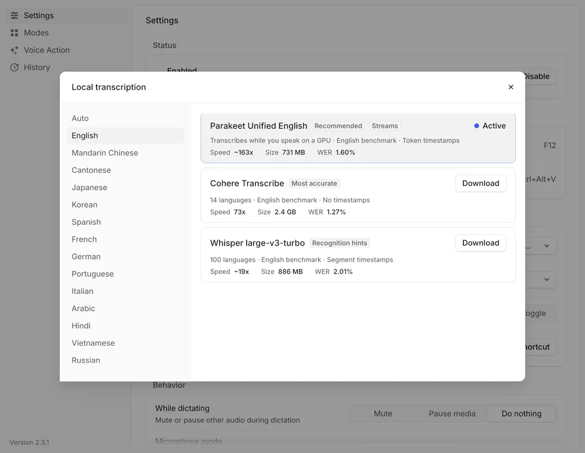
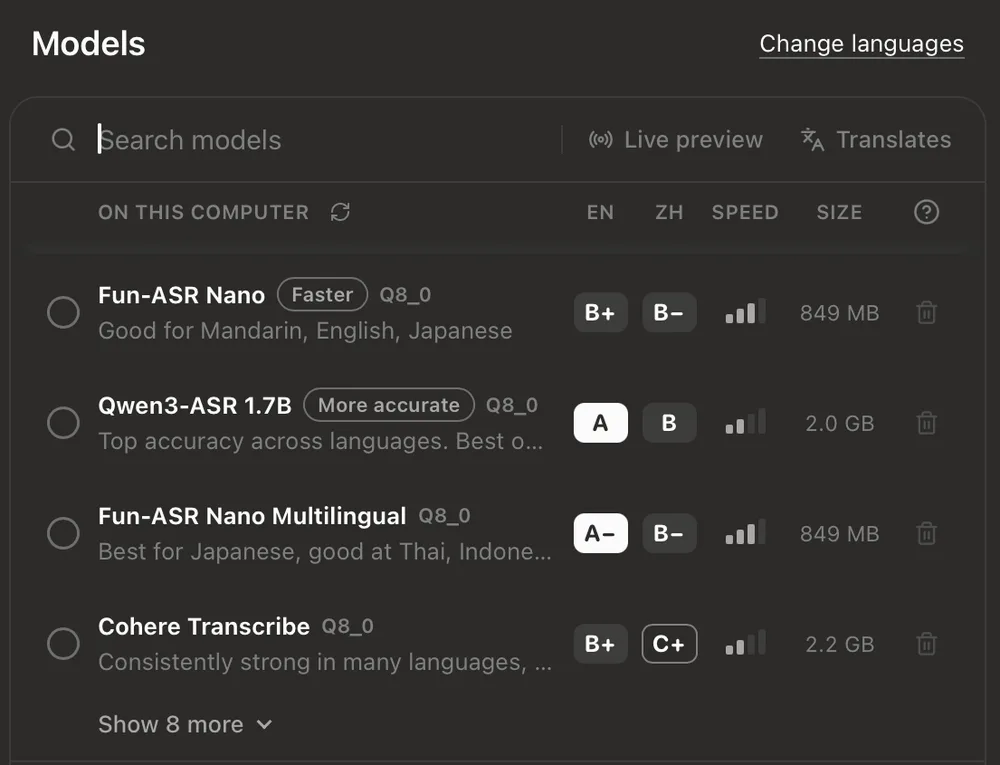
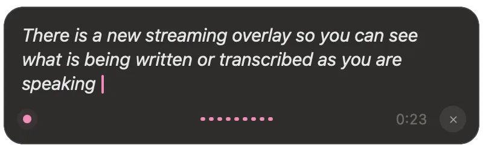
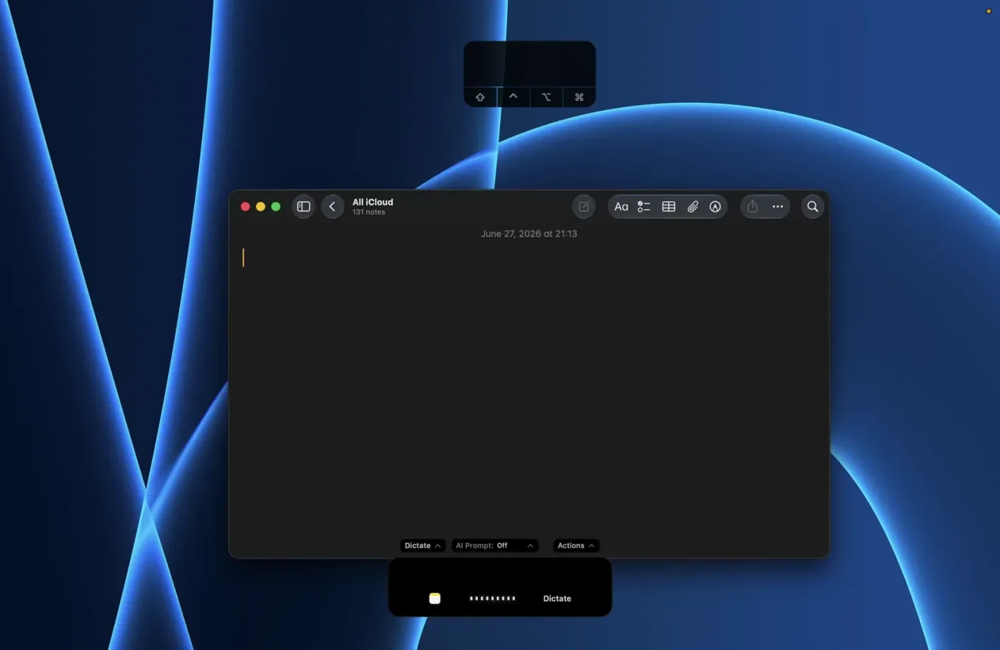
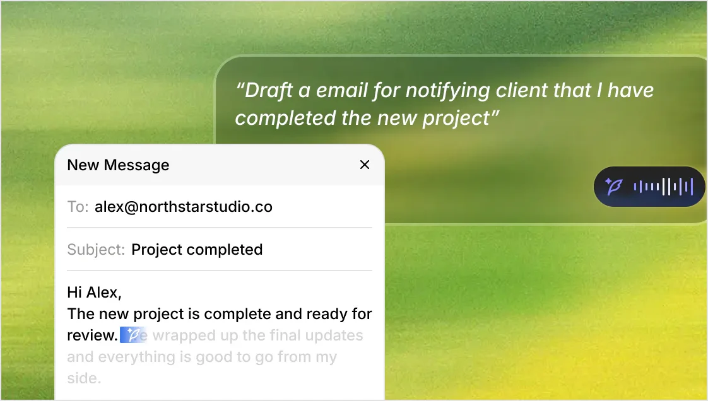
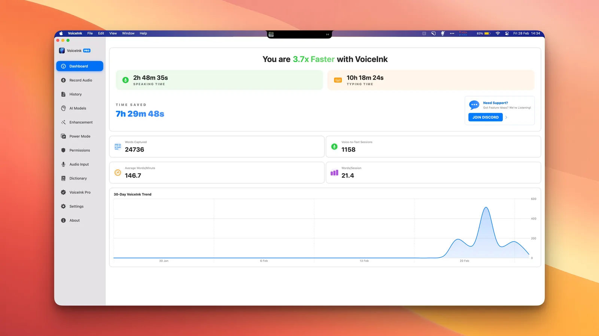
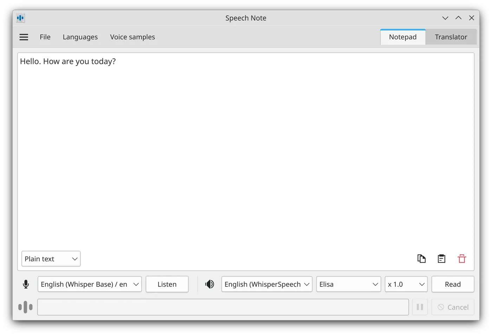
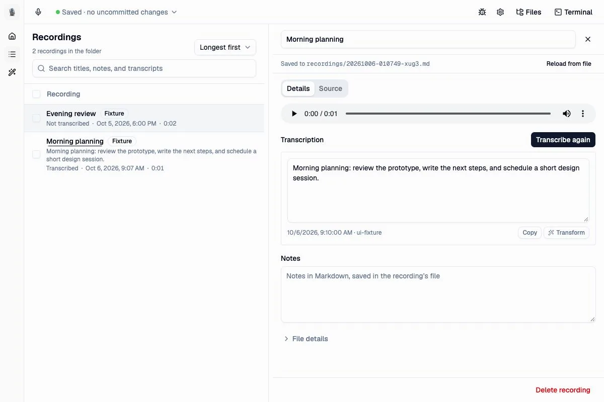
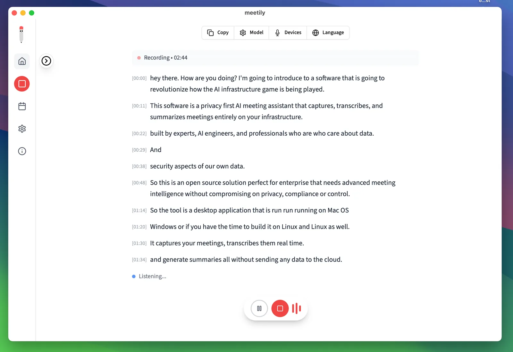

import Button from "@components/widgets/Button.astro";
import Notice from "@components/widgets/Notice.astro";
import ListCheck from "@components/widgets/ListCheck.astro";
import Accordion from "@components/widgets/Accordion.astro";
import Tabs from "@components/widgets/Tabs.astro";
import Tab from "@components/widgets/Tab.astro";

Paid dictation had a rough year. Wispr Flow wants $15 a month, SuperWhisper wants $85 a year, and meanwhile a stack of free, open-source tools running local Whisper and Parakeet models got good enough that paying for voice typing stopped making sense for most people.

This roundup covers the free dictation apps actually worth installing on Mac, Windows, and Linux. Almost all of them run speech-to-text on your own hardware, all are free for real (no word caps on local use), and most are open source. I've flagged where each one falls short, because they all fall short somewhere.

**In a hurry?** Install [Hex](#hex) on Windows or Linux, [FluidVoice](#fluidvoice) or [Hex](#hex) on an Apple silicon Mac, and [Handy](#handy) if you want the simplest possible push-to-talk.

## Quick comparison

| App | Platforms | License | Local models | AI cleanup | Voice commands | Best for |
|---|---|---|---|---|---|---|
| [Hex](#hex) | Mac, Win, Linux | MIT | Catalog + custom GGUF | Via OpenCode | Yes | Developers, agent workflows |
| [Handy](#handy) | Mac, Win, Linux | MIT | Whisper, Parakeet v3 | Optional BYO key | No | Simplest push-to-talk |
| [FluidVoice](#fluidvoice) | Mac (Win/iOS beta) | GPL-3.0 | Parakeet, Whisper, more | Fluid-1 bundled | Yes | Best Mac experience |
| [OpenWhispr](#openwhispr) | Mac, Win, Linux | MIT | Whisper, Parakeet, more | Yes | Agent mode | Features + optional cloud |
| [VoiceInk](#voiceink) | Mac only | GPL-3.0 | whisper.cpp, Parakeet | BYO LLM key | No | Maintained native Mac app |
| [Superwhisper Free](#superwhisper-free) | Mac, Win, iOS, Android | Proprietary | Whisper, unlimited | Pro only | Pro only | Free dictation on a phone |
| [Speech Note](#speech-note) | Linux | MPL-2.0 | Whisper, Vosk, Parakeet, more | No | No | Linux + file transcription |
| [Whispering](#whispering) | Mac, Win | MIT | BYO endpoint (local or cloud) | Custom prompts | No | Hackable voice notes |
| Built-in dictation | Mac, Win, Chrome | Proprietary | Varies | No | Basic | Zero install |

## Hex

[Hex](/hex-dictation/) is the newest app on this list and the most ambitious. It's a free MIT-licensed dictation tool from Anomaly, the team behind OpenCode, written in Rust with local transcription through a transcribe.cpp fork on Metal or Vulkan. Four months in, it's at 5,100+ stars.

Hold a key, talk, release, text appears at your cursor. That's the baseline every app here shares.



What separates Hex:

- **Real cross-platform parity.** Same build quality on macOS, Windows (x64 and ARM64), and Linux (X11 and Wayland), plus .deb, .rpm, AUR, and Nix packages.
- **A proper model catalog.** Parakeet, Whisper, Qwen3-ASR, Cohere, SenseVoice, GigaAM variants, each card showing size, languages, and optional raw WER benchmarks. You can also import your own GGUF file or reuse models already sitting in your Hugging Face cache.
- **Custom vocabulary.** A term list with "sounds like" spellings that feeds transcription, rewriting, meeting notes, and search. If you dictate names and jargon all day, this alone justifies it.
- **Agent plumbing.** A CLI (`hex dictation start`, `hex model use`, `hex history --search`), a read-only MCP server (`hex mcp`), a local HTTP API, and a TypeScript SDK. Personal commands live in a `hex.config.ts` that a coding agent can literally write for you.
- **Extras in Labs**: meeting recording with call detection (Zoom, Meet, Teams, Slack, Discord, more), screen annotation capture, CleanShot-style screenshots.

The catch: the AI rewrite and meeting summary features expect a running OpenCode instance, big pieces are still flagged Labs, macOS requires Apple silicon and macOS 15+, and Windows needs a Vulkan 1.2 driver for GPU transcription (CPU fallback otherwise). Full breakdown in the [Hex review](/hex-dictation/).

```bash
brew install --cask anomalyco/tap/hex                    # macOS
curl -fsSL https://anoma.ly/hex/install-linux.sh | sh    # Linux
# Windows: grab the per-user Setup.exe from anoma.ly/hex (x64 and ARM64)
```

## Handy

[Handy](https://handy.computer/) is what you recommend to someone who says "just give me the simple one." It's a free, MIT-licensed push-to-talk dictation app by CJ Pais, ~33k GitHub stars, and it does exactly one thing: press a hotkey, talk, release, get text in your current app. There's a toggle mode if holding a key annoys you.

Under the hood it runs a model catalog of its own — Whisper (Small through Large, plus Turbo), Parakeet v3, and newer entries like Fun-ASR, Qwen3-ASR, and Cohere Transcribe — with automatic language detection, on GPU where available. Silero VAD filters silence so only actual speech gets transcribed. Output is close to verbatim. There's an optional AI cleanup step you can connect to your own API key, a local Ollama model, or Apple Intelligence, but it's off by default.



There's no meeting recorder, no command mode, no per-app modes. There *is* a Custom Words list — misheard → corrected pairs with an adjustable correction threshold — but it's a post-hoc correction table, not real vocabulary biasing like Hex's. The project's stated position is that accessibility tooling shouldn't sit behind a paywall, and it shows: everything's local, everything's free, and the only network calls are model downloads and update checks.

```
brew install --cask handy          # macOS
winget install cjpais.Handy        # Windows
# Linux: AppImage/deb from handy.computer or GitHub releases
```

**Where it loses to Hex:** the vocabulary is a flat correction list rather than sounds-like biasing, no per-app modes, no agent surface, less polish in the model picker. **Where it wins:** zero configuration surface, and no Labs full of half-finished features.



## FluidVoice

[FluidVoice](/fluidvoice-mac-dictation/) is the one I covered in depth already, and it stays the best free dictation experience on a Mac. GPL-3.0, 12,400+ stars, built by a solo developer who got annoyed at Wispr Flow's pricing.



What you get for $0:

- **Fluid-1**, a bundled local cleanup model (~3.5 GB, trained on 100k+ dictation samples) that turns raw transcripts into sendable text. No other free app ships this; everyone else makes you bring an LLM.
- **Command Mode and Write Mode**: voice-control your Mac, or select text anywhere and say "make this more concise" for an in-place rewrite.
- **FluidMeet**: local meeting recording with speaker diarization (up to 8 speakers), live captions, and agent integrations, no bot joining your call.
- Per-app prompt sets: formal for email, terse for Slack, conventional commits for your editor.

The limits: macOS 15+ required, Apple silicon for the fast models (Intel gets Whisper only), and the Windows and iPhone builds are still beta with unpublished source. Fluid-1 itself is closed-source even though the app is GPL. Read the [full FluidVoice review](/fluidvoice-mac-dictation/) for the complete picture.

```
brew install --cask fluidvoice
```

## OpenWhispr

[OpenWhispr](https://github.com/OpenWhispr/openwhispr) answers the local-vs-cloud question with "yes." MIT-licensed, ~5,800 stars, Electron-based, on macOS, Windows, and Linux.



Local transcription with Whisper, Parakeet, Orukeet, or Cohere models is unlimited and free forever. If you'd rather use their cloud or your own API keys, that's available too, though the free cloud path caps at 2,000 words per week. Beyond plain dictation it packs in meeting transcription with local speaker diarization and voice fingerprinting, a notes system with semantic search, dictation translation (speak one language, paste another), and an AI agent mode wired to GPT-5, Claude, Gemini, Groq, or local models.

The tradeoffs: it's Electron, so it's heavier than the Rust/Swift competition. The onboarding steers you toward the capped cloud tier when the unlimited local path is one settings screen away. Live speaker identification doesn't work on Intel Macs, and the iOS app sits on the Pro plan ($80/year) with no Android option.

Pick it if you want Handy-plus: a kitchen-sink feature set where the local path is still free and open.

## VoiceInk

[VoiceInk](https://github.com/Beingpax/VoiceInk) is the second-best Mac option after FluidVoice. GPL-3.0, ~6,900 stars, macOS 14.4+ on Apple silicon, running whisper.cpp and Parakeet models locally with per-app power modes and a slick native UI.



The pricing quirk: the source is fully open, so it's free if you build it yourself in Xcode. Prebuilt binaries cost $29-69 one-time, which funds development. AI enhancement requires your own LLM API key or a local model; nothing's bundled like Fluid-1.

If you're on a Mac, comfortable with `xcodebuild`, and want a maintained native app, it's excellent. If you'd rather pay nothing and click once, Hex or FluidVoice cover the same ground.

## Superwhisper Free

The freemium exception on this list. [Superwhisper](https://superwhisper.com) is the paid tool I needle elsewhere, but its free tier is genuinely usable: unlimited local dictation with on-device Whisper models on Mac, Windows, iPhone, and Android, no word cap. It's the only option here with real phone apps that cost nothing.

The catches: it's proprietary, so "local" is a claim you trust rather than verify, and the app exists to upsell Pro (~$85/year) — that's where AI cleanup, cloud models, and the better features live. If open code matters, pick anything else on this list. If you want free dictation on a phone, this is the realistic choice.

## Speech Note

Linux finally has a good answer here. [Speech Note](https://flathub.org/en/apps/net.mkiol.SpeechNote) is an MPL-2.0 Flatpak that bundles offline speech-to-text, text-to-speech, and machine translation in one app. It's been around for years and is the most polished packaged option on Linux.



The engine list is absurd: Coqui STT, Vosk, whisper.cpp, Parakeet, Faster Whisper, and april-asr for STT; Piper, Kokoro, Mimic 3, and a dozen more for TTS; Bergamot for translation. A built-in model browser downloads what you need, and optional Flatpak add-ons enable NVIDIA or AMD GPU acceleration.

The catch is the shape of the tool: Speech Note is a notes workspace with live listening and file transcription, not a global "type into any app" dictation tool. You dictate into Speech Note, then copy the text out. For true global dictation on Linux, install Hex or Handy instead; for transcribing audio files, meetings, and interviews offline, Speech Note is the right tool and the other apps can't touch it.

```bash
flatpak install net.mkiol.SpeechNote
# Optional GPU add-ons: net.mkiol.SpeechNote.Addon.nvidia / .Addon.amd
```

## Whispering

[Whispering](https://github.com/EpicenterHQ/epicenter) is Braden Wong's YC-backed experiment in radical data ownership, now part of the Epicenter local-first app suite. MIT license, Mac and Windows.

The model: record audio, transcribe it through an endpoint *you* choose, transform it with prompts *you* write, and keep everything as ordinary files in a Git-versioned folder. Point it at a local Whisper C++ or Speaches server for full privacy, or straight at Groq, OpenAI, or ElevenLabs with your own key. No middleman, no account, no telemetry.



Fair warning: Whispering is mid-rewrite. The current milestone build is a voice-notes app where text leaves via copy buttons, not a system-wide dictation tool that pastes into other apps, and global hotkeys are explicitly listed as not supported in the new build. Older versions did proper push-to-talk dictation. If the file-first workflow sounds appealing it's worth a look; if you want dictation-into-any-app today, pick something above.

## Built-in dictation: the free option you already have

Before installing anything, know what your OS gives you for free:

<Tabs>
<Tab name="macOS Dictation">

Press the Fn/Globe key (or your configured trigger) in any text field. On Apple silicon, dictation runs on-device for supported languages and no longer times out after 30 seconds. Accuracy is decent, punctuation is automatic, and there's zero setup.

What you don't get: model choice, custom vocabulary, AI cleanup, or any control over processing. For a paragraph here and there it's fine. For daily dictation it's the baseline every other app on this list beats.

</Tab>
<Tab name="Windows voice typing">

Win+H opens Microsoft's voice typing in any text field. It's accurate, fast, and free, but it's a cloud service: audio goes to Microsoft's servers and it needs an internet connection. Voice Access (Settings → Accessibility → Speech) adds full voice control of the PC on top.

If privacy doesn't matter for your use case it's the easiest option on Windows. If it does, use Handy or Hex.

</Tab>
<Tab name="Google Docs">

Tools → Voice typing inside Google Docs (Chrome/Edge only). Free, decent, and cloud-processed, but it only works inside a Doc, not system-wide. Useful for drafting long documents if you're already living in Google Docs.

</Tab>
</Tabs>

## For meetings: Meetily

Dictation apps handle *your* voice into *your* text field. Meetings are a different job: two audio channels, speaker separation, summaries. [Meetily](/meetily-self-hosted-ai-meeting-assistant/) is the free, MIT-licensed answer: it records system audio plus your mic, transcribes locally with Parakeet or Whisper, and summarizes via Ollama or your own LLM keys. No bot joins the call, nothing uploads. ~25k stars, Mac/Windows/Linux.



Hex's Labs meetings feature and FluidVoice's FluidMeet cover the same ground with less maturity today. For meeting-length transcription and structured notes, start with the [Meetily guide](/meetily-self-hosted-ai-meeting-assistant/).

## If your problem is files, not dictation

Everything above is for talking into a live text field. Transcribing existing recordings is a different category: **Buzz** and **Vibe** (both free, open source, whisper.cpp-based) drag-and-drop audio files to transcripts, **MacWhisper Free** covers local file transcription on Mac (the €64 Pro upgrade adds batch jobs and more), **Aiko** is a free polished file transcriber for Apple platforms, and Speech Note (above) handles files too. Don't install a push-to-talk app to transcribe a podcast.

## The honest cons of free dictation

<Notice type="warning" title="What you give up vs paid tools">
Free dictation apps are good, not magic. Know the tradeoffs before uninstalling your paid tool.
</Notice>

1. **Cleanup quality varies.** Wispr Flow's cloud AI still produces cleaner first-pass text than most local setups. FluidVoice's Fluid-1 and Hex's OpenCode rewrite close the gap, but the first needs a 3.5 GB model and the second needs another app running.
2. **Hardware matters.** Local models want Apple silicon, a decent GPU, or patience. On a weak CPU, big Whisper models lag and small ones mishear.
3. **Mobile is mostly absent.** None of the free open-source apps ship a real Android or iOS app — Superwhisper Free covers both, but it's proprietary. Otherwise: VoiceInk's iOS app, FluidVoice's TestFlight, or paid tiers.
4. **Support is a GitHub issue.** No SLA, no help desk. These are community projects, and the biggest ones are maintained by one or two people.
5. **Setup isn't zero.** Models download, permissions get granted, shortcuts get configured. Ten minutes of setup for years of free dictation, but it's not sign-in-and-go like the SaaS tools.

## How to choose

<ListCheck>

- **Apple silicon Mac, want it to just work:** [FluidVoice](/fluidvoice-mac-dictation/) (bundled cleanup) or [Hex](/hex-dictation/) (more hackable)
- **Windows:** [Hex](/hex-dictation/) or [Handy](https://handy.computer/), or Win+H if cloud is fine
- **Linux:** [Hex](/hex-dictation/) for global dictation, [Speech Note](https://flathub.org/en/apps/net.mkiol.SpeechNote) for files and translation
- **Minimalist:** Handy. One key, one job, nothing to configure
- **Names and jargon all day:** Hex's vocabulary feature, no contest
- **Meetings:** [Meetily](/meetily-self-hosted-ai-meeting-assistant/)
- **On a phone:** Superwhisper Free (proprietary) or the built-in dictation
- **Maximum features, cloud optional:** OpenWhispr (stay on the local path)
- **Privacy absolutist:** Hex, Handy, or Speech Note. All MIT/MPL, all fully local, code you can audit

</ListCheck>

<Accordion label="Frequently Asked Questions" group="faq">

**Are free dictation apps really as accurate as paid ones?**
Mostly yes, because everyone's standing on the same models now. Whisper large-v3 and Parakeet v3 are the accuracy ceiling for local use, and paid apps like SuperWhisper run the same underlying engines. What paid tools add is cleanup (formatting, punctuation, tone), polish, and mobile apps. The raw transcription accuracy of a free local Parakeet v3 and a paid cloud service is closer than the marketing suggests.

**Which free dictation app is most private?**
Hex, Handy, and Speech Note are all fully local with auditable code. Handy is the most conservative: no cloud path exists in the code at all. Windows voice typing and Google Docs voice typing send audio to the cloud.

**Do these work offline?**
All the local apps do after the one-time model download (anywhere from ~250 MB to ~3 GB depending on model). Built-in Windows voice typing needs internet.

**Can I dictate in languages other than English?**
Yes. Whisper-based models cover ~99 languages, Parakeet v3 covers 25, Qwen3-ASR auto-detects. Speech Note has the broadest multilingual story plus translation. English still gets the best accuracy everywhere.

**What about Android or iOS?**
iOS: Superwhisper Free, VoiceInk's app, FluidVoice's TestFlight build, or Apple's built-in dictation. Android: Superwhisper Free, or on-device voice typing via Transcribro or FUTO Keyboard — none of the open-source desktop apps here ship an Android build.

</Accordion>

## Final verdict

The free tier won. Two years ago, paying for dictation bought you accuracy you couldn't get locally. Now the best free apps run the same models on your own hardware, keep your audio on your machine, and add features the paid tools don't have: Hex's agent-facing CLI and MCP server, FluidVoice's bundled cleanup model, Handy's one-key simplicity.

My picks: **Hex** if you want one app for every desktop and the most control, **FluidVoice** on an Apple silicon Mac for the best out-of-box polish, **Handy** when you want a hammer and not a Swiss Army knife, and **Meetily** when the thing to transcribe is a meeting instead of your own voice.

<Button text="Read the Hex review" link="/hex-dictation/" variant="solid" color="blue" size="md" icon="arrow-right" />

<Button text="FluidVoice guide" link="/fluidvoice-mac-dictation/" variant="outline" color="gray" size="md" />
