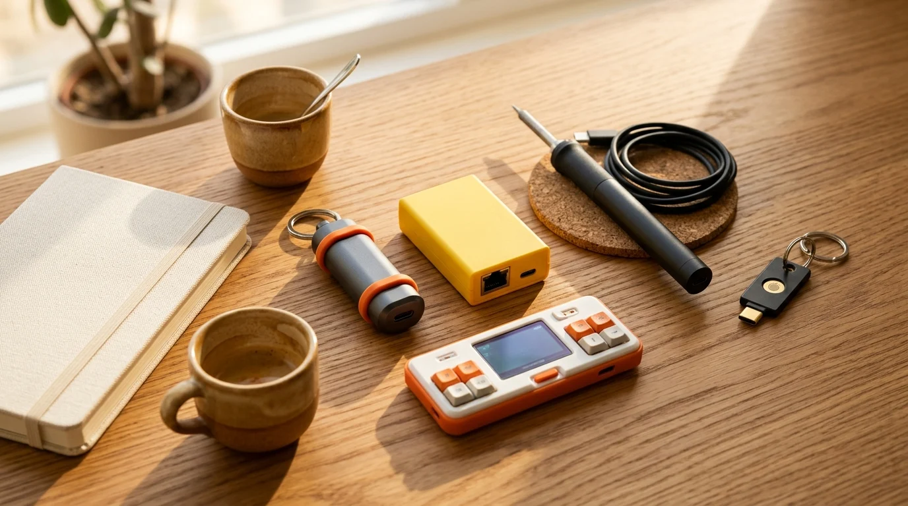

import Notice from "@components/widgets/Notice.astro";
import Accordion from "@components/widgets/Accordion.astro";
import Button from "@components/widgets/Button.astro";
import AmazonProduct from "@components/widgets/AmazonProduct.astro";

Most "gadgets for developers" roundups fall into one of two traps: either they recommend novelty binary-clock desk toys that go into a closet after two weeks, or they list a $3,500 MacBook Pro and a $1,600 Herman Miller chair as if those are impulse buys.

This list covers the middle ground—thirteen physical tools under $400 that solve specific problems when you write code, manage Linux servers, or debug hardware away from your main desk. Think hardware-backed `ed25519-sk` SSH keys that can't be phished, a fan-cooled thumb-sized NVMe drive that holds twenty bootable Ventoy ISOs without thermal throttling, a pocket OpenWrt router that tunnels hotel Wi-Fi straight into your home lab over WireGuard, and a $42 ESP32 QWERTY terminal you can script in MicroPython. All prices were checked on Amazon on November 18, 2026.

<Notice type="warning" title="Affiliate disclosure">
Some links below use `/go/` affiliate redirects to Amazon. Buying through them earns a small commission at no extra cost to you and helps fund our hardware testing.
</Notice>

## Quick picks

| Gadget | Price (Nov 18) | What it actually does for a developer | Link |
| --- | :---: | --- | --- |
| **Yubico Security Key C NFC** | $29.00 | Hardware-backed `ed25519-sk` SSH keys & phishing-proof FIDO2 | [Check Price](/go/yubico-security-key-c-nfc/) |
| **SHARGE Disk 2230 NVMe Capsule** | $39.99 | Active-cooled 10Gbps pocket drive with physical write-protect switch | [Check Price](/go/sharge-disk-nvme/) |
| **PINECIL V2 Smart Soldering Iron** | $39.99 | Open-source RISC-V USB-C PD iron that hits 350°C in 6 seconds | [Check Price](/go/pinecil-v2/) |
| **M5Stack Cardputer Adv (ESP32-S3)** | $41.90 | Credit-card 56-key QWERTY dev board for MicroPython & UART | [Check Price](/go/m5stack-cardputer-adv/) |
| **Meshtastic LoRa V3 2-Pack (915MHz)** | $63.99 | Two open-source encrypted off-grid mesh radio transceivers | [Check Price](/go/meshtastic-lora-v3-2pack/) |
| **iFixit Pro Tech Toolkit (64-Bit)** | ~$75.00 | Precision S2 steel bit kit + ESD tools for laptops and servers | [Check Price](/go/ifixit-pro-tech-toolkit/) |
| **Arzopa A1 15.6" USB-C Monitor** | $79.99 | Single-cable 1080p IPS second screen for hotel or desk debugging | [Check Price](/go/arzopa-a1-monitor/) |
| **Elgato Stream Deck Neo** | ~$89.99 | 8 LCD keys + clock bar for build scripts, git macros & call mute | [Check Price](/go/elgato-stream-deck-neo/) |
| **GL.iNet Beryl AX (GL-MT3000)** | ~$89–99 | Pocket OpenWrt Wi-Fi 6 router with 300Mbps WireGuard & Tailscale | [Check Price](/go/glinet-beryl-ax/) |
| **Anker Laptop Power Bank 25K (165W)** | $97.99 | 100W USB-C laptop charging with two built-in retractable cables | [Check Price](/go/anker-laptop-power-bank/) |
| **Keychron K3 Max (QMK/VIA)** | ~$110 | 75% low-profile wireless mechanical keyboard with browser remapping | [Check Price](/go/keychron-k3-max/) |
| **Logitech MX Master 4** | ~$119 | Free-spin MagSpeed scroll wheel for 5,000-line logs + thumb wheel | [Check Price](/go/logitech-mx-master-4/) |
| **Sony WH-1000XM6 Headphones** | ~$378 | 12-mic QN3 active noise cancellation + returned folding hinge | [Check Price](/go/sony-wh-1000xm6/) |

---

## Pocket hardware, security & bench tools

### 1. Yubico Security Key C NFC ($29.00)

If you still rely on 6-digit TOTP authenticator apps for GitHub, Cloudflare, AWS root accounts, and your password manager, a real-time reverse-proxy phishing page can intercept that code in milliseconds. A FIDO2 hardware passkey refuses to sign an authentication challenge unless the browser's exact origin domain matches.

Beyond web logins, the **$29** [Yubico Security Key C NFC](/go/yubico-security-key-c-nfc/) works natively with OpenSSH 8.2+ (`ssh-keygen -t ed25519-sk`). Your private SSH key handle stays bound to the physical token on your keyring, so even if malware scrapes `~/.ssh/` off your laptop, nobody can SSH into your production VPS without physically touching the gold capacitive contact on the key (see our [Linux SSH hardening guide](/secure-ssh-server-linux/)).

*Note:* The $29 Security Key C NFC handles FIDO2/WebAuthn and U2F only. If you want to sign Git commits with a hardware-resident OpenPGP key (`gpg --card-status`) or store offline OATH-TOTP codes on the key itself, step up to the **$58** [YubiKey 5C NFC](/go/yubikey-5c-nfc/).

<AmazonProduct
  productName="Yubico Security Key C NFC (FIDO2 / WebAuthn / OpenSSH)"
  productDescription="Crush-resistant, IP68 waterproof USB-C and NFC hardware security key supporting FIDO2/WebAuthn passkeys, U2F, and native OpenSSH ed25519-sk hardware-backed SSH authentication."
  productFeatures={[
    "Native OpenSSH 8.2+ `ed25519-sk` and `ecdsa-sk` hardware SSH key support",
    "Phishing-resistant FIDO2/WebAuthn passkeys for GitHub, AWS, Google, Cloudflare, and 1Password/Bitwarden",
    "Dual USB-C and tap-to-auth NFC for Linux, macOS, Windows, iOS, and Android",
    "Stores up to 100 discoverable resident passkeys; zero batteries or drivers"
  ]}
  productLink="/go/yubico-security-key-c-nfc/"
  productImage="https://m.media-amazon.com/images/I/41DkFsG8yEL._AC_SL1000_.jpg"
  productRating={4.6}
  recommendedBadge="Best Under-$30 Upgrade"
  pros={[
    "Half the price of the YubiKey 5 series while covering FIDO2 web logins and OpenSSH",
    "Survives keyrings, washing machines, and daily bag abuse"
  ]}
  cons={[
    "Does not include OpenPGP smart-card commit signing or PIV (get the $58 YubiKey 5C NFC for GPG)",
    "Always register a backup second key so a lost keychain doesn't lock you out"
  ]}
/>

### 2. SHARGE Disk Active-Cooled M.2 2230 NVMe Capsule ($39.99)

Standard USB thumb drives crawl once their SLC cache fills up, and passive metal NVMe enclosures cook your fingers after copying a 40GB Proxmox backup. The [SHARGE Disk](/go/sharge-disk-nvme/) is a half-ounce aluminum and transparent polycarbonate capsule built around the tiny **M.2 2230 NVMe** form factor (the 22×30mm SSDs used in the Steam Deck and Surface Pro), cooled by an internal **13,000 RPM silent PWM fan**.

Drop in a spare 1TB or 2TB 2230 NVMe drive and you get sustained **1,000MB/s (10Gbps)** transfers without thermal throttling, plus a physical **hardware read-only switch** on the side so you can plug a Ventoy multi-ISO recovery drive into an untrusted machine without risking filesystem writes. (Remember that this $39.99 listing is the empty enclosure; bring your own 2230 M.2 NVMe stick.)

<Button text="Check SHARGE Disk NVMe Capsule price" link="/go/sharge-disk-nvme/" variant="outline" color="blue" size="md" icon="arrow-right" />

### 3. PINECIL V2 Smart Mini Portable Soldering Iron ($39.99)

Even pure software developers eventually need to tack a header pin onto an ESP32 board, replace a clicking mouse microswitch, or fix a torn sensor wire. Instead of keeping a bulky 1980s soldering station in a closet, get the open-source [PINECIL V2](/go/pinecil-v2/). Powered by a 32-bit RISC-V SoC running community **IronOS** firmware, it plugs straight into any 65W+ USB-C PD laptop charger (or 12–24V barrel jack), heats from cold to 350°C in six seconds flat, and uses an accelerometer to drop into standby temperature the moment you set it down on the desk.

<Button text="Check PINECIL V2 Soldering Iron price" link="/go/pinecil-v2/" variant="outline" color="blue" size="md" icon="arrow-right" />

### 4. iFixit Pro Tech Toolkit (~$75.00)

The [iFixit Pro Tech Toolkit](/go/ifixit-pro-tech-toolkit/) is the standard bench roll for a reason: 64 CNC-machined S2 steel bits covering every security Torx, Apple pentalobe, Gamebit, tri-wing, and standoff screw you'll ever run across, paired with an aluminum ball-bearing driver handle, ESD wrist strap, angled tweezers, Jimmy metal pry blade, and nylon spudgers. It pays for itself the first time you upgrade laptop RAM or swap an NVMe drive without chewing up a captive case screw.

<Button text="Check iFixit Pro Tech Toolkit price" link="/go/ifixit-pro-tech-toolkit/" variant="outline" color="blue" size="md" icon="arrow-right" />

### 5. GL.iNet Beryl AX (GL-MT3000) Pocket OpenWrt Router (~$89–99)

Connecting your laptop, phone, and portable test devices one by one to a sketchy hotel or conference captive portal is painful—and most hotel networks enable client isolation so you can't even SSH from your laptop into a local dev board on the same desk.

The [GL.iNet Beryl AX](/go/glinet-beryl-ax/) solves both problems. It runs genuine **OpenWrt** with a clean web UI on top, connects to the hotel Wi-Fi (or 2.5GbE wall jack) once, and broadcasts your own private WPA3 Wi-Fi 6 subnet to all your devices. Turn on its built-in **WireGuard** (~300Mbps throughput) or **Tailscale** client and every device on your travel desk can reach your [home server](/best-mini-pc-home-server/), internal GitLab, and NAS shares as if you never left your house. Compare it against the newer Wi-Fi 7 Beryl 7 in our [best travel routers for WireGuard and Tailscale guide](/best-travel-router-wireguard-tailscale/).

<Button text="Check GL.iNet Beryl AX price" link="/go/glinet-beryl-ax/" variant="outline" color="blue" size="md" icon="arrow-right" />

### 6. Elgato Stream Deck Neo (~$89.99)

If you don't need the four audio mixing dials on the $180 Stream Deck + from our [desk setup guide](/best-desk-setup-gadgets-2027/), the compact [Elgato Stream Deck Neo](/go/elgato-stream-deck-neo/) gives you eight crisp LCD macro buttons plus a live date/time/status InfoBar between two touch page buttons for around $90. Wire individual buttons to run `docker compose up -d --build`, switch kubectl contexts, toggle your microphone with a bright red mute icon, or fire Home Assistant webhooks when you sit down to code.

<Button text="Check Elgato Stream Deck Neo price" link="/go/elgato-stream-deck-neo/" variant="outline" color="blue" size="md" icon="arrow-right" />

### 7. M5Stack Cardputer Adv ESP32-S3 Pocket Computer ($41.90)

Most ESP32 dev boards end up dangling from a breadboard by five jumper wires until somebody knocks them off the desk. The [M5Stack Cardputer Adv](/go/m5stack-cardputer-adv/) packages an **ESP32-S3** (StampS3A module with 8MB Flash), a 56-key tactile QWERTY thumb keyboard, a crisp 1.14-inch 240×135 IPS screen, a speaker, MEMS microphone, infrared transmitter, microSD slot, and a **1,750mAh internal battery** inside an injection-molded shell the footprint of a stack of credit cards.

The newer **Adv** hardware revision adds a 6-axis BMI270 IMU and breaks out a full **14-pin GPIO header** alongside the HY2.0-4P Grove port. Flash it with UIFlow2 (MicroPython), Arduino C++, ESP-IDF, or multi-tool community firmwares via M5Burner to use it as a portable UART serial monitor, Wi-Fi/BLE packet tester, MQTT sensor debugger, or pocket retro terminal.

<AmazonProduct
  productName="M5Stack Cardputer Adv (ESP32-S3 Pocket QWERTY Dev Computer)"
  productDescription="Credit-card-sized programmable ESP32-S3 handheld computer with a 56-key QWERTY keyboard, 1.14-inch color TFT display, 1,750mAh battery, audio codec, 6-axis IMU, microSD slot, and 14-pin GPIO expansion bus."
  productFeatures={[
    "ESP32-S3FN8 dual-core Xtensa LX7 @ 240MHz with Wi-Fi + BLE 5.0",
    "56-key tactile thumb keyboard + 1.14-inch 240×135 IPS LCD screen",
    "Adv upgrade: 14-pin GPIO header, BMI270 6-axis IMU, ES8311 audio + 3.5mm jack, 1,750mAh battery",
    "Programmable in MicroPython (UIFlow2), Arduino IDE, ESP-IDF, and PlatformIO"
  ]}
  productLink="/go/m5stack-cardputer-adv/"
  productImage="https://m.media-amazon.com/images/I/71QaSJCNHPL._AC_SL1500_.jpg"
  productRating={4.5}
  recommendedBadge="Most Fun Under $45"
  pros={[
    "Self-contained ESP32-S3 lab with battery, screen, and keyboard always ready in a pocket",
    "Huge open-source firmware ecosystem via M5Burner (serial terminal, RF/IR tools, MicroPython REPL)"
  ]}
  cons={[
    "Thumb keys are built for short commands and hex entry, not writing essays",
    "ESP32-S3 radios support 2.4GHz Wi-Fi only (no 5GHz)"
  ]}
/>

### 8. Meshtastic ESP32 LoRa V3 2-Pack Starter Kit ($63.99)

Want a weekend networking project that has nothing to do with cloud APIs or TCP/IP? This [2-pack of 915MHz Heltec LoRa V3 boards](/go/meshtastic-lora-v3-2pack/) comes with snap-fit cases, stubby antennas, and rechargeable LiPo batteries ready to flash with open-source **Meshtastic** firmware from a Chrome browser (`flasher.meshtastic.org`).

Once flashed, the boards form a zero-infrastructure, AES-256 encrypted long-range radio mesh that relays text messages, GPS coordinates, and MQTT telemetry across miles with zero cellular or internet coverage. Leave one node on your homelab window sill bridged to your local MQTT broker and carry the second one in your pack on hikes.

<Button text="Check Meshtastic LoRa 2-Pack price" link="/go/meshtastic-lora-v3-2pack/" variant="outline" color="blue" size="md" icon="arrow-right" />

---

## Daily desk & travel workhorses

### 9. Keychron K3 Max Low-Profile QMK/VIA Wireless Keyboard (~$110)

For an engineer typing 40+ hours a week, the [Keychron K3 Max](/go/keychron-k3-max/) solves three problems at once: its low-profile Gateron mechanical switches keep your wrists flat without needing a bulky palm rest, its 75% layout keeps dedicated arrow and function keys in a backpack-friendly footprint, and its open-source **QMK/VIA firmware** lets you remap keys and layers directly in Chrome (`usevia.app`) without installing sketchy background drivers on a locked-down corporate laptop. It connects via a low-latency 2.4GHz USB receiver, three Bluetooth channels, or wired USB-C.

<Button text="Check Keychron K3 Max price" link="/go/keychron-k3-max/" variant="outline" color="blue" size="md" icon="arrow-right" />

### 10. Logitech MX Master 4 Ergonomic Wireless Mouse (~$119)

When you spend half your afternoon scrolling horizontally through wide Git diffs or vertically through 10,000 lines of container stdout, a standard mouse wheel gets old fast. The [Logitech MX Master 4](/go/logitech-mx-master-4/) pairs its electromagnetic MagSpeed wheel (which automatically disengages its ratchet when you flick it to coast through thousands of lines a second) with a dedicated metal thumb wheel for horizontal scrolling and gesture buttons for hopping across virtual desktops.

<Button text="Check Logitech MX Master 4 price" link="/go/logitech-mx-master-4/" variant="outline" color="blue" size="md" icon="arrow-right" />

### 11. Arzopa A1 15.6-Inch USB-C Portable Monitor ($79.99)

Debugging a broken deployment on a single 13-inch or 14-inch laptop screen in a hotel room is miserable—you spend more time `Cmd+Tab`bing between your IDE, browser DevTools, and SSH terminal than actually fixing the bug. At **$79.99**, the 1.6-pound [Arzopa A1 15.6-inch 1080p IPS monitor](/go/arzopa-a1-monitor/) slips into the same backpack sleeve as your laptop and lights up over a single USB-C DisplayPort cable with no wall brick required. Back at your home desk, stand it underneath your main monitor as a permanent `htop`/Grafana/logs display.

<Button text="Check Arzopa A1 Monitor price" link="/go/arzopa-a1-monitor/" variant="outline" color="blue" size="md" icon="arrow-right" />

### 12. Anker Laptop Power Bank 25,000mAh 165W ($97.99)

Compiling Rust or running four local Docker containers drains a laptop battery fast when you're stuck in an airport terminal or a conference room with zero open wall outlets. The [Anker 25,000mAh 165W Power Bank](/go/anker-laptop-power-bank/) pushes a full **100W** over USB-C PD (enough to charge a 16-inch MacBook Pro or ThinkPad under load, not just slow down the drain), stays under the 100Wh TSA carry-on limit, and has **two built-in retractable USB-C cables** so you never dig through your bag looking for a cord.

<Button text="Check Anker 165W Power Bank price" link="/go/anker-laptop-power-bank/" variant="outline" color="blue" size="md" icon="arrow-right" />

### 13. Sony WH-1000XM6 Noise-Canceling Headphones (~$378)

Deep concentration requires killing background speech, and human voices are the hardest frequency band for cheap ANC headphones to cancel. Sony's [WH-1000XM6](/go/sony-wh-1000xm6/) uses its new QN3 processor and 12 microphones to blank out open-office chatter, HVAC rumble, and airplane cabin noise, while bringing back the **foldable hinge design** that makes them pack down cleanly into a tech bag.

<Button text="Check Sony WH-1000XM6 price" link="/go/sony-wh-1000xm6/" variant="outline" color="blue" size="md" icon="arrow-right" />

---

## FAQ

<Accordion label="Which two gadgets on this list should a developer buy first?" group="faq" expanded="true">
Start with the **$29 Yubico Security Key C NFC** (actually buy two so you have an off-site backup key) and the **~$75 iFixit Pro Tech Toolkit**. One locks down your GitHub, cloud consoles, and OpenSSH servers against phishing; the other opens and repairs every laptop, mini PC, and controller you own for the next decade. After those two, upgrade the keyboard and mouse your hands touch for eight hours a day.
</Accordion>

<Accordion label="Do I need the $29 Yubico Security Key C NFC or the $58 YubiKey 5C NFC?" group="faq">
If you want hardware-backed FIDO2/WebAuthn passkeys for GitHub, AWS, Google, Cloudflare, and Bitwarden/1Password—plus native OpenSSH `ed25519-sk` SSH keys—the **$29 Yubico Security Key C NFC** does the exact same job at half the cost. Only step up to the **$58 YubiKey 5C NFC** if you specifically use smart-card OpenPGP (`gpg --card-status`) to sign Git commits on the key, PIV x509 certificates, or Yubico Authenticator offline TOTP codes.
</Accordion>

<Accordion label="Are the M5Stack Cardputer Adv and Meshtastic LoRa radios actually useful or just toys?" group="faq">
Both are real open-source hardware tools disguised as fun pocket gadgets. The **Cardputer Adv ($41.90)** is a battery-powered ESP32-S3 with an exposed 14-pin GPIO header and Grove bus that makes prototyping MicroPython scripts, testing I2C/UART sensors, or debugging serial output far cleaner than wiring a bare dev board. And the **Meshtastic LoRa V3 pair ($63.99)** is a genuine off-grid 915MHz radio link that many self-hosters use to receive out-of-band home server alerts when their ISP connection drops.
</Accordion>

<Accordion label="Where can I find bigger workstation and home-server hardware recommendations?" group="faq">
For full desk builds, see our [best desk setup gadgets for 2027](/best-desk-setup-gadgets-2027/), [best 32-inch 4K OLED monitors](/best-32-inch-oled-monitors-guide/), and [Thunderbolt 5 docks guide](/best-thunderbolt-5-docks-guide/). For the self-hosting side, check our [best mini PCs for a home server](/best-mini-pc-home-server/) and [tech gifts for homelab owners](/tech-gifts-homelab-owners/).
</Accordion>

## Bottom line

Every tool on this page earns its space by solving a recurring engineering friction point: unphishable `ed25519-sk` SSH logins with the **$29** [Yubico Security Key C NFC](/go/yubico-security-key-c-nfc/), throttle-free bootable ISOs on the **$39.99** [SHARGE Disk NVMe Capsule](/go/sharge-disk-nvme/), hotel-to-homelab WireGuard routing on the [GL.iNet Beryl AX](/go/glinet-beryl-ax/), and all-day typing ergonomics on the [Keychron K3 Max](/go/keychron-k3-max/).

Shopping for a developer friend or teammate rather than yourself? Head over to our [19 cool gifts for programmers guide](/gifts-for-programmers/) for even more under-$50 and $100+ hardware ideas.
