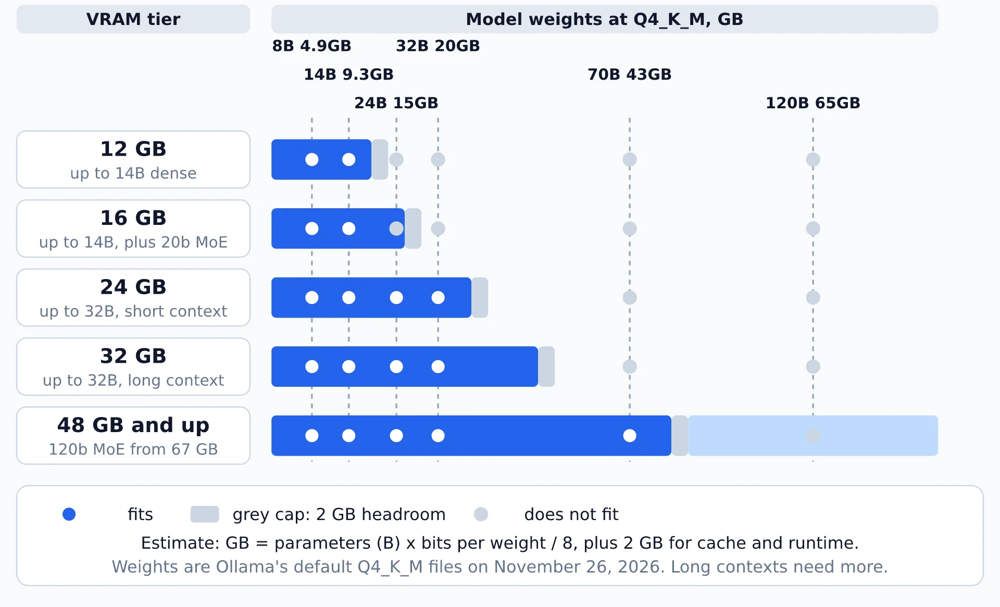
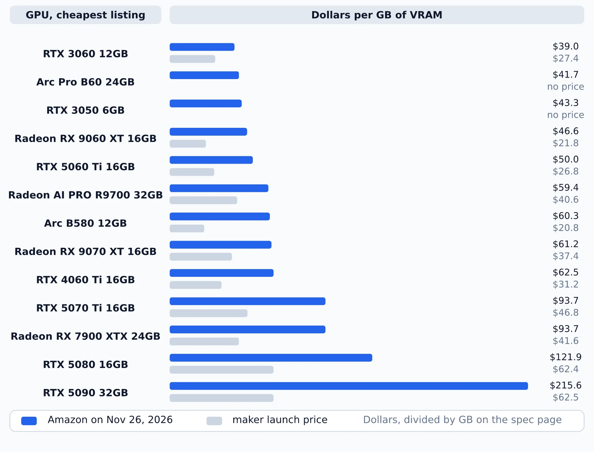
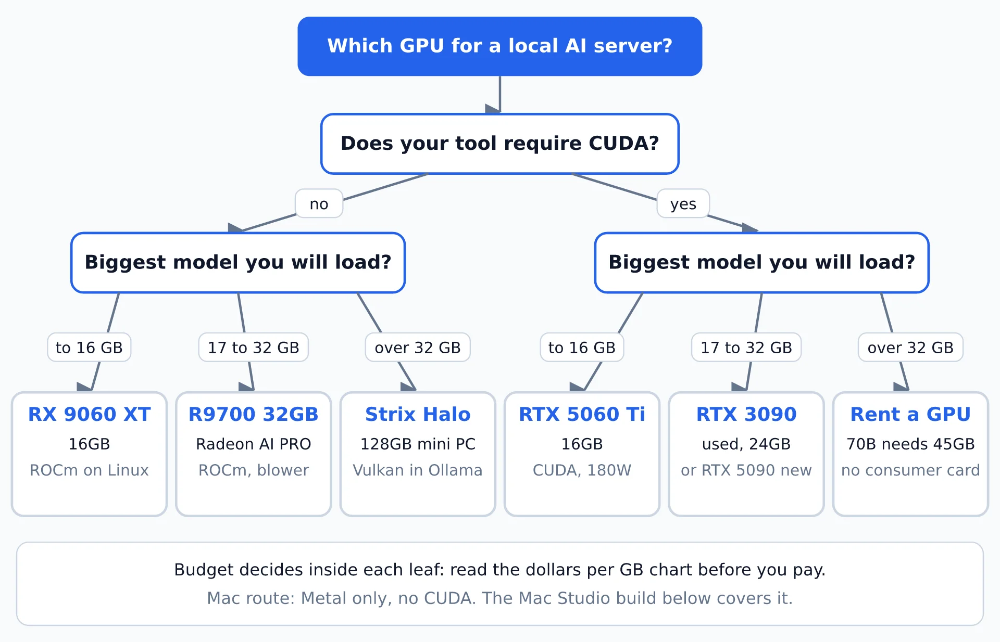

import Notice from "@components/widgets/Notice.astro";
import Accordion from "@components/widgets/Accordion.astro";
import AmazonProduct from "@components/widgets/AmazonProduct.astro";

For a local AI server, the **[RTX 5060 Ti 16GB](#1-rtx-5060-ti-16gb-the-default-buy)** is the GPU I'd buy. It costs $799.99 to $824 on November 26, 2026, about $50 per GB of VRAM, and runs 8B to 14B models on the GPU. Need 24 GB or more? The Arc Pro B60 24GB is the cheapest new card, and the 32GB Radeon AI PRO R9700 gives a 32B model room for a long context.

<Notice type="warning" title="Affiliate disclosure">
Some links below are Amazon affiliate links, including `/go/` redirects that land on Amazon. Buying through them pays me a small commission at no extra cost to you. Prices were checked on November 26, 2026 and move constantly, so always confirm on the product page.
</Notice>

## Quick picks

| GPU | Price (Nov 26, 2026) | VRAM | $ per GB | Buy it if |
| --- | --- | --- | --- | --- |
| [RTX 5060 Ti 16GB](/go/rtx-5060-ti-16gb/) | $824 | 16 GB | $51.50 | You want CUDA |
| [RTX 3060 12GB](/go/gigabyte-rtx-3060-12gb/) | $467.63 | 12 GB | $38.97 | 8B models are enough |
| [Radeon RX 9060 XT 16GB](/go/asus-dual-radeon-rx-9060-xt-16gb/) | $745 | 16 GB | $46.56 | Ollama on Linux, no CUDA |
| [Arc Pro B60 24GB](/go/asrock-arc-pro-b60-creator-24gb/) | $999.99 | 24 GB | $41.67 | 32B models under $1,000 |
| [Radeon AI PRO R9700 32GB](/go/asus-turbo-radeon-ai-pro-r9700-32gb/) | $2,359.99 | 32 GB | $73.75 | 32B with long context, or two cards |

## What fits in 12, 16, 24 and 32GB of VRAM?

12 GB runs 8B and 14B models at 4-bit and nothing bigger. 16 GB adds gpt-oss-20b with almost no headroom. 24 GB runs 32B models at short context, and 32 GB runs them with room for a long one. A 70B model needs about 45 GB, which no single card here holds.

Weights in GB equal parameters in billions, times bits per weight, divided by 8. A true 4-bit copy of a 32B model is 16 GB, but real Q4_K_M files run near 4.9 to 5 bits per weight. Ollama's defaults are 4.9 GB for [llama3.1:8b](https://ollama.com/library/llama3.1/tags), 9.3 GB for [qwen3:14b](https://ollama.com/library/qwen3/tags), 15 GB for [mistral-small3.2:24b](https://ollama.com/library/mistral-small3.2/tags), 14 GB for [gpt-oss:20b](https://ollama.com/library/gpt-oss/tags) and 20 GB for [qwen3:32b](https://ollama.com/library/qwen3/tags). Add 2 GB for the KV cache and the runtime to get the fit line.



*Estimate, not a measurement: Ollama's default Q4_K_M file sizes on November 26, 2026, plus 2 GB for cache and runtime.*

gpt-oss-20b is a mixture-of-experts model with 21B parameters and 3.6B active per token, per [OpenAI's model card](https://huggingface.co/openai/gpt-oss-20b). Long prompts grow the KV cache, so the 2 GB is a short-prompt figure. [Local LLM Advisor](https://localllmadvisor.com/blog/state-of-local-llm-hardware-oct-2026.html), whose speed numbers I cite below, fits models the same way.

## Dollars per GB of VRAM, ranked

Price per GB is the comparison that holds when no card sells at launch price. Each row is the cheapest Amazon listing I found for that model on November 26, 2026, divided by the memory on the maker's spec page.

| GPU | Amazon price (Nov 26, 2026) | VRAM | Bus | Power | $ per GB | Launch price |
| --- | --- | --- | --- | --- | --- | --- |
| [RTX 3060 12GB](/go/gigabyte-rtx-3060-12gb/) | $467.63 | 12 GB | 192-bit | 170 W | $38.97 | $329 |
| [Arc Pro B60 24GB](/go/asrock-arc-pro-b60-creator-24gb/) | $999.99 | 24 GB | 192-bit | 200 W | $41.67 | none published |
| [Radeon RX 9060 XT 16GB](/go/asus-dual-radeon-rx-9060-xt-16gb/) | $745 | 16 GB | 128-bit | 160 W | $46.56 | $349 |
| [RTX 5060 Ti 16GB](/go/rtx-5060-ti-16gb/) | $799.99 to $824 | 16 GB | 128-bit | 180 W | $50.00 to $51.50 | $429 |
| [Radeon AI PRO R9700 32GB](/go/powercolor-radeon-ai-pro-r9700-32gb/) | $1,899.99 | 32 GB | 256-bit | 300 W | $59.37 | $1,299 |
| [Radeon RX 9070 XT 16GB](/go/xfx-radeon-rx-9070-xt-16gb/) | $979.99 | 16 GB | 256-bit | 304 W | $61.25 | $599 |
| [RTX 4060 Ti 16GB](/go/msi-rtx-4060-ti-16gb-ventus-3x/) | $999.99 | 16 GB | 128-bit | 165 W | $62.50 | $499 |
| [RTX 5070 Ti 16GB](/go/pny-rtx-5070-ti-16gb/) | $1,499 | 16 GB | 256-bit | 300 W | $93.69 | $749 |
| RX 7900 XTX 24GB | $2,249 | 24 GB | 384-bit | 355 W | $93.71 | $999 |
| [RTX 5080 16GB](/go/gigabyte-rtx-5080-aero-oc-sff-16gb/) | $1,949.99 | 16 GB | 256-bit | 360 W | $121.87 | $999 |
| [RTX 5090 32GB](/go/asus-rog-astral-rtx-5090-32gb/) | $6,899.94 | 32 GB | 512-bit | 575 W | $215.62 | $1,999 |

Specs come from [NVIDIA's compare table](https://www.nvidia.com/en-us/geforce/graphics-cards/compare), AMD's [RX 9070 XT](https://www.amd.com/en/products/graphics/desktops/radeon/9000-series/amd-radeon-rx-9070xt.html) page, Intel's [Arc B580](https://www.intel.com/content/www/us/en/products/sku/241598/intel-arc-b580-graphics/specifications.html) page and the maker pages linked below. Launch prices are the makers': NVIDIA's [50 series](https://nvidianews.nvidia.com/news/nvidia-blackwell-geforce-rtx-50-series-opens-new-world-of-ai-computer-graphics), [5060 Ti](https://nvidianews.nvidia.com/news/nvidia-blackwell-geforce-rtx-arrives-for-every-gamer-starting-at-299), [4060 Ti](https://blogs.nvidia.com/blog/geforce-rtx-4060-ti/) and [3060](https://nvidia.com/en-us/geforce/news/gfecnt/20211/nvidia-geforce-rtx-game-on-announcement-roundup) posts. AMD's [RX 9070 XT](https://d1io3yog0oux5.cloudfront.net/_c2f0f19dde702988fbf14ececfea2041/amd/news/2025-02-28_AMD_Unveils_Next_Generation_AMD_RDNA_4_1238.pdf), [RX 9060 XT](https://ir.amd.com/news-events/press-releases/detail/1253/amd-introduces-new-radeon-graphics-cards-and-1253) and [RX 7900 XTX](https://amd.com/en/newsroom/press-releases/2022-11-3-amd-unveils-world-s-most-advanced-gaming-graphics-.html) releases cover its cards, and its [Radeon AI PRO page](https://www.amd.com/en/products/graphics/workstations/radeon-ai-pro.html) states the R9700 MSRP.

I would buy the RTX 3060, the Arc Pro B60, the RX 9060 XT, the 5060 Ti and the R9700. I would skip the rest: they sell the same memory for more, or too little of it. The Arc B580 sells near three times its $249 launch price, and 6 GB on an RTX 3050 runs an 8B model and little else. Nothing sits at launch price: the RTX 3060 is closest at 1.4 times, the RTX 5090 furthest at 3.5 times its $1,999.



*Amazon listing prices on November 26, 2026, divided by the VRAM on each maker's spec page. Grey bars use the maker's launch price.*

## Which GPU should you pick for a local AI server?

Answer two questions and the list collapses to one card. Does your tool need CUDA? TensorRT-LLM and any notebook written against CUDA do; Ollama and llama.cpp do not. Then size the biggest model you will load with the formula above, and buy the cheapest card that holds it plus 2 GB.

If 8B models are enough, the [RTX 3060 12GB](/go/gigabyte-rtx-3060-12gb/) is the cheapest CUDA card I would buy, at 170 W. If CUDA will never matter, the [Radeon RX 9060 XT 16GB](/go/asus-dual-radeon-rx-9060-xt-16gb/) costs $79 less on November 26, 2026 and runs through ROCm on Linux. AMD's [page](https://www.amd.com/en/products/graphics/desktops/radeon/9000-series/amd-radeon-rx-9060xt.html) rates it at 320 GB/s.

For image generation, stay on NVIDIA. [ComfyUI's README](https://github.com/comfyanonymous/ComfyUI) lists NVIDIA, AMD, Intel and Apple Silicon, but each needs its own install: a CUDA build, ROCm wheels, or Intel's xpu build. VRAM decides which image models load.



*Answer the CUDA question first; the $ per GB table above settles the budget call.*

## 1. RTX 5060 Ti 16GB: the default buy

The 5060 Ti 16GB is the cheapest 16 GB NVIDIA card per GB, and 180 W lets it drop into a desktop you already own. On gpt-oss 20B at Q4, [Local LLM Advisor](https://localllmadvisor.com/blog/state-of-local-llm-hardware-oct-2026.html)'s dataset has it generating 134.1 tokens per second, against 103.7 for the RTX 4060 Ti 16GB.

**Best for:** 8B to 14B models at 4-bit in Ollama or llama.cpp, with CUDA on tap for image generation.

**Strengths:** 16 GB of GDDR7 and 448 GB/s on [NVIDIA's table](https://www.nvidia.com/en-us/geforce/graphics-cards/compare). One 8-pin connector and a 600 W system requirement. Amazon.com sells it at $824, and the PNY card at $799.99, on November 26, 2026.

**Trade-offs:** The 128-bit bus is the lowest of the RTX 50 cards. About 1.9 times its $429 launch price. No 32B model fits.

<AmazonProduct
  productName="ASUS Dual GeForce RTX 5060 Ti 16GB GDDR7 OC Edition"
  productDescription="16 GB of GDDR7 on a 180 W card with one 8-pin connector. The default GPU for a first local AI server."
  productFeatures={["16 GB GDDR7, 128-bit bus, 448 GB/s", "180 W, one 8-pin connector, 600 W system", "4608 CUDA cores, CUDA capability 12.0"]}
  productLink="/go/rtx-5060-ti-16gb/"
  productImage="https://m.media-amazon.com/images/I/81kYKB0Aj5L._AC_SL1500_.jpg"
  productRating={4.6}
  recommendedBadge="Best Overall"
  importantConsiderations={["About 1.9 times its $429 launch price", "No 32B model fits in 16 GB"]}
  pros={["Cheapest 16 GB NVIDIA card per GB today", "Fits older power supplies and small cases"]}
  cons={["128-bit bus limits generation speed", "Far above launch price"]}
/>

## 2. Arc Pro B60 24GB: the cheapest new 24GB card

The Arc Pro B60 is 24 GB for $999.99 on November 26, 2026, or $41.67 per GB. No other card I priced offers 24 GB for under $1,100. Ollama lists Intel under neither CUDA nor ROCm, so it runs through Vulkan.

**Best for:** 32B models at 4-bit on one card under $1,000, through Vulkan in Ollama or llama.cpp.

**Strengths:** 24 GB of GDDR6 at 456 GB/s on a 192-bit bus, per [Intel's spec page](https://www.intel.com/content/www/us/en/products/sku/243916/intel-arc-pro-b60-graphics/specifications.html). ASRock's listing describes a 2-slot card 271 mm long with one 8-pin connector.

**Trade-offs:** No CUDA and no ROCm, and I found no third-party tokens-per-second figure I would quote. Intel publishes no launch price.

<AmazonProduct
  productName="ASRock Intel Arc Pro B60 Creator 24GB"
  productDescription="24 GB of GDDR6 for under $1,000, run through Vulkan in Ollama and llama.cpp. The cheapest new card that holds a 32B model."
  productFeatures={["24 GB GDDR6, 192-bit bus, 456 GB/s", "200 W TBP, one 8-pin connector", "20 Xe2 cores on PCIe 5.0 x8"]}
  productLink="/go/asrock-arc-pro-b60-creator-24gb/"
  productImage="https://m.media-amazon.com/images/I/61Z1OPznJFL._AC_SL1200_.jpg"
  productRating={4.2}
  recommendedBadge="Best for 24GB"
  importantConsiderations={["No CUDA and no ROCm: Vulkan is the path in Ollama", "Thin Amazon rating history"]}
  pros={["Lowest $ per GB of any 24 GB card today", "Holds 32B models at 4-bit", "2-slot card with a single 8-pin cable"]}
  cons={["Software support depends on Vulkan or SYCL", "No public tokens-per-second benchmark"]}
/>

## 3. Radeon AI PRO R9700 32GB: 32GB without NVIDIA pricing

The R9700 is 32 GB with official ROCm support, at $1,899.99 for the PowerColor card on November 26, 2026. The ASUS Turbo costs $2,359.99 and suits a multi-GPU box, because it is a blower design. In a February 2026 [llama-bench comparison](https://github.com/ggml-org/llama.cpp/discussions/19890), an R9700 on Vulkan generated 127.4 tokens per second on Qwen3.5-35B-A3B, against 194.0 for an RTX 5090 on CUDA.

**Best for:** 32B models with a long context on one card, or two stacked cards for 64 GB, in Ollama on Linux.

**Strengths:** 32 GB of GDDR6 at 640 GB/s and 300 W, per [AMD's page](https://www.amd.com/en/products/graphics/workstations/radeon-ai-pro/ai-9000-series/amd-radeon-ai-pro-r9700.html). ROCm 7.14.1 lists it, and AMD states an MSRP of $1,299. ASUS builds the Turbo as a 2-slot blower 266.7 mm long.

**Trade-offs:** No CUDA. Ollama's Windows ROCm list omits it, so Windows runs it through Vulkan. It sells for 1.5 to 1.8 times MSRP.

<AmazonProduct
  productName="ASUS Turbo Radeon AI PRO R9700 32GB"
  productDescription="32 GB of GDDR6 with official ROCm support and a 2-slot blower cooler built for stacked multi-GPU boxes."
  productFeatures={["32 GB GDDR6, 256-bit bus, 640 GB/s", "300 W TBP, one 16-pin connector, 750 W PSU", "2-slot blower cooler, 266.7 mm long"]}
  productLink="/go/asus-turbo-radeon-ai-pro-r9700-32gb/"
  productImage="https://m.media-amazon.com/images/I/71V13OfYCxL._AC_SL1500_.jpg"
  productRating={4.6}
  recommendedBadge="Room to Grow"
  importantConsiderations={["No CUDA: NVIDIA-only tools will not run", "Ollama uses Vulkan for it on Windows"]}
  pros={["32 GB for about a quarter of an RTX 5090's price", "Blower cooler suits two stacked cards", "ROCm support on Linux"]}
  cons={["Slower prompt processing than a 5090", "300 W asks for a 750 W supply"]}
/>

## Three local AI server builds at three budgets

Three complete routes, cheapest first, priced on Amazon on November 26, 2026.

| Build | Price (Nov 26, 2026) | Memory | $ per GB | Largest model it holds (estimate) |
| --- | --- | --- | --- | --- |
| 16 GB CUDA box, parts below | $1,656.23 | 16 GB GDDR7 | $103.51 | 14B with context |
| [GMKtec EVO-X2 with 64GB](/go/gmktec-evo-x2-64gb/) | $2,199.99 | 64 GB unified | $34.38 | 32B |
| [Mac Studio M5 Max with 36GB](/go/mac-studio-m5-max/) | $2,299 | 36 GB unified | $63.86 | 32B at short context |

Build 1 is this parts list:

| Part | Price (Nov 26, 2026) |
| --- | --- |
| [ASUS Dual RTX 5060 Ti 16GB](/go/rtx-5060-ti-16gb/) | $824.00 |
| [AMD Ryzen 5 5600X](/go/amd-ryzen-5-5600x/) with its Wraith Stealth cooler | $127.28 |
| [GIGABYTE B550 Eagle WiFi6](/go/gigabyte-b550-eagle-wifi6/) | $99.99 |
| [CORSAIR Vengeance LPX 32GB DDR4](/go/corsair-vengeance-lpx-32gb-ddr4/) | $249.99 |
| [Acer Predator GM7 1TB SSD](/go/predator-gm7-1tb/) | $189.99 |
| [CORSAIR RM750e 750W ATX 3.1](/go/corsair-rm750e-750w/) | $89.99 |
| [Lian Li V100 ATX case](/go/lian-li-v100-atx-case/) | $74.99 |
| Total | $1,656.23 |

The platform is where the money hides. A 32GB DDR5 kit costs more than a Ryzen 5 9600X and an ASRock B650 Pro RS together, and that CPU ships without a cooler. So this list uses AM4 parts and DDR4 and saves about $300. The V100 takes GPUs up to 420 mm, and the RM750e has a native 12V-2x6 cable for a bigger card later.

Build 2 swaps the box for the GMKtec EVO-X2 with 64GB. Its unified memory counts as VRAM, so it has the lowest $ per GB here, and Ollama lists its Ryzen AI Max+ 395 under ROCm on Linux. The 128GB version loads a 70B model; the [mini PC guide](/best-mini-pc-local-llm/) has those prices and the installer caveats.

Build 3 is a Mac Studio with the M5 Max and 36GB, which Apple specs at 460 GB/s. Ollama uses Metal there, so there is no CUDA, and Docker is no shortcut: as the [Ollama Docker guide](/ollama-docker-install/) explains, containers on macOS cannot reach the GPU.

## CUDA, ROCm or Vulkan: which backend runs your card?

Ollama picks its backend by vendor: CUDA for NVIDIA, ROCm on Linux for the Radeon cards on its list, Metal on Apple, Vulkan for everything else. [llama.cpp](https://github.com/ggml-org/llama.cpp/blob/master/docs/build.md) makes you choose at compile time, and `--list-devices` shows what the binary can see. Sources: [Ollama's hardware page](https://docs.ollama.com/gpu) and [ROCm 7.14.1's supported GPU list](https://rocm.docs.amd.com/projects/install-on-linux/en/latest/reference/system-requirements.html).

| Card | Ollama | llama.cpp build |
| --- | --- | --- |
| NVIDIA cards on this page | CUDA (compute capability 5.0 or newer, driver 550 or newer) | CUDA |
| Radeon RX 9060 XT, RX 9070 XT, R9700 | ROCm on Linux; Vulkan on Windows | HIP or Vulkan |
| Radeon RX 7900 XTX | ROCm on Linux and Windows | HIP or Vulkan |
| Arc Pro B60, Arc B580 | Vulkan only | Vulkan or SYCL |
| Ryzen AI Max+ 395 (Strix Halo) and Apple Silicon | ROCm on Linux for the Ryzen; Metal on Apple | HIP or Vulkan; Metal by default |

```bash
cmake -B build -DGGML_CUDA=ON                                   # NVIDIA
cmake -S . -B build -DGGML_HIP=ON -DGPU_TARGETS=gfx1201         # Radeon RX 9070 XT and R9700
cmake -B build -DGGML_VULKAN=1                                  # any Vulkan driver, including Intel
```

AMD's own R9700 page says its published tests ran the Vulkan build of llama.cpp inside LM Studio. A second poster in the llama.cpp discussion measured about 183 tokens per second through Vulkan against about 150 through ROCm HIP. In Docker, Ollama's `:rocm` tag carries ROCm and the main image carries a Vulkan runtime, as the [Docker guide](/ollama-docker-install/) shows.

## How big a PSU and case do you need?

For the 5060 Ti 16GB, a 600 W supply and a case that takes a 229 mm, 2.5-slot card. For a 300 W card, a 750 W supply. An NVIDIA flagship wants a case with at least 315 mm of clearance. Partner cards differ from the Founders Edition, so check the exact model.

NVIDIA asks for 850 W with the RTX 5080 and 1000 W with the RTX 5090, which takes four 8-pin cables or one 600 W Gen 5 cable. AMD asks for 750 W for the R9700, with one 16-pin connector, and for the RX 9070 XT, with two 8-pin. For length, count 266.7 mm for the ASUS Turbo R9700, 312 mm for the ASUS Prime RX 9070 XT, and 304 mm for a Founders Edition 5090. Figures come from the maker pages above and the [ASUS Dual 5060 Ti](https://www.asus.com/motherboards-components/graphics-cards/dual/dual-rtx5060ti-o16g/techspec/), [Prime RX 9070 XT](https://www.asus.com/motherboards-components/graphics-cards/prime/prime-rx9070xt-o16g/techspec/) and [Turbo R9700](https://www.asus.com/motherboards-components/graphics-cards/turbo/turbo-ai-pro-r9700-32g/techspec/) spec pages.

A blower card pushes its heat out through the bracket. An open-air card blows most of it back into the case, which is fine for one card. With two cards a slot apart, the upper card's fans sit millimetres off the lower card's backplate and breathe its exhaust. ASUS builds its Turbo R9700 as a 2-slot blower for exactly that case. Two of them give 64 GB, double any single card here, and Ollama selects devices through `CUDA_VISIBLE_DEVICES`, `ROCR_VISIBLE_DEVICES` or `GGML_VK_VISIBLE_DEVICES`.

## How much power will it draw, and how loud will it be?

At its rating, a 180 W card running four hours a day uses 0.72 kWh a day. At $0.16 per kWh, the rate the [mini PC guide](/best-mini-pc-local-llm/) uses, that is about $3.50 a month. The 575 W RTX 5090 comes to 2.3 kWh a day, about $11. Those are card ratings, not wall measurements.

Noise follows watts, because every watt leaves as heat the fans have to move. I measured nothing here, so I will not rank cards by decibels. Power-limiting is the free fix for a loud card: one owner in the thread below caps two RTX 3090s at 285 W each.

## The used RTX 3090, and why it has no link here

The 3090 is still the cheapest route to 24 GB with CUDA. [NVIDIA's table](https://www.nvidia.com/en-us/geforce/graphics-cards/compare) lists 24 GB of GDDR6X on a 384-bit bus at 350 W, and Ollama includes it. Local LLM Advisor's dataset has 16 generation runs on it: 189.5 tokens per second on gpt-oss 20B, level with the RTX 5070 Ti.

It has no link because Amazon had nothing to link. On November 26, 2026 a search for "rtx 3090 24gb" returned no listings. On October 23 the [mini PC guide](/best-mini-pc-local-llm/) found one refurbished third-party offer at $1,929.99. Used 3090s change hands on local listings, in person.

The February 2026 thread [RTX 3090 in 2026](https://www.reddit.com/r/LocalLLaMA/comments/1r020dz/rtx_3090_in_2026/) on r/LocalLLaMA sums up the risk. Commenters warn that RTX 3000 cards may have spent their first years mining. For tight cases they prefer the two-slot Dell and Alienware versions, because most partner cards are 2.5 or 3 slots.

## When not to buy a GPU at all

- The largest model you use is an 8B and you use it a few times a week. The [mini PC guide](/best-mini-pc-local-llm/) covers small machines that do that for the price of a low-end card.
- You need CUDA for a model over 32 GB of weights. Two commenters in the r/LocalLLM thread [on a $6,800 budget](https://www.reddit.com/r/LocalLLM/comments/1tf2zqx/which_gpus_at_6800_usd/) told someone weighing two RTX 5090s to rent a cloud GPU first.
- You want gpt-oss-120b or another 120B mixture-of-experts model. At 65 GB of weights it is a 128GB Strix Halo job, which the mini PC guide prices.
- You mainly need an agent host on a Mac. The [Mac mini guide](/best-mac-mini-for-openclaw/) covers those machines, and the [OpenClaw with Ollama guide](/openclaw-ollama-local-models/) explains which models run on modest hardware.

## What I'd buy

I'd buy the [RTX 5060 Ti 16GB](/go/rtx-5060-ti-16gb/), build the desktop around it with the parts list above, and load Ollama from the [Docker guide](/ollama-docker-install/). I would pick the Arc Pro B60 only for 32B models on Vulkan, and the R9700 for 32B with a long context or two stacked cards. I would not pay today's prices for an RTX 5080 or an RTX 5090.

Then check the install before you trust it. Run `ollama ps` while a model is loaded. `100% GPU` means the card is doing the work; `100% CPU` means the backend did not attach, and nothing else matters until that reads GPU.

## FAQ

<Accordion label="What is the best GPU for a local LLM?" group="faq" expanded="true">

The RTX 5060 Ti 16GB for most buyers: $799.99 to $824 on November 26, 2026, about $50 per GB of VRAM, with CUDA. For 32B models, the Arc Pro B60 24GB at $999.99 or the R9700 32GB at $1,899.99. No card on Amazon that day held a 70B.

</Accordion>

<Accordion label="How much VRAM does a 14B model need?" group="faq">

About 11 GB at Ollama's default Q4_K_M: a 9.3 GB file plus 2 GB for cache and runtime. That fits a 12 GB card such as the RTX 3060. A 32B model is a 20 GB file, so it needs 24 GB.

</Accordion>

<Accordion label="Is a used RTX 3090 still worth it in 2026?" group="faq">

Yes, if you can test it before paying. It has 24 GB and CUDA support in Ollama, and 189.5 tokens per second on gpt-oss 20B in Local LLM Advisor's dataset. Amazon's search for it returned nothing on November 26, 2026.

</Accordion>

<Accordion label="Can Ollama use an AMD or Intel GPU?" group="faq">

AMD cards on Ollama's list, such as the RX 9060 XT, RX 9070 XT and R9700, run through ROCm on Linux and Vulkan on Windows. Intel cards such as the Arc Pro B60 run through Vulkan only. Run `ollama ps`; `100% GPU` confirms the backend.

</Accordion>

<Accordion label="How big a power supply does an RTX 5060 Ti 16GB need?" group="faq">

NVIDIA asks for a 600 W system, and ASUS recommends 550 W for its Dual model, which uses one 8-pin cable. A 750 W ATX 3.1 unit such as the CORSAIR RM750e leaves room for a 300 W card later.

</Accordion>

<Accordion label="Is the RTX 5090 worth it for local LLMs?" group="faq">

Not at November 26, 2026 prices. At $6,899.94 it is $215.62 per GB, 3.5 times its $1,999 launch price, for 32 GB. The R9700 gives the same 32 GB for $1,899.99 without CUDA.

</Accordion>
