import Button from "@components/widgets/Button.astro";
import Notice from "@components/widgets/Notice.astro";
import ListCheck from "@components/widgets/ListCheck.astro";
import Accordion from "@components/widgets/Accordion.astro";
import Tabs from "@components/widgets/Tabs.astro";
import Tab from "@components/widgets/Tab.astro";
import YouTubeEmbed from "@components/widgets/YouTubeEmbed.astro";

Herdr now ships an **official desktop app** (`herdr-app v0.1.16`, macOS/Linux/Windows) and a **free official mobile app** (iPhone, iPad, Android) on `herdr-core`, alongside **Herdr TUI (`v0.9.5`, 52K+ stars)**. There is still no official web UI, so browser dashboards remain community-built.

That changes the decision tree from October 2026 completely. Back then, every desktop and mobile Herdr client was third-party. Now you pick along a clean split first: **Herdr App + `herdr-core`** (official desktop + free official mobile app, plus Moshi) or **Herdr TUI** (your existing terminal, plus ColliePWA, Heeler, `herdr-web-ui`, `herdrm`, Herdr UI, and Moshi).

Below is the side-by-side decision table, what each client actually attaches to, the security rules for loopback web UIs, and the reference VPS + Tailscale setup. If you are new to the runtime, start with our [Herdr review](/herdr-agent-multiplexer/) and [AI coding tools comparison](/ai-coding-tools/).

<Notice type="warning" title="Official apps and TUI use separate daemons">
**Herdr Desktop (`herdr-app` v0.1.16)** and **Herdr Mobile** connect to **`herdr-core` (`hc` v0.1.21)**. **Herdr TUI (`herdr` v0.9.5)** and community TUI clients (ColliePWA, `herdr-web-ui`, Heeler, `herdrm`, `penso/herdr-gpui`) connect to the **TUI daemon**. Only **Moshi (`moshi-hook v0.4.62`)** bridges both daemons today.
</Notice>

## Which Herdr client should you choose?

Pick **Herdr Desktop + Herdr Mobile** if you want zero-cost official apps on `herdr-core` over SSH/Tailscale; pick **Herdr TUI + ColliePWA or Moshi** if you prefer living inside Ghostty/WezTerm/Kitty with TUI plugins and browser/Mosh access.

| Situation | Best client | Backend daemon | Exposure | Moving parts |
|---|---|---|---|---|
| Native desktop window + custom layouts | Official **Herdr Desktop (`herdr-app`)** | `herdr-core` (`hc`) | Local + SSH | Single native app |
| Free official phone/tablet control | Official **Herdr Mobile** (iOS/Android) | `herdr-core` (`hc`) | Direct SSH / Tailscale | Zero account, zero relay |
| Terminal purist at the desk | Built-in **Herdr TUI (`herdr`)** | Herdr TUI (`v0.9.5`) | None | Single Rust binary |
| Remote laptop into a VPS | `herdr machine add` or `hc machine add` | Either | SSH only | SSH config |
| Phone control over unstable LTE + approvals | **Moshi** + `moshi-hook v0.4.62` | **Both** TUI & `herdr-core` | SSH / Mosh / Tailscale | `moshi-hook` daemon |
| Android PWA / browser approvals on TUI | **ColliePWA** or `devswha/herdr-web-ui` | Herdr TUI | Loopback + `tailscale serve` | 1 service or plugin |
| Native iPhone TUI console (libghostty) | **Heeler** | Herdr TUI | SSH StreamLocal | 1 TUI plugin |
| Native macOS window attached to TUI daemon | **herdrm** or **Herdr UI** (`herdr-gpui`) | Herdr TUI | Local / SSH | Native desktop app |
| Full TUI fidelity in a browser | `kcosr/herdr-web` | Herdr TUI | Loopback (`:8787`) | Rust bridge (experimental) |

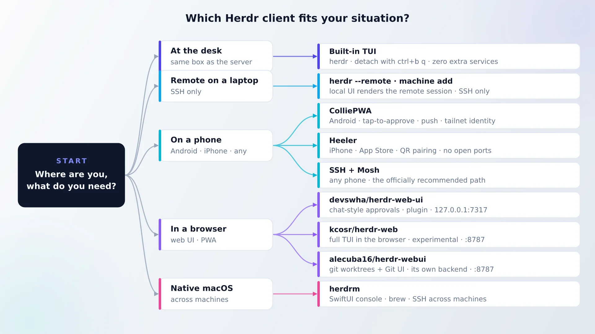

One practical filter before you install five dashboards: add an extra client only when a real scenario demands it. If you sit at one desk in Ghostty, plain `herdr` or `herdr-app` is already enough.

## Official Herdr clients: Desktop App, Mobile App, and TUI

### Official Herdr Desktop App (`v0.1.16`) + `herdr-core` (`v0.1.21`)

Written in Rust on GPUI with Ghostty's terminal engine, `herdr-app` runs on macOS (Apple Silicon), Linux (x86_64/ARM64 with Vulkan), and Windows. Its spaces, tabs, and SSH machines live in `herdr-core`, and its entire interface is editable by coding agents through **312+ community layouts and 576+ QuickJS mods**. See our full [Herdr app layouts and mods tour](/herdr-app-layouts-mods/) for install commands and screenshots.

### Official Herdr Mobile App (iPhone, iPad, and Android)

Free on the [App Store](https://apps.apple.com/app/id6828898364) and [Google Play](https://play.google.com/store/apps/details?id=dev.herdr.app) with no account, no ads, and no cloud relay. Your phone connects straight to `herdr-core` over SSH or Tailscale SSH:

- **Inbox sorted by urgency:** `Needs you`, `Done`, `Working`, and `Idle` across every machine, with swipe-right to pin/mark read and swipe-left to send `Esc`.
- **Real terminal + compose bar:** Type straight into the terminal or open **compose** to write, paste screenshots, attach photos, or use on-device speech dictation.
- **Mirrored spaces and foldables:** Every desktop space renders as a live pane map without resizing your desktop window. On iPad and unfolded Android foldables, the sidebar and terminal sit side by side.

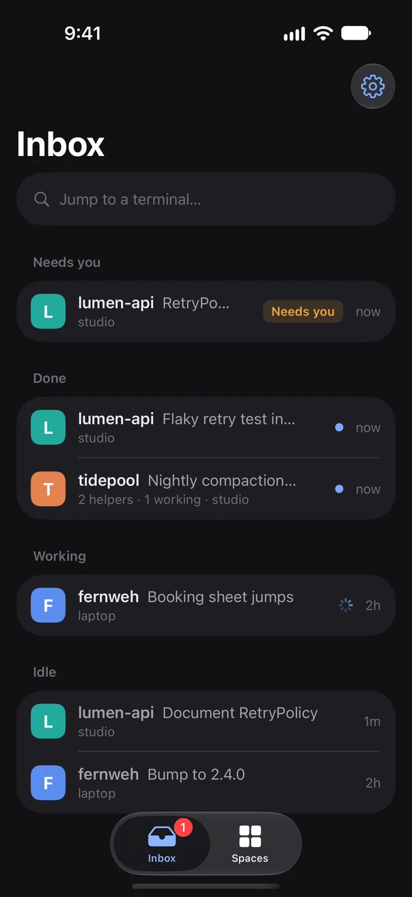

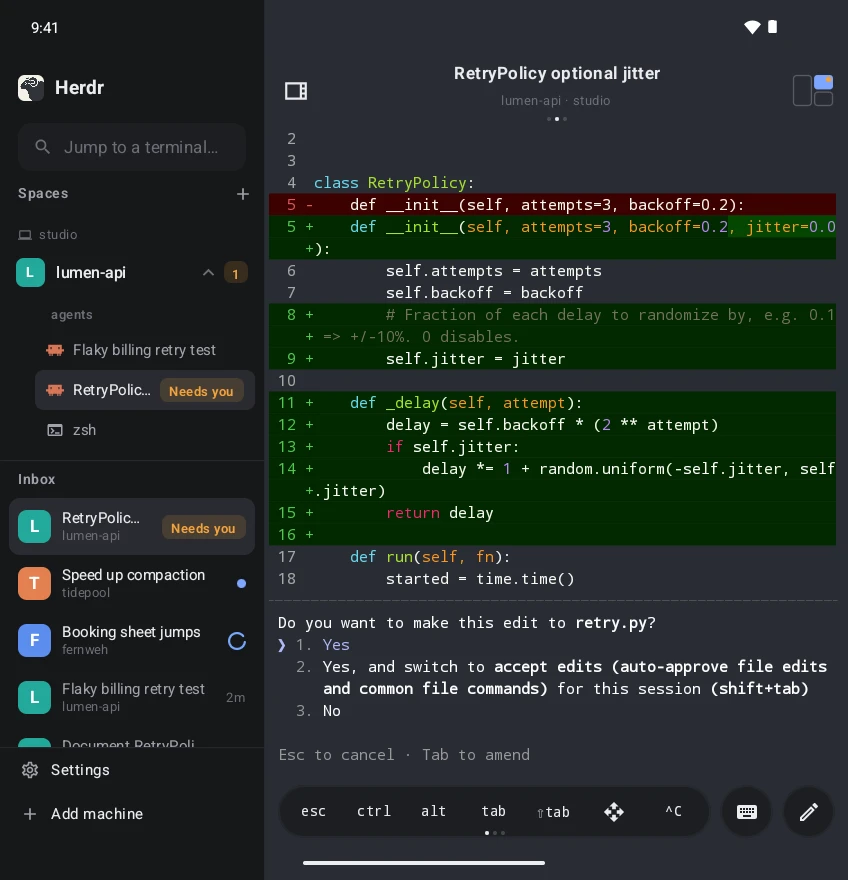

### Official Herdr TUI (`v0.9.5`) and multi-machine SSH

If you live inside your own terminal emulator, `herdr` (`v0.9.5`, Apache-2.0, ~52K stars) stays the cleanest zero-dependency runtime:

```bash
curl -fsSL https://herdr.dev/install.sh | sh
herdr -V && herdr status
herdr machine add workbox --label "Build box"
herdr --remote workbox
```

`herdr update` updates the binary and lists running servers still on older versions. Remember: detach with `Ctrl+B q`, not `herdr server stop` (which kills pane processes). While in the terminal, pair it with [Oh My Zsh plugins](/best-oh-my-zsh-plugins/) and [zoxide](/zoxide/).

## Best Herdr web UIs (five community options for Herdr TUI)

There is still no official Herdr web UI. All five options below are community-built, attach to Herdr TUI, and bind loopback by default with no built-in login wall.

| Project | Port | Install | Auth posture | Best for |
|---|---|---|---|---|
| [AltanS/collie](https://github.com/AltanS/collie) (ColliePWA) | loopback | `curl ... collie start` | Tailnet identity + device pairing | Best overall PWA & Android mobile web UI |
| [devswha/herdr-web-ui](https://github.com/devswha/herdr-web-ui) | 7317 | `herdr plugin install` | Loopback + Tailscale QR | Chat-style approval cards + web push |
| [sarathsp06/herdrweb](https://github.com/sarathsp06/herdrweb) | 7331 | Single Go binary | Loopback-only ("one operator") | Cleanest minimal inbox + diffs |
| [kcosr/herdr-web](https://github.com/kcosr/herdr-web) | 8787 | Tarball + APK | Origin allowlist (not auth) | Full TUI/vim fidelity via Ghostty WASM |
| [alecuba16/herdr-webui](https://github.com/alecuba16/herdr-webui) | 8787 | Tarball | Loopback | IDE + git worktrees (`--backend-mode external-herdr`) |

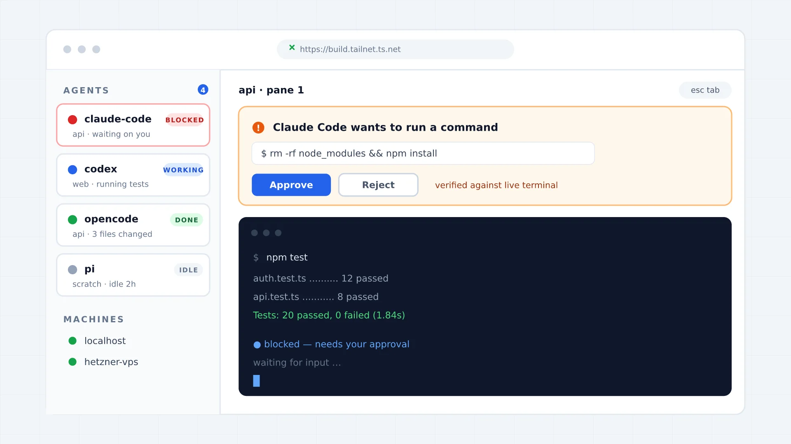

### ColliePWA: strongest security model and Android PWA

[ColliePWA](https://colliepwa.dev) puts blocked agents at the top, adds web push notifications, `quick-replies.toml`, read-only git diffs, and multi-machine "Crews." Front it with `tailscale serve` and set `COLLIE_TRUSTED_USER=you@example.com` so Tailscale injects verified identity headers; device pairing tokens gate write access.

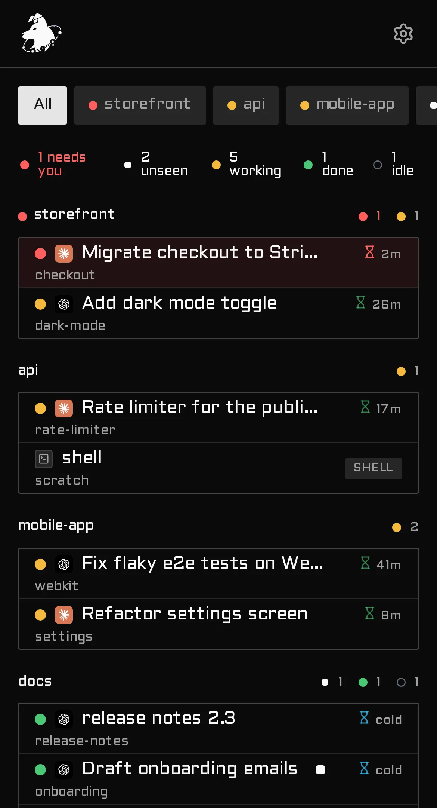

### devswha/herdr-web-ui and sarathsp06/herdrweb

`devswha/herdr-web-ui` installs as a TUI plugin (`herdr plugin install devswha/herdr-web-ui`) and turns transcripts into tappable chat approval cards on `127.0.0.1:7317`. `sarathsp06/herdrweb` ships a single Go binary with embedded SvelteKit UI, Shiki diffs, and real RPC calls on `127.0.0.1:7331`.

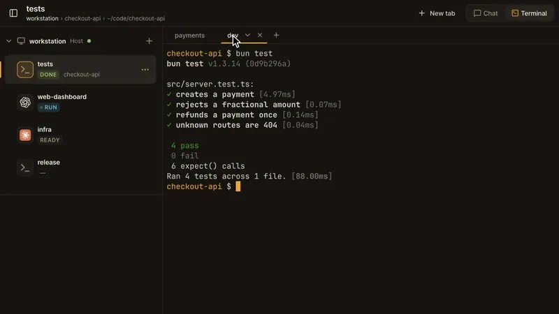

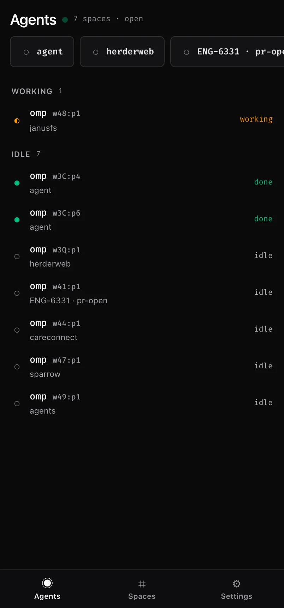

### kcosr/herdr-web and alecuba16/herdr-webui

Use `kcosr/herdr-web` when you need full-screen TUIs (vim, htop) in a browser (caveat: it vendors internal Herdr APIs and can break across upgrades). `alecuba16/herdr-webui` ships a full IDE + git UI and can run standalone or attach to Herdr via `--backend-mode external-herdr`.

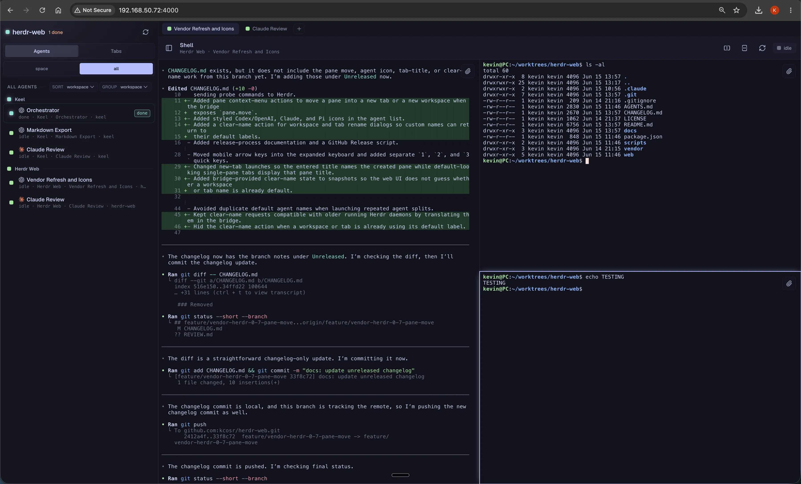

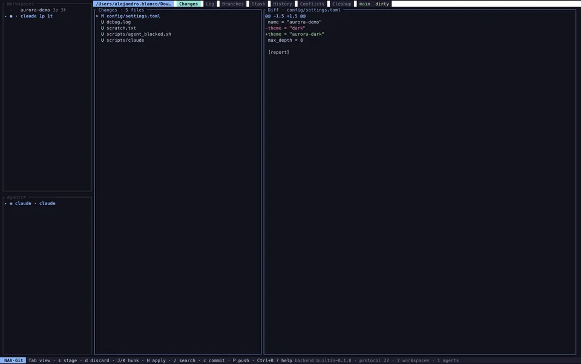

<Notice type="info" title="TUI plugins now have herdr plugin update">
Since Herdr TUI `v0.9.4`, you can update GitHub-installed TUI plugins with `herdr plugin update` without reloading config. Plugins still run unsandboxed as your user, so check our [vetted Herdr plugins guide](/best-herdr-plugins/) before installing.
</Notice>

## Mobile and desktop apps: Moshi, Heeler, herdrm, and Herdr UI

### Moshi (iOS, Android, and Desktop): the one client bridging TUI and Core

[Moshi](https://getmoshi.app) (free SSH tier; Pro $7.99/mo or $69.99/yr across 3 devices) stands out in late 2026 because **`moshi-hook v0.4.62`** supports **both Herdr TUI and `herdr-core` (`hc`)**. It renders Herdr Desktop spaces, tabs, and panes on your phone, lets you create git worktrees from a Herdr space (`v0.4.60+`), adds Mosh UDP roaming for flaky cellular connections, and delivers lock-screen Approve/Deny push cards plus Tier-A Native Chat View for Claude Code, Codex, Hermes, Antigravity, and OMP. **Moshi Desktop** (~11 MB Tauri app for macOS/Linux/Windows) uses the same `moshi-hook` gateway without killing agents when you quit.

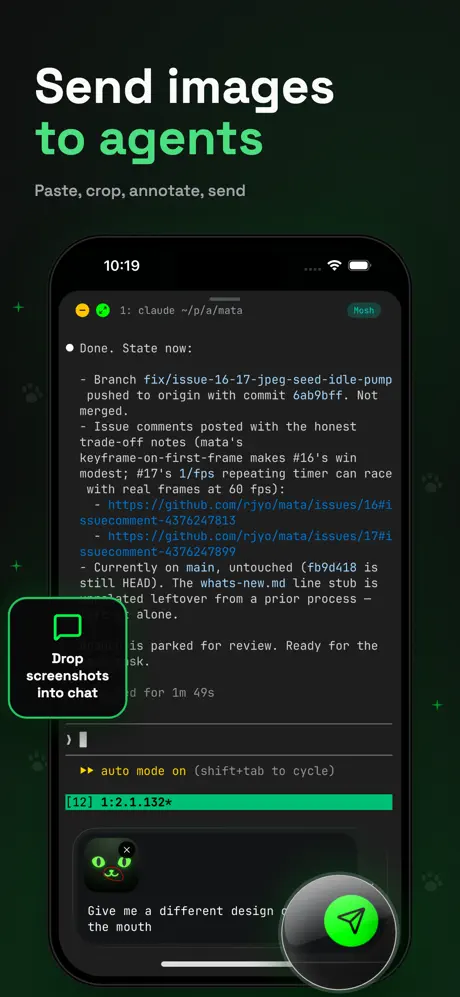

Read the full walkthrough in [control AI agents from your phone with Herdr Mobile and Moshi](/control-ai-agents-from-phone-moshi-herdr/).

### Heeler (iPhone), herdr-remote, herdrm, and Herdr UI (for Herdr TUI)

If you stay on Herdr TUI instead of moving to `herdr-core`, four community native apps cover every platform:

- **[Heeler](https://heeler.bybee.dev) (iPhone):** Native SwiftUI + `libghostty` console with QR pairing (`herdr plugin action invoke heeler.pair`), end-to-end encrypted push, and Live Activities over SSH StreamLocal.
- **[herdr-remote](https://github.com/dcolinmorgan/herdr-remote):** macOS menu bar dropdown plus Telegram one-tap approvals (`/agents`, `/reply`, `/trust`).
- **[herdrm](https://github.com/missuo/herdrm) (macOS):** Native SwiftUI + SwiftTerm desktop app (`brew install owo-network/brew/herdrm`) attaching real TUI PTYs across local and SSH hosts.
- **[Herdr UI](https://herdrui.dev) (`penso/herdr-gpui`):** Native GPUI desktop window for macOS/Linux/Windows that attaches directly to your existing **Herdr TUI** daemon (unlike official `herdr-app`, which uses `herdr-core`), adding issue dispatch, side-by-side review, and checkpoints.

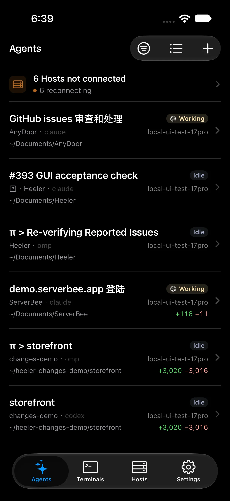

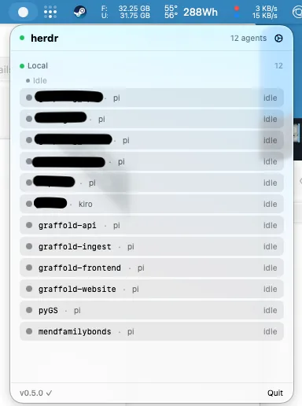

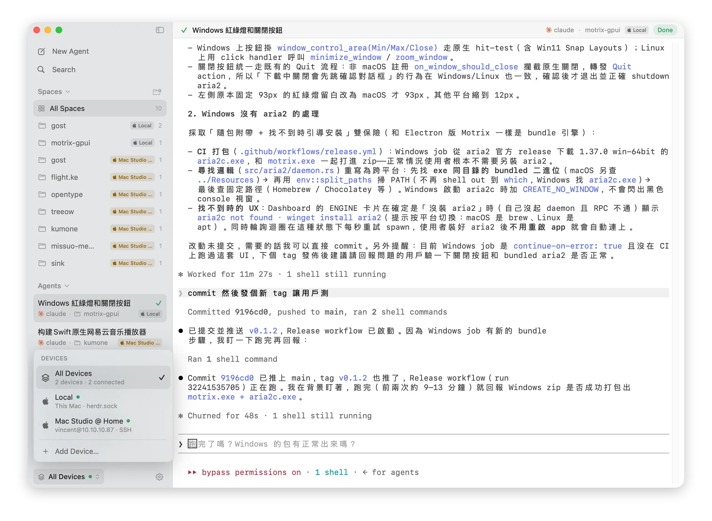

<YouTubeEmbed url="https://www.youtube.com/watch?v=iFQpQHTN4iI" label="Herdr UI walkthrough: a native desktop client for the Herdr daemon" />

## Security first: every Herdr web UI is a root shell

Any Herdr web UI can read your files, execute commands, and reach your agent credentials. Never bind `0.0.0.0` and never expose a web client with `tailscale funnel`. Bind `127.0.0.1` and front it with `tailscale serve` so Tailscale handles TLS, Web Push HTTPS requirements, and tailnet identity.

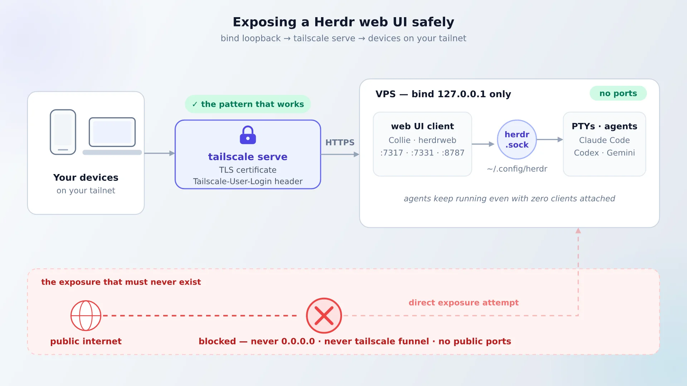

<Notice type="error" title="Never expose a Herdr web UI to the public internet">
Verify loopback binding (`ss -tlnp | grep -E '7317|7331|8787'` must show `127.0.0.1`), expose only via `tailscale serve`, and leave `pane_history = true` off unless you accept scrollback secrets written to disk. The same Tailscale-front pattern applies to [Dockge](/dockge-install/).
</Notice>

## Reference VPS setup: Hetzner + Tailscale + one client

<Notice type="warning" title="Affiliate Disclosure">
Some links below are affiliate links. If you buy through them, I may earn a small commission at no extra cost to you.
</Notice>

Run agents 24/7 on a small €4-5/month [Hetzner Cloud](https://go.bitdoze.com/hetzner) or [Hostinger KVM VPS](https://go.bitdoze.com/hostinger-vps) (or at home on a [Proxmox mini PC](/best-mini-pc-proxmox/) like the [ASUS DC510](https://go.bitdoze.com/asus-dc510)). Coding agents are API-bound, so 2 vCPU / 4 GB RAM is plenty. Check [cloud server benchmarks](/benchmark-cloud-servers/) before picking a provider.

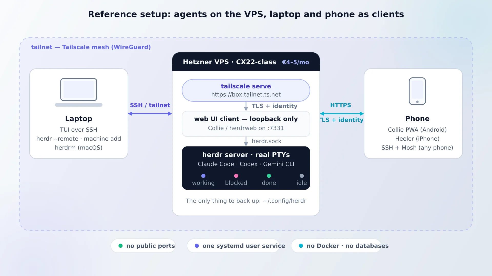

<Tabs>
<Tab name="Path A: Official Herdr Core + Mobile (simplest)">

```bash
# On your VPS (Ubuntu/Debian)
curl -fsSL https://releases.herdr.dev/core/install.sh | sh
sudo loginctl enable-linger $USER
hc run --bg claude
```

Add the VPS in **Herdr Desktop** (`hc machine add vps`) or **Herdr Mobile** over Tailscale SSH. Zero open ports, zero web proxy, zero third-party services.

</Tab>
<Tab name="Path B: Herdr TUI + ColliePWA / herdrweb">

```bash
curl -fsSL https://herdr.dev/install.sh | sh
herdr -V && herdr status
# Start work in a session, detach with Ctrl+B q

curl -fsSL https://colliepwa.dev/install.sh | sh
collie start
tailscale serve --bg --https=443 127.0.0.1:<collie-port>
```

Confirm with `ss -tlnp` that the service listens only on `127.0.0.1`, open `https://<host>.tailnet.ts.net` on your phone, and send a test push notification.

</Tab>
</Tabs>

## Frequently asked questions

<Accordion label="Does Herdr have an official desktop app, mobile app, or web UI?" group="faq" expanded="true">
Yes to desktop and mobile; no to web UI. `herdrdev/herdr-app` (v0.1.16) is the official desktop app for macOS, Linux, and Windows, and **Herdr Mobile** is the official free iOS/Android app. Both run on `herdr-core` (`hc`). Web UIs like ColliePWA and `herdr-web-ui` remain community-built for Herdr TUI.
</Accordion>

<Accordion label="Which client works with both Herdr TUI and Herdr Core?" group="faq">
**Moshi** (with `moshi-hook v0.4.62`) is currently the only polished mobile/desktop client that discovers and controls both Herdr TUI sessions and `herdr-core` desktop spaces.
</Accordion>

<Accordion label="Can I approve Claude Code prompts from my phone?" group="faq">
Yes. Official **Herdr Mobile** opens the live terminal on `herdr-core` with Inbox urgency sorting and voice compose. On Herdr TUI (or both), **Moshi** sends lock-screen Approve/Deny pushes via `moshi-hook`, **ColliePWA** gives tappable cards over Tailscale, and **Heeler** delivers encrypted iOS pushes with Live Activities.
</Accordion>

<Accordion label="Is it safe to expose a Herdr web UI on a public URL?" group="faq">
No. Every Herdr web UI is effectively a root shell into your workspace and credentials. Always bind `127.0.0.1` and access through `tailscale serve` or an SSH tunnel.
</Accordion>

## Verdict

If you are setting up from scratch in November 2026, install **`herdr-core` + Herdr Desktop + Herdr Mobile** for the cleanest zero-cost official stack over Tailscale SSH. If you already rely on **Herdr TUI** (`v0.9.5`) and its plugin ecosystem, pair it with **Moshi** (for Mosh roaming + lock-screen approvals) or **ColliePWA** behind `tailscale serve`.

<Button text="Read our Herdr review" link="/herdr-agent-multiplexer/" variant="solid" color="blue" size="md" />
<Button text="Set up phone control" link="/control-ai-agents-from-phone-moshi-herdr/" variant="outline" color="gray" size="md" />

Explore the rest of the ecosystem: [Herdr Desktop layouts & mods](/herdr-app-layouts-mods/), [best Herdr plugins](/best-herdr-plugins/), [best terminal multiplexers](/best-terminal-multiplexers/), and [top AI GitHub repos](/top-ai-github-repos/).
