import Button from "@components/widgets/Button.astro";
import Notice from "@components/widgets/Notice.astro";
import ListCheck from "@components/widgets/ListCheck.astro";
import Accordion from "@components/widgets/Accordion.astro";
import Tabs from "@components/widgets/Tabs.astro";
import Tab from "@components/widgets/Tab.astro";
import YouTubeEmbed from "@components/widgets/YouTubeEmbed.astro";

Start with three vetted **Herdr TUI** plugins (`persiyanov/herdr-reviewr`, `kryptamine/herdr-auto-title`, and `cloudmanic/herdr-plus`) on **Herdr `v0.9.5`**, where `herdr plugin update` now refreshes GitHub plugins without reloading config.

The Herdr TUI plugin marketplace at [herdr.dev/tui/plugins](https://herdr.dev/tui/plugins/) indexes over 1,000 community plugins automatically with zero human review. Every plugin runs as your user with your full environment, so installing blind is asking for trouble. Below are the ten plugins worth installing, the exact `install`/`update`/`pin` commands, and the 5-minute vetting checklist I run before confirming any manifest.

<Notice type="info" title="TUI plugins vs Desktop App mods">
Everything here extends **Herdr TUI (`herdr` v0.9.5)** via `herdr-plugin.toml`. The newer **Herdr Desktop App (`herdr-app` v0.1.16)** runs on `herdr-core` and uses JavaScript **mods** and JSON **layouts** (312+ layouts and 576+ mods at `herdr.dev/gallery/`). If you use the desktop app instead of the TUI, read our [Herdr app layouts and mods tour](/herdr-app-layouts-mods/).
</Notice>

If you are new to the runtime, start with our [Herdr review](/herdr-agent-multiplexer/), [AI coding tools comparison](/ai-coding-tools/), and [six-way terminal multiplexer comparison](/best-terminal-multiplexers/).

## What are Herdr plugins and how do they work?

A Herdr TUI plugin is a directory with a `herdr-plugin.toml` manifest and ordinary commands executed as argv arrays; there is no restricted SDK because the entire `herdr` CLI (called via `HERDR_BIN_PATH`) is the plugin API.

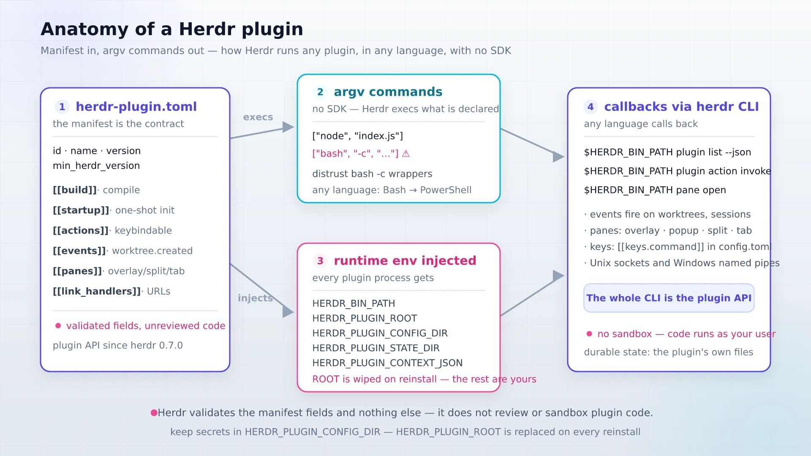

Key manifest sections: `[[build]]` compiles on GitHub installs, `[[startup]]` runs one-shot init, `[[actions]]` expose keybindable commands, `[[events]]` fire on triggers like `worktree.created`, `[[panes]]` place overlays/splits/popups, and `[[link_handlers]]` map Ctrl+click URLs. At runtime Herdr injects `HERDR_SOCKET_PATH`, `HERDR_BIN_PATH`, `HERDR_PLUGIN_CONFIG_DIR`, and `HERDR_PLUGIN_STATE_DIR`. Keep credentials and settings in `HERDR_PLUGIN_CONFIG_DIR`, never inside `HERDR_PLUGIN_ROOT` (which updates overwrite).

<Notice type="warning" title="No sandbox, no marketplace review">
As [herdr.dev/tui/docs/plugins](https://herdr.dev/tui/docs/plugins/) states plainly, a plugin is ordinary code running with your user permissions and environment variables. The index refreshes every 30 minutes directly from GitHub's `herdr-plugin` topic without security review.
</Notice>

<YouTubeEmbed url="https://youtube.com/embed/29KAoidwCUA" label="5 JAW-DROPPING Herdr Plugins" />

## How to install, update, and verify Herdr plugins safely

Inspect `herdr-plugin.toml`, install with interactive preview (never `--yes` on first install), pin a reviewed ref with `--ref`, and use `herdr plugin update` (`v0.9.4+`) when you are ready to refresh.

```bash
# Install with interactive manifest preview
herdr plugin install persiyanov/herdr-reviewr

# Or pin the exact tag you audited
herdr plugin install persiyanov/herdr-reviewr --ref v1.2.0

# Update all GitHub-installed plugins or a single one (added in Herdr v0.9.4)
herdr plugin update
herdr plugin update herdr-reviewr

# Verify registration, actions, and logs
herdr plugin list --json
herdr plugin action list --plugin plugin.id
herdr plugin log list --plugin plugin.id --limit 20
```

<Notice type="success" title="New since Herdr v0.9.4 and v0.9.5">
Earlier guides noted that Herdr had no update command. **`herdr plugin update`** shipped in `v0.9.4` (October 13, 2026): it updates GitHub-installed plugins in place while running plugin panes keep working on their old files, and new runs pick up the update with no config reload. Locally linked plugins (`herdr plugin link`) stay untouched. `v0.9.5` also fixed Windows plugin panes failing when a folder on `PATH` matched the plugin's binary name.
</Notice>

To bind a plugin action in `~/.config/herdr/config.toml` and reload:

```toml
[[keys.command]]
key = "prefix+l"
type = "plugin_action"
command = "example.layout.apply"
description = "apply layout"
```

```bash
herdr server reload-config
```

Rollback is equally clean: `herdr plugin disable ID` or `herdr plugin uninstall ID` (which preserves `HERDR_PLUGIN_CONFIG_DIR`).

## What are the 10 best Herdr TUI plugins worth installing?

Install by fully qualified `owner/repo` every time, because multiple plugins in the marketplace share identical names.

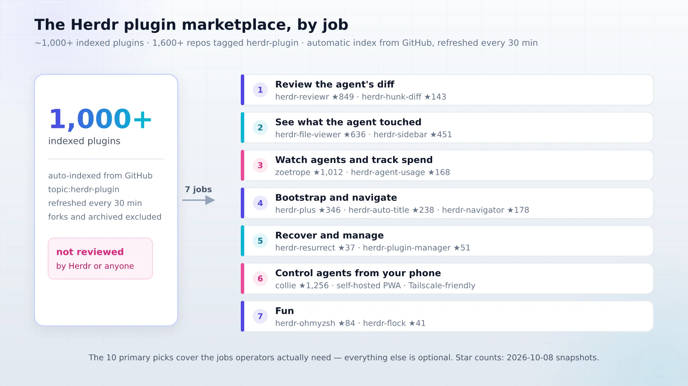

### 1. Review agent diffs: `persiyanov/herdr-reviewr`

Opens the agent's git diff in a terminal pane and sends inline line comments straight back to Claude Code, Codex, OpenCode, and Pi. Ships prebuilt Rust binaries (no Cargo compile wait). Lighter alternative: `jhochenbaum/herdr-hunk-diff`.

```bash
herdr plugin install persiyanov/herdr-reviewr
```

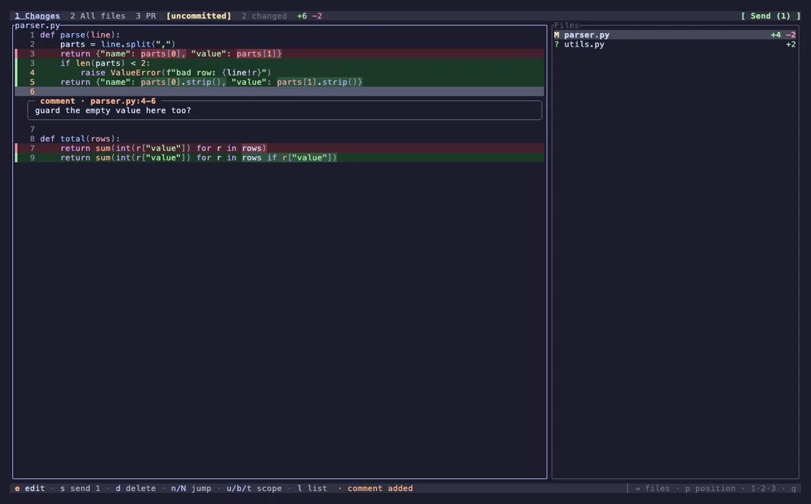

### 2. Inspect touched files: `smarzban/herdr-file-viewer`

A git-aware, read-only file tree with rendered Markdown and working-tree diffs. Read-only matters when agents are actively writing files so you never accidentally edit over them. If you want write support plus git staging, check `alexarthurs/herdr-sidebar`.

```bash
herdr plugin install smarzban/herdr-file-viewer
```

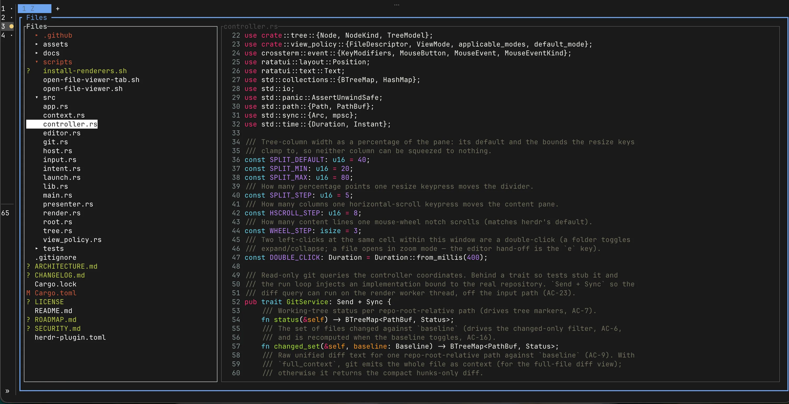

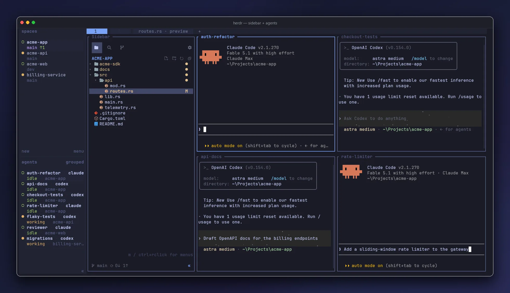

### 3 & 4. Watch sessions and track spend: `furkankly/zoetrope` & `levi-qiao/herdr-agent-usage`

`furkankly/zoetrope` draws a live Rust/ratatui flow graph of Claude Code and Codex sessions. `levi-qiao/herdr-agent-usage` puts per-agent context, cache, and API/weekly spend gauges in your sidebar (watch the name collision with `senna-lang/herdr-agent-usage`). For a project-grouped working/blocked radar, try `hhdebb/herdr-radar`.

```bash
herdr plugin install furkankly/zoetrope
herdr plugin install levi-qiao/herdr-agent-usage
herdr plugin install hhdebb/herdr-radar
```

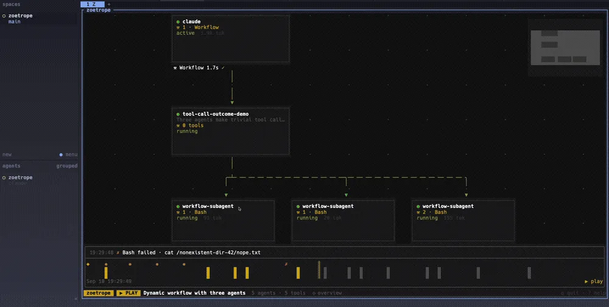

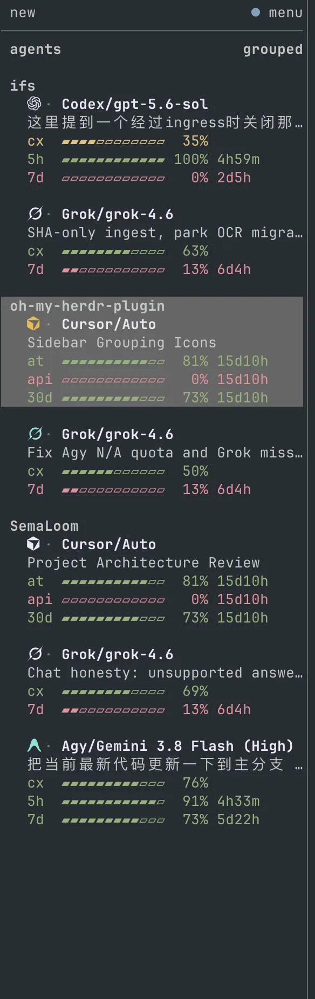

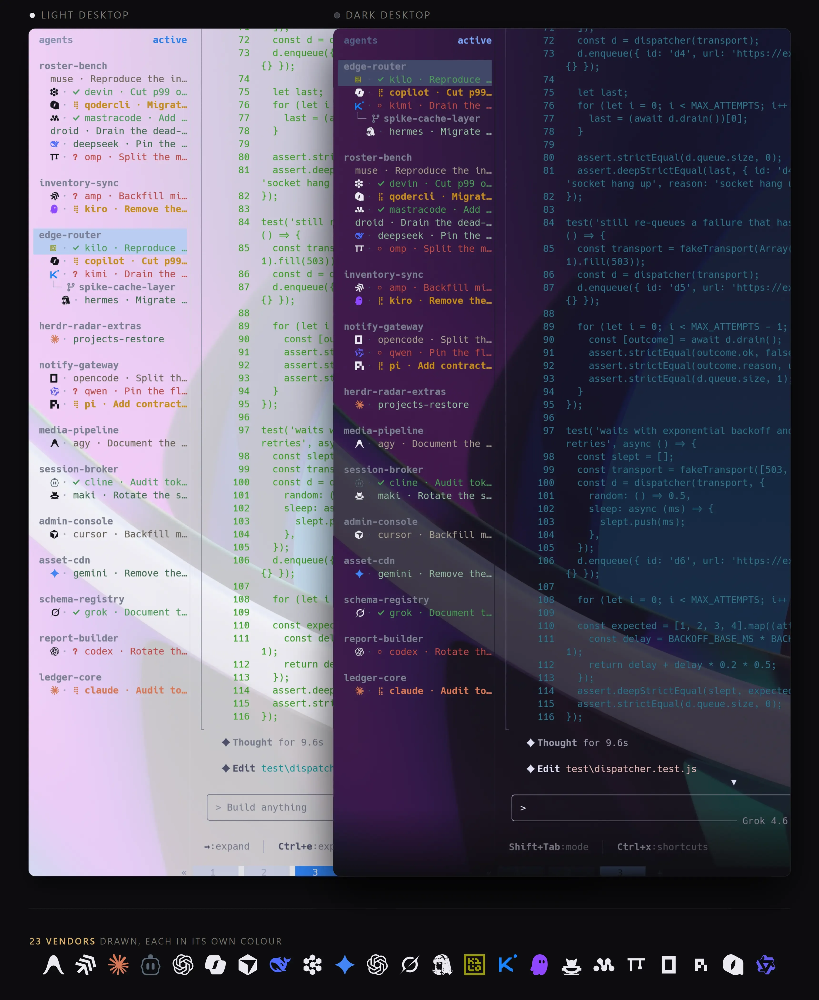

### 5, 6 & 7. Workspace bootstrap & navigation: `herdr-plus`, `herdr-auto-title`, `herdr-navigator`

- **`cloudmanic/herdr-plus`:** Rebuilds multi-tab project layouts from TOML files committed in your dotfiles, plus fuzzy Quick Actions.
- **`kryptamine/herdr-auto-title`:** Names tabs from git branch, active command, and Claude Code sessions (watch the name collision with `sh1ma/herdr-auto-title`; for a readable shell-script alternative, see `qu8n/herdr-automatic-rename`).
- **`thanhdat77/herdr-navigator`:** Fuzzy jumper across workspaces, agents, projects, and remote machines, pairing naturally with [zoxide](/zoxide/).

```bash
herdr plugin install cloudmanic/herdr-plus
herdr plugin install kryptamine/herdr-auto-title
herdr plugin install thanhdat77/herdr-navigator
```

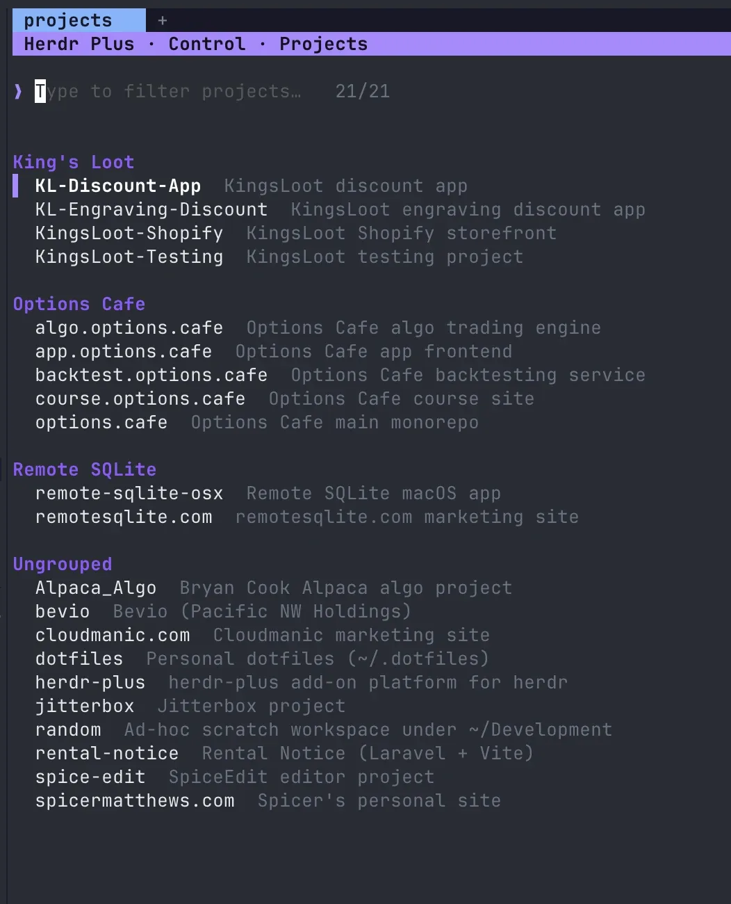

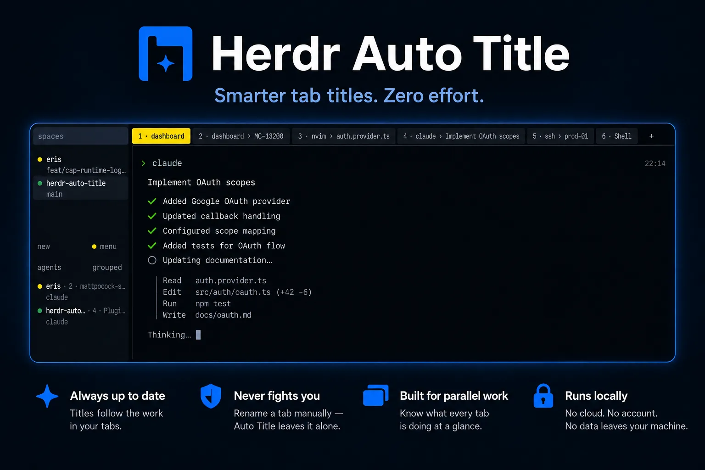

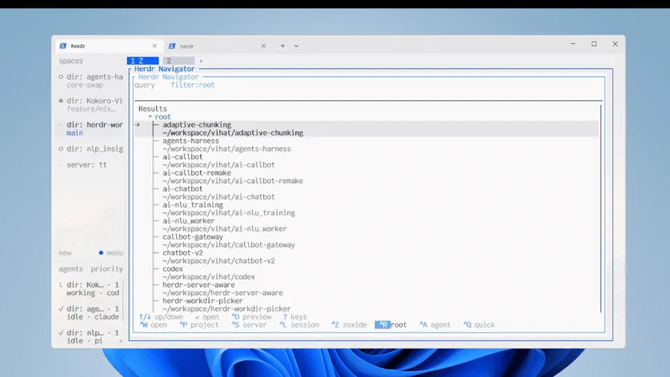

### 8 & 9. Crash recovery & management: `ntindle/herdr-resurrect` & `speardragon/herdr-plugin-manager`

`ntindle/herdr-resurrect` snapshots workspaces, tabs, working directories, and agents so you recover cleanly after a reboot (back up `config.toml` and `HERDR_PLUGIN_CONFIG_DIR` separately with [Restic / Pluton](/pluton-self-hosted-backup/)). `speardragon/herdr-plugin-manager` lets you browse, enable, and remove plugins from a `prefix+p` popup (close any open Settings/Copy-mode modal first so popups do not return `ui_busy`).

```bash
herdr plugin install ntindle/herdr-resurrect
herdr plugin install speardragon/herdr-plugin-manager
```

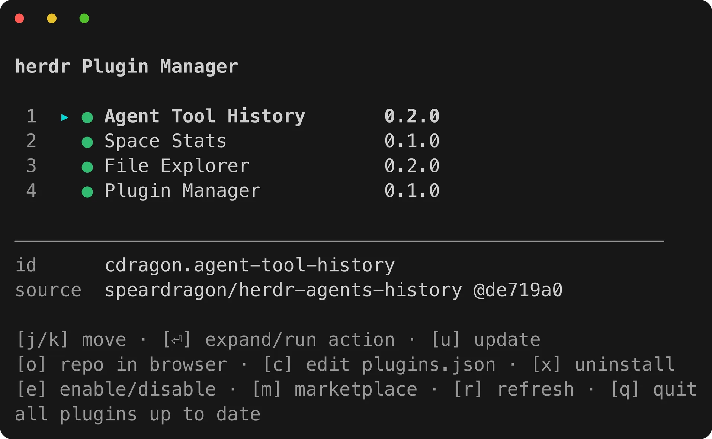

### 10. Control TUI agents from your phone: `AltanS/collie`

`AltanS/collie` turns Herdr TUI into a mobile-first PWA behind `tailscale serve` with web push alerts, quick replies, and read-only diffs. For the full picture including the **new official Herdr Mobile app** (which runs on `herdr-core`) and **Moshi**, compare options in [best Herdr clients](/best-herdr-clients/) and [control AI agents from your phone](/control-ai-agents-from-phone-moshi-herdr/).

```bash
herdr plugin install AltanS/collie
```

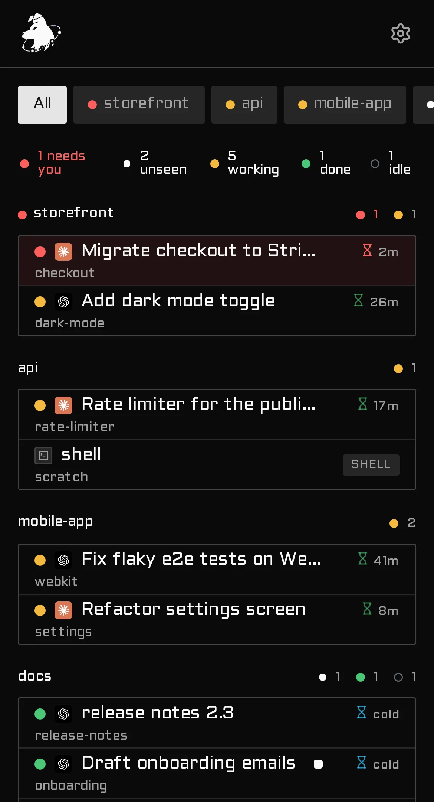

<Notice type="warning" title="Affiliate Disclosure">
Some links below are affiliate links. If you buy through them, I may earn a small commission at no extra cost to you.
</Notice>

For 24/7 always-on agents, a 2-4 GB [Hetzner Cloud](https://go.bitdoze.com/hetzner) or [Hostinger VPS](https://go.bitdoze.com/hostinger-vps) at 4-8 EUR/month is plenty (see [2026 VPS pricing shifts](/vps-price-increases/)). Also check two fun extras outside the top ten: `robbyrussell/herdr-ohmyzsh` (companion to [Oh My Zsh plugins](/best-oh-my-zsh-plugins/)) and `ragamo/herdr-flock` (pixel sheep in a pane).

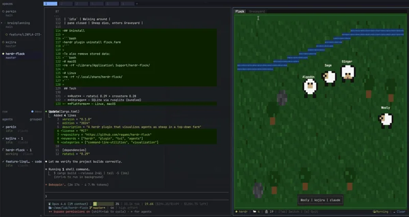

## How to vet a Herdr plugin in 5 minutes

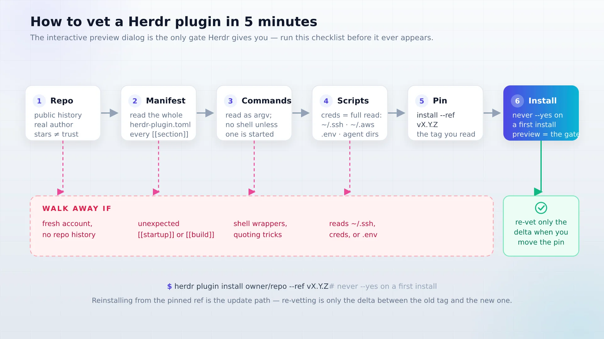

<ListCheck>
<ul>
<li>Read <code>herdr-plugin.toml</code> first, checking every <code>[[build]]</code>, <code>[[startup]]</code>, and <code>[[actions]]</code> command array.</li>
<li>Distrust shell wrappers (<code>["bash", "-c", "..."]</code>) and skim scripts for access to <code>~/.ssh</code>, <code>~/.aws</code>, or <code>.env</code> files.</li>
<li>Check repository history and license (avoid <code>NOASSERTION</code> repos for commercial work).</li>
<li>Pin the tag you reviewed (<code>--ref vX.Y.Z</code>) and never pass <code>--yes</code> on a first install.</li>
<li>Before exposing any remote relay plugin, follow [server firewall hardening](/bsi-security-report-docker-ufw/) and use Tailscale instead of open ports.</li>
</ul>
</ListCheck>

## Frequently asked questions

<Accordion label="How do I update Herdr plugins now?" group="faq" expanded="true">
On Herdr TUI `v0.9.4` and newer, run `herdr plugin update` to update all GitHub-installed plugins or `herdr plugin update <name>` for a single plugin. Running panes continue cleanly on old files until reopened, no config reload is required, and locally linked plugins are skipped.
</Accordion>

<Accordion label="Do Herdr TUI plugins work in the Herdr Desktop App?" group="faq">
No. TUI plugins (`herdr-plugin`) extend the `herdr` terminal multiplexer. The official `herdr-app` desktop app runs on `herdr-core` and uses QuickJS **mods** (`herdr-mod`) and JSON **layouts** (`herdr-layout`) from `herdr.dev/gallery/`.
</Accordion>

<Accordion label="Are Herdr plugins safe to install?" group="faq">
They run unsandboxed with your user permissions and the marketplace at `herdr.dev/tui/plugins` is unreviewed. Always inspect `herdr-plugin.toml`, check for credential/network access, and pin a reviewed ref.
</Accordion>

<Accordion label="What is the difference between a Herdr plugin and an Agent Skill?" group="faq">
Plugins extend the Herdr terminal runtime (panes, events, keybindings). Agent skills extend the LLM's instructions and workflow context. See [Agent Skills compared](/best-ai-skills-for-web-design/) for the skill layer.
</Accordion>

## Minimal recommended stack

Skip installing twenty plugins on day one. Start with **`persiyanov/herdr-reviewr`**, **`kryptamine/herdr-auto-title`**, and **`cloudmanic/herdr-plus`**, verify them with `herdr plugin list --json`, and add `zoetrope` or `herdr-agent-usage` only when you need live session graphs or token spend tracking.

<Button text="Read our Herdr review" link="/herdr-agent-multiplexer/" variant="solid" color="blue" size="md" icon="arrow-right" />
<Button text="Browse Herdr Desktop layouts & mods" link="/herdr-app-layouts-mods/" variant="outline" color="blue" size="md" />
