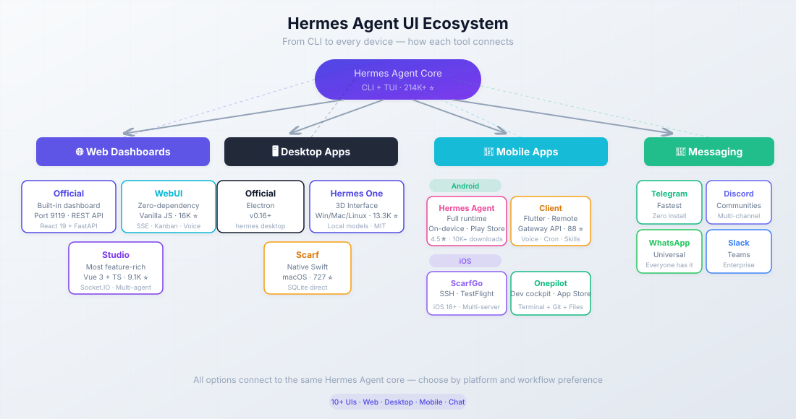

import Button from "@components/widgets/Button.astro";
import Notice from "@components/widgets/Notice.astro";
import ListCheck from "@components/widgets/ListCheck.astro";
import Accordion from "@components/widgets/Accordion.astro";
import Tabs from "@components/widgets/Tabs.astro";
import Tab from "@components/widgets/Tab.astro";
import YouTubeEmbed from "@components/widgets/YouTubeEmbed.astro";

<Notice type="info" title="Affiliate disclosure">
The hardware links in this section are affiliate links, including `/go/` redirects that land on Amazon. If you buy through them, I earn a small commission at no extra cost to you.
</Notice>

For Bot Mode, pick the official desktop app, covered in [our Hermes Agent setup guide](/hermes-agent-setup-guide/). For the lightest community web dashboard, pick [Hermes WebUI](https://github.com/nesquena/hermes-webui). Hermes Agent by Nous Research is the fastest-growing open-source AI agent on GitHub, with 266K+ stars (November 2026). The core agent is CLI-first: you run it from your terminal with `hermes` or in a full TUI with `hermes --tui`. That's great for developers who live in the terminal, but you also need to check on your agent from a browser at work or a phone on the couch.

The ecosystem now has web dashboards, desktop apps, Android apps, iOS apps, and messaging integrations. That gives you 10+ ways to interact with Hermes Agent outside the terminal. Two are official. The desktop app ships with Bot Mode, a roster of named bots that run routines, share group chats and message each other. The gateway can also serve the same Desktop workspace to a browser as the Webapp (port 9120). The sections below compare every major option so you can pick the right one for your workflow.

<Notice type="info" title="New to Hermes Agent?">
If you haven't installed Hermes yet, start with [our Hermes Agent setup guide](/hermes-agent-setup-guide/). It covers installation, model configuration, and first steps before you pick a dashboard.
</Notice>

## Quick comparison: all Hermes Agent UIs at a glance

Here's the 30-second overview of every major Hermes Agent UI. Star counts come from the GitHub API on 2026-11-27.

| Name | Type | Stars | Main strength | Price | Best for |
|---|---|---|---|---|---|
| Official Desktop | Desktop (macOS, Windows, Linux) | Built-in | Bot Mode roster, group chats, remote gateways | Free | Bot Mode and a native app |
| Official Webapp | Web | Built-in | Desktop workspace in a browser, port 9120 | Free | Desktop UI on a phone or another computer |
| Official Dashboard | Web | Built-in | Admin panel on port 9119, full REST API, 150+ config fields | Free | Self-hosted management |
| Hermes WebUI (nesquena) | Web | 19.6K | Zero-dependency, lightweight | Free | Minimal resource usage |
| Ekko Studio, formerly Hermes Studio (EKKOLearnAI) | Web + Desktop | 11.8K | Most features, group chat, visual workflows | Free for non-commercial use (BSL-1.1) | Power users, teams |
| Hermes Workspace | Web | 6.8K | IDE-like workspace + terminal | Free | Full agent ops in browser |
| Hermes One (fathah) | Desktop | 14.6K | 3D visual interface, 22 slash commands | Free | Cross-platform desktop |
| Hermes Control Interface | Web | 903 | RBAC, security-hardened admin | Free | Team access control (no push since June 2026) |
| Scarf | macOS + iOS | 923 | Native Swift, SQLite direct | Free | macOS users |
| Hermes Agent Android | Mobile (Android) | n/a | Full runtime on-device | Freemium | Android power users |
| Ares, formerly Hermes Android (rusty4444) | Mobile (Android) | 572 | Flutter client, on Google Play and F-Droid | Free | Remote server access |
| ScarfGo | Mobile (iOS) | n/a | SSH-based, on the App Store | Free | iOS + macOS users |
| Onepilot | Mobile (iOS) | n/a | Dev cockpit, terminal + git | Freemium | iOS developers |
| Hermex (uzairansar) | iOS + iPadOS | 1.9K | Native client for the official dashboard, with a Bots inbox | Free, MIT | iPhone and iPad chat with a self-hosted Hermes |
| ERMIS, formerly Hermes AI (Ilya Vishneuski) | iOS | n/a | Hosted agent, or your own server | Freemium | Users who would rather not run a server |
| Telegram Gateway | Messaging | n/a | Zero install, instant | Free | Everyone |



The diagram is a high-level map of the main categories; it does not show the official Desktop app or the Webapp. The table above also lists Hermes Workspace and Hermes Control Interface.

<Button text="Jump to Dashboards" link="#best-hermes-agent-web-dashboards" variant="outline" color="blue" size="sm" />
<Button text="Jump to Mobile Apps" link="#best-hermes-agent-mobile-apps-for-android" variant="outline" color="blue" size="sm" />

## Best Hermes Agent web dashboards

Web dashboards run in a browser and suit remote management from any device. You can self-host them on a VPS, run them locally, or tunnel them through SSH. The options below start with the two official ones, the admin dashboard and the Webapp, then cover four community projects up to a full IDE-style workspace.

### Official Hermes Web Dashboard

The built-in dashboard is part of the core Hermes package (it ships with Hermes Agent v0.16+; v0.23.4 is the current release as of November 2026). Launch it with `hermes dashboard` and you get a FastAPI/Uvicorn backend with a React 19 + TypeScript + Tailwind frontend on port 9119.

What you get:

- A status page with a live overview that auto-refreshes every 5 seconds
- A Chat tab that embeds the PTY-backed TUI over WebSocket, so you get the full terminal experience in the browser
- A form-based config editor that covers the 150+ fields of `config.yaml`
- Session browsing with FTS5 search, export and prune
- Agent, gateway and error logs with level and component filters and a live tail
- Token analytics for 7, 30 or 90 days, with cost tracking and a per-model breakdown
- A cron page to schedule, pause, resume, trigger and edit jobs across every profile
- Skills and MCP pages to browse, search and toggle skills, and to add, test, enable or disable MCP servers
- Profile creation, switching and cloning, plus pages for API keys, webhooks, pairing and channels
- A System page with host metrics, an update badge, gateway start/stop/restart, and one-click `doctor`, security audit, backup and restore

Auth options are OAuth via Nous Portal, username/password, and self-hosted OIDC; a non-loopback bind refuses to start without one of them (details in the security section below). Eight built-in themes are included, and you can add your own theme or plugin without forking.

Prerequisites: install the web and PTY extras first.

```bash
pip install -e ".[web,pty]"
```

<Tabs>
<Tab name="CLI command">
```bash
# Default: opens the browser on port 9119
hermes dashboard

# Custom port, server mode (no browser auto-open)
hermes dashboard --port 9121 --no-open

# Non-loopback bind: the auth gate is on, so set a password or OAuth provider first
hermes dashboard --host 0.0.0.0 --no-open
```
</Tab>
<Tab name="Docker">
```yaml
# docker-compose.yml
services:
  hermes:
    image: nousresearch/hermes-agent:latest
    ports:
      - "9119:9119"
    volumes:
      - ~/.hermes:/root/.hermes
    # --host 0.0.0.0 engages the auth gate, and a container gets no interactive
    # prompt, so seed a provider first or the process exits.
    command: hermes dashboard --host 0.0.0.0
```
</Tab>
<Tab name="Custom host/port">
```bash
# Bind to all interfaces on a custom port
hermes dashboard --host 0.0.0.0 --port 8080 --no-open

# Behind a reverse proxy (Caddy, Nginx): keep the backend on 127.0.0.1 and
# set dashboard.public_url. See our Hermes Agent dashboard setup guide for
# the SSH tunnel, Caddy, and Docker security setup
```
</Tab>
</Tabs>

The official dashboard has a full REST API, so you can script any management operation. For full security configuration including SSH tunnels and reverse proxy setup, see our [Hermes Agent dashboard setup guide](/hermes-dashboard-guide/).

**Best for:** Self-hosted management with the simplest setup and no extra dependencies.

**Trade-offs:** A non-loopback bind refuses to start without an auth provider.

#### Themes and plugins

The dashboard ships with eight built-in themes: Hermes Teal, Hermes Teal Large, Nous Blue, Midnight, Ember, Mono, Cyberpunk and Rosé. You do not need to fork anything to go further. The [Extending the Dashboard](https://hermes-agent.nousresearch.com/docs/user-guide/features/extending-the-dashboard) page documents three drop-in layers:

- A theme is one YAML file in `~/.hermes/dashboard-themes/`. Every field is optional, so a theme can be as small as two colors. It can set palette, typography, layout (radius, density and the `standard`, `cockpit` and `tiled` variants), image assets, per-component chrome and raw CSS.
- A UI plugin is a directory with a `manifest.json` and a pre-built JavaScript bundle in `~/.hermes/plugins/<name>/dashboard/`. It can add a tab, replace a built-in page, inject widgets into a built-in page through slots, or fill shell slots. It calls the SDK on `window.__HERMES_PLUGIN_SDK__` instead of bundling React.
- A backend plugin is a Python file with a FastAPI router. Its routes mount under `/api/plugins/<name>/`.

All three load at runtime, with no repo clone and no build of the dashboard itself. The desktop app has a separate plugin SDK (`@hermes/plugin-sdk`), so a dashboard plugin does not carry over to Desktop.

### Official Webapp: the Desktop workspace in a browser

The gateway can serve the Desktop workspace to a normal browser. The docs are blunt about what it is: this is not the Web Dashboard. You get the chat-first Desktop UI with sessions, profiles, Capabilities, Messaging, Artifacts, scheduled jobs, the host file tree, Git review, previews and the terminal rail. Native-only features stay in the desktop app: global shortcuts, always-on-top overlays, OS-window inspection, external-terminal launch and the updater.

Turn it on once:

```bash
hermes config set webapp.enabled true
hermes gateway restart
hermes webapp            # builds the bundle when out of date, opens a one-use sign-in link
hermes webapp --status   # is the gateway serving it, and on which address
```

It serves at `http://127.0.0.1:9120`. The link from `hermes webapp` works once, within 60 seconds, and the browser exchanges it for a sign-in that survives reloads and gateway restarts. A fresh tab or a bare URL shows instructions instead of access, so run `hermes webapp` again for a new link. Chats run on the gateway, the same process that serves the CLI, the desktop app and messaging.

It differs from `hermes dashboard` in purpose. The dashboard on port 9119 is the admin panel (Status, Config, API Keys, Sessions, Logs, Analytics, Cron, Skills, MCP, System), and its optional Chat tab embeds the TUI through a pseudo-terminal. The Webapp on port 9120 is where you work, with the same conversations and panes as the desktop app plus a terminal rail that runs the host's interactive shell. Use the dashboard to administer and the Webapp to chat.

From another machine the Webapp sits behind the same dashboard sign-in gate. Set `webapp.host` to `0.0.0.0` or to one IP address of the machine (a LAN or Tailscale address), or keep loopback and set `webapp.public_url` behind a reverse proxy. In the desktop app, Settings, Web Access turns it on for other devices behind sign-in with your Nous account. Treat the URL like shell access and prefer an SSH tunnel, Tailscale or another VPN. Plain HTTP on another host also loses the microphone, clipboard paste and system notifications, so use HTTPS or a tunnel.

**Best for:** The Desktop workspace in a browser on a phone or another computer, with no install. It is free.

**Trade-offs:** A signed-in Webapp user can run arbitrary commands as the OS account that runs Hermes, so treat the URL like shell access. The docs do not say whether the Webapp includes the Bots pane of Bot Mode, so treat the roster as a desktop-app feature for now.

### Hermes WebUI by nesquena

<Button text="GitHub Repository" link="https://github.com/nesquena/hermes-webui" variant="solid" color="blue" size="md" />

The most popular community dashboard with 19.6K GitHub stars (November 2026), MIT. Its defining trait: zero dependencies. No Node.js, no bundler, no framework. Just Python's standard-library HTTP server and vanilla JavaScript. It is actively maintained. The last push landed on 2026-11-27.

<ListCheck>
<ul>
<li>Streaming chat via SSE with multi-provider model support</li>
<li>Session management: pin, archive, projects, tags, search, export/import</li>
<li>Mobile-responsive design (hamburger sidebar, 44px touch targets)</li>
<li>Voice input via Web Speech API</li>
<li>Workspace file browser with git detection</li>
<li>Kanban board for task management</li>
<li>CLI session bridge (import sessions from the terminal)</li>
<li>6+ themes with a skin system</li>
<li>Extension system for injecting custom scripts and styles</li>
<li>Password, WebAuthn/passkeys, and OIDC authentication</li>
<li>Docker and Nix support</li>
<li>~11,500 tests across ~1,150 files</li>
</ul>
</ListCheck>

Launch commands:

```bash
# Clone first, then bootstrap (recommended)
git clone https://github.com/nesquena/hermes-webui.git
cd hermes-webui
python3 bootstrap.py

# Or use the shell script after clone
./start.sh

# Docker
docker pull ghcr.io/nesquena/hermes-webui:latest
docker run -d -p 8787:8787 -v ~/.hermes:/home/hermeswebui/.hermes \
  ghcr.io/nesquena/hermes-webui:latest
# Opens http://localhost:8787
```

The mobile-responsive design makes this the best web dashboard for phone-based access, because the hamburger sidebar and touch targets are built for it. It also has a built-in Kanban board (see the [Hermes Kanban setup guide](/hermes-kanban-setup-guide/) for details) and web search capabilities that pair well with [TinyFish free search for AI coding agents](/tinyfish-free-search-coding-agents/).

If you want to extend Hermes with web search and page fetching for your agent, the [TinyFish web search API](https://go.bitdoze.com/tinyfish) is a simple add-on. It gives your agent 30 search/min and 150 fetch/min for free (fetch is free up to 1,000 URLs a day), which works alongside the WebUI's own page extraction.

**Best for:** Users who want a lightweight, zero-dependency web UI that works on mobile browsers out of the box.

### Hermes Workspace

<Button text="GitHub Repository" link="https://github.com/outsourc-e/hermes-workspace" variant="solid" color="green" size="md" />

Hermes Workspace is the IDE-style option: chat, embedded terminal, file browser, memory viewer, skills hub, MCP management, and multi-agent orchestration in one React/TypeScript UI. 6.8K stars (November 2026), MIT licensed, last push on 2026-11-05.

The Conductor / Swarm features are what set it apart. You describe a complex task, and the workspace breaks it into subtasks, dispatches specialized agents, and merges results. Bot Mode in the official desktop app and Ekko Studio's visual workflows now cover some of the same ground (group chats, handoffs between agents), so compare the three before you commit to one.

<ListCheck>
<ul>
<li>Embedded web terminal (xterm.js): full shell without a separate SSH session</li>
<li>File/workspace browser with edit support</li>
<li>Conductor / Swarm multi-agent task decomposition</li>
<li>Skills hub and full MCP catalog/marketplace</li>
<li>Mobile PWA + Tailscale-friendly remote access</li>
<li>Multiple themes (Hermes, Nous, Bronze, Slate, Mono)</li>
</ul>
</ListCheck>

```bash
# Docker Compose (recommended)
git clone https://github.com/outsourc-e/hermes-workspace.git
cd hermes-workspace
docker compose up -d
# Workspace on port 3000, Hermes gateway on 8642
```

**Best for:** Users who want a full agent operations console (terminal + files + multi-agent), not only chat.

### Ekko Studio by EKKOLearnAI

<Button text="GitHub Repository" link="https://github.com/EKKOLearnAI/ekko-studio" variant="solid" color="purple" size="md" />

Ekko Studio is the new name of Hermes Studio. The repo moved from `EKKOLearnAI/hermes-studio` to `EKKOLearnAI/ekko-studio` (the old URLs redirect), the npm package is `ekko-studio` with the `ekko-studio-web` command, and the desktop command is `ekko-studio`. The legacy `hermes-web-ui` package still receives the same releases. 11.8K stars (November 2026), last push on 2026-11-26. It is still the most feature-rich community option.

It is built with Vue 3 + TypeScript + Vite + Naive UI, with a Koa backend and Socket.IO for real-time chat. It also supports its own Ekko Agent and 14 coding-agent integrations, which is one reason it outgrew the Hermes-only name.

What sets it apart:

- One page for 10 platform channels (Telegram, Discord, Slack, WhatsApp, Matrix, Feishu, DingTalk, QQBot, WeChat and WeCom)
- Multi-agent group chat rooms
- Visual workflows that connect agents with schedules, approval gates and MCP servers
- Coding-agent runners for Claude Code, Codex, Pi, OpenCode and more, with an Agent Manager that installs and updates their CLIs
- A web terminal built on node-pty and xterm.js
- Voice input and output, with TTS adapters for Edge, OpenAI-compatible endpoints, MiMo and others
- A file browser that reaches local, Docker, SSH and Singularity backends
- Model management with provider discovery
- Profile cloning, export and import
- Usage analytics for tokens, cost and model distribution
- A profile-aware Kanban board (see [Hermes Kanban setup guide](/hermes-kanban-setup-guide/))

Launch commands:

```bash
# npm global install (Node.js 23 or newer)
npm install -g ekko-studio && ekko-studio-web start   # http://localhost:8648

# Docker
WEBUI_IMAGE=ekkoye8888/hermes-web-ui docker compose up -d   # Port 6060
```

<Notice type="warning" title="License note">
Ekko Studio uses the BSL-1.1 license, not MIT. For personal use, education and research this is fine. Commercial use (selling it, SaaS hosting, embedding it in a commercial product) needs a separate commercial license. The license file names 2029-05-10 as the change date, when it converts to Apache 2.0.
</Notice>

**Best for:** Power users and teams who want the richest feature set, especially multi-agent rooms, visual workflows and platform channel management.

**Trade-offs:** BSL-1.1, not MIT. Commercial use needs a separate commercial license until the change date, 2029-05-10, when the license converts to Apache 2.0.

### Hermes Control Interface (HCI)

<Button text="GitHub Repository" link="https://github.com/xaspx/hermes-control-interface" variant="solid" color="green" size="md" />

HCI is the security-focused admin panel. 903 stars (November 2026), MIT, vanilla JS + Vite + Express. It prioritizes RBAC, CSRF, rate limiting, and auditability over visual polish.

What you get:

- Password gate with bcrypt hashing, CSRF on mutating endpoints, rate limiting
- ~20 permissions across admin / viewer / custom roles
- Browser terminal (xterm.js), file explorer, sessions, cron, system metrics
- Multi-agent / Office swarm monitor with kanban-style task views
- PWA installable to the homescreen

```bash
git clone https://github.com/xaspx/hermes-control-interface.git
cd hermes-control-interface
cp .env.example .env   # set HERMES_CONTROL_PASSWORD + HERMES_CONTROL_SECRET
npm install && npm run build
node server.js         # http://localhost:10274
```

Requires Node.js 20+ and the `hermes` CLI on PATH on the same machine.

**Best for:** Teams that need granular access control and a hardened admin surface more than a pretty chat UI.

**Trade-offs:** The last push landed on 2026-06-28, five months before the November 2026 check, so budget time to maintain it yourself.

### Scarf dashboard: macOS native

<Button text="GitHub Repository" link="https://github.com/awizemann/scarf" variant="solid" color="purple" size="md" />

A native macOS app (Swift/SwiftUI) that reads Hermes SQLite directly for real-time data. 923 stars (November 2026), MIT licensed, last push on 2026-11-26. Releases ship as Developer ID signed, notarized universal binaries (Apple Silicon and Intel) from [GitHub Releases](https://github.com/awizemann/scarf/releases), because Scarf needs non-sandboxed access to `~/.hermes/` and the `hermes` binary. Updates arrive through Sparkle.

Its windows cover a dashboard, analytics, a sessions browser, an activity feed, live chat (Rich ACP or terminal), a memory editor, a skills browser, a platforms GUI, personalities, a cron manager, health monitoring, gateway control, and custom project dashboards that agents can auto-generate via JSON widgets.

Multi-window support lets you monitor multiple Hermes servers simultaneously (local + remote over SSH). A menu bar status icon keeps agent health visible at all times. Scarf for macOS also collects usage statistics: event names and a hashed install identifier, never content, paths or hostnames. ScarfGo is the iOS companion (covered in the mobile section).

**Best for:** macOS users who want a native app instead of a browser tab. It is a proper macOS application that does everything a dashboard does.

**Trade-offs:** It is not on the App Store, and the current README asks for macOS 15 or later.

## Best Hermes Agent desktop apps

Desktop apps give tighter OS integration than browser dashboards. They have system tray icons, native notifications, keyboard shortcuts, and offline access to cached data. Some tools (Ekko Studio, Scarf) appear in both the web dashboard and desktop sections because they ship as both.

### Official Hermes Desktop

The official desktop app is free and has been available since Hermes v0.16. The package ships an Electron shell around a native React chat surface, and it runs on the same config, API keys, sessions, skills and memory as the CLI. Bundles exist for Windows 11 22H2 or later (x64 or ARM64, from the Microsoft Store or the signed `.appinstaller`) and for macOS 13 Ventura or later on Apple Silicon (open the DMG and copy Hermes Agent.app to Applications). On Linux, do the source install first, then run `hermes desktop`. v0.23.4 (November 23, 2026) is the current release.

<YouTubeEmbed url="https://www.youtube.com/embed/YBp_PXBbe80" label="Hermes Agent Desktop App walkthrough" />

It tracks Hermes releases closely. Documentation is at [hermes-agent.nousresearch.com/docs/user-guide/desktop](https://hermes-agent.nousresearch.com/docs/user-guide/desktop).

#### Bot Mode: a roster of bots

The headline change in Hermes Desktop is Bot Mode. It ships in the desktop app and is on by default (checked against v0.23.4). A Bots tab sits next to Sessions in the left sidebar, and a Routines tile docks beside the conversation while the Bots tab is active.

A Bot is a Hermes profile with its own role, model, memory, skills and avatar. Its config, memory, skills, credentials and chat history live under `~/.hermes/profiles/<name>/`. Bot Mode is a UI over that primitive rather than a second runtime. `hermes -p <bot> chat` opens the same agent from a shell, and a routine is a plain cron job named `[bot:<name>] <routine>` that shows up in `hermes cron list`. Opening a local Bot runs `hermes gateway ensure --json` for its profile, which attaches to the running gateway or starts one. Closing Desktop does not stop the gateway; `hermes gateway stop` does.

What the Bots pane adds over bare profiles:

- One permanent Bot Chat per Bot. Click the Bot and you are back in the same conversation, and `/new` inside a Bot Chat is rerouted to `/compact` so the history stays.
- A roster with avatar, latest message and unread state, plus sections (folders such as Clients or Team), Hide Bot, Duplicate and Delete Profile (permanent). Section and hidden state are stored in the Bot's profile metadata, so they follow the Bot to every desktop on that backend.
- New Agent: a Name, Title and Description, and the Bot introduces itself in its Bot Chat within seconds. The Advanced disclosure clones an existing profile or starts fresh, pins a model and provider per Bot, sets a custom `SOUL.md`, and enables skills, toolsets and MCP servers per Bot.
- Routines: recurring tasks attached to the Bot that does them, with a schedule picker and a raw schedule field. Runs land in the Bot's own chat history.
- Group chats of 2 to 6 Bots. Your message triggers up to three serial rounds of member turns, capped at 10 messages per send. Bots pull each other in with `@name` and escalate judgment calls to you with `@user`, which puts a "needs you" badge on the room.
- Bot-to-bot messages. Type `@researcher have a look at this` in any chat and the active Bot composes its own message and sends it with `message_agent`. Delivery is not a live interrupt. The receiving Bot picks the message up on its next turn, and a loop guard (`gateway.bot_loop_guard.max_hops`, default 4) stops two Bots from keeping each other busy forever.

Bot Mode works against a remote backend. Gateway-owned group chats keep running when Desktop is closed, and a group chat can span machines, with Bots on other computers joining through their own gateways. To switch Bot Mode off, use Capabilities, Plugins, Bots. No restart is needed, and profiles, sessions and cron jobs stay untouched. Do not install the old standalone plugin. [NousResearch/Hermes-Bot-Mode](https://github.com/NousResearch/Hermes-Bot-Mode) is archived (last push 2026-08-17), and current Desktop builds have Bot Mode built in.

Creating Bots, routines and group chats takes a while, so it has its own section in [our Hermes Agent setup guide](/hermes-agent-setup-guide/).

#### Connect Desktop to a remote backend

Desktop can drive a Hermes backend running on another machine: a VPS, a home server, a Mini behind Tailscale. There is no remote-only download. Install the package, then open Settings, Gateways. Connection mode offers three alternatives to the local gateway:

- Remote gateway: the URL of a `hermes serve` backend you run yourself (default port 9119), then sign in
- Hermes Cloud: sign in once and pick an agent on your account
- SSH: an SSH host

The remote backend must already be running `hermes serve`; Desktop attaches to it and does not start it. A non-loopback bind engages the dashboard auth gate described in the security section below. Use OAuth through Nous Portal for anything reachable beyond your own machine, and username/password only on a trusted LAN or VPN. On Tailscale, bind the backend to the machine's Tailscale IP and use `http://<tailscale-ip>:9119` as the Remote URL.

**Best for:** Users who want the official, maintained-by-Nous-Research desktop experience, and anyone who wants Bot Mode, since the Bots pane is part of this app.

**Trade-offs:** There are no bundles for Intel Macs or for macOS 12 or earlier; those machines use the CLI installer.

### Hermes One by fathah

<Button text="GitHub Repository" link="https://github.com/fathah/hermes-desktop" variant="solid" color="blue" size="md" />

The most popular community desktop app, with 14.6K stars (November 2026), MIT licensed, runs on Windows, macOS, and Linux. Repo: `fathah/hermes-desktop`, last push on 2026-11-18. Not affiliated with Nous Research.

<Notice type="info" title="Not affiliated with Nous Research">
Hermes One is community-maintained. It uses the official Hermes install script under the hood but is independently developed by fathah.
</Notice>

<ListCheck>
<ul>
<li>Guided first-run install with progress tracking</li>
<li>Local or remote backend support (API URL + API key)</li>
<li>Streaming chat via SSE with tool progress and markdown rendering</li>
<li>Token usage tracking with live cost estimates</li>
<li>22 slash commands for quick actions</li>
<li>Session management with FTS5 full-text search</li>
<li>14 toolsets with profile switching</li>
<li>Memory system editor and persona (SOUL.md) editor</li>
<li>Cron job builder with 15 delivery targets</li>
<li>16 messaging gateways</li>
<li>Hermes Office (Claw3d): a 3D visual interface</li>
<li>Backup/import/debug dump</li>
<li>Secrets provider (KeePassXC, 1Password, Bitwarden, GnuPG, pass)</li>
<li>Auto-updater via electron-updater</li>
<li>Supports local providers: LM Studio, Ollama, vLLM, llama.cpp</li>
</ul>
</ListCheck>

**Best for:** Cross-platform desktop users who want the richest standalone desktop experience with local model support.

**Trade-offs:** Its product site, hermesone.org, served an expired TLS certificate on 2026-11-27, so start from the repo.

### Ekko Studio desktop (Electron)

Ekko Studio also ships as an Electron desktop app for Windows, macOS and Linux, free for non-commercial use under the same BSL-1.1 license as the web version. After the packaged app starts it installs managed command shims: `ekko-studio cli` (the bundled Hermes Agent CLI), `ekko-studio web` (the bundled server) and `ekko-studio-mcp`. Studio data lives in `~/.hermes-web-ui`; Hermes profile data stays in the Hermes home.

Auto-update reads Cloudflare download endpoints first and falls back to GitHub Releases. Cross-reference [Ekko Studio by EKKOLearnAI](#ekko-studio-by-ekkolearnai) for the full feature list. The desktop version has the same capabilities as the web console.

**Best for:** Users who want Ekko Studio's feature set in a standalone desktop window.

**Trade-offs:** The old `hermes-studio` command is removed when the new shim is installed, so update any scripts that call it.

## Best Hermes Agent mobile apps for Android

Android has the richer mobile ecosystem for Hermes: full Hermes runtimes that execute the agent directly on the device, and lightweight clients that connect to a remote Hermes instance over the network.

### Hermes Agent Android (Google Play)

By Hen Works. [Google Play listing](https://play.google.com/store/apps/details?id=com.hermesagent.android): 4.6 stars with 4.33K reviews and 50K+ downloads (November 2026), last updated on 2026-11-23. Free with ads and an in-app purchase (Hermes Pro, one-time) that removes them.

<Notice type="info" title="Full runtime, not a client">
This app runs the complete Hermes Agent on your Android device. It's not connecting to a server; it IS the server. You need your own API key and about 200MB of storage for the initial setup.
</Notice>

What it does:

- Multi-model chat with OpenAI, Anthropic, Google, OpenRouter and local models through LiteRT
- A built-in Linux terminal with bash, Python and git
- Code execution on the device
- A gateway to Telegram, Slack and Discord
- Web search and page extraction
- Image generation through Fal.ai
- Text-to-speech through Edge TTS
- A memory system that persists across conversations
- Session management with resume
- A dashboard web UI for monitoring sessions, tools and memory
- A Chat Skin option (Labs) that switches between a terminal UI and chat bubbles with tool cards

**Best for:** Android users who want the full Hermes experience without a separate server.

**Trade-offs:** It shows ads unless you buy Hermes Pro (a one-time in-app purchase), and the initial setup needs your own API key and about 200MB of storage.

### Ares, formerly Hermes Android, by rusty4444

<Button text="GitHub Repository" link="https://github.com/rusty4444/ares" variant="solid" color="blue" size="md" />

A Flutter client by rusty4444, MIT licensed, 572 GitHub stars (November 2026, last push on 2026-11-27). The app was called Hermes Android until its 4.0 release; the package name and signing key are unchanged, so the update installs over the old app. The current stable release is 4.0.19, available on Google Play and F-Droid or as an APK from [GitHub Releases](https://github.com/rusty4444/ares/releases). It connects to a remote Hermes instance through the Gateway API (port 8642) and the dashboard API (port 9119).

```
Android app (Flutter)
├─ Gateway API Server, port 8642
│  ├─ GET /api/sessions
│  ├─ GET /api/sessions/{id}/messages
│  └─ POST /v1/chat/completions (SSE streaming)
└─ Hermes dashboard, port 9119
   ├─ /api/memory
   ├─ /api/cron/jobs
   ├─ /api/skills
   └─ /api/model/*
```

It streams replies with reasoning and tool activity, and it signs in once through the Hermes dashboard with a password or browser authentication. It manages cron jobs (list, trigger, pause, resume, create, edit, delete), browses skills and memory, and reaches a server over LAN, Wi-Fi, Tailscale or a configured HTTPS endpoint. Two interfaces ship in the app, Classic and NextGen.

It also handles password-protected dashboards and reverse-proxy path prefixes.

**Best for:** Users who already have Hermes running on a server or desktop and want an Android client for it, with more session and model controls than a messaging channel gives you.

### Long-running tasks and push notifications

There is no widely adopted standalone "Hermes Dispatch" app with a public install path that matches the major dashboards above. For background work and phone notifications, use the official stack instead:

- The Hermes Kanban board and async subagents on the server, for long-running jobs that survive phone disconnects (see the [Hermes Kanban setup guide](/hermes-kanban-setup-guide/))
- ntfy as a Hermes messaging channel for push alerts to Android and iOS ([official ntfy docs](https://hermes-agent.nousresearch.com/docs/user-guide/messaging/ntfy))
- The Telegram or Discord gateway for fire-and-forget task messages without installing another client

If you need the agent to control an Android device (ADB-style remote control), look at community bridge projects such as [raulvidis/hermes-android](https://github.com/raulvidis/hermes-android). That is a device-control bridge, not a chat dashboard.

**Best for:** Server-side long jobs with phone alerts, without depending on a niche mobile-only product.

## Best Hermes Agent mobile apps for iOS

<Notice type="warning" title="iOS limitation">
iOS sandboxing prevents running Hermes Agent directly on an iPhone or iPad. All iOS apps are clients that connect to a remote Hermes instance via SSH or API. You need Hermes running somewhere else first. There is also an official option that needs no app: the Webapp (`hermes webapp`), the Desktop workspace served by the gateway, opens in a phone browser behind the dashboard sign-in. If you need a free API key to get started, see how to set up [Hermes Agent with free models on Nous Portal](/hermes-agent-mimo-v2-pro/).
</Notice>

### ScarfGo

The native iOS companion to the Scarf macOS app ([awizemann/scarf](https://github.com/awizemann/scarf)). It left TestFlight and is [on the App Store](https://apps.apple.com/us/app/scarfgo/id6763763341) for free (November 2026). It speaks SSH directly with a pure-Swift implementation, reads Hermes state over SFTP and SQLite snapshots, and streams agent output over the Agent Client Protocol on a long-lived SSH channel. It needs no ssh binary or developer server.

Features:

- SSH keys generated on the device and stored in the iOS Keychain
- Multi-server support
- Project-scoped chat
- Session resume
- Memory editor, cron list (read-only) and a read-only skills tree
- Per-server profile switching
- Voice input and text-to-speech replies

**Best for:** Users who already run Scarf on macOS and want the same experience on iPhone. The macOS app and iOS companion are designed to work together.

**Trade-offs:** It runs on iPhone only and needs iOS 18.6 or later.

### Onepilot

A native iOS app on the App Store (freemium): [Onepilot: SSH Shell Terminal](https://apps.apple.com/am/app/onepilot-ssh-shell-terminal/id6759485908). Docs: [onepilotapp.com/agents/hermes](https://onepilotapp.com/agents/hermes). This is the closest thing to a full development cockpit on iOS.

What it does:

- Deploys Hermes to a Linux or macOS host over SSH with a guided wizard
- A full SSH terminal, with sessions that survive app closes and connection drops
- A syntax-highlighted file browser
- A git tab with diffs
- Cron management
- Deploys OpenClaw as well, and shows Claude Code, Codex and OpenCode sessions live
- Wires Telegram, Discord or Slack during deployment

Its pitch is that Hermes has no official iOS client, so Onepilot deploys and supervises the runtime on a host you SSH into. The official Webapp (`hermes webapp`) puts most of the Desktop chat surface in a phone browser for free, so pick Onepilot when you want to deploy and monitor the host from the phone itself, with fleet alerts and a persistent shell.

**Best for:** iOS users who want a full development environment on their phone, with a terminal and not only a chat interface.

**Trade-offs:** It runs on iPhone only, with iOS 18.6 or later. The App Store also lets it install on Apple silicon Macs running macOS 15.6 or later, marked as not verified for macOS.

### ERMIS, formerly Hermes AI: Personal Agent

An independent iOS app by Ilya Vishneuski, renamed ERMIS ([App Store](https://apps.apple.com/us/app/ermis-client-for-hermes/id6759341434)). Requires iOS 17.0 or later, and also runs on Apple silicon Macs and Apple Vision. 19.2 MB download. Not affiliated with Nous Research.

Its headline feature is a hosted agent, where the developer runs a dedicated Hermes instance for you. Since version 1.3 (October 2026) the app also connects to your own Hermes server and switches between it and Hermes Cloud, with an Agent screen for scheduled tasks, a Kanban board, memory, skills and plugins.

<Notice type="warning" title="Premium pricing">
The US App Store lists four Premium in-app purchases at $12.99, $19.99, $129.99 and $199.99 (checked on 2026-11-27; tiers can change). Before you pay, compare that with free clients such as Hermex and ScarfGo, which connect to a Hermes instance you already run.
</Notice>

**Best for:** Users who want a managed Hermes on iOS and would rather not run a server, or one app that switches between a hosted agent and their own.

**Trade-offs:** It is freemium, with four paid Premium tiers on the US App Store (checked on 2026-11-27).

### Hermex by uzairansar

Hermex was called Hermes Mobile during its TestFlight beta. It is now [on the App Store](https://apps.apple.com/us/app/hermex/id6767006319): free, open source under MIT ([uzairansaruzi/hermex](https://github.com/uzairansaruzi/hermex), 1.9K GitHub stars in November 2026), rated 4.8 by 231 US reviewers. There is no hosted backend, no ads and no tracking. The old `uzairansar.com/hermes-mobile` link redirects to [hermexapp.com](https://hermexapp.com/). Not affiliated with Nous Research.

The bigger change is what it connects to. Before 2.0 Hermex was a client for a self-hosted Hermes WebUI. Hermex 2.0 connects straight to the official dashboard (`hermes dashboard --no-open`) and signs in with its username and password. Its release notes say 2.1 (November 2026) also works with a Hermes Webapp, a host that serves the dashboard from the gateway. WebUI servers keep working, marked Legacy, but new features land on the Hermes connection. The same release notes put Bots beside Sessions, and the site shows a Bot Mode inbox with each Bot's face, group chats and @ mentions from the phone.

Features:

- Reopen, search, pin, archive and export sessions, with a read-only offline cache
- Stream responses live, with thinking and tool calls in view
- Answer approvals and questions inline
- Attach photos and documents, or dictate by voice
- Pick the model, profile, reasoning level and fast mode from the composer
- Browse workspace files and review Git diffs
- Tasks, Kanban boards, skills, memory and usage
- Live Activities on the Lock Screen and in the Dynamic Island

**Best for:** iPhone and iPad users who run their own Hermes and want a native client for the official dashboard, including a window on Bot Mode.

**Trade-offs:** It requires iOS or iPadOS 18 or later.

## Mobile access via messaging channels

The simplest way to get Hermes on your phone: use the built-in messaging gateway. No extra apps to install; just chat with your agent through Telegram, Discord, WhatsApp, Signal, or Slack.

<Notice type="info" title="Fastest path to mobile access">
Telegram is the quickest way to get Hermes on your phone. Setup takes under 5 minutes and you get cross-device sync, voice memos, and the same chat app you probably already have open.
</Notice>

| Channel | Setup | Pros | Cons |
|---|---|---|---|
| Telegram | Low | Fastest path, voice memos, cross-device sync | Single session view, message queuing delay |
| Discord | Low | Reactions, threads, channel per topic | More setup than Telegram |
| WhatsApp | Medium | Everyone has it | Requires phone number and pairing |
| Signal | Medium | Privacy-focused | Less feature-rich |
| Slack | Medium | Team-friendly, channels | Requires workspace |

Setup is straightforward:

```bash
# Configure the messaging gateway
hermes gateway setup
# Follow prompts for your platform (e.g., Telegram bot token)

# Start the gateway
hermes gateway start
```

**Telegram limitations** worth knowing (from community feedback): you only get a single session view, there's a message queuing delay, no visible token count or model info, and context window resets are not communicated. For casual use it's great. For heavy development work, use a proper dashboard or desktop app.

## Which Hermes Agent UI should you pick?

For Bot Mode, pick the official Hermes Desktop; for a browser UI with minimal resources, pick Hermes WebUI. On a phone with no install, use the Telegram or Discord gateway; on Android with an on-device agent, use Hermes Agent Android; and on iOS for chat, use Hermex or ScarfGo.

| Your situation | Recommended tool | Why |
|---|---|---|
| Want Bot Mode: a roster of bots, routines, group chats | Official Hermes Desktop | Bot Mode is built in and on by default; see the [setup guide](/hermes-agent-setup-guide/) |
| macOS user who wants a native app | Scarf | Native Swift, reads SQLite directly, menu bar icon |
| Cross-platform desktop user | Official Hermes Desktop, or Hermes One | The official app tracks releases and connects to a remote backend; Hermes One adds a guided install and a 3D interface |
| Hermes on a VPS, UI on your laptop | Official Desktop with Remote gateway or SSH | Settings, Gateways attaches to a `hermes serve` backend on port 9119 |
| Desktop UI on a phone or a work laptop, no install | Official Webapp | Port 9120, served by the gateway, same sign-in gate as the dashboard |
| Browser-first, self-hosted, simple | Official Dashboard | Built-in, `hermes dashboard` on port 9119 |
| Browser-first, minimal resources | Hermes WebUI | No build step, vanilla JS, mobile-responsive |
| Browser-first, max features | Ekko Studio | Group chat, visual workflows, 10 platform configs |
| Browser-first, terminal + files + multi-agent | Hermes Workspace | IDE-like workspace, Conductor/Swarm |
| Security / team RBAC first | Hermes Control Interface | CSRF, bcrypt, granular permissions; no push since June 2026 |
| Android user, want on-device agent | Hermes Agent Android | Full runtime, no server needed |
| Android user, connect to server | Ares (formerly Hermes Android) | On Google Play and F-Droid, dashboard sign-in, Tailscale support |
| iOS user, want dev cockpit | Onepilot | Terminal, file browser, git, SSH |
| iOS user, want chat only | Hermex or ScarfGo | Clients for the official dashboard, or for an SSH-reachable host |
| Just want mobile chat, no install | Telegram/Discord gateway | Zero install, works now |
| Team use | Ekko Studio or HCI | Group chat / multi-agent rooms, or RBAC admin |
| Budget-conscious | Official Dashboard, Webapp and Telegram | All three free, all built in |

Ready to get started? Follow [our Hermes Agent setup guide](/hermes-agent-setup-guide/) to install Hermes and configure your first model. For the [cheapest AI models for Hermes Agent](/best-cheap-models-hermes-agent/), we have a separate comparison of budget-friendly API providers.

<Button text="Get started with Hermes Agent" link="/hermes-agent-setup-guide/" variant="solid" color="blue" size="md" icon="arrow-right" />

### Where to run Hermes 24/7

Every dashboard above assumes Hermes is running somewhere that stays on. A VPS works. At home, these are the three boxes I'd pick from:


| Box | Price (Oct 23, 2026) | Fits if |
|---|---|---|
| [Beelink Mini S13 (N150)](/go/beelink-mini-s13/) | $349 | Hermes talks to API models and you just need a quiet Linux host for the agent and a web dashboard |
| [Mac mini M6 16GB](/go/mac-mini-m6/) | $779 | You want macOS (Scarf, the native apps) and small local models. See the [best Mac mini for OpenClaw](/best-mac-mini-for-openclaw/), which applies to Hermes too |
| [GMKtec EVO-X2 128GB](/go/gmktec-evo-x2-128gb/) | $3,649.99 | You want the models local as well: 70B dense and 120B-class MoE quants. For CUDA, see the [GPU box section](/best-mini-pc-local-llm/#need-cuda-build-a-gpu-box-instead) instead |

## Security considerations for remote access

Any dashboard or mobile app exposed to the network needs auth. This is non-negotiable. A Hermes dashboard without auth gives anyone full control of your agent, your API keys, and potentially your server.

<Notice type="error" title="Never expose without auth">
Since the June 2026 hardening, `hermes dashboard` bound to a non-loopback address refuses to start without an auth provider, and `--insecure` is accepted but ignored. Older builds started `hermes dashboard --host 0.0.0.0` with no auth at all, which was an open backdoor. Update anything older than v0.23.2 (that release also fixes CVE-2026-130164), and always pair public-facing dashboards with auth and HTTPS.
</Notice>

### The dashboard auth gate

The gate switches on when the bind host is anything other than `127.0.0.1`, `::1` or `localhost`. Three providers ship: username/password (for a trusted network or VPN, never the public internet), OAuth through Nous Portal (the one to use for internet-facing deployments and for a remote Hermes Desktop connection), and self-hosted OIDC. It fails closed. With the gate engaged and no provider registered, `hermes dashboard` refuses to bind. When you run it interactively with no provider, it offers to set one up on the spot. Docker and other non-interactive runs skip the prompt and exit with the fail-closed error. To see where a backend stands, check its status endpoint from the machine itself:

```bash
curl -s http://127.0.0.1:9119/api/status | jq '.auth_required, .auth_providers'
```

`auth_required: true` means the gate is engaged.

### SSH tunnels (easiest)

The simplest secure approach is to tunnel the dashboard port through SSH. The backend stays on loopback, so the gate never engages and no port is exposed:

```bash
# Tunnel WebUI (port 8787)
ssh -N -L 8787:127.0.0.1:8787 user@your-server

# Tunnel Official Dashboard (port 9119)
ssh -L 9119:localhost:9119 user@your-vps

# Tunnel the Webapp (port 9120) for the Desktop workspace in a browser
ssh -L 9120:127.0.0.1:9120 user@your-vps

# Then open http://localhost:8787 or http://localhost:9119 locally
```

### Tailscale (most secure for regular use)

Install Tailscale on your server and phone or laptop, and reach the dashboard through its Tailscale IP. No port is exposed to the public internet. The bind is non-loopback, so the auth gate still engages and a provider comes first. The Hermes docs call binding to the machine's Tailscale IP the clean option for a `hermes serve` backend that Desktop connects to. Ares has Tailscale support built in, and Hermex's setup guide recommends Tailscale Serve, which puts the dashboard behind an HTTPS name on your tailnet.

### Password protection

Set the username and password with `hermes dashboard password`. It writes `username`, an scrypt `password_hash` and (when missing) a signing `secret` under `dashboard.basic_auth` in `config.yaml`. It never stores or prints the password and never takes it as an argument. It asks on the terminal, or reads the first line of standard input with `--password-stdin`, so it works in scripts, containers and service setups.

```bash
# The password comes from a secret file, never from the command line
hermes dashboard password --username admin --password-stdin < /run/secrets/dashboard_password

# Now the non-loopback bind can start
hermes dashboard --host 0.0.0.0 --no-open
```

Changing the username or password ends every session. `/auth/password-login` is rate-limited per client IP (10 attempts a minute, then HTTP 429). Username/password is for a trusted LAN or VPN. For anything on the public internet, register the install with your Nous Portal account instead: `hermes dashboard register` writes `HERMES_DASHBOARD_OAUTH_CLIENT_ID` to `~/.hermes/.env`.

### Behind a reverse proxy

Keep the backend on loopback and let Caddy or Nginx terminate TLS:

```bash
hermes dashboard --host 127.0.0.1 --port 9119 --no-open
```

Then set `dashboard.public_url` (or `HERMES_DASHBOARD_PUBLIC_URL`) to the complete public URL, and add the proxy's exact IP to `dashboard.trusted_proxies` when the TLS terminator connects from another container or host:

```yaml
dashboard:
  public_url: "https://dashboard.example.com/hermes"
  trusted_proxies: ["172.20.0.5"]
```

Declaring a non-loopback `public_url` always engages the auth gate, even though the backend binds to loopback, so configure a provider first or Hermes fails closed at startup. `0.0.0.0/0` and `::/0` are rejected as trusted proxies, and for good reason: with a range that wide, every container on a trusted network can supply forwarding headers. Use the exact proxy IP or a bounded CIDR. The hostname in `public_url` is also accepted as the HTTP Host and WebSocket Origin value, and wildcards are not. That is the DNS-rebinding guard.

### Desktop and the Webapp against a remote backend

The same providers protect the two newer surfaces. Hermes Desktop connects to a `hermes serve` backend from Settings, Gateways: Remote gateway (the backend's URL, default port 9119), Hermes Cloud (sign in and pick an agent) or SSH. The app detects which provider the backend advertises and shows either a Sign in form or Sign in with Nous Research. The Webapp uses the dashboard sign-in: set `webapp.host` to a LAN or Tailscale address, or `webapp.public_url` behind a proxy, and the gateway requires it.

The docs spell out the blast radius. A signed-in Webapp user can run arbitrary commands as the OS account running Hermes. The credentials Desktop saves for its gateways live in `gateway-connections.json` and `gateway-connection-tokens.json` in your Hermes home, owner-only (0600), as plain text, because the Webapp's server has to read them. Prefer an SSH tunnel, Tailscale or another VPN over opening either port.

### Auth support by dashboard

| Dashboard | Password | OIDC | WebAuthn/Passkeys |
|---|---|---|---|
| Official Dashboard | Yes | Yes (Nous Portal OAuth or self-hosted OIDC) | No |
| Official Webapp | Yes (dashboard account) | Yes (OAuth or OIDC) | Not documented |
| Hermes WebUI | Yes | Yes | Yes |
| Ekko Studio (formerly Hermes Studio) | Yes (account login) | No | No |
| Hermes Workspace | Yes (`HERMES_PASSWORD`) | Varies by deploy | No |
| Hermes Control Interface | Yes (bcrypt + RBAC) | No | No |
| Scarf | macOS Keychain | No | No |

For full security setup including Caddy reverse proxy configuration and Docker networking, see our [Hermes Agent dashboard setup guide](/hermes-dashboard-guide/).

## FAQ

<Accordion label="Is there an official Hermes Agent mobile app?" group="faq" expanded="true">
No. There is no official mobile app from Nous Research. Every mobile app comes from the community. The official surfaces are the CLI, the desktop app (`hermes desktop`), its browser version, the Webapp (`hermes webapp`), and the admin dashboard (`hermes dashboard`). A phone browser can also open the official Webapp. Every Android and iOS app covered above is a third-party project.
</Accordion>

<Accordion label="Can I run Hermes Agent on my phone?" group="faq">
On Android, yes. Hermes Agent Android (Google Play) runs the full Hermes runtime directly on the device. You need your own API key and about 200MB of storage. On iOS, no. iOS sandboxing prevents running Hermes directly. All iOS apps connect to a remote Hermes instance via SSH or API.
</Accordion>

<Accordion label="What's the best free Hermes dashboard?" group="faq">
The official built-in dashboard (`hermes dashboard`) and Hermes WebUI by nesquena are both free and good. The official dashboard is the simplest to set up, since it ships with Hermes, and the official Webapp (`hermes webapp`) is free as well if you mainly want to chat rather than administer. Hermes WebUI is lighter on resources (no build step, no framework) and has better mobile responsiveness. If you also need a free API key, see how to set up [Hermes Agent with free models on Nous Portal](/hermes-agent-mimo-v2-pro/).
</Accordion>

<Accordion label="How do I access my Hermes dashboard remotely?" group="faq">
Four routes, roughly from easiest to most involved: (1) SSH tunnel: `ssh -L 9119:localhost:9119 user@your-vps`, then open localhost:9119; no auth gate, since the backend stays on loopback. (2) Tailscale: install on both devices and use the Tailscale IP; the gate is on, so set a password first. (3) The official Webapp: `hermes webapp` serves the Desktop workspace on port 9120, and Settings, Web Access in the desktop app turns it on for other devices behind sign-in with your Nous account. (4) Reverse proxy with HTTPS: keep the backend on `127.0.0.1`, set `dashboard.public_url`, and register OAuth with `hermes dashboard register` for anything public. The `--insecure` flag no longer does anything, so there is no way around the gate.
</Accordion>

<Accordion label="Which Hermes dashboard uses the least resources?" group="faq">
Hermes WebUI by nesquena. It uses Python's standard-library HTTP server and vanilla JavaScript, with no Node.js, no bundler, and no framework. The startup is fast and memory usage is minimal compared to the React/Vue-based alternatives.
</Accordion>

<Accordion label="Can I use multiple dashboards at the same time?" group="faq">
Yes. Dashboards are independent web applications running on different ports. You can run the official dashboard on port 9119, the Webapp on 9120, Hermes WebUI on 8787, Ekko Studio on 8648, Hermes Workspace on 3000, and HCI on 10274 simultaneously. They all read from the same Hermes data directory, so sessions, config, and profiles are shared.
</Accordion>

<Accordion label="Is the BSL-1.1 license of Ekko Studio (formerly Hermes Studio) a problem?" group="faq">
For personal use, no. For commercial use, review the license terms. Ekko Studio's BSL-1.1 (Business Source License) grants non-commercial use only; selling it, SaaS hosting or embedding it in a commercial product needs a separate commercial license. The license file names 2029-05-10 as the change date, when it converts to Apache 2.0. If you need a fully MIT-licensed dashboard for commercial use, choose the official dashboard or Hermes WebUI instead.
</Accordion>

<Accordion label="Does Bot Mode need the Hermes Desktop app?" group="faq">
For the roster UI, yes. The Bots pane, the routine editor and the group chat window live in the desktop app, where Bot Mode is on by default. The Bots themselves do not need it: a Bot is a Hermes profile, so `hermes -p <bot> chat` opens the same agent from a shell and `hermes cron list` shows its routines as jobs named `[bot:<name>]`. On a headless VPS, install Desktop on your laptop and connect it to the VPS through Settings, Gateways. Bot-to-bot messages only run in the Bot Chats that the Bots pane sets up, so that part leans on Desktop unless you mark the install by hand. Group chats owned by a gateway keep running with Desktop closed. The walkthrough is in the [Hermes Agent setup guide](/hermes-agent-setup-guide/).
</Accordion>

<Accordion label="What is the difference between the Webapp and the dashboard?" group="faq">
`hermes dashboard` on port 9119 is the admin panel: Status, Config, API Keys, Sessions, Logs, Analytics, Cron, Skills, MCP and System, with an optional Chat tab that embeds the TUI. The Webapp on port 9120 is the Desktop workspace in a browser, served by the gateway: the same chat-first UI, file tree, Git review and terminal rail as the desktop app. Turn it on with `hermes config set webapp.enabled true`, `hermes gateway restart`, then `hermes webapp`. Use the dashboard to administer and the Webapp to work.
</Accordion>

## Conclusion

There's no single "best" Hermes Agent UI. The right one depends on your device and workflow. The short version, with star counts from November 2026:

<ListCheck>
<ul>
<li>Bot Mode is the reason to pick the official desktop app: one roster of bots with their own model, memory and routines, plus group chats and bot-to-bot messages (v0.23.4 checked)</li>
<li>The official dashboard is the simplest starting point for admin: free, built-in, `hermes dashboard` on port 9119</li>
<li>The official Webapp gives you the Desktop workspace in any browser on port 9120, behind the same sign-in gate</li>
<li>Hermes WebUI is the lightest web option, with a design built for phone browsers (19.6K stars)</li>
<li>Ekko Studio, formerly Hermes Studio, packs the most community features: group chat, visual workflows and 10 platform channels (11.8K stars)</li>
<li>Hermes Workspace is the best full workspace (terminal + files + Conductor/Swarm, 6.8K stars)</li>
<li>Hermes Control Interface is the pick when RBAC and hardened admin matter most, but it has had no push since June 2026</li>
<li>For macOS, Scarf is the native macOS app; Hermes One is the community pick for cross-platform desktop (14.6K stars)</li>
<li>For Android, Hermes Agent Android gives you the full runtime on-device; Ares (formerly Hermes Android) is the client for remote servers</li>
<li>For iOS, Onepilot is the closest to a full development cockpit; Hermex and ScarfGo are the native chat clients</li>
<li>Telegram gateway is the fastest path to mobile access, with no extra app needed</li>
<li>Security is not optional: the auth gate fails closed, so pair remote access with a provider, an SSH tunnel or Tailscale</li>
</ul>
</ListCheck>

Pick one option, set it up, and iterate. Most of these tools are free or have free tiers, so there's no cost to experimenting.

To get Hermes installed and running, start with [our Hermes Agent setup guide](/hermes-agent-setup-guide/); it also walks through Bot Mode (creating bots, routines, group chats and bot-to-bot messages). For the built-in dashboard security setup, see the [Hermes dashboard guide](/hermes-dashboard-guide/). For free models, check the [Nous Portal guide](/hermes-agent-mimo-v2-pro/), and for budget paid models see [best cheap models for Hermes Agent](/best-cheap-models-hermes-agent/). If you want a full chat app with a roster of bots, each with its own computer, compare Hermes with the [open source Grok Bot alternatives](/best-open-source-grok-bot-alternatives/).

<Button text="Set up Hermes Agent now" link="/hermes-agent-setup-guide/" variant="solid" color="blue" size="md" icon="arrow-right" />
