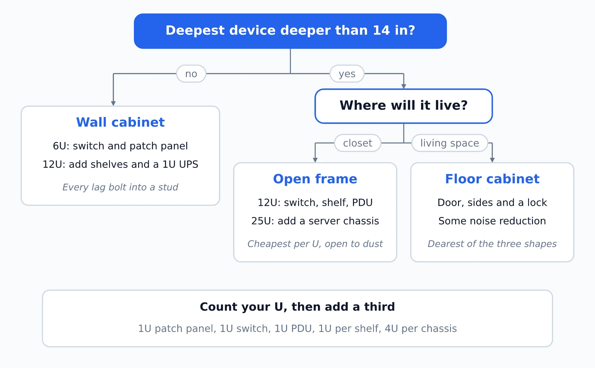
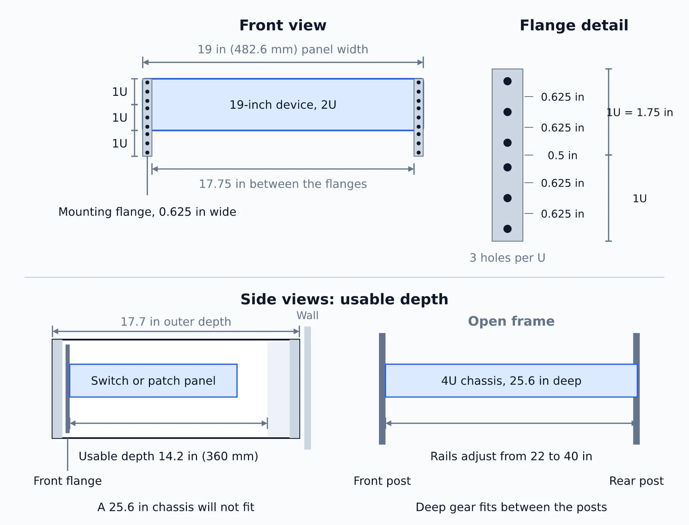
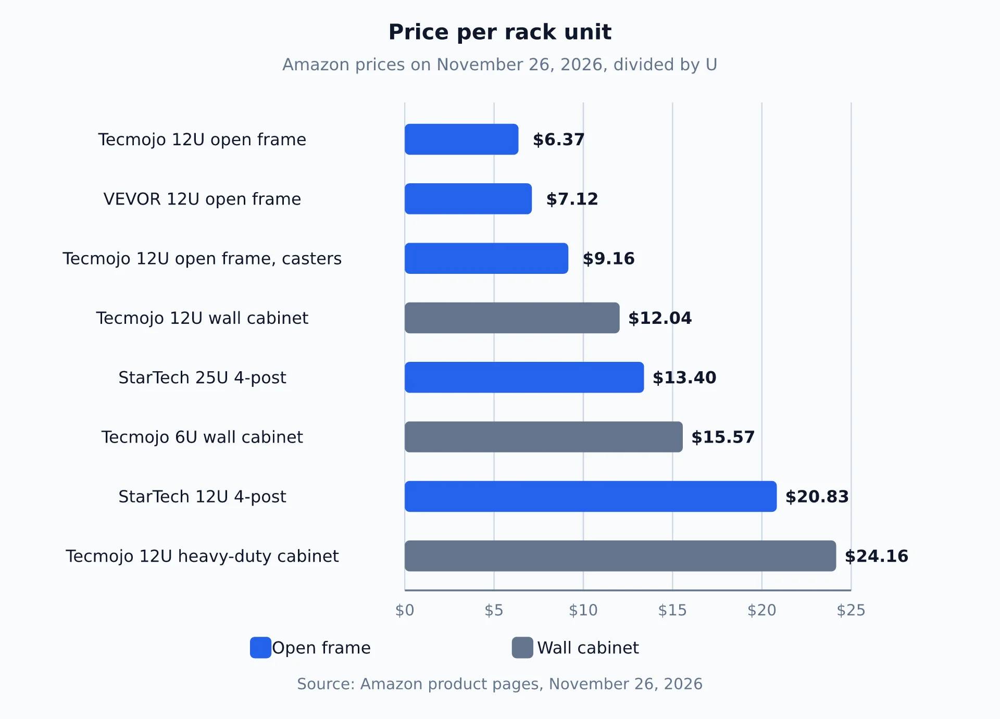

import Notice from "@components/widgets/Notice.astro";
import Accordion from "@components/widgets/Accordion.astro";
import AmazonProduct from "@components/widgets/AmazonProduct.astro";

For most homelabs the answer is the **[StarTech 4POSTRACK12U](#startech-4postrack12u-the-one-that-fits-anything)** at $249.99 on November 26, 2026, a 12U open frame whose rails slide from 22 to 40 inches, so a full-depth server chassis fits. Choose a wall cabinet only when your deepest device is under 14 inches. Go 25U when a chassis, a rack UPS and shelves need room.

<Notice type="warning" title="Affiliate disclosure">
Some links below are Amazon affiliate links, including `/go/` redirects that land on Amazon. Buying through them pays me a small commission at no extra cost to you. Prices were checked on November 26, 2026 and move constantly, so always confirm on the product page.
</Notice>

## Quick picks

| Pick | Price (Nov 26, 2026) | Shape | Usable depth | Buy it if |
| --- | --- | --- | --- | --- |
| [StarTech 4POSTRACK12U](/go/startech-12u-4-post-open-frame-rack/) | $249.99 | 12U open frame | 22 to 40 in | One rack that fits anything. |
| [Tecmojo 12U open frame](/go/tecmojo-12u-open-frame-rack/) | $76.42 | 12U open frame | 20.2 in, fixed | The budget stops under $100. |
| [Tecmojo 12U wall cabinet](/go/tecmojo-12u-wall-cabinet/) | $144.42 | 12U wall cabinet | 14.2 in (360 mm) | The rack has to hang on a wall. |
| [StarTech 4POSTRACK25U](/go/startech-25u-4-post-open-frame-rack/) | $334.99 | 25U open frame | 22 to 40 in | A chassis and a UPS need room. |
| [CyberPower CPS1215RM](/go/cyberpower-cps1215rm-pdu/) | $63.95 | 1U PDU | 4.75 in | You need ten outlets in the rack. |

Usable depth runs from the back of the front rail to the first obstruction, and it decides what fits. If your [10-inch mini rack](/best-10-inch-mini-rack/) is full, these are the next sizes.

## Should you buy a wall cabinet, an open frame or a floor cabinet?

Buy a wall cabinet if the deepest thing you own is a switch or a patch panel and the floor is spoken for. Buy an open frame for anything with a server chassis in it, and a floor cabinet when that chassis sits in a room you live in.

*Start with the deepest device you own, then decide where the rack stands. The U count comes last.*

### Wall cabinets: network gear with no floor space

The wall cabinet is the box most people picture: a lockable glass door, side panels and a small fan, bolted to the studs. Tecmojo's 12U is 17.7 in deep, and its rails stop 360 mm (14.2 in) back from the door. That holds a patch panel, a switch, a PDU and a shelf, but no server. The [6U version](/go/tecmojo-6u-wall-cabinet/) is 13.8 in tall, and the [heavy-duty 12U](/go/tecmojo-12u-heavy-duty-wall-cabinet/) reaches 20.1 in of mounting depth.

### Open frames: servers, on a floor

An open frame is four posts and nothing else: no door, no side panels, no fan. You reach the gear from every side and air moves freely, but dust settles on it. [Eaton's buying guide](https://tripplite.eaton.com/products/rack-buying-guide) puts 4-post racks first for servers, UPS systems and deep equipment. The Tecmojo fixes its posts 20.2 in apart; the StarTech rails slide from 22 to 40 in.

### Floor cabinets: the rack in the living room

A floor cabinet puts the door and side panels back on a full-depth frame on feet or casters. You get a lock and less dust, and you pay in weight and cooling ([Eaton](https://tripplite.eaton.com/products/rack-buying-guide)). The budget enclosed racks I found, such as an 18 in deep VEVOR 12U, share the wall cabinet's depth limit. [StarTech's 12U enclosed 4-post cabinet](/go/startech-12u-enclosed-server-cabinet/) is 29 in deep and cost $596.99 on November 26, 2026. Check its mounting depth before you order a chassis.

## How deep does a home server rack need to be?

Deeper than your longest device plus the cables behind it. Rosewill lists its [RSV-L4412U](https://www.rosewill.com/rosewill-rsv-l4500u-black/p/9SIA072GJ92847) 4U chassis at 650 mm (25.59 in) long, so the rails have to open past 26 in before you count one power cable.

*Front: 19 in of panel on 0.625 in flanges, with three holes per 1.75 in U. Sides: 14.2 in of usable depth in a 17.7 in wall cabinet against a 22 to 40 in open frame.*

The 19-inch part of the name is only the width. Every panel is 19 in (482.6 mm) across, ears included, on flanges 0.625 in wide with 17.75 in of clear space between them. Height comes in units of 1.75 in (44.45 mm), each with three holes spaced 0.625, 0.625 and 0.5 in apart ([Wikipedia](https://en.wikipedia.org/wiki/19-inch_rack)). Depth was never standardized, so two listings can both say "server rack" and fit different gear.

### Why a 12 to 18 inch wall cabinet cannot take a server chassis

The Tecmojo 12U wall cabinet is 17.7 in deep outside and offers 360 mm (14.2 in) of mounting depth inside. The Rosewill chassis is 25.59 in long, so it overshoots the rails by 11.4 in. Even the heavy-duty Tecmojo, with 20.1 in of mounting depth, misses by 5.5 in. The StarTech frames open to 40 in, so the same chassis fits with room for cable bends.

In ["Where to get a rack?"](https://www.reddit.com/r/homelab/comments/1ej3xxo/) a commenter says cheap network cabinets are far too short for a server, and that 600 mm is about the minimum for a PowerEdge. ["What sort of server rack do you have?"](https://www.reddit.com/r/homelab/comments/1hzcia2/) advises measuring from the back edge of the bezel to the furthest rear point. A long chassis can hang out behind an open frame's rear post, but a cabinet door will not close on it.

## The racks

### StarTech 4POSTRACK12U: the one that fits anything

My default pick: rails that open to 40 in, a 1,200 lb static rating and square holes for the M6 cage nuts in the box.

**Best for:** a lab that owns or plans a server chassis, a NAS or a rack UPS.

**Strengths:** Rails marked in U and depth, from 22 to 40 in ([datasheet](https://media.startech.com/cms/pdfs/4postrack12u_datasheet.pdf)). The box holds 24 M6 cage nuts, casters, leveling feet and a floor base plate.

**Trade-offs:** No door or side panels, so the gear stays visible and dusty. It cost $249.99 on November 26, 2026.

<AmazonProduct
  productName="StarTech 4POSTRACK12U (12U 4-post open frame rack)"
  productDescription="12U open frame with 22 to 40 in rails and a 1,200 lb static rating."
  productFeatures={["22 to 40 in adjustable depth", "1,200 lb stationary rating", "Square-hole rails, M6 cage nuts included", "Casters, leveling feet, floor base plate"]}
  productLink="/go/startech-12u-4-post-open-frame-rack/"
  productImage="https://m.media-amazon.com/images/I/51gCYf+jqtL._AC_SL1000_.jpg"
  productRating={4.7}
  recommendedBadge="Best Overall"
  importantConsiderations={["No door or side panels", "Not wall mountable", "Flat packed, assembly required"]}
  pros={["Fits a full-depth server chassis", "Rails marked in U and depth", "2-year warranty"]}
  cons={["Gear stays visible and dusty", "Costs more than three times the Tecmojo frame"]}
/>

### Tecmojo 12U open frame: the budget frame

For $76.42 on November 26, 2026 you get a 12U 4-post frame with two 1U shelves and the mounting hardware.

**Best for:** a switch, a patch panel and a shelf of mini PCs, on a floor or a wall.

**Strengths:** Rated for 260 lb on the floor or 130 lb on a wall ([Tecmojo](https://tecmojo.com/products/tecmojo-12u-open-frame-network-rack-for-it-av-gear-av-rack-floor-standing-or-wall-mounted-with-2-pcs-1u-rack-shelves-mounting-hardware-network-rack-for-19-networking-audio-and-video-device-1)). At 20.47 by 21.02 in, it fits where a cabinet will not. Amazon showed 1,000+ bought in the past month on November 26, 2026.

**Trade-offs:** The posts sit 20.2 in apart and do not move, so the 25.59 in Rosewill chassis overhangs the rear by 5.4 in. The [version with casters and brakes](/go/tecmojo-12u-open-frame-rack-with-casters/) was $109.90 on November 26, 2026.

<AmazonProduct
  productName="Tecmojo 12U Open Frame Network Rack (with 2 shelves)"
  productDescription="Budget 12U 4-post open frame for floor or wall, with two 1U shelves."
  productFeatures={["12U rail, 512 mm between posts", "260 lb floor, 130 lb wall rating", "Two 1U shelves and hardware included", "20.47 in wide, 21.02 in tall"]}
  productLink="/go/tecmojo-12u-open-frame-rack/"
  productImage="https://m.media-amazon.com/images/I/71aVC0cgDQL._AC_SL1500_.jpg"
  productRating={4.5}
  recommendedBadge="Best Budget"
  importantConsiderations={["Fixed 20.2 in depth, a chassis overhangs", "Casters cost extra", "Open frame, no dust protection"]}
  pros={["Cheapest way into 19-inch", "Shelves and hardware in the box", "Wall mountable"]}
  cons={["Rails do not adjust", "No door or panels"]}
/>

### Tecmojo 12U wall cabinet: the network closet

The cabinet I would hang in a hallway closet: lockable glass door, lockable side panels, a built-in fan and a door that swings 180 degrees.

**Best for:** a patch panel, a switch, a PDU and a shelf, where the floor has no room for a frame.

**Strengths:** 14.2 in of mounting depth takes a short-depth UPS, such as the 9.04 in 1U CyberPower in the [rack-mount UPS guide](/best-rack-mount-ups-homelab/). Rated for 110 lb.

**Trade-offs:** 14.2 in stops every server chassis, and one small fan moves the air in a sealed box. It cost $144.42 on November 26, 2026.

<AmazonProduct
  productName="Tecmojo 12U Wall Mount Server Cabinet (glass door)"
  productDescription="12U wall cabinet with a lockable glass door and a built-in fan, 17.7 in deep."
  productFeatures={["360 mm (14.2 in) mounting depth", "110 lb weight capacity", "Lockable door and side panels", "Built-in cooling fan"]}
  productLink="/go/tecmojo-12u-wall-cabinet/"
  productImage="https://m.media-amazon.com/images/I/51LYCBsqvpL._AC_SL1134_.jpg"
  productRating={4.5}
  recommendedBadge="Best for Wall Mounting"
  importantConsiderations={["No server chassis fits in 14.2 in", "Lag bolts into studs or a plywood backer", "Check reviews for dented panels"]}
  pros={["Locks shut", "Fits a switch, patch panel, shelf and 1U UPS", "Small footprint for a closet"]}
  cons={["Shallow", "Single fan in a sealed box"]}
/>

### StarTech 4POSTRACK25U: room to grow

Same rails and steel as the 12U, with 13 more U for $85 more: $334.99 on November 26, 2026.

**Best for:** a lab with a server chassis and floor space for a frame 48 in tall.

**Strengths:** 43.75 in of rail in a frame rated for 1,200 lb stationary and 661.5 lb rolling ([datasheet](https://media.startech.com/cms/pdfs/4postrack25u_datasheet.pdf)). The box holds 32 M6 cage nuts and 12 cable hooks.

**Trade-offs:** 72.8 lb before you add gear, and 50.8 in tall on casters. It has no door either.

<AmazonProduct
  productName="StarTech 4POSTRACK25U (25U 4-post open frame rack)"
  productDescription="25U open frame with 22 to 40 in rails, 1,200 lb stationary and 661.5 lb rolling."
  productFeatures={["22 to 40 in adjustable depth", "1,200 lb stationary, 661.5 lb rolling", "Square-hole rails, M6 cage nuts included", "48 in tall on feet, 50.8 in on casters"]}
  productLink="/go/startech-25u-4-post-open-frame-rack/"
  productImage="https://m.media-amazon.com/images/I/51wLbjaTjvL._AC_SL1000_.jpg"
  productRating={4.7}
  recommendedBadge="Room to Grow"
  importantConsiderations={["72.8 lb empty, flat packed", "Needs a 4.2 ft tall corner", "Open frame, no dust protection"]}
  pros={["Room for a chassis, UPS and shelves", "Rolling and static ratings published", "Cable hooks included"]}
  cons={["Too tall for some closets", "Open-frame dust"]}
/>

The [VEVOR 12U open frame](/go/vevor-12u-open-frame-rack/) adjusts from 23 to 40 in and cost $85.41 on November 26, 2026. Read its one-star reviews before picking it over the Tecmojo.

## How many U does a home server rack need?

Count 1U per patch panel, switch, shelf and PDU, 2U per rack UPS and 4U per server chassis. Buy a rack a third bigger than that count. A 12U gives 21 in of rail and a 6U only 10.5 in.

*Price per rack unit on November 26, 2026. Budget frames cost the least per U and the heavy-duty racks the most.*

The Tecmojo 6U costs $15.57 per U and the 12U $12.04 (November 26, 2026). The taller cabinet is the better buy unless the wall is too short.

A real lab adds up fast: 1U patch panel, 1U switch, 1U PDU, two 1U shelves, a 2U UPS and a 4U chassis come to 11U. That leaves 1U of a 12U rack, too little for air or the next box. The narrow 0.5 in gap between hole groups marks the boundary of each U.

## Square holes or tapped rails?

Square holes, for a homelab that changes. A tapped rail is one cross-threaded screw away from a dead hole, and a cage nut snaps out for replacement.

Tapped rails still suit gear that never moves. StarTech ships M6 cage nuts with its 4-post frames, so match the screw to the rail in front of you.

The 10-inch racks in the [GeeekPi vs Tecmojo](/geeekpi-vs-tecmojo-10-inch-rack/) comparison take #10-32 screws and 10-32 cage nuts, so a 10-inch parts bin will not cover a StarTech frame.

## How much weight can a wall mount rack hold?

Less than the label suggests until the bolts are right. Tecmojo rates its standard wall cabinets at 110 lb, its open frame at 130 lb on a wall, and its heavy-duty cabinet at 176 lb.

The lever is the part people skip. A 17.7 in deep cabinet carries its load 9 in out from the wall, so the top bolts feel an upward pull as well as the weight. RackSolutions' [installation instructions](https://link.racksolutions.com/desk_wall-mount_rack_installation_instructions) require every lag bolt in the center of a wood stud to reach the rated weight. On drywall, the same document has you screw a plywood backer to the studs first.

In a 2020 r/homelab thread, ["Navepoint 22U cabinet is made of paper mache"](https://www.reddit.com/r/homelab/comments/iicm7q/navepoint_22u_cabinet_is_made_of_paper_mache/), the owner needed a car jack to refit the side panels under load. Put the UPS at the bottom, where Eaton says heavy gear belongs.

Tecmojo's 12U wall cabinet weighs 40.9 lb empty.

## Will a server overheat or drone in a closet?

A mini PC lab will not. A rack server will be heard through the door and needs a path for its heat.

Heat is watts. Every watt a device burns leaves as heat, about 3.41 BTU per hour, and a used rack server idles at 60 W or more ([mini PC home server guide](/best-mini-pc-home-server/)). An N150 mini PC idles at 5 to 8 W.

Airflow is the other half. An empty U slot lets hot exhaust loop back into the intakes, so Eaton's guide recommends blanking panels and a fan at the top of an enclosed rack. The Tecmojo wall cabinets ship with a built-in fan; the open frames leave cooling to the room.

CyberPower's PDU FAQ warns that high ambient temperature can trip its breaker, and its range stops at 104°F (40°C).

Noise keeps a rack server out of a bedroom: r/homelab calls a PowerEdge a "tornado machine" in a [thread about a first server](https://www.reddit.com/r/homelab/comments/15gfzw4/).

## Do you need casters?

On a floor rack, yes, the first time you have to get behind it. On a wall cabinet the question never comes up.

StarTech ships casters and leveling feet with both frames. On casters the 12U stands 28 in tall instead of 25.1 in, and the 25U's rating drops from 1,200 lb stationary to 661.5 lb rolling. Lock them once the rack is placed.

The Tecmojo 12U open frame with casters and brakes costs $33.48 more than the one without ($109.90 against $76.42 on November 26, 2026).

## What does a rack PDU do, and what does it not do?

It turns one wall outlet into 8 or 10 outlets inside the rack, behind a single 15 A breaker. It does not ride through a power cut, because a PDU has no battery and plugs into the UPS that does.

Eaton sorts rack PDUs into [Basic, Metered Input, Metered Outlet and Managed](https://eaton.com/us/en-us/products/backup-power-ups-surge-it-power-distribution/power-distribution-for-it-equipment/power-distribution-units-for-server-racks.html). A Basic PDU is outlets and a breaker with unfiltered pass-through. Metered models add a load readout, and Managed models switch each outlet over the network.

| | Rack PDU | Rack UPS |
| --- | --- | --- |
| Job | Splits one outlet into 8 or 10 | Holds the load through a power cut |
| Battery | None | Yes |
| Read more | This page | [Rack-mount UPS](/best-rack-mount-ups-homelab/) and [home server UPS](/best-ups-for-home-server/) guides |

### CyberPower CPS1215RM: the PDU I'd buy

Ten rear-facing outlets, a 15 A breaker, a lighted switch and a 15 ft cord, for $63.95 on November 26, 2026.

**Best for:** any rack here, including the 14.2 in wall cabinet, since the PDU is 4.75 in deep.

**Strengths:** 10 NEMA 5-15R outlets at the rear, 15 A at 100 to 125 V, 5 lb, UL Recognized, 3-year warranty ([CyberPower](https://www.cyberpowersystems.com/product/pdus/basic/cps1215rm/)).

**Trade-offs:** It is a Basic PDU: no joule rating, no meter, no outlet switching. The CPS1215RMS adds 1800 J of surge suppression and 12 outlets, six at the front ([CyberPower](https://www.cyberpowersystems.com/product/pdus/surge/cps1215rms/)).

<AmazonProduct
  productName="CyberPower CPS1215RM Basic PDU (10 outlets)"
  productDescription="1U rack PDU with 10 rear NEMA 5-15R outlets, a 15 A breaker and a 15 ft cord."
  productFeatures={["10 NEMA 5-15R outlets at the rear", "15 A at 100 to 125 V", "1U, 17.25 by 4.75 in, 5 lb", "UL Recognized, 3-year warranty"]}
  productLink="/go/cyberpower-cps1215rm-pdu/"
  productImage="https://m.media-amazon.com/images/I/51LHjG3W6GL._AC_SL1500_.jpg"
  productRating={4.8}
  recommendedBadge="Best Rack PDU"
  importantConsiderations={["Basic PDU: no joule rating or meter", "No battery, pair it with a UPS"]}
  pros={["Ten outlets from one wall plug", "15 ft cord", "Sold by Amazon.com"]}
  cons={["No joule rating published", "Outlets face the rear only"]}
/>

The [8-outlet 1U power strip](/go/1u-8-outlet-rack-pdu/) at $33.99 on November 26, 2026 is the cheaper route, with individual switches, a 1200 J surge rating and a resettable breaker. Its seller is a brand I had not come across before this lookup.

## Patch panel, shelves and blanking panels

The [Rapink 24-port Cat6](/go/rapink-24-port-cat6-patch-panel/) at $37.99 on November 26, 2026 comes with the couplers loaded, so house cables plug into the back and patch cables into the front. You skip the punch-down tool, and a detachable back bar takes the strain off the couplers.

The [1U vented shelf pair](/go/1u-vented-rack-shelf-2-pack-6in/) at $24.35 on November 26, 2026 gives you two 6 in deep shelves rated at 44 lb each. That holds a mini PC or a modem. A NAS wants a 4-post shelf or its own rails, since 1U shelves lean under that weight ([r/homelab](https://www.reddit.com/r/homelab/comments/18qziwj/)).

The switch is in the [2.5 and 10GbE switch guide](/best-2-5-10gbe-switch-homelab/). Blank the U you leave empty in a cabinet: Eaton credits blanking panels with stopping hot exhaust from recirculating into the intakes. The [StarTech 1U panel](/go/startech-1u-blanking-panel/) cost $13.99 on November 26, 2026.

## Three carts with totals

Prices are Amazon's on November 26, 2026. No cart includes the switch, the UPS or the server.

### Cart 1: 12U wall cabinet for a network closet

| Item | Price (Nov 26, 2026) |
| --- | --- |
| [Tecmojo 12U wall cabinet](/go/tecmojo-12u-wall-cabinet/) | $144.42 |
| [Rapink 24-port Cat6 patch panel](/go/rapink-24-port-cat6-patch-panel/) | $37.99 |
| [1U vented shelf pair, 6 in](/go/1u-vented-rack-shelf-2-pack-6in/) | $24.35 |
| [8-outlet 1U power strip](/go/1u-8-outlet-rack-pdu/) | $33.99 |
| Total | $240.75 |

Four items fill 4U of the 12U.

### Cart 2: 12U open frame

| Item | Price (Nov 26, 2026) |
| --- | --- |
| [StarTech 4POSTRACK12U](/go/startech-12u-4-post-open-frame-rack/) | $249.99 |
| [Rapink 24-port Cat6 patch panel](/go/rapink-24-port-cat6-patch-panel/) | $37.99 |
| [1U vented shelf pair, 6 in](/go/1u-vented-rack-shelf-2-pack-6in/) | $24.35 |
| [CyberPower CPS1215RM PDU](/go/cyberpower-cps1215rm-pdu/) | $63.95 |
| Total | $376.28 |

The budget version, with the Tecmojo frame, its two shelves, the patch panel and the 1U power strip, comes to $148.40 on November 26, 2026.

### Cart 3: 25U frame for a server

| Item | Price (Nov 26, 2026) |
| --- | --- |
| [StarTech 4POSTRACK25U](/go/startech-25u-4-post-open-frame-rack/) | $334.99 |
| [Rapink 24-port Cat6 patch panel](/go/rapink-24-port-cat6-patch-panel/) | $37.99 |
| [1U vented shelf pair, 6 in](/go/1u-vented-rack-shelf-2-pack-6in/) | $24.35 |
| [CyberPower CPS1215RM PDU](/go/cyberpower-cps1215rm-pdu/) | $63.95 |
| Total | $461.28 |

The remaining 21U hold a 4U chassis, a 2U UPS from the [rack-mount UPS guide](/best-rack-mount-ups-homelab/) and whatever comes next.

### The shipping damage caveat

Racks ship as flat sheet steel, and thin steel bends in transit. For budget cabinets, search the one-star reviews for "dent" and "bent" before you order, and photograph every panel before assembly. A 2017 r/homelab thread, ["Sysrack anyone tried?"](https://www.reddit.com/r/homelab/comments/5sv2sh/), has a buyer reporting a cabinet that arrived bent.

## What I'd buy

I'd buy the StarTech 4POSTRACK12U with the Rapink patch panel, the shelf pair and the CyberPower PDU: $376.28 on November 26, 2026. It takes whatever I put in it next year.

Change the pick in three cases. Buy the 25U frame if a 4U chassis and a 2U UPS are on the list. Buy the Tecmojo 12U open frame ($76.42 on November 26, 2026) for a switch, a patch panel and shelves. Buy the Tecmojo wall cabinet ($144.42 on November 26, 2026) if the deepest box is under 14 in.

Before you order, measure your deepest box from the back of its bezel to the furthest point behind it. Then match that number to the usable depth column at the top.

## FAQ

<Accordion label="What size server rack do I need for a homelab?" group="faq" expanded="true">
12U covers a patch panel, a switch, a PDU, two shelves and a 2U UPS in its 21 in of rail. Add a 4U chassis and the count hits 11U, so the 25U frame is the safer buy.
</Accordion>

<Accordion label="Can a server fit in a 12U wall mount rack?" group="faq">
Only a shallow one. The Tecmojo 12U wall cabinet offers 360 mm (14.2 in) of mounting depth, and Rosewill's RSV-L4412U chassis is 650 mm (25.59 in) long. A chassis needs 22 to 40 in rails.
</Accordion>

<Accordion label="What is the difference between a rack PDU and a UPS?" group="faq">
A PDU splits one wall outlet into 8 or 10 outlets behind a breaker and has no battery. A UPS holds the load through a cut. The order is wall to UPS, UPS to PDU, PDU to gear.
</Accordion>

<Accordion label="How much weight can a wall mount rack hold?" group="faq">
Tecmojo rates its standard wall cabinets at 110 lb and its open frame at 130 lb on a wall. Those figures need lag bolts centered in wood studs, per RackSolutions' instructions.
</Accordion>

<Accordion label="Can I put a mini PC in a server rack?" group="faq">
Yes, on a 1U shelf. The 6 in shelf here is rated at 44 lb, and a Beelink Mini S13 is about 115 by 102 mm, so it fits. Add one shelf per loose box.
</Accordion>

<Accordion label="Are casters worth it on a server rack?" group="faq">
Yes on a floor rack. The StarTech 12U ships with four casters and rises from 25.1 in to 28 in on them. On the 25U the rating drops from 1,200 lb to 661.5 lb rolling, so lock them once placed.
</Accordion>
