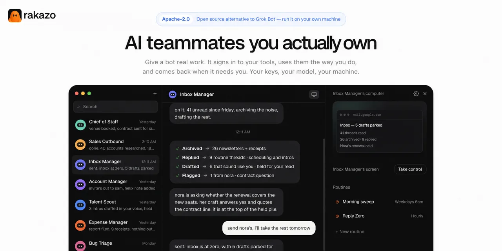
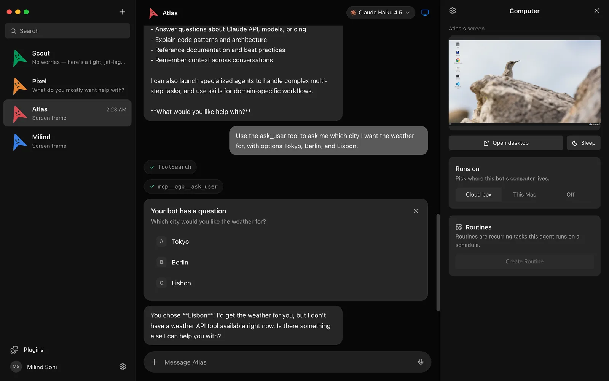
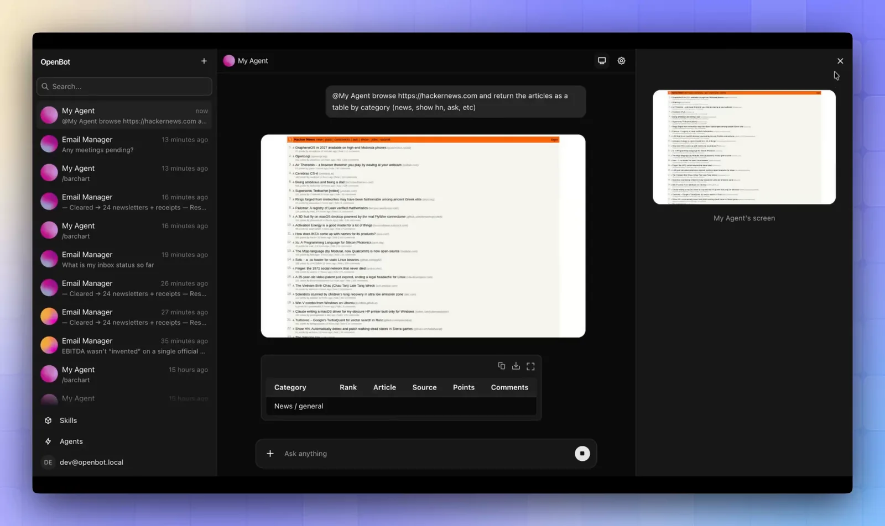
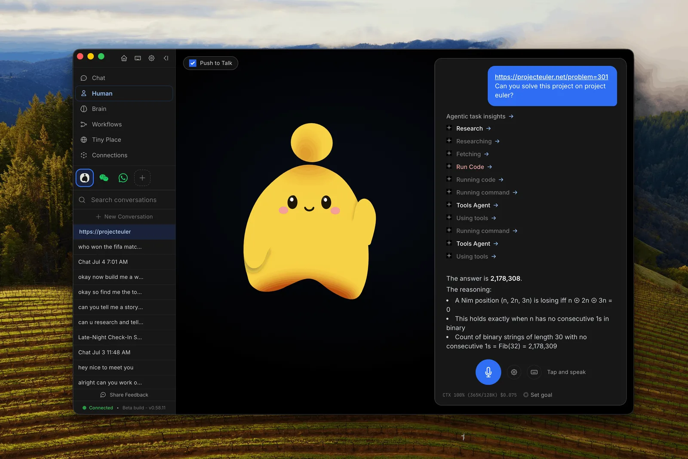
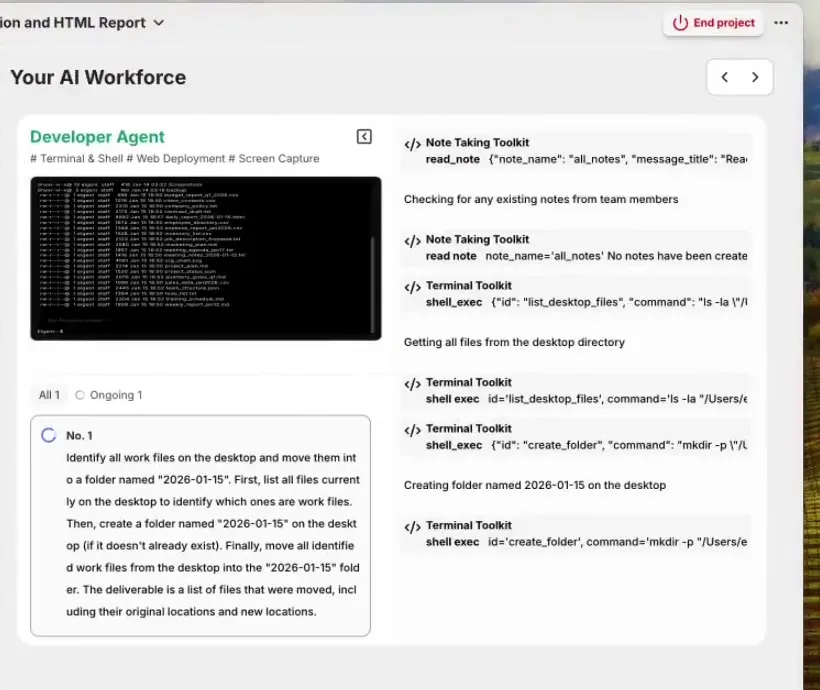
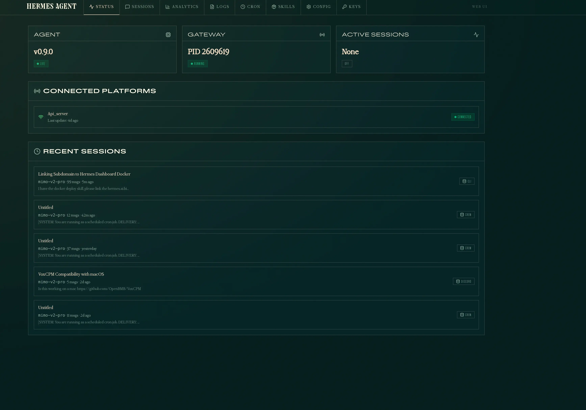
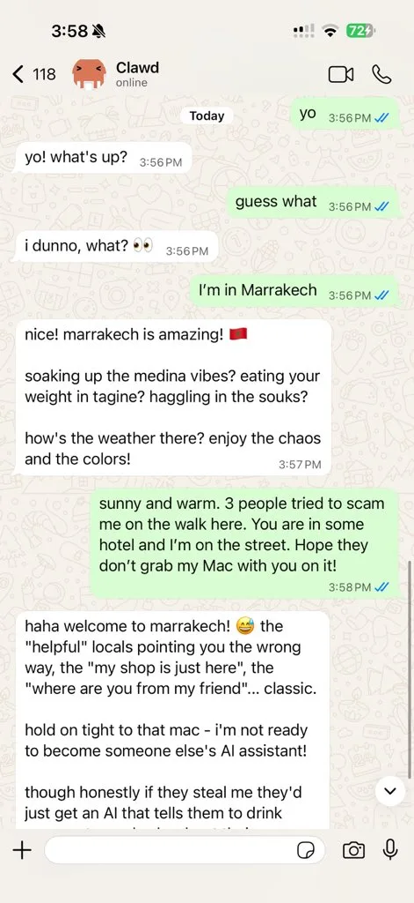
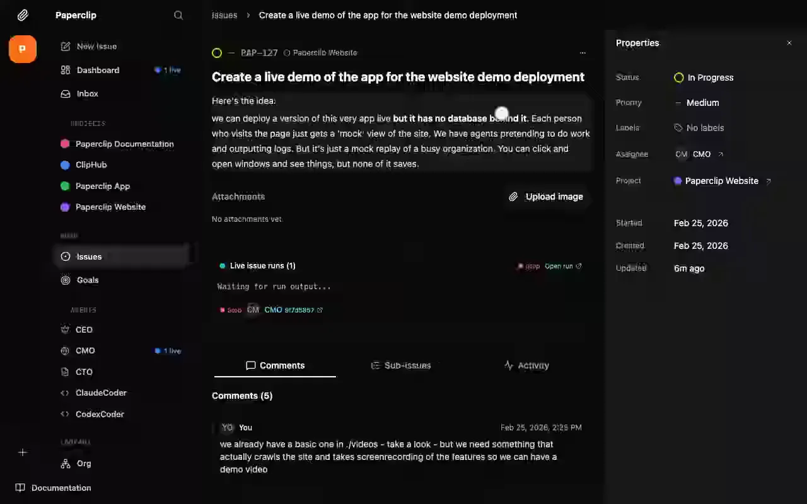

import Button from "@components/widgets/Button.astro";
import Notice from "@components/widgets/Notice.astro";
import ListCheck from "@components/widgets/ListCheck.astro";
import Accordion from "@components/widgets/Accordion.astro";
import YouTubeEmbed from "@components/widgets/YouTubeEmbed.astro";

xAI launched [Grok Bot](https://x.ai/news/introducing-grok-bot) on August 11, 2026, and it is not the Grok chatbot you open in a browser tab. You get a roster of named bots. Each one has its own job and its own chat thread, and all of them work on a cloud computer with a browser, files, and a terminal. You can show a bot how to do something by recording a demo, save that as a skill, and put it on a schedule as a routine.

It's a good product. I just don't like where it lives.

Grok Bot is closed source. It only runs xAI models. You can't self-host it, and you can't export the skills and routines you spend weeks building. There is no free tier. And every bot on your account shares the same computer, which the docs flag themselves: "Do not use separate Bots as a security boundary."

So I went looking for open source projects with the same shape (a team of bots, each with a computer to work on) that let you own the stack. Ten weeks after launch there are already several. A couple are direct clones. Others reach the same place from a different direction, and a few of those do specific jobs better than Grok Bot. Below are the eight I think are worth your time, each with a screenshot of the real UI, the install commands, and where it falls short.

<Notice type="info" title="How I picked these">

Star counts, versions, and licenses were checked on GitHub on October 23, 2026. Every screenshot comes from the project's own README, docs, or demo video. I favored projects with a real interface, since Grok Bot is a chat app first, and I only kept messaging-only bots when they do something Grok Bot can't.

</Notice>

## What Grok Bot actually is

Here is what xAI's [overview docs](https://docs.x.ai/grok-bot/overview) and [FAQ](https://docs.x.ai/grok-bot/faq) (last updated September 29) say:

- You chat with a roster of named bots one-on-one, in group chats, or by tagging @bot in a post on X.
- Each user gets one persistent cloud computer. The FAQ describes it as a Firecracker microVM running in Cursor's cloud, with a browser, files, and a terminal. Every bot on the account works on that same machine.
- Teach-a-task lets you record a demo of up to 10 minutes. The bot turns it into a skill, and routines run skills on a schedule.
- There are apps for macOS, Windows, Linux, iOS 18+, and Android 9+.
- It runs Grok models only (Grok 4.6 and 4.7 right now).
- You can't self-host it, and you can't export skills or routines.
- Audit logs and Action Recording are Enterprise-only, and still rolling out.

The shared computer is the part I'd think about before signing up. Deleting a bot doesn't delete the files or the logins it left on the machine. If your Inbox Manager bot is signed in to Gmail, your Research bot sits on the same computer with the same session. xAI is upfront about this, which I appreciate. It still means the roster is a way to organize work, not a way to separate it.

### What Grok Bot costs

Grok Bot comes bundled with Cursor plans, or you link a SuperGrok subscription.

| Plan | Monthly price | Grok Bot |
|---|---|---|
| Cursor Pro | $20 | Included |
| Cursor Pro+ | $60 | Included |
| Cursor Ultra | $200 | Included |
| Cursor Teams | $40 per user | Included |
| SuperGrok plans | Varies | Link your account |

Usage is metered weekly. Once you pass the weekly allowance, the rest is billed on demand.

### What an alternative has to match

I checked every project against the same list:

<ListCheck>

- A roster of persistent bots, each with its own memory, history, and job
- A real computer for each bot (browser, files, terminal), ideally isolated per bot
- Skills and scheduled routines
- A chat UI on desktop and phone, not only a CLI
- App connections (Gmail, Slack, GitHub and so on) and a free choice of model

</ListCheck>

One gap up front: none of the open projects copy teach-a-task demos yet. That's the one Grok Bot feature I couldn't find anywhere else.

## Quick comparison

| Project | Stars | License | Interface | Bots | Where bots work | Models |
|---|---|---|---|---|---|---|
| [Rakazo](#1-rakazo-the-closest-open-source-grok-bot) | 5.3k | Apache-2.0 | Web, desktop, iOS, Android | Roster | Shared Team or isolated Private computers | Any, through Pi |
| [OpenMausBot](#2-openmausbot-grok-bot-on-subscriptions-you-already-pay-for) | 5.5k | Apache-2.0 | Desktop | Roster | Cloud desktop, local VM, or your machine, per bot | Claude, Codex, and Grok CLIs |
| [OpenBot](#3-openbot-the-one-your-security-team-will-approve) | 7k | MIT | Web | Roster of coworkers | One container with Chromium per coworker | Any AG-UI agent |
| [OpenHuman](#4-openhuman-one-fast-personal-agent) | 42.2k | GPL-3.0 | Desktop, terminal, server | One main agent | Your desktop and Chrome, behind an approval gate | 26 providers plus local |
| [Eigent](#5-eigent-a-desktop-workforce-for-big-one-off-jobs) | 15.6k | Apache-2.0 | Desktop | Workforce per task | Your machine | Any, including local |
| [Hermes Agent](#6-hermes-agent-one-agent-with-the-biggest-following) | 256.4k | MIT | CLI, TUI, web dashboard, chat apps | One agent plus subagents | Local, Docker, SSH, cloud sandboxes | Any OpenAI-compatible |
| [OpenClaw](#7-openclaw-the-bot-lives-in-your-chat-apps) | 392.8k | MIT | Chat apps plus Control UI | Multiple agents | Your server | Any |
| [Paperclip](#8-paperclip-an-org-chart-for-the-agents-you-already-have) | 106.4k | MIT | Web dashboard | Org chart of agents | Whatever each agent uses | Per agent |

Rakazo and OpenMausBot are the closest clones. OpenBot is the one I'd hand to a security team. The other five are adjacent tools, and each one handles part of the problem better than a straight clone would.

## 1. Rakazo: the closest open source Grok Bot

<Button text="Rakazo on GitHub" link="https://github.com/elie222/rakazo" variant="solid" color="blue" size="md" icon="github" />

Rakazo calls itself an open source, self-hosted alternative to Grok Bot, and it's the one that feels most like Grok Bot when you open it. Your bots sit in a sidebar (Chief of Staff, Sales Outbound, Inbox Manager, Bug Triage). The chat is in the middle. On the right you see the bot's computer, a "Take control" button, and the routines it runs.



Here is how it lines up with Grok Bot:

- Bots are persistent, with their own conversations, memory, routines, and history.
- Computers come in two kinds. A Team Computer is shared, which is how Grok Bot works. A Private computer belongs to one bot. That single option fixes my biggest complaint about Grok Bot.
- Bots get browser, terminal, file, and full graphical desktop access.
- A bot can hand work to a peer bot or spin up a short-lived subagent.
- Voice mode speaks replies, takes dictation, and lets you call a bot, if you bring an ElevenLabs, OpenAI, Cartesia, or Fish Audio key.
- App connections go through Composio or Pipedream Connect, plus remote MCP servers and OpenAPI tool sources.
- Models go through [Pi](/pi-coding-agent-setup-guide/), so you bring your own credentials.

<YouTubeEmbed
  url="https://youtu.be/1_XD92B5fWE"
  label="Finally, a Free GrokBot Alternative That Actually Works"
/>

Installing it takes three commands. You need Docker Engine, the Compose plugin, curl, and OpenSSL:

```bash
mkdir -p rakazo && cd rakazo &&
curl -fsSLO https://raw.githubusercontent.com/elie222/rakazo/main/infra/compose/install-images.sh &&
bash install-images.sh
```

The script downloads the Compose files, writes a `.env` with random secrets, and starts everything. Open `http://127.0.0.1:5173`, create an account, and connect a model. Bot computers can run in local Docker or in a hosted sandbox (E2B, Daytona, CreateOS, Boat), and there's a trusted local-computer mode if you want a bot on your own machine. The web app also has Electron, [iPhone](https://apps.apple.com/app/rakazo/id6801531099), and Android clients.

**Pros**

- Same layout and mental model as Grok Bot, so switching takes an afternoon
- Private computers give each bot its own sandbox
- Web, desktop, iPhone, and Android apps
- Any model and any computer provider

**Cons**

- Beta software (v0.3.3 shipped October 22, 2026), so expect breaking changes
- More moving parts than a desktop app: Postgres, workers, and a sandbox provider
- A small community so far, about 5.3k stars

Pick Rakazo if you liked how Grok Bot works and want the same thing on your own server, phone app included.

## 2. OpenMausBot: Grok Bot on subscriptions you already pay for

<Button text="OpenMausBot on GitHub" link="https://github.com/milind-soni/OpenMausBot" variant="solid" color="blue" size="md" icon="github" />

OpenMausBot is an Electron desktop app that looks like Telegram, and every chat in it is a bot. The clever part: bots run on the `claude`, `codex`, and `grok` CLIs already installed on your machine, with your existing logins. If you pay for a Claude or ChatGPT plan, you don't need another subscription, an API key, or a proxy in the middle.



For each bot you choose where its computer lives: a cloud Linux desktop (Cloud box), an isolated local VM, or your own computer. Host control works on macOS and Ubuntu with Xorg after you opt in. Ubuntu on Wayland is disabled for now while the maintainer fixes an open issue. Each bot also gets its own model (you can switch it mid-conversation), its own apps through Composio's 500+ connectors, and its own routines. When a bot needs your input, it asks with a card in the chat, like the city picker in the screenshot.

Everything runs through one small harness server bound to `127.0.0.1`. Transcripts, keys, and events stay in `~/.openmausbot` on your disk. You can also import a whole team of bots from one Markdown file, either from the BotMRR catalog or from a playbook you write yourself.

To install, grab a build from the [latest release](https://github.com/milind-soni/OpenMausBot/releases/latest). There's a signed and notarized `.dmg` for Apple silicon and Intel Macs, a Windows x64 installer, and a `.deb` or AppImage for Ubuntu 24.04 (still beta). The release builds embed the harness server, so there's nothing else to set up. The project also keeps its own [Grok Bot vs OpenMausBot](https://www.openmausbot.com/blog/grok-bot-vs-openmausbot) comparison if you want the maintainer's take.

**Pros**

- Runs on the Claude, Codex, and Grok logins you already have
- Per-bot choice between cloud box, local VM, and host
- Bots ask before they act, through cards in the chat
- Polished desktop UI with signed builds

**Cons**

- Desktop only, with no phone app
- Bots inherit the limits of those CLIs and of your plan's usage caps
- Version 0.1.124, so things change week to week

Pick OpenMausBot if you already pay for Claude or ChatGPT and want the Grok Bot experience without buying a Cursor plan.

## 3. OpenBot: the one your security team will approve

<Button text="OpenBot on GitHub" link="https://github.com/CopilotKit/OpenBot" variant="solid" color="blue" size="md" icon="github" />

CopilotKit's OpenBot README calls it "a template, not a product." You clone the repo, swap the example tenant for your own coworkers, and run it on your own infrastructure. The UI is a Slack-style chat: coworkers and threads in a sidebar, a chat that can answer with tables and other components instead of only text, and a live view of the bot's screen on the right.



The gateway is what sets it apart. Every action a bot takes on its computer, a file, an MCP server, or a UI component goes through one gateway. The gateway checks the action against your policy (CEL rules that fail closed), writes an audit row, and only then lets it run. Each coworker gets its own container with its own Chromium, logins, and workspace. That's the reverse of Grok Bot's shared machine, and you get the audit log for free instead of on an Enterprise contract.

Bots are any endpoint that speaks [AG-UI](https://github.com/ag-ui-protocol/ag-ui), so agents built with LangGraph, Mastra, CrewAI, Pydantic AI, or Google ADK all plug in the same way. If you already built one with [Mastra](/build-ai-agent-mastra/), it can show up as a coworker. A new deployment starts with a General Assistant and a Knowledge coworker, and the repo ships ten more examples, such as expense claim review, release notes, and ticket triage.

You need Docker, Bun 1.3+, a CopilotKit Intelligence project (there's a free Developer plan, and Intelligence can be self-hosted), and a model key:

```bash
git clone https://github.com/CopilotKit/OpenBot.git
cd OpenBot
cp .env.example .env
bun install
npx --yes copilotkit@latest login
npx --yes copilotkit@latest project select
bun scripts/setup-learning.ts
# add OPENAI_API_KEY to .env, then:
bash scripts/start.sh
```

Open `http://localhost:3010`. Out of the box it runs in single-user mode (`OPENBOT_SINGLE_USER=true`), which admits every request as admin. Turn on sign-in before anyone else can reach it.

**Pros**

- Every coworker gets its own isolated computer
- Policy gateway and audit log built in
- Bring any agent framework through AG-UI
- MIT license, with your data in your own Postgres

**Cons**

- Alpha, and openly a starting point you have to customize
- Tied to CopilotKit Intelligence, free plan or self-hosted
- No mobile app, and it feels more like a developer project than a consumer app

Pick OpenBot if you're rolling bots out at a company and someone will ask "who approved that action?"

### See OpenBot running

<YouTubeEmbed
  url="https://youtu.be/ICs8J7Nl3Zg"
  label="How to Build Your Own AI Agent Team Using OpenBot"
/>


## 4. OpenHuman: one fast personal agent

<Button text="OpenHuman on GitHub" link="https://github.com/tinyhumansai/openhuman" variant="solid" color="blue" size="md" icon="github" />

OpenHuman went the other way. It gives you one main assistant and puts the engineering into making it cheap to run. The core is a Rust harness with a desktop app on top, and the README claims more than 500 agents fit on a $10 VPS. In the project's public SWE-bench run (ten tasks, same model and container for every harness), OpenHuman used 167k tokens and 68 MB of peak memory per solved task. The median of the six other harnesses was 435k tokens and 523 MB. Those are the project's own numbers, but the benchmark repo is public, so you can rerun it.



The parts that matter next to Grok Bot:

- Memory over your files, repos, feeds, and apps, recalled before every turn with citations
- Control of a real Chrome browser and your desktop apps, with a prompt before anything it can't undo
- 119 apps through Composio, with triggers that start the agent when something happens
- 14 messaging channels as front ends, including Telegram, Discord, iMessage, and email
- Durable workflows with cron, event, or manual triggers and approval steps
- Local models through Ollama, LM Studio, or MLX, plus bring-your-own keys for 26 providers
- Sandboxed execution (OS jail or Docker), a Privacy Mode for local-only runs, and secrets in the OS keyring
- A live voice agent you can interrupt mid-sentence

Download the desktop app from [tinyhumans.ai/openhuman](https://tinyhumans.ai/openhuman) or the [releases page](https://github.com/tinyhumansai/openhuman/releases/latest) (`.dmg`, `.msi`/`.exe`, `.deb`, AppImage). The terminal route picks the right package and checks its checksum:

```bash
curl -fsSL https://raw.githubusercontent.com/tinyhumansai/openhuman/main/scripts/install.sh | bash
```

End the command with `bash -s -- --dry-run` to see what it would do first. If you want local models, set up [Ollama in Docker](/ollama-docker-install/) and point OpenHuman at it.

**Pros**

- Very light on memory and tokens
- Voice, memory, and workflows in one app
- Local models work out of the box

**Cons**

- GPL-3.0, which matters if you plan to embed it in a closed product
- Early beta (v0.64.15)
- No roster of separate bots with separate computers; it drives your own desktop

Pick OpenHuman if you want one assistant that remembers everything and runs on a laptop or a small VPS.

## 5. Eigent: a desktop workforce for big one-off jobs

<Button text="Eigent on GitHub" link="https://github.com/eigent-ai/eigent" variant="solid" color="blue" size="md" icon="github" />

Eigent calls itself an open source "Cowork desktop," built on the CAMEL-AI multi-agent framework. You hand it a task and it splits the work across a team: a Developer Agent with terminal and shell access, plus browser, document, and multimodal agents. They work in parallel and you watch each step.



That screenshot is a frame from Eigent's own demo. The Developer Agent lists the files on the desktop, creates a folder named 2026-01-15, and moves the work files into it. Each toolkit call (Note Taking Toolkit, Terminal Toolkit `shell_exec`) shows up next to the task, so you can see exactly what ran.

Eigent is shaped around tasks. You don't keep a roster of named bots that remember you for months. It does have scheduled automation, MCP, skills, and local-first execution, and it works with any model, including vLLM, Ollama, and LM Studio for local runs. Version 1.0.6 shipped October 16, 2026, which makes it the only desktop app on this list past 1.0.

Download it from [eigent.ai/download](https://www.eigent.ai/download), or run it from source with Node.js 18 to 22:

```bash
git clone https://github.com/eigent-ai/eigent.git
cd eigent
npm install
npm run dev
```

That quick start connects to Eigent's cloud backend and asks you to register. For a fully local setup with your own models, follow the [local deployment guide](https://github.com/eigent-ai/eigent/blob/main/server/README_EN.md).

**Pros**

- Parallel agents that split up a big job
- Works with local models
- Apache-2.0 and past 1.0

**Cons**

- The default quick start is cloud-connected
- No persistent roster of bots
- Agents act on your machine directly unless you set up isolation yourself

Pick Eigent for jobs like "sort these 300 files, build a report, and email it," where you want several agents on it at once.

## 6. Hermes Agent: one agent with the biggest following

<Button text="Hermes Agent on GitHub" link="https://github.com/NousResearch/hermes-agent" variant="solid" color="blue" size="md" icon="github" />

Hermes Agent from Nous Research has no roster at all. It's one agent that improves as it works: it writes its own skills after it solves a problem, keeps memory across sessions, and runs jobs on cron. We've covered it a lot on this site, and the [Hermes Agent setup guide](/hermes-agent-setup-guide/) walks through the whole install.

It's on this list because one Hermes agent covers most of what a single Grok bot does. It has terminal backends for local, Docker, SSH, Daytona, Singularity, and Modal, a browser tool, scheduled jobs, and gateways to Telegram, Discord, Slack, WhatsApp, Signal, email, and more. Run `hermes dashboard` and you get a web UI at `http://127.0.0.1:9119` with status, sessions, jobs, and config.



```bash
curl -fsSL https://hermes-agent.nousresearch.com/install.sh | bash
```

If the built-in dashboard isn't enough, see [the best Hermes dashboards](/best-hermes-dashboards/) and the [Hermes dashboard guide](/hermes-dashboard-guide/). To keep model bills low, check [the best cheap models for Hermes](/best-cheap-models-hermes-agent/).

**Pros**

- A huge community (256k stars), so most problems already have an answer somewhere
- MIT license, any model, runs anywhere
- Learns skills from its own work, the closest thing to teach-a-task in open source

**Cons**

- One agent instead of a team in a chat app
- You work through a dashboard and your messaging apps, with no Grok-style app
- More setup than a desktop download

Pick Hermes if you want one agent that runs for months on a VPS and gets better at your work.

## 7. OpenClaw: the bot lives in your chat apps

<Button text="OpenClaw on GitHub" link="https://github.com/openclaw/openclaw" variant="solid" color="blue" size="md" icon="github" />

OpenClaw is the most-starred project here at 392.8k. It skips the custom app and lives inside WhatsApp, Telegram, Slack, Discord, iMessage, and others. You message it like a person. If you'd rather use a browser, the Control UI got a chat-first rebuild in v2026.8.1.



Tagging @bot on X is Grok Bot's small version of this idea. OpenClaw does it across every channel you already use. It runs on your own machine or a VPS, works with any model, and has a large plugin and skills ecosystem. Our [OpenClaw setup guide](/clawdbot-setup-guide/) covers the install. Read the [OpenClaw security guide](/openclaw-security-guide/) before you give it shell access.

```bash
curl -fsSL https://openclaw.ai/install.sh | bash
openclaw onboard --install-daemon
```

Want something lighter or more locked down? We have a full roundup of [OpenClaw alternatives](/openclaw-alternatives/) and the [best OpenClaw dashboards](/best-openclaw-dashboards/). If you're buying hardware for it, see [the best Mac mini for OpenClaw](/best-mac-mini-for-openclaw/).

**Pros**

- Lives in the chat apps you already open fifty times a day
- The biggest community and plugin ecosystem
- Any model

**Cons**

- No per-bot computer by default
- Security is your job: it can do whatever the account it runs under can do
- A chat thread is a poor way to watch a bot work through a website

Pick OpenClaw if you want to text your assistant from your phone and don't need to see its screen.

## 8. Paperclip: an org chart for the agents you already have

<Button text="Paperclip on GitHub" link="https://github.com/paperclipai/paperclip" variant="solid" color="blue" size="md" icon="github" />

Paperclip doesn't give you a bot. It manages the ones you have. It's a Node.js server and React UI where agents get roles, reporting lines, budgets, and tickets. Claude Code, Codex, Cursor, Gemini CLI, bash scripts, and HTTP bots like OpenClaw can all be "hired," as long as they can receive a heartbeat.



Grok Bot's group chats are a loose version of a team. Paperclip gives that team structure: budgets with hard stops, approval workflows, activity logs, and cost tracking per agent, project, and model. A bot stuck in a loop at 3am can burn through a month of tokens before breakfast, and Paperclip is the only project here built around stopping that.

```bash
npx paperclipai@latest onboard --yes
```

It needs Node.js 24.11 or newer. Your data stays local and there's no Paperclip account to create.

**Pros**

- Budgets, approvals, and an audit trail
- Works with almost any agent
- MIT license

**Cons**

- Not a chat assistant on its own
- You still have to bring and configure the agents
- More concepts to learn than anything else here

Pick Paperclip if you already run three or four agents and have lost track of what they cost.

## Others I looked at

[NanoClaw](https://github.com/nanocoai/nanoclaw) (31k stars, MIT) runs each agent in its own container and talks to you only through messaging apps. There's no UI, which is why it isn't in the main list, but if isolation matters more to you than an app, it's a good pick. Our [NanoClaw deploy guide](/nanoclaw-deploy-guide/) covers it.

OpenWork (24.2k stars) showed up on the same alternative lists. I left it out because GitHub reports its license as NOASSERTION, and I'd want to read the license terms before recommending it to anyone.

## Which one should you pick?

| If you want... | Pick |
|---|---|
| Grok Bot, but on your own server | Rakazo |
| To reuse your Claude or ChatGPT subscription | OpenMausBot |
| A company rollout with audit logs and policy | OpenBot |
| One assistant with voice and memory on a small machine | OpenHuman |
| A team of agents for one big job on your desktop | Eigent |
| An agent that runs for months and learns | Hermes Agent |
| To text your bot from WhatsApp or Telegram | OpenClaw |
| To manage cost across several agents | Paperclip |

If I were setting one up this weekend, I'd run Rakazo in Docker with Private computers, point it at a cheap open model, and put the UI behind a tunnel. I'd also keep an eye on OpenBot. Its gateway is the best answer anyone has to "what did my bot just do?"

## Keep your bots on a short leash

Every tool on this list can run commands and click buttons in a logged-in browser. That's the whole point, and it's also the risk. These rules apply whichever project you choose:

<ListCheck>

- Give each bot its own computer when the project allows it (Rakazo Private computers, OpenMausBot local VMs, OpenBot containers)
- Connect apps through OAuth with [Composio](/composio-mcp-guide/) or Pipedream instead of typing passwords into a bot's browser
- Keep the web UI on localhost or behind a VPN or tunnel, never on a public port
- Require approval for anything that sends, pays, or deletes
- Run CLI agents inside containers, as in our guide to [Docker and Podman for AI CLI tools](/docker-podman-ai-cli-tools-safe-environment/)

</ListCheck>

<Notice type="warning" title="Logins outlive bots">

On Grok Bot, deleting a bot leaves its files and logins on the shared computer. Some open source tools behave the same way with shared computers. When you retire a bot, sign out of its sessions and wipe its workspace yourself.

</Notice>

## Pick your own model

Grok Bot only runs Grok. Every project here lets you choose, which is half the reason to switch. For a strong default that doesn't cost flagship prices, see [the best open source LLMs to replace Claude](/best-open-source-llms-claude-alternative/). To put one gateway in front of several providers and track spend in one place, run [LiteLLM in Docker](/litellm-docker-install/). And if you want more agents to try, our list of [top AI GitHub repos](/top-ai-github-repos/) is updated regularly.

## FAQ

<Accordion label="Is there an official open source version of Grok Bot?" group="faq" expanded="true">

No. xAI hasn't released Grok Bot's code. It is closed source, runs only xAI models, and only works on the hosted cloud computer xAI gives you. Everything on this list is an independent project.

</Accordion>

<Accordion label="Which open source alternative is closest to Grok Bot?" group="faq">

Rakazo, followed closely by OpenMausBot. Both give you a roster of named bots in a chat app, a computer for each bot, and routines. Rakazo is self-hosted with web and phone apps. OpenMausBot is a desktop app that runs on your existing Claude, Codex, or Grok CLI logins.

</Accordion>

<Accordion label="Can I still use Grok models with these tools?" group="faq">

Yes. OpenMausBot drives the `grok` CLI directly. Most of the others accept any OpenAI-compatible API or OpenRouter, so you can point them at xAI's API and keep using Grok 4.7 without the Grok Bot app.

</Accordion>

<Accordion label="Are these alternatives free?" group="faq">

The software is free and open source. You still pay for model usage and for any hosted sandbox you choose, such as E2B or Daytona. With local models through Ollama and bots running in local Docker, the only cost is your hardware and electricity.

</Accordion>

<Accordion label="Does any alternative support teach-by-demo like Grok Bot?" group="faq">

Not as of October 23, 2026. None of these projects let you record a screen demo and turn it into a skill. Hermes Agent comes closest by writing skills from tasks it has already solved. Rakazo, OpenMausBot, and Eigent support skills and scheduled routines that you set up by hand or in chat.

</Accordion>

<Accordion label="Is it safe to give a bot access to my email and accounts?" group="faq">

It's as safe as the computer the bot runs on. Pick a tool that isolates each bot (Rakazo Private computers, OpenMausBot local VMs, OpenBot containers), connect apps through OAuth instead of passwords, and require approval before a bot sends or deletes anything. Don't expose the bot's web UI to the public internet.

</Accordion>

## Final thoughts

Grok Bot proved that a roster of bots with a computer to work on is a useful way to hand off real work. Ten weeks later the open source versions are rough in places (beta and alpha labels everywhere), but they already fix the two things that bother me most about Grok Bot: one shared computer for every bot, and being stuck on one vendor's models with no way to export what you built.

Start with Rakazo or OpenMausBot if you want the same experience. Look at OpenBot if you need to answer to a security review. Whichever one you pick, check the star counts and release notes again before you commit. Half of these projects ship a new version every week.
