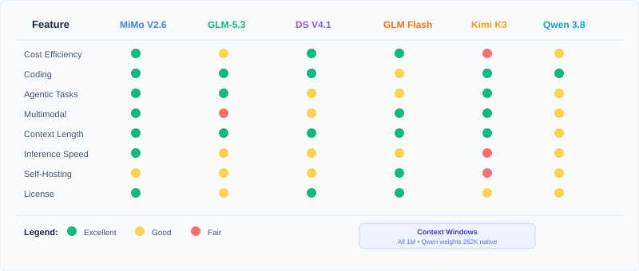

import Button from "@components/widgets/Button.astro";
import Notice from "@components/widgets/Notice.astro";
import ListCheck from "@components/widgets/ListCheck.astro";
import Accordion from "@components/widgets/Accordion.astro";
import Tabs from "@components/widgets/Tabs.astro";
import Tab from "@components/widgets/Tab.astro";

The best open source LLMs now trade blows with [Claude Opus 5.5](https://www.anthropic.com/claude-opus-5-5) on real coding work, at a fraction of the flagship price. Three weeks ago I published this league table as of September 24. Since then the proprietary tier copied the open tier's pricing: Claude Sonnet 5.5, GPT-6.1 Sol, and Gemini 4 Argon all sit at $2/$10 per million tokens, while Claude Haiku 5.5 and GPT-6 Luna run at $0.10/$0.50. The open field answered with Step 5 Preview taking the #3 open-weights slot and Xiaomi shipping MOPD checkpoints that fix a real agentic failure mode.

I keep running these models against the paid frontier on actual coding work. The gap is narrower than the flagship price tags suggest, and the case for open source is no longer "cheaper sticker price." It is cost per useful agent-run, downloadable weights, off-peak billing, and no rate limits.

<Notice type="info" title="Cost comparison overview">

Claude Opus 5.5 is $4/$20 per million tokens. Sonnet 5.5, GPT-6.1 Sol, and Gemini 4 Argon are $2/$10. Haiku 5.5 and Luna are $0.10/$0.50. The open models here range from under a cent (DeepSeek cache hits) to $3.00 per million input tokens. Against Fable 5.1 and GPT-6 Astra ($10/$50) that is a 70-97% cut. Against Opus 5.5 ($4/$20), MiMo, GLM-5.3, and DeepSeek still run 65-93% cheaper on input; Kimi K3 at $3/$15 is the exception at about 25%. Against Haiku 5.5 and Luna the open case is weights, self-hosting, and capability, not sticker price.

Updated October 16, 2026: Sonnet 5.5, Haiku 5.5, GPT-6.1 Sol, Gemini 4 Argon, Step 5 Preview, MiMo MOPD checkpoints, DeepSeek API renames.

</Notice>

If you still need to pick the agent before the model, start with our [best AI coding tools and agents](/ai-coding-tools/) comparison and come back here for the model shortlist. For always-on assistants that need a cheap model behind them, see our [open source Grok Bot alternatives](/best-open-source-grok-bot-alternatives/).

## What changed since our September 2026 update

Three weeks is a long time in this market. Six things moved:

<ListCheck>

- **Claude Sonnet 5.5 shipped September 28**: AA Intelligence 56 at $2/$10. This is the new value threat, not Opus.
- **Claude Haiku 5.5 shipped October 7**: $0.10/$0.50 (batch $0.05/$0.25) at AA 43. It undercuts GLM-5.3-Flash on input price and scores higher.
- **GPT-6 Sol became GPT-6.1 Sol on September 29**: AA 48 to 52 at the same $2/$10. A free 4-point upgrade for anyone on that tier.
- **Gemini 4 Argon landed September 30**: AA 53 at $2/$10, pitched at complex software engineering and multi-step agents.
- **Step 5 Preview (September 18) is the new #3 open-weights model**: AA 44, 600B total / 27B active.
- **Xiaomi published MiMo MOPD checkpoints on October 9**: they fix tool-call repetition, a failure mode where the agent looks busy and makes no progress.

</ListCheck>

One more correction: Fable 5.1 and GPT-6 Astra at 53 used to be the highest published score on the Artificial Analysis Intelligence Index. No longer. Claude Opus 5.5 (max with fallback) sits at 58.

## Why consider open source LLM alternatives?

The short version: the open field caught up on coding, and it did it while staying cheap to run.

<ListCheck>

- **Cost per useful agent-run**: Most models here run $0.15-$3 per million input tokens, and cache hits plus off-peak pricing can cut that again
- **Open weights**: Every model on this list has downloadable weights, so you can self-host, fine-tune, or pin a version forever
- **Performance**: MiMo-V2.6-Pro (AA 46) and GLM-5.3 (AA 45) beat older frontier models on several agentic coding suites
- **Flexibility**: Provider APIs, OpenRouter, or your own GPU cluster
- **Escape hatch**: Pin weights, switch providers when an API hiccups, and avoid rate limits and surprise deprecations
- **Pace**: Step 5 Preview, Muse Spark Open, and MiMo MOPD all landed since mid-September

</ListCheck>

### What to evaluate

- **Coding**: Generate, debug, and refactor across a real repo
- **Agentic work**: Tool calling, long multi-step runs, not losing the thread at step 200
- **Context length**: How much of a codebase fits in one shot
- **Cost per useful result**: Not just sticker price per million tokens
- **Weight availability**: "Open" now ranges from MIT, to GLM's $10B-revenue MaaS clause, to StepFun Model License 1.0 revenue terms. Read before you ship.

## The proprietary bar: Claude Opus 5.5, Sonnet 5.5, GPT-6.1, Gemini 4

Here is what the open models are chasing, as of October 16, 2026.

| Model | AA Intelligence | Price in/out per M | Why it matters |
| --- | --- | --- | --- |
| **Claude Opus 5.5** | 58 | $4/$20 | Highest published AA score, 1M context, 128K max output |
| **Claude Sonnet 5.5** | 56 | $2/$10 (batch $1/$5) | 3 points above Astra at one fifth the output price |
| **Fable 5.1 / GPT-6 Astra / Gemini 4 Argon** | 53 | $10/$50, $10/$50, $2/$10 | Former ceiling; Argon ties it at $2/$10 |
| **Muse Wonder / GPT-6.1 Sol** | 52 | TBD, $2/$10 | Meta's new flagship and the upgraded OpenAI mid-tier |
| **Haiku 5.5 / GPT-6 Luna** | 43 / 38 | $0.10/$0.50 | The new budget tier |

Three operator notes on that table.

**Opus 5.5 migration pain is real.** Adaptive thinking is always on (depth is controlled with the effort parameter), forced tool use is gone, and `thinking: disabled` now returns a 400 error. If your agent stack was built on Opus 5, read the migration notes before switching.

<Notice type="warning" title="Opus 5.5 breaking changes">

`thinking: disabled` returns a 400 now, and forced tool use has been removed. Any client that hardcoded either behavior will break on the first request. Test against the new API shape before you cut production traffic over.

</Notice>

**Sonnet 5.5 is the model that competes with the open field on value.** AA 56 at $2/$10 is 3 points above GPT-6 Astra while costing one fifth of its output rate. If you only want "cheap and smart" and do not care about weights, this is the proprietary answer.

**The budget tier is only half a win for proprietary.** Haiku 5.5 at $0.10/$0.50 with AA 43 is cheaper on input than GLM-5.3-Flash ($0.15) and scores higher (43 vs 42). But GPT-6 Luna at AA 38 sits below GLM-5.3-Flash (42), DeepSeek V4.1-Flash (39), and Kimi K3 (44) at the same sticker. So "proprietary is now cheapest" is true for Haiku and mostly false for Luna.

Also worth remembering: GPT-6-family requests over 272K input tokens reprice to $20/$75 on Astra-class billing. Long context is not free anywhere.

## 1. MiMo-V2.6-Pro: The new open-weights leader

**[MiMo-V2.6-Pro](https://go.bitdoze.com/mimo)** is Xiaomi's September 22 flagship and the current top open-weights model on the Artificial Analysis Intelligence Index at 46, ahead of GLM-5.3 (45) and the Step 5 Preview / Kimi K3 pair at 44. That puts it above Grok 4.6 and Gemini 3.8 Flash, tied with Grok 4.7, and about twelve points behind Opus 5.5's 58. It is a 1.02T sparse MoE with 42B active per token, MIT-licensed, and natively omnimodal: text, image, video, and audio in.

Two details I did not expect from a phone company's AI lab: they published the RL training bill (about $2.62M for Pro, 30 steps in under six days and roughly 750K trajectories), and the API price stayed flat versus V2.5 at $0.435/M input and $0.87/M output.

### Technical specifications

| Feature               | MiMo-V2.6-Pro                              |
| --------------------- | ------------------------------------------ |
| **Total Parameters**  | 1.02T (sparse MoE, 384 experts / 8 active) |
| **Active Parameters** | 42B                                        |
| **Context Length**    | 1M tokens                                  |
| **Architecture**      | Hybrid SWA/GA MoE + 5-layer MTP decoder    |
| **Multimodal**        | Text, image, video, audio input            |
| **AA Intelligence**   | 46 (#1 open weights)                       |
| **DeepSWE v1.1**      | 71.9                                       |
| **Terminal-Bench 2.1**| 89.9% (vendor-run)                         |
| **Input Cost**        | $0.435/M tokens                            |
| **Output Cost**       | $0.87/M tokens                             |
| **License**           | MIT                                        |

### What stands out

<ListCheck>

- **AA Intelligence 46**: Highest open-weights score, and it is AA's own harness producing the number, not Xiaomi's marketing page
- **DeepSWE 71.9**: Above Claude Fable 5's 70.0 on the same suite, near GPT-5.6 Sol's 73.0
- **Terminal-Bench 2.1 at 89.9%**: Vendor-run and near the top of published scores when it landed. Re-check the live leaderboard before you quote it as "strongest"
- **AutomationBench 53.1 and Agents' Last Exam 31.6**: Beats or ties Claude Opus 5's published numbers on both
- **Omnimodal input**: The only model here that takes audio natively, plus image and video
- **~134 tok/s output**: Fast for a trillion-parameter model, helped by the MTP speculative decoder
- **Cheap siblings**: MiMo-V2.6-Flash (310B/15B active) at $0.14/$0.28, and a Pro-UltraSpeed variant at $4.35/$8.70 when you want roughly 20x generation speed

</ListCheck>

<Button
  text="MiMo Token Plan ($2 Bonus)"
  link="https://go.bitdoze.com/mimo"
  size="lg"
  color="green"
  variant="solid"
  icon="arrow-right"
  iconPosition="right"
/>

### The MOPD checkpoints: pull these, not the original release

On October 9 Xiaomi published `MiMo-V2.6-Pro-MOPD` and `MiMo-V2.6-Flash-MOPD` under MIT, plus the raw RL-stage checkpoints (`MiMo-V2.6-Pro-RL`, `MiMo-V2.6-Flash-RL`) and a 52-page technical report (section 5.6 covers MOPD2). The MOPD upgrade exists to fix one specific failure mode: tool-call repetition.

Xiaomi describes it plainly in their [tool-call repetition diagnosis](https://mimo.xiaomi.com/blog/mimo-v2-6-tool-call-repetition): the model "keeps issuing the same or highly similar tool calls, appearing busy while making no progress," and the pattern "tends to go unnoticed." That second part is the operator problem. A stuck agent that looks productive burns tokens and hours.

<Notice type="warning" title="Watch for tool-call repetition">

If an agent run is producing a stream of near-identical tool calls with no file changes or output progress, you are in this loop. Short term: kill the run, add loop detection or a max-identical-call limit in your harness. Structural fix: serve the MOPD checkpoint instead of the original September release. Diagnosis details are in the Xiaomi blog post linked above.

</Notice>

For self-hosters the checklist is simple: download `MiMo-V2.6-Pro-MOPD` (or `Flash-MOPD`), not the original tag. If your box is small, `MiMo-V2.6-Distill-Qwen-9B` (September 22, MIT) is the realistic option, and you can [run local models with Ollama in Docker](/ollama-docker-install/) to keep the serving stack contained.

### When to use it

- **General agent work**: Highest open score on AA's agent-heavy index
- **Long coding sessions**: 1M context with strong DeepSWE and Terminal-Bench numbers
- **Multimodal pipelines**: Screenshots, video frames, audio notes in one model
- **Skip if**: you need a small self-host footprint. 1.02T needs a multi-GPU node even quantized; MiMo-V2.6-Flash (310B) or the 9B distill is the more realistic homelab option

<Notice type="info" title="MiMo bonus">

Sign up through [go.bitdoze.com/mimo](https://go.bitdoze.com/mimo) and get a $2 bonus credit. Xiaomi also launched a MiMo Desktop client and membership plans alongside V2.6 if you prefer a flat subscription over per-token billing. Bonus terms change; the landing page shows what is live today.

</Notice>

## 2. GLM-5.3: The open coding workhorse

**[GLM-5.3](https://z.ai/blog/glm-5.3)** launched August 14 through the GLM Coding Plan, with open weights following on August 28. Same 744B-A40B base as GLM-5.2; every gain comes from post-training. The numbers show how far that goes: Terminal-Bench 3.0 jumped from 4.6 to 28.3, DeepSWE from 46.2 to 66.9, and Z.ai claims a 50% improvement on its in-house code bench. Z.ai calls it the most capable open-weights coding model, and it holds AA Intelligence 45, second among open models.

One caveat: GLM-5.3's post-training run produced a big jump in cyber capability too. Z.ai is open about it (CyberGym 84.5, state of the art; exploitation benchmarks more than doubled versus 5.2). Useful for security research, and a reason to keep agent permissions tight either way.

### Technical specifications

| Feature               | GLM-5.3                              |
| --------------------- | ------------------------------------ |
| **Parameters**        | 744B total / 40B active              |
| **Context Length**    | 1M tokens                            |
| **Max Output**        | 128K tokens                          |
| **Modality**          | Text only                            |
| **Terminal-Bench 2.1**| 88.2%                                |
| **Terminal-Bench 3.0**| 28.3 (open SOTA)                     |
| **DeepSWE v1.1**      | 66.9                                 |
| **Input Cost**        | $1.40/M tokens ($0.26 cached)        |
| **Output Cost**       | $4.40/M tokens                       |
| **License**           | GLM-5.3 License (MIT-style, with a $10B-revenue MaaS clause) |

<Button
  text="Try GLM-5.3"
  link="https://go.bitdoze.com/glm"
  size="lg"
  color="blue"
  variant="solid"
/>

### The Z.ai speed ladder

Since mid-September Z.ai ships four throughput tiers off the same model family. Worth knowing before you pick an endpoint:

- **GLM-5.3-Flash** ($0.15/$0.50): the budget tier, covered below
- **GLM-5.3-FlashX** (September 18, $0.37/$1.25, cache $0.09): up to ~200 tok/s
- **GLM-5.3** ($1.40/$4.40): the weights-backed daily driver
- **GLM-5.3-Prime** (September 23, $2.80/$8.80, cache $0.56): 1.5-2x throughput, text only

FlashX and Prime are API-only. I found no weights for either on Hugging Face as of October 16. If you need downloadable weights, it is Flash or the full GLM-5.3.

### Strengths

<ListCheck>

- **Terminal-Bench 3.0 at 28.3**: Open SOTA, up from GLM-5.2's 4.6; Fable 5 gets 33.7 and GPT-5.6 Sol 34.6, so it is close to frontier on the harder bench
- **FrontierSWE 78.1**: Best open score on that suite in the release table
- **1M context, 128K output**: Same envelope as the proprietary flagships
- **Three API protocols**: OpenAI Chat Completions, OpenAI Responses, and Anthropic Messages, so Claude Code-style tooling works directly
- **Same price as 5.2**: $1.40/$4.40 unchanged despite the capability jump

</ListCheck>

<Notice type="warning" title="GLM pricing anomaly: verify before you budget">

OpenRouter currently lists `z-ai/glm-5.3` at $0.079 input / $4.80 output, and `z-ai/glm-5.3-flash` at $0.031/$0.61. Those input rates are far below Z.ai's own list prices in the tables above. Either Z.ai cut list prices, there is a promo, or the router bills a cheaper context tier. The tables in this article use Z.ai direct list pricing. Check z.ai directly before you budget on the OpenRouter rates.

</Notice>

<Notice type="info" title="GLM Coding Plans">

[GLM Coding Plans](https://z.ai/subscribe?ic=NKNUNYDRZT) run on a points-based quota. Off-peak calls, including all day on weekends, consume half the standard points. GLM-5.3 is available to all plan tiers.

</Notice>

### Best use cases

- **Daily-driver coding agent**: Strongest all-round open coding profile
- **Long-horizon terminal work**: TB 3.0 gains suggest it holds up where other models fall apart
- **Claude Code-style stacks**: Native Anthropic Messages endpoint
- **Self-hosting at scale**: FP8 and BF16 weights on Hugging Face and ModelScope, but 744B is cluster territory

## 3. DeepSeek-V4.1-Flash: The efficiency king

**[DeepSeek-V4.1-Flash](https://huggingface.co/deepseek-ai/DeepSeek-V4.1-Flash)** shipped September 10 under MIT, and it is the most interesting architecture on this list. It uses a Causal Encoder-Decoder design: 552B total parameters, but only 8B active while reading your input and 16B while generating output. Combined with FP4 KV caching, its working KV cache is about 890 bytes per token, roughly a quarter of its predecessor. In plain terms: it is built to make million-token agent loops cheap to serve.

The vendor-reported numbers are aggressive: Terminal-Bench 2.1 at 90.6% and DeepSWE 74.2, above Fable 5's 70.0 and GPT-5.6 Sol's 73.0. Treat those as DeepSeek's own runs until more third-party verification lands, and re-check the live leaderboard before quoting them as records. The odd part: Artificial Analysis scores it at 39 on the Intelligence Index, well below its coding results, because that index rewards breadth and V4.1-Flash is a specialist.

### Technical specifications

| Feature               | DeepSeek-V4.1-Flash                    |
| --------------------- | -------------------------------------- |
| **Parameters**        | 552B MoE                               |
| **Active Parameters** | 8B on input / 16B on output            |
| **Context Length**    | 1M tokens                              |
| **Max Output**        | 384K tokens                            |
| **Modality**          | Text + image input                     |
| **Terminal-Bench 2.1**| 90.6% (vendor-run)                     |
| **DeepSWE v1.1**      | 74.2 (vendor-run)                      |
| **Terminal-Bench 3.0 / 4.0** | 30.0 / 31.2                     |
| **Input Cost**        | $0.30/M peak, $0.15/M off-peak         |
| **Output Cost**       | $1.20/M peak, $0.60/M off-peak         |
| **Cache Hit**         | $0.006/M peak, $0.003/M off-peak       |
| **License**           | MIT                                    |

Pricing and terms verified unchanged against the DeepSeek API docs on October 16, 2026. Peak windows are 01:00-04:00 and 06:00-10:00 UTC on weekdays.

### What it does well

<ListCheck>

- **8B-active prefill**: Input-heavy agent workloads (repo dumps, tool outputs, long prompts) cost a fraction of dense reads
- **Vendor-reported 90.6% Terminal-Bench 2.1 and 74.2 DeepSWE**: Ahead of published Fable 5 and GPT-5.6 Sol numbers on the same suites, if the runs hold up
- **Half price off-peak, and weekends count**: Everything outside the two weekday peak windows bills at 50%, including all weekend and Chinese public holidays. Batch your evals and nightly runs accordingly
- **384K max output**: Largest output budget here, useful for long file generation
- **MIT weights, day one**: Real open release with a 51-page tech report

</ListCheck>

<Button
  text="DeepSeek-V4.1-Flash on HF"
  link="https://huggingface.co/deepseek-ai/DeepSeek-V4.1-Flash"
  size="lg"
  color="blue"
  variant="solid"
  icon="arrow-right"
  iconPosition="right"
/>

### Platform notes worth knowing

- **Current API model names are `deepseek-flash` and `deepseek-v4-pro`.** The legacy names `deepseek-v4-flash` and `deepseek-v4-flash-vision-exp` are retired but still accepted, billed at Flash price. Update your configs anyway.
- **Anthropic-format base URL**: `https://api.deepseek.com/anthropic`. Point Claude Code-compatible clients at this and the rest of the tooling works. Same trick applies in our [Codex app with any model guide](/codex-app-any-model/).
- **Concurrency limits**: 2500 for Flash vs 500 for Pro. Size agent fleets accordingly.
- **Search and Fetch APIs** are $0.75 per 1,000 successful requests, and DeepSeek Harness is in developer preview for agent-harness builders.

### When to use it

- **Always-on agents on a budget**: $0.30/$1.20 peak, half that off-peak
- **Terminal and repo-level coding**: Where its benchmark profile is strongest
- **Self-host experiments**: MIT weights plus the most cache-efficient serving story here
- **Skip if**: you need broad general-knowledge work; its AA Index shows the trade-offs of specialization. A V4.1-Pro is coming for that.

## 4. GLM-5.3-Flash: The value monster

**[GLM-5.3-Flash](https://huggingface.co/zai-org/GLM-5.3-Flash)** released August 26 under MIT, and it quietly rearranged the budget tier. 320B total, 18B active, with a hybrid attention stack that interleaves 34 KDA linear-attention layers with 11 sparse-attention layers in a 3:1 pattern. That cuts attention compute roughly 3x and KV cache roughly 4.4x versus GLM-5.3. It is also the first natively multimodal GLM-5 model, with image and video input.

The punchline is the price: $0.15/M input and $0.50/M output, with $0.03 cached. It scores 84.3% on Terminal-Bench 2.1, 63.4 on DeepSWE, and holds AA Intelligence 42. Fun detail: before launch it circulated on OpenRouter and OpenCode as the anonymous "Ox Alpha" model people were trying to identify.

### Technical specifications

| Feature               | GLM-5.3-Flash                          |
| --------------------- | -------------------------------------- |
| **Parameters**        | 320B total / 18B active                |
| **Context Length**    | 1M tokens                              |
| **Architecture**      | Hybrid KDA linear + sparse attention   |
| **Multimodal**        | Text, image, video input               |
| **AA Intelligence**   | 42                                     |
| **Terminal-Bench 2.1**| 84.3%                                  |
| **DeepSWE v1.1**      | 63.4                                   |
| **Input Cost**        | $0.15/M tokens ($0.03 cached)          |
| **Output Cost**       | $0.50/M tokens                         |
| **License**           | MIT                                    |

<Notice type="info" title="Haiku 5.5 changed the budget math">

Claude Haiku 5.5 shipped October 7 at $0.10/$0.50 with AA 43. Versus GLM-5.3-Flash (AA 42, $0.15/$0.50) that is cheaper input and a higher index score on paper. The honest open case is now: MIT weights, a 320B model that fits one multi-GPU node, $0.03 cache hits, image plus video input, and no vendor lock-in. If you do not need any of that, Haiku is the simpler buy today.

</Notice>

### What it does well

<ListCheck>

- **$0.15/$0.50 pricing**: Cheapest open model on this list at list price, and it beats GLM-5.2 (which cost ~9x more) on every reported bench
- **AA Intelligence 42**: Within four points of the flagship GLM-5.3
- **Native multimodality**: Image and video input at budget rates
- **320B/18B profile**: The most practical self-host target among the big releases; FP8 weights fit a single multi-GPU node
- **Only budget pick with downloadable weights at this score**: Haiku 5.5 has none
- **GDPval-AA 1773 Elo**: Strong real-work score for office-style tasks

</ListCheck>

### Best use cases

- **Default model for everything cheap**: Still my budget pick for open weights; M3 has its place via the [MiniMax Token Plan](https://go.bitdoze.com/minimax) if you want a flat subscription instead of per-token billing
- **Self-hosted coding stack**: MIT license, vLLM/SGLang support, one node instead of a cluster
- **Multimodal on a budget**: Screenshot-to-code and video understanding without K3 pricing
- **High-frequency agent loops**: Cache hits at $0.03/M make warm sessions nearly free
- **Need more speed?** GLM-5.3-FlashX runs up to ~200 tok/s at $0.37/$1.25 (API-only)

## 5. Kimi K3: Still the largest open weights

**[Kimi K3](https://www.kimi.com/ai-models/kimi-k3)** is no longer in the top three on the AA index. AA Intelligence 44 now puts it tied with Step 5 Preview, effectively fourth on AA's ordering: MiMo-V2.6-Pro 46, GLM-5.3 45, Step 5 Preview 44, K3 44. What has not changed: at 2.8T parameters it remains the biggest open release, and its coding numbers still hold up. Terminal-Bench 2.1 at 88.3%, DeepSWE 67.5, SWE-Marathon 42.0, FrontierSWE 81.2, and BrowseComp 91.2 for web research agents.

Since September 18 it is also generally available on Amazon Bedrock, which matters if your org wants the weights-model story inside an AWS security boundary with prompt caching. That is a September claim I have not been able to re-verify this round; check the Bedrock docs if it is load-bearing for you.

The pricing caveat from the original version of this guide still stands: $3/M input and $15/M output is frontier-adjacent money. Cache hits at $0.30/M are what keep it sane in warm coding loops. If your cache hit rate is bad, MiMo-V2.6-Pro does comparable work for a seventh of the output price. And if you are routing through OpenRouter instead of going direct, `moonshotai/kimi-k3` bills about $0.304 input / $12.53 output / $0.21 cache as of October 16, roughly 17% less on output than the direct rate.

### Technical specifications

| Feature                | Specification                          |
| ---------------------- | -------------------------------------- |
| **Total Parameters**   | 2.8T (MoE, 16 of 896 experts)          |
| **Active Parameters**  | ~104B                                  |
| **Context Length**     | 1M tokens                              |
| **Architecture**       | MoE + Kimi Delta Attention             |
| **Multimodal**         | Text, image, video input               |
| **AA Intelligence**    | 44 (tied #3 open weights)              |
| **Terminal-Bench 2.1** | 88.3%                                  |
| **BrowseComp**         | 91.2                                   |
| **Input Cost**         | $0.30/M cache-hit / $3.00/M fresh      |
| **Output Cost**        | $15.00/M                               |
| **License**            | Kimi K3 License (open weights)         |

### What stands out

<ListCheck>

- **2.8T open weights**: Nothing else downloadable is this large; self-hosting means a real cluster, not [a mini PC](/best-mini-pc-local-llm/)
- **FrontierSWE 81.2**: Best score on that suite in its release table
- **BrowseComp 91.2**: Still the pick for web-research agents
- **Bedrock GA path**: Open-weight model with explicit prompt caching inside an AWS security boundary
- **1M context + multimodal**: Image and video in the same long sessions

</ListCheck>

<Button
  text="Kimi K3 Model Page"
  link="https://www.kimi.com/ai-models/kimi-k3"
  size="lg"
  color="green"
  variant="solid"
  icon="arrow-right"
  iconPosition="right"
/>

### When to use it

- **Hard coding and agent marathons**: FrontierSWE and SWE-Marathon leadership among open models
- **Web-heavy research agents**: BrowseComp 91.2
- **AWS shops**: Bedrock with caching since September 18
- **Skip if you are price-sensitive**: $15/M output is the highest here by a wide margin

## 6. Qwen3.8-Max and the open 2.4T weights

Alibaba is running Qwen 3.8 as two products wearing one name. **[Qwen3.8-Max](https://qwen.ai/blog?id=qwen3.8)** is the hosted API at $2/$6 per million tokens, live since August 3 and refreshed September 2 as `Qwen3.8-Max-0902`. That snapshot debuted at #1 on Arena's Code Arena WebDev leaderboard with 1,691 points, edging Claude Opus 5 by 3 points and Kimi K3 by 17. Its Terminal-Bench 3.0 and ProgramBench scores more than doubled versus the launch build. If your work is frontend and "vibe coding," this is the strongest open-ecosystem option right now.

The downloadable half is **Qwen3.8-2.4T-A95B**, released August 12: 2.4T parameters, 95B active, hybrid linear-plus-full attention, 262K native context extensible to 1M, under a custom Qwen license. Community MXFP4/NVFP4 quants squeeze it to about 1.2TB, which fits a single 8-GPU B300 node. One catch: the September 0902 post-training is API-only so far, so the weights lag the hosted model. Confirmed October 16: the Qwen org shows no new 3.8 weights since August (only Qwen3Guard-Stream safety models and Qwen-Image-2.1).

### Technical specifications

| Feature               | Qwen3.8-Max / Qwen3.8-2.4T-A95B          |
| --------------------- | -------------------------------------- |
| **Parameters**        | 2.4T total / 95B active                |
| **Context Length**    | 1M API / 262K native on weights        |
| **Code Arena WebDev** | 1691 (#1, 0902 snapshot)               |
| **AA Intelligence**   | 45 (0902 API) / ~40 (open weights)     |
| **Terminal-Bench 2.1**| 86.6% vendor / 88.8% independent (AA)  |
| **Input Cost**        | $2.00/M tokens ($0.25 cache read)      |
| **Output Cost**       | $6.00/M tokens                         |
| **License**           | Custom Qwen license (open weights)     |

That AA split matters. The API model you can call today scores 45, which edges GLM-5.3. The weights you can download still score about 40. If your eval says "Qwen3.8-Max," make sure you know which one it ran.

### What it offers

<ListCheck>

- **#1 Code Arena WebDev**: First Chinese model to top that leaderboard; fair warning, it mostly measures one-shot UI generation
- **Open weights at Max scale**: First Qwen-Max-class release with downloadable weights
- **$2/$6 API pricing**: Roughly a fifth of Fable 5.1's output rate
- **1M context API**: With implicit prefix caching at $0.25/M
- **Smaller siblings**: Qwen3.8-27B and Qwen3.8-Flash-Next if 2.4T is too much iron. There is also a Qwen3.8-Max-Prime throughput SKU at $4/$12 (September 23)

</ListCheck>

<Button
  text="Explore Qwen3.8-Max"
  link="https://openrouter.ai/qwen/qwen3.8-max"
  size="lg"
  color="purple"
  variant="solid"
  icon="arrow-right"
  iconPosition="right"
/>

### When to use it

- **Frontend and design-to-code**: The WebDev arena lead is the whole argument
- **API convenience plus a weights exit**: Start on QwenCloud, keep the option to self-host the 2.4T
- **Self-host frontier-class**: If you have the node for it, this is the second-largest open model after K3
- **Skip if**: you need the September improvements on-prem today; the 0902 checkpoint is hosted-only for now

For companion coverage of the smaller Qwen models and how they behave inside coding agents, see [our Qwen models for AI coding agents guide](/qwen36-ai-coding-agents/).

## 7. Step 5 Preview: The new #3 open model

StepFun released **[Step 5 Preview](https://huggingface.co/stepfun-ai/Step-5-Preview)** on September 18 and it went largely unnoticed until the AA index caught up. It is a 600B total / 27B active MoE with 1M context, and AA Intelligence 44 puts it at #3 among open-weights models on AA's own ordering, a hair ahead of Kimi K3. On active-parameter efficiency that is the best deal in the open top five: 27B active is a third of MiMo's 42B.

Weights are on Hugging Face as `stepfun-ai/Step-5-Preview`, with BF16 and NVFP4 official variants plus community GGUF and MLX quants. Downloads are still low (hundreds to low thousands), so treat this as early.

### Technical specifications

| Feature               | Step 5 Preview                         |
| --------------------- | -------------------------------------- |
| **Parameters**        | 600B total / 27B active (MoE)          |
| **Context Length**    | 1M tokens                              |
| **Modality**          | Text (check the model card for multimodal support) |
| **AA Intelligence**   | 44 (#3 open weights)                   |
| **Weights**           | BF16, NVFP4, community GGUF/MLX       |
| **Input / Output Cost** | TBD, check StepFun's platform        |
| **License**           | StepFun Model License 1.0 (custom)     |

<Notice type="warning" title="Preview checkpoint and custom license">

Two reasons not to make this your production default yet. First, it is literally named Preview, the download count is low, and API pricing is not confirmed as of October 16. Second, StepFun Model License 1.0 is custom with revenue terms. Read the license before commercial use, same as you would with GLM's MaaS clause. Watch this one: if StepFun prices it under K3's $3/$15, it becomes the default hard-task open model.

</Notice>

<Button
  text="Step 5 Preview on HF"
  link="https://huggingface.co/stepfun-ai/Step-5-Preview"
  size="lg"
  color="purple"
  variant="solid"
  icon="arrow-right"
  iconPosition="right"
/>

## Open source LLMs vs Claude Opus 5.5 and GPT-6.1: side-by-side comparison

Numbers as of October 16, 2026. "n/a" means not published or not comparable on that exact suite. DeepSWE and Terminal-Bench columns mix vendor and third-party runs; single-source numbers get less trust. Read the table like this: at the $2/$10 tier the argument is capability per dollar, and at the $0.10/$0.50 tier it is weights and self-hosting.

| Model | AA | DeepSWE v1.1 | TB 2.1 | Context | Open weights | In $/M | Out $/M |
| --- | --- | --- | --- | --- | --- | --- | --- |
| **Claude Opus 5.5** | 58 | 74.0* | n/a | 1M | No | $4.00 | $20.00 |
| **Claude Sonnet 5.5** | 56 | n/a | n/a | 1M | No | $2.00 | $10.00 |
| **Claude Fable 5.1** | 53 | 70.0 | n/a | 1M | No | $10.00 | $50.00 |
| **GPT-6 Astra** | 53 | n/a | n/a | 1.05M | No | $10.00 | $50.00 |
| **Gemini 4 Argon** | 53 | n/a | n/a | 1M | No | $2.00 | $10.00 |
| **Muse Wonder** | 52 | n/a | n/a | 1M | No | TBD | TBD |
| **GPT-6.1 Sol** | 52 | n/a | n/a | 1.05M | No | $2.00 | $10.00 |
| **MiMo-V2.6-Pro** | 46 | 71.9 | 89.9% | 1M | MIT | $0.435 | $0.87 |
| **GLM-5.3** | 45 | 66.9 | 88.2% | 1M | GLM lic. | $1.40 | $4.40 |
| **Qwen3.8-Max** | 45 (API) / ~40 (wts)† | 56.6 | 86.6% | 1M API / 262K wts | Custom | $2.00 | $6.00 |
| **Step 5 Preview** | 44 | n/a | n/a | 1M | StepFun lic. | TBD | TBD |
| **Kimi K3** | 44 | 67.5 | 88.3% | 1M | Kimi lic. | $3.00 | $15.00 |
| **Claude Haiku 5.5** | 43 | n/a | n/a | 1M | No | $0.10 | $0.50 |
| **GLM-5.3-Flash** | 42 | 63.4 | 84.3% | 1M | MIT | $0.15 | $0.50 |
| **DeepSeek V4.1 Flash** | 39 | 74.2 | 90.6% | 1M | MIT | $0.15-0.30 | $0.60-1.20 |
| **Muse Spark Open** | 39 | n/a | n/a | 1M | Muse lic. | TBD | TBD |
| **GPT-6 Luna** | 38 | n/a | n/a | 1M | No | $0.10 | $0.50 |
| **MiniMax M3** | 29 | n/a | n/a | n/a | n/a | $0.30 | $1.20 |

\*Opus 5 figure where Opus 5.5 has no published DeepSWE run; Anthropic rates 5.5 at roughly Fable 5.1 level. †AA scores the 0902 API snapshot at 45 and the open 2.4T-A95B weights at about 40. Kimi K3 prices shown are direct list; OpenRouter bills $0.304/$12.53. MiniMax M3 is the OpenRouter listing, see the pricing footnotes below. DeepSeek input is $0.30 peak / $0.15 off-peak.



## How to run these open source LLMs (OpenRouter, direct API, or self-hosted)

### Step 1: Choose your access path

<Tabs>
  <Tab name="OpenRouter">
    One API key for every model in this article, including the proprietary rows you want to compare against. Best for evaluation and mixed fleets. Pay per token, no commitments. If you are comparing five models this week, do it here first.
  </Tab>
  <Tab name="Direct API">
    Better rate limits, plan pricing, and off-peak windows (Z.ai, DeepSeek, Xiaomi MiMo, Qwen, Kimi all have their own endpoints). Pick this once you know which one or two models carry your workload. DeepSeek also exposes an Anthropic-format endpoint for Claude Code-style clients.
  </Tab>
  <Tab name="Self-hosted">
    GLM-5.3-Flash (320B) is the realistic single-node option. MiMo MOPD checkpoints and the 9B distill are the other practical targets. K3, Qwen 2.4T, and Step 5 Preview want real clusters. Self-hosting wins on data locality and sustained volume, not on your first month's bill.
  </Tab>
</Tabs>

<ListCheck>

- **OpenRouter**: One key, every model on this list, fastest way to compare
- **Direct provider APIs**: Better rate limits and plan pricing (Z.ai, DeepSeek, Xiaomi MiMo, Qwen, Kimi)
- **Flat-rate agent access**: The [OpenCode Go review (31 AI models for $10/month)](/opencode-go-plan/) covers a flat subscription that includes several models from this list, via an [OpenCode Go coding agent](https://go.bitdoze.com/opencode-go)
- **One key for your CLI tools**: [Agent Router (Claude Code, Codex, Gemini CLI behind one key)](https://go.bitdoze.com/agentrouter) if you run several coding CLIs and do not want per-provider config
- **Self-hosting**: GLM-5.3-Flash (320B) is the realistic single-node option; K3 and Qwen 2.4T want a cluster. See the self-hosting notes below
- **Gateway routing**: [Self-host an LLM gateway with LiteLLM](/litellm-docker-install/) when you want one OpenAI-compatible endpoint in front of every provider
- **Agent tools**: OpenCode, Claude Code-compatible endpoints, Hermes, Codex any-model configs. For the box underneath, a [VPS setup for AI coding agents](/vps-ai-coding-setup/) is enough to run everything except self-hosted weights. A [cheap Hetzner VPS](https://go.bitdoze.com/hetzner) is my default when the workload is API-only

</ListCheck>

### Step 2: Environment (OpenRouter example)

```bash
# Install OpenAI SDK
pip install openai

# Set environment variables
export OPENROUTER_API_KEY="your_api_key_here"
export OPENROUTER_BASE_URL="https://openrouter.ai/api/v1"
```

Verify the key before you write any code:

```bash
curl -s https://openrouter.ai/api/v1/models \
  -H "Authorization: Bearer $OPENROUTER_API_KEY" | head
```

You want JSON back. If you get an HTML error page or `401`, fix the key or the network path first.

### Step 3: First call, two models side by side

```python
import openai

client = openai.OpenAI(
    base_url="https://openrouter.ai/api/v1",
    api_key="your_openrouter_api_key"
)

def ask(model: str, prompt: str) -> str:
    response = client.chat.completions.create(
        model=model,
        messages=[{"role": "user", "content": prompt}]
    )
    usage = response.usage
    print(f"{model}: {usage.prompt_tokens} in / {usage.completion_tokens} out")
    return response.choices[0].message.content

prompt = "Create a Python web scraper for product prices"

# The open coding workhorse vs the new proprietary budget tier
print(ask("z-ai/glm-5.3", prompt))
print(ask("anthropic/claude-haiku-5.5", prompt))
```

Same call in curl if you just want to see the shape of the response:

```bash
curl https://openrouter.ai/api/v1/chat/completions \
  -H "Authorization: Bearer $OPENROUTER_API_KEY" \
  -H "Content-Type: application/json" \
  -d '{"model":"z-ai/glm-5.3","messages":[{"role":"user","content":"Create a Python web scraper for product prices"}]}'
```

Note on DeepSeek: the current API model name is `deepseek-flash` (serving V4.1-Flash), and if you want Anthropic Messages format the base URL is `https://api.deepseek.com/anthropic`. Legacy names like `deepseek-v4-flash` still resolve, billed at Flash price, but do not build new configs on them.

### Step 4: Match context to the job

<Notice type="warning" title="Context length">

Every model here advertises a 1M-token window, but long context is not free: providers charge more past thresholds (GPT-6 reprices above 272K input), and Qwen's open weights only do 262K natively before extension. For cheap long-context options see our [best cheap models for Hermes Agent](/best-cheap-models-hermes-agent/) guide.

</Notice>

### Step 5: Verify it works

Three checks that take five minutes and save an afternoon:

1. **The response has content and `response.model` matches what you requested.** Providers silently substitute models more often than they admit.
2. **Log the usage block and price one real task.** Multiply `prompt_tokens` and `completion_tokens` by the list rates. Compare that against the same task on Haiku 5.5 or Opus 5.5. Your cost per useful result is the number that matters.
3. **Run the same prompt through two models and diff the output quality.** This is "measure in your domain" made executable. Do it on a task you know the answer to, not a toy prompt.

<Notice type="info" title="Common errors">

- **401 Unauthorized**: bad key, or the key does not have access to that model. On OpenRouter, some models need extra credits or allowlisting.
- **402 Payment Required**: out of credit. Top up, then re-send the exact request before you debug anything else.
- **404 Not Found**: renamed model IDs. This is what hit `deepseek-v4-flash` users; use `deepseek-flash`. Search the provider's model list endpoint for the current ID.
- **429 Too Many Requests**: concurrency, not quota. DeepSeek allows 2500 concurrent on Flash and 500 on Pro. Back off and retry with jitter.

</Notice>

### Self-hosting notes

If you are going to serve weights yourself, the practical picks as of October 2026:

<ListCheck>

- **MiMo-V2.6-Pro-MOPD / Flash-MOPD (MIT)**: Pull the MOPD tag, not the original September release. The MOPD checkpoint fixes the tool-call repetition loop described earlier
- **MiMo-V2.6-Distill-Qwen-9B (MIT)**: The small-box option. You can [run local models with Ollama in Docker](/ollama-docker-install/) for a contained serving stack
- **GLM-5.3-Flash (MIT, 320B/18B)**: The single multi-GPU node pick among the big models. FP8 weights
- **Step 5 Preview and Muse Spark Open**: BF16/NVFP4/GGUF/MLX quants exist day one, but both are early (Preview checkpoint, and Spark shipped October 15). Fine for experiments, not for pinning production

</ListCheck>

<Notice type="warning" title="Do not copy unverified serving flags">

I do not publish vLLM or SGLang launch commands for these models here on purpose. Support matrices move weekly and a wrong `--tensor-parallel-size` or quantization flag wastes an evening. Check each model's Hugging Face card for current serving instructions before you start the server. For the agent side of the sandbox, [run AI CLI tools safely in Docker or Podman](/docker-podman-ai-cli-tools-safe-environment/).

</Notice>

Two ops notes.

**Rollback is boring, which is the point.** A self-hosted model is weights plus an API process. Pin a checkpoint tag in your deploy config, and reverting a bad upgrade is redeploying the previous tag. There is no migration, no data format change.

**Cost math before you buy iron.** A 320B-class model (GLM-5.3-Flash) needs one multi-GPU node. A 2.4T-class model (Qwen3.8, K3) needs an 8-GPU node class. At the volumes in the next section (10M in + 10M out per month) API spend is $6.50 for GLM-5.3-Flash and $80-$180 for Qwen3.8-Max and Kimi K3. Hardware wins only when you need data locality, sustained much-higher volume, or cache-heavy workloads you would rather not meter. For the small-footprint end of the scale, see [best mini PCs for local LLMs](/best-mini-pc-local-llm/).

<Notice type="info" title="Affiliate disclosure">
The hardware links below are affiliate links, including `/go/` redirects that land on Amazon. If you buy through them, I earn a small commission at no extra cost to you.
</Notice>

**If you do buy hardware**, none of it runs the 320B+ models above. What a home box can run is the small end: MiMo-V2.6-Distill-Qwen-9B and the quantized 30B-120B class.

| Box | Price (Oct 23, 2026) | What it's for |
|---|---|---|
| [Mac mini M6 16GB](/go/mac-mini-m6/) | $779 | Running the agent against API models, plus a 9B distill locally. See the [best Mac mini for OpenClaw](/best-mac-mini-for-openclaw/) |
| Desktop with an [RTX 5060 Ti 16GB](/go/rtx-5060-ti-16gb/) | $765.99 for the card | 9B-14B models fast, with CUDA for vLLM or SGLang. See the [GPU box section](/best-mini-pc-local-llm/#need-cuda-build-a-gpu-box-instead) |
| [GMKtec EVO-X2 128GB](/go/gmktec-evo-x2-128gb/) | $3,649.99 | 70B dense and 120B-class MoE quants, slowly. The cheapest 128GB mini PC in the [local LLM guide](/best-mini-pc-local-llm/) |

## Cost breakdown: what these cheap AI coding models really cost

Illustrative monthly cost at 10M input + 10M output tokens, API list rates as of October 16, 2026. Real bills move with cache hits, plans, batch discounts, and off-peak timing. Opus 5.5 is the baseline.

### Monthly cost comparison (10M in + 10M out)

| Model | Input | Output | Total | vs Opus 5.5 | AA |
| --- | --- | --- | --- | --- | --- |
| **GPT-6 Astra** | $100 | $500 | $600 | 150% more | 53 |
| **Claude Fable 5.1** | $100 | $500 | $600 | 150% more | 53 |
| **Claude Opus 5.5** | $40 | $200 | $240 | Baseline | 58 |
| **Kimi K3 (fresh input)** | $30 | $150 | $180 | ~25% less | 44 |
| **Kimi K3 (cache-hit input)** | $3 | $150 | $153 | ~36% less | 44 |
| **Claude Sonnet 5.5** | $20 | $100 | $120 | 50% less | 56 |
| **GPT-6.1 Sol** | $20 | $100 | $120 | 50% less | 52 |
| **Gemini 4 Argon** | $20 | $100 | $120 | 50% less | 53 |
| **Qwen3.8-Max** | $20 | $60 | $80 | ~67% less | 45 / ~40 |
| **GLM-5.3** | $14 | $44 | $58 | ~76% less | 45 |
| **DeepSeek V4.1 Flash (peak)** | $3 | $12 | $15 | ~94% less | 39 |
| **MiniMax M3** | $3 | $12 | $15 | ~94% less | 29 |
| **MiMo V2.6 Pro** | $4.35 | $8.70 | $13.05 | ~95% less | 46 |
| **DeepSeek V4.1 Flash (off-peak)** | $1.50 | $6 | $7.50 | ~97% less | 39 |
| **GLM-5.3-Flash** | $1.50 | $5 | $6.50 | ~97% less | 42 |
| **Claude Haiku 5.5** | $1 | $5 | $6 | ~97% less | 43 |
| **GPT-6 Luna** | $1 | $5 | $6 | ~97% less | 38 |

<Notice type="warning" title="Two pricing footnotes">

**MiniMax M3**: the $0.30/$1.20 per million rate is the OpenRouter listing as of October 16. An earlier draft of this table was flagged as possibly duplicating the DeepSeek row (the totals are identical because the rates are identical). Check MiniMax's direct pricing, or the [MiniMax Token Plan](https://go.bitdoze.com/minimax) if you want a flat subscription instead.

**GPT-6-family repricing**: requests over 272K input tokens reprice to $20/$75 on Astra-class billing. Qwen's open weights only do 262K natively before extension. Long context is where "cheap per million" math breaks.

</Notice>

The punchline changed since September. At $6/month-class spend the proprietary tier now matches open sticker price: Haiku 5.5 and Luna both land at $6 on this math. You pick open models anyway for weights, self-hosting, off-peak and batch pricing, and no rate limits. And the top of the open field (MiMo 46, GLM-5.3 45) still costs $13-$58 at this volume while beating Haiku by 2-3 AA points and Luna by 7-8. The trade: $6 buys you 43 (Haiku) or 38 (Luna) with no weights, or $6.50 buys you 42 with MIT weights and cache hits at $0.03.

Two more footnotes on that table. GPT-6 Astra and Fable 5.1 at $600 buy the top of the index only if your workload needs AA 53-58. Most coding-agent work does not. And Kimi K3's $15/M output means its "cheap" reputation only holds when your input cache hit rate stays high.

If you would rather pay a flat monthly rate and let someone else do the routing, the [OpenCode Go vs ClinePass for cheap access to DeepSeek, Qwen, and Kimi](/opencode-go-vs-clinepass-cheap-models/) breakdown covers the subscription side of the same models.

## Tips and common mistakes

### What works

<ListCheck>

- **Match model to task**: GLM-5.3-Flash or DeepSeek for volume, MiMo-V2.6-Pro (MOPD) or GLM-5.3 for hard agent runs, K3 for research agents, Qwen3.8-Max for frontend. Add Step 5 Preview to the hard-task list once it has real pricing
- **Use off-peak windows**: DeepSeek halves prices outside its two weekday peak windows (01:00-04:00 and 06:00-10:00 UTC), and weekends plus Chinese public holidays count as off-peak in full. GLM Coding Plan halves points off-peak and on weekends
- **Prompt per model**: Each family still has its own instruction quirks
- **Measure in your domain**: Vendor benches are marketing with a methodology section; run your own evals
- **Keep a fallback**: Provider hiccups happen; OpenRouter makes switching one line of config

</ListCheck>

### What to avoid

- Routing every task to the most expensive model by default. At $20/M output, Opus 5.5 on bulk refactors lights money on fire
- Trusting vendor-reported benchmarks without independent runs (DeepSeek V4.1-Flash's Terminal-Bench numbers are self-reported so far)
- Letting agents run without permission scoping, especially given how fast cyber capability is climbing in these releases. [Run AI CLI tools safely in Docker or Podman](/docker-podman-ai-cli-tools-safe-environment/) instead of on your home directory
- Ignoring the license fine print: MIT is clean, GLM-5.3 has a $10B MaaS clause, StepFun Model License 1.0 has revenue terms, Qwen, Kimi, and Muse use custom licenses
- Missing tool-call repetition loops. If an agent looks busy but the file tree never changes, you are burning tokens on repeated tool calls. Swap to an MOPD checkpoint or add loop detection in the harness. Xiaomi's [diagnosis post](https://mimo.xiaomi.com/blog/mimo-v2-6-tool-call-repetition) describes the pattern well

## What's coming next

- **DeepSeek-V4.1-Pro**: The family flagship. Still absent from Hugging Face and the API as of October 16; `deepseek-v4-pro` still serves DeepSeek-V4-Pro-0813 at $0.66-$1.32 in / $1.98-$3.96 out
- **Refreshed Qwen3.8 weights**: The 0902 post-training is API-only today. Verified October 16: no new 3.8 weights on the Qwen org since August. An updated checkpoint would matter for self-hosters
- **Tencent Hy4**: 770B Apache-2.0 preview, still `tencent/hy4-preview` on OpenRouter at $0.751/$2.251 and on Hugging Face with FP8 and community GGUF quants. No GA
- **Step 5 GA and pricing**: If StepFun prices the final model under K3's $3/$15, it becomes the default hard-task open model
- **Meta's Muse line**: Muse Wonder (AA 52, October 12) is the proprietary flagship; Muse Spark Open (October 15, 816B/42B, AA 39, Muse Model License) is the open release with day-one NVFP4 and MLX quants. Read the Muse license revenue terms before recommending either commercially
- **Longer shots**: GLM-5.3-Prime and FlashX weights (both API-only today), Inkling from Thinking Machines (975B/41B, Apache-2.0, AA 25), and Reflection's Beam 1.0 (501B/23B, Apache-2.0, AA 30). Interesting licenses, not coding contenders yet

## Which open source LLM should you pick?

### MiMo-V2.6-Pro if you want:

- The highest open-weights score (AA 46) with MIT weights
- Strong agentic numbers (AutomationBench 53.1, DeepSWE 71.9)
- Text + image + video + audio in one model
- $0.44/$0.87 pricing, ~134 tok/s
- Pull the MOPD checkpoint for agent work

<Button
  text="Try MiMo V2.6 Pro"
  link="https://go.bitdoze.com/mimo"
  size="lg"
  color="green"
  variant="solid"
  icon="arrow-right"
  iconPosition="right"
/>

### GLM-5.3 if you need:

- The strongest open coding profile (TB 3.0 28.3, FrontierSWE 78.1)
- A proven daily driver with Coding Plan subscription options
- Anthropic-compatible endpoint for Claude Code-style tools
- Predictable $1.40/$4.40 pricing

<Button
  text="Try GLM-5.3"
  link="https://go.bitdoze.com/glm"
  size="lg"
  color="blue"
  variant="solid"
  icon="arrow-right"
  iconPosition="right"
/>

### DeepSeek V4.1 Flash if you want:

- Vendor-reported 90.6% Terminal-Bench 2.1 and 74.2 DeepSWE (verify against the live leaderboard)
- MIT weights and the cheapest serious agent serving
- Off-peak pricing that halves an already low bill, weekends included
- 384K output budget for long generations

### GLM-5.3-Flash if you want:

- $0.15/$0.50 list pricing with MIT weights
- Native image + video input
- A 320B model that fits one node
- 84.3% TB 2.1, four AA points behind its flagship sibling

### Kimi K3 if you want:

- The largest open weights (2.8T)
- BrowseComp 91.2 research agents
- AWS Bedrock deployment with prompt caching
- You can live with $15/M output and lean on cache hits

### Qwen3.8-Max if you care about:

- #1 on Code Arena WebDev for frontend work
- $2/$6 API pricing with 1M context
- A 2.4T open-weights path when you are ready to self-host

### Step 5 Preview if you want:

- The new #3 open score (AA 44) with only 27B active parameters
- 600B weights with BF16/NVFP4 and community GGUF quants already out
- You can live with a preview checkpoint and a custom license while pricing is TBD

My ranking for coding-agent work right now: GLM-5.3 as the default, MiMo-V2.6-Pro (MOPD) when the task is long or multimodal, GLM-5.3-Flash for volume when you need weights and Haiku 5.5 when you do not, DeepSeek V4.1-Flash for terminal-heavy loops, and Kimi K3 or Qwen3.8-Max when their specific strengths (research, frontend) match the job. Step 5 Preview joins the hard-task list the day it gets real pricing.

For agentic harnesses specifically, the [best open source models for OpenClaw](/best-opensource-models-for-openclaw/) shortlist filters this same set by tool-calling reliability.

One sentence on when to skip open entirely: Claude Sonnet 5.5 at AA 56 and $2/$10 is the value threat, and if you do not need weights, off-peak billing, or a self-host exit, it is a defensible default. I still pick open for anything long-running, because pinning a checkpoint and serving it yourself is the only version of "this model will still exist next quarter" you control.

## FAQ

<Accordion label="What is the best open source LLM right now?" group="faq" expanded="true">

As of October 2026: MiMo-V2.6-Pro holds the top open-weights score on the Artificial Analysis Intelligence Index at 46, GLM-5.3 is the strongest open coding specialist at 45, and Step 5 Preview is the rising #3 at 44. For most coding-agent work I default to GLM-5.3 and switch to MiMo-V2.6-Pro (MOPD checkpoint) for long or multimodal runs. Re-check the numbers before you commit; this table moves monthly.

</Accordion>

<Accordion label="Can open source models really replace Claude Opus 5.5?" group="faq">

For most coding-agent work, yes, at 5-10% of flagship cost. The open top five handle refactors, tool calling, and long repo sessions well. At the absolute top of capability, no: Opus 5.5's AA 58 is still the ceiling, and Fable 5.1 / Astra at 53 keep an edge on the hardest agentic evals. The practical test is not the benchmark, it is whether your task retries disappear. Run both on a real week of work and compare cost per merged PR, not cost per million tokens.

</Accordion>

<Accordion label="What is the cheapest way to run these models?" group="faq">

Four levers, in order of impact: schedule heavy work off-peak (DeepSeek halves prices outside its two weekday peak windows, weekends included), keep cache hit rates high (DeepSeek cache hits are $0.006/M, GLM-5.3-Flash is $0.03/M), batch evals instead of running them interactively, and drop to Haiku 5.5 ($0.10/$0.50, AA 43) if you can live without weights. Flat-rate subscriptions like [OpenCode Go](https://go.bitdoze.com/opencode-go) change the math again if your usage is spiky.

</Accordion>

<Accordion label="Do I need a GPU to get started?" group="faq">

No. OpenRouter and the direct provider APIs give you every model in this article without any hardware. A GPU is only for self-hosting: GLM-5.3-Flash (320B) needs one multi-GPU node, Qwen3.8 and K3 need an 8-GPU node class, and only MiMo-V2.6-Distill-Qwen-9B is realistic on small iron. If you just want to run a 9B model locally, [Ollama in Docker](/ollama-docker-install/) is enough to start.

</Accordion>

<Accordion label="Are these licenses safe for commercial use?" group="faq">

MIT is clean (MiMo-V2.6 family, GLM-5.3-Flash, DeepSeek V4.1-Flash). The rest need a read: GLM-5.3 uses an MIT-style license with a $10B-revenue MaaS clause, StepFun Model License 1.0 has revenue terms, and Qwen, Kimi, and Muse all use custom licenses. None of these are "closed," but two of them will matter if your product crosses a revenue threshold or offers the model as a service. Read the license text, not the blog post.

</Accordion>

<Notice type="success" title="Ready to get started?">

The short version: GLM-5.3 or MiMo-V2.6-Pro (MOPD) for hard work, GLM-5.3-Flash or Haiku 5.5 for volume, DeepSeek for terminal loops. All of the open models are reachable through their providers and most are on OpenRouter. If you use the Codex app, our [Codex app with any model guide](/codex-app-any-model/) shows how to plug GLM, MiniMax, and MiMo in with a short config. For coding agents on a cheap VPS, see the [OpenCode setup guide](/opencode-setup-guide/) and [Pi coding agent setup guide](/pi-coding-agent-setup-guide/), and our [VPS setup for AI coding agents](/vps-ai-coding-setup/) covers the box underneath. Full pricing and Hermes-focused benches live in [best cheap models for Hermes Agent](/best-cheap-models-hermes-agent/), the tooling map is in [top AI GitHub repos](/top-ai-github-repos/), and the agent-first view is in [best AI coding tools and agents](/ai-coding-tools/).

</Notice>
