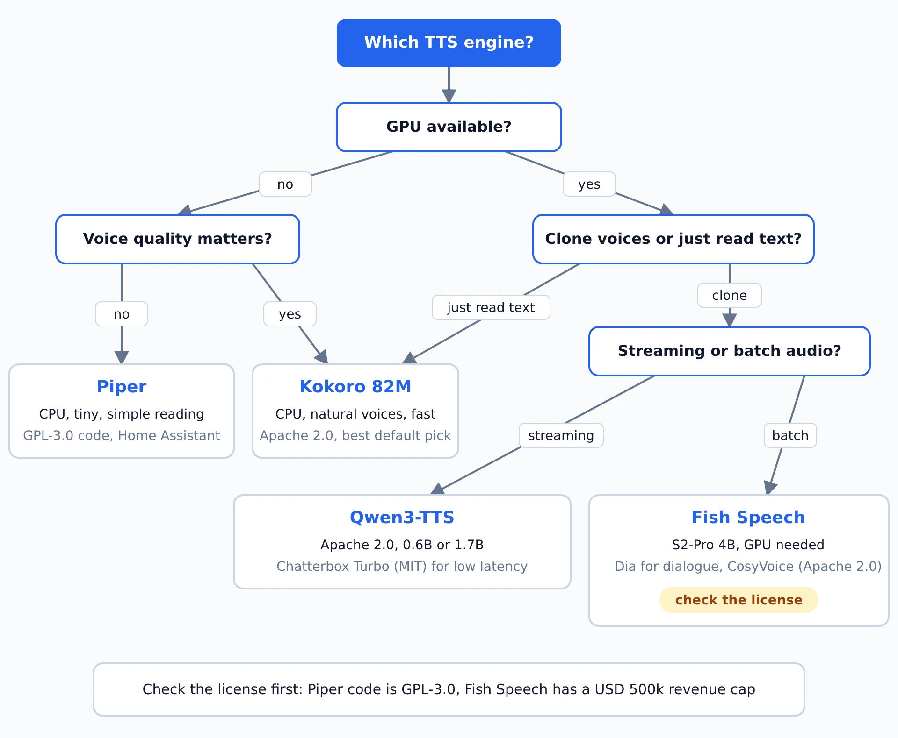
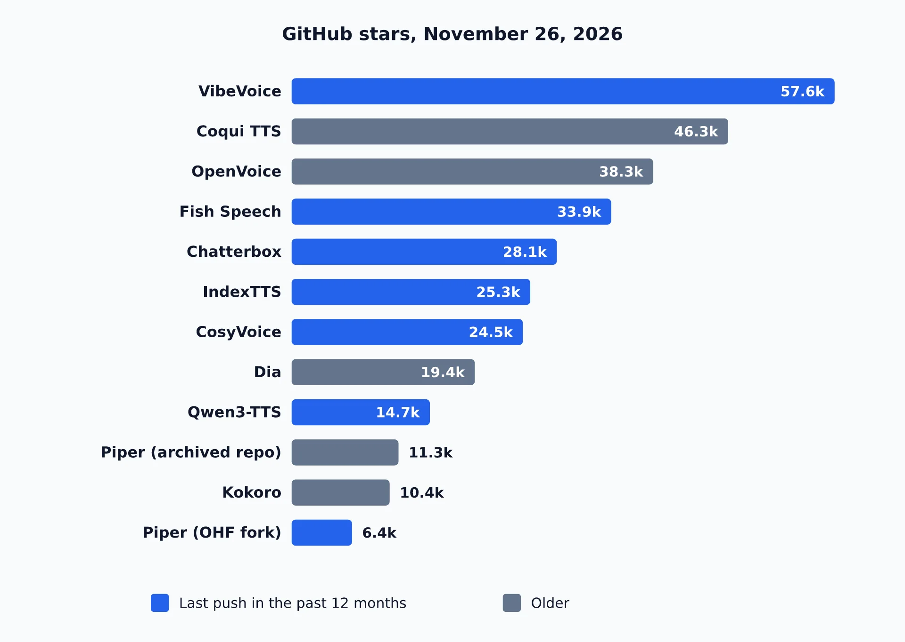
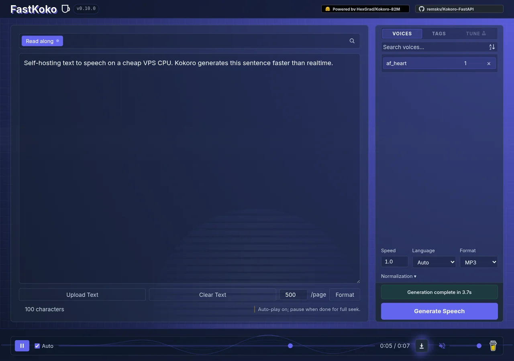

import Button from "@components/widgets/Button.astro";
import Notice from "@components/widgets/Notice.astro";
import ListCheck from "@components/widgets/ListCheck.astro";
import Accordion from "@components/widgets/Accordion.astro";
import Tabs from "@components/widgets/Tabs.astro";
import Tab from "@components/widgets/Tab.astro";

*Disclosure: this guide contains referral links. If you buy through them, I may earn a commission at no extra cost to you.*

**[Kokoro](https://github.com/hexgrad/kokoro) is the best open-source TTS engine for most self-hosters in 2026.** It uses 82 million parameters under Apache 2.0 and runs faster than realtime on a plain CPU. For voice cloning, pick Chatterbox (MIT) or Qwen3-TTS (Apache 2.0). If you have a GPU and want the highest audio quality, try Fish Speech after reading its license. [Kokoro-FastAPI](https://github.com/remsky/Kokoro-FastAPI) wraps Kokoro in an OpenAI-compatible API with one Docker command.

I tested the CPU build of Kokoro on this machine while writing. A request for 15.4 seconds of audio returned in about 6 seconds over the API with no GPU. I did not benchmark the other engines. Their comparison rows come from each project's README and license file checked on November 26, 2026, since licensing trips up most TTS roundups.

## Which open-source TTS engine should you pick?

Pick Kokoro for CPU-only servers and straightforward speech synthesis, and use Piper (GPL-3.0) for lightweight embedded playback like Home Assistant. Choose Chatterbox or Qwen3-TTS when you need voice cloning, and Dia for multi-speaker dialogue with non-verbal cues. When you own a GPU and want maximum voice realism, pick Fish Speech or CosyVoice.

The decision rarely starts with quality. It starts with hardware and license, because those two constraints delete most of the list before you listen to a single sample.



*Pick by hardware first, then by cloning and streaming needs, and read the license before you commit.*

## How the open-source TTS engines compare

| Engine | License | Size | Languages | Voice cloning | Streaming | CPU viable |
|---|---|---|---|---|---|---|
| Kokoro 82M | Apache 2.0 | 82M | 8 (9 locales) | No (voice packs) | Yes (Kokoro-FastAPI) | Yes, CPU-friendly |
| Piper | GPL-3.0 (code), voices vary | small per-voice models | Many | No | Not verified | Yes, runs on a Raspberry Pi |
| Chatterbox Turbo/Nano | MIT | 350M / 110M | EN (Multilingual V3: 23+) | Yes, zero-shot | Not verified | Nano only (3x RT on 8 cores) |
| Qwen3-TTS | Apache 2.0 | 0.6B / 1.7B | 10 | Yes, 3-second clone | Yes, 97ms first packet | Not documented |
| Fish Speech | Community License (S2-Pro weights: Research License) | S2-Pro 4B, Drama 3 35B-A3B | 80+ (S2-Pro) | Yes | Yes | No, GPU needed |
| CosyVoice 3 | Apache 2.0 | 0.5B | 9 + 18 Chinese dialects | Yes, zero-shot | Yes, bi-streaming | Not documented |
| Dia | Apache 2.0 | 1.6B | EN only | Audio prompt | Not documented | No, GPU-only per README |
| IndexTTS 2.5 | bilibili Model Use License (custom) | 0.8B | ZH, EN, JA, ES, AR | Yes, zero-shot | Not verified | Not documented |
| Coqui XTTS v2 | Coqui Public Model License (weights), MPL-2.0 (code) | not checked | 17 | Yes, zero-shot | Yes | Slowly |
| VibeVoice-Realtime | MIT | 0.5B | EN + 9 experimental | Fixed voices | Yes | GPU recommended |
| MeloTTS / OpenVoice v2 | MIT | small | Several | OpenVoice yes | Not verified | Yes |

Stars below come from the GitHub API on November 26, 2026. Treat them as popularity signals rather than quality rankings. Coqui's total accumulated over years on a repo last updated in August 2024, while Kokoro's lower star count hides heavy real-world deployment. The chart includes both Piper repos, showing the archived rhasspy/piper alongside the active OHF fork.



*GitHub stars on November 26, 2026. Blue: pushed within the past 12 months. Grey: older. VibeVoice's TTS code was removed in September 2025.*

## Kokoro for CPU-only servers

[Kokoro](https://github.com/hexgrad/kokoro) by hexgrad is the default pick when you want natural voices on a cheap CPU-only VPS under Apache 2.0. On this machine, the Kokoro-FastAPI container generated 15.4 seconds of audio in roughly 6 seconds on CPU alone, about 2.5x realtime.

**Best for:** reading articles, notifications, voice notes, and batch text-to-audio jobs on an existing server. The README lists American and British English, Spanish, French, Hindi, Italian, Brazilian Portuguese, Japanese, and Mandarin. Kokoro-FastAPI also supports weighted voice blending like `af_bella(2)+af_sky(1)`.

**Strengths:** Apache 2.0 weights come with no revenue caps or non-commercial clauses. The model is 82M parameters, though the CPU image of [Kokoro-FastAPI](https://github.com/remsky/Kokoro-FastAPI) (5.7k stars, Apache-2.0) uses 4.87 GB on disk (`docker images`), so budget storage before pulling. It provides an OpenAI-compatible `/v1/audio/speech` endpoint, a web player at `/web`, and streaming audio.

**Trade-offs:** no voice cloning in the base model, only the shipped voice packs and mixes. Long-form intonation is good but flatter than the billion-parameter models. The hexgrad/kokoro inference repo (10.4k stars) was last pushed in August 2025; Kokoro-FastAPI was pushed on November 21, 2026, so the activity is in the serving wrapper.

## Piper for tiny embedded voices

Piper is a fast local neural TTS engine where each voice is a small ONNX model light enough for a Raspberry Pi. Check the license before copying old tutorials. The original [rhasspy/piper](https://github.com/rhasspy/piper) repo (11.3k stars, MIT) is archived and redirects to [OHF-Voice/piper1-gpl](https://github.com/OHF-Voice/piper1-gpl). That Open Home Foundation fork uses GPL-3.0, and its README notes it needs maintainers; individual voices carry their own licenses.

<Notice type="info" title="Piper is GPL now">
New Piper releases come from the GPL-3.0 repo. If you ship Piper inside a closed product, the code license matters; the MIT label on the archived repo covers only the old code.
</Notice>

**Best for:** offline voice announcements, accessibility reading, IoT devices, anything where "fast and small" beats "emotional." If you run Home Assistant voice satellites, this is already what you use.

**Trade-offs:** in my experience the voices sound closer to a decent GPS than a narrator, and Piper offers no cloning or emotion control. Pick it when those are features you don't need.

## Chatterbox for MIT-licensed voice cloning

Resemble AI's [Chatterbox](https://github.com/resemble-ai/chatterbox) (28.1k stars, MIT, last pushed November 4, 2026) is the strongest permissively licensed voice-cloning engine here. Its README documents three variants. Turbo (350M) targets low-latency English voice agents, Nano (110M) claims 3x realtime speed on 8 CPU cores, and Multilingual V3 (500M) covers 23+ languages with improved speaker similarity. Every clip carries Resemble's PerTh watermark, which matters for post-processing.

**Best for:** voice agents, dubbing pipelines, and anything needing emotion exaggeration control or paralinguistic tags like `[laugh]`. The README's cloning examples use a roughly 10-second reference clip passed as `audio_prompt_path`.

**Trade-offs:** the README's examples for Turbo and the 500M models load on CUDA, and only Nano is pitched at CPU. The original 500M model has tuning knobs (CFG weight, exaggeration) that take some trial and error.

## Fish Speech for GPU voice quality (read the license)

[Fish Speech](https://github.com/fishaudio/fish-speech) (33.9k stars) is the open-weights sibling of the hosted [Fish Audio](/fish-audio-review/) service. The README claims the lowest word error rate on Seed-TTS Eval for S2-Pro, which is a vendor benchmark, not something I reproduced. S2-Pro is a 4B model with 80+ languages; Drama 3 (35B-A3B mixture, 3B active per token) adds multi-character scenes, long-form generation and local editing.

<Notice type="warning" title="Read the Fish license before you download">
The README puts the codebase and weights under the [Fish Audio Community License](https://raw.githubusercontent.com/fishaudio/fish-speech/main/LICENSE) (v1.0, October 13, 2026), except S2-Pro weights, which stay under the Fish Audio Research License. Per the [S2-Pro model card](https://huggingface.co/fishaudio/s2-pro), commercial deployments of S2-Pro require a separate Fish Audio license. The Community License allows commercial use only below USD 500,000 annual revenue and bars hosted services without written approval. However, delivering generated audio files to clients is explicitly carved out.
</Notice>

**Best for:** personal projects, research, and small businesses under the revenue cap that want maximum voice quality and have a GPU. A commercial product using S2-Pro specifically needs a license from Fish Audio first.

**Trade-offs:** the README calls S2-Pro small enough for a consumer GPU, while the Hugging Face card lists 5B parameters in BF16. That puts the weights alone near 10 GB before the KV cache. Neither S2-Pro nor Drama 3 has a published hardware table I could find, so test on your card before committing. Drama 3 at 35B parameters needs far more VRAM.

## CosyVoice and Qwen3-TTS for multilingual Apache apps

Both models use Apache 2.0 under Alibaba's Qwen organization, making them the safest permissive options after Kokoro. [CosyVoice](https://github.com/QwenAudio/CosyVoice) (24.5k stars, formerly FunAudioLLM) supports 9 languages plus 18+ Chinese dialects and accents. It handles zero-shot cross-lingual cloning and instruction control for emotion, speed, and volume. Fun-CosyVoice 3.0 (0.5B) adds bi-streaming with README-reported latency as low as 150ms.

[Qwen3-TTS](https://github.com/QwenLM/Qwen3-TTS) (14.7k stars) focuses on streaming across 0.6B and 1.7B variants in 10 languages (Chinese, English, Japanese, Korean, German, French, Russian, Portuguese, Spanish, and Italian). It supports voice design from text descriptions, 3-second voice cloning, and a claimed 97ms first-packet latency. If you are building a multilingual voice agent and cannot accept the Fish Audio license, start here. The repo was last pushed in March 2026, with weights on ModelScope and Hugging Face.

## Dia for two-speaker dialogue

Nari Labs' [Dia](https://github.com/nari-labs/dia) (19.4k stars, Apache 2.0, last pushed November 2025) is a 1.6B parameter model that generates two-speaker dialogue in one pass. It uses `[S1]` and `[S2]` speaker tags, non-verbal cues like `(laughs)`, and audio-prompt voice conditioning for podcast-style scripts.

**Trade-offs:** the README notes that Dia was tested only on GPUs (PyTorch 2.0+, CUDA 12.6). Because it was not fine-tuned on one speaker, the voice shifts between runs unless you supply an audio prompt or fix the seed. English only, so pick another engine for a consistent single narrator.

## IndexTTS, VibeVoice, XTTS v2, and the rest

**[IndexTTS](https://github.com/index-tts/index-tts)** (25.3k stars) is a zero-shot cloning system from Bilibili. The latest release is IndexTTS-2.5 (August 2026, 0.8B, Chinese, English, Japanese, Spanish and Arabic). The README says the project is under the bilibili Model Use License Agreement, a custom text, so read it before commercial use.

**[VibeVoice](https://github.com/microsoft/VibeVoice)** (57.6k stars, MIT) is an unusual entry. Microsoft's long-form VibeVoice-TTS supported 90-minute 4-speaker generation and earned an ICLR 2026 oral paper, yet Microsoft pulled its code in September 2025 after discovering misuse. What remains is VibeVoice-Realtime-0.5B for streaming TTS with fixed voices alongside ASR models, meaning those stars mostly reflect an ASR repo today.

**Coqui XTTS v2** still appears in old tutorials, even though the [coqui-ai/TTS](https://github.com/coqui-ai/TTS) repo has not seen a commit since August 2024. The [XTTS-v2 model card](https://huggingface.co/coqui/XTTS-v2) places its weights under the Coqui Public Model License. Check those commercial terms before shipping, because I treat it as non-commercial. While the toolkit code uses MPL-2.0 per GitHub, the weight license makes it risky for products.

**MeloTTS** (MIT, 7.7k stars, last push December 2024) and **OpenVoice v2** (MIT, 38.3k stars, last push April 2025) are usable but quiet. **Orpheus-TTS** (Apache 2.0, 6.4k stars, last push December 2025) is worth a look if you want an LLM-based pipeline. **StyleTTS 2** (MIT, last push August 2024) is a research codebase; for self-hosting I would not start there.

## How do you self-host an open-source TTS engine?

The fastest path is the Kokoro-FastAPI Docker image: one container, no GPU, an OpenAI-compatible API plus a web player. The compose file below wraps the image from the [project README](https://github.com/remsky/Kokoro-FastAPI), which publishes it as `docker run -p 8880:8880 ghcr.io/remsky/kokoro-fastapi-cpu:latest`:

```yaml
name: kokoro-tts
services:
  kokoro-tts:
    image: ghcr.io/remsky/kokoro-fastapi-cpu:latest
    container_name: kokoro-tts
    restart: unless-stopped
    ports:
      - "8880:8880"
```

Then synthesize with the same client code you would use against OpenAI. Both tabs call the local server:

<Tabs>
<Tab name="curl">

```bash
curl -X POST http://localhost:8880/v1/audio/speech \
  -H "Content-Type: application/json" \
  -d '{
    "model": "kokoro",
    "input": "Self-hosted voices, no per-character bill.",
    "voice": "af_heart",
    "response_format": "wav"
  }' -o speech.wav
```

</Tab>
<Tab name="Python (openai SDK)">

```python
from openai import OpenAI

client = OpenAI(base_url="http://localhost:8880/v1", api_key="not-needed")

with client.audio.speech.with_streaming_response.create(
    model="kokoro",
    voice="af_heart",
    input="Self-hosted voices, no per-character bill.",
    response_format="wav",
) as response:
    response.stream_to_file("speech.wav")
```

</Tab>
</Tabs>

The Python version follows the README's OpenAI-library example; I ran only the curl call.

On this machine, 15.4 seconds of audio returned in about 6 seconds on CPU, while a shorter sentence in the built-in web player finished in 3.7 seconds. That speed comfortably handles article narration, Home Assistant announcements, and voicemail prompts. GPU-class engines need dedicated servers; the fish-speech README documents its own API server for Drama 3 and S2-Pro. Because Kokoro-FastAPI exposes the OpenAI speech endpoint, you can also put it behind [LiteLLM](/litellm-docker-install/), though I have not tested that setup.



*The Kokoro-FastAPI web player after generating the test sentence: voice af_heart, CPU-only container, 3.7 seconds.*


*Waveform of the actual WAV the container returned for the longer test paragraph: 15.4 seconds of speech in one API call.*

Two operational notes. First, the README advises pinning a release tag rather than running `latest`, so lock a release tag in your compose file before relying on it. Second, if your host already runs reverse proxies and other Docker apps (such as my [Dokploy](/dokploy-install/) setup), port 8880 is unprivileged and needs no GPU runtime flags. A small home server handles the CPU image fine; see my [mini PC picks for local AI](/best-mini-pc-local-llm/) when sizing hardware.

## When hosted beats self-hosted

Self-hosting wins for narration pipelines, accessibility readers, and generated podcasts where volume stays high, privacy matters, or API billing adds up. The counterpoint is GPU math. Quality-tier models (Fish Speech, large Chatterbox variants) need a GPU, and renting one continuously at $0.50/hr runs about $360/month. At low volume, hosted APIs are cheaper and skip licensing complexity. [Fish Audio's API](/fish-audio-api/) bills per UTF-8 byte ($15 per million bytes for `s2.1-pro` plus a free `s2.1-pro-free` tier on the [pricing page](https://docs.fish.audio/developer-guide/models-pricing/pricing-and-rate-limits)). ElevenLabs bills $0.04 to $0.08 per 1K characters depending on model ([API pricing](https://elevenlabs.io/pricing/api)), and I compare both in [Fish Audio vs ElevenLabs](/fish-audio-vs-elevenlabs/).

*Disclosure: the button below is a referral link. If you sign up through it, I may earn a commission at no extra cost to you.*

<Button text="Try Fish Audio Free" link="https://go.bitdoze.com/fish-audio" variant="solid" color="blue" size="md" icon="arrow-right" />

I recommend splitting workloads by quality bar. Run Kokoro on your own hardware for bulk reading where "very good" suffices, and call a hosted API for production hero voices. For minimal Python scripting, see the [uv text-to-speech script](/uv-text-to-speech-script/), and for speech-to-text, read the [Whisper alternatives](/openai-whisper-alternatives/) roundup. When the agent should hear and answer with one model instead of a TTS stage, start with my [best speech-to-speech models](/best-speech-to-speech-models/) roundup.

## Which engine to start with

Pick by the constraint that bites first:

<ListCheck>
<ul>
<li>**No GPU, plain text reading:** Kokoro via Kokoro-FastAPI (Apache 2.0)</li>
<li>**Home Assistant or tiny devices:** Piper, with the GPL-3.0 code license in mind</li>
<li>**Cloning with a permissive license:** Chatterbox (MIT) or Qwen3-TTS (Apache 2.0)</li>
<li>**Two-voice dialogue:** Dia (Apache 2.0, GPU only)</li>
<li>**Best sound with a GPU and revenue under the cap:** Fish Speech, after reading the license</li>
</ul>
</ListCheck>

Pull the Kokoro CPU image tonight, send it one paragraph through the curl command above, and listen. If the voice clears your bar, you are done. If it doesn't, the table above shows which GPU-class engine or hosted API to try next.

## FAQ

<Accordion label="What is the best open-source TTS engine in 2026?" group="faq">

Kokoro is the top pick for most people. It ships under Apache 2.0 at 82M parameters and generated 15.4 seconds of audio in about 6 seconds on a CPU in my test. For voice cloning, pick Chatterbox (MIT) or Qwen3-TTS (Apache 2.0).

</Accordion>

<Accordion label="Can open-source TTS run without a GPU?" group="faq">

Yes. Kokoro ran at roughly 2.5x realtime on CPU in my test, and Chatterbox-Nano (110M) claims 3x realtime on 8 cores. Piper voices also run on a Raspberry Pi. By contrast, Dia requires GPUs in its README, and Fish Speech's 4B+ models need a GPU.

</Accordion>

<Accordion label="Which open-source TTS licenses allow commercial use?" group="faq">

Apache 2.0 and MIT engines (Kokoro, Chatterbox, Qwen3-TTS, CosyVoice, Dia, VibeVoice, MeloTTS, and OpenVoice) allow commercial use. Piper's active repo is GPL-3.0 copyleft, and each voice carries its own license. Fish Speech's Community License caps commercial use at USD 500,000 annual revenue and excludes hosted services, while S2-Pro weights require a commercial license from Fish Audio. IndexTTS uses a custom license, and Coqui XTTS v2 uses the Coqui Public Model License, which I treat as non-commercial.

</Accordion>

<Accordion label="What happened to Coqui TTS?" group="faq">

The coqui-ai/TTS repository's last push was August 2024, though it still has 46.3k GitHub stars. The toolkit code is MPL-2.0, but the XTTS v2 weights carry the Coqui Public Model License, so check the commercial terms before shipping. For new projects I would start with Chatterbox or Kokoro.

</Accordion>

<Accordion label="How do I add TTS to a voice agent or Home Assistant?" group="faq">

For Home Assistant, Piper is the standard and appears in the Home Assistant add-ons repository. For agents, run Kokoro-FastAPI and point any OpenAI-compatible client at `http://localhost:8880/v1`; it also streams audio responses, which keeps first-audio latency low.

</Accordion>

<Accordion label="Which engine clones voices with the least setup?" group="faq">

Qwen3-TTS advertises 3-second rapid cloning with its Base models, and Chatterbox clones from a reference clip passed as `audio_prompt_path`. Fish Speech clones too, but S2-Pro weights need a commercial license from Fish Audio and the Community License bars hosted services.

</Accordion>

<Accordion label="Is Microsoft VibeVoice still usable for TTS?" group="faq">

Partially. Microsoft pulled the VibeVoice-TTS code in September 2025. However, Microsoft open-sourced VibeVoice-Realtime-0.5B under MIT in December 2025 as a fixed-voice streaming model alongside the repository's speech-recognition models.

</Accordion>

<Accordion label="Self-hosted TTS or a paid API, which is cheaper?" group="faq">

It depends on volume and hardware. Running Kokoro on CPU uses your existing VPS, whereas renting a GPU continuously at $0.50/hr costs about $360/month and loses to API pricing at low volume. Fish Audio bills per UTF-8 byte and ElevenLabs bills per character. Steady high volume favors self-hosting, while sporadic hero voices favor APIs.

</Accordion>
