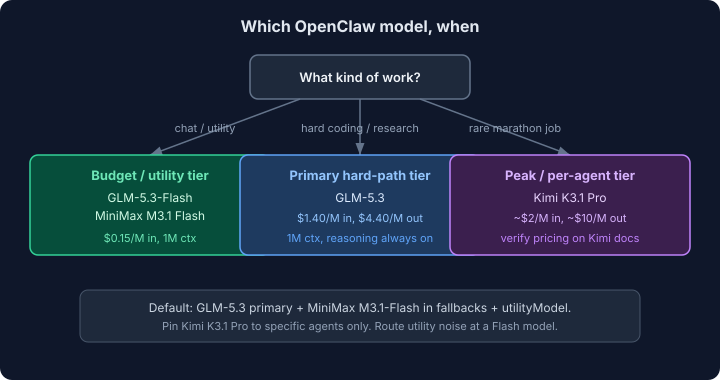
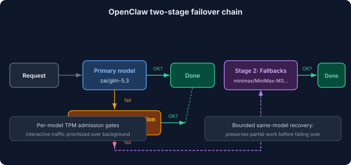

import Button from "@components/widgets/Button.astro";
import Notice from "@components/widgets/Notice.astro";
import ListCheck from "@components/widgets/ListCheck.astro";
import Accordion from "@components/widgets/Accordion.astro";
import Tabs from "@components/widgets/Tabs.astro";
import Tab from "@components/widgets/Tab.astro";

I've been running [OpenClaw](/clawdbot-setup-guide/) for a while and the model lineup keeps moving. As of late 2026, the **best open source models for OpenClaw** are **GLM-5.3** for hard agent work, **MiniMax M3.1 Flash** and **GLM-5.3-Flash** for everyday traffic, and **Kimi K3.1 Pro** when a single job needs peak capability.

Below: what changed in the last few months, how to wire each model up, the OpenClaw config gotchas that break old setups, why routing a Claude Code or Gemini CLI subscription through OpenClaw is still a bad idea, and what this costs per month.

<Notice type="warning" title="Subscription risk warning">

Using your Claude Code, Gemini CLI, or ChatGPT/Codex subscription OAuth tokens with OpenClaw can get your account banned. Anthropic, Google, and OpenAI watch for automated usage patterns that fall outside normal CLI use. Stick with API keys.

</Notice>

## What changed since July 2026: GLM-5.3, M3.1 Flash, and Kimi K3.1 Pro

This post gets revised often. Here is what moved since the last update.

<ListCheck>

- **GLM-5.3 shipped Aug 18, 2026** and replaces GLM-5.2 as the headline pick. GLM-5.2 still works but auto-routes to 5.3 on Coding Plans.
- **GLM-5.3-Flash arrived Aug 26** as an ultra-cheap multimodal tier ($0.15/M in, $0.50/M out) that directly attacks MiniMax's budget slot.
- **MiniMax M3.1-Flash** undercut M3 on price ($0.15/$0.60 vs $0.30/$1.20). M2.5 and M2.7 stop accepting new users and retire Nov 18, 2026.
- **Kimi K3.1 Pro is API-live now.** Open weights are promised "by Nov 4" per the vendor. The K2 series closes to new users Oct 31 and retires end of Dec 2026.
- **OpenClaw's config schema moved.** `fallback` is now `fallbacks` (array), provider IDs use `zai/*` not `z-ai/*`, and a new `utilityModel` slot handles background traffic.
- **Z.AI's Coding Plan is points-based now** (from $18/mo, off-peak burns 50% points), and since Oct 16, Coding Plan keys and standard API keys are billed separately.

</ListCheck>

Two things did not change. The core thesis still holds: open models over API keys beat subscription OAuth for 24/7 agents. And the price anchors held. GLM-5.3 launched at the same $1.40 input / $4.40 output per million tokens as GLM-5.2, and MiniMax M3's $0.30/$1.20 rate is still the permanent 50%-off price.

## Why open source models make sense for OpenClaw

OpenClaw runs 24/7 on your server. It handles messages, scheduled jobs, and skills nonstop. That continuous load gets expensive fast on proprietary models.

Open source models through API providers give you:

<ListCheck>

- **Predictable costs**: Pay per token, no surprise subscription overages.
- **No ban risk**: API access is built for automated use.
- **Model flexibility**: Swap models in config without changing platforms.
- **Better rate limits**: API tiers usually beat subscription OAuth for throughput.
- **Failover freedom**: Chain any provider as fallback. No single-vendor lock.

</ListCheck>

OpenClaw's own recommended-models list now leads with the same open picks (`glm-5.3`, `minimax-m3.1-flash`, `kimi-k3.1-pro`). That is external confirmation, not just my bias. For the wider coding-model roundup covering Qwen 3.8, MiMo V2.6 Pro, DeepSeek V4.1, and proprietary alternatives, see the [best open source LLMs for coding](/best-open-source-llms-claude-alternative/).

## The risks of using Claude Code or Gemini CLI subscriptions

I get this question constantly, so I'll deal with it up front.

OpenClaw can take OAuth tokens from Claude Code, Gemini CLI, and OpenAI Codex. Technically you can point a $20/month Claude Pro plan or a Google AI subscription at OpenClaw instead of paying API credits. It works. You're also gambling.

### Why you can get banned

Anthropic, Google, and OpenAI restrict how subscription tokens may be used. Route a Claude Code OAuth token through OpenClaw and this is what changes:

<ListCheck>

- **Usage patterns**: Normal Claude Code looks like a human in a terminal. OpenClaw fires automated requests around the clock, often in bursts when jobs run.
- **Token volume**: An always-on assistant burns more than a human coding session.
- **Retries and parallel calls**: Failures and fan-out look like scraping to detectors.
- **IP and fingerprinting**: VPS data-center traffic does not look like a laptop on residential internet.

</ListCheck>

### What happens when you get banned

| Platform | Consequence | Recovery |
|----------|-------------|----------|
| **Claude Code** | Account suspended, subscription cancelled | Appeal exists, no guarantee |
| **Gemini CLI** | Google account flagged, API access revoked | Can spill into other Google services |
| **OpenAI Codex** | Account banned, subscription terminated | Limited appeal options |

<Notice type="error" title="Real risk">

Threads in the OpenClaw community describe account suspensions within days of routing subscription tokens through automated tools. Detection keeps improving. OpenClaw's docs still treat OAuth as operator auth, not a subscription-to-API bridge. A Claude Max sub is not worth risking over a few dollars of API spend.

</Notice>

### What to do instead

Use API keys. Every provider sells pay-as-you-go access built for automation:

- **Anthropic API**: [console.anthropic.com](https://console.anthropic.com/)
- **Google AI**: [aistudio.google.com](https://aistudio.google.com/)
- **OpenAI API**: [platform.openai.com](https://platform.openai.com/)

Or skip the ban question entirely and use open models over API. That's the rest of this post.

## What you need before you start

<ListCheck>

- **OpenClaw installed and gateway running.** If not, the [OpenClaw setup guide](/clawdbot-setup-guide/) covers install. Current stable is v2026.10.8 and ships near-daily; pin the Gateway version (more on that below).
- **A 24/7 box.** A VPS works fine. I use [Hetzner Cloud](https://go.bitdoze.com/hetzner) for cheap EU boxes. If you are building from scratch, see [VPS setup for AI coding agents](/vps-ai-coding-setup/).
- **Provider accounts and API keys** for whichever models you plan to use: Z.AI (`ZAI_API_KEY`), MiniMax (`MINIMAX_API_KEY`), and/or Moonshot/Kimi (`MOONSHOT_API_KEY`).
- **Basic config comfort.** You will edit `~/.openclaw/openclaw.json` or use `openclaw` CLI commands.

</ListCheck>

On a typical VPS you call these models over API. Running models locally is a different path covered in the FAQ.

<Button
  text="Run OpenClaw on Hetzner Cloud"
  link="https://go.bitdoze.com/hetzner"
  size="lg"
  color="green"
  variant="solid"
/>

## 1. GLM-5.3: the best open source model for serious OpenClaw work

**[GLM-5.3](/best-open-source-llms-claude-alternative/)** from Z.AI is the open model I trust most for OpenClaw's hard path. It reasons well, holds multi-step agent work without falling apart, and rarely invents facts when it shouldn't. On Z.ai Code Bench it scores 34.5% at Max effort, which beats Claude Opus 4.8's 29.5% at High effort (though Claude Fable 5 leads at 39.5%). DeepSWE v1.1 sits at 66.9%.

<Notice type="info" title="Benchmark versions matter">

Terminal-Bench 2.1, Terminal-Bench 3.0, and Terminal-Bench 4.0 are different suites with different difficulty. Same for SWE-Bench Pro vs DeepSWE v1.1. Always check which version a score came from before comparing across models. GLM-5.2's old 81.0% on TB 2.1 does not mean GLM-5.3 regressed at 28.3% on TB 3.0; the newer suite is much harder.

</Notice>

### Why GLM-5.3 works for OpenClaw

OpenClaw is not a chatbot. It plans, calls tools, runs scripts, and keeps context across long threads. GLM-5.3 handles that kind of work reliably.

- **DeepSWE v1.1: 66.9%** and strong agent-bench numbers. Matters when OpenClaw edits or runs code on your box.
- **1M token context**: Room for long OpenClaw history plus tool output dumps.
- **Reasoning always on** with `reasoning_effort` low/high/max (default max). Tune depth per agent.
- **Low hallucination reputation**: When the assistant shells out on a live server, wrong answers hurt.
- **Security-audit capability**: CyberGym 84.5%, ExploitBench 54.4%. Useful for security skills and one more reason to sandbox. See the [OpenClaw security guide](/openclaw-security-guide/).
- **Open source license**: Fine for automated commercial workflows.

One breaking change to know: GLM-5.3 rejects `thinking.type: "disabled"`. If your config still has that from the GLM-5.2 era, requests will fail. Migrate to `thinking.type: "enabled"` with `reasoning_effort: "low"` instead. Full migration notes in the config section below.

### GLM-5.3 pricing and specs

| Feature | GLM-5.3 | GLM-5.3-Flash (preview) |
|---|---|---|
| **Parameters** | Undisclosed | 320B (18B active) MoE |
| **Context length** | 1M tokens | 1M tokens |
| **Max output** | 128K tokens | 128K tokens |
| **Input cost** | $1.40/M | $0.15/M |
| **Cached input** | $0.26/M | $0.03/M |
| **Output cost** | $4.40/M | $0.50/M |
| **Multimodal** | Text | Image, video, file |
| **SWE-Bench Pro** | 62.1% (GLM-5.2, historical) | Not published |
| **DeepSWE v1.1** | 66.9% | Not published |
| **Terminal-Bench 3.0** | 28.3 | Not published |

GLM-5.3-Flash gets its own section below as the budget contender.

<Button
  text="GLM-5.3 Coding Plans"
  link="https://z.ai/subscribe?ic=NKNUNYDRZT"
  size="lg"
  color="blue"
  variant="solid"
/>

<Notice type="info" title="GLM Coding Plans: points, not per-token">

Z.AI's Coding Plans switched to a points system. Lite gets 2,000 points per 5 hours plus 10,000/week; Pro gets 12,000 per 5 hours plus 60,000/week. Plans start at $18/month. Off-peak hours, **including all weekend**, burn only 50% points. GLM-5.3-Flash burns a third of the quota that GLM-5.3 does on these plans, so it stretches your credits much further for light work.

</Notice>

### Setting up GLM-5.3 with OpenClaw

The fastest path is the onboard shortcut:

```bash
openclaw onboard --auth-choice zai-api-key   # auto-detects general vs coding endpoint
openclaw models set zai/glm-5.3              # or zai/glm-5.3-flash for budget agents
openclaw gateway restart
```

Environment variable: `ZAI_API_KEY`. Endpoints:

| Purpose | URL |
|---|---|
| General API (pay-as-you-go) | `https://api.z.ai/api/paas/v4` |
| Coding Plan (points billing) | `https://api.z.ai/api/coding/paas/v4` |
| Anthropic-protocol (pay-as-you-go) | `https://api.z.ai/api/anthropic` |

Or edit the config directly. Note the `fallbacks` key (array) and `zai/` provider prefix:

```json
{
  "agents": {
    "defaults": {
      "model": {
        "primary": "zai/glm-5.3",
        "fallbacks": ["minimax/MiniMax-M3", "minimax/MiniMax-M3.1-Flash"]
      }
    }
  }
}
```

<Tabs>
<Tab name="Coding Plan key">

If you subscribe to a Z.AI Coding Plan, your key works on the **OpenAI Chat Completion-compatible coding endpoint** only (`https://api.z.ai/api/coding/paas/v4`). It will not work on the Anthropic-protocol endpoint. Billing is points-based as described above.

</Tab>
<Tab name="Pay-as-you-go API key">

Standard API keys work on all endpoints including the Anthropic-protocol one (`https://api.z.ai/api/anthropic`). Billing is per token at the rates in the table above. This is the right choice if you want the Anthropic-protocol transport in OpenClaw.

</Tab>
</Tabs>

<Notice type="warning" title="Z.AI key split since Oct 16, 2026">

Coding Plan keys and standard API keys are now managed and billed separately. Using a Coding Plan key against the general API endpoint (or vice versa) produces auth errors that look like a bad key. Check which key type you have before debugging connectivity. See Z.AI's key management notice in their devpack docs.

</Notice>

**Verify it works:**

```bash
openclaw models list --provider zai    # should show glm-5.3 and glm-5.3-flash
openclaw models status                  # primary should report healthy
openclaw doctor                         # overall config sanity check
```

If `models list` shows nothing under `zai`, your key type or endpoint is wrong. If `models status` reports auth failures, regenerate the key and make sure the env var is set in the same shell or systemd unit that runs the gateway.

### Where GLM-5.3 shines in OpenClaw

- **Scheduled tasks**: Morning briefings, server checks, cron jobs that must work.
- **Coding skills**: Scripts, Docker configs, repo edits.
- **Research**: Pairs well with [DuckDuckGo search](/duckduckgo-openclaw-search/).
- **Multi-step tool chains**: Long agent runs without losing the plot.
- **Long sessions**: 1M context helps when history piles up.
- **Security-audit skills**: The CyberGym/ExploitBench numbers make it the best open pick for scanning and audit work. One more reason to keep it sandboxed; the [OpenClaw security guide](/openclaw-security-guide/) covers the Sept 2026 advisory batch and the lockdown checklist.

## 2. GLM-5.3-Flash and MiniMax M3.1 Flash: the cheap OpenClaw models

Most OpenClaw traffic does not need the flagship. Quick questions, reminders, file ops, background summaries. Two models now compete hard for this slot.

**GLM-5.3-Flash** ($0.15/M in, $0.50/M out) brings native multimodal support (image, video, file), 1M context, and 3x quota efficiency on Coding Plans. **MiniMax M3.1-Flash** ($0.15/M in, $0.60/M out, $0.015/M cache read) offers tunable thinking depth and interleaved reasoning at similar prices. Both undercut the flagship tier by roughly 10x.

MiniMax M3 stays in the lineup as the known-good alternative with real published coding numbers (59.0% SWE-Bench Pro, 66.0% Terminal-Bench 2.1). If you want proven coding benchmarks from your budget model, M3 is still the pick.

For more options in this price range across other agents, see [cheapest AI models under $1/M tokens](/best-cheap-models-hermes-agent/).

### MiniMax M3 and M3.1 Flash pricing and specs

| Feature | MiniMax M3.1-Flash | MiniMax M3 (≤512k in) | MiniMax M3 (>512k in) |
|---|---|---|---|
| **Input cost** | $0.15/M | $0.30/M | $0.60/M |
| **Output cost** | $0.60/M | $1.20/M | $2.40/M |
| **Cache read** | $0.015/M | $0.06/M | $0.12/M |
| **Context length** | 1M tokens | 1M tokens | 1M tokens |
| **Thinking** | Tunable depth | Standard | Standard |
| **SWE-Bench Pro** | Not published | 59.0% | 59.0% |
| **Terminal-Bench 2.1** | Not published | 66.0% | 66.0% |
| **Multimodal** | Image | Image + video | Image + video |

The M3 prices shown are the permanent 50%-off promotional rates (list is $0.60/$2.40). A priority tier at 1.5x standard is available via `service_tier: "priority"` if you need lower latency.

<Notice type="warning" title="M3 price doubles past 512k input tokens">

MiniMax M3's $0.30/M input rate applies only when input is under 512K tokens. Cross that threshold and every token (input, output, cache) doubles. A 1M-context OpenClaw thread that fills up will hit this. Compact your sessions or route long-context work at M3.1-Flash, which has a flat rate.

</Notice>

<Button
  text="MiniMax Coding Plans (10% Off)"
  link="https://go.bitdoze.com/minimax"
  size="lg"
  color="purple"
  variant="solid"
/>

M2.5 and M2.7 stopped accepting new users Oct 19 and retire Nov 18, 2026. Plan users get auto-routed to M3.1-Flash. If you see `minimax/m2.7` in an example config (including some OpenClaw docs pages), do not copy it.

### Setting up MiniMax with OpenClaw

```bash
openclaw onboard --auth-choice minimax-global-api   # or minimax-cn-api for the China endpoint
```

Environment variable: `MINIMAX_API_KEY`. The correct model refs are capitalized: `minimax/MiniMax-M3` and `minimax/MiniMax-M3.1-Flash`. The old lowercase `minimax/m3` slug may not resolve on current builds.

If your OpenClaw build does not ship M3.1-Flash yet, register it explicitly:

```json
{
  "agents": {
    "defaults": {
      "model": {
        "primary": "minimax/MiniMax-M3",
        "fallbacks": ["zai/glm-5.3"]
      },
      "utilityModel": {
        "primary": "minimax/MiniMax-M3.1-Flash"
      }
    }
  },
  "models": {
    "mode": "merge",
    "providers": {
      "minimax": {
        "baseUrl": "https://api.minimax.io/anthropic",
        "apiKey": "${MINIMAX_API_KEY}",
        "api": "anthropic-messages",
        "models": [
          {
            "id": "MiniMax-M3.1-Flash",
            "name": "MiniMax M3.1 Flash",
            "reasoning": true,
            "input": ["text", "image"],
            "cost": {
              "input": 0.15,
              "output": 0.6,
              "cacheRead": 0.015,
              "cacheWrite": 0
            },
            "contextWindow": 1000000,
            "maxTokens": 131072
          }
        ]
      }
    }
  }
}
```

**Verify it works:**

```bash
openclaw models list --provider minimax   # should show MiniMax-M3 and MiniMax-M3.1-Flash
openclaw models status
```

If nothing shows up under `minimax`, check that your ref uses the capitalized model ID. Old configs with `minimax/m3` or `minimax/m2.7` need updating.

### Where the budget models shine in OpenClaw

- **Always-on chat**: Cheap enough you stop rationing messages.
- **Utility and cron noise**: Titles, summaries, background jobs. Route these at a Flash model so they never eat your primary budget.
- **Quick tasks**: Reminders, file ops, simple lookups.
- **Multimodal skills**: Screenshot and short-video input when a skill needs eyes.
- **Fallback duty**: Picks up when the primary hits rate limits or is down.

The `utilityModel` config slot is the cleanest way to handle the utility traffic. Full setup in the config section below.

## 3. Kimi K3.1 Pro: the peak option for hard agent jobs

**[Kimi K3.1 Pro](/best-open-source-llms-claude-alternative/)** is a 3T-class post-trained model with 1M context, vision plus video input, and `reasoning_effort` low/high/max. It builds on K3 (2.8T, KDA hybrid attention), which led SWE Marathon and Frontend Code Arena and scored 88.3% on Terminal-Bench 2.1.

K3.1 Pro is API-available now. Open weights are promised "by Nov 4" per the vendor, so I won't call it fully open-weight at time of writing. A Highspeed variant offers the same intelligence at roughly 2-3x speed for interactive use.

I do **not** run it as my default. OpenRouter lists roughly $2.00/M input, $10.00/M output, $0.20/M cache read (verify on [platform.kimi.ai/docs/pricing/chat](https://platform.kimi.ai/docs/pricing/chat) before quoting; the official tables are JS-rendered and may differ). Cheaper output than K3's old $3/$15, but still expensive for always-on use. Use K3.1 Pro for:

- Tough multi-hour coding and agent marathons.
- Web-heavy research where its BrowseComp-class scores matter.
- Frontend-heavy skills where Arena rank translates to quality.

### Setting up Kimi K3.1 Pro with OpenClaw

Kimi goes through a plugin now:

```bash
openclaw plugins install @openclaw/moonshot-provider
openclaw gateway restart
openclaw onboard --auth-choice moonshot-api-key
openclaw models set moonshot/kimi-k3.1-pro
```

Environment variable: `MOONSHOT_API_KEY`. Base URLs: `https://api.moonshot.ai/v1` (international) or `https://api.moonshot.cn/v1` (China). Kimi Code has its own built-in provider (`kimi/kimi-for-coding`) if you use that product instead.

**Verify it works:**

```bash
openclaw models list --provider moonshot    # should show kimi-k3.1-pro
openclaw plugins update @openclaw/moonshot-provider   # keep the plugin current
```

Billing notes: Kimi uses flat pricing with no context tiering. Automatic context caching uses TTLs of 5 minutes or 1 hour; pin the 1h TTL when gaps between calls exceed 5 minutes or you lose cache benefits. Minimum top-up is $1.

Note: the K2 series (`kimi-k2.6`, `kimi-k2.5`) is sunsetting. New users closed Oct 31 and retirement is end of Dec 2026. If an OpenClaw docs example shows `moonshot/kimi-k2.6`, use `moonshot/kimi-k3.1-pro` instead.

## GLM-5.3 vs MiniMax M3 vs M3.1 Flash: head to head



| Feature | GLM-5.3 | MiniMax M3 | MiniMax M3.1-Flash |
|---|---|---|---|
| **Input cost** | $1.40/M | $0.30/M (≤512k) | $0.15/M |
| **Output cost** | $4.40/M | $1.20/M (≤512k) | $0.60/M |
| **Cache read** | $0.26/M | $0.06/M | $0.015/M |
| **Context** | 1M | 1M | 1M |
| **Multimodal** | Text | Image + video | Image |
| **DeepSWE v1.1** | 66.9% | Not published | Not published |
| **SWE-Bench Pro** | 62.1%* | 59.0% | Not published |
| **Terminal-Bench** | 28.3 (TB 3.0) | 66.0 (TB 2.1) | Not published |
| **Best for** | Hard coding, research, agents | Proven budget coding | Utility, chat, always-on |
| **Monthly cost (est.)** | $30-60 | $7-15 | $5-10 |

*GLM-5.2 figure, kept as historical context. Suite versions differ across benchmarks and are not directly comparable.

Monthly estimates assume roughly 30-60% cache-hit rate, medium cron load, and a mix of chat and tool calls. Your numbers will vary. These are order-of-magnitude estimates, not measurements.

### What I run

GLM-5.3 as primary, MiniMax M3 and M3.1-Flash in the fallbacks chain, M3.1-Flash as the utility model:

```json
{
  "agents": {
    "defaults": {
      "model": {
        "primary": "zai/glm-5.3",
        "fallbacks": ["minimax/MiniMax-M3", "minimax/MiniMax-M3.1-Flash"]
      },
      "utilityModel": {
        "primary": "minimax/MiniMax-M3.1-Flash"
      }
    }
  }
}
```

GLM does the hard stuff. MiniMax M3 catches rate limits and handles mid-tier work. M3.1-Flash eats all the utility noise so it never touches the primary budget. For low-stakes skills and scheduled jobs, point those agents at a Flash model directly.

## OpenClaw config: fallbacks, utilityModel, and failover

OpenClaw's model config grew new slots and renamed keys since the last version of this post. Here is the anatomy.

**Primary and fallbacks**: `model.primary` takes one model ref. `model.fallbacks` takes an array of model refs tried in order when the primary fails. The old `fallback` key (singular) still loads in some builds but the current schema and docs use `fallbacks`. Fix it before upgrading.

**Utility and specialized slots**: `utilityModel` handles titles, summaries, and background tasks. `imageModel`, `mediaModels`, and `pdfModel` exist for media-specific routing. Point `utilityModel` at a Flash-tier model so routine noise costs pennies.

**Per-model params**: Each model entry supports `params` like `cacheRetention: "long"` and `promptCacheTtl`. These control prompt caching behavior and matter for cost.

One consolidated block:

```json
{
  "agents": {
    "defaults": {
      "model": {
        "primary": "zai/glm-5.3",
        "fallbacks": ["minimax/MiniMax-M3", "minimax/MiniMax-M3.1-Flash"]
      },
      "utilityModel": {
        "primary": "minimax/MiniMax-M3.1-Flash"
      },
      "imageModel": {
        "primary": "minimax/MiniMax-M3"
      }
    }
  }
}
```

### Migration gotchas and failure modes

If you are upgrading from an older OpenClaw config or from GLM-5.2, these are the things that break.

- **`fallback` to `fallbacks`**: The key was renamed and is now an array. Old configs may still load but new docs and the schema use `fallbacks`. Update before the next major upgrade.
- **GLM-5.3 rejects `thinking.type: "disabled"`**: Requests with that setting fail outright. Use `thinking.type: "enabled"` with `reasoning_effort: "low"` for the cheapest reasoning tier. This is a breaking change from GLM-5.2.
- **Z.AI key type mismatch**: Since Oct 16, 2026, Coding Plan keys and standard API keys are billed separately. A Coding Plan key on the general API endpoint (or vice versa) gives auth errors. Coding Plan keys only work on the OpenAI-compatible coding endpoint.
- **Provider prefix**: `z-ai/*` is the OpenRouter prefix. OpenClaw's built-in Z.AI provider uses `zai/*`. If you have `z-ai/glm-5.2` in your config, change it to `zai/glm-5.3`. Whether legacy `z-ai/` refs still resolve after an upgrade is worth testing before you rely on them.
- **Stale docs examples**: `minimax/m2.7` and `moonshot/kimi-k2.6` appear in some OpenClaw docs pages but both models are dying. Use `minimax/MiniMax-M3.1-Flash` and `moonshot/kimi-k3.1-pro`.
- **Capitalization matters**: `minimax/MiniMax-M3` (capitalized model ID), not `minimax/m3`.

### Model failover explained

OpenClaw does two-stage failover now, which is more sophisticated than a simple fallback list.

**Stage 1: auth-profile rotation.** If a request fails due to auth issues or rate limits, OpenClaw tries alternate API keys for the same model before falling back to a different model.

**Stage 2: fallbacks chain.** If auth rotation fails, it walks the `fallbacks` array in order. Each fallback gets the same treatment.

Before any of that kicks in, OpenClaw attempts bounded same-model recovery that preserves partial work (so a failed tool call does not force a complete restart). Per-model TPM (tokens-per-minute) admission gates prevent runaway consumption. Interactive traffic gets priority over background jobs.



**To roll back a config change**: restore the previous config file and run `openclaw gateway restart`. For a temporary model switch without editing config, use `/model` in chat.

**Verify failover works:**

```bash
openclaw doctor
openclaw models status
openclaw gateway restart
```

Send a test message after restart. To deliberately test fallback, temporarily point `primary` at an invalid model ref and confirm the first fallback handles the request. Restore the real primary ref when done.

## DuckDuckGo search with your models

All the models above work with OpenClaw web search. Without search, OpenClaw is stuck on training cutoffs. With search, it can pull current docs and status pages when skills need them. Setup is in the [DuckDuckGo OpenClaw search guide](/duckduckgo-openclaw-search/).

## Cost comparison: open source vs subscriptions

<Notice type="info" title="These are estimates, not measurements">

Monthly figures below assume a mix of chat, tool calls, and cron jobs at medium volume with 30-60% cache-hit rate. Your numbers will vary with usage patterns, context sizes, and how much scheduled work you run.

</Notice>

Rough monthly OpenClaw spend by approach:

| Approach | Monthly cost (est.) | Ban risk | Notes |
|---|---|---|---|
| **Claude Code OAuth** | $20-200 (sub) | High | ToS violation, suspension risk |
| **Gemini CLI OAuth** | $0-20 (sub) | High | Can affect your whole Google account |
| **Claude API (Opus 5.5 / Sonnet)** | $50-200+ | None | Expensive for 24/7 |
| **GPT-6.1 Sol API** | $50-150+ | None | Strong coding, pricey always-on |
| **Gemini 4 (Argon) API** | $40-120+ | None | Solid all-around, still costly nonstop |
| **GLM-5.3 API** | $30-60 | None | Best balance for hard work |
| **GLM-5.3-Flash / M3.1-Flash** | $5-15 | None | Best pure value for light use |
| **MiniMax M3 API** | $7-15 | None | Proven coding benchmarks on a budget |
| **Kimi K3.1 Pro API** | $30-150+ | None | Heavily dependent on cache hit rate |
| **GLM-5.3 + Flash combo** | $20-45 | None | What I run |

Assumptions: medium cron load, 30-60% cache-hit rate, no MiniMax >512k context excursions (which double M3 prices). Proprietary rows use order-of-magnitude monthly estimates; per-token pricing for those models changes often and is not pinned here. Z.AI off-peak hours (including all weekend) burn 50% Coding Plan points, which effectively halves your costs if you shift heavy work to weekends.

## Tips from running this setup

### Prompt tuning

GLM and MiniMax react differently to the same prompt. GLM likes clear, structured instructions. MiniMax tolerates casual chat but needs explicit format rules for structured output.

Put shared guardrails in `~/.openclaw/workspace/SOUL.md`:

```markdown
When executing tasks:
- Break complex requests into clear steps
- Confirm before running destructive commands
- Use structured output for research results
```

### Prompt caching: the biggest cost lever

Prompt caching is where the real savings hide. A sticky system prompt that hits cache on every call turns $1.40/M input into $0.26/M on GLM-5.3. On MiniMax M3.1-Flash, cache reads cost $0.015/M versus $0.15/M fresh.

Set `params.cacheRetention: "long"` on models where your system prompt stays stable. For Kimi, pin the 1h cache TTL when gaps between calls exceed 5 minutes. For long-running cron jobs and agents with persistent system prompts, cached prefixes are not optional; they are the difference between $30/month and $100/month.

### Context management

Both GLM and MiniMax support 1M tokens, but shorter threads still work better and cost less. Use `/compact` when history balloons, or `/new` when the session is stale. On MiniMax M3 specifically, compaction is a cost action, not just a quality one: crossing 512K input doubles every token's price.

### Monitoring costs

Watch your usage the first week. Cron and background skills burn more tokens than chat alone.

- **Z.AI**: [z.ai/dashboard](https://z.ai/dashboard)
- **MiniMax**: [platform.minimax.io](https://platform.minimax.io)

For session, cost, and cron visibility inside OpenClaw itself, see [OpenClaw dashboards for session and cost tracking](/best-openclaw-dashboards/). Run `openclaw promos` to check for promotional model offers.

### Version pinning and updates

OpenClaw ships near-daily (v2026.9.34 to v2026.10.8 happened within days). That pace is great for features and risky for stability. Pin your Gateway version, read release notes before upgrading, and restart the gateway after plugin updates:

```bash
openclaw plugins update @openclaw/moonshot-provider
openclaw gateway restart
```

### Fallback configuration

Always set a fallback chain. Providers go down. If GLM is out at 3 AM and a briefing is scheduled, MiniMax should pick it up. The full config pattern is in the [config section](#openclaw-config-fallbacks-utilitymodel-and-failover) above.

<Accordion label="Frequently Asked Questions" group="faq" expanded="true">

**Can I use both GLM-5.3 and MiniMax at the same time?**

Yes. Use `primary` and `fallbacks` in the defaults config, or point different agents/skills at different models. The fallback chain handles provider outages automatically.

**Will using my Claude subscription with OpenClaw definitely get me banned?**

Not guaranteed, but the risk is real and framed as a ToS violation. OpenClaw community threads describe suspensions within days of automated OAuth use. Anthropic monitors usage patterns. API access exists for a reason; use it.

**How much does OpenClaw cost with MiniMax per month?**

Light-to-medium use on M3.1-Flash lands around $5-10. MiniMax M3 with real coding work runs $7-15. Heavy cron plus long contexts can hit $20-25, especially if you cross the 512K input threshold where M3 pricing doubles. Still well under proprietary API costs for the same pattern.

**Should I use Kimi K3.1 Pro as my default OpenClaw model?**

No. Its output pricing (roughly $10/M, verify on the Kimi pricing page) makes it a poor default for 24/7 use. Keep it for hard one-off agent runs and warm multi-turn coding with high cache hits. GLM-5.3 or a Flash model is more rational for everyday traffic.

**Can I switch models without restarting OpenClaw?**

Yes. `/model` in chat for on-the-fly switches. Permanent changes require editing config and running `openclaw gateway restart`.

**Do these models support DuckDuckGo search in OpenClaw?**

Yes. See the [DuckDuckGo search integration](/duckduckgo-openclaw-search/).

**Is GLM-5.3-Flash good enough as my only OpenClaw model?**

For chat, utility tasks, and light skills, yes. It handles 1M context, supports image and video input, and costs $0.15/M input. If you do real coding work through OpenClaw, keep GLM-5.3 or MiniMax M3 as a fallback for harder tasks. Compare with M3.1-Flash on price; they are within pennies of each other.

**What is the `utilityModel` slot in OpenClaw for?**

It routes titles, summaries, and background utility traffic at a specific model so it never eats your primary model's budget. Point it at `minimax/MiniMax-M3.1-Flash` or `zai/glm-5.3-flash` for maximum savings. See the config section above.

**What broke when I upgraded: `fallback`, `thinking.type`, or my Z.AI key?**

Probably one of those three. `fallback` became `fallbacks` (array). GLM-5.3 rejects `thinking.type: "disabled"`. Z.AI split Coding Plan keys from API keys on Oct 16. The migration gotchas section covers all three fixes.

**What about local models with Ollama?**

Solid if you have the hardware. [OpenClaw with Ollama](/openclaw-ollama-local-models/) covers tiers, small models, and hybrid local primary plus API fallback. On a typical VPS, GLM-5.3 or MiniMax over API still beats what you can run locally. Buying hardware for it? The [best Mac mini for OpenClaw](/best-mac-mini-for-openclaw/) guide covers which memory tier is worth it.

</Accordion>

There is no good reason to risk a Claude or Gemini subscription on an always-on agent. GLM-5.3 handles the hard work, Flash-tier models keep everyday traffic cheap, and Kimi K3.1 Pro earns its output price on the rare marathon job. Set `fallbacks`, route utility traffic at `utilityModel`, pin your versions, and lock the box down. My GLM-5.3 plus Flash combo lands around $20-45/month depending on load.

Harden first if you have not already. The [OpenClaw security guide](/openclaw-security-guide/) covers the Sept 11 2026 advisory batch (5 medium-severity GHSA items), CVE-2026-25253, and a lockdown checklist. For the full model breakdown including Kimi K3.1 Pro, Qwen 3.8, MiMo V2.6 Pro, Mistral Large 4, and DeepSeek V4.1, read [best open source LLMs for coding](/best-open-source-llms-claude-alternative/).

Need a hardened box first? [VPS setup for AI coding agents](/vps-ai-coding-setup/) covers the groundwork. Want to run the Codex app against GLM and MiniMax? See [use the Codex app with GLM and MiniMax](/codex-app-any-model/). Platform shopping: [self-hosted OpenClaw alternatives](/openclaw-alternatives/). Broader AI tooling on GitHub: [top AI GitHub repos](/top-ai-github-repos/). Container-isolated Claude agents: [NanoClaw deploy](/nanoclaw-deploy-guide/). Small Zig binary with many providers: [NullClaw deploy](/nullclaw-deploy-guide/). Session and cost visibility: [best OpenClaw dashboards](/best-openclaw-dashboards/).
