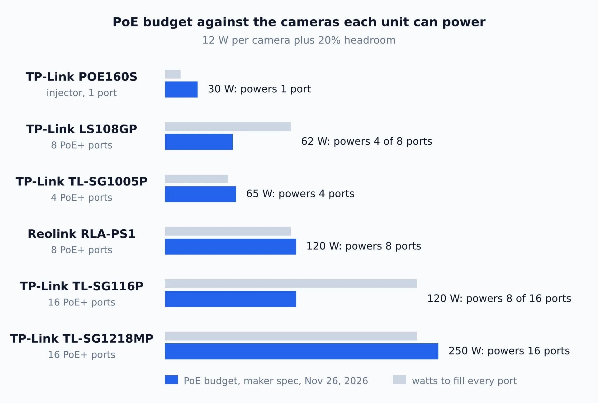
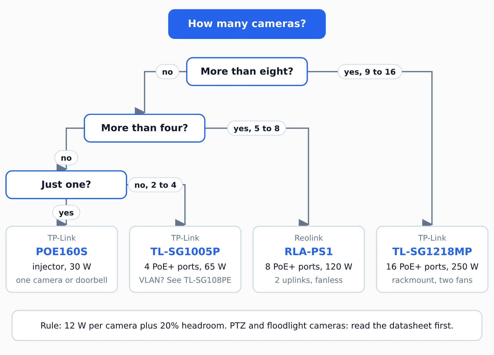
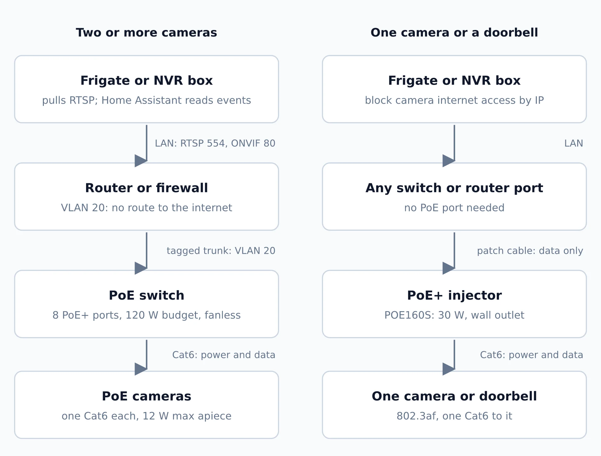

import Notice from "@components/widgets/Notice.astro";
import Accordion from "@components/widgets/Accordion.astro";
import AmazonProduct from "@components/widgets/AmazonProduct.astro";

For most homes the answer is the **[Reolink RLA-PS1](#reolink-rla-ps1-five-to-eight-cameras)** at $63.74 on November 26, 2026: eight PoE+ ports, two uplink ports and a 120 W budget that covers eight cameras at 12 W each with headroom. One camera needs only an injector. Four and sixteen cameras get their own picks below.

<Notice type="warning" title="Affiliate disclosure">
Some links below are Amazon affiliate links, including `/go/` redirects that land on Amazon. Buying through them pays me a small commission at no extra cost to you. Prices were checked on November 26, 2026 and move constantly, so always confirm on the product page.
</Notice>

## Quick picks

| Pick | PoE ports | Budget | Price (Nov 26, 2026) | Buy it for |
| --- | --- | --- | --- | --- |
| [TP-Link POE160S](/go/tp-link-poe160s/) | 1 | 30 W | $19.99 | One camera or a doorbell. |
| [TP-Link TL-SG1005P](/go/tp-link-tl-sg1005p/) | 4 | 65 W | $39.85 | Two to four cameras at the lowest price. |
| [TP-Link TL-SG108PE](/go/tp-link-tl-sg108pe/) | 4 | 64 W | $59.99 | Up to four cameras on a VLAN. |
| [Reolink RLA-PS1](/go/reolink-rla-ps1/) | 8 | 120 W | $63.74 | Five to eight cameras. |
| [TP-Link TL-SG1218MP](/go/tp-link-tl-sg1218mp/) | 16 | 250 W | $139.89 | Nine to sixteen cameras, in a rack. |
| [TP-Link TL-SG105PP-M2](/go/tp-link-tl-sg105pp-m2/) | 4 | 123 W | $125.00 | Four cameras and a 2.5G access point. |

Budgets are the PoE power each maker publishes for the whole switch. Camera counts assume 12 W per camera plus 20% headroom, worked out next.

## How many watts does a PoE camera need?

Budget 12 W for each fixed camera, then add 20%: 58 W for four cameras, 115 W for eight and 230 W for sixteen. The 12 W is the maximum Reolink lists for the [RLC-810A](/go/reolink-rlc-810a/) and RLC-510A, the cameras our [Frigate camera guide](/best-cameras-frigate-home-assistant/) recommends.

*PoE budgets from each manufacturer's spec page on November 26, 2026. Camera counts are mine: 12 W per camera plus 20% headroom, capped by the port count.*

Two things hide inside that 20%. The first is cable loss. 802.3af lets the switch send 15.4 W so that 12.95 W reaches the camera, so a long run can cost 19% before the camera sees a watt ([Power over Ethernet](https://en.wikipedia.org/wiki/Power_over_Ethernet)). The second is night. Reolink says a typical 15 W camera averages 3 W to 8 W by day and 6 W to 12 W with the IR LEDs on ([Reolink](https://reolink.com/blog/cctv-ip-security-camera-power-consumption/)).

A switch sized for the daytime average runs out on a cold night. Past the budget, these switches cut their lowest-priority ports: the RLA-PS1 starts at port 8, and the TL-SG116P in priority mode protects ports 1 to 4. The camera that drops is whichever sits on that port.

## 802.3af, 802.3at or 802.3bt: which one do cameras use?

The fixed IP cameras most home setups use are 802.3af, the 15.4 W tier. Reolink lists IEEE 802.3af for the RLC-810A, the RLC-510A and the [PoE doorbell](/best-poe-doorbell-home-assistant/).

| Standard | Common name | Per port at the switch | At the camera |
| --- | --- | --- | --- |
| 802.3af | PoE | 15.4 W | 12.95 W |
| 802.3at | PoE+ | 30 W | 25.5 W |
| 802.3bt Type 3 | PoE++ | 60 W | 51 W |
| 802.3bt Type 4 | PoE++ | 90 W | 71.3 W |

*From the standards table in [Power over Ethernet](https://en.wikipedia.org/wiki/Power_over_Ethernet). TP-Link's [PoE overview](https://www.omadanetworks.com/us/solution/poe/) gives the same per-port figures.*

PoE+ (802.3at, 30 W) covers PTZ cameras and floodlights. Reolink's own power table puts its floodlight models at up to about 24 W, so no camera there needs 802.3bt. The 60 W and 90 W tiers are for access points, and for a switch that is itself fed by PoE.

A port negotiates with the camera and sends only what the camera asks for, so an 802.3af camera is safe on any PoE port. The reverse is the problem: an 802.3at camera on an 802.3af port has 15.4 W to work with and may not start.

Skip passive adapters. TP-Link's TL-POE4824G is a 48 V passive injector sold for TP-Link's own outdoor access points and CPEs ([TP-Link](https://www.tp-link.com/us/business-networking/accessory/tl-poe4824g/)). A passive injector skips that negotiation. Reolink's FAQ for the RLC-510A asks for an injector that is 802.3af compliant and works in active mode ([Reolink](https://reolink.com/product/rlc-510a/)). Buy the POE160S below unless the camera's datasheet names passive 48 V.

## Which PoE switch should I buy for my cameras?

Match the PoE budget to the camera count first, then count ports. Every switch needs one spare port for the uplink unless it has a dedicated one. Only one of the six picks, the TL-SG108PE, can tag a VLAN.

*Each leaf is the least expensive unit here that clears 12 W per camera plus 20% headroom for that count.*

The [TP-Link LS108GP](/go/tp-link-ls108gp/) is the cheaper eight-port unit, but its budget is 62 W and it has no separate uplink ([TP-Link](https://www.tp-link.com/us/business-networking/soho-switch-poe/ls108gp/)). By the rule above it is a four-camera switch with ports to spare.

## TP-Link POE160S: one camera or a doorbell

For a single camera the [POE160S](/go/tp-link-poe160s/) at $19.99 on November 26, 2026 is the entire purchase: a gigabit PoE+ injector rated for 30 W, with the power supply built into the case.

**Best for:** one camera, or the front-door doorbell, when the rest of the network is already wired.

**Strengths:** it speaks 802.3af and 802.3at, so it covers every camera here with 30 W against a 12 W draw. Both ports are gigabit, a wall mount kit ships in the box, and the case measures 125 x 59 x 37 mm ([TP-Link](https://www.omadanetworks.com/us/business-networking/omada-accessory-poe-adapter/poe160s/)).

**Trade-offs:** one injector per camera. Two cameras mean two injectors and two outlets, and the TL-SG1005P costs the same as a pair. There is no VLAN, so isolation is up to the router. The 0 to 40 °C rating rules out a hot attic.

<AmazonProduct
  productName="TP-Link POE160S PoE+ Injector"
  productDescription="Gigabit PoE+ injector rated for 30 W, with the power supply built into the case."
  productFeatures={["802.3af and 802.3at, up to 30 W", "Gigabit data in and out", "Power supply built in", "Wall mount kit included"]}
  productLink="/go/tp-link-poe160s/"
  productImage="https://m.media-amazon.com/images/I/41vVpOKZgSL._AC_SL1500_.jpg"
  productRating={4.7}
  recommendedBadge="Best for One Camera"
  importantConsiderations={["Powers one camera", "No VLAN: isolate it in the router", "Rated for 0 to 40 °C"]}
  pros={["Powers any camera here", "Negotiates power, so it cannot overdrive a camera", "Costs less than any switch here"]}
  cons={["One per camera", "No management"]}
/>

## TP-Link TL-SG1005P: two to four cameras

The [TL-SG1005P](/go/tp-link-tl-sg1005p/) is the cheapest switch here: four PoE+ ports, a 65 W budget and no fan, in a case 100 mm square. It cost $39.85 on November 26, 2026, and Amazon showed 5K+ bought in the past month.

**Best for:** two to four fixed cameras that can stay on the main LAN.

**Strengths:** 65 W covers four 12 W cameras with 7 W to spare. Extend mode takes ports 1 and 2 to 250 m at 10 Mbps, which still carries one RLC-810A stream at its 8192 Kbps maximum. PoE Auto Recovery reboots a camera that stops answering ([TP-Link](https://www.tp-link.com/us/business-networking/soho-switch-poe/tl-sg1005p/)).

**Trade-offs:** no VLANs and no web interface. Four PoE ports is the ceiling, and the fifth port is the uplink. TP-Link's own footnote calls the 65 W budget a laboratory figure that is not guaranteed.

<AmazonProduct
  productName="TP-Link TL-SG1005P (5-Port Gigabit, 4x PoE+)"
  productDescription="Five gigabit ports, four of them PoE+, with a 65 W budget in a fanless desktop case."
  productFeatures={["4 PoE+ ports, 802.3af/at, up to 30 W each", "65 W total PoE budget", "Fanless, 99.8 x 98 x 25 mm", "Extend mode to 250 m, PoE Auto Recovery"]}
  productLink="/go/tp-link-tl-sg1005p/"
  productImage="https://m.media-amazon.com/images/I/71WCFZeuK2L._AC_SL1500_.jpg"
  productRating={4.7}
  recommendedBadge="Best Budget"
  importantConsiderations={["Unmanaged: no VLANs", "The fifth port is the uplink, so four cameras is the limit", "TP-Link calls the 65 W budget a lab figure"]}
  pros={["Lowest price per powered camera here", "Silent and small enough for a shelf", "Auto Recovery reboots a frozen camera"]}
  cons={["No way to isolate cameras on the switch", "7 W of headroom with four 12 W cameras"]}
/>

## TP-Link TL-SG108PE: four cameras on a camera VLAN

The [TL-SG108PE](/go/tp-link-tl-sg108pe/) is the TL-SG1005P with a web interface, for $59.99 on November 26, 2026: the same four PoE+ ports, a 64 W budget, and 802.1Q VLANs.

**Best for:** up to four cameras when you want the isolated camera VLAN described below.

**Strengths:** it holds 32 VLANs, port based or 802.1Q tagged, which is more than a camera VLAN and an uplink need. The other four ports carry the uplink, the Frigate box and Home Assistant without PoE. It is fanless and draws 74.3 W at full budget ([TP-Link](https://www.tp-link.com/us/business-networking/soho-switch-poe/tl-sg108pe/v3/)).

**Trade-offs:** the desktop utility is Windows only, though the web interface works from anything. Four PoE ports, the same as the TL-SG1005P, for more money.

<AmazonProduct
  productName="TP-Link TL-SG108PE V3 (8-Port Easy Smart, 4x PoE+)"
  productDescription="Eight gigabit ports, four of them PoE+, with a 64 W budget and 802.1Q VLANs."
  productFeatures={["4 PoE+ ports, 802.3af/at, up to 30 W each", "64 W total PoE budget", "Up to 32 VLANs with 802.1Q tagging", "Web interface, fanless"]}
  productLink="/go/tp-link-tl-sg108pe/"
  productImage="https://m.media-amazon.com/images/I/71Yq3GR5rgL._AC_SL1500_.jpg"
  productRating={4.6}
  recommendedBadge="Best for a Camera VLAN"
  importantConsiderations={["Only four of the eight ports supply power", "Easy Smart is a web menu, not a controller", "Management utility needs Windows; the web page does not"]}
  pros={["Cheapest VLAN-capable PoE switch here", "Four non-PoE ports for uplink and servers", "PoE Auto Recovery on ports 1 to 4"]}
  cons={["No SFP slot", "Same four powered ports as the TL-SG1005P"]}
/>

## Reolink RLA-PS1: five to eight cameras

The [RLA-PS1](/go/reolink-rla-ps1/) is the best 8 port PoE switch here for the money, and the one I would buy for most homes. It has eight PoE+ ports, two separate gigabit uplinks and a 120 W budget, which is exactly eight cameras under the rule above. It cost $63.74 on November 26, 2026.

**Best for:** five to eight fixed cameras, or six cameras plus a doorbell and a spare.

**Strengths:** both uplinks are their own ports, so all eight PoE ports go to cameras. Reolink rates the surge protection at 4 kV. It is fanless, measures 190 x 107 x 26 mm, and powers any 802.3af or 802.3at device ([Reolink](https://reolink.com/product/rla-ps1/)).

**Trade-offs:** it is an unmanaged PoE switch, so there are no VLANs, and it has no SFP slot. Its power management cuts port 8 first, so that is the place for the least important camera. Reolink's support article calls the PoE ports 10/100 Mbps while the product page says gigabit; either matches or beats a camera's own port.

<AmazonProduct
  productName="Reolink RLA-PS1 (8x PoE+ with 2 Gigabit Uplinks)"
  productDescription="Eight gigabit PoE+ ports, two gigabit uplink ports and a 120 W budget in a fanless case."
  productFeatures={["8 PoE+ ports, 802.3af/at, up to 30 W each", "120 W total PoE budget", "2 separate gigabit uplink ports", "4 kV surge protection, Extend and Recovery modes"]}
  productLink="/go/reolink-rla-ps1/"
  productImage="https://m.media-amazon.com/images/I/51lZECkPM3L._AC_SL1500_.jpg"
  productRating={4.6}
  recommendedBadge="Best Overall"
  importantConsiderations={["Unmanaged: no VLANs", "Overload cuts port 8 first", "Support article lists PoE ports as 10/100, product page as gigabit"]}
  pros={["Eight powered ports plus two uplinks", "120 W clears eight 12 W cameras with headroom", "Fanless and small enough for a shelf"]}
  cons={["No SFP slot", "No web interface"]}
/>

## TP-Link TL-SG1218MP: nine to sixteen cameras

Sixteen cameras need 230 W with headroom, and the [TL-SG1218MP](/go/tp-link-tl-sg1218mp/) is the cheapest way here to get it. It packs a 250 W budget, sixteen PoE+ ports, two plain gigabit ports and two gigabit SFP slots into a 1U rack chassis. It cost $139.89 on November 26, 2026.

**Best for:** nine to sixteen cameras, or eight that include power-hungry PTZ or floodlight models.

**Strengths:** the uplinks and SFP slots are separate, so all sixteen PoE ports go to cameras. An SFP slot takes a fiber module for a run to a garage or an attic, with no copper to carry a surge inside. The rack kit ships in the box, and the 440 x 180 x 44 mm case suits the shallow wall cabinets in the [home server rack](/best-home-server-rack/) guide ([TP-Link](https://www.tp-link.com/us/business-networking/soho-switch-poe/tl-sg1218mp/)).

**Trade-offs:** two fans, so it is a rack or closet switch rather than a desk one. It is unmanaged. The SFP slots run at gigabit, not 10G, and at full load it pulls 286.6 W from the wall.

If you want sixteen PoE ports without fans, the [TP-Link TL-SG116P](/go/tp-link-tl-sg116p/) has a 120 W budget in a 286 mm desktop case. That is eight cameras' worth of power by the rule above, sixteen only if each averages under 6 W.

<AmazonProduct
  productName="TP-Link TL-SG1218MP (16x PoE+, 2x SFP, Rackmount)"
  productDescription="Sixteen PoE+ ports with a 250 W budget, two non-PoE ports and two gigabit SFP slots in a 1U rack chassis."
  productFeatures={["16 PoE+ ports, 802.3af/at, up to 30 W each", "250 W total PoE budget", "2 gigabit uplink ports and 2 gigabit SFP slots", "19-inch 1U rack mount, rack kit included"]}
  productLink="/go/tp-link-tl-sg1218mp/"
  productImage="https://m.media-amazon.com/images/I/41ZZY08pArL._AC_SL1500_.jpg"
  productRating={4.5}
  recommendedBadge="Room to Grow"
  importantConsiderations={["Two fans: not a desk switch", "Unmanaged: no VLANs", "286.6 W from the wall at full budget"]}
  pros={["250 W clears sixteen 12 W cameras with headroom", "Dedicated uplinks leave all sixteen PoE ports for cameras", "SFP slots for a fiber run"]}
  cons={["Largest and loudest unit here", "SFP slots are gigabit, not 10G"]}
/>

## Do 4K cameras need a 2.5G PoE switch?

No. The 4K Reolink RLC-810A has a 10/100 Mbps port and its main stream tops out at 8192 Kbps, so sixteen of them add up to about 131 Mbps. That is 13% of one gigabit uplink.

The same answer came out of r/Ubiquiti when someone asked for the best PoE switch for UniFi cameras. "2.5G Ethernet is 100% overkill for basically any IP camera", wrote one commenter, and another counted about 43 Mb/s for 13 cameras ([thread](https://www.reddit.com/r/Ubiquiti/comments/1rx0q1t/)). Buy for watts, not speed.

A multi-gig PoE switch earns its price in two places. A 2.5G port matters when the same box feeds a Wi-Fi 6 or 7 access point. An SFP+ uplink matters when the camera switch hangs off a 10GbE core, the setup the [2.5GbE and 10GbE switch guide](/best-2-5-10gbe-switch-homelab/) builds. There the cage is for cabling, not camera bandwidth: fiber or a DAC replaces a long copper run, and glass carries no surge.

### TP-Link TL-SG105PP-M2: four cameras and a 2.5G access point

The [TL-SG105PP-M2](/go/tp-link-tl-sg105pp-m2/) is the multi-gig pick: five 2.5G ports, four of them PoE++ up to 60 W each, sharing a 123 W budget. It cost $125.00 on November 26, 2026.

**Best for:** four cameras and a 2.5G access point on one desk switch.

**Strengths:** ports 1 to 4 speak 802.3af, 802.3at and 802.3bt Type 3, so floodlights and PTZ are not a question. The budget is ten 12 W cameras' worth of power for four ports. It is fanless and runs on Cat5e ([TP-Link](https://www.tp-link.com/us/business-networking/soho-switch-poe/tl-sg105pp-m2/)).

**Trade-offs:** unmanaged, no SFP slot, and five ports in total with one taken by the uplink.

<AmazonProduct
  productName="TP-Link TL-SG105PP-M2 (5-Port 2.5G, 4x PoE++)"
  productDescription="Five 2.5G ports, four of them PoE++ up to 60 W each, with a 123 W budget and no fan."
  productFeatures={["4 PoE++ ports, 802.3af/at/bt Type 3, up to 60 W each", "123 W total PoE budget", "5x 2.5G ports on Cat5e or better", "Fanless, PoE Auto Recovery"]}
  productLink="/go/tp-link-tl-sg105pp-m2/"
  productImage="https://m.media-amazon.com/images/I/51rjGgJOzcL._AC_SL1500_.jpg"
  productRating={4.6}
  recommendedBadge="Best Multi-Gig"
  importantConsiderations={["Unmanaged: no VLANs", "No SFP slot", "Confirm the seller and return terms on the listing"]}
  pros={["2.5G on every port for an access point", "60 W per port handles floodlight and PTZ cameras", "Fanless"]}
  cons={["Five ports only, one used by the uplink", "Priced far above the four-port gigabit switches"]}
/>

For the SFP+ route, the [YuanLey 8x 2.5GbE PoE with two 10G SFP ports](/go/yuanley-8-port-2-5g-poe/) costs less and is still a white box, so read this month's one-star reviews. The [Ubiquiti Flex 2.5G PoE](/go/ubiquiti-flex-2-5g-poe/) has eight 2.5G PoE++ ports, a 10G SFP+ uplink and 256 VLANs. Its 196 W budget needs the AC adapter, which Ubiquiti sells separately; fed from a PoE+ port it has 16 W to give the cameras ([Ubiquiti](https://techspecs.ui.com/unifi/switching/usw-flex-2-5g-8-poe)). For 24 cameras and four 10G SFP+ uplinks in one managed box, TP-Link's Omada SG3428XMP carries a 384 W budget.

## Managed or unmanaged: how do I stop cameras calling home?

An unmanaged switch cannot block anything. The isolation lives in the router, and the switch's part is to put the cameras in their own VLAN so the router has something to block. Buy a VLAN-capable switch such as the TL-SG108PE, or skip the VLAN with a second network port.

*Left: the blocking happens in the firewall, and the switch only tags VLAN 20. Right: with an injector the camera sits on the main LAN, so the router has to block it by address.*

For the VLAN route, four steps:

1. On the switch, create VLAN 20 and make the camera ports untagged members of it. Leave the uplink tagged in VLAN 20 and in the VLAN you manage the switch from.
2. On the router or firewall, add an interface for VLAN 20 with its own DHCP range.
3. Add two rules. VLAN 20 may reach the DHCP server and nothing else. The Frigate and Home Assistant host may open TCP 554 and TCP 80 or 8080 into VLAN 20, the RTSP and ONVIF ports Frigate's [camera setup](https://docs.frigate.video/configuration/cameras) uses.
4. Give the cameras a clock. Frigate's docs note that ONVIF authentication tokens include a timestamp. Point the cameras at your router or the Frigate host for time, since they can no longer reach the internet's time servers.

The unmanaged route needs no VLAN at all. Plug the camera switch into a second network port on the Frigate box, give that port a private subnet such as 192.168.20.1/24, and set static addresses on the cameras. With no gateway the cameras have no way out, and nothing else on the LAN can reach them. That is the most upvoted answer in r/BlueIris to whether cameras need their own switch ([thread](https://www.reddit.com/r/BlueIris/comments/yu8olf/)). If Home Assistant runs on another machine, it loses the cameras; run it as a VM on the same host and attach the same bridge.

## Fanless or fanned: how loud is a PoE switch?

Every unit here is fanless except the two-fan TL-SG1218MP, and every fanless model stops at a 123 W budget.

The heat is smaller than the name suggests, because a switch only loses the difference between what it draws and what it sends. A TL-SG1218MP at full budget turns 286.6 W at the wall into 250 W on the cables, so the rack sees about 37 W. The cameras burn their own watts outdoors.

r/TPLink_Omada has the noise question in its pure form: five cameras, a network stack headed for a guest bedroom closet, and a request for something not too loud ([thread](https://www.reddit.com/r/TPLink_Omada/comments/196hsjz/)). The TL-SG2210MP suggested there has one fan by TP-Link's spec, so for a bedroom closet I would stay with the desktop units above.

## Outdoor camera runs and surge protection

A cable that leaves the house is an antenna, and the switch at its near end is what dies. TP-Link's [Lightning Protection Guide](https://www.tp-link.com/us/configuration-guides/lightning_protection_guide/) says it plainly: outdoor Ethernet is not recommended, and any outdoor run needs a signal lightning arrester on the port before the cable reaches the device.

The rest of that guide is about how the cable travels. Bury outdoor runs, and take aerial cable through a metal pipe at least 15 m long with both ends grounded. Earth the switch through its power lead or a grounding terminal. I would add a grounded Ethernet surge protector between each outdoor camera and the switch, on the same earth.

The RLA-PS1 advertises 4 kV of surge protection on its ports. Treat that as a second line, not a substitute for the arrester and the earth, because no spec page I read rates a switch against a direct strike.

TP-Link rates every model here to 100 m on Cat5e or better at gigabit. Extend mode, a button on the TL-SG1005P and the LS108GP and a switch on the RLA-PS1, takes ports 1 and 2 to 250 m and drops them to 10 Mbps.

## What a PoE switch costs you on the UPS

Size the UPS for the cameras plus the switch's own draw, because a PoE switch passes its budget straight through to the wall. TP-Link publishes both numbers:

| Switch | Nothing attached | Full PoE budget |
| --- | --- | --- |
| TL-SG1005P | 3.44 W | 74.49 W |
| TL-SG108PE | 5.4 W | 74.3 W |
| LS108GP | 5.53 W | 71.61 W |
| TL-SG105PP-M2 | 7.57 W | 143.37 W |
| TL-SG116P | 11.72 W | 142.51 W |
| TL-SG1218MP | 21.4 W | 286.6 W |

*Maximum power consumption from each model's spec page on TP-Link's site, read on November 26, 2026. Reolink publishes no wall draw for the RLA-PS1, so count its 120 W adapter.*

Use the full-load column even though the cameras rarely pull it. Eight cameras at 12 W plus an N150-class box from the [Home Assistant hardware guide](/best-home-assistant-hardware/), a modem and a router land around 130 W. There the CyberPower CP1500PFCLCD runs roughly half an hour to an hour by the table in my [home server UPS guide](/best-ups-for-home-server/). A sixteen-camera build on the TL-SG1218MP lands between that guide's 36 minutes at 150 W and 14 minutes at 300 W rows.

A cut power line is the moment you want the recording, so the switch, the Frigate box, the router and the modem go on the battery side.

## What I'd buy

Buy the [Reolink RLA-PS1](/go/reolink-rla-ps1/) and one [POE160S](/go/tp-link-poe160s/) for the doorbell. Eight powered ports, two uplinks and 120 W cover every count up to eight by the rule above.

Change the pick in four cases. One camera and nothing else on PoE: the injector alone. Four cameras that must stay off the internet: the TL-SG108PE. More than eight cameras, or a switch that lives in a rack: the TL-SG1218MP. A 2.5G access point sharing the box: the TL-SG105PP-M2.

Before you order, add up the power figures on your cameras' spec pages, multiply by 1.2 and compare the result with the budget column in the chart above.

## FAQ

<Accordion label="How many watts does an IP camera use on PoE?" group="faq" expanded="true">
Reolink lists under 12 W for the RLC-810A and RLC-510A. It says a typical 15 W camera averages 3 W to 8 W by day and 6 W to 12 W at night with the IR LEDs on. Budget 12 W per fixed camera plus 20%, which is 115 W for eight cameras.
</Accordion>

<Accordion label="Can I plug an 802.3af camera into a PoE+ or PoE++ port?" group="faq">
Yes. The port negotiates with the camera and sends only what it asks for. A 30 W or 60 W port does not push that power into a 12 W camera. The reverse is the problem: an 802.3at camera on an 802.3af port has 15.4 W and may not start.
</Accordion>

<Accordion label="Will a cheap passive 48V injector work with IP cameras?" group="faq">
Not by default. TP-Link sells its TL-POE4824G for its own passive PoE access points and CPEs, and a passive injector skips the negotiation that standards-based PoE uses. Reolink's FAQ asks for an injector that is 802.3af compliant and works in active mode. Use the POE160S unless the camera's datasheet names passive 48 V.
</Accordion>

<Accordion label="Do I need a managed PoE switch for cameras?" group="faq">
Only for a camera VLAN. An unmanaged switch such as the RLA-PS1 works with every camera here. You can still isolate it by plugging it into a second network port on the Frigate box with no gateway. If Frigate and Home Assistant must share one network with the cameras blocked from the internet, you need 802.1Q VLANs, which the TL-SG108PE provides.
</Accordion>

<Accordion label="How far can I run a PoE camera cable?" group="faq">
100 m on Cat5e or better at gigabit, which is the rating on every TP-Link model here. Extend mode on the TL-SG1005P, the LS108GP and the RLA-PS1 takes ports 1 and 2 to 250 m and drops them to 10 Mbps. A 4K Reolink stream tops out at 8192 Kbps, so one camera per extended port still fits.
</Accordion>

<Accordion label="How much power does a PoE switch draw on a UPS?" group="faq">
Between 3.44 W and 21.4 W for the switch itself, plus whatever the cameras draw. At a full budget the TL-SG1005P pulls 74.49 W from the wall and the TL-SG1218MP 286.6 W, by TP-Link's spec pages. Size the UPS on the full-load figure, not on the idle one.
</Accordion>
