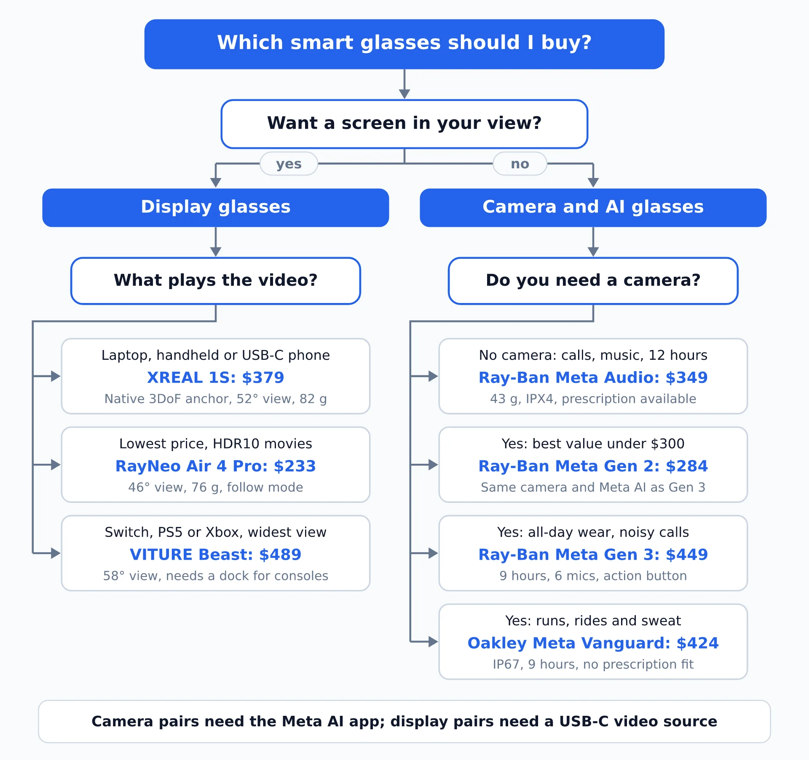
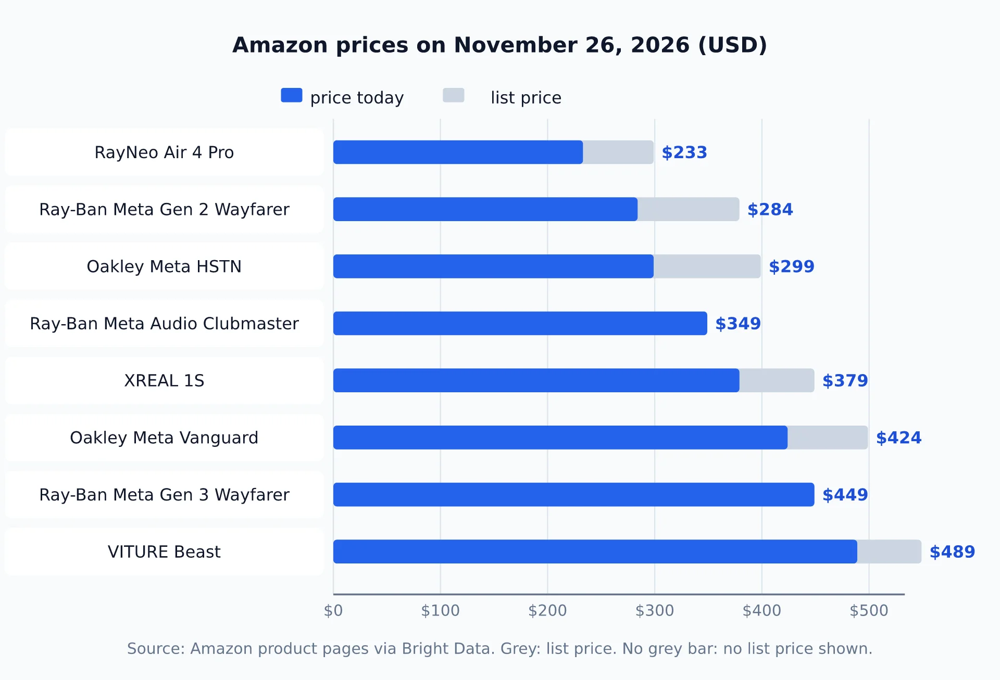
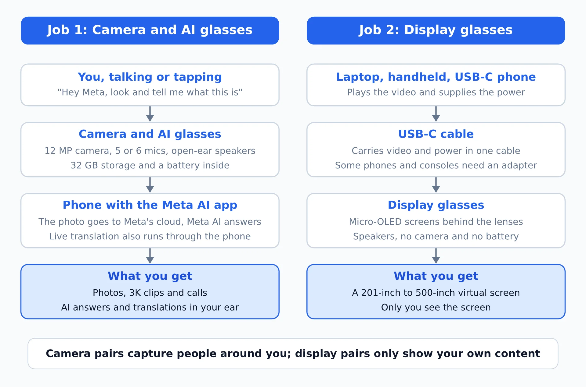

import Notice from "@components/widgets/Notice.astro";
import Accordion from "@components/widgets/Accordion.astro";
import Button from "@components/widgets/Button.astro";
import AmazonProduct from "@components/widgets/AmazonProduct.astro";

**The [Ray-Ban Meta Gen 2 at $284](#ray-ban-meta-gen-2-wayfarer-the-pick-for-most-people)** is the best smart glasses buy for most people. It shoots the same 12 MP photos and 3K video as the $449 Gen 3 and runs the same Meta AI. Pick Gen 3 for nine hours of battery, Oakley Meta for sport, or display glasses for a screen on a plane.

<Notice type="warning" title="Affiliate disclosure">
Some links below are Amazon affiliate links, including `/go/` redirects that land on Amazon. Buying through them pays me a small commission at no extra cost to you. Prices were checked on November 26, 2026 and move constantly, so always confirm on the product page.
</Notice>

## Quick picks

| Pick | Price (Nov 26, 2026) | Job | Buy it if |
| --- | --- | --- | --- |
| [Ray-Ban Meta Gen 2 Wayfarer, clear lenses](/go/ray-ban-meta-gen-2-wayfarer-clear/) | $284 | Camera and AI | Lowest price on Meta's camera. |
| [Ray-Ban Meta Gen 2 Wayfarer, green sunglasses lenses](/go/ray-ban-meta-gen-2-wayfarer-green/) | $284 | Camera and AI | Sunglasses at the same price. |
| [Ray-Ban Meta Gen 2 Wayfarer, polarized](/go/rayban-meta-wayfarer-gen2/) | $306 | Camera and AI | Polarized sunglasses lenses. |
| [Ray-Ban Meta Gen 3 Wayfarer](/go/ray-ban-meta-gen-3-wayfarer/) | $449 | Camera and AI | All-day wear. |
| [Oakley Meta Vanguard](/go/oakley-meta-vanguard-prizm-24k/) | $424 | Camera and AI | Runs, rides and sweat. |
| [Oakley Meta HSTN](/go/oakley-meta-hstn/) | $299 | Camera and AI | Prescription Oakleys. |
| [Ray-Ban Meta Audio Clubmaster](/go/ray-ban-meta-audio-clubmaster/) | $349 | Audio and AI | No camera. |
| [RayNeo Air 4 Pro](/go/rayneo-air-4-pro/) | $233 | Display | The cheapest screen. |
| [XREAL 1S](/go/xreal-1s-ar-glasses/) | $379 | Display | A wider, anchored view. |
| [VITURE Beast](/go/viture-beast-xr-glasses/) | $489 | Display | The widest view. |

Every listing in this table was in stock on Amazon on November 26, 2026. The $284 Gen 2 is a Black Friday price; Meta's sale ends November 30 and the list price is $379. I have not worn these pairs: every number comes from makers' spec pages, Amazon's product pages and owner threads.

## Which smart glasses should you buy in 2027?

Smart glasses do two jobs, and the job decides the buy. Camera and AI glasses take photos and video from your point of view, play audio from speakers in the temples and answer questions through Meta AI. Display glasses have no camera and no battery: a USB-C cable brings video and power from your laptop, handheld or phone.

*Start with the job, then the device you will plug in or pair. Prices are Amazon product page prices on November 26, 2026.*

Every Meta pair needs the Meta AI app and a Meta account, and AI answers travel through your phone's data connection. Display glasses need a USB-C port that carries video, which laptops, the Steam Deck and the ROG Ally have. A Switch, PS5 or Xbox needs a dock or adapter first.

## Ray-Ban Meta Gen 2 vs Gen 3: what changed

Gen 3 is a slimmer frame with one more hour of battery, a sixth microphone and a button you can program. The camera, the video and the Meta AI software are the same on both.

| | Ray-Ban Meta Gen 2 | Ray-Ban Meta Gen 3 |
| --- | --- | --- |
| Launch | September 2025 | September 23, 2026 |
| Price on Nov 26, 2026 | $284, list $379 | $449 |
| Battery, mixed use | Up to 8 hours | Up to 9 hours |
| Charging case | Adds up to 48 hours | Adds up to 50 hours |
| Camera and video | 12 MP, 3K at 30 fps, 1200p at 60 fps | 12 MP, 3K at 30 fps; horizontal capture and Dolby Atmos recording due later in 2026 |
| Microphones | 5 | 6, which Meta says cuts over 90% of background noise |
| Controls | Power slider, touchpad, capture button | The same, plus a programmable action button |
| Frame styles | Wayfarer, Headliner, Skyler, plus two Optics frames | Wayfarer in two sizes, Aviator, Zena, 27 color and lens combinations |

Sources: Meta's [battery page](https://www.meta.com/help/ai-glasses/303057485648146/), [launch post](https://meta.com/blog/ray-ban-meta-audio-and-deepest-ai-glasses-lineup) and [buying guide](https://meta.com/is/ai-glasses/learn/smart-glasses-buying-guide), and Ray-Ban's [Gen 3 page](https://ray-ban.com/usa/l/discover-ray-ban-meta-ai-glasses) and [FAQ](https://india.ray-ban.com/ray-ban-meta-faq).

## Is Ray-Ban Meta Gen 2 a better buy than Gen 3?

Yes, while the deal lasts. At the $379 list price the gap shrinks to $70, and then Gen 3 is the better buy for anyone who wears glasses all day.

*Amazon product page prices on November 26, 2026. Grey bars are list prices.*

The extra $165 buys one hour of battery, a sixth microphone, a programmable action button, adjustable temple tips and a slimmer frame. Horizontal capture and Dolby Atmos recording were still promised for "later this year" at the launch.

It does not buy a better camera. Both pairs shoot 12 MP photos and 3K video, hold about 500 photos, and run the same Meta AI and live translation.

In [r/RaybanMeta, two days after launch](https://www.reddit.com/r/RaybanMeta/comments/1wq2jrr/), one reply called Gen 3 "more money for marginal improvements".

My rule: buy Gen 2 whenever it sells for $100 or more below Gen 3. Under that, pay the extra, because the sealed battery lasts the life of the pair.

## Ray-Ban Meta Gen 2 Wayfarer: the pick for most people

The Gen 2 Wayfarer is where I would put my own money while it sells for $284. It carries the same 12 MP camera, 3K video and Meta AI as Gen 3.

**Best for:** a first pair of camera glasses, and the lowest price on Meta AI.

**Strengths:** a 12 MP ultra-wide camera with 3K video, hyperlapse and slow motion. Up to 8 hours of mixed use, plus 48 from the case. Three frame shapes, two prescription-first Optics frames, and clear, sun, polarized or Transitions lenses.

**Trade-offs:** five microphones instead of six, no action button, and a battery you cannot swap.

<AmazonProduct
  productName="Ray-Ban Meta (Gen 2) Wayfarer, matte black with clear lenses"
  productDescription="Last year's Ray-Ban Meta camera glasses at a Black Friday price, with the same 12 MP camera, 3K video and Meta AI as Gen 3."
  productFeatures={["12 MP ultra-wide camera, 3K video at 30 fps", "Up to 8 hours, plus 48 hours from the case", "Meta AI, live translation, open-ear audio", "32 GB holds about 500 photos"]}
  productLink="/go/ray-ban-meta-gen-2-wayfarer-clear/"
  productImage="https://m.media-amazon.com/images/I/51YGHoZOjfL._AC_SL1500_.jpg"
  productRating={4.1}
  recommendedBadge="Best Overall"
  importantConsiderations={["Clear lenses; green-lens and polarized Wayfarers cost $284 and $306", "$284 is a Black Friday price; list is $379", "Needs the Meta AI app and a Meta account"]}
  pros={["Same camera and Meta AI as Gen 3", "Lowest price on a Ray-Ban Meta pair today", "Looks like an ordinary pair of Wayfarers"]}
  cons={["Five microphones instead of six", "No action button", "Battery is sealed in and cannot be replaced"]}
/>

<Button text="Check Ray-Ban Meta Gen 2 price" link="/go/ray-ban-meta-gen-2-wayfarer-clear/" variant="outline" color="blue" size="md" icon="arrow-right" />

The $284 pair has clear lenses. The [Shiny Black with green lenses](/go/ray-ban-meta-gen-2-wayfarer-green/) also sells for $284, the [polarized Wayfarer](/go/rayban-meta-wayfarer-gen2/) costs $306, and Transitions pairs listed at $344.

## Ray-Ban Meta Gen 3: the better pair for all-day wear

Gen 3 is the better pair, and the one to buy within $100 of Gen 2: nine hours of battery, six microphones and a programmable button.

**Best for:** people who wear glasses from morning to night and take calls in noisy places.

**Strengths:** up to 9 hours of mixed use and 50 more from the case, which gives 4 hours back from a 20-minute charge. Wayfarer, Aviator and Zena shapes in 27 combinations.

**Trade-offs:** $449, with horizontal capture and Dolby Atmos recording still promised at launch. In a 55-comment [r/RaybanMeta thread from October 2026](https://www.reddit.com/r/RaybanMeta/comments/1wvm0zh/), one owner could not start calls by voice on a new pair.

<AmazonProduct
  productName="Ray-Ban Meta (Gen 3) Wayfarer, matte black with clear lenses"
  productDescription="The current Ray-Ban Meta camera glasses: a 12 MP camera, 3K video, six microphones and a programmable action button in a slimmer frame."
  productFeatures={["12 MP ultra-wide camera, 3K video", "Up to 9 hours, plus 50 hours from the case", "Six-microphone array", "Programmable action button"]}
  productLink="/go/ray-ban-meta-gen-3-wayfarer/"
  productImage="https://m.media-amazon.com/images/I/51RMIY685pL._AC_SL1500_.jpg"
  productRating={4.1}
  recommendedBadge="Best for All-Day Wear"
  importantConsiderations={["Clear lenses; a grey-lens Wayfarer costs the same $449", "No discount on Amazon: price and list price match", "Horizontal capture and Dolby Atmos recording were not available at launch"]}
  pros={["Longest battery on a Ray-Ban Meta camera pair", "Clearer calls with a sixth microphone", "Adjustable temple tips and three frame shapes"]}
  cons={["Same camera and video as Gen 2 at $165 more", "Launch-month owner reports of pairing and voice-call problems"]}
/>

<Button text="Check Ray-Ban Meta Gen 3 price" link="/go/ray-ban-meta-gen-3-wayfarer/" variant="outline" color="blue" size="md" icon="arrow-right" />

## Oakley Meta Vanguard and HSTN: for runs and rides

At $424 on November 26, 2026, Oakley Meta Vanguard is the only Meta pair rated IP67, and the only one that cannot take prescription lenses.

**Best for:** running, cycling and snow sports, where sweat, rain and dust are normal.

**Strengths:** up to 9 hours of typical use or 6 hours of continuous music, with 36 more from the case. A centered 12 MP camera with a 122-degree lens, against 100 on the Ray-Bans.

**Trade-offs:** a wraparound shield that, in Meta's words, "looks clearly like a sport-specific product". Five microphones. No prescription lenses.

<AmazonProduct
  productName="Oakley Meta Vanguard, black with Prizm 24K lenses"
  productDescription="Meta's sport camera glasses, rated IP67 for dust and water, with a centered 12 MP camera and Garmin and Strava integration."
  productFeatures={["IP67 dust and water resistance", "Centered 12 MP camera with a 122-degree lens, 3K video", "Up to 9 hours, plus 36 hours from the case", "Garmin and Strava integration"]}
  productLink="/go/oakley-meta-vanguard-prizm-24k/"
  productImage="https://m.media-amazon.com/images/I/61lBwbzUaVL._SL1500_.jpg"
  productRating={4.4}
  recommendedBadge="Best for Sport"
  importantConsiderations={["No prescription lens support", "Wraparound shield shape", "Five-microphone array"]}
  pros={["Survives sweat, rain and dust", "Camera sits on the center line for action footage", "Loudest speakers in Meta's line"]}
  cons={["No prescription lenses", "Case adds 36 hours, not 48"]}
/>

<Button text="Check Oakley Meta Vanguard price" link="/go/oakley-meta-vanguard-prizm-24k/" variant="outline" color="blue" size="md" icon="arrow-right" />

The [Oakley Meta HSTN](/go/oakley-meta-hstn/) at $299 takes prescription lenses and lasts up to 8 hours. Every other Meta pair stops at splash resistance: Gen 2 and Ray-Ban Meta Audio are IPX4, and I found no IP rating for Gen 3. No charging case is water-resistant.

## Ray-Ban Meta Audio: calls and Meta AI with no camera

Ray-Ban Meta Audio keeps the speakers, microphones and Meta AI of a Ray-Ban Meta pair and drops the camera. That is how it reaches 12 hours of battery in a 43-gram frame.

**Best for:** offices, meetings and anywhere a camera on your face would start a conversation.

**Strengths:** up to 12 hours of general use, or 6 hours of continuous audio, plus 48 from the case. All 23 frame and lens combinations take prescription lenses. IPX4.

**Trade-offs:** no photos or video, and no offline translation, which Meta limits to the camera pairs. $349 is only $30 under Gen 2's list price.

<AmazonProduct
  productName="Ray-Ban Meta Audio Clubmaster, shiny black on gold with green lenses"
  productDescription="Camera-free Ray-Ban glasses with open-ear speakers, six microphones and Meta AI, built for all-day listening."
  productFeatures={["No camera", "Up to 12 hours, plus 48 hours from the case", "43 g frame with adjustable temple tips", "IPX4 water resistance"]}
  productLink="/go/ray-ban-meta-audio-clubmaster/"
  productImage="https://m.media-amazon.com/images/I/516GOcU0bYL._AC_SL1500_.jpg"
  productRating={4.5}
  recommendedBadge="Best Camera-Free"
  importantConsiderations={["No photos or video", "No offline translation", "Prices on Meta.com run from $349 to $429 by lens"]}
  pros={["Longest battery of any Ray-Ban Meta pair", "Lightest Ray-Ban Meta frame at 43 g", "Prescription lenses in every frame and lens combination"]}
  cons={["Cannot take photos or video", "Six hours of continuous audio"]}
/>

The budget route is Meta's own brand. The [Meta Adventurer](/go/meta-adventurer-glasses/) costs $254 on Amazon today with Gen 3's camera, six microphones and programmable button. Meta quotes only "over 8 hours" of battery and a 40-hour case for it.

## What can Meta AI do with photos and voice?

Meta AI answers questions about what is in front of you, translates speech and signs, sends messages and sets reminders by voice. For anything visual, the glasses send a photo to Meta's cloud, and Meta keeps it unless you turn one setting off.

Start with "Hey Meta". Ray-Ban's [FAQ](https://india.ray-ban.com/ray-ban-meta-faq) lists voice commands for photos and video, calls and messages, media and volume. The same wake word sets reminders, timers and calendar events, per Ray-Ban's [feature page](https://ray-ban.com/usa/l/discover-ray-ban-meta-ai-glasses).

Point the camera at something and ask: "Hey Meta, look and tell me what this says in English" translates a sign or a menu. Autocapture cuts short clips into a montage, and [Meta's help page](https://meta.com/help/ai-glasses/1824727564872648) lists Gen 2, Vanguard and HSTN as compatible and does not mention Gen 3.

Now the part the spec sheets skip. When you ask about what you see, "your glasses will send a photo to Meta's cloud", as the FAQ puts it. [Meta says](https://meta.com/help/ai-glasses/1381548946634724) it stores that visual data and may use it, with human review, until you switch storage off. The toggle is in the Meta AI app under your glasses' Settings, then Meta AI in the Experiences section: "Store visual data from AI experiences".

A second setting, "Cloud media processing" under Privacy, keeps copies of your media on Meta's cloud for 30 days, and autocapture needs it on. I would leave both off.

The white capture LED blinks when you save a photo or record a video, and the camera stops if it is covered. [Engadget reports](https://engadget.com/2313707/ai-glasses-banned-places-list-keeps-growing) that some AI camera functions run without it.

## Where are camera glasses banned or restricted?

Courthouses are the hard stop. New York's courts, England and Wales, and Pennsylvania's First Judicial Circuit all make you hand over camera glasses at the door, prescription lenses included.

| Place | What the rule says |
| --- | --- |
| New York courts | Banned from all 1,240 state and local courts since July 20, 2026. Prescription pairs count. |
| England and Wales courts | Confiscated on entry and returned when you leave. |
| Pennsylvania's First Judicial Circuit | Banned in court facilities since April 7, 2026 without written authorization. |
| Schools and tests | Western Australia's public schools since October 12, 2026; Victoria from January 27, 2027; every SAT test site. |
| UK cinemas and theatres | UK cinemas began restricting them in August 2026. ATG Theatres asks wearers to remove them during shows. |
| UK pubs and restaurants | Jeremy King's restaurants and Soho House ask wearers to remove them. Wetherspoon bars filming without permission. |

Sources: [Engadget](https://engadget.com/2313707/ai-glasses-banned-places-list-keeps-growing), [Reuters](https://internazionale.it/ultime-notizie-reuters/2026/11/19/factbox-countries-weigh-banning-smart-glasses-over-privacy-concerns), [The Guardian on courts](https://theguardian.com/technology/2026/aug/11/meta-glasses-banned-from-courts-in-england-and-wales), [The Guardian on venues](https://theguardian.com/technology/2026/aug/06/restaurants-pubs-and-theatres-ban-metas-spy-glasses-over-privacy-fears) and the [Maryland State Bar Association](https://www.msba.org/site/site/content/News-and-Publications/News/General-News/Smart_Glasses_Must_Be_Off_Out%20of%20Sight_or_Outright_Banned_In_the_Courtroom.aspx).

Keep a plain pair with your prescription for courthouse days, and ask before you record a meeting: Maryland requires every participant's consent. Meta's guidance, quoted by [The Guardian](https://theguardian.com/world/2026/oct/05/norway-temporary-ban-smart-glasses-public-places), is to stop recording if anyone objects.

## How long does the battery last in real use?

Plan on about five hours of music or calls from Gen 2, and a working day of light mixed use. The 8 and 9 hour figures come from a test day with about 70 minutes of listening in it.

[Meta's legal page](https://meta.com/il/legal/disclosures) spells out the Gen 2 test day. It holds 51 minutes of audio and 19 minutes of calls. The rest is 3 Meta AI conversations, 32 notifications, 10 photos, 6 one-minute videos, 2 photo shares and 7 minutes of livestreaming.

[Android Central's](https://www.androidcentral.com/wearables/ray-ban-meta-gen-2) Gen 2 spec table lists 5 hours of continuous audio or calling. [Engadget's](https://engadget.com/2267213/ray-ban-meta-gen-3-hands-on-better-battery-life) reporter got "a little more than 5 hours" from Gen 2 with continuous audio playback.

In a 58-comment [r/RaybanMeta thread](https://www.reddit.com/r/RaybanMeta/comments/1pquu92/) from December 2025 about Gen 1, a commenter who takes short business calls gets 6 to 8 hours with the wake word off. Another wrote that the battery "is pretty decent provided you use zero of the advertised features".

### Storage and the charging case

Gen 2, Gen 3 and Oakley Meta Vanguard have 32 GB, about 500 photos or 100 videos of 30 seconds. Photos and videos stay on the glasses until you import them through the Meta AI app. The glasses charge only inside their case.

The Gen 2 case adds 48 hours, Gen 3 50, Oakley Meta Vanguard 36 and Ray-Ban Meta Audio 48. The Ray-Ban cases refill in 3.5 hours over USB-C, cable not included.

## Can you get smart glasses with prescription lenses?

Yes, on every Ray-Ban Meta style, Oakley Meta HSTN, Ray-Ban Meta Audio and Meta Glasses. Oakley Meta Vanguard does not take prescription lenses.

Lens types are clear, sun, polarized and Transitions on both Ray-Ban generations. [Meta says](https://meta.com/is/ai-glasses/learn/smart-glasses-buying-guide) Ray-Ban Meta, Oakley Meta HSTN and Meta Glasses come in single-vision and progressive options.

The ranges disagree, so enter your prescription before you order. [Meta's prescription guide](https://www.meta.com/ai-glasses/prescription-lenses) lists -6.00 to +6.00 for Gen 2 and HSTN. [Its compare page](https://www.meta.com/ai-glasses/compare/) lists -12.00 to +6.00 for the Gen 2 Wayfarer. I found no range for Gen 3 on Meta's or Ray-Ban's pages.

Display glasses need separate inserts: RayNeo points Air 4 Pro buyers to its lens partner Lensology, and Even Realities builds custom G2 lenses from -12.00 to +12.00.

## Does live translation work without a connection?

Partly. Six languages work offline on camera glasses after you download the pack: English, French, German, Italian, Portuguese and Spanish. Ray-Ban Meta Audio has no offline mode.

Online, [Meta's help page](https://www.meta.com/help/ai-glasses/955732293123641/) lists 20 languages, from Arabic and Chinese (Mandarin) to Vietnamese. Say "Hey Meta, start live translation", or tap Glasses, then Translate in the Meta AI app.

You hear the other language through the glasses. The other person reads your words on your phone, or taps a speaker icon to hear them. Signs and menus go through the camera and the cloud: "Hey Meta, look and tell me what this says in English".

## Display glasses for a plane or a desk

Display glasses are a monitor you wear. No camera, no battery and no AI app. The device in your bag does the work, and the lenses add a virtual screen of 31 to 500 inches.

*Camera glasses send what you see to your phone and Meta's cloud. Display glasses only receive video from the device in your bag.*

| Model | Price on Nov 26, 2026 | Field of view | Display | Weight | Screen anchoring | Buy it for |
| --- | --- | --- | --- | --- | --- | --- |
| [RayNeo Air 4 Pro](/go/rayneo-air-4-pro/) | $233 | 46° | 1080p per eye, HDR10, 120 Hz, 1,200 nits | 76 g | Follow mode | The lowest price |
| [XREAL 1S](/go/xreal-1s-ar-glasses/) | $379 | 52° | 1200p per eye, 120 Hz, 700 nits | 82 g | Native 3DoF on the X1 chip | A wider view and a pinned screen |
| [VITURE Beast](/go/viture-beast-xr-glasses/) | $489 | 58° | 1200p, 120 Hz, 1,250 nits | 88 g | Built-in 3DoF | The widest view and dimming lenses |
| Even Realities G2 | $599 on evenrealities.com, not on Amazon | 27.5° | Green text only, 60 Hz, 1,200 nits | 36 g | None | Everyday glasses with captions |
| Rokid Glasses | $699 on global.rokid.com | 30° | Green text only, 1,500 nits | 49 g | None | A text display plus a camera |

The makers label brightness differently (peak, perceived and eye-level nits), so treat those figures as rough.

The glasses replace a portable monitor on a trip, not the one on your desk; the [desk setup gadgets guide](/best-desk-setup-gadgets-2027/) covers that.

### XREAL 1S: the display pair I would take on a plane

At $379 on November 26, 2026, the XREAL 1S is the display pair I would pack: a 52° view, 1200p per eye and an X1 chip that holds the screen still.

**Best for:** flights, hotel desks and a Steam Deck or laptop owner.

**Strengths:** anchor mode that pins the screen in place, plus ultrawide and side-view modes. Electrochromic dimming. Sound by Bose.

**Trade-offs:** 82 g plus a cable, 700 nits peak, no battery of its own, and a fit that depends on your IPD. 6DoF needs the XREAL Eye accessory.

<AmazonProduct
  productName="XREAL 1S AR Glasses"
  productDescription="Display glasses that plug into a USB-C device and show a virtual screen up to 500 inches wide, with native 3DoF anchoring on the X1 chip."
  productFeatures={["1200p per eye, 52° field of view", "Native 3DoF anchor mode on the X1 chip", "Screen scales from 31 to 500 inches", "Sound by Bose, 4-microphone array"]}
  productLink="/go/xreal-1s-ar-glasses/"
  productImage="https://m.media-amazon.com/images/I/61VmcA4tVoL._AC_SL1500_.jpg"
  productRating={4.0}
  recommendedBadge="Best Display Glasses"
  importantConsiderations={["No camera, no battery and no storage; the source device supplies power", "Wired USB-C connection that needs DisplayPort video", "Fit depends on your interpupillary distance"]}
  pros={["Screen stays pinned when you turn your head", "Works with laptops, handhelds and USB-C phones", "Electrochromic dimming in three levels"]}
  cons={["82 g plus a tether", "700 nits peak, below the VITURE and RayNeo figures"]}
/>

<Button text="Check XREAL 1S price" link="/go/xreal-1s-ar-glasses/" variant="outline" color="blue" size="md" icon="arrow-right" />

### The cheaper, the wider and the camera-free

The [RayNeo Air 4 Pro](/go/rayneo-air-4-pro/) at $233 is the cheap screen: 1080p per eye, HDR10, a 46° view and follow mode instead of a pinned screen. The [VITURE Beast](/go/viture-beast-xr-glasses/) at $489 is the widest, with a nine-level electrochromic film that darkens the lenses.

The Even Realities G2 has no camera and no speakers. It weighs 36 g and shows green text in both lenses: captions, translations in 35 languages and a teleprompter. Its Conversate feature transcribes a conversation and writes a summary in the phone app. At $599 it costs more than a camera pair.

Rokid Glasses are the hybrid: a 49-gram frame with a green 30° text display, a 12 MP camera that records 3K video, and speakers. Meta's own display pair, the $799 Meta Ray-Ban Display, puts a color display in the right lens and lasts up to 6 hours.

## Which pairs were in stock on Amazon on November 26, 2026?

Every linked pair showed "In Stock" on its Amazon product page on November 26, 2026. Amazon showed 5K+ bought in the past month on the $284 Gen 2 Wayfarer and 1K+ on the Gen 3 Wayfarer.

| Listing and variant | Price | Sold by | Stock on Nov 26, 2026 |
| --- | --- | --- | --- |
| [Gen 2 Wayfarer](/go/ray-ban-meta-gen-2-wayfarer-clear/), matte black, clear lenses | $284 | Amazon.com | In Stock |
| [Gen 2 Wayfarer](/go/ray-ban-meta-gen-2-wayfarer-green/), shiny black, green lenses | $284 | Amazon.com | In Stock |
| [Gen 2 Wayfarer](/go/rayban-meta-wayfarer-gen2/), matte black, polarized graphite gradient | $306 | Amazon.com | In Stock |
| [Gen 3 Wayfarer](/go/ray-ban-meta-gen-3-wayfarer/), matte black, clear lenses | $449 | Amazon.com | In Stock |
| [Oakley Meta HSTN](/go/oakley-meta-hstn/), shiny black, clear lenses | $299 | Amazon.com | In Stock |
| [Oakley Meta Vanguard](/go/oakley-meta-vanguard-prizm-24k/), black, Prizm 24K lenses | $424 | Amazon.com | In Stock |
| [Ray-Ban Meta Audio Clubmaster](/go/ray-ban-meta-audio-clubmaster/), shiny black on gold, green lenses | $349 | Amazon.com | In Stock |
| [Meta Adventurer](/go/meta-adventurer-glasses/), black, clear lenses | $254 | Amazon.com | In Stock |
| [RayNeo Air 4 Pro](/go/rayneo-air-4-pro/), black | $233 | RayNeo Direct, shipped by Amazon | In Stock |
| [XREAL 1S](/go/xreal-1s-ar-glasses/) | $379 | XREAL Direct, shipped by Amazon | In Stock |
| [VITURE Beast](/go/viture-beast-xr-glasses/), black | $489 | VITURE US, shipped by Amazon | In Stock |

## What I'd buy

The [Ray-Ban Meta Gen 2 Wayfarer at $284](/go/ray-ban-meta-gen-2-wayfarer-clear/) is my buy, with clear lenses or as the $306 polarized pair. It is the same camera and the same Meta AI as Gen 3 for $165 less.

- Buy Gen 3 when it sells within $100 of Gen 2, or when you need the ninth hour.
- Buy Oakley Meta Vanguard for rain and sweat, and Oakley Meta HSTN for prescription sport lenses.
- Buy Ray-Ban Meta Audio when a camera would cost you meetings, and display glasses only for a screen.

Both glasses already sit in our [gifts for programmers](/gifts-for-programmers/) guide and the [best tech gadgets 2027](/best-tech-gadgets-2027/) list. Before you order, open both Wayfarer listings. If Gen 3 is within $100 of Gen 2, buy Gen 3.

## FAQ

<Accordion label="Is Ray-Ban Meta Gen 2 still worth buying?" group="faq" expanded="true">

Yes. At $284 it costs $165 less than Gen 3 and shares the 12 MP camera, 3K video and Meta AI. Gen 3 adds one hour of battery, a sixth microphone and a programmable button. Buy Gen 3 instead when the price gap is under $100.

</Accordion>

<Accordion label="What is the difference between Ray-Ban Meta Gen 2 and Gen 3?" group="faq">

Gen 3 lasts up to 9 hours against 8, has six microphones against five, and adds a programmable action button. Both have a 12 MP camera, 3K video and 32 GB of storage. Gen 3 starts at $449, and Gen 2 lists at $379.

</Accordion>

<Accordion label="How long does the battery last on Ray-Ban Meta glasses?" group="faq">

Meta rates Gen 2 at 8 hours and Gen 3 at 9 hours of mixed use, measured on a day with about 70 minutes of audio. Continuous music or calls drop that to about 5 hours.

</Accordion>

<Accordion label="Do Ray-Ban Meta glasses work with prescription lenses?" group="faq">

Yes, on every Ray-Ban Meta style, Oakley Meta HSTN, Ray-Ban Meta Audio and Meta Glasses. Oakley Meta Vanguard does not. Meta lists ranges from -6.00 to +6.00 and from -12.00 to +6.00 on different pages, so enter yours before ordering.

</Accordion>

<Accordion label="Where are camera smart glasses banned?" group="faq">

New York banned them from all 1,240 state and local courts on July 20, 2026, and England and Wales confiscate them at court entrances. Western Australia's public schools, SAT test sites and many UK cinemas and pubs restrict them as well. Carry a plain pair for courthouse days.

</Accordion>

<Accordion label="Does Meta AI store the photos from my glasses?" group="faq">

Photos taken with the capture button stay on the glasses until you import them. Photos used for AI answers go to Meta's cloud, and Meta keeps them until you switch off "Store visual data from AI experiences". Cloud media processing, when on, keeps media for 30 days.

</Accordion>
