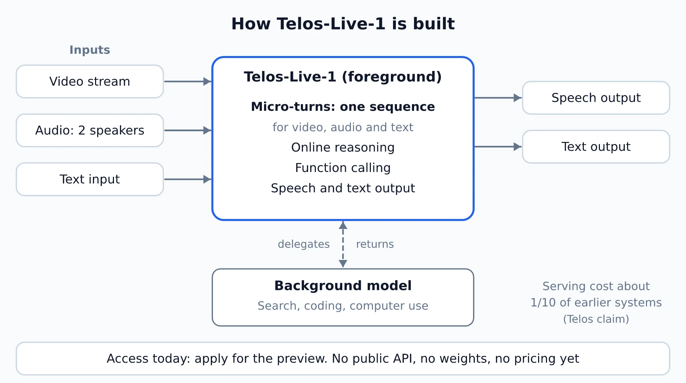
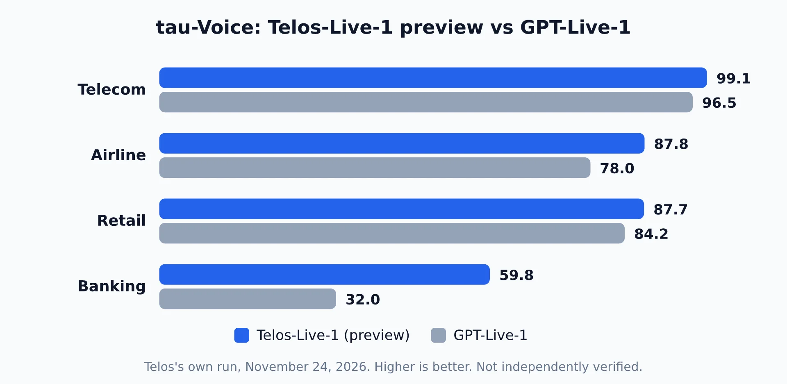
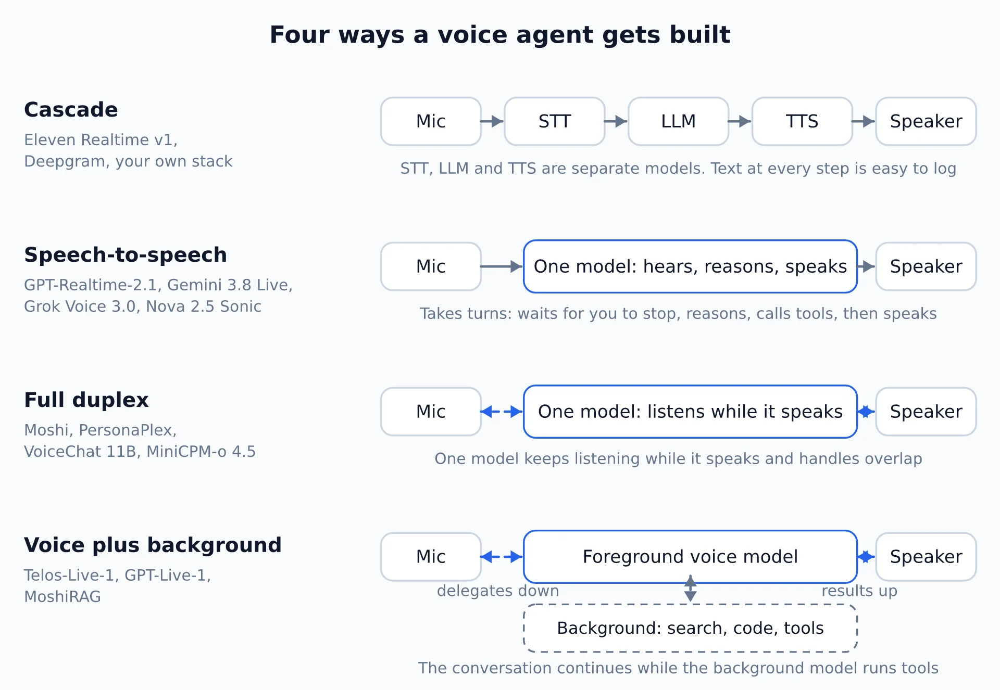
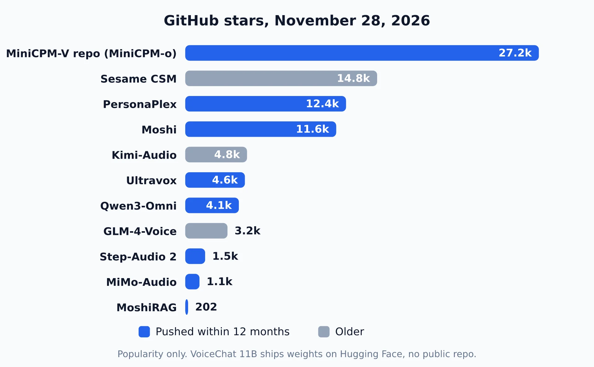
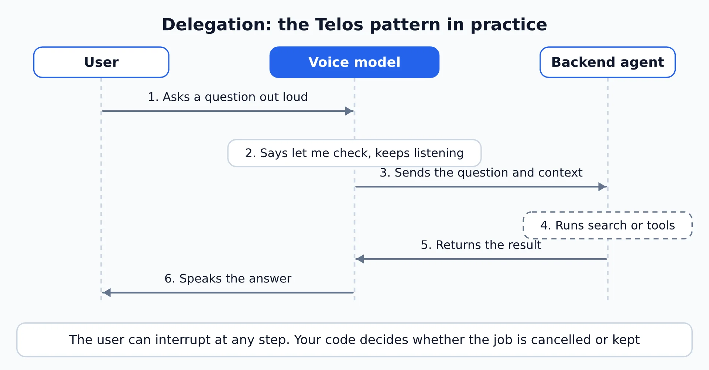
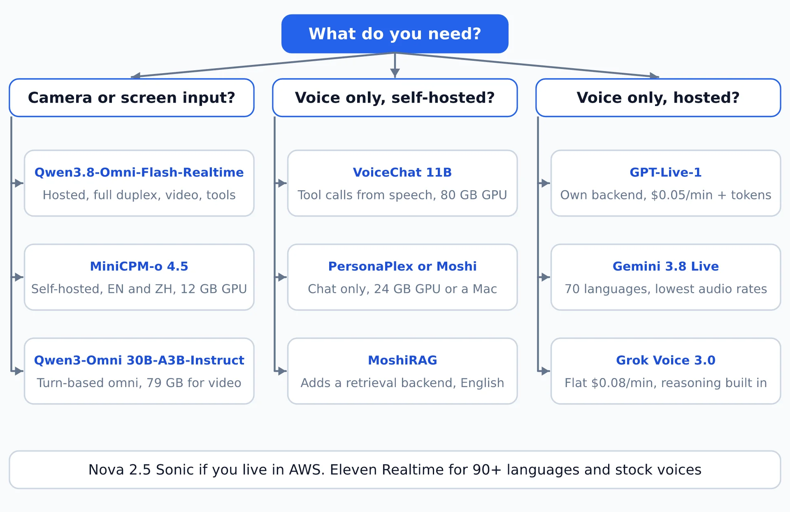

import ListCheck from "@components/widgets/ListCheck.astro";
import Notice from "@components/widgets/Notice.astro";
import Accordion from "@components/widgets/Accordion.astro";
import Tabs from "@components/widgets/Tabs.astro";
import Tab from "@components/widgets/Tab.astro";

**The best speech-to-speech models right now are [Qwen3.8-Omni-Flash-Realtime](https://www.alibabacloud.com/help/en/model-studio/realtime) for video with tools, OpenAI's GPT-Live-1 for voice with a backend you control, and Gemini 3.8 Live on a budget.** With downloadable weights, NVIDIA's VoiceChat 11B and OpenBMB's MiniCPM-o 4.5 each cover two of those three needs. The launch that prompted this list is Telos-Live-1, an omni-modal, full-duplex model announced on November 24, 2026. It watches a video stream, listens to several speakers and talks at the same time, while a second model runs search or code in the background. You cannot buy it yet. Telos takes applications for a preview, says a public API is coming, and publishes no weights or pricing.

This roundup covers fifteen speech-to-speech models, paid and open source, that you can run today. Some see video but take turns. Some are full duplex but never see a camera. The open ones add a third split, between English-only models and the few that speak more. I read the docs and model cards on November 28, 2026.

I did not run any of them for this article. This machine has no GPU and I hold accounts with only a few of these vendors. Every number below is the vendor's own, with the page it came from.

<Notice type="info" title="What this covers">
<ListCheck>
<ul>
<li>What Telos-Live-1 claims, and what is missing before you can use it</li>
<li>Seven paid speech-to-speech models: video input, duplex mode, tools, languages, price</li>
<li>Eight open-source models: license, size and the GPU each one needs</li>
<li>The list price of one minute on every pay-per-use API</li>
<li>Code for the voice-plus-background pattern, hosted and self-hosted</li>
</ul>
</ListCheck>
</Notice>

## What is Telos-Live-1, and why can't you run it yet?

Telos-Live-1 is an omni-modal, full-duplex model that watches video, listens to several speakers and talks at once, while a background model runs search or code. Telos announced it on November 24, 2026, and you cannot buy it: access is by application for a preview, with a public API promised and no weights or pricing published.
The second half is the part worth copying. A foreground model keeps the talk going while a background model handles slow jobs such as search, coding and computer use. A duplex protocol feeds the results back into the conversation. Telos says this cut the serving cost of a full-duplex session to about 1/10 of earlier systems. That figure is theirs, and the [announcement](https://teloslab.com/research/introducing-telos-live-1) gives no method behind it.
Telos-Live-1 treats a conversation as one running sequence. Its micro-turn design merges streaming video, multi-channel audio, text and the model's own outputs into a single stream, so the model can switch between listening and speaking inside one pass. Telos lists online reasoning and function calling on that same stream.

The second half is the part worth copying. A foreground model keeps the talk going while a background model handles slow jobs such as search, coding and computer use, and a duplex protocol feeds the results back into the conversation. Telos says this cut the serving cost of a full-duplex session to about 1/10 of earlier systems. That figure is theirs, and the [announcement](https://teloslab.com/research/introducing-telos-live-1) gives no method behind it.



*Telos-Live-1 as described in its announcement: one foreground model on every track, a background model for slow work, preview access by application only.*

The recorded demos show the target. A coach counts sit-ups from a camera. A meeting leader handles several speakers, a tutor draws on a whiteboard, and an interviewer reads code off a shared screen. The post does not say which demo conditions were staged.

### The one benchmark Telos published

Telos compares its preview with OpenAI's GPT-Live-1 and with unnamed baselines of its own. On τ-Voice, Sierra's voice-agent benchmark for customer-service calls, it leads GPT-Live-1 in all four domains. The gap is narrow in telecom and retail, and wide in banking.



*τ-Voice task success, Telos's own run on November 24, 2026. Higher is better. Nobody outside Telos has published a reproduction.*

On Full-Duplex-Bench, which scores how a model handles pauses, noise and interruptions, the pattern repeats:

| Test | Telos-Live-1 preview | GPT-Live-1 | Better |
|---|---|---|---|
| False interruptions during pauses (FDB v1) | 4.5 | 8.5 | Lower |
| False responses to background audio (FDB v1.5) | 2.0 | 28.0 | Lower |
| Ignoring irrelevant interruptions (FDB v1.5) | 75.0 | 54.0 | Higher |
| Tool calling quality (FDB v3) | 73.0 | 66.0 | Higher |
| Response quality (FDB v3) | 91.0 | 89.0 | Higher |

Source: the Telos announcement, November 24, 2026.

Three caveats before you quote these numbers. Telos ran them on its own preview. The chart names GPT-Live-1 without the backend model, and that score depends on the backend. GPT-Live-1 is audio only, so it never saw a video track. The knowledge tests carry the larger claim. Telos reports 70.2 on MMSU with 1.32 seconds of latency. A same-size duplex model that thinks before it speaks needs 13.43 seconds for 71.4.

## Which speech-to-speech model wins the benchmarks and leaderboards?

Grok Voice 3.0 leads the two cross-vendor tables published so far, with 86.9 on Artificial Analysis's Speech-to-Speech Index and 97.0% on Full-Duplex Bench. Every row below comes from the vendor whose model it praises, so read the table as a map of claims rather than a ranking.

| Benchmark | What it measures | Published scores |
|---|---|---|
| τ-Voice (Sierra) | Task success on full-duplex customer-service calls in retail, airline, telecom and banking | Telos-Live-1 preview at 99.1 on telecom and 59.8 on banking; Grok Voice 3.0 at 71.6% overall |
| Full-Duplex-Bench v1 to v3 | Pauses, backchannels and interruptions, then tool calls over disfluent speech | Grok Voice 3.0 at 97.0%, GPT-Live-1 at 94.9%, Gemini 3.8 Live at 91.9%; Eleven Realtime Mini at 95.8% |
| Big Bench Audio | Reasoning answered by voice | Eleven Realtime Max at 98.8%, Grok Voice 3.0 at 98.5%, Gemini 3.8 Live at 97.7%, GPT-Live-1 at 90.1% |
| Artificial Analysis Speech-to-Speech Index | A blend of speech reasoning, τ-Voice and blind call comparisons | Grok Voice 3.0 at 86.9, GPT-Live-1 with Astra at 83.2, Gemini 3.8 Live with high thinking at 82.6 |

Sources: [Telos](https://teloslab.com/research/introducing-telos-live-1), [xAI](https://x.ai/news/grok-voice-3) and [ElevenLabs](https://elevenlabs.io/blog/realtime) published their own rows. The index figures come from xAI quoting Artificial Analysis on October 13, 2026.

The one independent run I found predates most of these models. The [Full-Duplex-Bench v3 paper](https://arxiv.org/abs/2604.04847), published April 6, 2026, tested six systems on tool calls made through hesitant, self-correcting speech. GPT-Realtime had the best Pass@1 at 0.600 and Gemini Live 3.1 answered fastest at 4.25 seconds. A plain Whisper, GPT-4o and TTS cascade was slowest at 10.12 seconds but took every turn it should. Sierra keeps a [public voice leaderboard](https://taubench.com/leaderboard/?benchmark=voice) for numbers submitted by teams other than the vendor.

## What is a speech-to-speech model? Four architectures

A speech-to-speech model takes audio in and sends audio out through one network, with no separate speech-to-text or text-to-speech stage. It comes in four designs, and the one you choose sets the latency, the turn-taking and whether a camera is possible.



*All fifteen models in this roundup fit one of these four rows. The last row is the Telos design.*

**Cascade.** Speech-to-text, an LLM, then TTS. Every stage is replaceable and writes text, so you can log it, redact it and swap parts. You pay in latency and turn-taking: each handoff adds a pause, and the LLM learns that you stopped talking only after a VAD says so. Eleven Realtime is this design, tuned by one vendor and sold under a single model ID. If you build it yourself, my [Whisper alternatives](/openai-whisper-alternatives/) and [open-source TTS](/best-open-source-tts/) roundups cover the two ends of the chain.

**Speech-to-speech.** One model, sometimes called voice-to-voice, takes audio in and sends audio out, with reasoning and tool calls inside the same network. It still takes turns. GPT-Realtime-2.1, Gemini 3.8 Live, Grok Voice 3.0 and Nova 2.5 Sonic sit here.

**Full duplex.** One model listens while it speaks. A pause or a backchannel does not trip it, and it can yield mid-sentence when you interrupt. Moshi, PersonaPlex, VoiceChat 11B and MiniCPM-o 4.5 sit here, and so does GPT-Live-1.

**Voice plus a background model.** A full-duplex voice model holds the conversation and hands slow work to a second model. That is Telos-Live-1, GPT-Live-1 and Kyutai's MoshiRAG.

The decision that shapes your project is whether the model can see. A camera or a shared screen rules out every audio-only model, full duplex or not.

## Best paid speech-to-speech models

Qwen3.8-Omni-Flash-Realtime is the best paid speech-to-speech model when you need video, GPT-Live-1 when you want to control the backend, and Gemini 3.8 Live when cost comes first. Each block below carries its own verdict, use case and price.

### 1. Qwen3.8-Omni-Flash-Realtime (best for video with tools)

**Verdict:** The only hosted model here that sees video, speaks full duplex and calls tools at once. [Alibaba Cloud Model Studio](https://www.alibabacloud.com/help/en/model-studio/realtime) updated its Qwen-Omni-Realtime docs on November 24, 2026 and tells you to use this model first.

**Best for:** Rooms with several speakers. WebSocket sessions accept 1, 2 or 4 audio channels, and its `semantic_vad` setting ignores backchannels and background noise.

**Strengths:** Text, image, streaming audio and video in; text and audio out. Tool calling covers custom functions, remote MCP tools and web search. Speech recognition covers 113 languages and dialects and speech generation covers 36. It runs over WebSocket, WebRTC or AOQ from Singapore or Beijing.

**Trade-offs:** Prices appear only inside the console, the console bills text output apart from audio output, and I found no independent benchmark that names this exact model. Budget an afternoon to price your own traffic.

**Pricing:** Per token for each modality. Output audio tokens equal seconds of audio times 12.5.

### 2. OpenAI GPT-Live-1 (best for a backend you choose)

**Verdict:** A full-duplex voice model that listens while it speaks and hands reasoning and tool use to a backend, the same split Telos uses. OpenAI brought it to the API on September 10, 2026. `gpt-live-1.1` followed with better transcription and a steadier accent across languages.

**Best for:** Phone and app agents that need to keep talking while a lookup runs. Speak, a language app, reported interruptions during thinking pauses down by almost 80% against its old turn-based stack.

**Strengths:** With Responses delegation, OpenAI runs a Responses model for you and the docs start you on `gpt-6-luna`, then `gpt-6-sol` for harder tasks. With client delegation, the backend can be any model, agent harness or service you run. You feed results back with `session.commentary.append` for things the model should say, or `session.thinking.append` for facts it should hold. OpenAI puts it 30 points ahead of GPT-Realtime-2.1 on Full Duplex Bench and first on Tau3 when paired with GPT-6 Astra at medium effort. WebRTC is the recommended transport, with WebSocket and SIP as alternatives, and LiveKit, Twilio, Telnyx, Bandwidth and Daily/Pipecat have integrations.

**Trade-offs:** Audio and text only; its [model page](https://developers.openai.com/api/docs/models/gpt-live-1) marks image and video input as not supported. The backend's latency becomes your latency, and the voice model's knowledge cutoff is July 31, 2025, so anything current has to come from the backend. LiteLLM proxies `gpt-live-1` on `/v1/live/sessions` from v1.107.0, with the `openai` and `azure` providers only. My [LiteLLM install guide](/litellm-docker-install/) pins v1.105.0, so a voice agent needs a newer tag.

**Pricing:** $0.05 per minute while active and $0.02 on standby, billed per second, plus the backend's tokens. OpenAI quotes 50 concurrent sessions on the Build tier and 500 on Grow, with no free tier.

### 3. OpenAI GPT-Realtime-2.1 (best for images and a single bill)

**Verdict:** The turn-based option from OpenAI: one model that takes text, audio and images, returns text and audio, and carries a 128K context with 32K output tokens. You can set reasoning effort, and it supports function calling.

**Best for:** Agents that need a photo or a screenshot in the conversation, or teams already on the Realtime API.

**Strengths:** GPT-Realtime-2, launched May 7, 2026, added preambles such as "let me check that", parallel tool calls, and the jump from 32K to 128K context. `gpt-realtime-2.1` then improved alphanumeric recognition, silence and noise handling, and interruption behavior.

**Trade-offs:** It takes turns, so it cannot listen and speak at once. Every turn re-bills the whole conversation, so long calls cost more per minute than short ones.

**Pricing:** $32 per million audio input tokens and $64 per million audio output tokens, with cached input at $0.40. `gpt-realtime-2.1-mini` runs at $10 and $20.

### 4. Google Gemini 3.8 Live (best for a low bill in 70 languages)

**Verdict:** Google's default audio-to-audio model, last updated in September 2026, and the cheapest hosted speech-to-speech model on this list. It takes text, images and audio, answers in audio with an optional transcript, and accepts video as frames at up to 1 fps.

**Best for:** Multilingual agents on a budget. The Live API lists 70 supported languages and has a free tier.

**Strengths:** Asynchronous function calling is on by default. The model keeps talking while your function runs, and you choose when the result lands: it interrupts the answer, waits for an idle moment, or stays silent until later. Google Search grounding is built in. The sibling `gemini-3.8-live-extended-thinking` adds background reasoning at low, medium or high effort and accepts only asynchronous tool calls.

**Trade-offs:** It takes turns, so barge-in is all you get. Audio arrives as raw 24 kHz PCM that you play yourself. On the Extended Thinking model `turnComplete` no longer means the model is idle, so check `interaction_status` before you close a session.

**Pricing:** $0.005 per minute of audio input and $0.018 per minute of audio output, or $3 and $12 per million tokens. Video frames cost $0.002 per minute. Search grounding includes 5,000 requests a month, then costs $14 per 1,000.

### 5. xAI Grok Voice 3.0 (best for a flat rate with reasoning inside)

**Verdict:** A speech-to-speech model with reasoning on by default at high effort, shipped October 14, 2026 as `grok-voice-3.0`. It takes text and audio.

**Best for:** Teams that want one predictable rate and built-in web search without wiring a backend.

**Strengths:** Its tools cover functions, MCP servers, file search, web search and X search. It speaks more than 20 languages and runs from us-east-1 or eu-west-1. The API looks like OpenAI's Realtime API: a WebSocket to `wss://api.x.ai/v1/realtime`, server VAD, and `input_audio_buffer.append` events. xAI claims latency under one second.

**Trade-offs:** Flat pricing is dearer than Gemini's meter at low usage, and there is no video. The benchmark table it quotes comes from a post that crowns its own model.

**Pricing:** $0.08 per minute, the same rate as Grok Voice 2.0, plus $0.004 for text input as the pricing page lists it.

### 6. Amazon Nova 2.5 Sonic (best for AWS shops)

**Verdict:** Amazon's speech-to-speech model on AWS since October 5, 2026, sold as `amazon.nova-2-5-sonic` through a bidirectional streaming API. It takes speech and text, returns speech and text, and has a 256K context.

**Best for:** Teams already on AWS, and EU deployments that need a region inside the EU. It runs from eu-north-1 (Stockholm), us-east-1, us-west-2 and ap-northeast-1.

**Strengths:** It supports function calling and asynchronous tool calling, so the conversation continues while a tool runs. Its voices cover seven languages and switch languages mid-call, and you can mix typed and spoken input in one session. Its model card promises support until at least October 5, 2027 with a legacy period of at least six months.

**Trade-offs:** The bidirectional stream API is its own protocol, the default quota is 20 concurrent sessions per account per region, and there is no image or video input.

**Pricing:** The same list price as Nova 2 Sonic, billed per token on Amazon's [Nova pricing page](https://aws.amazon.com/nova/pricing/).

### 7. ElevenLabs Eleven Realtime v1 (best for many languages and stock voices)

**Verdict:** A cascade of speech-to-text, an LLM and TTS that ElevenLabs tuned end to end and sells under one model ID, launched October 20, 2026. It speaks the OpenAI Realtime protocol, so you can point an existing client at it.

**Best for:** Products that want a stock voice in many languages. Both sizes support more than 90 languages and any of the 17,000+ voices in the ElevenLabs library.

**Strengths:** v1 Max is the one for tool work. ElevenLabs, citing Artificial Analysis, reports 98.8% on Big Bench Audio, a first-audio time of 0.57 seconds and 87.1% on tool-use tasks. v1 Mini answers 75.9% and starts in 0.62 seconds.

**Trade-offs:** It takes turns, and v1 Max needs a token limit of at least 1,024. v1 Mini is not available under Zero Retention Mode or HIPAA. If you already pay ElevenLabs for voices, read my [Fish Audio vs ElevenLabs](/fish-audio-vs-elevenlabs/) comparison before adding this bill.

**Pricing:** $0.08 per minute of connected audio plus LLM tokens: $0.20 and $6.00 per million for Mini, $1.80 and $9.00 for Max.

### Paid models side by side

| Model | Sees video | Duplex mode | Tool calls | Speech output | List price on November 28, 2026 |
|---|---|---|---|---|---|
| Qwen3.8-Omni-Flash-Realtime | Yes | Full | Functions, MCP, web search | 36 languages | Per token, prices in the console |
| GPT-Live-1 and 1.1 | No | Full | Through the backend agent | 1.1 is multilingual | $0.05/min plus backend |
| GPT-Realtime-2.1 | Images only | Turns | Functions | Not stated on the model page | $32 in, $64 out per 1M audio tokens |
| Gemini 3.8 Live | Frames at 1 fps | Turns | Functions, Search grounding | 70 languages | $0.005/min in, $0.018/min out |
| Grok Voice 3.0 | No | Turns | Functions, MCP, web and X search | More than 20 languages | $0.08/min |
| Nova 2.5 Sonic | No | Turns | Functions, async | 7 languages | Same as Nova 2 Sonic |
| Eleven Realtime v1 | No | Turns | Functions | More than 90 languages | $0.08/min plus tokens |

## Best open-source speech-to-speech models

VoiceChat 11B is the best open-source speech-to-speech model for tool calls, MiniCPM-o 4.5 for a camera, and Qwen3-Omni for more languages. No open model sees video, speaks full duplex and calls tools all at once; you pick two of the three.



*GitHub stars from the API on November 28, 2026. Blue means a push within the past 12 months. The MiniCPM-o repo now redirects to MiniCPM-V, which hosts MiniCPM-o 4.5. Stars measure attention, not quality.*

| Model | License | Mode | Tool calls | Speech languages | Hardware |
|---|---|---|---|---|---|
| VoiceChat 11B | OpenMDW 1.1 | Full duplex, audio only | Yes, native | English | 80 GB NVIDIA GPU |
| MiniCPM-o 4.5 (9B) | Apache 2.0 | Full duplex with video | Not documented | English, Chinese | 12 GB GPU, or an M4 Max with 24 GB |
| Qwen3-Omni-30B-A3B-Instruct (3B active) | Apache 2.0 | Turn-based with video | Audio function calling | 10 output, 19 input | 78.85 GB in BF16 |
| Moshi 7B | CC-BY 4.0 | Full duplex, audio only | No | English | 24 GB GPU or Apple Silicon |
| MoshiRAG (Moshi 7B) | CC-BY 4.0 | Full duplex, audio only | Retrieval backend | English | 24 GB GPU plus a second LLM |
| PersonaPlex 7B | NVIDIA Open Model | Full duplex, audio only | No | English | GPU, CPU offload optional |
| Step-Audio 2 mini | Apache 2.0 | Turn-based, audio only | Yes | Chinese, English, Japanese, more | GPU with vLLM |
| GLM-4-Voice 9B | Model license, code Apache 2.0 | Turn-based, audio only | Not documented | Chinese, English | GPU |

### 1. NVIDIA VoiceChat 11B (best for tool calls from speech)

**Verdict:** The only open full-duplex model with tool calling that I found. It listens and speaks at once, transcribes you as you talk, and emits tool calls on a separate output channel while it keeps talking. NVIDIA released it on August 3, 2026.

**Best for:** A self-hosted agent that has to look things up mid-conversation and runs on NVIDIA hardware.

**Strengths:** The [model card](https://huggingface.co/nvidia/NVIDIA-NemotronLabs-VoiceChat-11B) reports a turn-taking latency of about 450 ms and 4.33 out of 5 for responses after an interruption. On VoiceBench it ranks second among open full-duplex models.

**Trade-offs:** The realtime container needs an NVIDIA GPU with at least 80 GB of memory, which means an A100, an H100 or an RTX 6000 Pro, on x86_64. It speaks English only, and tool responses have to be plain ASCII. On Full-Duplex-Bench v3 it reaches 82.5% on tool selection, 42.2% on argument accuracy and 33% end-to-end Pass@1, so it picks the right tool more often than it fills it in.

**Pricing:** Free to download under the OpenMDW 1.1 license. The real cost is the GPU: 11B weights on a Nemotron Nano v2 9B backbone.

### 2. OpenBMB MiniCPM-o 4.5 (best for a camera on small hardware)

**Verdict:** A 9B end-to-end model built on SigLip2, Whisper-medium, CosyVoice2 and Qwen3-8B. It takes continuous video and audio and generates text and speech at the same time, which the team calls full-duplex live streaming. It is the only open model here that sees video.

**Best for:** A camera or screen-sharing assistant on a Mac or a single small GPU. It decides once a second whether to speak. Speech conversation works in English and Chinese, and a short reference clip clones a voice.

**Strengths:** Through llama.cpp-omni, full duplex needs an Apple M4 Max with 24 GB of RAM or an NVIDIA GPU with 12 GB. An AWQ build fits in 11 GB.

**Trade-offs:** I found no function calling in its docs, so it is a companion rather than an agent until you wrap it. The PyTorch path wants a 28 GB NVIDIA GPU.

**Pricing:** Apache 2.0, free to download.

### 3. Qwen3-Omni-30B-A3B-Instruct (best for multilingual omni input)

**Verdict:** It takes text, images, audio and video and answers in text and natural speech. It supports 119 text languages, 19 speech input languages and 10 speech output languages, which makes it the multilingual open option.

**Best for:** Teams that need more output languages than MiniCPM-o offers and can host a large model.

**Strengths:** A cookbook shows [function calling from audio input](https://github.com/QwenLM/Qwen3-Omni/blob/main/cookbooks/audio_function_call.ipynb).

**Trade-offs:** It takes turns rather than running full duplex, and it is heavy. The README lists a 78.85 GB minimum for the Instruct model in BF16 with 15 seconds of video, and the talker alone accounts for about 10 GB. `vllm serve` currently runs the thinker only, so you get text out and need the Transformers path for speech. The last push to the repo was April 23, 2026.

**Pricing:** Apache 2.0, free to download.

### 4. Kyutai Moshi and MoshiRAG (best for plain conversation and facts)

**Verdict:** Moshi has been the reference open full-duplex model since 2024. It models two audio streams at once, yours and its own, plus a text stream for its inner monologue. A 7B Temporal Transformer drives it with a theoretical latency of 160 ms, and 200 ms in practice on an L4 GPU.

**Best for:** A full-duplex voice layer you can read and modify. MoshiRAG, released in April 2026, adds the Telos split. Moshi predicts a trigger token when a question needs facts, a backend retrieves while the talk continues, and MoshiRAG feeds the result back into the conditioning.

**Strengths:** The Python code is MIT and the Rust server code is Apache. Apple Silicon users can run the MLX build in 4-bit, which Kyutai tested on a MacBook Pro M3. MoshiRAG's backend can be any LLM served over an OpenAI-compatible API, with a local vLLM copy of `gemma-3-27b-it` as the recommended default.

**Trade-offs:** English only, a 24 GB GPU for the PyTorch build, and no tools. Kyutai warns that MoshiRAG retrieval delays over 3 seconds hurt response quality, so the backend belongs on the same machine or a fast API. It is not the Moshi mobile SSH app from my [phone control guide](/control-ai-agents-from-phone-moshi-herdr/), which shares only the name.

**Pricing:** Weights are CC-BY 4.0 for both models, free to download with attribution.

### PersonaPlex, Step-Audio 2 mini, and the rest

**PersonaPlex 7B** is NVIDIA's rebuild of Moshi with persona control: a text role prompt plus a voice sample hold for a whole conversation. Weights carry the NVIDIA Open Model license and the code is MIT. Its memory is a sliding window of roughly the last 2.5 minutes, and there are no tools. It is the easiest way to get a full-duplex character running, with 12,370 GitHub stars and a push on November 6.

**Step-Audio 2 mini** comes from StepFun under Apache 2.0, built for speech conversation with tool calling and multimodal retrieval. It reads paralinguistic cues such as emotion, serves through vLLM with its own tool-call parser, and covers Chinese, Cantonese, Japanese, Arabic and English. It takes turns.

**GLM-4-Voice 9B** speaks Chinese and English end to end, but its last push was December 2024. **Kimi-Audio-7B-Instruct** (MIT) handles audio understanding, generation and conversation in turns. **Sesame CSM 1B** (Apache 2.0) generates speech with a Llama backbone and has no duplex mode or tools. **Ultravox 0.7** (MIT) takes audio in and emits text only, so you add your own TTS. **MiMo-Audio 7B** (Apache 2.0) is a general audio learner for few-shot tasks over speech and sound, not a dialogue model.

## How much does a speech-to-speech model cost per minute?

Gemini 3.8 Live lists at about $0.012 for a minute split evenly between caller and model, GPT-Live-1 at $0.05 plus the backend, and Grok Voice 3.0 at a flat $0.08. Open weights are free to download and cost GPU time instead.

List prices on November 28, 2026 for one minute of talk, half caller and half model, audio only, with no tools and no caching:

| Model | Billing unit | One minute | What the number hides |
|---|---|---|---|
| Gemini 3.8 Live | Audio time, each direction | $0.012 | Video frames and Search grounding cost extra |
| GPT-Realtime-2.1 mini | Audio tokens | $0.015 | Every turn re-bills the whole conversation |
| GPT-Realtime-2.1 | Audio tokens | $0.048 | Same, so long calls cost more per minute |
| GPT-Live-1 | Session time | $0.05 | Plus the backend model's tokens |
| Grok Voice 3.0 | Session time | $0.08 | Flat, reasoning included |
| Eleven Realtime v1 | Session time and tokens | $0.08 plus tokens | The LLM part scales with tool use |
| Nova 2.5 Sonic | Tokens | On the Nova pricing page | Same list price as Nova 2 Sonic |
| Qwen3.8-Omni-Flash-Realtime | Tokens per modality | In the console | Text output billed apart from audio output |

The Gemini figure is $0.005 for 30 seconds in plus $0.018 for 30 seconds out. The OpenAI ones come from the token rates above: 300 caller tokens at $32 per million and 600 model tokens at $64 per million. OpenAI's cost guide notes that each new turn sends the whole conversation again, so the per-token rows drift upward on long calls while cached input pulls them back.

At 10,000 minutes a month, Gemini lists at about $120 and Grok at $800, before either discount. Self-hosting flips the model: the GPU is the bill. Moshi wants a 24 GB card and VoiceChat 80 GB, and my [GPU guide](/best-gpu-for-local-llm/) ranks cards by dollars per GB of VRAM.

## How do you build a voice agent with a background model?

Pair a full-duplex voice model with a backend that runs tools. GPT-Live-1 calls it delegation, Gemini 3.8 Live calls it asynchronous function calling, and MoshiRAG does it with open weights. You do not need Telos to ship this shape.



*The pattern Telos productizes. The user can interrupt at any step; your code decides whether the background job is cancelled or kept.*

<Tabs>
<Tab name="Gemini 3.8 Live, async tool">

Assembled from Google's [Live API guides](https://aistudio.google.com/docs/live-api/get-started-sdk). The function declaration carries `behavior: "NON_BLOCKING"`, so the model keeps talking while it runs. I did not execute this script.

```python
import asyncio
import os
import wave

from google import genai
from google.genai import types

client = genai.Client(api_key=os.environ["GEMINI_API_KEY"], http_options={"api_version": "v1beta"})
model = "gemini-3.8-live"

# NON_BLOCKING keeps the session open while the function runs
lookup_order = {"name": "lookup_order", "behavior": "NON_BLOCKING"}
config = {"response_modalities": ["AUDIO"], "tools": [{"function_declarations": [lookup_order]}]}


async def main() -> None:
    async with client.aio.live.connect(model=model, config=config) as session:
        await session.send_client_content(turns={"parts": [{"text": "Where is order 742?"}]})
        with wave.open("reply.wav", "wb") as wf:
            wf.setnchannels(1)
            wf.setsampwidth(2)
            wf.setframerate(24000)  # model audio is 24 kHz
            async for response in session.receive():
                if response.data is not None:
                    wf.writeframes(response.data)
                elif response.tool_call:
                    replies = []
                    for fc in response.tool_call.function_calls:
                        result = await lookup_order(**fc.args)  # your own code
                        replies.append(
                            types.FunctionResponse(
                                id=fc.id,
                                name=fc.name,
                                # INTERRUPT speaks the result now, WHEN_IDLE waits, SILENT holds it
                                response={"result": result, "scheduling": "INTERRUPT"},
                            )
                        )
                    await session.send_tool_response(function_responses=replies)


asyncio.run(main())
```

</Tab>
<Tab name="GPT-Live-1 through LiteLLM">

From LiteLLM's [live sessions doc](https://docs.litellm.ai/docs/live_sessions). It needs LiteLLM v1.107.0 or later and the OpenAI SDK at 3.12.0 or later. It opens a session, waits for `session.started` and closes it, which is enough to prove the route works before you add a microphone.

```bash
pip install -U "openai[realtime]>=3.12.0"
```

```python
import asyncio
import os

from openai import AsyncOpenAI

client = AsyncOpenAI(base_url="http://localhost:4000/v1", api_key=os.environ["LITELLM_API_KEY"])


async def main() -> None:
    async with client.live.connect() as connection:
        await connection.send({"type": "session.start", "session": {"model": "gpt-live-1"}})
        async for event in connection:
            print(event.type)
            if event.type == "session.started":
                await connection.send({"type": "session.close"})
            if event.type in ("session.closed", "error"):
                break


asyncio.run(main())
```

Guardrails do not run on live sessions in LiteLLM, and only the `openai` and `azure` providers are accepted.

</Tab>
<Tab name="Self-hosted with Moshi">

Moshi's [README](https://github.com/kyutai-labs/moshi) ships a Compose file for CUDA hosts. It needs the NVIDIA Container Toolkit and builds the image from the `moshi` directory. The UI listens on port 8998 inside the Compose network, and a Cloudflare tunnel puts it behind HTTPS, since browsers only open a microphone on HTTPS or localhost.

```bash
git clone https://github.com/kyutai-labs/moshi.git
cd moshi
docker compose up
```

On a private network you can swap `expose` for `ports` and drop the tunnel. On a Mac, skip Docker and use the MLX build, which serves the same web UI over plain HTTP:

```bash
pip install -U moshi_mlx
python -m moshi_mlx.local_web
```

For the Telos shape, MoshiRAG adds three processes around the Moshi server. It calls a reference text encoder through `REFERENCE_ENCODER_URL`, a streaming speech-to-text endpoint through `STT_URL`, and a retrieval LLM through `LLM_BASE_URL`.

</Tab>
</Tabs>

**Verify it.** Ask something the model cannot know, such as the status of a fake order, then keep talking while the tool runs. A correct build answers the side question and picks up the result when it lands. A broken one goes silent until the tool returns, or interrupts itself to read the result mid-sentence. In the Gemini script, switch `scheduling` between `INTERRUPT`, `WHEN_IDLE` and `SILENT` and listen to the difference. That one word is most of what Telos means by a duplex protocol.

**Where it breaks.** A slow backend ruins the effect: MoshiRAG degrades past 3 seconds of retrieval delay, and GPT-Live-1's latency is the sum of both models. Tool output written for screens reads badly aloud, so cut results to one sentence before you hand them back; VoiceChat 11B requires ASCII for the same reason. Silence costs money on per-minute models: GPT-Live-1 bills per second while active and drops to the standby rate only on WebRTC with inference paused.

## Which speech-to-speech model should you pick?

Pick Qwen3.8-Omni-Flash-Realtime if you need video, GPT-Live-1 if you want to own the backend, and Gemini 3.8 Live if the bill comes first. With open weights, pick VoiceChat 11B for tool calls, MiniCPM-o 4.5 for a camera, or Moshi for plain conversation.



*Pick by the constraint that bites first: camera input, then self-hosting, then the bill.*

<ListCheck>
<ul>
<li>**Camera or screen plus tools, hosted:** Qwen3.8-Omni-Flash-Realtime, after you price it in the console</li>
<li>**Camera or screen, self-hosted:** MiniCPM-o 4.5 for English or Chinese, Qwen3-Omni 30B-A3B for nine more output languages</li>
<li>**Voice plus a backend you control:** GPT-Live-1 with client delegation</li>
<li>**Lowest bill and 70 languages:** Gemini 3.8 Live, with its Extended Thinking sibling for hard tasks</li>
<li>**Flat rate with reasoning inside:** Grok Voice 3.0</li>
<li>**Open weights with tool calls:** VoiceChat 11B, if you have an 80 GB GPU</li>
<li>**Open weights for chat only:** PersonaPlex or Moshi, plus MoshiRAG when facts matter</li>
</ul>
</ListCheck>

Start with the cheapest test that answers your real question: one minute of your own audio against Gemini 3.8 Live on the free tier, with one tool wired in. If it fumbles your turns, you have spent nothing and learned that you need full duplex, and GPT-Live-1 is the next call.

## FAQ

<Accordion label="What is a full-duplex voice model?" group="faq">

A voice model that keeps listening while it is speaking, so a pause, a backchannel or an interruption does not break the turn. GPT-Live-1, Moshi, PersonaPlex, VoiceChat 11B and MiniCPM-o 4.5 are full duplex, and so is Telos-Live-1. Turn-based models wait for silence before they answer.

</Accordion>

<Accordion label="Which speech-to-speech models support video input?" group="faq">

Hosted: Qwen3.8-Omni-Flash-Realtime with full-duplex video, Gemini 3.8 Live with frames at 1 fps, and GPT-Realtime-2.1 with images. Open weights: MiniCPM-o 4.5 with full-duplex video and audio, and Qwen3-Omni-30B-A3B-Instruct, which takes turns. GPT-Live-1, Grok Voice 3.0 and Nova 2.5 Sonic are audio only.

</Accordion>

<Accordion label="What is the best open-source speech-to-speech model?" group="faq">

For tool calls, NVIDIA VoiceChat 11B: 82.5% tool selection on Full-Duplex-Bench v3 and about 450 ms turn-taking, but its realtime container needs an 80 GB NVIDIA GPU. For a camera, MiniCPM-o 4.5 runs full duplex on a 12 GB GPU. For plain conversation, PersonaPlex or Moshi run on a 24 GB GPU or a Mac.

</Accordion>

<Accordion label="Can I run a speech-to-speech model locally?" group="faq">

Yes, with open weights. Moshi and PersonaPlex need a 24 GB NVIDIA GPU, or an Apple Silicon Mac through Moshi's MLX build, which Kyutai tested on a MacBook Pro M3. MiniCPM-o 4.5 needs 12 GB of GPU memory for full duplex, and VoiceChat 11B needs 80 GB.

</Accordion>

<Accordion label="Is full duplex better than turn-based speech-to-speech?" group="faq">

For interruptions and pauses, yes. OpenAI reports GPT-Live-1 30 points ahead of the turn-based GPT-Realtime-2.1 on Full Duplex Bench. For task accuracy it is closer. In the Full-Duplex-Bench v3 paper, GPT-Realtime had the best Pass@1 at 0.600, and a cascaded Whisper, GPT-4o and TTS baseline had the worst latency at 10.12 seconds. Pick duplex for companions and coaching, and turns for forms and scripted flows.

</Accordion>

<Accordion label="GPT-Live-1 or GPT-Realtime-2.1, and is GPT-Live-1 free?" group="faq">

Pick GPT-Live-1 when the caller should be able to talk over the agent while a backend looks things up, and GPT-Realtime-2.1 when you need image input or a single bill. OpenAI puts GPT-Live-1 30 points ahead on Full Duplex Bench. Neither is free: GPT-Live-1 costs $0.05 per minute plus the backend, and GPT-Realtime-2.1 bills $32 and $64 per million audio tokens.

</Accordion>

<Accordion label="Which model should back GPT-Live-1?" group="faq">

Any Responses model through Responses delegation, or any model or agent through client delegation. OpenAI's docs start with `gpt-6-luna` and move to `gpt-6-sol` for harder tasks, and its benchmarks used GPT-6 Astra at medium effort. For high-volume lookups, the [cheap models roundup](/best-cheap-models-hermes-agent/) lists text models under $1 per million input tokens.

</Accordion>
