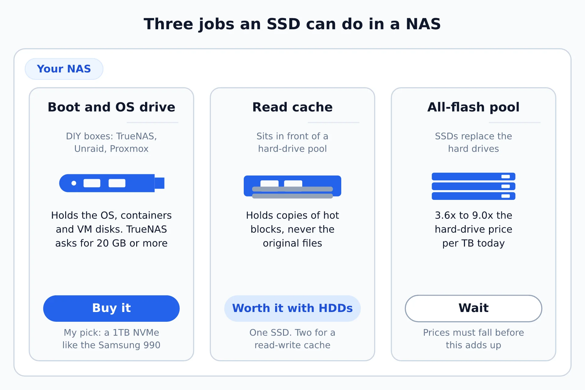
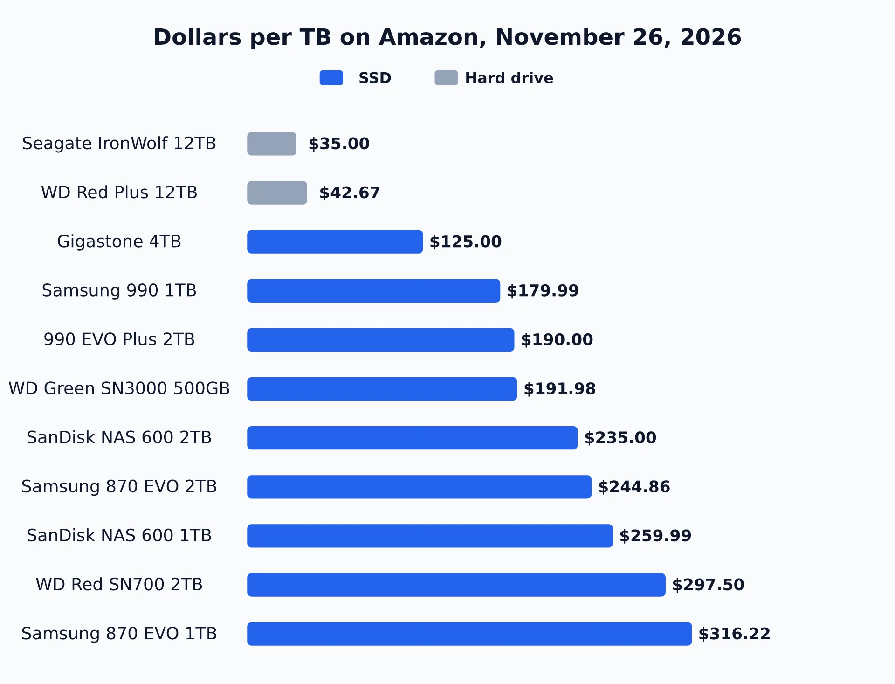
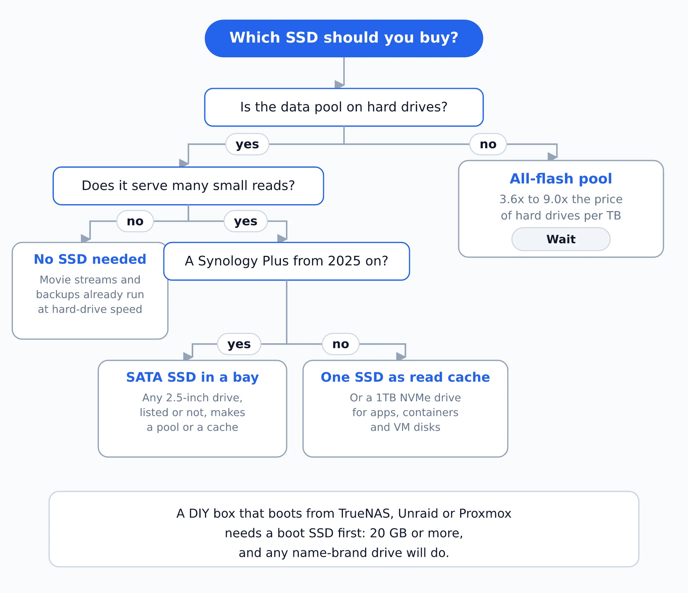

import Notice from "@components/widgets/Notice.astro";
import Accordion from "@components/widgets/Accordion.astro";
import AmazonProduct from "@components/widgets/AmazonProduct.astro";

On November 26, 2026, the best SSD for a NAS was one small drive for the OS, apps and metadata, with hard drives in the bays. My pick is the **[Samsung 990 1TB](#1-samsung-990-1tb-the-boot-and-app-drive)**, an NVMe drive at $179.99. A read cache pays off only beside a hard-drive pool, and an all-flash pool costs 3.6 to 9.0 times more per TB.

<Notice type="warning" title="Affiliate disclosure">
Some links below are Amazon affiliate links, including `/go/` redirects that land on Amazon. Buying through them pays me a small commission at no extra cost to you. Prices were checked on November 26, 2026 and move constantly, so always confirm on the product page.
</Notice>

## Quick picks

| SSD | Price (Nov 26, 2026) | Per TB | Buy it if |
| --- | --- | --- | --- |
| [Samsung 990 1TB](/go/samsung-990-1tb-nvme/) | $179.99 | $179.99 | The NAS has a free M.2 slot for a boot and app drive. |
| [Samsung 870 EVO 2TB](/go/samsung-870-evo-2tb/) | $489.71 | $244.86 | There are drive bays and no free M.2 slot. |
| [WD Red SN700 2TB](/go/wd-red-sn700-2tb/) | $594.99 | $297.50 | The SSD will hold originals on a non-Synology NAS. |
| [SanDisk NAS 600 1TB](/go/sandisk-nas-600-1tb/) | $259.99 | $259.99 | You want a NAS-rated SATA drive and accept a one-review listing. |
| [Gigastone High Endurance 4TB](/go/gigastone-high-endurance-ssd-4tb/) | $499.99 | $125.00 | You want the lowest price per TB here for a read-only cache. |

## What can an SSD do inside a NAS?

An SSD in a NAS has three jobs: boot drive and app volume, read cache in front of a hard-drive pool, or all-flash pool. At today's prices the first is worth buying, the second pays off only next to hard drives, and the third does not add up.

*Buy the boot and app drive, add a read cache only beside hard drives, and wait on an all-flash pool.*

### Job one: the boot and app drive

Buy this one. A box you built and loaded with TrueNAS, Unraid or Proxmox needs a boot device, and [TrueNAS asks for a 20 GB SSD](https://www.truenas.com/docs/scale/gettingstarted/tnhardwareguide/) at minimum. On a [forum thread about the boot drive](https://forums.truenas.com/t/recommended-ssd-for-my-nas-os/50615), the accepted answer was "pick an SSD, any SSD", provided you keep a config backup. Capacity barely matters. The space earns its keep by holding what you want off the hard drives: container volumes, VM disks and the SQLite databases behind Plex and Jellyfin. The [NAS for Plex guide](/best-nas-for-plex/) sets out the same split for a media server.

An appliance NAS starts from a different place. [UGREEN's spec sheet](https://ai.ugreen.com/products/ugreen-nasync-dxp4800-plus-nas-storage) lists a 128GB system disk inside the DXP4800 Plus, so both M.2 slots are free. [Synology states](https://kb.synology.com/en-sg/DSM/tutorial/Which_models_support_M_2_SSD_storage_pool) that DSM cannot be installed on M.2 SSDs and needs at least one drive in a bay. On those boxes the job is an app and metadata volume, and the pick stays the same. The same split applies to a mini PC and a [DAS enclosure](/best-das-enclosure-homelab/).

### Job two: the read cache

Buy this one only if the pool is on hard drives. A read cache keeps copies of often-read blocks on the SSD while the originals stay on the pool. It helps when the same small files come back again and again. [UGREEN's guidance](https://ai.ugreen.com/blogs/how-to/mix-ssds-hdds-nas-setup) says to add M.2 cache when the hard-drive volume "repeatedly serves the same small files". Large transfers are poor cache candidates, it says: an SSD cache "should not be installed solely to make those transfers faster". The [OpenZFS documentation](https://openzfs.github.io/openzfs-docs/Basic%20Concepts/Pool%20Structure/Caching.html) draws the same line: a cache device helps when the working set is much larger than RAM, does nothing for writes, and costs RAM to run.

Because the cache holds copies, losing it loses nothing. OpenZFS calls a failed cache device harmless because the read is reissued against the pool. That makes this the one job where the cheapest drive is good enough. The [Gigastone High Endurance 4TB](/go/gigastone-high-endurance-ssd-4tb/) at $499.99 on November 26, 2026 publishes no TBW rating, and Amazon's review summary cites heat-related failures, so keep it read-only. UGREEN needs one SSD for a read-only cache and two in RAID 1 for a read-write cache. I would stay read-only.

### Job three: the all-flash pool

Wait on this one. Here the SSDs hold the originals and replace every hard drive, and the next section puts the bill at 3.6 to 9.0 times the hard-drive cost per TB. The top reply in an [r/homelab thread about an all-SSD NAS](https://www.reddit.com/r/homelab/comments/1f0xejo/all_ssd_nas_which_sdd_should_i_buy/) says to "go with used enterprise ssds", which is the one cheap route in. I would still wait.

## What does an SSD cost per TB right now?

The cheapest SSD I would put in a NAS costs $125 per TB and the name-brand ones run $180 to $316. A 12TB NAS hard drive costs $35 to $43, so an all-flash pool runs 3.6 to 9.0 times the price per TB.

*Dollars per TB from Amazon listings on November 26, 2026. Grey bars are hard drives.*

| Drive | Capacity | Price (Nov 26, 2026) | Per TB | Endurance rating |
| --- | --- | --- | --- | --- |
| [Seagate IronWolf 12TB](/go/seagate-ironwolf-12tb/) | 12TB HDD | $419.99 | $35.00 | n/a |
| [WD Red Plus 12TB](/go/wd-red-plus-12tb/) | 12TB HDD | $511.99 | $42.67 | n/a |
| [Gigastone High Endurance 4TB](/go/gigastone-high-endurance-ssd-4tb/) | 4TB SATA SSD | $499.99 | $125.00 | not published |
| [Samsung 990 1TB](/go/samsung-990-1tb-nvme/) | 1TB NVMe | $179.99 | $179.99 | 400 TBW |
| [Samsung 870 EVO 2TB](/go/samsung-870-evo-2tb/) | 2TB SATA SSD | $489.71 | $244.86 | 1,200 TBW |
| [SanDisk NAS 600 1TB](/go/sandisk-nas-600-1tb/) | 1TB SATA SSD | $259.99 | $259.99 | 600 TBW |
| [WD Red SN700 2TB](/go/wd-red-sn700-2tb/) | 2TB NVMe | $594.99 | $297.50 | 2,500 TBW |

Two things stand out. NVMe is cheaper per TB than 2.5-inch SATA right now: the Samsung 990 1TB costs $136 less than the Samsung 870 EVO 1TB at $316.22. And the NAS label carries a premium. The WD Red SN700 2TB costs $215 more than the Samsung 990 EVO Plus 2TB, money that buys endurance you need only when the SSD holds originals.

<Notice type="info" title="Recheck this table every month">
Prices moved all year: NAS hard drives went from about $21 per TB in mid-2024, per the hard drive guide, to $35 to $43 on November 26, 2026 in the table above. Divide the day's price by the capacity before you order, because the ranking here moves with every price change.
</Notice>

## Which SSD should you buy for your NAS?

Buy the Samsung 990 1TB if the NAS has a free M.2 slot, and the Samsung 870 EVO 2TB if it only has drive bays. Buy nothing if you hoped to replace the hard drives this year.

*Follow the arrows from the pool you already have. Only the all-flash branch ends without a drive to buy.*

## 1. Samsung 990 1TB: the boot and app drive

The Samsung 990 is the cheapest 1TB NVMe in Samsung's line, it carries a published endurance rating, and that is all a boot and app drive has to be.

**Best for:** a spare M.2 slot on a UGREEN, TerraMaster or DIY box, to hold the OS, containers and VM disks.

**Strengths:** at $179.99 on November 26, 2026 it costs less per TB than every 2.5-inch SATA drive here. [Samsung lists](https://www.samsung.com/us/memory-storage/nvme-ssd/990-nvme-ssd-sku-mz-v9v1t0b-am/) 7,250/6,450 MB/s over PCIe 4.0 x4, and [B&H's spec sheet](https://www.bhphotovideo.com/c/product/1973191-REG/samsung_mz_v9v1t0b_am_1tb_990_nvme_pcie.html) lists a 400 TBW rating and a three-year warranty. At 20 GB of writes a day, 400 TBW is about 55 years. Amazon showed 6K+ bought in the past month on November 26, 2026.

**Trade-offs:** the warranty is three years, where Samsung gives the 990 EVO five. The 400 TBW rating is fine for apps and thin for a busy pool.

<AmazonProduct
  productName="Samsung 990 1TB NVMe M.2 SSD (MZ-V9V1T0B/AM)"
  productDescription="1TB PCIe 4.0 NVMe drive for a NAS boot pool, containers and VM disks, and the cheapest name-brand NVMe per TB here."
  productFeatures={["1TB M.2 2280 NVMe, PCIe 4.0 x4", "Up to 7,250 MB/s read, 6,450 MB/s write", "400 TBW endurance rating", "3-year limited warranty"]}
  productLink="/go/samsung-990-1tb-nvme/"
  productImage="https://m.media-amazon.com/images/I/71TbbDStZKL._AC_SL1500_.jpg"
  productRating={4.8}
  recommendedBadge="Best Overall"
  importantConsiderations={["Three-year warranty, where the 990 EVO gets five", "Not on the DS925+ compatibility list"]}
  pros={["Lowest price per TB of the name-brand NVMe drives here", "1TB covers boot, containers and a few VMs"]}
  cons={["400 TBW is too thin for a busy pool", "Speed is wasted in a PCIe 3.0 x1 slot"]}
/>

For boot only, the [WD Green SN3000 500GB](/go/wd-green-sn3000-500gb/) at $95.99 on November 26, 2026 does the job for $84 less, with a 100 TBW rating. If the M.2 SSD will hold originals or absorb every write, step up to the [WD Red SN700 2TB](/go/wd-red-sn700-2tb/) at $594.99 on November 26, 2026. [WD's product brief](https://documents.sandisk.com/content/dam/asset-library/en_us/assets/public/western-digital/product/internal-drives/wd-red-ssd/product-brief-western-digital-wd-red-sn700-nvme-ssd.pdf) lists 2,500 TBW with a five-year warranty, about 0.69 drive writes per day and roughly double the consumer drives here. It is a PCIe Gen3 x4 drive that steps down to Gen3 x1, so nothing is lost in the TerraMaster's slots. Synology does not list it, so it is not the answer for a DS925+.

## 2. Samsung 870 EVO 2TB: the 2.5-inch SATA pick

When the only slot is a drive bay, the Samsung 870 EVO 2TB is the safest SATA SSD to buy. The 2TB size also costs less per TB than the 1TB and 500GB models.

**Best for:** a Synology Plus from 2025 on with a bay to spare, UGREEN boxes without M.2 slots, and DIY builds with 2.5-inch mounts.

**Strengths:** [Samsung's spec page](https://samsung.com/uk/memory-storage/sata-ssd/870-evo-2tb-sata-3-2-5-ssd-mz-77e2t0b-eu) lists 1,200 TBW, a five-year warranty and 2 GB of low-power DDR4 on the 2TB model. Its 560 MB/s is more than twice a single hard drive's 240 to 260 MB/s.

**Trade-offs:** at $489.71 on November 26, 2026, or $244.86 per TB, it costs $65 more per TB than the Samsung 990. A 2.5-inch drive fits a 3.5-inch bay only where the vendor supports it. The 500GB model at $228.95 on November 26, 2026 is enough for a boot-only mirror.

<AmazonProduct
  productName="Samsung 870 EVO 2TB SATA SSD (MZ-77E2T0B/AM)"
  productDescription="2TB 2.5-inch SATA SSD with its own DRAM cache and a 1,200 TBW rating. The safe pick for a NAS with drive bays and no free M.2 slot."
  productFeatures={["2TB 2.5-inch SATA SSD", "Up to 560 MB/s read, 530 MB/s write", "1,200 TBW endurance rating", "5-year limited warranty"]}
  productLink="/go/samsung-870-evo-2tb/"
  productImage="https://m.media-amazon.com/images/I/81lTp8HlFmL._AC_SL1500_.jpg"
  productRating={4.8}
  recommendedBadge="Best for SATA Bays"
  importantConsiderations={["Costs more per TB than the NVMe picks", "Confirm your bays accept 2.5-inch drives"]}
  pros={["Published endurance and a five-year warranty", "DRAM on board"]}
  cons={["SATA speed only", "2.5 W average, double a DRAM-less NAS SATA drive"]}
/>

## 3. SanDisk NAS 600 1TB: the purpose-built NAS SATA drive

The SanDisk NAS 600 is a SATA SSD built for 24/7 NAS duty, and the 1TB model at $259.99 on November 26, 2026 undercuts the Samsung 870 EVO 1TB by $56.

**Best for:** a SATA bay that will hold a cache or a small pool, where you want a five-year warranty for less than the 870 EVO.

**Strengths:** [the datasheet](https://documents.sandisk.com/content/dam/asset-library/en_us/assets/public/sandisk/product/internal-drives/nas-600-sata-ssd/data-sheet-nas-600-sata-ssd.pdf) lists 600 TBW for the 1TB model and 1,300 TBW for the 2TB, a five-year warranty and a 2.25 million-hour MTTF. Average active power is 1.1 W, the lowest of any drive here.

**Trade-offs:** the Amazon listing showed one review on November 26, 2026, and the drive only [went on sale in September](https://sandisk.com/company/newsroom/press-releases/2026/2026-08-20-sandisk-introduces-nas-ssds-to-power-fast-high-endurance-storage-for-prosumers-and-small-businesses), so there is no field history to read. The datasheet lists "DRAM: No".

<AmazonProduct
  productName="SanDisk NAS 600 1TB NAS SATA SSD (SDSNS2100TAB)"
  productDescription="1TB 2.5-inch SATA SSD engineered for 24/7 NAS use, with a published endurance rating and the lowest active power here."
  productFeatures={["1TB 2.5-inch/7mm SATA SSD", "Up to 560 MB/s read, 515 MB/s write", "600 TBW endurance rating", "5-year limited warranty"]}
  productLink="/go/sandisk-nas-600-1tb/"
  productImage="https://m.media-amazon.com/images/I/71SjhjvzLXL._AC_SL1500_.jpg"
  productRating={5.0}
  recommendedBadge="Best NAS-Rated SATA"
  importantConsiderations={["Listing shows one review as of November 26, 2026", "On sale only since September 2026, so no field history"]}
  pros={["Undercuts the Samsung 870 EVO 1TB by $56", "1.1 W average active power, the lowest here"]}
  cons={["DRAM-less design", "SATA speed only"]}
/>

## How long will an SSD last in a NAS?

Longer than its warranty in most home use. A 1TB drive rated for 600 TBW, such as the SanDisk NAS 600, can take 329 GB of writes a day for five years before it reaches the limit. Reads do not wear the flash.

Two numbers describe endurance. TBW, terabytes written, is the total a warranty covers. DWPD, drive writes per day, spreads that total over the warranty: TBW divided by capacity, then by 365 and by the warranty years.

| Drive | Capacity | TBW | Warranty | GB of writes a day over the warranty | DWPD |
| --- | --- | --- | --- | --- | --- |
| WD Green SN3000 | 500GB | 100 | 3 years | 91 | 0.18 |
| Samsung 990 | 1TB | 400 | 3 years | 365 | 0.37 |
| Samsung 870 EVO | 2TB | 1,200 | 5 years | 658 | 0.33 |
| WD Red SN700 | 2TB | 2,500 | 5 years | 1,370 | 0.69 |
| SanDisk NAS 800 NVMe | 960GB | 1,750 | 5 years | 959 | 1.00 |

The last row is [SanDisk's NAS 800 NVMe](https://sandisk.com/products/ssd/internal-ssd/sandisk-nas-800-nvme-ssd), $289.99 direct for 960GB.

One [r/synology thread](https://www.reddit.com/r/synology/comments/17ntlqg/ssd_nas/) is the counterweight. A user running eight 2TB Samsung 860 and 870 EVO drives in RAID 10 reported replacing four or five at 25 to 30 percent of their rated TBW. One report proves little, but the thread's top reply agrees that consumer QLC drives are the wrong tool for a pool. Skip the Samsung 870 QVO for that reason. Its 1TB model also cost more than the 870 EVO 1TB on November 26, 2026, at $317.99.

## Do DRAM-less SSDs matter in a NAS?

For a boot drive or a read cache, no. For a pool under heavy random writes, DRAM helps, and the purpose-built SanDisk NAS 600 ships without it.

An SSD keeps a map of where every block lives. Drives with DRAM hold that map in their own memory. A DRAM-less NVMe drive borrows space in system RAM instead, through Host Memory Buffer, a feature [added in the NVMe 1.2 specification](https://pmc.ncbi.nlm.nih.gov/articles/PMC7051071/). HMB belongs to NVMe, so a DRAM-less SATA drive works without borrowed memory. The NAS 600 datasheet says "DRAM: No". The Samsung 870 EVO carries 2 GB of its own low-power DDR4.

What DRAM buys is speed under sustained random writes at high queue depth, a state that streaming a movie over 2.5GbE never reaches. Pay for DRAM on the one drive that holds a busy pool, if you have one.

## Do you need power-loss protection in a NAS SSD?

Only if the SSD will take ZFS sync writes, which on a home NAS almost never happens. Consumer SSDs leave the feature out, and the [OpenZFS documentation](https://openzfs.github.io/openzfs-docs/Basic%20Concepts/Pool%20Structure/Caching.html) warns that such drives "will happily report data as stable that a power cut then loses".

Power-loss protection is a set of capacitors that gives a drive time to flush its volatile write cache to flash when power dies. [Klara Systems](https://klarasystems.com/articles/good-time-to-use-openzfs-slog-and-when-to-avoid-it), which supports OpenZFS for a living, tells SLOG buyers to verify "some type of super capacitor or battery". [Samsung describes it](https://www.samsung.com/au/memory-storage/sata-ssd/883-dct-sata-3-2-5-inch-ssd-mz-7lh1t9ne/) on the 883 DCT, a data center drive, as preventing corruption "in case of power failure". The datasheets for the 870 EVO, the SN700 and the NAS 600 never mention it, and the Gigastone listing claims it without one.

ZFS turns that gap into a rule. Synchronous writes from databases, VM disks and NFS must reach stable storage before the call returns, and ZFS logs them in the ZIL. By default the ZIL lives inside the pool on the hard drives, which honor flush commands, so the write is slow but safe. Move the log to a separate device, a SLOG, and that device needs power-loss protection.

For most homes the answer is a UPS, because SMB copies, backups and media streams never touch the ZIL. If you run a database or VM host over NFS or iSCSI on TrueNAS, [TrueNAS recommends](https://www.truenas.com/docs/references/slog/) a 16 GB SLOG with power-loss protection, over-provisioned from a larger drive.

## Which SSDs are on the Synology and UGREEN compatibility lists?

Synology's DS925+ list for its M.2 slots holds only Synology drives, while any 2.5-inch SATA SSD can go in its bays. UGREEN publishes a list but blocks nothing: an unlisted SSD works, unverified.

[Synology's compatibility page](https://www.synology.com/en-us/compatibility?search_by=drives&model=DS925%2B&category=m2_ssd_internal&filter_type=M.2%20NVMe%20SSD) for the DS925+ returned ten rows for the M.2 slots on November 26, 2026, every one a Synology SNV3400, SNV3410 or SNV5420. Its [policy FAQ](https://kb.synology.com/en-us/DSM/tutorial/Drive_compatibility_policies) for models from 2025 on says unlisted 2.5-inch SATA SSDs are supported for new storage pools and caches. For M.2 NVMe it gives the reason: only drives meeting its "performance, endurance, and thermal management requirements" qualify. A second [Synology page](https://kb.synology.com/en-sg/DSM/tutorial/Which_models_support_M_2_SSD_storage_pool) says to use only Synology M.2 NVMe SSDs for storage pools. Synology's own drives are expensive: its SNV5420 400GB showed at $484.99 on Amazon on November 26, 2026, about $1,212 per TB. For a DS925+ owner the practical route is a 2.5-inch SSD in a bay, and the [UGREEN vs Synology comparison](/ugreen-vs-synology/) covers the rest of that trade.

[UGREEN's compatibility list](https://comp-list.ugnas.com/pages/compatibility) is a reference, and UGREEN blocks nothing. "An unlisted component is not automatically incompatible", it says, but UGREEN "has not verified basic interoperability" for it. The DXP4800 Plus page goes further and says there is "no vendor lock-in of any kind". Check the list for your exact model number, and treat an absent drive as working but unproven.

## SATA or M.2: which slots does your NAS have?

All three four-bay boxes below carry two M.2 NVMe slots next to four SATA bays, so the slot type rarely limits you. The catch is lane speed: TerraMaster wires each slot at PCIe 3.0 x1, which turns a Gen4 drive into a much slower one.

| NAS | Drive bays | M.2 slots | What the SSD can do | Watch out for |
| --- | --- | --- | --- | --- |
| [UGREEN DXP4800 Plus](https://ai.ugreen.com/products/ugreen-nasync-dxp4800-plus-nas-storage) | 4 SATA, 3.5-inch or 2.5-inch | 2 M.2 NVMe | Cache, or a separate SSD pool | UGOS runs from a built-in 128GB system disk |
| [Synology DS925+](https://www.synology.com/en-global/products/DS925+) | 4 bays for 3.5-inch HDD or 2.5-inch SSD | 2 M.2 2280 NVMe | Cache or storage pool | DSM cannot boot from M.2, and the list holds only Synology NVMe |
| [TerraMaster F4-424 Pro](https://terra-master.com/products/f4-424-pro) | 4 SATA, HDD or SSD | 2 M.2 2280 NVMe at PCIe 3.0 x1 | SSD caching under TOS | A Gen4 SSD runs at the speed of one Gen3 lane |

A PCIe 3.0 x1 slot moves just under 1 GB/s, so the Samsung 990's 7,250 MB/s is wasted in the TerraMaster. Buy on endurance and price there. If you build instead of buy, the [$500 NAS build](/nas-build-under-500/) budgets a 256GB NVMe boot and app drive. The [NAS for Docker and Proxmox](/best-nas-homelab-docker-proxmox/) picks all carry two M.2 slots too.

## How much noise and power does an SSD save?

An all-flash four-bay NAS drops about 15 W and all seek noise, which is roughly $22 a year at $0.17/kWh. That is a small fraction of the price gap.

The NAS 600 datasheet rates the drive at 1.1 W to 1.2 W on average while active. A NAS hard drive idles around 5 W, per the [NAS hard drive guide](/best-hard-drives-for-nas/). Four SSDs therefore draw about 5 W where four hard drives draw 20 W, which is $22 a year or about $113 across a five-year warranty. Four 4TB Gigastone drives cost $1,999.96 on November 26, 2026, which is $320 more than four 12TB IronWolf drives that hold three times the data.

The bigger saving is letting the hard drives sleep. [UGREEN rates](https://ai.ugreen.com/products/ugreen-nasync-dxp4800-plus-nas-storage) the DXP4800 Plus at 42.36 W during drive access and 18.12 W in drive hibernation, measured with one 2TB hard drive. Move container volumes and databases onto an SSD and the disks stop waking for every thumbnail request. The fans stay, but seek chatter goes.

## What I'd buy

- Most NAS owners with a free M.2 slot: the [Samsung 990 1TB](/go/samsung-990-1tb-nvme/).
- Drive bays only, or a Synology Plus from 2025 on: the [Samsung 870 EVO 2TB](/go/samsung-870-evo-2tb/), or the [SanDisk NAS 600 1TB](/go/sandisk-nas-600-1tb/) if 1TB is enough.
- An M.2 pool or read-write cache on a UGREEN or TerraMaster box: the [WD Red SN700 2TB](/go/wd-red-sn700-2tb/).
- A read-only cache where a failure loses nothing: the [Gigastone High Endurance 4TB](/go/gigastone-high-endurance-ssd-4tb/).

Move up to the WD Red SN700 when the SSD will hold originals, because that is what its 2,500 TBW is for. Buy nothing when the plan was to replace 12TB hard drives.

Open your NAS model on the vendor's compatibility page and count its free M.2 slots. If there is one, order the Samsung 990 1TB and move your container volumes onto it the weekend it arrives.

## FAQ

<Accordion label="What is the best SSD for a NAS?" group="faq" expanded="true">
On November 26, 2026, the Samsung 990 1TB NVMe was the best SSD for any NAS with a free M.2 slot, at $179.99 per TB. With drive bays only, buy the Samsung 870 EVO 2TB at $244.86 per TB.
</Accordion>

<Accordion label="Is an SSD cache worth it on a NAS?" group="faq">
Only beside a hard-drive pool that serves the same small files again and again. OpenZFS says a cache device does nothing for writes, so one cheap SSD set up as a read-only cache is enough.
</Accordion>

<Accordion label="Can I use any SSD in a Synology NAS?" group="faq">
On Plus models from 2025 on, Synology's policy FAQ allows unlisted 2.5-inch SATA SSDs in the bays for pools and caches. The DS925+ list for its M.2 slots held only Synology SNV3400, SNV3410 and SNV5420 drives on November 26, 2026. DSM cannot be installed on an M.2 SSD, so one bay must hold a drive.
</Accordion>

<Accordion label="Do I need power-loss protection in a NAS SSD?" group="faq">
Only for a ZFS separate log device that takes synchronous writes from databases, VMs or NFS. Consumer SSDs without it, OpenZFS warns, happily report data as stable that a power cut then loses. SMB copies and media streams never touch that path, so a UPS is the cheaper fix.
</Accordion>

<Accordion label="Is an all-flash NAS cheaper to run?" group="faq">
It saves about 15 W in a four-bay box, roughly $22 a year at $0.17/kWh. The purchase price swamps that: four 4TB Gigastone drives cost $1,999.96 on November 26, 2026, which is $320 more than four 12TB IronWolf drives.
</Accordion>

<Accordion label="How do I work out dollars per TB?" group="faq">
Divide the price by the capacity in TB. In a shell, `echo "489.71 / 2" | bc -l` returns 244.855, so redo it on the day you order. The table above uses November 26, 2026 prices.
</Accordion>
