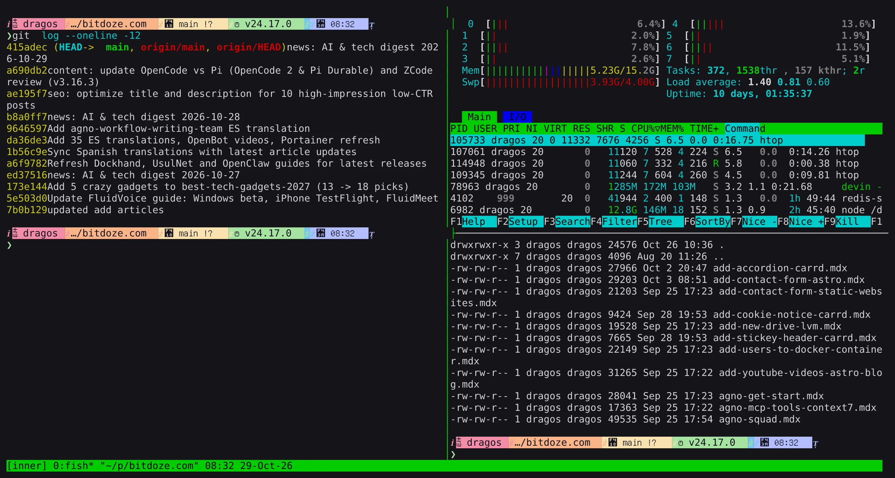
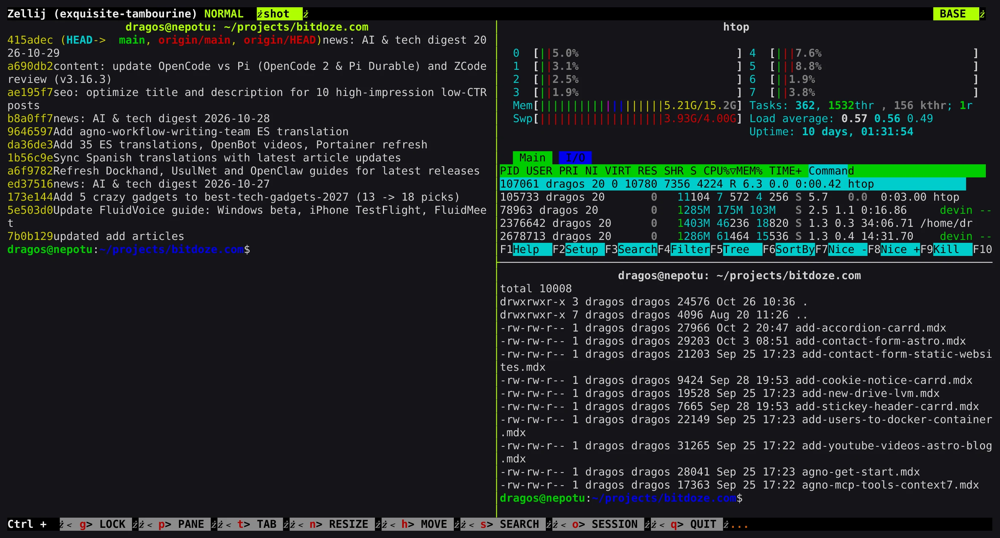
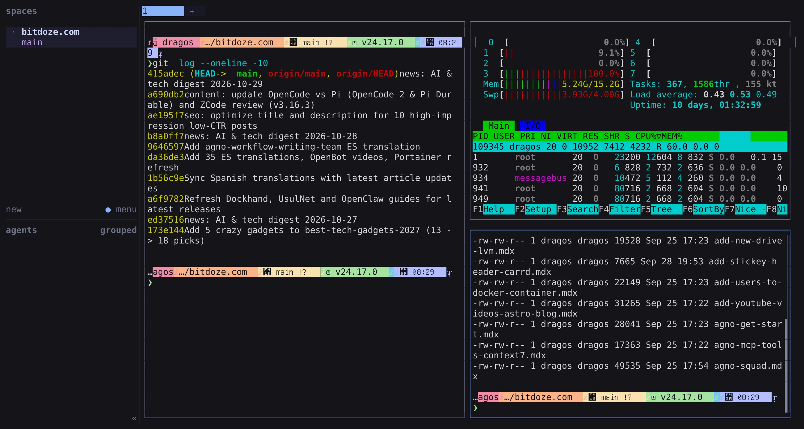
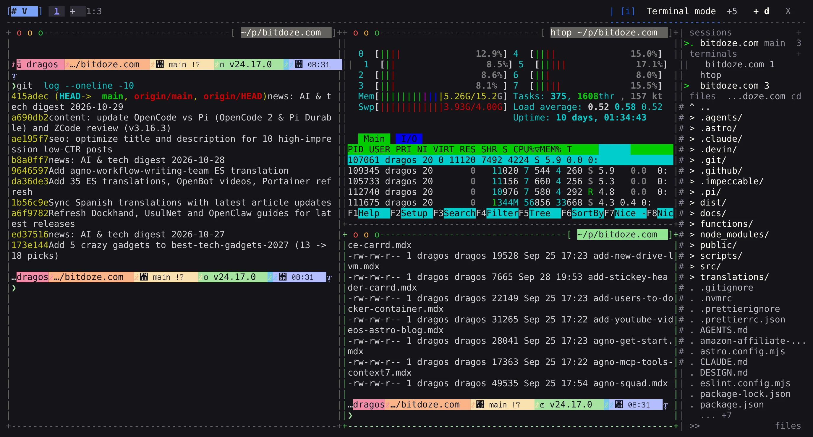
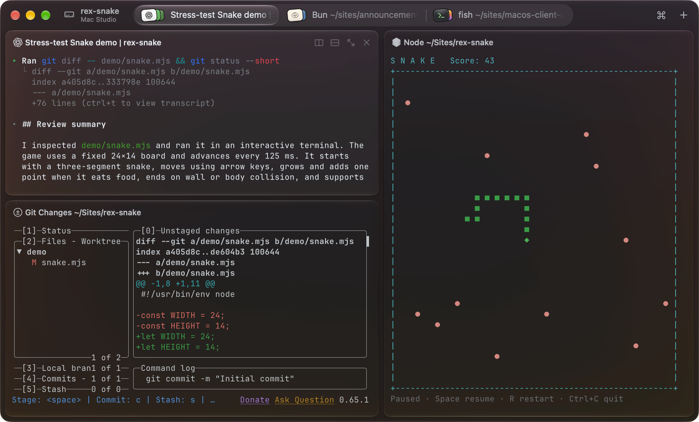

import Accordion from "@components/widgets/Accordion.astro";
import ListCheck from "@components/widgets/ListCheck.astro";
import Button from "@components/widgets/Button.astro";
import Notice from "@components/widgets/Notice.astro";
import Tabs from "@components/widgets/Tabs.astro";
import Tab from "@components/widgets/Tab.astro";

The terminal multiplexer question used to take five seconds to answer: tmux, unless you were logged into a box old enough to only have GNU `screen`. That answer expired around mid-2026. [AI coding agents](/ai-coding-tools/) changed what a multiplexer is actually for. Keeping a shell alive over a flaky SSH link used to be the whole job; now the job is keeping six agents alive across git worktrees, knowing which one is blocked on a permission prompt, and approving it from a laptop or phone without hunting through twenty panes.

Four serious tools now compete inside your terminal emulator (**tmux**, **Zellij**, **Herdr**, and **TuiOS**), plus two more (**Superlogical Rex** and **Stencil Tern**) that argue the multiplexer should *be* the terminal emulator itself.

I have run all six on real projects and written standalone deep dives on most of them. This guide puts the entire field side by side: how the architectures differ, install and config snippets you can paste tonight, how each handles AI agent fleets, remote SSH and phone workflows, a keybinding translation table, and where each tool still hurts. Every screenshot below is captured from my own setup.

Versions and GitHub star counts were verified on 2026-10-29: **tmux 3.8** (~49k stars), **Zellij 0.45.1** (~35.7k stars), **Herdr 0.9.3** (~44k stars), **TuiOS 0.11.1** (~5.4k stars), **Rex** public testing build, and **Tern 0.9.5** closed beta.

## The short version

If you just want the recommendation before the deep dive:

- **tmux**: pick it if you SSH into machines you do not administer, want a 1.2 MB binary that is already installed, or have a decade of `.tmux.conf` muscle memory. Still the right default for plain server and shell work.
- **Zellij**: pick it if you want tmux's job done with modern defaults: on-screen key hints, KDL project layouts, built-in session resurrection, first-class nested sessions (v0.45+), WebAssembly plugins, and a built-in web client.
- **Herdr**: pick it if AI coding agents are most of what you run. The real-time agent-state sidebar (`working` / `blocked` / `done` / `idle`), Unix socket API, and mobile/web client ecosystem are why it exists.
- **TuiOS**: pick it if you want a tiling window manager inside your terminal plus the deepest built-in agent Inbox (prompt holds, queued replies, inline diff review with notes, `fan` worktree runs, and a tmux shim) and can live with a fast-moving young project.
- **Rex**: pick it if you are on macOS and want the multiplexer built into the terminal app itself, powered by `libghostty` from Ghostty's creator with first-class remote system logins.
- **Tern**: pick it if you want a cross-platform Rust terminal where panes can also be native git clients, SQLite browsers, Jupyter notebooks, kanban boards, and AI agent blocks, and you do not mind a closed-beta waitlist.

## All 6 terminal multiplexers at a glance

| Feature | tmux | Zellij | Herdr | TuiOS | Rex | Tern |
|---|---|---|---|---|---|---|
| **Category** | In-terminal multiplexer | In-terminal multiplexer + workspace | In-terminal AI agent multiplexer | In-terminal tiling WM + agent mux | Native terminal app + multiplexer | Native terminal app + dev workspace |
| **GitHub stars (Oct 2026)** | ~49k | ~35.7k | ~44k | ~5.4k | Closed source | Closed source |
| **Language & license** | C, ISC | Rust, MIT | Rust, Apache-2.0 | Go, MIT (Bubble Tea v2) | Closed source ("free forever") | Rust, closed source |
| **Binary / footprint** | ~1.2 MB binary, tiny RAM | ~18 MB binary | ~11 MB single binary | ~16 MB pure-Go binary | Native macOS app (`libghostty`) | Native Rust app (~150 ms launch) |
| **Session owner** | Background server | Background server | Background session server | Background daemon | Server owns PTYs, tees raw bytes | Daemon owns sessions + blocks |
| **Reboot recovery** | Via plugin (`tmux-resurrect`) | Built-in layout + commands, opt-in scrollback | Layout, dirs, agent convos, opt-in screen history | Layout, dirs, pane history, agent convos | Server-persisted sessions | Daemon-persisted sessions + scrollback |
| **AI agent support** | None (bytes in a pane) | None (bytes in a pane) | State sidebar, TOML manifests, hooks, socket API | Unified Inbox, prompt holds, diff review, `fan` worktrees, MCP | None specific | Native `omp` block + attention inbox |
| **Layout capabilities** | Splits, windows, floating panes (3.8) | Tiled, floating, stacked panes, tabs | Splits, tabs, spaces, zoom | BSP / master-stack / scrolling tiling, floating, PiP, 9 workspaces | Native OS tabs, splits, windows | Splits, tabs, PiP, 4 layout modes + native blocks |
| **Remote workflow** | `ssh` in, then `tmux attach` | `ssh` in, or built-in `zellij web` browser UI | `ssh`, `herdr --remote` thin client, multi-machine sidebar | Built-in SSH server, remote panes in local session, `tuios-web` | Built-in remoting with real OS login (`who`) | `tern remote serve` (QUIC), WebGPU browser + mobile clients |
| **Config format** | `~/.tmux.conf` | KDL (`~/.config/zellij/config.kdl`) | TOML (`~/.config/herdr/`) | TOML (`~/.config/tuios/config.toml`) | Lua (`~/.config/rex/init.lua`) | Settings UI + Luau plugins |
| **Scripting & API** | CLI, `tmux -CC` control mode, hooks, formats | `zellij action`, `zellij pipe`, WASM plugins | CLI, JSON Unix socket API, ~1,000 plugins | CLI (`--json`), `.tape` scripts, MCP stdio, Herdr socket/plugins | `rex` CLI (`--json`), typed Lua actions (`rex do`) | `tern` CLI, event stream, `tern ctl` / `tern shot`, Luau SDK |
| **Graphics support** | Sixel / `allow-passthrough on` | Kitty graphics + Sixel (v0.45+) | Terminal passthrough | Native Kitty graphics + 24-bit color | Native `libghostty` rendering | Native surface renderer |
| **Platforms** | Every Unix, Linux, macOS, BSD | Linux, macOS, Windows | Linux, macOS, Windows | Linux, macOS, Windows, FreeBSD, OpenBSD | macOS now (Linux/Win/iOS/web in progress) | macOS, Linux, Windows, Android (iOS next) |
| **Price & status** | Free, v3.8 stable | Free, v0.45.1 stable | Free, v0.9.3 pre-1.0 | Free, v0.11.1 (started Sept 2025) | Free, public testing waitlist | Unannounced pricing, v0.9.5 closed beta |

## Why the architecture split in 2026: in-terminal TUI vs terminal-as-multiplexer

Before looking at individual tools, it helps to understand the structural split in the table above. Every tool here falls into one of two camps:

1. **In-terminal multiplexers (tmux, Zellij, Herdr, TuiOS)** sit *between* your terminal emulator and the shell: `Terminal App → Multiplexer Server → PTY → Shell/Agent`. Because the multiplexer runs inside any terminal window, it must maintain its own internal virtual terminal state machine, parse every ANSI escape sequence coming from the program, and then re-emit diffs to your outer terminal.
   - **The upside:** works over plain SSH on a headless $4/month Linux VPS, works inside Kitty, [Ghostty](/ghostty-terminal/), WezTerm, Alacritty, or an iPhone SSH client, and survives switching terminal apps.
   - **The downside:** every byte is parsed twice. If the multiplexer's internal parser is slower than your GPU terminal or doesn't understand a newer escape sequence (like Kitty graphics before passthrough landed), the multiplexer becomes the bottleneck.

2. **Terminal-as-multiplexer apps (Rex, Tern)** eliminate the middleman TUI. A background daemon owns the PTYs (locally or on a remote server), and the desktop, browser, or mobile app is a native client that attaches directly to that daemon.
   - **The upside:** zero double-parsing, native GPU rendering (`libghostty` in Rex, Rust + WebGPU in Tern), independent scrollback per attached client, and panes that don't have to be text grids at all.
   - **The downside:** you have to use their terminal app (or web/mobile client) rather than running the multiplexer inside whatever terminal emulator you already use.

---

## 1. tmux: the incumbent



tmux (~49k stars, C, ISC) is a ~1.2 MB binary that is either preinstalled or one `apt install tmux` away on every server you will ever log into. A background server owns your sessions, windows act as tabs, panes are splits inside windows, and the `Ctrl+b` prefix key has stayed consistent for 18 years.

### What landed in tmux 3.7 and 3.8

tmux is conservative, not dead. Two recent releases modernized several rough edges:

- **Floating panes (3.7, completed in 3.8):** `Ctrl+b *` opens an overlay floating pane on top of your current window without disturbing your split layout, with move/resize bindings under `Ctrl+b g`.
- **Built-in fuzzy switcher (3.8):** `Ctrl+b Tab` opens a fuzzy finder across sessions and windows, replacing the need for an external `fzf` popup script just to jump sessions.
- **Built-in light/dark themes (3.8):** tmux now detects your terminal's background and applies a built-in theme option out of the box.
- **Mode-specific help and line numbers:** pressing `Ctrl+h` inside copy mode shows only copy-mode bindings, and `set -g copy-mode-line-numbers on` adds line numbers for faster selection jumps.

### Install and daily workflow

<Tabs>
  <Tab name="Linux (Debian/Ubuntu/RHEL)">
    ```bash
    # Debian / Ubuntu
    sudo apt update && sudo apt install -y tmux

    # RHEL / AlmaLinux / Rocky / Fedora
    sudo dnf install -y tmux
    ```
  </Tab>
  <Tab name="macOS (Homebrew)">
    ```bash
    brew install tmux
    tmux -V   # prints tmux 3.8
    ```
  </Tab>
  <Tab name="Essential ~/.tmux.conf">
    ```tmux
    # Enable mouse clicks, pane resizing, and wheel scroll
    set -g mouse on

    # Start window and pane numbering at 1 instead of 0
    set -g base-index 1
    setw -g pane-base-index 1
    set -g renumber-windows on

    # 24-bit true color and image passthrough (Kitty/Sixel)
    set -g default-terminal "tmux-256color"
    set -as terminal-features ",*:RGB"
    set -g allow-passthrough on

    # Larger scrollback for build and agent logs
    set -g history-limit 50000
    ```
  </Tab>
</Tabs>

The one command worth aliasing on every server is **attach-or-create**:

```bash
tmux new -A -s dev
```

If the `dev` session already exists, `tmux new -A -s dev` attaches to it; if not, it creates it. Pair it with `tmux -CC attach -t dev` on macOS if you use iTerm2 and want remote tmux windows rendered as native macOS tabs.

### Where tmux hurts in 2026

To tmux, Claude Code waiting on a destructive bash approval and `tail -f /var/log/syslog` are identical: bytes in a pane. There is no semantic state, no cross-session inbox, and no built-in way to orchestrate panes from an agent without gluing together `tmux send-keys` and `tmux capture-pane` shell scripts. Reboot persistence also requires third-party plugins (`tmux-resurrect` and `tmux-continuum`) via TPM, and two clients attached to the same window still share a single scroll position unless you create grouped sessions.

- **Best for:** unmanaged remote servers, minimal VPS setups, pair programming over SSH, and anyone who wants a config that will still work unchanged in ten years.
- **Skip if:** you want discoverable UI controls or need to supervise five AI coding agents at once.

My [tmux basics guide](/tmux-basics/) walks through installation, sessions, windows, panes, TPM plugins, and troubleshooting protocol version mismatches after upgrades.

---

## 2. Zellij: the friendly modern multiplexer



Zellij (~35.7k stars, Rust, MIT) is what a classic terminal multiplexer looks like when designed from scratch in Rust. Instead of hiding every command behind an invisible prefix key, Zellij renders a contextual key-hint bar showing the exact keys available in your current mode (`NORMAL`, `PANE`, `TAB`, `RESIZE`, `MOVE`, `SEARCH`, `SESSION`, or `LOCK`). You can hand Zellij to a developer who has never used a multiplexer and they will be splitting, floating, and stacking panes inside two minutes.

### What makes Zellij 0.45.1 stand out

- **First-class nested sessions (0.45 / 0.45.1):** running Zellij locally and SSHing into a remote server that also runs Zellij used to be a keybinding nightmare. In 0.45.1, nested sessions differentiate inner and outer status bars and keybindings automatically over SSH without manual environment variable forwarding.
- **Scroll by command:** instead of scrolling line-by-line through 10,000 lines of compiler output, you can jump directly between shell command blocks.
- **Reproducible KDL layouts & session resurrection:** layouts live in clean `.kdl` files. When a machine reboots or a session exits, Zellij serializes your layout and pane commands to disk; reattaching restores the exact workspace and puts dangerous commands behind a "Press ENTER to run" safety gate.
- **WebAssembly plugin system:** plugins compile to `wasm32-wasip1`, meaning you can write plugins in Rust, Go, Zig, or C/C++ and run them in a capability-sandboxed runtime instead of giving shell scripts full access to your user account.
- **Built-in browser client (`zellij web`):** serves your terminal sessions over HTTP/HTTPS with generated login tokens and read-only spectator tokens, making it the only classic multiplexer with a first-party web server built into the main binary.

### Install, KDL layout, and daily commands

<Tabs>
  <Tab name="Install & Quick Start">
    ```bash
    # macOS or Linux (Homebrew)
    brew install zellij

    # Rust cargo (any platform)
    cargo install --locked zellij

    # Quick launch without installing (Linux/macOS)
    bash <(curl -L https://zellij.dev/launch)

    # Start or reattach
    zellij -s work                        # new named session
    zellij attach -c work                 # attach if exists, create if not
    zellij attach -c monitor -- htop      # start session running htop directly
    zellij web                            # start built-in browser server
    ```
  </Tab>
  <Tab name="Project Layout (~/.config/zellij/layouts/dev.kdl)">
    ```kdl
    layout {
        default_tab_template {
            pane size=1 borderless=true {
                plugin location="zellij:tab-bar"
            }
            children
            pane size=2 borderless=true {
                plugin location="zellij:status-bar"
            }
        }
        tab name="code" focus=true {
            pane split_direction="vertical" {
                pane name="editor" size="60%" command="nvim"
                pane split_direction="horizontal" size="40%" {
                    pane name="agent" command="claude"
                    pane name="tests"
                }
            }
        }
    }
    ```
  </Tab>
</Tabs>

Launch that layout anywhere with `zellij --layout dev` (or `zellij -n dev` to force a fresh session).

<Notice type="info" title="Fix Zellij keybinding clashes with Neovim / Emacs">
Default Zellij binds `Ctrl+p` (Pane), `Ctrl+t` (Tab), `Ctrl+n` (Resize), and `Ctrl+o` (Session), which collide with common Vim/Neovim and shell shortcuts. Either press `Ctrl+g` to toggle **Lock mode**, or switch Zellij to its **Unlock-First (non-colliding)** preset in `zellij setup` so `Ctrl+g` unlocks the multiplexer modes only when you ask for them.
</Notice>

### Where Zellij falls short

Zellij has the same blind spot as tmux for AI agents: a pane running Claude Code or Codex is just an ANSI text buffer. You can script panes with `zellij action` and `zellij run`, and community WASM plugins are starting to experiment with agent helpers, but there is no built-in agent state detector or approval inbox.

- **Best for:** developers who want a batteries-included tmux replacement with floating/stacked panes, KDL project layouts, and a built-in web client.
- **Skip if:** you need zero-config AI agent state tracking across local and remote hosts.

---

## 3. Herdr: the AI agent control plane



Herdr (~44k stars, Rust, Apache-2.0) was the first multiplexer built specifically around the multi-agent bottleneck: when you have eight coding agents running across three repositories, which one is stuck waiting on your input right now?

<YouTubeEmbed
  url="https://www.youtube.com/embed/wwCDi3kN0ck"
  label="How I Use Herdr Day to Day — Hands-On Walkthrough"
/>

Herdr runs inside your existing terminal emulator as a single ~11 MB Rust binary (`herdr`). A background session server owns the PTYs so sessions survive SSH drops and laptop sleep just like tmux, while the TUI adds a left-hand **Spaces & Agents sidebar** that rolls up real-time semantic states for every pane: `working`, `blocked`, `done`, `idle`, or `unknown`.

### How Herdr detects and orchestrates agents

Herdr combines two detection layers out of the box for 14+ coding agents (Claude Code, Codex, Copilot CLI, Cursor Agent, OpenCode, Gemini CLI, Pi, Amp, Droid, Grok CLI, [Hermes Agent](/hermes-agent-setup-guide/), Antigravity CLI, Kimi Code, and QoderCLI):

1. **Zero-config TOML screen manifests:** Herdr inspects the child process tree and matches the live bottom buffer of each pane against per-agent screen rules to detect spinners, permission prompts, and idle prompts without touching the agent's config.
2. **Lifecycle hooks (`herdr integration`):** installing the optional integration wires into the agent's native hook system (such as Claude Code's `SessionStart`, `PreToolUse`, and `Stop` hooks) for exact, zero-latency state reporting.

Underneath the TUI sits a JSON Unix socket API (`~/.config/herdr/herdr.sock`) and CLI that allow one lead agent to spawn worker panes, pass prompts, read sibling terminal output, and block until a worker reaches `done` or `blocked`:

```bash
# Install Herdr on Linux or macOS
curl -fsSL https://herdr.dev/install.sh | sh    # or: brew install herdr

# Optional: install exact lifecycle hooks
herdr integration install claude
herdr integration install codex
herdr integration install copilot

# Orchestrate panes and agents from scripts or a lead agent
herdr pane list                                 # JSON list of panes and states
herdr pane split --direction right --focus      # split current pane
herdr agent start reviewer --kind claude        # launch tracked agent in pane
herdr pane run <pane-id> "cargo test"           # run command in target pane
```

### Multi-machine windows and the client ecosystem

Since v0.9, Herdr supports **multi-machine windows**: `herdr machine add user@vps` or `herdr --remote user@vps` lets you view local panes and remote VPS sessions inside a single sidebar, plus built-in git worktree management and automatic agent conversation resume after a host restart.

Because Herdr treats every UI as just a client attached to its socket, an entire third-party ecosystem has grown around it:

- **Mobile control:** [Moshi](/control-ai-agents-from-phone-moshi-herdr/) (iOS/Android with Mosh transport and `moshi-hook` lock-screen push approvals) and Heeler.
- **Browser & desktop clients:** ColliePWA, `devswha/herdr-web-ui`, `herdrm` (native macOS), Herdr UI, and Moshi Desktop.
- **Plugin marketplace:** ~1,000 indexed plugins (`herdr-plugin.toml`), though plugins run unsandboxed as your OS user, so never install marketplace plugins without reading their source first.

Read our full [Herdr review](/herdr-agent-multiplexer/), the [best Herdr clients comparison](/best-herdr-clients/), and the [best Herdr plugins guide](/best-herdr-plugins/) for hardened VPS and Tailscale setups.

- **Best for:** running 3 to 15 AI coding agents across local machines and headless VPS boxes, with lock-screen phone approvals and a proven ecosystem.
- **Skip if:** you want floating panes or tiling window manager layouts (Herdr's layout model is strictly splits, tabs, spaces, and zoom).

---

## 4. TuiOS: the tiling window manager + deepest agent Inbox



TuiOS (~5.4k stars, Go, MIT) stands for *Terminal UI Operating System*, and it is the boldest new in-terminal multiplexer of the year. Built on Charm's Bubble Tea v2 and Lipgloss v2 with a background daemon, it combines two ideas that usually live in separate tools: a desktop-style **tiling window manager** (BSP, master-stack, and niri-style scrolling layouts, floating windows, picture-in-picture, 9 workspaces per session, top/bottom dock bar with live CPU/RAM graphs, and a right-hand session/file/agent rail) and an **agent orchestration engine** that goes even deeper than Herdr's.

### The Inbox, prompt holds, and worktree fan-out

Where Herdr gives you a status sidebar, TuiOS builds the entire human-in-the-loop workflow into its daemon:

1. **The unified Inbox (`Ctrl+b i` or `tuios list-attention`):** collects every blocked approval, question (`tuios ask-human`), plan review (`ExitPlanMode`), error, and unread finished turn across every session on your machine and linked remote hosts.
   - When you enable `[agents.approvals]`, TuiOS intercepts single-line permission requests (`PermissionRequest` in Claude Code/Qwen, `permission.asked` in OpenCode/Kilo) and holds them in the Inbox. Press `1` (allow once), `2` (always), or `3` (reject) directly from the Inbox without switching workspaces.
   - Commands that match **risk rules** (`rm -rf`, force pushes, `curl | sh`, or writes outside the pane's project root) are flagged with a `risk` badge and require a second confirmation press.
2. **Queued replies and verified human mail:** if an agent is busy mid-turn, `tuios queue -w worker "run the migration tests next"` holds your prompt and types it automatically the moment the agent comes to rest. Agents can also send structured mail to each other (`tuios send-agent-message`, `tuios ask-agent`) or to `human`, with cryptographic `"verified_human": true` tagging so one agent cannot spoof a human approval to another pane.
3. **Git worktree fan-out, verification, and inline diff review:** you can race multiple agents (even across different models) on the same task in isolated git worktrees, run a test suite across all of them, review their diffs with line notes, and ship the winner:

```bash
# Install TuiOS (macOS / Linux)
brew install tuios
# or release script:
curl -fsSL https://raw.githubusercontent.com/Gaurav-Gosain/tuios/main/install.sh | bash

# Fan a prompt across 3 isolated git worktrees using Claude, Codex, and Gemini
tuios fan 3 --agent 'claude,codex --model o5,gemini' 'Add exponential backoff to the HTTP client.'

# Compare line changes and run your test suite across every attempt
tuios fan compare api-fan-add-exponential-backoff
tuios fan verify api-fan-add-exponential-backoff -- go test ./...

# Review an attempt's diff, attach line notes, and send them back to the agent
tuios review api-fan-add-exponential-backoff-2
tuios review note -s api-fan-add-exponential-backoff-2 client/retry.go:42 'log the attempt count here'
tuios review send -s api-fan-add-exponential-backoff-2

# Keep the winning worktree, squash-merge, or open a PR
tuios fan keep api-fan-add-exponential-backoff-2 --merge --squash
```

### Herdr socket compatibility, MCP server, and the tmux shim


The smartest engineering decision in TuiOS is that it refuses to wall itself off from existing ecosystems:

- **Herdr socket & plugin bridge:** every TuiOS pane exports `HERDR_SOCKET_PATH`, `HERDR_PANE_ID`, and `HERDR_BIN_PATH`. TuiOS answers 77 of Herdr's 102 socket methods natively and runs enabled Herdr plugins (`terminal-browser`, `herdr-nvim`, `herdr-sidebar`) behind an explicit per-pane capability grant system (`read`, `write`, `respond`, `fan`, `admin`).
- **The tmux shim (`tuios tmux-shim`):** tools that hardcode `tmux` calls (most notably Claude Code's experimental agent teams with `CLAUDE_CODE_EXPERIMENTAL_AGENT_TEAMS=1` and `fzf --tmux`) work inside TuiOS without installing tmux:
  ```bash
  tuios tmux-shim -- env CLAUDE_CODE_EXPERIMENTAL_AGENT_TEAMS=1 claude
  ```
  Each spawned teammate opens as a native TuiOS window with its own status on the rail and in the Inbox.
- **Native MCP server (`tuios mcp`) and headless ACP:** `tuios mcp` exposes TuiOS over stdio to any MCP-capable agent, and `tuios start-agent --protocol acp 'opencode acp'` can run agents headless over the Agent Client Protocol.
- **Remote panes & mobile:** includes a built-in SSH server (`tuios ssh --port 2222`), remote windows running on another host rendered inside your local session (`tuios new-window -s work deploy --host build`), SHA-256 verified cross-host file copies (`tuios cp`), `tuios-web`, QR phone pairing (`tuios pair`), and ntfy/Pushover Inbox push notifications.

### Where TuiOS hurts

Age and surface area. The first commit landed in September 2025, and at v0.11.1 it has a massive command surface (`tuios --help` lists over 90 subcommands). It ships fast, which means occasional breaking changes between minor releases and a steeper learning curve if you turn on every feature at once. (You can set `[agents] enabled = false` in `~/.config/tuios/config.toml` if you only want the tiling multiplexer.)

- **Best for:** power users who want i3/Hyprland-style terminal tiling, multi-agent worktree fan-out, and an Inbox that handles prompt approvals and diff reviews natively.
- **Skip if:** you want a minimal, slow-moving tool with a small CLI surface.

---

## 5. Rex: the terminal that is the multiplexer



Rex is Mitchell Hashimoto's (HashiCorp, [Ghostty](/ghostty-terminal/)) answer to a problem he ran into while building Ghostty: modern GPU terminals like Ghostty, Kitty, and Alacritty can parse terminal I/O up to 100x faster than the internal terminal emulators inside tmux or screen. Putting a traditional multiplexer in front of a fast terminal bottlenecks the entire pipeline down to the multiplexer's parser.

So Rex flips the architecture. You do not run `rex` inside another terminal; Rex *is* the terminal application.

### How Rex's raw-byte streaming works

1. **The server owns the PTYs.** When a Rex client connects, the server briefly pauses PTY processing, sends a compact binary handshake frame (dimensions, cursor, current screen state), and immediately unlocks input.
2. **Raw PTY bytes, not screen diffs.** Instead of parsing output into a shared virtual grid and sending screen diffs, the Rex server tees raw PTY byte streams to every attached client, just like SSH. Each client runs its own embedded `libghostty` engine and parses at native speed.
3. **Independent client scrollback.** History backfills in the background (newest chunks first), and because each client owns its own viewport, two people attached to the same session can scroll up and inspect logs independently without yanking each other's screen.

### First-class remote logins and Lua automation

Adding a remote machine from Rex's command palette does not just open an SSH pipe inside a local pane; it performs a **real OS login** on the remote Rex server (the session appears in `who`, loads your login shell, honors PAM/user limits, and authenticates via your existing SSH keys or Tailscale identity, inspectable via `rex whoami`) with Mosh-inspired responsiveness.

Every Rex terminal automatically gets `rex` on `PATH` plus `REX_SESSION`, `REX_BLOCK`, and `REX_SERVER` environment variables:

<Tabs>
  <Tab name="Rex CLI Automation">
    ```sh
    rex ls                              # list sessions (supports --json)
    rex session inspect                 # inspect current session details
    rex split                           # split current block
    rex send -s build -w 2 'make test'  # send command to window 2 of "build"
    rex capture -b logs                 # print current screen of block "logs"
    rex -S studio ls                    # list sessions on remote host "studio"
    ```
  </Tab>
  <Tab name="Lua Config (~/.config/rex/init.lua)">
    ```lua
    -- Keybindings (supports tmux-style prefix chords too)
    rex.bind("cmd+d", "pane.split", { direction = "right" })
    rex.bind("ctrl+b>c", "window.new")

    -- Custom typed action runnable from palette, keybind, or `rex do`
    rex.action{
      name  = "scratch",
      title = "Open Scratch Window",
      run   = function(ctx, args)
        rex.session.new_window{
          layout = rex.layout.block{
            flavor = "com.superlogical.terminal.shell",
          },
        }
      end,
    }
    rex.bind("shift+cmd+n", "scratch")
    ```
  </Tab>
</Tabs>

### Where Rex hurts

First, **platform reach**: only the macOS client is in public testing right now (Linux, Windows, iOS, and browser clients exist internally at Superlogical but have not shipped to external testers yet). Second, **layout model**: because each split is an independent PTY connection rendered in a native container (which is how Rex will adapt cleanly to iOS and web), there is no nested in-window tmux pane tree. Third, Rex is closed source, though Superlogical pledges that the Rex client and server "is and will always be free," requires no account, and is fully self-hostable.

If you are on macOS and want a `libghostty`-based terminal with an automation CLI that is already generally available without a waitlist, check out [cmux](/cmux-terminal/). For the full deep dive on Rex's data path and exit codes, read my [Superlogical Rex briefing](/superlogical-rex/).

- **Best for:** macOS developers who want native `libghostty` speed, persistent local/remote sessions, and Lua/CLI scriptability without a TUI wrapper.
- **Skip if:** you need Linux or Windows desktop clients today, or want built-in AI agent state supervision.

---

## 6. Tern: the terminal that wants your whole workflow


Tern (built by Stencil, the team behind the `omp` coding agent CLI) starts from the same premise as Rex (a background daemon `tern daemon` owns persistent sessions while windows are disposable views) and pushes it into full workspace territory. Calling itself "a neoterminal for the Electron-weary," Tern is a native Rust application (~150 ms cold start to a live prompt) where a terminal shell is only one kind of **block**.

<YouTubeEmbed
  url="https://www.youtube.com/embed/G6F1ASwMEUU"
  label="Tern hands-on: workspace tour and an agent-built Astro site"
/>

### Native blocks over the Tern Surface Protocol

Instead of embedding Chromium, Tern renders structured tools natively over its **Tern Surface Protocol** right beside your shell splits (or popped out as always-on-top picture-in-picture windows):

- **Git block (`⌥⌘G`):** commit graph with branch/tag lanes, staged/unstaged working tree with line staging and context folding, `git peek`, stashes/worktrees/submodules view, and AI commit message generation.
- **SQLite Database block:** schema browser, filterable data grid with inline cell editors (text, JSON, hex, image), SQL query tabs with completion and result plotting, and staged "Write Changes" / revert.
- **Kanban Board block (`⌥⌘K`):** turns a plain `TODO.md` file in your repo into a drag-and-drop Todo/Doing/Done board that both you and your AI coding agents can read and update.
- **Jupyter Notebook block:** runs code and Markdown cells directly against your local Python kernel with a variables inspector, with no Jupyter server required.
- **Files, Editor & Media block (`⌘O` / `tern open`):** syntax-highlighted code editor with git gutter diffs, rendered Markdown toggle, SVG/PDF/image viewers, and video frame-strip previews (`EDITOR='tern open --wait'` works for `git commit`).
- **Browser (`⇧⌘B`), Task Manager, and Canvas blocks:** an inspectable browser block that agents can drive and snapshot, a CPU/RAM/GPU process tree, and a freeform drawing canvas.

### Native `omp` agent blocks, QUIC remoting, and CLI control

Because Stencil builds `omp`, launching an agent block renders a native UI with a model picker, thinking toggle, subagent task tree, and a 1M-token context budget breakdown (system prompt, tools, skills, messages), while routing completion alerts and bell events into Tern's **"Needs attention" inbox**. Standard CLI agents (Claude Code, Codex, Devin) run in regular terminal panes, and a community **Luau plugin for Herdr** lets you embed Herdr panes inside Tern.

```sh
# Tern workspace & automation CLI
tern ls                              # list sessions, tabs, and panes
tern new | split | move | pip | dock # manipulate window layout from scripts
tern run 'make test'                 # execute command in a pane
tern send / capture / wait           # type into, read back, or block on panes
tern events --filter pane_spawned    # stream live daemon events
tern whoami --json                   # inspect user + host identity chain

# Remote hosts, browser client, and headless screenshot harness
tern remote serve                    # expose session daemon over QUIC
tern web serve                       # serve Wasm + WebGPU client in a browser tab
tern shot scenario.kdl               # render offscreen UI captures
```

Unlike Rex, Tern already ships builds for **macOS, Linux, Windows, and Android** (paired via QR code from the Hosts palette, with iOS next), plus a WebAssembly + WebGPU browser client (`tern web serve`).

### Where Tern hurts

Tern is **closed source**, currently in **closed beta** behind a waitlist (mine cleared in about two days), and Stencil has not announced final pricing or commercial tiers yet. For a full tour of every block, see my [Tern terminal hands-on review](/tern-terminal/).

- **Best for:** developers who want daemon-persisted sessions, QUIC remote hosts, and native git/SQLite/kanban/notebook panes without Electron overhead.
- **Skip if:** you only adopt open-source terminal tools or want a lightweight Unix utility that does one thing.

---

## AI coding agent orchestration compared

Because AI coding agents are the main reason developers are rethinking their multiplexer in 2026, here is how the six tools compare specifically on agent workflows:

| Agent Capability | tmux | Zellij | Rex | Tern | Herdr | TuiOS |
|---|---|---|---|---|---|---|
| **Auto state detection (`working`/`blocked`/`done`)** | No | No | No | `omp` native; others via bell/exit | **Yes** (14+ agents via manifests + hooks) | **Yes** (manifests + hooks + `OSC 7501`) |
| **Cross-session approval inbox** | No | No | No | Attention inbox (notifications) | Sidebar + mobile/web client inboxes | **Built-in Inbox** (`Ctrl+b i`, holds prompts & plans) |
| **Risky command guardrails** | No | Resurrection Enter gate | No | Agent-dependent | Agent-dependent | **Yes** (`risk` rules require double-press) |
| **Queue next prompt while agent works** | No | No | No | No | Via plugins / scripts | **Built-in** (`tuios queue`) |
| **Agent-to-agent messaging / orchestration** | Manual `send-keys` | Manual `zellij action` | `rex send` / `capture` | `tern send` / `capture` + subagents | **Unix socket API** + CLI | **Built-in** (`ask-agent`, `send-agent-message`, `mcp`) |
| **Git worktree fan-out & test verification** | Manual | Manual | Manual | Git block worktrees | Built-in worktree sessions | **Built-in** (`tuios fan`, `fan compare`, `fan verify`, `ship`) |
| **Inline diff review with notes to agent** | No | No | No | Git block diffs | Via plugins / clients | **Built-in** (`tuios review`, `Ctrl+b v`) |

<Notice type="info" title="Herdr vs TuiOS: which agent multiplexer should you pick?">
If AI coding agents occupy most of your terminal time, your real choice is **Herdr vs TuiOS**. Pick **Herdr** for proven stability (~44k stars) and the best mobile/desktop client ecosystem (especially [Moshi on iPhone/Android](/control-ai-agents-from-phone-moshi-herdr/)). Pick **TuiOS** if you want tiling window management, built-in worktree fan-out (`tuios fan`), inline diff review with notes (`tuios review`), and Claude Code team compatibility via `tuios tmux-shim`, while still running Herdr plugins and speaking Herdr's socket API.
</Notice>

---

## Keybinding and vocabulary cheat sheet

Moving between these six tools is much easier once you see how their nouns and default shortcuts map to each other:

| Action / Concept | tmux | Zellij | Herdr | TuiOS | Rex | Tern |
|---|---|---|---|---|---|---|
| **Top-level group** | Session | Session | Workspace / Session | Session (grouped by Space) | Session | Session |
| **Tab layer** | Window | Tab | Tab | Workspace (1–9) | Window | Tab |
| **Split / leaf item** | Pane | Pane (tiled / float / stack) | Pane | Window (tiled / float) | Block | Pane running a Block |
| **Default prefix / mode key** | `Ctrl+b` | Modal (`Ctrl+p`, `Ctrl+t`, `Ctrl+g` lock) | `Ctrl+b` + mouse UI | `Ctrl+b` + modal WM/Terminal mode | `Cmd` shortcuts + `Ctrl+b` chords | `⌘K` palette + remappable chords |
| **Split right / vertical** | `Ctrl+b %` | `Ctrl+p` then `r` (or `Alt+n`) | `Ctrl+b v` (or mouse) | `Ctrl+b v` / `tuios split-window right` | `Cmd+d` / `rex split` | `tern split` / shortcut |
| **Split down / horizontal** | `Ctrl+b "` | `Ctrl+p` then `d` | `Ctrl+b s` (or mouse) | `Ctrl+b s` / `tuios split-window down` | `Shift+Cmd+d` | `tern split` / shortcut |
| **Detach session** | `Ctrl+b d` | `Ctrl+o` then `d` | `Ctrl+b q` | `Ctrl+b d` / `tuios detach-client` | Close window (server persists) | Close window (daemon persists) |
| **List sessions from CLI** | `tmux ls` | `zellij ls` | `herdr session list` | `tuios ls` | `rex ls` | `tern ls` |

---

## Remote SSH, phones, and browsers compared

| Tool | Remote Transport | Multi-Machine View | Phone Experience | Browser Client | Unmanaged Server Ready |
|---|---|---|---|---|---|
| **tmux** | Plain SSH (or Mosh + `tmux attach`) | Manual (`ssh` inside panes) | Generic SSH apps (Termius, Blink, Moshi) | Third-party only (`ttyd`, `gotty`) | **Yes** (preinstalled almost everywhere) |
| **Zellij** | Plain SSH (`zellij attach`, auto-nested in 0.45.1) | Manual (`ssh` inside panes) | Generic SSH apps or mobile browser | **Built-in** (`zellij web` with auth/read-only tokens) | Needs single binary install |
| **Herdr** | SSH + `herdr --remote` thin client | **Yes** (`herdr machine add` sidebar) | **Best today** ([Moshi](/control-ai-agents-from-phone-moshi-herdr/) + `moshi-hook` push approvals, Heeler) | Community web UIs (ColliePWA, `herdr-web-ui`) | Needs ~11 MB binary on host |
| **TuiOS** | Built-in SSH server (`tuios ssh`) + linked hosts | **Yes** (remote panes inside local session + `tuios cp`) | `tuios pair` QR code + ntfy/Pushover Inbox push alerts | Official `tuios-web` companion binary | Needs ~16 MB binary on host |
| **Rex** | Built-in Rex protocol (real OS login, Mosh-style feel) | **Yes** (`rex -S <host>` + command palette) | iOS client built internally, not shipped yet | Web client built internally, not shipped yet | Needs Rex server on host |
| **Tern** | `tern remote serve` over QUIC (or SSH w/ terminfo) | **Yes** (Hosts palette switcher + remote Luau plugins) | **Native Android app** (QR pairing); iOS next | **Built-in** (`tern web serve` Wasm + WebGPU client) | Needs Tern daemon on host |

- **Best for servers you do not own:** **tmux**, and nothing else comes close. It is already installed on almost every customer server, container host, and BSD box.
- **Best next-gen remote protocol:** **Rex** (real system login with Mosh-like responsiveness) and **Tern** (`tern remote serve` over QUIC to desktop, WebGPU browser, and Android clients). **TuiOS** takes third place with its ability to mount a single remote pane from another host right inside your local workspace (`tuios new-window --host build`).
- **Best phone experience today:** **Herdr** paired with [Moshi](/control-ai-agents-from-phone-moshi-herdr/) (Mosh UDP transport + `moshi-hook` lock-screen Approve/Deny buttons) or Heeler, with **TuiOS** (`tuios pair` QR code + ntfy/Pushover Inbox push notifications) and **Tern** (Android client) right behind.
- **Best browser experience:** **Zellij** (`zellij web` with built-in auth and read-only tokens) and **Tern** (`tern web serve` WebGPU client). `tuios-web` and Herdr's community web UIs (ColliePWA, `herdr-web-ui`) are great over Tailscale.

## Which terminal multiplexer should you actually pick?

| Your situation / primary workflow | Best pick | Runner-up | Why |
|---|---|---|---|
| **SSH into production or customer Linux servers** | **tmux** | Zellij | Already installed everywhere, 1.2 MB binary, zero setup risk. |
| **Want a modern tmux with discoverable keys & layouts** | **Zellij** | tmux 3.8 | On-screen key hints, KDL project layouts, floating panes, and built-in `zellij web`. |
| **Run 3–10+ AI coding agents on a laptop or VPS** | **Herdr** | TuiOS | Proven stability (~44k stars), zero-config state sidebar, socket API, and Moshi phone approvals. |
| **Want tiling layouts + worktree fan-out & diff review** | **TuiOS** | Herdr | BSP/scrolling tiling, unified Inbox with prompt holds, `tuios fan`, `tuios review`, and Herdr/tmux shims. |
| **macOS user who wants the multiplexer inside the terminal** | **Rex** | [cmux](/cmux-terminal/) / Tern | `libghostty` speed, independent client scrollback, real OS remote logins, and Lua automation. |
| **Want git, SQLite, Jupyter & kanban panes next to your shell** | **Tern** | Zellij + TUI tools | Native blocks over the Tern Surface Protocol, QUIC remoting, and native `omp` agent UI. |

<ListCheck>
  <ul>
    <li>Maintain shells, builds, and logs on arbitrary Linux servers → <strong>tmux</strong>. Installed everywhere, tiny footprint, zero surprises.</li>
    <li>Want a modern tmux replacement with discoverable shortcuts, floating panes, KDL layouts, and a web UI → <strong>Zellij</strong>.</li>
    <li>Run 3+ AI coding agents and want a live state sidebar, socket API, and lock-screen phone approvals → <strong>Herdr</strong>.</li>
    <li>Want a tiling window manager in your terminal plus an Inbox that holds prompts, fans out worktrees, and reviews diffs → <strong>TuiOS</strong>.</li>
    <li>Use macOS and want a fast <code>libghostty</code> terminal with built-in session persistence and SSH-replacing remote logins → <strong>Rex</strong>.</li>
    <li>Want a cross-platform Rust terminal with native git, SQLite, Jupyter, and kanban blocks beside your shell → <strong>Tern</strong>.</li>
  </ul>
</ListCheck>

### Real-world combinations (and the one nesting rule)

You do not have to pick just one. My own daily stack uses three:

1. **tmux** on production servers I touch once a month.
2. **Herdr + Moshi** on an always-on Hetzner VPS where long-running Claude Code and Codex sessions live.
3. **TuiOS** (or **Herdr inside Tern**) when I want worktree fan-out (`tuios fan`) or native git/SQLite blocks on my workstation.

Nesting works fine as long as you follow **one rule**: keep a single multiplexer layer directly above your AI coding agents. Running Herdr inside a Tern pane works because Tern renders the outer window while Herdr directly owns the agent PTYs. Putting `tmux` *between* Herdr/TuiOS and your coding agent breaks automatic process-tree detection (the outer multiplexer sees `tmux`, not `claude` or `codex`). If a tool tries to spawn `tmux` panes underneath you, run it under `tuios tmux-shim` instead of nesting a real tmux server.

## FAQ

<Accordion label="Is tmux dead in 2026?" group="faq" expanded="true">
  No. tmux still owns the "preinstalled on every server" niche, and tmux 3.8 (September 2026) added floating pane refinements, a built-in fuzzy session switcher (<code>Ctrl+b Tab</code>), and automatic light/dark themes. When you SSH into a machine you do not manage, tmux is what is there. What changed is local and VPS development with AI coding agents: tmux has no concept of agent state or prompt approvals, which is why Herdr and TuiOS grew so quickly.
</Accordion>

<Accordion label="tmux vs Zellij: which is better for normal terminal work?" group="faq">
  If you are starting fresh today and control the machines you work on, Zellij is faster to learn thanks to its on-screen key hints, default mouse support, KDL project layouts, built-in session resurrection, first-class nested sessions (v0.45+), and <code>zellij web</code> browser access. If you regularly hop across customer servers, minimal containers, or BSD boxes, or rely on iTerm2's <code>tmux -CC</code> integration, stick with tmux.
</Accordion>

<Accordion label="Can I run two terminal multiplexers together?" group="faq">
  Yes, with one rule: keep a single multiplexer layer directly above your AI coding agents. Running Herdr inside Tern works because Tern renders the outer window while Herdr directly owns the agent PTYs. Putting tmux inside Herdr (or Herdr inside tmux) breaks automatic agent detection unless you configure explicit lifecycle hooks. TuiOS also includes <code>tuios tmux-shim</code>, which translates <code>tmux</code> CLI calls into native TuiOS windows so you do not need to nest tmux at all.
</Accordion>

<Accordion label="What is the best terminal multiplexer for a headless VPS?" group="faq">
  For classic sysadmin work and long-running builds, tmux. For a headless VPS dedicated to running Claude Code, Codex, or OpenCode 24/7, use Herdr or TuiOS: both keep sessions alive on the server and give you an agent state sidebar or Inbox you can reach from your laptop or phone over Tailscale. See our <a href="/control-ai-agents-from-phone-moshi-herdr/">phone control setup with Moshi and Herdr</a> for the step-by-step stack.
</Accordion>

<Accordion label="Are all six terminal multiplexers free and open source?" group="faq">
  Four are free and open source: tmux (ISC), Zellij (MIT), Herdr (Apache-2.0), and TuiOS (MIT). Superlogical Rex is closed source, though Superlogical pledges that the Rex client and server "is and will always be free" and self-hostable with no account required. Stencil Tern is closed source in closed beta and has not announced pricing yet.
</Accordion>

<Accordion label="Which terminal multiplexer is the most stable for daily driving right now?" group="faq">
  tmux and Zellij, by a wide margin. Both are mature, stable, and predictable. Among the agent-first tools, Herdr (v0.9.3, ~44k stars) is the more proven daily driver, while TuiOS (v0.11.1) ships features at a rapid pace if you do not mind frequent updates. Rex and Tern are both still gated behind beta invites.
</Accordion>

## Verdict

There is no single winner here because the category split into three distinct jobs:

1. **Classic shell multiplexing:** **tmux** remains untouchable on remote servers you do not own, and **Zellij** is the best modern upgrade when you want KDL layouts, floating panes, nested SSH sessions, and on-screen key hints without spending a weekend writing a config file.
2. **AI agent multiplexing:** **Herdr** is the safest pick today for supervising a fleet of coding agents across local and remote machines, while **TuiOS** is the most ambitious challenger with its tiling window manager, unified Inbox, inline diff review, worktree fan-out, and Herdr/tmux compatibility shims.
3. **Next-gen terminal apps:** **Rex** and **Tern** prove that baking session persistence and remoting into the terminal emulator itself is faster and cleaner than running a TUI inside a TUI: Rex for `libghostty` purists on macOS, Tern for developers who want git, SQLite, kanban, and notebooks right next to their prompt.

If your terminal day is mostly shells and logs, install tmux or Zellij and get back to work. If half your panes are AI coding agents, switch to a multiplexer that knows they are in there.

<Button text="Herdr on GitHub" link="https://github.com/herdrdev/herdr" variant="solid" color="blue" size="md" icon="arrow-right" />
<Button text="TuiOS Docs" link="https://tuios.dev/docs" variant="outline" color="blue" size="md" />
<Button text="Zellij on GitHub" link="https://github.com/zellij-org/zellij" variant="outline" color="blue" size="md" />
