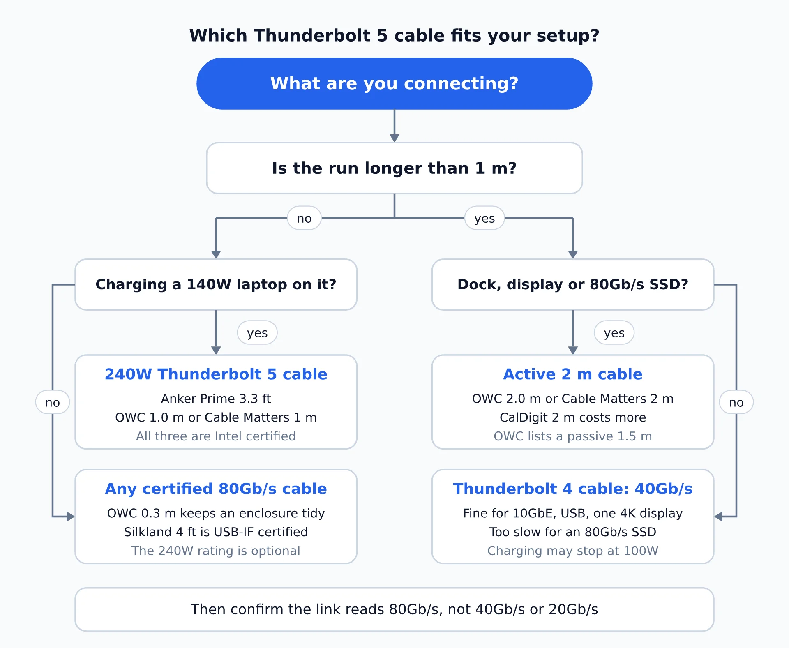
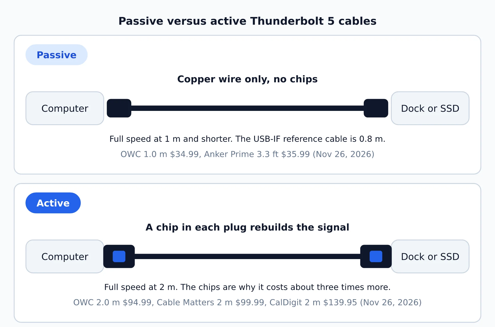
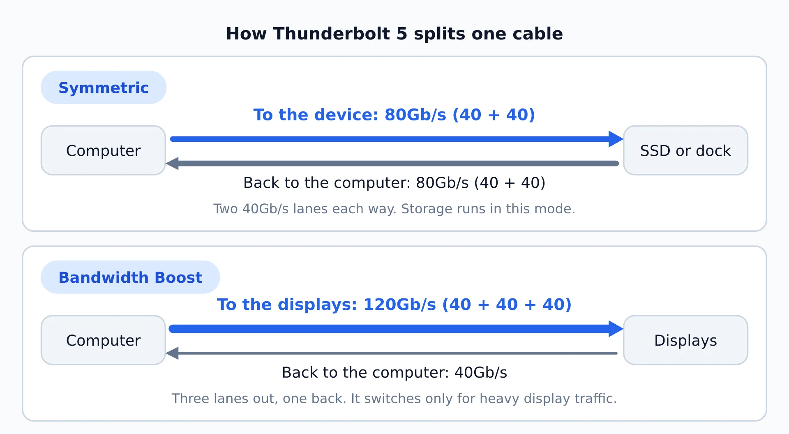
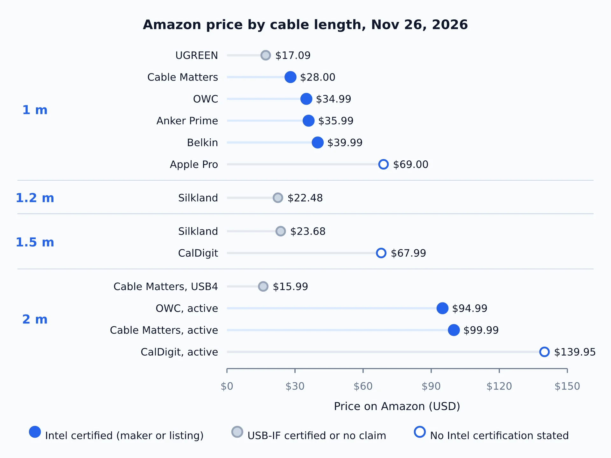

import Notice from "@components/widgets/Notice.astro";
import Accordion from "@components/widgets/Accordion.astro";
import AmazonProduct from "@components/widgets/AmazonProduct.astro";

The **[Anker Prime Thunderbolt 5 cable (3.3 ft)](#anker-prime-thunderbolt-5-cable-33-ft-the-default)** is the best Thunderbolt 5 cable for most desks. It is on Intel's certified list, rated for 80Gb/s and 240W, and cost $35.99 on November 26, 2026. For a 2 m run, buy an active cable from OWC or CalDigit. Nobody on this site measured throughput for this guide; every speed figure comes from the maker.

<Notice type="warning" title="Affiliate disclosure">
Some links below are Amazon affiliate links, including `/go/` redirects that land on Amazon. Buying through them pays me a small commission at no extra cost to you. Prices were checked on November 26, 2026 and move constantly, so always confirm on the product page.
</Notice>

## Quick picks

| Cable | Price (Nov 26, 2026) | Length | Buy it if |
| --- | --- | --- | --- |
| [Anker Prime Thunderbolt 5 cable](/go/anker-prime-tb5-cable/) | $35.99 | 3.3 ft (1 m) | You want one certified cable for a dock, a display or an SSD, and the laptop charges through it. |
| [Cable Matters Intel Certified Thunderbolt 5 cable](/go/cable-matters-tb5-cable/) | $28.00 | 3.3 ft (1 m) | You want the cheapest Intel certified 1 m cable. |
| [Apple Thunderbolt 5 (USB-C) Pro cable](/go/apple-thunderbolt-5-pro-cable-1m/) | $69.00 | 1 m | A Studio Display or a Pro Display XDR is on the same order. |
| [OWC Thunderbolt 5 (USB-C) cable, 2.0 m](/go/owc-tb5-cable-2m/) | $94.99 | 2.0 m, active | The dock or the display sits across the desk. |
| [CalDigit Thunderbolt 5 Pro cable, 2.0 m](/go/caldigit-tb5-pro-cable-2m/) | $139.95 | 2.0 m, active | You want a braided active cable for a laptop that gets unplugged daily. |

Prices are Amazon listings on November 26, 2026. "Intel certified" means the maker says so on its own page or in the listing title.

## Is a cheaper USB4 80Gbps cable as good as Apple's?

For a passive cable of 1 m or less, the specification says yes. Intel's [Thunderbolt 5 technology brief](https://www.thunderbolttechnology.net/sites/default/files/Thunderbolt_5_TechBrief_2023_09_12.pdf) says the 80Gb/s and 120Gb/s rates run over the same passive cables that carried 40Gb/s before. The brand does not set the speed.

What Apple's cable adds on paper is a DisplayPort 2.1 UHBR20 rating, a Thunderbolt logo on the sleeve, and the maker's name on the order. Its other numbers match the field: Thunderbolt 5 at up to 120Gb/s, USB4 at up to 80Gb/s and 240W, per [Apple's support page](https://support.apple.com/en-us/118204). The Amazon listing for the same cable says USB4 at up to 40Gb/s, which disagrees with Apple's store page.

Below the $69 Apple cable there are three tiers:

- Intel certified 1 m cables: [Cable Matters at $28.00](/go/cable-matters-tb5-cable/), [OWC 1.0 m at $34.99](/go/owc-tb5-cable-1m/), [Anker Prime at $35.99](/go/anker-prime-tb5-cable/) and [Belkin at $39.99](/go/belkin-tb5-cable-1m/).
- USB-IF certified, not Intel: the [Silkland 4 ft at $22.48](/go/silkland-usb4-tb5-cable-4ft/), whose listing cites USB-IF test ID 12800.
- No certificate claimed: UGREEN's 3.3 ft cable at $17.09 and Fitee's 5 ft cable at $12.79. Both titles say "for Thunderbolt 5".

USB-IF certification is a separate program from Intel's. A [commenter in r/Thunderbolt](https://www.reddit.com/r/Thunderbolt/comments/1sqmcqi/thunderbolt_5_cable_recommedation_12m_15m_4ft_5ft/) with a 1.5 m Cable Matters cable wrote in April 2026: "to a 99% approximation they're same thing, especially for passive cables". Treat the Silkland's 80Gb/s at 1.2 m as a claim until System Report confirms it. Amazon's review summary of the Fitee reports "constant disconnects" for some buyers.

In the [Best brand of Thunderbolt 5 cable?](https://www.reddit.com/r/Thunderbolt/comments/1qgjshy/best_brand_of_thunderbolt_5_cable/) thread, one owner saw "no difference in speed" between a Jeyi cable from AliExpress and a Cable Matters cable. Two short answers named Apple and OWC.

I'd buy the Anker Prime or the Cable Matters and keep the $33 to $41, and Apple's cable only when it goes on the same receipt as a Studio Display.

## Which Thunderbolt 5 cable should I buy?

Start with length. Up to 1 m, buy an Intel certified passive cable, because every 1 m pick here claims 80Gb/s and 240W. Past 1 m, buy an active 2 m cable from OWC, Cable Matters or CalDigit. For a keyboard hub or a 10GbE adapter, a Thunderbolt 4 cable you already own will do at 40Gb/s. The USB-C stands in the [Mac mini dock guide](/best-mac-mini-dock/) bring their own host cable.



*Pick by length first, then by whether a 140W laptop charges through the cable and whether the device needs 80Gb/s.*

Every cable in this table claims 80Gb/s and 240W; the differences are length, build, who backs the claim and price.

| Cable | Length | Build | Certification (per maker) | Price (Nov 26, 2026) |
| --- | --- | --- | --- | --- |
| [Anker Prime Thunderbolt 5 cable](/go/anker-prime-tb5-cable/) | 3.3 ft (1 m) | Not stated | Intel certified (listing, Intel's list) | $35.99 |
| [Cable Matters braided Thunderbolt 5 cable](/go/cable-matters-tb5-cable/) | 3.3 ft (1 m) | Not stated | Intel certified (listing) | $28.00 |
| [OWC Thunderbolt 5 cable 1.0 m](/go/owc-tb5-cable-1m/) | 1.0 m | Passive | Thunderbolt certified (OWC, Intel's list) | $34.99 |
| [Belkin Thunderbolt 5 cable](/go/belkin-tb5-cable-1m/) | 3.3 ft (1 m) | Not stated | Intel certified (Belkin) | $39.99 |
| [Apple Thunderbolt 5 Pro cable](/go/apple-thunderbolt-5-pro-cable-1m/) | 1 m | Not stated | Not stated by Apple | $69.00 |
| [OWC Thunderbolt 5 cable 2.0 m](/go/owc-tb5-cable-2m/) | 2.0 m | Active | Thunderbolt certified (OWC, Intel's list) | $94.99 |
| [Cable Matters Active Thunderbolt 5 cable](/go/cable-matters-tb5-active-cable-2m/) | 6.6 ft (2 m) | Active | Intel certified (listing, Intel's list) | $99.99 |
| [CalDigit Thunderbolt 5 Pro cable 2.0 m](/go/caldigit-tb5-pro-cable-2m/) | 2.0 m | Active | Brand on Intel's list; no claim on CalDigit's page | $139.95 |
| [Silkland USB4 cable 4 ft](/go/silkland-usb4-tb5-cable-4ft/) | 4 ft (1.2 m) | Not stated | USB-IF certified (TID 12800) | $22.48 |
| [Cable Matters USB4 cable 2 m](/go/cable-matters-usb4-80gbps-cable-2m/) | 6.6 ft (2 m) | Not stated | None claimed | $15.99 |

### Anker Prime Thunderbolt 5 cable (3.3 ft): the default

This is the one I would order first. It cost $35.99 on November 26, 2026, in the middle of the certified 1 m prices, and Amazon showed 2K+ bought in the past month.

**Best for:** a Thunderbolt 5 dock, display or 80Gb/s enclosure within arm's reach of a MacBook Pro or a Thunderbolt 5 Windows laptop.

**Strengths:** the listing calls it Thunderbolt 5 certified and Intel's list carries "Anker Prime Thunderbolt 5 Cable". It is rated for 80Gbps of data, up to 120Gbps of display bandwidth and 240W, which covers a 16-inch MacBook Pro's 140W. The jacket is braided.

**Trade-offs:** 3.3 ft does not reach a dock on the floor, and Amazon's review summary says opinions on the length are mixed. The warranty is 18 months, against 2 years at CalDigit and Belkin and 3 at OWC.

<AmazonProduct
  productName="Anker Prime Thunderbolt 5 Cable (3.3 ft, 240W)"
  productDescription="Intel certified 1 m Thunderbolt 5 cable rated for 80Gbps data, up to 120Gbps of display bandwidth and 240W charging."
  productFeatures={["80Gbps data, up to 120Gbps display bandwidth", "240W charging for a 140W MacBook Pro", "Thunderbolt 5 certified, braided jacket", "18-month warranty"]}
  productLink="/go/anker-prime-tb5-cable/"
  productImage="https://m.media-amazon.com/images/I/61V3yWe7kUL._SL1500_.jpg"
  productRating={4.7}
  recommendedBadge="Best Overall"
  importantConsiderations={["3.3 ft is short for a dock that sits off the desk", "18-month warranty, shorter than OWC and CalDigit"]}
  pros={["On Intel's certified list", "Priced below Apple and Belkin", "Carries 140W for a 16-inch MacBook Pro"]}
  cons={["Build is not stated as passive or active", "Short for a floor setup"]}
/>

### Cable Matters Intel Certified Thunderbolt 5 cable (1 m): the budget pick

The cheapest Intel certified 1 m cable I found, at $28.00 on November 26, 2026.

**Best for:** a second cable for a hub's downstream port, a spare for the laptop bag, and anyone who wants Intel certification for under $30.

**Strengths:** the title says Intel Certified, and [Cable Matters' page](https://cablematters.com/pc-1724-180-intel-certified-80-gbps-braided-thunderbolt-5-cable.aspx) lists 80Gbps bidirectional, 120Gbps in Bandwidth Boost mode and 240W. Intel's list carries several Cable Matters Thunderbolt 5 cables. The jacket is braided.

**Trade-offs:** it has fewer ratings on Amazon than the plain version of the same cable, which costs $1.99 more.

<AmazonProduct
  productName="Cable Matters Intel Certified 80 Gbps Braided Thunderbolt 5 Cable (3.3 ft)"
  productDescription="Braided 1 m Thunderbolt 5 cable with Intel certification, 80Gbps data and 240W charging."
  productFeatures={["Intel certified Thunderbolt 5", "80Gbps data, up to 120Gbps display bandwidth", "240W charging with a PD 3.1 EPR charger", "Braided jacket, aluminium connectors"]}
  productLink="/go/cable-matters-tb5-cable/"
  productImage="https://m.media-amazon.com/images/I/61nDl-jcauL._SL1500_.jpg"
  productRating={4.6}
  recommendedBadge="Best Budget"
  importantConsiderations={["Only 3.3 ft long", "240W charging needs a PD 3.1 EPR charger"]}
  pros={["Cheapest Intel certified 1 m cable here", "Backward compatible with Thunderbolt 4 and 3", "Same brand as the certified 2 m active cable"]}
  cons={["Shortest useful length for a dock", "Fewer ratings than the plain Cable Matters cable"]}
/>

### Apple Thunderbolt 5 (USB-C) Pro cable (1 m): for a Studio Display

Apple's cable is the reference the Reddit threads measure the others against.

**Best for:** a Mac to a Studio Display, a Pro Display XDR or an LG UltraFine 5K, which are the displays Apple names for this cable.

**Strengths:** rated for DisplayPort 2.1 UHBR20, Thunderbolt 5 at up to 120Gb/s, USB4 at up to 80Gb/s and 240W. The Thunderbolt logo on the sleeve separates it from the USB-C charge cable in the same drawer. Amazon.com itself was the seller on November 26, 2026.

**Trade-offs:** $69 buys nothing measurable over the Anker Prime on paper, and Apple states no Intel certification on its store or support pages.

<AmazonProduct
  productName="Apple Thunderbolt 5 (USB-C) Pro Cable (1 m)"
  productDescription="Apple's 1 m Thunderbolt 5 cable with DisplayPort 2.1 UHBR20, up to 120Gb/s and 240W charging."
  productFeatures={["Thunderbolt 5 up to 120Gb/s", "USB4 up to 80Gb/s", "DisplayPort 2.1 UHBR20 video output", "Up to 240W charging"]}
  productLink="/go/apple-thunderbolt-5-pro-cable-1m/"
  productImage="https://m.media-amazon.com/images/I/71X83dmzTHL._AC_SL1500_.jpg"
  productRating={4.5}
  recommendedBadge="Best for Studio Display"
  importantConsiderations={["About double the price of certified 1 m cables", "Apple does not state Intel certification on its pages"]}
  pros={["DisplayPort 2.1 UHBR20 rating", "Thunderbolt logo printed on the connector", "Sold by Amazon.com"]}
  cons={["Highest 1 m price here", "1 m only"]}
/>

### OWC Thunderbolt 5 (USB-C) cable (2.0 m, active): for long runs

When the dock or display is more than 1 m away, this is the cheapest certified 2 m cable I found, and it carries the longest warranty of the group. It cost $94.99 on November 26, 2026.

**Best for:** a Thunderbolt 5 dock, display or 80Gb/s SSD that sits across the desk from the computer.

**Strengths:** OWC says the 2.0 m is an active design and that all its lengths "deliver the same data rates, power delivery, and display support" ([OWC's FAQ](https://eshop.macsales.com/shop/owc-thunderbolt-5-cables)). Intel's list carries an OWC Thunderbolt 5 cable. It is rated 240W at 48V/5A with a 3-year OWC limited warranty.

**Trade-offs:** the jacket is not braided. In the [Best 2 m (or longer) Thunderbolt 5 cable?](https://www.reddit.com/r/UsbCHardware/comments/1vllhm9/best_2_m_or_longer_thunderbolt_5_cable/) thread, one owner called it "not braided and stiffer" than CalDigit. Another said their OWC 2 m "kept disconnecting randomly" on a Trebleet dock. That is two anecdotes out of 56 comments.

<AmazonProduct
  productName="OWC 2.0M Thunderbolt 5 (USB-C) Cable (active)"
  productDescription="Active 2 m Thunderbolt 5 cable with 80Gb/s data, up to 120Gb/s for displays and 240W charging."
  productFeatures={["Active design for 2 m at full speed", "80Gb/s data, up to 120Gb/s display bandwidth", "240W at 48V/5A", "3-year OWC limited warranty"]}
  productLink="/go/owc-tb5-cable-2m/"
  productImage="https://m.media-amazon.com/images/I/61XlZ1gfcLL._AC_SL1500_.jpg"
  productRating={4.6}
  recommendedBadge="Best for Long Runs"
  importantConsiderations={["Not braided", "About 2.7 times the price of OWC's 1.0 m cable"]}
  pros={["Cheapest certified active 2 m cable here", "Longest warranty of the group", "Backward compatible with Thunderbolt 4 and 3"]}
  cons={["Not braided", "One owner in a Reddit thread reported disconnects"]}
/>

### CalDigit Thunderbolt 5 Pro cable (2.0 m, active): the braided 2 m cable

The premium 2 m option. One owner on Reddit called it the more flexible of the two.

**Best for:** a laptop that gets unplugged every day and needs 2 m to reach a dock.

**Strengths:** [CalDigit's page](https://caldigit.com/thunderbolt-5-pro-cable) lists 80Gb/s bidirectional, 120Gb/s with Bandwidth Boost, 240W, a 20,000-bend lifespan and a 2-year warranty. Only the 2.0 m is labelled active. CalDigit has four entries on Intel's Thunderbolt 5 cable list.

**Trade-offs:** at $139.95 it costs 47% more than the OWC 2.0 m. CalDigit's own store showed every length sold out on November 26, 2026, and Amazon's listing showed delivery no earlier than December 3.

<AmazonProduct
  productName="CalDigit Active Thunderbolt 5 (USB-C) Pro Cable (2.0 m, braided)"
  productDescription="Active 2 m braided Thunderbolt 5 cable with 80Gb/s data, 120Gb/s Bandwidth Boost and 240W charging."
  productFeatures={["Active design for 2.0 m", "80Gb/s bidirectional, 120Gb/s Bandwidth Boost", "240W power delivery", "20,000-bend braided jacket, 2-year warranty"]}
  productLink="/go/caldigit-tb5-pro-cable-2m/"
  productImage="https://m.media-amazon.com/images/I/61JoT9kAEKL._AC_SL1500_.jpg"
  productRating={4.6}
  recommendedBadge="Best for Daily Unplugging"
  importantConsiderations={["Highest price on this page", "CalDigit's own store lists every length sold out"]}
  pros={["Braided jacket", "20,000-bend lifespan rating", "CalDigit has four cables on Intel's list"]}
  cons={["47% more than the OWC 2.0 m", "Sold out on CalDigit's own store"]}
/>

### The rest, with links

- [Belkin Thunderbolt 5 cable (1 m)](/go/belkin-tb5-cable-1m/): $39.99, "Thunderbolt 5 and Intel certified" on [Belkin's page](https://belkin.com/p/thunderbolt-5-cable/INZ005fq1MBK.html), with a 2-year warranty.
- [Cable Matters Active Thunderbolt 5 cable (2 m)](/go/cable-matters-tb5-active-cable-2m/): $99.99, Intel certified and braided.
- [Cable Matters USB4 cable (2 m)](/go/cable-matters-usb4-80gbps-cable-2m/): $15.99 with no Intel certification and no word on the build. I would use it as a 40Gb/s spare.

## Intel certified or "USB4 Gen4": what does the label prove?

Three different things show up on a cable listing, and only two are certificates.

Intel certification sits behind the Thunderbolt logo. Intel's brief calls it "mandatory certification for all shipping computers, accessories, and cables" and adds "cable testing and cable quality audits". The results go on Intel's [certified product list](https://www.thunderbolttechnology.net/products?tid=3&field_prod_os_value_many_to_one=All&field_prod_tb_version_value_many_to_one=tbv5&field_dp_capabilities_value_many_to_one=All&field_company_nid=All), filtered to cables and Thunderbolt 5. On November 26, 2026 the page carried cables from Anker, Belkin, OWC, CalDigit, Cable Matters, Satechi, StarTech and Silkland, among others. The list names companies and products, not ASINs, and reaches back five years.

USB-IF certification is the second program, for the USB4 side of the same cable. A certified cable has a Test ID, and Silkland prints two in its listings (TID 12800 and TID 13829). USB-IF also requires every USB-C to USB-C cable to carry a logo with its speed and wattage, 60W or 240W EPR, as test lab [Allion describes](https://www.allion.com/news-center/usb4passivecables/).

Everything else is a description. "USB4 Gen4", "USB4 V2.0" and "for Thunderbolt 5" say what the maker claims the cable does, not who checked. UGREEN's and Fitee's listings use those words and claim no certificate. Intel's own comparison table shows the gap: Thunderbolt 4 and 5 list mandatory certification and cable audits, and the USB4 column lists only "USB4 specification compliance".

The list moves. A January 2026 comment in [r/Thunderbolt](https://www.reddit.com/r/Thunderbolt/comments/1qmh139/) said "OWC is not certified yet". By November 26, 2026 OWC's cable was on Intel's list, and OWC's FAQ says its cables go through Intel's certification process.

## How long can a passive Thunderbolt 5 cable be at full speed?

Plan on 1 m and treat 1.5 m as the ceiling. The USB-IF's [USB4 Electrical Compliance Test Specification](https://usb.org/sites/default/files/USB4%20Electrical%20Compliance%20Test%20Specification%20Ver%201.02.pdf) runs its faster Gen 3 lanes through a 0.8 m passive cable. Its slower Gen 2 lanes get a 2 m passive cable. Every certified 2 m cable on this page is active.



*Top: a passive cable is copper all the way. Bottom: an active cable puts a chip in each plug to rebuild the signal, which is why 2 m costs about three times 1 m. Prices are Amazon listings on November 26, 2026.*

The [Thunderbolt 5 dock guide](/best-thunderbolt-5-docks-guide/) on this site states the rule as about 0.8 m for passive cables and about 2 m for active ones. That is the safe number. In the shops the line sits further out. OWC sells passive cables at 0.3, 0.8, 1.0 and 1.5 m and says they "deliver full Thunderbolt 5 performance without requiring additional circuitry". CalDigit sells a 1.5 m at $67.99 and labels only its 2.0 m cable as active. Intel's brief lists "universal cables up to 2 meters in length" at 120 Gbps without splitting passive from active.

An active cable puts retimer electronics in the plugs to rebuild the signal. Cable Matters describes its 2 m model as "built with integrated active chipset" to "maintain full Thunderbolt 5 performance over a 6.6 ft length". Its FAQ also says the active cable shows up as USB 2.0 on simple cable testers. Do not bin a working 2 m cable because a cheap tester calls it that.

The awkward length is 1.2 m to 1.5 m, which an [April 2026 thread](https://www.reddit.com/r/Thunderbolt/comments/1sqmcqi/thunderbolt_5_cable_recommedation_12m_15m_4ft_5ft/) called "kind of a gray area". OWC's passive 1.5 m at $58.99 from [its own shop](https://eshop.macsales.com/shop/owc-thunderbolt-5-cables) is the certified answer I would buy there.

## Does a Thunderbolt 4 or USB4 40Gbps cable still work?

Yes. A Thunderbolt 4 cable between two Thunderbolt 5 devices links at 40Gb/s, and everything on that link runs at Thunderbolt 4 speed. Apple's support page lists its Thunderbolt 4 Pro cable at "data-transfer speeds up to 40Gbps". OWC's table gives its Thunderbolt 5 cable the same 40Gb/s on Thunderbolt 4, Thunderbolt 3 and USB4 hosts.

Thunderbolt 5 doubles the PCIe budget from 32Gbps to 64Gbps, so an 80Gb/s NVMe enclosure drops to roughly half. The [TB5 enclosure guide](/best-tb5-nvme-enclosures/) lists the speeds to expect per host port. Bandwidth Boost stays off, so dual 8K is out. Charging may stop at 100W, which is all Thunderbolt 4 had to carry.

The cable that does not work is the USB-C charge cable that came with the laptop. Apple's page puts it at 480Mbps (USB 2.0) with no video, so it charges a MacBook and does nothing else. The [TB5 dock guide for the MacBook Pro](/best-tb5-dock-macbook-pro/) says the same from the dock side: a Thunderbolt 4 cable links and "will cap the pipe at 40Gb/s".

## Does a MacBook Pro need a 240W cable?

A 16-inch MacBook Pro needs a cable rated above 100W, and every Thunderbolt 5 cable on this page is rated 240W, so any pick here works. A Thunderbolt 4 cable may stop at 100W.

The number comes from CalDigit, whose cable page names the 16-inch MacBook Pro with M4 Max as a machine that requires 140W. 140W sits above the 100W of the older USB Power Delivery range, so it takes an EPR cable, the kind rated for 240W at 48V/5A. Thunderbolt 5 does not force that. Intel's brief says it "supports (but does not require) Extended Power Range (EPR) support, delivering up to 240 watts". Read the listing for 240W before you count on 140W.

The Mac never draws the full 240W: the MacBook Pro dock guide on this site puts a 16-inch at 140W. A 240W rating on the box means the cable is not the limit.

## What is Bandwidth Boost, and does the cable switch it on?

Bandwidth Boost is Thunderbolt 5's 120Gb/s one-way mode, and the host turns it on when display traffic needs it. The cable does not choose the mode. It only has to carry the rate, which Intel says the existing passive cables do.



*Top: the symmetric mode for storage. Bottom: Bandwidth Boost for displays. Four lanes either way; only the direction changes.*

In the symmetric mode the link runs 80Gb/s each way, built from two 40Gb/s lanes per direction. When "a high volume of display traffic is needed", in Intel's words, the host rebalances to 120Gb/s toward the display and 40Gb/s back. [Wikipedia](https://en.wikipedia.org/wiki/Thunderbolt_(interface)) describes the split the same way: 80Gb/s symmetric for mass storage and 120Gb/s in one direction for displays.

For a storage cable this changes nothing. An SSD or a 10GbE adapter never triggers the mode, which Plugable's [explainer](https://kb.plugable.com/en_US/general-support-articles/what-is-thunderbolt-5-bandwidth-boost) says activates "only when needed, such as when you connect 2x 8K displays". A listing that headlines "120Gbps" is quoting display bandwidth, so buy a storage cable on certification, length and price.

## What cable ships in the box?

CalDigit and Anker both ship a 1 m Thunderbolt 5 cable with their docks, so a spare is the only reason to buy. OWC's [1M2 80G enclosure](/best-tb5-nvme-enclosures/) ships with a 0.3 m USB4 cable whose speed rating OWC does not state.

| Product | Cable in the box | Where I read it |
| --- | --- | --- |
| CalDigit TS5 dock | Thunderbolt 5 braided cable, 1.0 m, plus a 240W power supply | [TS5 product page](https://caldigit.com/thunderbolt-5-dock-ts5), "In the Box" |
| Anker Prime Thunderbolt 5 dock (A83B5) | 3.3 ft Thunderbolt 5 cable | [Anker support page](https://support.anker.com/s/product/a08J1000000YaDJIA0/anker-prime-docking-station-14in1-8k-thunderbolt-5), "What You Get" |
| OWC Express 1M2 80G enclosure | 0.3 m USB4 cable, speed rating not stated | [OWC product page](https://www.owc.com/solutions/express-1m2-80g) and [launch post](https://owc.com/blog/owc-express-1m2-80g-launch-usb4-v2-thunderbolt-5-diy-ssd) |
| Acasis TB501 Pro enclosure | Not verified | See below |

CalDigit's FAQ adds the rule for a spare: "we recommend to use certified 80Gb/s Thunderbolt 5 cables with 240W power delivery". The docks are covered in the [TS5 vs Anker Prime TB5](/caldigit-ts5-vs-anker-prime-tb5/) comparison.

ChargerLAB's [teardown](https://chargerlab.com/teardown-of-anker-prime-thunderbolt-5-dock-14-in-1-8k-a83b5) measured Anker's included cable at about 1 m and read its e-marker at 50V/5A, USB4 80Gbps and Thunderbolt 5.

OWC's product page and Amazon listing both say only "the included USB4 cable", and the launch post gives the length. One Amazon reviewer says the box calls it plain USB4, which would cap an 80Gb/s enclosure at 40Gb/s, and I could not confirm that from OWC. If your 1M2 80G reads 40Gb/s in System Report, swap in a certified 1 m cable before you blame the SSD.

For the Acasis TB501 Pro I could not verify the cable. Its manual lists a "Thunderbolt 5 Cable (50CM)", but the page blocked my fetch and I saw that line only in a search snippet.

## How do you check the negotiated link speed?

Check the link before you blame the dock, the cable or the SSD. The number you want is 80Gb/s. 40Gb/s means a Thunderbolt 4 cable or port, and 20Gb/s or a plain USB entry means a charging cable.

On macOS, open System Settings, then General, About and System Report, the path in [Apple's guide](https://support.apple.com/guide/system-information/syspr35536/mac). Click Thunderbolt/USB4 in the Hardware list and read the Speed line for the port your cable is in.

On Linux, run `boltctl list`. Each connected device gets an `rx speed` and a `tx speed` line, and a 40Gb/s link prints "40 Gb/s = 2 lanes * 20 Gb/s". Intel says Thunderbolt 5 needs kernel 6.7 or later.

```bash
boltctl list
```

On Windows 11, open Settings, then Bluetooth and devices, USB, and USB4 hubs and devices. Microsoft's [USB blog](https://techcommunity.microsoft.com/blog/microsoftusbblog/discover-usb-settings-and-notifications-in-windows-11/4387341) says a device missing from that page is "not operating in USB4 mode". Intel lists Windows 11 23H2 or later for Thunderbolt 5.

If the port reads 40Gb/s, swap the cable first, which is also the first step in the [Thunderbolt 5 dock guide's](/best-thunderbolt-5-docks-guide/) troubleshooting.

## What does length cost?

About three times. The 1 m cables run from $28.00 to $69.00, and the certified active 2 m cables run from $94.99 to $139.95 (Amazon, November 26, 2026).



*Amazon listings on November 26, 2026. Blue: Intel certified per the maker or the listing. Grey: USB-IF certified or no certification claim. Ring: the maker states no Intel certification.*

Cable Matters goes from $28.00 at 1 m to $99.99 at 2 m, which is 3.6 times. OWC goes from $34.99 to $94.99, which is 2.7 times.

The Cable Matters USB4 cable at 2 m costs $15.99, about half of the same brand's certified 1 m cable, and the listing does not say it is active. A passive 2 m cable is a 40Gb/s part in the USB-IF's test spec. The Silkland at 1.5 m is USB-IF certified (TID 13829), and its listing does not say how it reaches that length.

## What I'd buy

I'd buy the [Anker Prime Thunderbolt 5 cable (3.3 ft)](/go/anker-prime-tb5-cable/) at $35.99 (November 26, 2026). It is on Intel's list, it is rated to carry a 16-inch MacBook Pro's 140W, and it costs about half of Apple's cable.

I would change the pick in three cases. Under $30: the [Cable Matters braided 1 m](/go/cable-matters-tb5-cable/) at $28.00. Past 1 m: the [OWC 2.0 m active](/go/owc-tb5-cable-2m/) at $94.99, or the [CalDigit 2.0 m](/go/caldigit-tb5-pro-cable-2m/) if you want braided. A Studio Display on the same order: the [Apple Pro 1 m](/go/apple-thunderbolt-5-pro-cable-1m/).

Order the cable today, and on the day it arrives open System Report or run `boltctl list`. If the port reads 40Gb/s, the return window is still open.

## FAQ

<Accordion label="What is the best Thunderbolt 5 cable?" group="faq" expanded="true">

The Anker Prime Thunderbolt 5 cable (3.3 ft) is the best pick for most desks. It is on Intel's certified list, rated for 80Gb/s and 240W, and cost $35.99 on November 26, 2026. For a 2 m run, the OWC 2.0 m active cable at $94.99 is the cheapest certified option I found.

</Accordion>

<Accordion label="Is a USB4 80Gbps cable as good as a Thunderbolt 5 cable?" group="faq">

On paper, yes: Intel's brief says 80Gb/s and 120Gb/s run over the same passive cables that carried 40Gb/s. Intel certifies Thunderbolt cables and the USB-IF certifies USB4 ones, so a listing that says only "USB4 Gen4" or "for Thunderbolt 5" carries no certificate.

</Accordion>

<Accordion label="How long can a passive Thunderbolt 5 cable be?" group="faq">

Plan on 1 m and treat 1.5 m as the ceiling. The USB-IF's USB4 Electrical Compliance Test Specification runs its faster lanes through a 0.8 m passive cable and its slower lanes through a 2 m passive cable. OWC sells passive cables up to 1.5 m, and every certified 2 m cable on this page is active.

</Accordion>

<Accordion label="Can I use a Thunderbolt 4 cable with Thunderbolt 5 devices?" group="faq">

Yes, at 40Gb/s. Apple lists its Thunderbolt 4 Pro cable at data speeds up to 40Gbps and 100W of charging. You lose the 64Gbps PCIe budget, so an 80Gb/s NVMe enclosure drops to roughly half its speed.

</Accordion>

<Accordion label="Does a MacBook Pro need a 240W cable?" group="faq">

A 16-inch MacBook Pro needs 140W, which is above the 100W that Thunderbolt 4 had to carry. Intel's brief says Thunderbolt 5 supports but does not require the 240W range, so read the listing for 240W before you count on 140W.

</Accordion>

<Accordion label="Does 120Gbps Bandwidth Boost make an SSD faster?" group="faq">

No. Bandwidth Boost moves the link to 120Gb/s toward a display and 40Gb/s back, and the host only does it for heavy display traffic. Storage uses the symmetric 80Gb/s mode, and the PCIe budget stays at 64Gbps in both modes.

</Accordion>

<Accordion label="Which Thunderbolt 5 cable is best for a 2 m run?" group="faq">

The OWC 2.0 m active cable at $94.99, with a 3-year warranty. The Cable Matters Active 2 m at $99.99 and the braided CalDigit 2.0 m at $139.95 are the alternatives (Amazon, November 26, 2026).

</Accordion>

<Accordion label="How do I check my Thunderbolt 5 cable speed?" group="faq">

On macOS, open System Report and read the Speed line in the Thunderbolt/USB4 pane. On Linux, run `boltctl list` and read the `rx speed` and `tx speed` lines; a 40Gb/s link prints "40 Gb/s = 2 lanes * 20 Gb/s". On Windows 11, look under Settings, Bluetooth and devices, USB, USB4 hubs and devices. You want 80Gb/s; 40Gb/s means the link fell back.

</Accordion>
