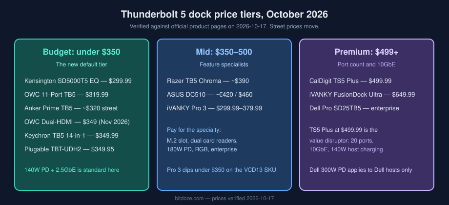
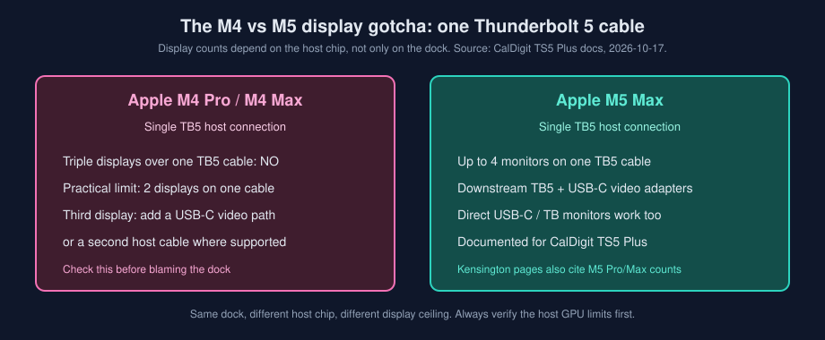
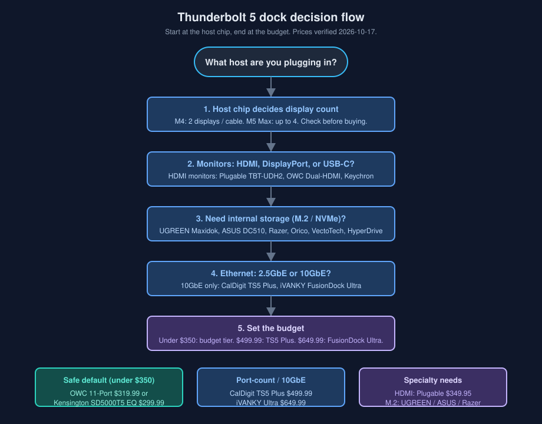

import Button from "@components/widgets/Button.astro";
import Notice from "@components/widgets/Notice.astro";
import ListCheck from "@components/widgets/ListCheck.astro";
import Accordion from "@components/widgets/Accordion.astro";
import Tabs from "@components/widgets/Tabs.astro";
import Tab from "@components/widgets/Tab.astro";

We compared the best Thunderbolt 5 docks for 2026, from budget picks under $350 to premium dual-chip stations, with verified pricing, port counts, and M5 Pro/Max compatibility. The market moved fast this year. Certified Thunderbolt 5 now starts at $299.99, the 20-port CalDigit TS5 Plus lists at $499.99, and the dual-chip iVANKY FusionDock Ultra tops out at $649.99.

This guide covers 12 Thunderbolt 5 docking stations in depth across three price tiers, plus six 2026 contenders. Every price below was checked against official product pages on 2026-10-17. Whether you are a content creator, developer, or running a multi-monitor desk, there is a Thunderbolt 5 dock here that fits without overpaying. If the laptop is a MacBook Pro, the [Best Thunderbolt 5 Dock for MacBook Pro](/best-tb5-dock-macbook-pro/) guide works through charging wattage and per-chip display limits first.

<Notice type="warning" title="Affiliate Disclosure">
Some links in this guide are affiliate links. If you buy through them, we may earn a small commission at no extra cost to you. This helps us keep testing and updating these recommendations.
</Notice>

## What changed for Thunderbolt 5 docks in late 2026

If you read the earlier version of this guide, here is the short version of what moved between June and October 2026:

- **The price reset.** CalDigit dropped the TS5 Plus to $499.99 MSRP. OWC sells its 11-port dock at $319.99 direct. Kensington's certified SD5000T5 EQ is $299.99. The old "$650 for premium, $400 for budget" framing is dead.
- **The dual-HDMI wave.** Kensington shipped the SD5010T5 with HDMI outputs (TechRadar, 2026-06-18). Plugable's TBT-UDH2 went from CES demo to a live $349.95 product page. OWC announced a dual-HDMI Thunderbolt 5 dock for $349, shipping November 2026 (Newsshooter, 2026-09-08). If your monitors only take HDMI, you no longer need adapters.
- **Dock-plus-storage became normal.** UGREEN's Revodok Maxidok 17-in-1 ships with an M.2 NVMe slot and took Tom's Hardware's top sub-$400 spot (2026-07-31). Orico, VectoTech, and HyperDrive all launched storage docks in the same window. That path used to belong to the ASUS DC510 and Razer alone.
- **M5 Pro/Max Macs are Thunderbolt 5 hosts.** CalDigit and Kensington both document display counts for M5 Pro and M5 Max chips, and AppleInsider reviewed a Mac mini M5 Pro on 2026-10-05. The host list is no longer just M4 Pro/Max.

Cost reality check: a good Thunderbolt 5 dock now starts under $350. Premium starts at $499.99 with the CalDigit TS5 Plus, which is a 20-port dock with 10GbE that would have been a $700 product a year ago. Street prices swing hard around sale events (Prime Big Deal Days in October had steep dock discounts per AppleInsider, 2026-10-06), so it is worth checking [Black Friday home server deals](/black-friday-home-server-deals/) if you are buying in Q4.

<Notice type="info" title="Prices verified">
All prices in this guide were verified against official product pages on 2026-10-17. The TS5 alternatives and hubs sections use Amazon prices checked on 2026-10-23. Street prices move, especially on Amazon. Check the links before you buy.
</Notice>

## Quick comparison overview

| **Category** | **Best Budget** | **Best Value** | **Best Productivity** | **Best under $350 (new)** |
|--------------|-----------------|----------------|-----------------------|---------------------------|
| **Dock** | Kensington SD5000T5 EQ | OWC 11-Port TB5 | CalDigit TS5 Plus | Plugable TBT-UDH2 |
| **Price** | $299.99 official | $319.99 direct | $499.99 MSRP | $349.95 |
| **Best for** | Certified TB5 at the lowest price | Active cooling, UHS-II, triple 8K | 20 ports, 10GbE, 140W host charge | Dual HDMI 2.1, TAA compliance |

## Quick pick: choose in 30 seconds

- Most ports + dual-chip + 10GbE → [iVANKY FusionDock Ultra](#ivanky-fusiondock-ultra-dual-chip-powerhouse-top-pick) (26 ports, 10GbE, quad display, $649.99)
- Maximum ports + professional networking at $499.99 → [CalDigit TS5 Plus](#caldigit-ts5-plus-20-port-powerhouse) (20 ports, 10GbE)
- Best overall value → [OWC 11-Port Thunderbolt 5 Dock](#owc-11-port-thunderbolt-5-docking-station) ($319.99)
- Lowest price with TB5 certification → [Kensington SD5000T5 EQ](#kensington-sd5000t5-eq-thunderbolt-5-dock-k34050ww) ($299.99)
- Dual HDMI 2.1 without adapters → [Plugable TBT-UDH2](#plugable-tbt-udh2-16-in-1-dual-hdmi-21) ($349.95, 16-in-1)
- Budget with polish, dual-HDMI option → [Keychron Thunderbolt 5 Dock 14-in-1](#keychron-thunderbolt-5-dock-14-in-1) ($349.99)
- Dock + internal NVMe storage on a budget → [UGREEN Revodok Maxidok 17-in-1](#ugreen-revodok-maxidok-17-in-1-m2-nvme)
- Content creators + dual card readers → [ASUS Master Thunderbolt 5 Dock DC510](#asus-master-thunderbolt-5-dock-dc510) (SD + microSD, 2.5GbE, M.2 slot)
- MacBook Pro/Max + highest charging → [iVANKY FusionDock Pro 3](#ivanky-fusiondock-pro-3-thunderbolt-5) (180W PD, from $299.99)
- Gaming, RGB, and internal SSD → [Razer Thunderbolt 5 Dock Chroma](#razer-thunderbolt-5-dock-chroma) (M.2 slot)
- Compact design with a built-in fan and active cooling → [Anker Prime TB5](#anker-prime-tb5-docking-station-14-in-1) (street ~$320)
- Business/enterprise + remote management → [Dell Pro SD25TB5](#dell-pro-thunderbolt-5-smart-dock-sd25tb5) (up to 300W PD on Dell)
- Something cheaper than the CalDigit TS5 → [TS5 alternatives](#caldigit-ts5-alternatives-cheaper), or a [Thunderbolt 5 hub](#thunderbolt-5-hubs-when-you-only-need-ports) from $179.99

Tap a link to jump straight to the model.

## Understanding Thunderbolt 5 technology

Before looking at specific models, it helps to know what Thunderbolt 5 changes and where the marketing runs ahead of the spec.

### Thunderbolt 5 benefits

- **80Gbps standard, 120Gbps with Bandwidth Boost**: three times the usable bandwidth of Thunderbolt 4 in the boost scenario, which matters when you push several high-refresh displays plus storage at once.
- **Multiple 8K displays**: dual 8K@60Hz or triple 4K@144Hz from one connection, host GPU permitting.
- **240W power delivery ceiling**: via USB PD 3.1 EPR. That is the standard's ceiling, not a per-dock guarantee. Most docks in this guide deliver 140W to the host.
- **Backward compatibility**: works with Thunderbolt 4, USB4, and USB-C devices, at reduced speeds where the cable or host limits it.

### Port technology explained

Thunderbolt 5 docks mix port types on purpose. Know what you are looking at before counting ports:

- **Thunderbolt 5 downstream**: full 80Gbps per port, 120Gbps with Bandwidth Boost on the host link. These ports also carry video.
- **USB-C 10Gbps**: fine for storage and peripherals, no PCIe tunneling, usually lower charging wattage (7.5W to 36W depending on the dock).
- **USB-A 3.2 Gen 2 (10Gbps)**: legacy devices, keyboards, dongles, card readers.
- **2.5GbE vs 10GbE**: 2.5GbE is the standard on most docks and is enough for most desks. 10GbE (CalDigit TS5 Plus, iVANKY FusionDock Ultra) only pays off if your switch and NAS speak 10GbE too. See [best 2.5GbE and 10GbE switches for a homelab](/best-2-5-10gbe-switch-homelab/) if you are building that side.

### Power delivery: 240W standard, 300W Dell-only

<Notice type="warning" title="240W, not 300W">
Thunderbolt 5's standard power ceiling is 240W (USB PD 3.1 EPR). You will see "up to 300W" in dock marketing. The Dell Pro SD25TB5 does deliver up to 300W, but only to Dell systems with the matching power implementation. On everything else, expect 140W host charging as the norm, 180W on the iVANKY FusionDock Pro 3.
</Notice>

Practical tiers you will see in this guide:

- **140W**: charges every current MacBook Pro 16-inch at full rate. Enough for nearly everyone.
- **180W (iVANKY FusionDock Pro 3)**: for high-draw mobile workstations.
- **300W (Dell SD25TB5, Dell systems only)**: desktop-replacement Dell workstations.

Per-port charging is separate from host charging. The CalDigit TS5 Plus, for example, pushes 140W to the host, 36W from each downstream Thunderbolt 5 port, 36W + 20W from the two front USB-C ports, and 7.5W from the remaining USB ports. Read the per-port numbers if you plan to charge a tablet or phone from the dock daily.

### Thunderbolt 5 vs Thunderbolt 4

- **Bandwidth**: 80/120Gbps vs 40Gbps. This is what unlocks dual 8K and high-refresh triple 4K without compression tricks.
- **Displays**: TB4 typically drives dual 4K. TB5 drives dual 8K@60 or triple 4K@144.
- **Power**: TB4 tops out around 100W charging. TB5 docks commonly do 140W, with a 240W standard ceiling.
- **When TB4 is enough**: single 4K display, office work, web apps, and a laptop that only has TB4 anyway. A TB4 dock is still cheaper. Do not buy TB5 for a machine that cannot use it.

<Notice type="info" title="Upgrade decision">
Choose Thunderbolt 5 if you run high-resolution or high-refresh displays, move large files daily, or want the dock to survive your next two laptops. Stay on TB4 for basic productivity. Pair any dock with a display that can use the bandwidth, like the [best 32-inch 4K OLED monitors](/best-32-inch-oled-monitors-guide/) we track.
</Notice>

### Which hosts support Thunderbolt 5? (2026 list)

As of October 2026, Thunderbolt 5 hosts include:

- MacBook Pro M4 Pro/Max (2024) and MacBook Pro M5 Pro/Max (2026)
- Mac mini M4 Pro (2024) and Mac mini M5 Pro (reviewed by AppleInsider, 2026-10-05)
- Mac Studio M4 Max / M3 Ultra (2025)
- Select Intel Core Ultra (15th-gen) laptops
- Razer Blade 18 and other high-end Windows machines with TB5 controllers

OS floor: macOS 14+ or Windows 11 23H2+. Kensington publishes this requirement on its dock pages.

<Notice type="info" title="Display compatibility">
The biggest pre-purchase gotcha in 2026 is the host chip, not the dock. M4 Apple Macs do not support triple displays via a single Thunderbolt 5 host connection. With the M5 Max, the CalDigit TS5 Plus supports up to 4 monitors on one Thunderbolt 5 connection. Same dock, different ceiling. Check your chip before you blame the hardware.
</Notice>

Cable rules, in short: passive Thunderbolt 5 cables hold full performance at about 0.8m. Active TB5 cables reach about 2m at 80Gbps. Longer runs fall back to lower bandwidth. The troubleshooting section below covers what to do when a display will not light up.

## Budget-friendly Thunderbolt 5 docks (under $350)

This is the tier that changed the most in 2026. Six months ago "budget Thunderbolt 5" meant one dock. Now five ranked picks land under $350 with 140W host charging and 2.5GbE as the baseline.

### Kensington SD5000T5 EQ Thunderbolt 5 Dock (K34050WW)

{/* VERIFY: confirm the /go/kensington-sd5000t5/ redirect still points at the EQ SKU (K34050WW). Older part numbers (K34020WW etc.) appear superseded. Amazon street price of ~$195 could not be verified on 2026-10-17 (bot-blocked); official price is $299.99. 2026-10-23: the redirect lands on the non-EQ K35201NA (ASIN B0DGTCXHZX), $226.98, 3.4 stars from 64. Repoint once an EQ listing exists on Amazon. */}

#### Specifications

| Feature | Details |
|---------|---------|
| **Thunderbolt standard** | Thunderbolt 5 (Intel certified) |
| **Total ports** | 11 ports |
| **TB5 downstream ports** | 3x Thunderbolt 5 (80Gbps) |
| **USB ports** | 3x USB-A 3.2 Gen 2 (10Gbps) |
| **Video output** | Native TB5 video |
| **Display support** | Triple 4K@120Hz / dual 8K@60Hz |
| **Power delivery** | 140W PD |
| **Ethernet** | 2.5GbE |
| **Card reader** | SD + microSD (UHS-II, SD4) |
| **Cooling** | Passive |

#### Highlights

- Intel certified Thunderbolt 5, so compatibility is guaranteed rather than hoped for.
- Three downstream TB5 ports at this price is unusual. Most rivals give you two.
- Dual UHS-II card readers (SD + microSD) on a $299 dock. Kensington added this to the EQ revision.
- Plug-and-play on Windows 11 23H2+ and macOS 14+. TB5 cable included.

<Notice type="info" title="Best entry-level TB5 dock">
The SD5000T5 EQ has the main Thunderbolt 5 features at the lowest official price we tracked: $299.99 from Kensington. The model name changed mid-cycle. The current SKU is the SD5000T5 EQ, part K34050WW. Older non-EQ listings may still appear on retailer sites.
</Notice>

> **Best for**: certified compatibility at the lowest price, triple 4K setups, anyone who wants three downstream TB5 ports without paying $400+

<Button text="Check Kensington SD5000T5 EQ Price" link="/go/kensington-sd5000t5/" size="lg" color="blue" variant="solid" />

---

### OWC 11-Port Thunderbolt 5 Docking Station

#### Specifications

| Feature | Details |
|---------|---------|
| **Thunderbolt standard** | Thunderbolt 5 |
| **Total ports** | 11 ports |
| **TB5 downstream ports** | 3x Thunderbolt 5 (80Gbps) |
| **USB ports** | 2x USB-A 10Gbps, 1x USB-A 5Gbps |
| **Video output** | TB5 + DisplayPort 2.1 |
| **Display support** | Triple 8K@60Hz / quad 4K@60Hz |
| **Power delivery** | 140W PD |
| **Ethernet** | 2.5GbE |
| **Card reader** | SD + microSD 4.0 UHS-II |
| **Cooling** | Active cooling |

#### Highlights

- Premium aluminum build with active cooling that holds up under sustained transfers.
- DisplayPort 2.1 plus native TB5 video gives you real multi-monitor flexibility.
- UHS-II card readers on both SD and microSD.
- OWC sells direct at $319.99 with a strong warranty track record.

<Notice type="info" title="Best value">
At $319.99 direct from OWC, this is the default recommendation for most people. Active cooling, UHS-II readers, DP 2.1, and 140W charging at a budget-tier price. You only skip it if you need 10GbE.
</Notice>

> **Best for**: creative professionals, anyone wanting active cooling and UHS-II readers without the premium price

<Button text="Check OWC 11-Port TB5 Price" link="/go/owc-11-port-tb5/" size="lg" color="blue" variant="solid" />

---

### Plugable TBT-UDH2 (16-in-1, dual HDMI 2.1)

{/* VERIFY: Plugable's product page showed mixed in-stock / sold-out markers on 2026-10-17. Confirm stock status before treating this as an instant buy. */}

The Plugable TBT-UDH2 went from a CES 2026 announcement to a live product page at $349.95. It is the first Thunderbolt 5 dock built around dual HDMI 2.1 outputs, which matters if your monitors are HDMI-only and you are tired of DP-to-HDMI adapters.

#### Specifications

| Feature | Details |
|---------|---------|
| **Thunderbolt standard** | Thunderbolt 5 |
| **Total ports** | 16-in-1 |
| **Video output** | 2x HDMI 2.1 |
| **Power delivery** | 140W host PD + 2x 30W front USB-C |
| **Ethernet** | 2.5GbE |
| **Card reader** | SD + microSD (UHS-II) |
| **Compliance** | TAA compliant |
| **OS support** | macOS and Windows |

#### Highlights

- Native dual HDMI 2.1, so you skip the adapters and the DP alt-mode guessing.
- 140W to the host plus two 30W USB-C ports on the front. That is enough to fast-charge a phone and a tablet while the laptop runs at full rate.
- TAA compliance for government and defense procurement, which almost nothing else in this tier offers.

<Notice type="warning" title="Availability">
Stock on the TBT-UDH2 was mixed at the time of writing. Specs and price are confirmed on Plugable's product page, but check availability before planning a build around it.
</Notice>

> **Best for**: HDMI-monitor setups, desks that need clean HDMI cable runs, government procurement

{/* affiliate: PENDING /go/ redirect for Plugable TBT-UDH2. Interim link to official product page. */}
<Button text="Check Plugable TBT-UDH2 Price" link="https://plugable.com/products/tbt-udh2" size="md" color="blue" variant="outline" />

---

### Keychron Thunderbolt 5 Dock (14-in-1)

Keychron's first Thunderbolt 5 dock lands at $349.99 with 140W charging and 2.5GbE. Engadget reviewed it on 2026-09-25 and called it "unusually sensible", which is about the best compliment a dock can get. Tom's Hardware lists it in its sub-$400 roundup as one of the dual-HDMI options. Specs and published coverage only here, we have not had one on the bench.

#### Specifications

| Feature | Details |
|---------|---------|
| **Thunderbolt standard** | Thunderbolt 5 |
| **Total ports** | 14-in-1 |
| **Video output** | Dual HDMI option (per Tom's Hardware) |
| **Power delivery** | 140W PD |
| **Ethernet** | 2.5GbE |
| **Price** | $349.99 (keychron.com, 2026-10-17) |

#### Highlights

- The "budget with polish" pick. Clean industrial design at a budget-tier price.
- 140W host charging and 2.5GbE match docks that cost $100 more.
- Worth a look if you want dual HDMI without waiting on Plugable stock.

> **Best for**: buyers who want a polished dual-HDMI dock under $350

{/* affiliate: PENDING /go/ redirect for Keychron TB5 Dock. Interim link to official product page. */}
<Button text="Check Keychron TB5 Dock Price" link="https://www.keychron.com/products/keychron-thunderbolt-5-dock-14-in-1" size="md" color="blue" variant="outline" />

---

### UGREEN Revodok Maxidok 17-in-1 (M.2 NVMe)

The Maxidok is the budget pick that answers "what if the dock was also my scratch disk". It carries an M.2 NVMe slot, which puts it in direct competition with the ASUS DC510 and Razer docks at a lower price. AppleInsider reviewed it on 2026-09-24 and called it "best in class price to features balance". Tom's Hardware gave it the top spot in its sub-$400 roundup (2026-07-31) specifically because of the M.2 slot.

#### Specifications

| Feature | Details |
|---------|---------|
| **Thunderbolt standard** | Thunderbolt 5 |
| **Total ports** | 17-in-1 |
| **Storage expansion** | M.2 NVMe slot |
| **Power delivery** | 140W class |
| **Ethernet** | 2.5GbE class |

#### Highlights

- Dock plus internal storage in one box. One cable, one power brick, one less enclosure on the desk.
- If you would rather keep storage external and swap it between machines, look at the [best Thunderbolt 5 NVMe SSD enclosures](/best-tb5-nvme-enclosures/) instead. A separate enclosure is more flexible; an internal M.2 slot is tidier.

> **Best for**: content creators who want dock + scratch storage in one device without paying ASUS/Razer prices

{/* affiliate: PENDING /go/ redirect for UGREEN Maxidok. Interim link to official product page. */}
<Button text="Check UGREEN Maxidok Price" link="https://www.ugreen.com" size="md" color="blue" variant="outline" />

---

### More 2026 budget contenders

These are worth knowing about. Specs come from the linked coverage and vendor pages, not from hands-on testing here.

| **Model** | **Price** | **Standout feature** | **Coverage** |
|-----------|-----------|----------------------|--------------|
| Kensington SD5010T5 / SD5010T5 EQ | TBD | HDMI outputs for HDMI monitors | TechRadar 2026-06-18, Forbes 2026-06-28, Macworld 2026-07-23 |
| OWC Thunderbolt 5 Dock Dual HDMI | $349 | Native dual HDMI 2.1, UHS-II readers, 140W, 2.5GbE | Newsshooter 2026-09-08. Ships November 2026. {/* VERIFY: confirm ship date and price on release. */} |
| Orico TB5 Desktop Workstation | TBD | Storage-focused dock | AppleInsider 2026-09-30, PCWorld 2026-10-05 |
| VectoTech V-Core | TBD | M.2 storage | Tom's Hardware 2026-09-28 |
| HyperDrive Next (Hyper) | TBD | Up to 16TB internal SSD option, 10 ports | Macworld 2026-08-04, Windows Central 2026-08-22 |
| WAVLINK TB5 dock | Low | Price play from a no-name entrant | Tom's Hardware 2026-05-08 multi-dock test |

If you go the M.2 route on any of these, pair it with a proper NVMe drive. Our [best Thunderbolt 5 NVMe SSD enclosures](/best-tb5-nvme-enclosures/) picks carry over to dock M.2 slots too.

> **Best for**: shoppers who already know they want a specific shape of dock and are comparing the last two candidates

## Premium and mid-range Thunderbolt 5 docks

Mid tier is $350 to 500: Anker, Razer, ASUS, iVANKY Pro 3, and Dell. Premium starts at $499.99 with the CalDigit TS5 Plus and runs to the $649.99 iVANKY FusionDock Ultra. The tier labels are blurrier than they used to be now that a $499 dock has 20 ports and 10GbE.

### iVANKY FusionDock Ultra (dual-chip powerhouse, top pick)

{/* VERIFY: iVANKY's product JSON reads "host_charging": "96W" while the marketing copy says 140W throughout. Confirm the actual host charging spec before relying on "140W + 45W front". */}

#### Specifications

| Feature | Details |
|---------|---------|
| **Thunderbolt standard** | Thunderbolt 5 (dual-chip architecture) |
| **Total ports** | 26 ports |
| **TB5 downstream ports** | 4x USB-C 80/120Gbps downstream + 2x USB-C host |
| **USB ports** | 4x USB-A 10Gbps, 7x USB-C 10Gbps |
| **Video output** | TB5 + DisplayPort 2.1 + HDMI 2.0 |
| **Display support** | Quad 6K (Mac dependent) / dual 8K@60Hz |
| **Power delivery** | 140W host PD + 45W front PD {/* VERIFY: 96W vs 140W discrepancy on iVANKY's own page */} |
| **Ethernet** | 10GbE |
| **Card reader** | SD 4.0 UHS-II + microSD 4.0 UHS-II |
| **Audio** | 3.5mm combo + optical Toslink in/out |
| **Power supply** | 240W external adapter |
| **Cooling** | Dual-fan push-pull |
| **Price** | $649.99 (ivanky.com, 2026-10-17) |

#### Highlights

- **Dual-chip architecture** splits the workload between two Thunderbolt controllers. No bandwidth throttling when the displays, SSD, and 10GbE are all busy at once.
- **26 ports.** Still the most of any Thunderbolt 5 dock we track.
- **10GbE built in.** Most docks cap out at 2.5GbE.
- **Quad display on Apple Silicon Max-chip Macs** (host dependent).
- **Magnetic dual USB-C cable** that adapts between MacBook Pro and Mac mini/Studio.

#### Why I chose this dock

After two weeks of daily use, the FusionDock Ultra is the most capable Thunderbolt 5 dock I have tested. The dual-chip design means no bandwidth drops when running multiple monitors plus an SSD plus Ethernet simultaneously. The 10GbE port is a real differentiator. It is optimized for Apple Silicon, but Windows, Chromebook, and Intel Macs work too with limits (the quad-display feature is Apple Silicon territory).

<Notice type="success" title="Dual-chip advantage">
The FusionDock Ultra's dual-chip architecture removes the bandwidth bottleneck that single-chip docks hit. Each chip owns its set of ports and displays, so four monitors, an external SSD, and 10GbE at the same time does not cause a slowdown.
</Notice>

> **Best for**: Apple Silicon power users, developers with multi-monitor setups, creators who need 10GbE and quad displays, anyone tired of single-chip bandwidth limits

<Button text="Check iVANKY FusionDock Ultra Price" link="/go/ivanky-fusiondock-ultra/" size="lg" color="blue" variant="solid" />

**Full review**: [two-week iVANKY FusionDock Ultra review](/ivanky-fusiondock-ultra-review/)

---

### CalDigit TS5 Plus (20-port powerhouse)

#### Specifications

| Feature | Details |
|---------|---------|
| **Thunderbolt standard** | Thunderbolt 5 with Bandwidth Boost |
| **Total ports** | 20 ports |
| **TB5 downstream ports** | 2x Thunderbolt 5 downstream (80Gb/s), host port up to 120Gb/s |
| **USB ports** | 5x USB-C 10Gb/s + 5x USB-A 10Gb/s (dual controllers) |
| **Front USB-C** | 1x USB-C 36W + 1x USB-C 20W |
| **Video output** | TB5 + DisplayPort 2.1 |
| **Display support** | Dual 8K@60Hz / triple 4K@144Hz. M5 Max: up to 4 monitors on one TB5 connection |
| **Power delivery** | 140W host PD. Each downstream TB5 port charges at 36W. USB-C 7.5W, USB-A 7.5W |
| **Ethernet** | 10GbE |
| **Card reader** | SD 4.0 UHS-II + microSD 4.0 UHS-II |
| **Audio** | 3.5mm in/out + audio out |
| **Power supply** | 330W external PSU |
| **Price** | $499.99 MSRP (caldigit.com, 2026-10-17) |

#### Highlights

- **20 ports at $499.99** repositions the whole premium tier. This is the value pick of late 2026.
- **Dual USB controllers** spread bandwidth across ten USB ports instead of choking one bus.
- **10GbE** for NAS and enterprise networking.
- **SD + microSD, both UHS-II 4.0.** The microSD slot is easy to miss in older writeups and it matters for creators.
- **330W PSU** covers the worst-case load: 140W host, 36W per downstream TB5 port, front ports at 36W and 20W.

#### The M5 Max display fact

CalDigit documents something no other dock page states as clearly: M4 Apple Macs do not support triple displays via a single Thunderbolt 5 host connection, while with the M5 Max the TS5 Plus supports up to 4 monitors on one Thunderbolt 5 connection (downstream TB5 ports plus USB-C video adapters or direct USB-C/TB monitors). If you are on an M5 Max and counting displays, this is the dock spec that matters.

<Notice type="success" title="Professional's choice">
20 ports, 10GbE, 140W host charging, and a 330W PSU at $499.99. If you are cross-platform and want the most connectivity without the dual-chip price, this is the one to buy. For the head-to-head against Anker, see [our CalDigit TS5 vs Anker Prime TB5 head-to-head](/caldigit-ts5-vs-anker-prime-tb5/).
</Notice>

> **Best for**: maximum ports on a cross-platform dock, 10GbE workflows, M5 Max multi-monitor desks

<Button text="Check CalDigit TS5-Plus Price" link="/go/caldigit-ts5-plus/" size="lg" color="blue" variant="solid" />

---

### Anker Prime TB5 Docking Station (14-in-1)

{/* VERIFY: MSRP is $399.99. Street price was ~$319.99 ("$80 off") per CNET 2026-08-28. Amazon price is JS-blocked to bots; confirm current street price before publishing. */}

#### Specifications

| Feature | Details |
|---------|---------|
| **Thunderbolt standard** | Thunderbolt 5 |
| **Total ports** | 14 ports |
| **TB5 downstream ports** | 2x Thunderbolt 5 (80Gbps) |
| **USB ports** | 6x USB-A 10Gbps, 2x USB-C 10Gbps |
| **Video output** | TB5 + HDMI 2.1 + DisplayPort 2.1 |
| **Display support** | Dual 8K@60Hz |
| **Power delivery** | 140W PD |
| **Ethernet** | 2.5GbE |
| **Card reader** | SD UHS-II |
| **Audio** | 3.5mm jack |
| **Special features** | Built-in cooling fan, ambient lighting |
| **Price** | $399.99 MSRP. ~$319.99 street (CNET, 2026-08-28) {/* VERIFY: current street price */} |

#### Highlights

- Compact cube design that looks good next to a Mac mini.
- Built-in active cooling prevents thermal throttling on long transfers.
- HDMI 2.1 + DP 2.1 gives you both major display standards without adapters.
- AnkerDock Manager software for firmware updates.

> **Best for**: design-conscious desks, anyone who wants HDMI + DP outputs in a compact shell

<Button text="Check Anker Prime TB5 Price" link="/go/anker-prime-tb5/" size="lg" color="blue" variant="solid" />

Spec-by-spec against the CalDigit? [Our CalDigit TS5 vs Anker Prime TB5 head-to-head](/caldigit-ts5-vs-anker-prime-tb5/) covers the trade-offs.

---

### Razer Thunderbolt 5 Dock Chroma

{/* VERIFY: street price around $390 could not be confirmed on 2026-10-17 (Amazon bot-blocked). */}

#### Specifications

| Feature | Details |
|---------|---------|
| **Thunderbolt standard** | Thunderbolt 5 |
| **Total ports** | 11 ports |
| **TB5 downstream ports** | 4x Thunderbolt 5 (80Gbps) |
| **USB ports** | 2x USB-A 10Gbps, 1x USB-C 10Gbps |
| **Display support** | Triple 4K@144Hz |
| **Power delivery** | 140W PD |
| **Ethernet** | 1GbE |
| **Card reader** | UHS-II SD slot |
| **Audio** | 3.5mm with 7.1 surround |
| **Special features** | M.2 SSD expansion (up to 8TB), Razer Chroma RGB |
| **Price** | ~$390 street {/* VERIFY */} |

#### Highlights

- M.2 SSD expansion for up to 8TB of internal storage. Same idea as the ASUS DC510 and UGREEN Maxidok, gaming-flavored.
- Four TB5 downstream ports, the most in this price band.
- TB Share for device switching, Chroma RGB if that is your thing.

For the storage angle on M.2 docks in general, our [best Thunderbolt 5 NVMe SSD enclosures](/best-tb5-nvme-enclosures/) testing applies to the drives you drop in these slots too. And if you are choosing between this and the ASUS, the [ASUS DC510 vs Razer Thunderbolt 5 Dock comparison](/asus-vs-razer-thunderbolt-5-comparison/) lays out the differences.

> **Best for**: gamers and enthusiasts who want internal storage and RGB on a TB5 dock

<Button text="Check Razer TB5 Dock Price" link="/go/razer-tb5-dock/" size="lg" color="blue" variant="solid" />

---

### ASUS Master Thunderbolt 5 Dock DC510

{/* VERIFY: price around €420 / $460 was not confirmable on 2026-10-17 (Amazon bot-blocked). */}

#### Specifications

| Feature | Details |
|---------|---------|
| **Thunderbolt standard** | Thunderbolt 5 |
| **Total ports** | 13 ports |
| **TB5 downstream ports** | 3x Thunderbolt 5 (80Gbps) |
| **USB ports** | 3x USB-A 10Gbps, 1x USB-A 5Gbps |
| **Display support** | Triple 4K@144Hz / dual 8K@60Hz |
| **Power delivery** | 140W PD |
| **Ethernet** | 2.5GbE |
| **Card reader** | SD 4.0 UHS-II + microSD UHS-II |
| **Special features** | M.2 NVMe PCIe 4.0 slot, RGB ambient lighting, SSD cooling pad |
| **Price** | ~€420 / $460 {/* VERIFY */} |

#### Highlights

- M.2 NVMe PCIe 4.0 expansion with a toolless magnetic cover.
- Dual card readers (SD + microSD UHS-II) for working across camera formats.
- SSD cooling pad included. Thermal headroom for sustained NVMe transfers.
- 180W power adapter and a Thunderbolt 5 cable in the box.

#### Real-world performance

Tested with a MacBook M1 Pro and Mac mini M4 Pro:

- Dual 4K displays at 144-165Hz
- SSD reads: 5,800 MB/s with a WD_BLACK SN850X
- SSD writes: 4,300 MB/s
- Stable with multiple peripherals attached

The SSD numbers are Thunderbolt 5 figures from the Mac mini M4 Pro. The MacBook M1 Pro is a TB4 host, so over that machine the link caps out around 3 GB/s.

<Notice type="info" title="Content creator's choice">
The DC510 is the creator pick in the mid tier. Dual card readers, 2.5GbE, and strong SSD performance. The active cooling is audible under load. Full numbers in the [full ASUS DC510 review with real-world benchmarks](/asus-thunderbolt-5-dock-dc510-review/).
</Notice>

> **Best for**: photographers and videographers who need card readers plus internal storage

<Button text="Check ASUS DC510 Price" link="https://go.bitdoze.com/asus-dc510" size="lg" color="blue" variant="solid" />

**Full review**: [ASUS Master Thunderbolt 5 Dock DC510 review with real-world benchmarks](/asus-thunderbolt-5-dock-dc510-review/)

---

### iVANKY FusionDock Pro 3 Thunderbolt 5

{/* VERIFY: 180W host charging claim. Confirm before publishing. */}

#### Specifications

| Feature | Details |
|---------|---------|
| **Thunderbolt standard** | Thunderbolt 5 (Intel DBF7052 certified) |
| **Total ports** | 11 ports |
| **TB5 downstream ports** | 3x Thunderbolt 5 (80Gbps/120Gbps) |
| **USB ports** | 4x USB-A 10Gbps, 2x USB-C 10Gbps |
| **Video output** | TB5 + HDMI + DisplayPort |
| **Display support** | Single 8K / dual 6K@60Hz (Mac) / dual 8K@60Hz (Windows) |
| **Power delivery** | 180W PD |
| **Ethernet** | 2.5GbE |
| **Card reader** | SD/TF 4.0 |
| **Price** | $299.99 (VCD13) / $379.99 (VCD13A) (ivanky.com, 2026-10-17) |

#### Highlights

- 180W host charging, the highest in this tier. The VCD13A variant is the higher-spec SKU at $379.99; the VCD13 at $299.99 is the value entry.
- Intel certified DBF7052 chipset.
- Bandwidth Boost support for 120Gbps.
- Mac-optimized, with the aluminum build iVANKY uses across the FusionDock line.

> **Best for**: MacBook Pro/Max users who want 180W charging without paying Ultra prices

On October 23 the Amazon listing said "Currently unavailable". iVANKY still lists both versions on its own store.

<Button text="Check iVANKY FusionDock Pro 3 Price" link="/go/ivanky-fusiondock-pro-3/" size="lg" color="blue" variant="solid" />

---

### Dell Pro Thunderbolt 5 Smart Dock (SD25TB5)

{/* VERIFY: Dell SD25TB5 price. Dell's page is JS-rendered and did not expose a price on 2026-10-17. */}

#### Specifications

| Feature | Details |
|---------|---------|
| **Thunderbolt standard** | Thunderbolt 5 |
| **Total ports** | 12+ ports |
| **TB5 downstream ports** | 2x Thunderbolt 5 (80Gbps) |
| **USB ports** | 6x USB (mixed A/C) |
| **Video output** | HDMI 2.1 + 2x DisplayPort 2.1 |
| **Display support** | Up to 4x 4K@120Hz |
| **Power delivery** | Up to 300W PD (Dell systems only) |
| **Ethernet** | 2.5GbE with MAC pass-through |
| **Special features** | Smart dock management, enterprise features |
| **Price** | Check Dell direct {/* VERIFY: JS-rendered page */} |

#### Highlights

- Up to 300W power delivery on Dell systems. This is a Dell-specific implementation, not the TB5 standard's 240W ceiling.
- Enterprise management with remote monitoring for IT fleets.
- MAC address pass-through for 802.1X and NAC environments.

> **Best for**: Dell laptop fleets, IT departments that need remote dock management

<Button text="Check Dell Pro TB5 Dock Price" link="/go/dell-pro-tb5-sd25tb5/" size="lg" color="blue" variant="solid" />

---

## CalDigit TS5 alternatives (cheaper)

The [CalDigit TS5](/go/caldigit-ts5/) is the dock most people measure the others against. On October 23 it was $399.95 on Amazon, sold by CalDigit, with 12 left. For that you get 15 ports, three downstream TB5 ports, 140W host charging, 2.5GbE, SD and microSD UHS-II, and no fan. If you want most of that for less money, here is what I would look at. Prices are Amazon, October 23.

| **Option** | **Price (Oct 23)** | **What you give up vs the TS5** | **Why it's on the list** |
|------------|--------------------|----------------------------------|--------------------------|
| [OWC 11-Port TB5](/go/owc-11-port-tb5/) | $319.99 (OWC's own offer, no buy box) | Four ports | Still three downstream TB5, DisplayPort 2.1, UHS-II readers, and 140W. My pick if you just want to save $80 |
| [Anker Prime TB5](/go/anker-prime-tb5/) | $339.99 for the dock alone (list $399.99). The link opens the dock + TB5 cable bundle at $347.86 | One downstream TB5 port, and video comes from one shared HDMI/DP output. It has a fan | Small cube for Windows and macOS desks. Full comparison in [TS5 vs Anker Prime TB5](/caldigit-ts5-vs-anker-prime-tb5/) |
| [Kensington SD5000T5](/go/kensington-sd5000t5/) | $226.98, sold by Amazon (list $299.99) | Reviews: 3.4 stars from 64 ratings | Cheapest dock here. It is the older non-EQ model (K35201NA), not the EQ covered above. Update the firmware the day it arrives |
| WAVLINK Thunderbolt 5 dock (Intel certified) | $199 in Amazon search, 4.2 stars from 151 | Firmware history and support | Price only. Read the [buy-or-skip note](#buy-or-skip-quick-bullets-for-each-dock) on no-name docks first |
| [CalDigit Element 5 Hub](/go/caldigit-element-5-hub/) | $249.99, sold by CalDigit | Ethernet, card readers, audio, DisplayPort, and charging drops to 90W | Same vendor and firmware tooling, for desks that only need more ports. See [hubs](#thunderbolt-5-hubs-when-you-only-need-ports) below |

If you want TS5-class ports for less, buy the OWC. If the TS5's Ethernet jack and card readers would never get used, the Element 5 Hub is the better buy. The iVANKY FusionDock Pro 3 would make this list on price, but its Amazon listing showed "Currently unavailable" on October 23.

## Thunderbolt 5 hubs: when you only need ports

A hub is the cheaper route when the laptop already has Ethernet, or the card reader would collect dust. You get extra Thunderbolt 5 ports and some USB. No Ethernet, no SD slot, no audio jack.

| **Hub** | **Price (Oct 23)** | **Ports** | **Host charging** | **Notes** |
|---------|--------------------|-----------|-------------------|-----------|
| [OWC Thunderbolt 5 Hub](/go/owc-tb5-hub/) | $179.99, sold by OWC (list $189.99) | 3 downstream TB5 + 1 USB-A 10Gbps | Up to 140W | 4.4 stars from 502 ratings. The same listing sells TB4 ($149.99) and USB4 ($129.99) versions, so check the selector says Thunderbolt 5 |
| [CalDigit Element 5 Hub](/go/caldigit-element-5-hub/) | $249.99, sold by CalDigit | 3 downstream TB5, 3 USB-A + 2 USB-C 10Gbps | 90W | 4.5 stars from 155 ratings. More USB than the OWC. Ships with a 0.8m cable and a 180W power supply |

The charging number is the one to check. A 16-inch MacBook Pro wants 140W, so on the Element 5 Hub it charges slower under load. On a 14-inch or a Windows ultrabook, 90W is fine. Displays run through the downstream TB5 ports on both hubs, so you need monitors with USB-C or Thunderbolt input, or a USB-C to DisplayPort cable.

---

## Complete dock specifications comparison

One consistent table per tier. Every price below was verified on 2026-10-17.

### Budget tier (under $350)

| **Specification** | [**Kensington SD5000T5 EQ**](#kensington-sd5000t5-eq-thunderbolt-5-dock-k34050ww) | [**OWC 11-Port TB5**](#owc-11-port-thunderbolt-5-docking-station) | [**Plugable TBT-UDH2**](#plugable-tbt-udh2-16-in-1-dual-hdmi-21) | [**Keychron TB5 14-in-1**](#keychron-thunderbolt-5-dock-14-in-1) |
|-------------------|----------------------------|---------------------------|------------------------------|--------------------------------|
| **Thunderbolt standard** | TB5 (Intel certified) | TB5 | TB5 | TB5 |
| **Total ports** | 11 | 11 | 16-in-1 | 14-in-1 |
| **TB5 downstream** | 3x TB5 (80Gbps) | 3x TB5 (80Gbps) | TB5 + dual HDMI 2.1 | Dual HDMI option |
| **Display support** | Triple 4K@120Hz / dual 8K@60Hz | Triple 8K@60Hz / quad 4K@60Hz | Dual HDMI 2.1 | Dual HDMI |
| **Power delivery** | 140W | 140W | 140W + 2x 30W front | 140W |
| **Ethernet** | 2.5GbE | 2.5GbE | 2.5GbE | 2.5GbE |
| **Card reader** | SD + microSD UHS-II | SD + microSD UHS-II | SD + microSD UHS-II | Not specified |
| **Cooling** | Passive | Active | Active | Active |
| **Price** | $299.99 | $319.99 | $349.95 | $349.99 |

### Premium and mid-range tier

| **Specification** | [**iVANKY FusionDock Ultra**](#ivanky-fusiondock-ultra-dual-chip-powerhouse-top-pick) | [**CalDigit TS5 Plus**](#caldigit-ts5-plus-20-port-powerhouse) | [**Anker Prime TB5**](#anker-prime-tb5-docking-station-14-in-1) | [**Razer TB5 Chroma**](#razer-thunderbolt-5-dock-chroma) | [**ASUS DC510**](#asus-master-thunderbolt-5-dock-dc510) | [**iVANKY Pro 3**](#ivanky-fusiondock-pro-3-thunderbolt-5) | [**Dell SD25TB5**](#dell-pro-thunderbolt-5-smart-dock-sd25tb5) |
|-------------------|:---:|:---:|:---:|:---:|:---:|:---:|:---:|
| **Thunderbolt standard** | TB5 dual-chip | TB5 + Bandwidth Boost | TB5 | TB5 | TB5 | TB5 (Intel certified) | TB5 |
| **Total ports** | 26 | 20 | 14 | 11 | 13 | 11 | 12+ |
| **TB5 downstream** | 4x USB-C (80/120Gbps) + 2x host | 2x TB5 (80Gb/s), host up to 120Gb/s | 2x TB5 (80Gbps) | 4x TB5 (80Gbps) | 3x TB5 (80Gbps) | 3x TB5 (80/120Gbps) | 2x TB5 (80Gbps) |
| **USB ports** | 4x USB-A + 7x USB-C 10Gbps | 5x USB-C + 5x USB-A 10Gb/s | 6x USB-A + 2x USB-C 10Gbps | 2x USB-A + 1x USB-C 10Gbps | 3x USB-A 10Gbps + 1x USB-A 5Gbps | 4x USB-A + 2x USB-C 10Gbps | 6x USB (mixed) |
| **Front USB-C charging** | 45W | 36W + 20W | No | No | No | No | No |
| **Video output** | TB5 + DP 2.1 + HDMI 2.0 | TB5 + DP 2.1 | TB5 + HDMI 2.1 + DP 2.1 | Native TB5 | Native TB5 | TB5 + HDMI + DP | HDMI 2.1 + 2x DP 2.1 |
| **Display support** | Quad 6K (Mac) / dual 8K@60Hz | Dual 8K@60Hz / triple 4K@144Hz. M5 Max: up to 4 monitors | Dual 8K@60Hz | Triple 4K@144Hz | Triple 4K@144Hz / dual 8K@60Hz | Single 8K / dual 6K@60Hz (Mac) | 4x 4K@120Hz |
| **Power delivery** | 140W host + 45W front | 140W host | 140W | 140W | 140W | 180W | Up to 300W (Dell only) |
| **Ethernet** | 10GbE | 10GbE | 2.5GbE | 1GbE | 2.5GbE | 2.5GbE | 2.5GbE + MAC pass-through |
| **Card reader** | SD + microSD UHS-II | SD + microSD UHS-II 4.0 | SD UHS-II | UHS-II SD | SD + microSD UHS-II | SD/TF 4.0 | Not specified |
| **Special features** | Dual-chip, quad display, magnetic cable, optical audio | Dual USB controllers, 330W PSU | Cooling fan, ambient lighting | M.2 slot, Chroma RGB | M.2 slot, SSD cooling pad, RGB | Mac optimization, Bandwidth Boost | Enterprise management |
| **Platform focus** | Optimized for Apple Silicon (Windows works with limits) | Cross-platform | Cross-platform | Cross-platform | Cross-platform | Mac-optimized | Dell / enterprise |
| **Price** | $649.99 | $499.99 | $399.99 MSRP (~$320 street) | ~$390 street | ~€420 / $460 | $299.99 / $379.99 | Enterprise pricing |

### Quick decision matrix

| **Category** | **Top pick** | **Runner-up** | **Budget pick** |
|--------------|-------------|---------------|-----------------|
| **Most ports** | iVANKY FusionDock Ultra (26) | CalDigit TS5 Plus (20) | Plugable TBT-UDH2 (16) |
| **Best display support** | iVANKY FusionDock Ultra (quad 6K) | OWC 11-Port (triple 8K) | Plugable TBT-UDH2 (dual HDMI 2.1) |
| **Highest power delivery** | Dell SD25TB5 (300W, Dell) | iVANKY FusionDock Pro 3 (180W) | Kensington SD5000T5 EQ (140W) |
| **Best networking** | iVANKY Ultra / CalDigit TS5 Plus (10GbE) | ASUS DC510 (2.5GbE) | OWC 11-Port (2.5GbE) |
| **Storage expansion** | UGREEN Maxidok (M.2) | Razer / ASUS DC510 (M.2) | VectoTech V-Core (M.2) |
| **Best value** | OWC 11-Port ($319.99) | CalDigit TS5 Plus ($499.99) | Kensington SD5000T5 EQ ($299.99) |
| **Enterprise** | Dell SD25TB5 | CalDigit TS5 Plus | Plugable TBT-UDH2 (TAA) |

## Buy or skip? Quick bullets for each dock

<ListCheck>
<ul>
<li>**iVANKY FusionDock Ultra** ($649.99) if you need 26 ports, 10GbE, and quad displays on Apple Silicon</li>
<li>**CalDigit TS5 Plus** ($499.99) if you want maximum ports and 10GbE without the dual-chip price</li>
<li>**OWC 11-Port** ($319.99) as the default for most desks</li>
<li>**Kensington SD5000T5 EQ** ($299.99) as the certified floor</li>
<li>**Plugable TBT-UDH2** ($349.95) if your monitors are HDMI-only</li>
</ul>
</ListCheck>

The longer version, dock by dock:

- **iVANKY FusionDock Ultra**
  - Buy if: you run Apple Silicon with multi-monitor setups and need 26 ports, 10GbE, quad display, and no bandwidth throttling.
  - Skip if: you are on Windows/Intel Mac as a primary, need a built-in NVMe slot, or want a power button.
- **CalDigit TS5 Plus**
  - Buy if: you want maximum ports, dual USB controllers, and 10GbE at $499.99.
  - Skip if: you do not need 10GbE and can save $180 with the OWC.
- **Kensington SD5000T5 EQ**
  - Buy if: you want the lowest-cost Intel-certified TB5 dock with triple 4K and 140W PD.
  - Skip if: you need active cooling or more video outputs than native TB5 gives you.
- **OWC 11-Port Thunderbolt 5 Dock**
  - Buy if: you want active cooling, UHS-II readers, and flexible display outputs at $319.99.
  - Skip if: you require 10GbE or more than 11 ports.
- **Plugable TBT-UDH2**
  - Buy if: your monitors are HDMI-only, or you need TAA compliance.
  - Skip if: stock is out and you need the dock this week.
- **Keychron Thunderbolt 5 Dock 14-in-1**
  - Buy if: you want dual HDMI and a polished build under $350.
  - Skip if: you want proven firmware update history from a dock-focused vendor.
- **UGREEN Revodok Maxidok 17-in-1**
  - Buy if: you want dock plus internal M.2 storage in one box.
  - Skip if: you want to move the SSD between machines. Use an external [Thunderbolt 5 NVMe enclosure](/best-tb5-nvme-enclosures/) instead.
- **Anker Prime TB5**
  - Buy if: you value compact design with a built-in fan and both HDMI 2.1 + DP 2.1.
  - Skip if: you need 10GbE or more than 2 TB5 downstream ports.
- **Razer Thunderbolt 5 Dock Chroma**
  - Buy if: you want M.2 expansion, Chroma RGB, and four TB5 downstream ports.
  - Skip if: you need 2.5/10GbE. This dock has 1GbE.
- **ASUS Master Thunderbolt 5 Dock DC510**
  - Buy if: you need dual card readers, 2.5GbE, and M.2 expansion for content work.
  - Skip if: fan noise bothers you.
- **iVANKY FusionDock Pro 3**
  - Buy if: you need 180W PD and Mac-optimized dual-6K output.
  - Skip if: you require 10GbE.
- **Dell Pro SD25TB5**
  - Buy if: you manage Dell laptops and want 300W PD plus remote management.
  - Skip if: you are not in a Dell shop. The 300W only works on Dell systems.
- **WAVLINK and other no-name entrants**
  - Skip unless the price gap is huge. Certification and firmware support matter more on docks than almost any other peripheral. A dock that drops displays on wake will cost you more time than it saved.

## Which dock should you choose?

The short version: check the host chip first (it caps display count), then the monitor inputs, then storage and Ethernet needs, then set the budget. The tabs below run the same logic per persona.

<Tabs>
  <Tab name="Content creation">
    You need UHS-II card readers (SD + microSD), fast storage access, and at least 2.5GbE for NAS handoff. My pick is the ASUS DC510 for the card readers and M.2 slot at ~€420/$460, or the iVANKY FusionDock Ultra ($649.99) if you also need 10GbE and quad displays. The CalDigit TS5 Plus ($499.99) is the runner-up with SD + microSD UHS-II 4.0 and 10GbE; skip the Razer here, it has a single SD slot and 1GbE. On a budget, the OWC 11-Port ($319.99) still gives you UHS-II dual readers, or take the UGREEN Maxidok if you want dock plus internal NVMe.
  </Tab>
  <Tab name="Development">
    Display count comes first (triple 4K minimum), then reliable PD so the laptop charges under load, then stable Ethernet. I would buy the CalDigit TS5 Plus ($499.99) for 20 ports and 10GbE to a NAS, or the iVANKY FusionDock Ultra ($649.99) on Apple Silicon. On an M5 Max the TS5 Plus drives up to 4 monitors on one cable. The OWC 11-Port ($319.99) is the runner-up: two or three displays and 2.5GbE covers most dev desks. If the budget is tight, the Kensington SD5000T5 EQ ($299.99) handles triple 4K@120Hz, which is plenty for IDE plus docs plus browser.
  </Tab>
  <Tab name="Gaming and enthusiasts">
    You want high refresh on multiple displays and low-latency USB; internal storage for a game library is nice to have. The Razer TB5 Dock Chroma (~$390) gets you the M.2 slot, four TB5 ports, and Chroma, and you accept the 1GbE. The Anker Prime TB5 (street ~$320) is the runner-up if you prefer HDMI 2.1 plus DP 2.1 in a compact cube with active cooling. If internal storage matters more than RGB, the UGREEN Maxidok is the cheaper route.
  </Tab>
  <Tab name="Enterprise and business">
    Remote manageability, MAC pass-through for 802.1X, predictable firmware support, and a real warranty are the filters. For Dell fleets, the Dell Pro SD25TB5 (300W PD on Dell systems, dock management) is the obvious pick. The Plugable TBT-UDH2 ($349.95) fits where TAA compliance is required and Dell is not the standard. For mixed-platform fleets I would take the CalDigit TS5 Plus ($499.99). For bulk rollouts where certification and price both matter, the Kensington SD5000T5 EQ at $299.99 in volume keeps purchasing simple.
  </Tab>
</Tabs>

### Value-for-money ranking (October 2026)

1. **OWC 11-Port Thunderbolt 5 Dock** ($319.99) - active cooling, UHS-II, DP 2.1, 140W at a budget-tier price.
2. **Kensington SD5000T5 EQ** ($299.99) - certified TB5, 3x TB5 downstream, nothing extra.
3. **CalDigit TS5 Plus** ($499.99) - the premium-tier value pick. 20 ports and 10GbE at half the price this slot used to cost.
4. **iVANKY FusionDock Pro 3** ($299.99/$379.99) - 180W PD if that is your constraint.
5. **Anker Prime TB5** (~$320 street) - design and dual video outputs.
6. **Razer TB5 Chroma** (~$390) - gaming features and M.2 justify the price only if you use them.
7. **iVANKY FusionDock Ultra** ($649.99) - the most capable dock here, at a premium price.
8. **Dell SD25TB5** - enterprise features at enterprise pricing.

Mac users specifically: the [Best Thunderbolt 5 Dock for MacBook Pro](/best-tb5-dock-macbook-pro/) guide walks through charging wattage per model. If your bottleneck is storage rather than ports, look at [Thunderbolt 5 NVMe SSD enclosures](/best-tb5-nvme-enclosures/) instead of a bigger dock.

## After you buy: setup, verify and troubleshoot

Docks are "plug and play" until they are not. Here is how to confirm yours negotiated correctly and what to check when it does not.

### Verify on arrival

1. **Confirm Thunderbolt 5 link speed.** macOS: Apple menu → System Information → Thunderbolt. You should see the dock listed with link speed up to 80/120Gbps. Windows: Device Manager → USB4/Thunderbolt devices. If you see 20Gbps or 40Gbps, you are on a TB4/USB4 fallback (wrong cable, or a port that is not TB5).
2. **Confirm host charging wattage.** macOS: `ioreg -l | grep -i "AdapterPower"` or check the battery menu. Windows: Settings → System → Battery. If the dock claims 140W and the laptop shows 60W or 96W, suspect the cable first, then the dock's PSU.
3. **Confirm Ethernet link speed.** `ethtool eth0` on Linux, or the network adapter properties on Windows/macOS. A 2.5GbE port linking at 1Gbps is usually the switch port, not the dock. `iperf3` against another host on the LAN is the quick sanity check.
4. **Mount an SD card and copy a 1GB file.** UHS-II should sustain over 200MB/s on a UHS-II card. If you see ~90MB/s, the card is UHS-I, not the slot.

### Firmware updates are real maintenance

<Notice type="warning" title="Firmware updates are maintenance">
CalDigit publishes dedicated firmware-update procedures for the TS5 Plus and Element 5 Hub, and some of those updates are gated to specific macOS versions. Other vendors ship firmware too. Check the vendor's firmware page before you open a support ticket, and after any OS upgrade. A dock that "stopped working" after a macOS update is often a firmware lag, not dead hardware.
</Notice>

AnkerDock Manager (Anker) and similar vendor tools handle this on other docks. Do firmware updates with the laptop plugged into wall power, not on battery.

### Failure modes and fixes

| **Symptom** | **Likely cause** | **Fix** |
|-------------|------------------|---------|
| Display will not light up | Wrong cable, or DP vs HDMI path mismatch | Use the included certified TB5 cable (0.8m passive). Check that the monitor input matches the dock output (DP 2.1 vs HDMI 2.1 vs TB video). |
| Only 2 of 3 displays work on a Mac | M4 display limit over a single TB5 connection | Expected on M4 Pro/Max. M5 Max supports up to 4 monitors on one cable (CalDigit TS5 Plus). See the display-limits diagram above. |
| Laptop not charging at advertised wattage | Cable PD rating, or Dell-only 300W on a non-Dell host | Use a cable rated for the wattage. 300W on the SD25TB5 only applies to Dell systems. |
| Ethernet links at 1Gbps on a 2.5/10GbE dock | Switch or cable side | Check the switch port speed. See [best 2.5GbE and 10GbE switches for a homelab](/best-2-5-10gbe-switch-homelab/). |
| SD cards mount slow | UHS-I card in a UHS-II slot | The card is the limit. Test with a UHS-II card. |
| Random disconnects | Passive cable over 0.8m, power budget, or flaky hub PSU | Shorten the cable. Move high-draw devices off the dock's low-wattage ports. Check the dock's PSU is seated. |
| M.2 SSD in the dock not detected | Drive not seated, or thermal throttle | Reseat the drive. Use the included cooling pad (ASUS DC510). Check the drive appears in Disk Management / Disk Utility. |

### Rollback and return window

Docks rarely need an uninstall. If detection is flaky, swap back to the included cable first, then try a different host port, then reset NVRAM (Intel Macs: SMC + NVRAM; Apple Silicon: shut down fully, wait 30 seconds). Keep the packaging through the return window. If the dock fails the "verify on arrival" checks above with two different cables and two different hosts, return it. Do not debug a bad dock past the return period.

## Thunderbolt 5 dock FAQ

<Accordion label="What is the best budget Thunderbolt 5 dock in 2026?" group="faq" expanded="true">
Two answers depending on what you value. The **Kensington SD5000T5 EQ at $299.99** is the cheapest Intel-certified option with three downstream TB5 ports and dual UHS-II readers. The **OWC 11-Port at $319.99** adds active cooling and DisplayPort 2.1 for $20 more, which is why it is our default value pick. The $349 wave (Keychron $349.99, Plugable TBT-UDH2 $349.95, OWC Dual-HDMI $349) is worth the stretch if you need HDMI outputs.
</Accordion>

<Accordion label="Do Thunderbolt 5 docks work with M5 Pro/Max Macs?" group="faq">
Yes, and they unlock more than on M4. CalDigit documents that the TS5 Plus supports up to 4 monitors on a single Thunderbolt 5 connection with the M5 Max. Kensington's pages reference display counts with M5 Pro and M5 Max chips as well. M4 Pro/Max Macs do not support triple displays over a single TB5 host connection, so check which chip you have before buying. More detail in the [Best Thunderbolt 5 Dock for MacBook Pro](/best-tb5-dock-macbook-pro/) guide.
</Accordion>

<Accordion label="Is a Thunderbolt 5 dock worth it over Thunderbolt 4?" group="faq">
If you run dual 8K, triple 4K@144Hz, or move large files daily: yes. The jump is 80Gbps standard (120Gbps with Bandwidth Boost) versus 40Gbps on TB4, plus a 240W power ceiling versus 100W. If your workload is one 4K display and office apps, a TB4 dock is cheaper and does the job. Do not buy TB5 hardware for a TB4-only laptop.
</Accordion>

<Accordion label="Will my current laptop support Thunderbolt 5?" group="faq">
TB5 hosts as of October 2026: MacBook Pro M4 Pro/Max (2024) and M5 Pro/Max (2026), Mac mini M4 Pro and M5 Pro, Mac Studio M4 Max / M3 Ultra, select Intel Core Ultra (15th-gen) laptops, and machines like the Razer Blade 18. OS floor is macOS 14+ or Windows 11 23H2+. Every dock here is backward compatible with TB4, USB4, and USB-C hosts at reduced speeds.
</Accordion>

<Accordion label="Do I really need 10 Gigabit Ethernet?" group="faq">
You need 10GbE if you transfer large video or dataset files regularly, hit a NAS all day, or work on a 10GbE network. 2.5GbE is enough for everyone else, including most internet connections. Remember that 10GbE on the dock is only half the path: the switch and the NAS need 10GbE too. Our [best 2.5GbE and 10GbE switches for a homelab](/best-2-5-10gbe-switch-homelab/) guide covers the rest of that stack. If the NAS side of the house is the bottleneck, [best NAS for a homelab](/best-nas-homelab-docker-proxmox/) is the next read.
</Accordion>

<Accordion label="How important is active cooling?" group="faq">
Active cooling matters if you sustain long transfers or run internal M.2 storage in the dock. It prevents thermal throttling during 10GB+ copies and NVMe writes. Passive cooling is fine for general productivity and intermittent use, and it is quieter. The OWC 11-Port, ASUS DC510, Razer, and Anker Prime all use active cooling; the Kensington SD5000T5 EQ is passive.
</Accordion>

<Accordion label="Do Thunderbolt 4 or USB-C cables work with Thunderbolt 5?" group="faq">
Yes, with caveats. A TB4 40Gbps cable works but caps you at TB4 bandwidth and display capability. A USB-C-only cable handles USB data and charging but will not enable full TB5 display or PCIe performance. For the full spec, use the certified TB5 cable that came with the dock.
</Accordion>

<Accordion label="Which cable do I need for dual 8K or triple 4K, and how long can it be?" group="faq">
Use a certified Thunderbolt 5 cable: up to 1m for passive at full performance, up to about 2m for active at 80Gbps. Longer runs fall back to lower bandwidth. For a spare, the [Anker Prime TB5 cable](/go/anker-prime-tb5-cable/) (1m, 240W, $37.99, 4.7 stars from 685 ratings) and the Intel-certified [Cable Matters TB5 cable](/go/cable-matters-tb5-cable/) (1m, $35, 4.6 stars from 389) were both in stock on Amazon on October 23. {/* TODO: link the Thunderbolt 5 cables guide (plan B1) once it is published. */} For 120Gbps Bandwidth Boost scenarios, host, dock, and cable must all support TB5. Actual display limits still depend on the host GPU and OS. If a display will not light up at full spec, try a shorter certified cable and verify the display path (DP 2.1 / HDMI 2.1 vs TB video). Pair with a monitor that can use the bandwidth, like the [best 32-inch 4K OLED monitors](/best-32-inch-oled-monitors-guide/).
</Accordion>

<Accordion label="How much power delivery do Thunderbolt 5 docks provide?" group="faq">
The TB5 standard ceiling is 240W via USB PD 3.1 EPR. In practice, most docks deliver 140W to the host, which charges every current MacBook Pro at full rate. The iVANKY FusionDock Pro 3 does 180W. The Dell SD25TB5 does up to 300W but only on Dell systems. Per-port charging is separate: the CalDigit TS5 Plus, for example, gives 36W from each downstream TB5 port and 36W + 20W from its two front USB-C ports while the host gets 140W.
</Accordion>

## Final recommendations

**Overall best: [iVANKY FusionDock Ultra](/go/ivanky-fusiondock-ultra/) at $649.99.** 26 ports, dual-chip architecture, 10GbE, quad display support, no bandwidth throttling. The Apple Silicon power-user dock. [Full review here](/ivanky-fusiondock-ultra-review/).

**Best value: [OWC 11-Port Thunderbolt 5 Dock](/go/owc-11-port-tb5/) at $319.99.** Active cooling, UHS-II readers, DP 2.1, 140W. Hard to argue with at this price.

**Best premium-value: [CalDigit TS5 Plus](/go/caldigit-ts5-plus/) at $499.99.** 20 ports and 10GbE at a price that undercuts everything else in the premium tier. The value pick of late 2026.

**Best budget: [Kensington SD5000T5 EQ](/go/kensington-sd5000t5/) at $299.99.** Intel-certified, 3x TB5 downstream, dual UHS-II readers. The floor for a serious TB5 dock.

**Best dual-HDMI: Plugable TBT-UDH2 at $349.95.** Native dual HDMI 2.1 plus TAA compliance. Check stock.

**Best budget plus storage: UGREEN Revodok Maxidok 17-in-1.** M.2 NVMe in a sub-$400 dock. Compare against external [TB5 NVMe enclosures](/best-tb5-nvme-enclosures/) if you want swappable storage.

**Best for gaming: [Razer Thunderbolt 5 Dock Chroma](/go/razer-tb5-dock/).** M.2 expansion and Chroma RGB. Accept the 1GbE.

**Best for business: [Dell Pro SD25TB5](/go/dell-pro-tb5-sd25tb5/).** Remote management, MAC pass-through, 300W on Dell systems.

**Best for content creators: [ASUS DC510](https://go.bitdoze.com/asus-dc510).** Dual card readers, 2.5GbE, M.2 with 5,800 MB/s reads. [Full ASUS DC510 review](/asus-thunderbolt-5-dock-dc510-review/).

**Best for Mac users on a budget: [iVANKY FusionDock Pro 3](/go/ivanky-fusiondock-pro-3/)** at $299.99/$379.99 with 180W PD.

The market settled into a sane shape this year: certified Thunderbolt 5 under $300, a genuinely competitive sub-$350 tier with real differentiation (HDMI vs storage vs polish), and premium starting at $499.99 instead of $650. Pick for the machine you have today (especially the M4 vs M5 display difference) and you will not overbuy.

## Where to buy: quick links

### Budget (under $350)

- [Kensington SD5000T5 EQ Thunderbolt 5 Dock](/go/kensington-sd5000t5/) - $299.99, certified, 3x TB5 downstream
- [OWC 11-Port Thunderbolt 5 Dock](/go/owc-11-port-tb5/) - $319.99, active cooling, UHS-II, DP 2.1
- [Plugable TBT-UDH2](https://plugable.com/products/tbt-udh2) - $349.95, dual HDMI 2.1, TAA {/* affiliate: PENDING /go/ redirect */}
- [Keychron Thunderbolt 5 Dock 14-in-1](https://www.keychron.com/products/keychron-thunderbolt-5-dock-14-in-1) - $349.99 {/* affiliate: PENDING /go/ redirect */}
- UGREEN Revodok Maxidok 17-in-1 - M.2 NVMe budget pick {/* affiliate: PENDING /go/ redirect */}

### Premium

- [iVANKY FusionDock Ultra](/go/ivanky-fusiondock-ultra/) - $649.99, dual-chip, 26 ports, 10GbE
- [CalDigit TS5 Plus](/go/caldigit-ts5-plus/) - $499.99, 20 ports, 10GbE
- [Anker Prime TB5 Docking Station](/go/anker-prime-tb5/) - $399.99 MSRP, ~$320 street
- [ASUS Master Thunderbolt 5 Dock DC510](https://go.bitdoze.com/asus-dc510) - dual card readers, M.2 slot

### Specialized

- [Razer Thunderbolt 5 Dock Chroma](/go/razer-tb5-dock/) - gaming, M.2, Chroma RGB
- [iVANKY FusionDock Pro 3](/go/ivanky-fusiondock-pro-3/) - 180W PD, from $299.99
- [Dell Pro Thunderbolt 5 Smart Dock (SD25TB5)](/go/dell-pro-tb5-sd25tb5/) - enterprise management, 300W on Dell
- Kensington SD5010T5 (HDMI outputs) and OWC Thunderbolt 5 Dock Dual HDMI ($349, November 2026) - watch for stock

<Notice type="warning" title="Availability and price watch">
Street prices on Thunderbolt 5 docks swing hard around sale events. Prime Big Deal Days in October 2026 brought steep discounts on high-end docks (AppleInsider, 2026-10-06), and the OWC Dual-HDMI dock ships in November 2026. If you can wait a few weeks, check [Black Friday home server deals](/black-friday-home-server-deals/) before buying at list price.
</Notice>
