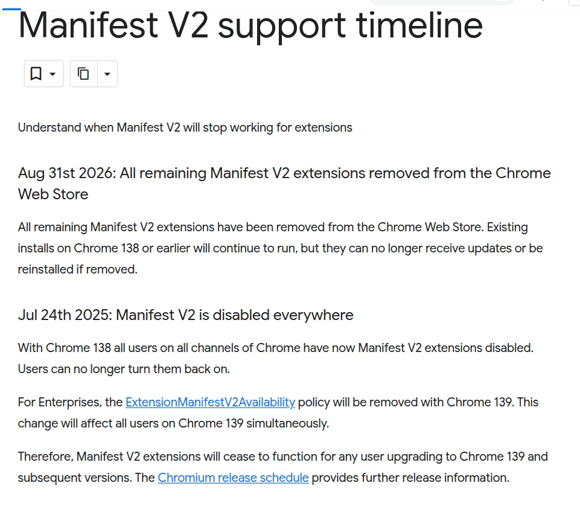
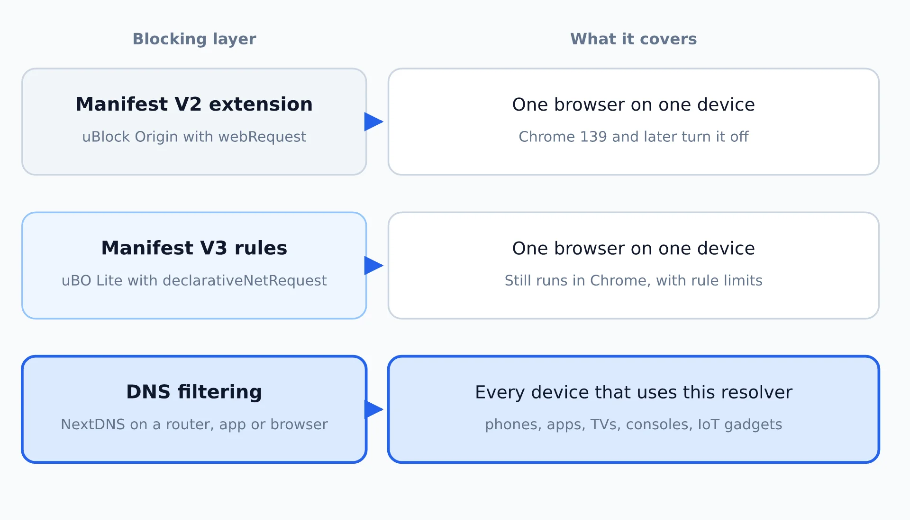
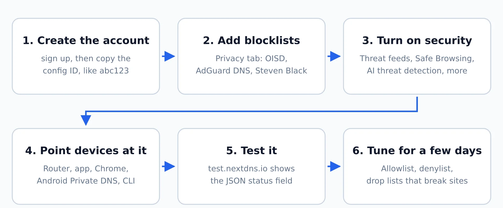
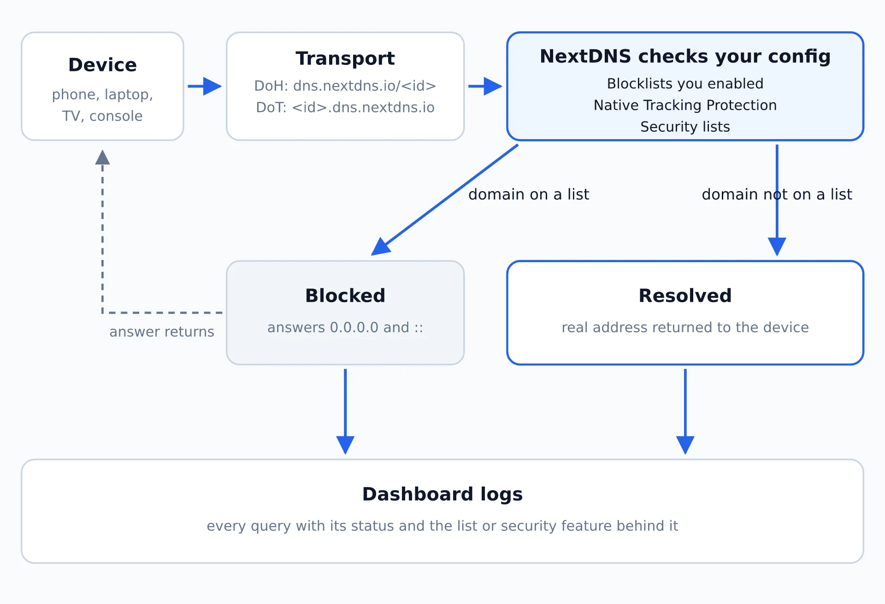
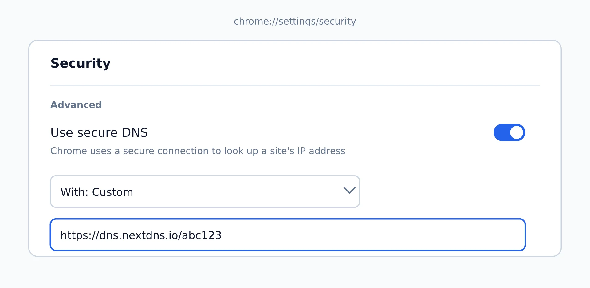
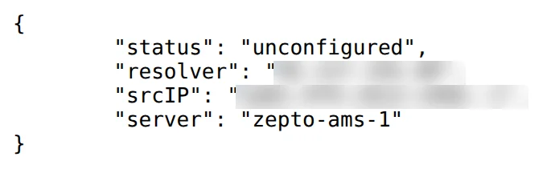
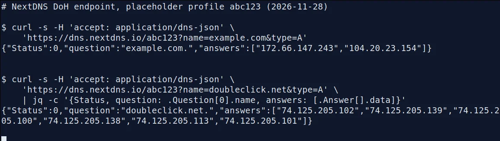
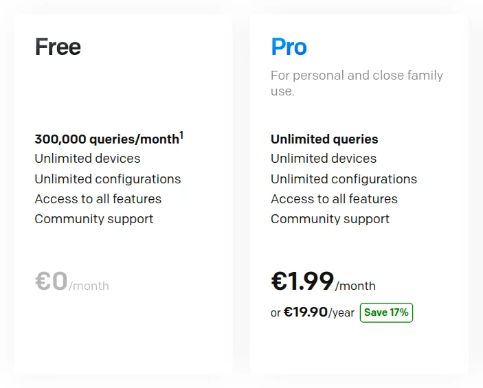

import Button from "../../components/widgets/Button.astro";
import Notice from "@components/widgets/Notice.astro";
import ListCheck from "@components/widgets/ListCheck.astro";
import Accordion from "@components/widgets/Accordion.astro";

*Disclosure: this guide contains referral links. If you buy through them, I may earn a commission at no extra cost to you.*

Chrome 150 and 151 ended the Manifest V2 workarounds; uBlock Origin is gone from Chrome. DNS blocking with [NextDNS](https://go.bitdoze.com/nextdns) stops ads on every device that uses it. Free allows 300,000 queries a month and Pro costs €1.99 a month.

If you open Chrome one morning and find uBlock Origin greyed out with a message saying it has been turned off, you are not alone. Google's switch to Manifest V3 is what turned it off. Blocking ads at the DNS level works in any browser, and that's what I want to walk you through here.

<Button text="Try NextDNS Free" link="https://go.bitdoze.com/nextdns" variant="solid" color="blue" size="lg" external={true} icon="rocket-launch" />

## What changed in Chrome

Every browser extension ships with a manifest file. It tells the browser what the extension is allowed to do. Manifest V2 (the old system) let an extension like uBlock Origin use the `webRequest` API to inspect and block network requests as they happened. When a page tried to pull in an ad script or a tracker, the extension caught it and stopped it before it loaded.

Manifest V3 replaces that with `declarativeNetRequest`. Instead of reacting to requests in real time, an extension now hands the browser a fixed set of rules and lets the browser do the filtering. That sounds harmless until you look at the limits:

- Chrome guarantees an extension 30,000 enabled static rules, 5,000 session rules and at least 5,000 dynamic rules ([API reference](https://developer.chrome.com/docs/extensions/reference/api/declarativeNetRequest#limits)).
- Filter rules ship inside the extension, so they change only when a new version goes through store review, not whenever a list updates ([uBO Lite FAQ](https://github.com/uBlockOrigin/uBOL-home/wiki/Frequently-asked-questions-%28FAQ%29)).
- The adaptive rules that fought blocker detection no longer work the same way, because uBO Lite has no dynamic filtering and no CNAME uncloaking ([uBO Lite FAQ](https://github.com/uBlockOrigin/uBOL-home/wiki/Frequently-asked-questions-%28FAQ%29)).

The timeline has run its course. Chrome 150 reached stable in June 2026 and removed the `ExtensionManifestV2Disabled` flag that kept Manifest V2 extensions alive. Chrome 151 followed in July 2026 and removed the remaining flags, according to the [W3C webextensions issue](https://github.com/w3c/webextensions/issues/1000) that tracked the Chromium commits. On August 31, 2026 Google removed the last Manifest V2 extensions from the Chrome Web Store ([Chrome for Developers timeline](https://developer.chrome.com/docs/extensions/develop/migrate/mv2-deprecation-timeline)). Classic uBlock Origin has no way to run in Chrome now. Chrome stable was at version 158 on November 28, 2026 ([version history](https://versionhistory.googleapis.com/v1/chrome/platforms/linux/channels/stable/versions/all/releases?filter=endtime=none)).



*Google's [Manifest V2 support timeline](https://developer.chrome.com/docs/extensions/develop/migrate/mv2-deprecation-timeline), captured on November 28, 2026.*

<Notice type="warning" title="uBlock Origin Lite is not the same">

The official Manifest V3 replacement, uBlock Origin Lite, still ships updates (release [2026.1127.1828](https://github.com/uBlockOrigin/uBOL-home/releases) came out on November 27, 2026), but it is a different tool from the original. It has no generic cosmetic filtering unless you raise its mode to Complete, and its rules change only with extension releases. Its [own FAQ](https://github.com/uBlockOrigin/uBOL-home/wiki/Frequently-asked-questions-%28FAQ%29) says it is less effective against sites that detect ad blockers. It's "good enough" for casual browsing, but it is a step down.

</Notice>

## Why DNS blocking is the smarter long-term fix

Browser extensions live and die by the rules of whatever browser you happen to use. DNS-level blocking sits one layer lower, between your device and the internet, so it doesn't care about Manifest V3 at all.

Here's the basic idea. Every time a device loads a page, it asks a DNS server "where do I find this domain?" A filtering DNS service like [NextDNS](https://go.bitdoze.com/nextdns) checks that domain against blocklists first. If the domain belongs to an ad network or a tracker, it answers with `0.0.0.0` and `::` instead of a real address ([help center](https://help.nextdns.io/t/h7hf6xa/use-a-block-page-does-it-slow-down-browsing)), and the ad never loads. This happens for ads, trackers, malware domains, and telemetry alike.



*Where each layer blocks and which devices it covers.*

Because the filtering happens at the DNS level, it covers things a browser extension never could:

<ListCheck>

- Ads inside mobile apps and games
- Smart TVs, streaming sticks, and game consoles
- Every browser on the machine at once, Chrome included
- IoT gadgets that phone home to tracking servers
- Devices where you cannot install an extension at all

</ListCheck>

I already wrote a full comparison of cloud and self-hosted DNS filtering if you want the deeper technical background:

<Notice type="info" title="Want the full DNS protection guide?">

I covered DNS encryption protocols, NextDNS, and the self-hosted AdGuard Home route in a separate guide. It explains how each piece fits together.

<Button text="Read the Complete DNS Protection Guide" link="/block-ads-malware-dns-protection/" variant="outline" color="blue" size="md" icon="book-open" />

</Notice>

## Extension vs DNS blocking

| | uBlock Origin (MV2) | uBlock Origin Lite (MV3) | NextDNS |
|---|---|---|---|
| Still works in Chrome 150+ | No | Yes | Yes |
| Blocks ads in apps | No | No | Yes |
| Covers every device | No | No | Yes |
| Rule limit | No browser cap | 30,000 guaranteed static | Provider lists |
| Per-element page hiding | Yes | Limited | No |
| Needs a browser | Yes | Yes | No |

DNS blocking can't hide individual page elements the way a browser extension can, and by default it won't touch YouTube ads served from the same domain as the video. For everything else, it keeps working long after Manifest V2 is gone. Pairing NextDNS with a lightweight extension covers both gaps, but the DNS layer is the part that survives the Chrome change. If you would rather run that layer on your own hardware, [Pi-hole vs AdGuard Home on Docker](/pihole-vs-adguard-home-docker/) compares the two self-hosted options.

## How to block ads with NextDNS after Manifest V3

Six steps: create the profile, pick blocklists, turn on security, point devices at it, test, then tune. Nothing in the chain depends on a browser, so a Chrome update cannot switch it off.



*The setup flow from account to a tuned profile.*

### Step 1: Create a NextDNS account

Head to [NextDNS](https://go.bitdoze.com/nextdns), sign up with your email, and you'll get a configuration ID that looks something like `abc123`. That ID is your profile. Everything you turn on or off lives there. The same ID selects the profile in every endpoint: `https://dns.nextdns.io/<id>` for DoH and `<id>.dns.nextdns.io` for DoT.

<Button text="Create Your NextDNS Profile" link="https://go.bitdoze.com/nextdns" variant="solid" color="blue" size="md" external={true} icon="rocket-launch" />

### Step 2: Add your blocklists

Open the **Privacy** tab and add a couple of well-maintained lists. I run these three:

- **OISD** merges several lists and leaves out domains whose blocking would break sites or affiliate links.
- **AdGuard DNS filter** combines rules from AdGuard, EasyList, EasyPrivacy and regional filters into one list built for DNS blocking.
- **Steven Black's Unified Hosts** merges hosts lists such as AdAway and Dan Pollock's, covering ads, trackers and malware domains.

All three sit in the blocklist picker, next to NextDNS's own recommended list for people who want a single list ([public catalog](https://api.nextdns.io/privacy/blocklists), 57 lists on November 28, 2026). Under **Native Tracking Protection**, switch on the device types you own (Apple, Windows, Samsung, and so on). It blocks trackers that record activity at the operating system level ([NextDNS](https://nextdns.io/)).

### Step 3: Turn on security filtering

In the **Security** tab, enable the protections that block dangerous domains:

```
- Threat Intelligence Feeds: ON
- Google Safe Browsing: ON
- AI-Driven Threat Detection: ON
- Cryptojacking Protection: ON
- DNS Rebinding Protection: ON
```

These catch malware, phishing, and crypto-mining domains, which is something an ad blocker extension was never really built to do. The separate Typosquatting Protection toggle no longer exists, because NextDNS folded it, with IDN Homographs, into AI-Driven Threat Detection. Its [API documentation](https://nextdns.github.io/api/) lists both old fields as deprecated.

### Step 4: Point your devices at NextDNS

Set the resolver once on the router and every device on the network uses it. A device that leaves the network needs its own setting.



*How a lookup travels to NextDNS and what comes back.*

**Whole network:** Change your router's DNS to NextDNS. If your router supports DNS-over-HTTPS, use `https://dns.nextdns.io/YOUR_CONFIG_ID`. Otherwise enter the linked IP addresses from your dashboard. Every device on the network is now filtered, Chrome included. Plain IPv4 only works after you link your public IP in the Setup tab. The link breaks behind carrier-grade NAT, or when a dynamic IP changes without DDNS ([help center](https://help.nextdns.io/t/m1hmv0k/which-setup-type-to-use)).

**Single devices:** Install the NextDNS app on Windows, Mac, Linux, iOS, or Android, then paste in your configuration ID. The app sends the device's system DNS to NextDNS over DoH or DoT, so NextDNS filters every app that uses the system resolver. It also removes the need for a linked IP ([help center](https://help.nextdns.io/t/m1hmv0k/which-setup-type-to-use)).

**Chrome itself:** its own secure DNS setting takes the DoH URL. Go to **Settings > Privacy and security > Security > Use secure DNS > Custom** and enter `https://dns.nextdns.io/YOUR_CONFIG_ID`. Now Chrome blocks ads through DNS, no extension involved. Google's help page puts the toggle under Advanced on that page and notes that managed devices cannot change it ([Chrome Help](https://support.google.com/chrome/answer/10468685)).



*Mockup of the Chrome secure DNS setting with a NextDNS profile URL. The real page is `chrome://settings/security`.*

**Linux machines and containers:** the open-source CLI is a small DoH proxy that listens on port 53 and forwards everything to your profile. Its wiki documents the Docker form: `docker run -d -p 53:53/tcp -p 53:53/udp nextdns/nextdns run -listen=:53 -profile=YOUR_CONFIG_ID` ([wiki](https://github.com/nextdns/nextdns/wiki/Docker)). On November 28, 2026 a lab run with image `1.50.2`, published on `127.0.0.1:55920`, answered `dig @127.0.0.1 -p 55920 example.com` in 22 ms after the first lookup. From inside the container's own network namespace, `https://test.nextdns.io` returned `"status": "ok"` with `"clientName": "nextdns-cli"`. Two things the wiki leaves out: `-config` still works but shows as deprecated next to `-profile`, and `nextdns install` exits with `system not supported` inside the image, so stick to `run`.

<Notice type="info" title="This is the part Manifest V3 can't take away">

Because the filtering happens at the DNS layer, Chrome can disable every extension it wants and your ads stay blocked. The browser only asks NextDNS for addresses, and NextDNS answers `0.0.0.0` for the ad servers.

</Notice>

### Step 5: Confirm it's working

Visit [test.nextdns.io](https://test.nextdns.io). The page answers with plain JSON, not a web page. Through NextDNS it shows `"status": "ok"` plus the protocol and the edge server; from a device that uses another resolver it shows `"status": "unconfigured"`. Your dashboard will start filling with queries, and you can watch in real time as ad and tracker domains get blocked.



*`test.nextdns.io` from a device that does not use NextDNS, captured on November 28, 2026. The resolver and source addresses are blurred.*

The DoH endpoint gives the same answer from a terminal: `curl -s -H 'accept: application/dns-json' 'https://dns.nextdns.io/YOUR_CONFIG_ID?name=example.com&type=A'` returns the lookup as JSON. On November 28, 2026 the placeholder `abc123` still resolved `doubleclick.net` to six addresses, so an ID without blocklists filters nothing. A blocked name comes back as `0.0.0.0` while the block page is off.



*Two DoH lookups through the placeholder profile `abc123`. The ad domain resolves because that profile has no blocklists.*

### Step 6: Tune it over a few days

Check your logs after a few days of normal use:

- If a legitimate site breaks, add the domain to your **allowlist**.
- If something annoying slips through, drop it on your **denylist**.
- Adjust your blocklists if you see too many false positives.

## Why can't DNS blocking remove YouTube ads?

Because YouTube serves ads from the same domains as the videos, a domain blocklist cannot tell them apart. Since November 3, 2026 NextDNS has an opt-in way around it, a beta blocklist called NextDNS YouTube Ad Blocking.

Add it under Privacy, Add a blocklist ([announcement](https://www.reddit.com/r/nextdns/comments/1xn0hce/youtube_ad_blocking_beta/)). It has no effect while Restricted Mode is on, and the help center carries a [report of YouTube Music breaking](https://help.nextdns.io/t/83yjn63/youtube-music-becomes-unavailable-when-the-beta-youtube-ad-blocking-feature-is-enabled) with it enabled. Test it before the household depends on it.

Plain DNS blocking also cannot hide individual elements on a page. Element hiding needs code inside the browser.

For those cases, run a Manifest V3 extension or switch to a browser that still supports the classic ones. Firefox keeps full uBlock Origin support because Mozilla [supports both](https://blog.mozilla.org/en/firefox/firefox-manifest-v3-adblockers/) `blockingWebRequest` and `declarativeNetRequest`. Brave ships a built-in blocker and still runs four Manifest V2 extensions, uBlock Origin among them ([Brave's list](https://brave.com/blog/brave-shields-manifest-v3/)). NextDNS handles the network-wide blocking; one of those handles the page-level hiding. Together they replace what a single Chrome extension used to do.

## Why I'd pick NextDNS for this

I have been running [NextDNS](https://go.bitdoze.com/nextdns) across my devices for months, and the appeal during this Chrome transition is that there's nothing to break. No extension to get disabled, no Manifest version to worry about. You set the DNS once and it keeps filtering on the phone, the laptop, the TV, and every app in between.

Setup takes about five minutes, and the free tier covers 300,000 queries a month. Pro removes the query cap for €1.99 a month or €19.90 a year. Prices are in euro, and when the free quota runs out NextDNS keeps resolving but stops filtering until the next month ([pricing](https://nextdns.io/pricing)).

| Plan | Queries/Month | Price |
|------|---------------|-------|
| Free | 300,000 | €0 |
| Pro | Unlimited | €1.99/month or €19.90/year |



*The Free and Pro plans on [nextdns.io/pricing](https://nextdns.io/pricing), captured on November 28, 2026.*

If you want my longer take on the service itself (features, privacy settings, what I run day to day), I covered it in detail here:

<Button text="Read My Full NextDNS Review" link="/nextdns-review/" variant="outline" color="blue" size="md" icon="book-open" />

## Is NextDNS still worth it after Manifest V3?

Yes. uBlock Origin has not run in Chrome since version 151, and NextDNS still blocks ads on every device that uses the resolver, free up to 300,000 queries a month.

The classic ad blockers you knew in Chrome are gone from it, and there is nothing left to fight. The DNS layer keeps running on the phone, the laptop, the TV, and inside apps that never had an ad blocker. If you also want page-level control, keep a Manifest V3 extension or a privacy-friendly browser around. But the part that quietly works in the background, on everything you own, is DNS. Set it up once and forget about the next Chrome update.

<Button text="Get Started with NextDNS" link="https://go.bitdoze.com/nextdns" variant="solid" color="blue" size="lg" external={true} icon="rocket-launch" />

## Related articles

- [Ladybird Browser Alpha: Hands-On, Memory Use and Verdict](/ladybird-browser-alpha-review/): a new engine with a built-in content blocker, no extension system
- [NextDNS Review: Cloud DNS Protection That Actually Works](/nextdns-review/)
- [How to Block Ads, Malware & Stop ISP Tracking with NextDNS and AdGuard Home](/block-ads-malware-dns-protection/)
- [Self-Host SearXNG: Private Search Engine With Docker](/searxng-self-host-privacy-search/)
- [Pi-hole v6 vs AdGuard Home on Docker (+ Unbound Setup)](/pihole-vs-adguard-home-docker/): the self-hosted route to the same DNS layer
- [Replace Your Smart TV's Home Screen and Remove the Ads: Every Repo, by TV OS](/smart-tv-custom-home-screen-remove-ads/): per-OS repos plus the network-level blocking that catches the rest
- [How to Block AI Crawlers & Safeguard Your Website](/block-ai-crawlers/): keeping bots off the sites you run, a job DNS filtering cannot do

## FAQ

<Accordion label="Is NextDNS free?" group="faq">
Yes, up to 300,000 queries a month with every feature included, and the counter resets each month. Past the quota, NextDNS keeps resolving names but stops filtering and logging until the next month. Pro removes the cap for €1.99 a month or €19.90 a year.
</Accordion>

<Accordion label="Does NextDNS slow browsing down?" group="faq">
The filter runs at the lookup, so the added cost is one DNS round trip. A blocked name gets its `0.0.0.0` answer instead of a connection to a real server. On November 28, 2026 a lab lookup through the CLI container returned `example.com` in 22 ms after the first query. The CLI can also cache answers with `-cache-size`, which is off by default.
</Accordion>

<Accordion label="Does NextDNS block YouTube ads?" group="faq">
Not with plain DNS blocking, because YouTube serves ads from the same domains as the videos. Since November 3, 2026 there is an opt-in beta blocklist, NextDNS YouTube Ad Blocking, under Privacy, Add a blocklist. It has no effect with Restricted Mode on, and users reported YouTube Music breaking while it is enabled.
</Accordion>

<Accordion label="Which devices can use NextDNS?" group="faq">
Anything that can point at a DNS server. Set it on the router and phones, laptops, smart TVs, consoles and IoT gadgets are covered at once. Apps exist for Windows, macOS, Linux, iOS and Android, Chrome takes the DoH URL directly, Android's Private DNS takes `<id>.dns.nextdns.io`, and the CLI runs in Docker.
</Accordion>

<Accordion label="Does NextDNS work without an app?" group="faq">
Yes. Chrome and other browsers with a custom secure DNS field take `https://dns.nextdns.io/YOUR_CONFIG_ID` on their own. Android's Private DNS field takes the DoT name `YOUR_CONFIG_ID.dns.nextdns.io`, and a router with DoH or DoT needs no software either. Plain IPv4 addresses work too, but only after you link your public IP in the Setup tab.
</Accordion>

<Accordion label="What does NextDNS see?" group="faq">
Every DNS lookup from the devices that use it: the names asked for, the source IP and the time. It does not see page content, because only the name leaves the device. You decide what is stored: logs can be disabled or kept from one hour up to two years ([NextDNS](https://nextdns.io/)).
</Accordion>

<Accordion label="Can NextDNS replace uBlock Origin?" group="faq">
No, the two do different jobs. NextDNS blocks whole domains, so it cannot hide a page element or a leftover ad slot the way uBlock Origin's cosmetic filters do. The uBO Lite FAQ says it is less effective against sites that detect blockers. The practical split is NextDNS for the network and an MV3 extension, Firefox or Brave for the page.
</Accordion>

<Accordion label="What about browsers that bypass system DNS?" group="faq">
A browser with its own DNS over HTTPS setting can ignore the resolver your router or app set up. In such a browser, add `https://dns.nextdns.io/YOUR_CONFIG_ID` as the custom provider, the same URL as in step 4. Chrome's help notes that a custom provider never falls back to plain DNS, and `test.nextdns.io` confirms the result with `"status": "ok"`.
</Accordion>
