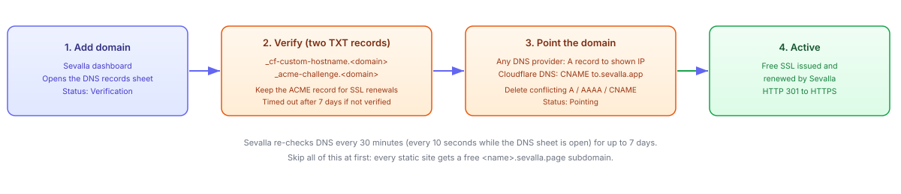

import Button from "@components/widgets/Button.astro";
import Notice from "@components/widgets/Notice.astro";
import ListCheck from "@components/widgets/ListCheck.astro";
import Accordion from "@components/widgets/Accordion.astro";
import Tabs from "@components/widgets/Tabs.astro";
import Tab from "@components/widgets/Tab.astro";
import YouTubeEmbed from "@components/widgets/YouTubeEmbed.astro";

A Breakdance static WordPress site gives you the visual output of a page builder with none of the PHP attack surface. You convert WordPress to static site files with the Simply Static plugin, push them to a Git repository, and [Sevalla](https://sevalla.com/) (formerly Kinsta) serves them from Cloudflare's edge. The tradeoff is that you lose dynamic features, which makes this approach ideal for presentation sites, portfolios, and landing pages that don't need logins or live data.

**Update (November 2026):** Kinsta moved its static site hosting to a separate platform called [Sevalla](https://sevalla.com/) on February 2, 2026. Your existing data, settings, and pricing carry over, and you can log in with your MyKinsta credentials. Since then the docs moved to [docs.sevalla.com](https://docs.sevalla.com/), static-site builds migrated to Oracle Cloud Infrastructure (completed September 1, 2026), and Sevalla shipped a CLI, a Terraform provider, an MCP server, and an official GitHub Action for deploys.

This workflow assumes a WordPress site built with [Breakdance](https://go.bitdoze.com/breakdance). Any builder exports, but Breakdance already strips a lot of bloat by default, which keeps the static output small. If you are still deciding on a builder, read [our Breakdance builder review](/breakdance-builder-review/) first. Below is the full path: optimize, export, deploy, point your domain, and verify.

<YouTubeEmbed
  url="https://www.youtube.com/embed/KYeHRkhG-Ws"
  label="Breakdance + Static WordPress Site Tutorial (recorded before the Kinsta to Sevalla migration, dashboard names have changed)"
/>

## Why go static with a Breakdance WordPress site?

<Button
  text="Try Breakdance"
  link="https://go.bitdoze.com/breakdance"
  variant="solid"
  color="blue"
  size="lg"
  external={true}
  icon="rocket-launch"
/>

A standard WordPress site needs PHP, a database, and web server processes running around the clock. Every page view is a database query. When you convert WordPress to static site output, every page view becomes a file read from a CDN edge location instead. For static WordPress site hosting, the practical benefits are:

<ListCheck>
<ul>
<li>Much faster page loads, with no database queries and no PHP execution per request</li>
<li>No WordPress vulnerabilities to patch on the public site, because there is no WordPress on the public site</li>
<li>Sevalla static site hosting is free for basic usage: 100 sites, 600 build minutes per month, and 100 GB bandwidth per month per company account</li>
<li>No server maintenance, no PHP-FPM tuning, no MySQL on a public box</li>
<li>Breakdance animations and JavaScript-driven sections survive the export untouched</li>
</ul>
</ListCheck>

This works best for sites that don't change on every request: company pages, portfolios, documentation, campaign landing pages. It does not work for sites that need logins, membership areas, live data, or a WooCommerce cart. If your site falls in the second group, you want WordPress to stay dynamic.

The cost angle is what usually sells it. Authoring stays on WordPress (locally or on a small VPS), and the public site costs $0 on Sevalla's free tier. If you want the full numbers on running WordPress versus going static, see the [Astro vs WordPress cost and ops breakdown](/astro-vs-wordpress/).

## What you need

<ListCheck>
<ul>
<li>A WordPress site built with <a href="https://go.bitdoze.com/breakdance">Breakdance</a> (or any other builder)</li>
<li>A <a href="https://sevalla.com/">Sevalla</a> account, free tier, you can log in with existing MyKinsta credentials</li>
<li>A GitHub, GitLab, or Bitbucket repository to hold the static export</li>
<li>The <a href="https://wordpress.org/plugins/simply-static/">Simply Static</a> plugin, v3.8.x is actively maintained (v3.8.24 as of November 9, 2026, 30,000+ active installs, PHP 7.4+ required)</li>
</ul>
</ListCheck>

DNS is optional to start. Every Sevalla static site gets a free `your-site-name.sevalla.page` subdomain the moment you create it, so you can run the whole workflow end to end tonight and only add a custom domain later.

<Button
  text="Create a free Sevalla account"
  link="https://sevalla.com/static-site-hosting/"
  variant="solid"
  color="green"
  size="lg"
  external={true}
/>

The authoring WordPress install can live anywhere: a local environment (LocalWP, DevKinsta, Docker), a staging box, or a cheap VPS. It never faces the public once the static export is live.

## Steps

The workflow in one line: WordPress + Breakdance (authoring) then Simply Static export (HTML/CSS/JS) then Git push then Sevalla (build OFF, publish as-is) then Cloudflare edge.


### 1. Optimize WordPress for a static export

Breakdance already removes a lot of WordPress overhead by default. Go to **Breakdance → Settings → Performance** and disable the Gutenberg editor, oEmbeds, and any feature you do not use. Every asset you disable here is one less file in the static export.

<Notice type="info" title="Back up first">
Back up the authoring site before you change settings or run an export. A settings change that breaks a template is easy to revert from a backup, painful to revert from memory. See the <a href="/best-free-wordpress-backup-plugins/">free WordPress backup plugins</a> comparison if you do not have a backup routine yet.
</Notice>

While you are here, keep the media library lean. Compress oversized hero images and delete unused uploads. This matters later: Sevalla caps each deployment's publish directory at 1 GB (covered in the limits section).

### 2. Configure Simply Static

Install [Simply Static](https://wordpress.org/plugins/simply-static/) from the WordPress plugin directory. In **Simply Static → Settings**, set:

- **Output**: Local directory (or ZIP download, if you prefer to move files manually)
- **Destination URL**: your `your-site-name.sevalla.page` subdomain, or the custom domain you will add later
- **Exclusions**: admin URLs, `wp-admin`, `wp-login.php`, comment endpoints, cart/checkout endpoints if any exist

The destination URL matters because Simply Static rewrites internal links to match it. Get it wrong and every internal link on the exported site points at the wrong host.

<Notice type="info" title="Automation upgrade">
The free plugin stops at producing files. <a href="https://simplystatic.com/simply-static-pro/">Simply Static Pro</a> (paid) pushes the export directly to GitHub, AWS S3, BunnyCDN, SFTP, or any Git-based deployment workflow. Push to the same repository Sevalla watches and the export itself triggers the auto-deploy. The free path below works fine for a site you update occasionally.
</Notice>

### 3. Generate the static files

Click **Generate** in Simply Static. Small sites finish in seconds. A medium site (50 to 100 pages) usually finishes in under a minute, but timing depends on page count and media volume.

**Verify:** open the export folder and confirm `index.html` sits at the root (or in the subfolder you configured). Open a couple of images in a viewer and confirm they are real files, not a few bytes of placeholder text. Tiny text files where images should be usually means Git LFS pointers were involved in the copy, which will break the deploy later.

The output is plain HTML, CSS, and JavaScript. There is no PHP in it anywhere. That is the whole point.

### 4. Deploy to Sevalla static site hosting

Push the export to the repository Sevalla will watch. If the export folder is a Git repo of its own:

```bash
# from your local static-export folder
git add .
git commit -m "publish static export"
git push -u origin main
```

<Notice type="warning" title="Avoid git push --force">
Force-pushing is only safe when the repo holds nothing but the latest export and you intentionally replace all history. On any shared or long-lived repo it destroys history and breaks pull-request previews. A normal push is enough for content updates.
</Notice>

In Sevalla, create a static site and connect the repository. Every push to the configured branch triggers a deployment, and you can also trigger one manually with **Deploy now**.

<Notice type="warning" title="Get the build strategy right">
Your export is already built HTML. Sevalla's default build step would try to run <code>npm run build</code> and fail. Go to <strong>Settings → Update build strategy</strong> and set <strong>Build site before publishing: OFF</strong>. Then set <strong>Index file</strong> to <code>index.html</code>, <strong>Error file</strong> to <code>404.html</code> if you have one, and leave <strong>Publish directory</strong> empty to publish the repo root (or point it at your export subfolder). This toggle is the single setting that makes a pre-generated Simply Static export deploy cleanly.
</Notice>

Deployments are atomic. Files upload to object storage first, then all domains switch to the new deployment in one step and the edge cache is purged automatically. Visitors never see a half-uploaded site.

**Verify:** open the deployment log and look for `Static site has been deployed successfully`. If you are using a `_redirects` file, also look for `Redirects processed successfully!` (more on both in the redirects section).

### 5. Add your custom domain

You can skip this section entirely and keep using the free `your-site-name.sevalla.page` subdomain. When you want your own domain, the flow is three steps in the site's **DNS records** sheet: **Add domain → Verify domain → Point domain**. Statuses move from Verification to Pointing to Active.



**Verify** means adding two TXT records at your DNS provider:

1. `your-domain.com` ownership record at `_cf-custom-hostname.your-domain.com`
2. SSL validation record at `_acme-challenge.your-domain.com`

Keep the `_acme-challenge` record in place permanently. Certificate renewals need it. The ownership record can be removed once the domain shows Active.

<Notice type="warning" title="A record, not CNAME">
For any DNS provider except Cloudflare, point the domain with an <strong>A record</strong> to the IP address shown in the Sevalla dashboard. A CNAME only works when your DNS is hosted at Cloudflare. Getting this wrong is the most common reason a domain never goes Active.
</Notice>

<Tabs>
<Tab name="Cloudflare DNS">
Add a CNAME record for `your-domain.com` pointing to the target Sevalla shows, typically `to.sevalla.app`. Cloudflare is the one provider where a CNAME on the apex domain is allowed.
</Tab>
<Tab name="Any other DNS provider">
Add an A record for `your-domain.com` pointing to the IP address shown in the Sevalla DNS records sheet. Delete any conflicting A, AAAA, or CNAME records on the same hostname first, or you will get a redirect loop or a stuck verification.
</Tab>
</Tabs>

Sevalla re-checks DNS every 30 minutes (every 10 seconds while the DNS records sheet is open) for up to 7 days. If verification stalls for 7 days the domain goes to **Timed out**, which is final: you have to delete it and add it again.

A few edge cases worth knowing up front:

- `.ru` domains are not supported
- A domain already attached to any other Sevalla service (in any company) cannot be added again
- Conflicting A, AAAA, or CNAME records must be deleted at your DNS provider before pointing works
- `http://` is 301-redirected to `https://` automatically once the domain is Active
- SSL certificates are issued and renewed by Sevalla for free, so there is nothing to manage

**Verify:** run `curl -I https://your-domain.com` and expect `HTTP/2 200` with `server: cloudflare`. Then run `curl -I http://your-domain.com` and expect a `301` redirect to the HTTPS URL.

### 6. Handle forms

Breakdance's built-in form builder relies on PHP to process submissions. On a static site there is no PHP, so those forms silently fail. Use an external form service and paste its embed code into a Breakdance HTML/embed element.

<Notice type="warning" title="Netlify Forms will not work here">
Netlify Forms only functions when the site is hosted on Netlify. On Sevalla it does nothing at all: submissions disappear with no error. Use a form service that works on any static host.
</Notice>

<Tabs>
<Tab name="Formspree (quick, no builder)">
[Formspree](https://formspree.io/) Free is $0 with 50 submissions per month, unlimited forms, no file uploads, and a 30-day submission archive. Point your form's `action` attribute at your Formspree endpoint and you are done. If you outgrow it, Personal is $15/month for 200 submissions.
</Tab>
<Tab name="AIDAForm (drag-and-drop builder)">
[AIDAForm](https://aidaform.com/) has a free tier and a visual form builder. It generates embed code you drop straight into Breakdance. Check their current free-tier submission limits before committing, the limits move.
</Tab>
</Tabs>

Both options are platform-agnostic, so they keep working if you ever move the static site off Sevalla. For more options, including self-hosted ones, see how to [add a contact form to any static website](/add-contact-form-static-websites/).

## Sevalla static site limits that matter

The free tier is genuinely usable, but the limits below are the ones that cause failed deploys or surprise bills. All numbers are from the Sevalla docs as of November 2026.

| Limit | Value | What breaks without it |
|---|---|---|
| Publish directory size | 1 GB per deployment | Deployment fails outright |
| Build time | 30 minutes per deployment | Build stops and the deploy fails |
| Concurrent builds per site | 1 | Queued builds wait, they do not run in parallel |
| Build container | 4 CPUs / 8 GB RAM, Ubuntu 24.04 | Heavy build steps can OOM |
| Static sites per company | 100 | Site creation is blocked beyond it |
| Build minutes | 600 per month, per company | Overage at $0.05 per build minute |
| Bandwidth | 100 GB per month, per company | Overage at $0.10 per GB |

<Notice type="warning" title="1 GB publish limit">
A media-heavy Breakdance export can exceed 1 GB without anyone noticing. Compress and resize images before exporting, delete unused uploads from the media library, and if you still blow the limit, serve heavy media from object storage instead. Sevalla's S3-compatible object storage runs on Cloudflare R2 at $0.02/GB per month with no ingress or egress fees: keep the HTML on static hosting and point `` tags at R2 URLs.
</Notice>

Two facts that work in your favor:

- The 600 build minutes and 100 GB bandwidth are **per company per month, shared across every static site**, including pull-request preview deployments. One heavy site can eat the allowance for all of them. Set a usage alert (see the checklist below).
- With **Build site before publishing** set to OFF, each deployment is an upload, not a build. Per-update build time is close to zero, so the 600 minutes go very far in this workflow.

## Redirects, 404s and headers

A WordPress to static migration usually changes some URLs. Sevalla reads a `_redirects` file (Netlify format) and a `_headers` file from the publish directory on every deployment, plus a **Pretty URLs** setting for trailing-slash and extensionless URLs. This is how you keep the SEO value of old links.

```text
# _redirects (place in the publish directory, next to index.html)
/old-about   /about      301
/pricing-old /pricing    301

# return a real 404 status for missing pages
/*           /404.html   404
```

To build the old-to-new URL map, [export all your WordPress post URLs and titles](/export-wordpress-post-urls-titles/) before you tear anything down.

Two gotchas, both from the Sevalla docs:

1. If any line in `_redirects` fails to parse, the deployment **still succeeds but with zero redirect rules applied**. Always check the deployment log for `Redirects processed successfully!` before you assume redirects are live.
2. The Error file (`404.html`) is served with **HTTP status 200** by default. Search engines treat soft-404s as real pages, which quietly wrecks a migration. The `/* /404.html 404` rule above is what makes missing pages return a real 404.

<Notice type="warning" title="404s are served as 200 by default">
Add the <code>/* /404.html 404</code> rule to <code>_redirects</code> on day one. Checking for it later, after a soft-404 has been indexed, is the expensive way to learn this.
</Notice>

Deploys are atomic and the edge cache is purged automatically on each deployment, so new redirects and headers take effect without any manual cache clearing.

**Verify:** run `curl -s -o /dev/null -w "%{http_code}" https://your-domain.com/nonexistent` and expect `404` (only after the `_redirects` rule is deployed). Run `curl -s -o /dev/null -w "%{http_code}" https://your-domain.com/old-about` and expect `301`. Check the deployment log for `Redirects processed successfully!`.

## Verify it worked

A five-minute end-to-end check after the first deploy. Run through this once and you will catch most problems before anyone else does.

<ListCheck>
<ul>
<li>Deployment log shows <code>Static site has been deployed successfully</code></li>
<li>If you use <code>_redirects</code>, the log shows <code>Redirects processed successfully!</code></li>
<li><code>curl -I https://&lt;domain&gt;</code> returns <code>200</code> with <code>server: cloudflare</code></li>
<li><code>curl -I http://&lt;domain&gt;</code> returns <code>301</code> to the HTTPS URL</li>
<li><code>curl -s -o /dev/null -w "%&#123;http_code&#125;" https://&lt;domain&gt;/nonexistent</code> returns <code>404</code>, not <code>200</code></li>
<li>The site loads correctly in an incognito window, including Breakdance animations and JS-driven sections</li>
<li>Sevalla Analytics → Bandwidth chart is populating, this is how you watch the 100 GB monthly allowance</li>
<li>A company-wide usage alert is set (Billing → Usage), so you are emailed before overages start ($0.10/GB bandwidth, $0.05/build minute)</li>
</ul>
</ListCheck>

The usage alert is the whole cost-control story. Everything else on the free tier is $0 until you cross an allowance, and the alert is what tells you before that happens.

## Troubleshooting common issues

<Accordion label="Deployment fails: publish directory over 1 GB" group="troubleshooting" expanded="true">
The build error names the size. Compress and resize images before export, delete unused media library entries, and move heavy media (video, large galleries) to Sevalla object storage on Cloudflare R2. The HTML can stay on static hosting while `` and `<video>` tags point at R2 URLs.
</Accordion>

<Accordion label="Build fails or times out" group="troubleshooting">
With **Build site before publishing** ON, Sevalla runs `npm run build` and fails on a plain-HTML repo. Turn the toggle OFF. Two related limits: builds stop after 30 minutes, and Sevalla ignores `engines`, `.nvmrc`, and `netlify.toml`, so a wrong Node version assumption in the repo does nothing. One build runs at a time per site.
</Accordion>

<Accordion label="No deployment after a push" group="troubleshooting">
Check that the branch Sevalla is watching matches the branch you pushed to. Also check: pending-deployment limit reached, repository permissions or visibility changed, and whether the Sevalla account has an operational suspension (that blocks all operations).
</Accordion>

<Accordion label="Old content after a deployment" group="troubleshooting">
Hard-refresh or test in an incognito window first. If the content is still old, confirm the new deployment is the one marked Active. The atomic switch should have purged the edge cache; if it did not, use **Deploy now** to force a fresh deployment.
</Accordion>

<Accordion label="Missing pages return status 200" group="troubleshooting">
The Error file is served as HTTP 200 by default, which is a soft-404. Add `/* /404.html 404` to `_redirects` and redeploy. This one matters for SEO. See the redirects section above.
</Accordion>

<Accordion label="Too many redirects on the custom domain" group="troubleshooting">
Almost always a DNS conflict: stale A, AAAA, or CNAME records on the same hostname, or the domain is still attached to another Sevalla service in some company. Delete the conflicting records, and make sure only the record Sevalla expects (A record, or CNAME on Cloudflare DNS) remains.
</Accordion>

<Accordion label="Images and large files appear as tiny text files" group="troubleshooting">
Those are Git LFS pointer files that were never resolved. Enable Git LFS support in Sevalla, or do not use LFS for the export repository. Re-export and re-push if the pointers already landed in the deploy.
</Accordion>

<Accordion label="Domain stuck in Verification or Timed out" group="troubleshooting">
TXT records missing or propagating slowly. Sevalla checks every 30 minutes for up to 7 days. Confirm both TXT records at your DNS provider. A domain that reaches **Timed out** cannot be revived: delete it and add it again. The Sevalla <a href="https://docs.sevalla.com/static-sites/go-live-checklist">go-live checklist</a> covers the remaining pre-launch checks.
</Accordion>

## Result

What you end up with is a site that looks identical to the Breakdance original, JavaScript-driven animations included, served from Cloudflare's edge with no PHP, no database, and no WordPress on the public side. Page loads are file reads from a CDN. There is nothing left to patch.

For a small presentation site this is close to free. The free tier covers 100 static sites, 600 build minutes, and 100 GB bandwidth per company per month, and with the build step off, most deployments use almost no build minutes. Past the allowances it is $0.10/GB for bandwidth and $0.05 per build minute. A usage alert prevents surprises.

Where the authoring WordPress lives is your call. You can [install WordPress with Docker Compose](/install-wordpress-docker/) locally, keep it on a staging box, or run it on a small VPS from [Hetzner](https://go.bitdoze.com/hetzner) if you want it reachable from anywhere. If you go the VPS route, the [ARM vs x86 VPS benchmarks](/arm-vs-x86-vps-server-benchmarks/) show what you get for your money, and [cloud server benchmarks](/benchmark-cloud-servers/) covers how to test the box yourself.

If you read this far and decided you need forms, logins, or live data after all, keep WordPress dynamic and put a cache in front of it instead. [Speeding up WordPress with Varnish cache](/cloudpanel-varnish-cache/) gets you most of the static-site performance without giving up the dynamic features.

For scaling past manual exports, Sevalla now has real deployment tooling: an official GitHub Action (`sevalla/sevalla-deploy`), a CLI, a Terraform provider, and an MCP server you can point a coding agent at. Wire the export into CI and the whole thing becomes push-to-publish.

<Button
  text="Try Breakdance"
  link="https://go.bitdoze.com/breakdance"
  variant="outline"
  color="blue"
  size="lg"
  external={true}
  icon="rocket-launch"
/>
