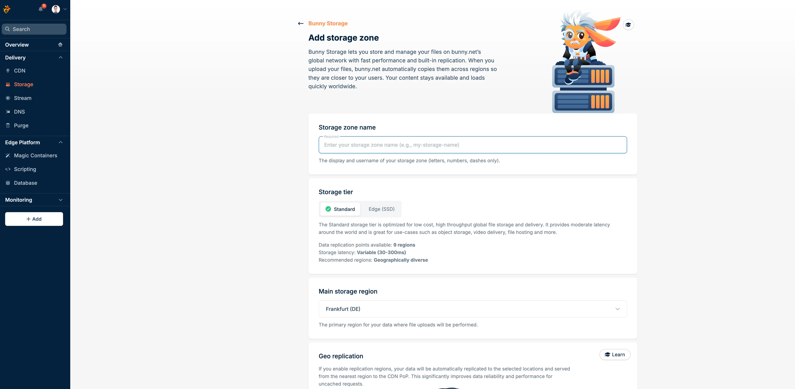

import Button from "@components/widgets/Button.astro";
import Notice from "@components/widgets/Notice.astro";
import ListCheck from "@components/widgets/ListCheck.astro";
import Accordion from "@components/widgets/Accordion.astro";
import Tabs from "@components/widgets/Tabs.astro";
import Tab from "@components/widgets/Tab.astro";

*Disclosure: this guide contains referral links. If you buy through them, I may earn a commission at no extra cost to you.*

Cloud storage pricing should be simple. You store files, you pay per gigabyte, done. But that's not how most providers work. AWS S3 has storage classes, request fees, lifecycle policies, and egress charges that need a spreadsheet to calculate. Even "simple" providers bury costs in API call fees or bandwidth surcharges.

I've been running sites and services through [Bunny.net](https://go.bitdoze.com/bunny) for a while now (you can read my [full Bunny.net review here](/bunny-net-review/)), and their storage is one of the pieces I find most interesting. The Bunny Storage vs S3 vs Backblaze question comes down to what you're storing, how often you access it, and where your users are. I went through the pricing pages for all three, ran the numbers for common scenarios, and put together this comparison. No affiliate math tricks where I conveniently ignore egress fees to make one option look better.

<Notice type="info" title="2026 pricing update">
  A few things changed since this article first published in April 2026. Backblaze B2 raised storage from $6 to $6.95 per TB and made API calls (Class A/B/C) free. Bunny Storage split into two tiers: Standard (HDD, up to 9 regions) and Edge (SSD, up to 15 regions) with a $1/month minimum. The AWS Free Tier is now credit-based ($100-200 over 6 months, account auto-closes) instead of "5 GB for 12 months." All numbers below reflect November 2026 pricing.
</Notice>

<Notice type="success" title="Try Bunny.net free for 14 days">
  You can test Bunny Storage yourself with no credit card. [Sign up at Bunny.net](https://go.bitdoze.com/bunny) and get a full 14-day trial.
</Notice>

## Bunny vs S3 vs Backblaze: the quick comparison

Before we get into details, here's what you're looking at:

| | **Bunny Storage** | **AWS S3** | **Backblaze B2** |
|---|---|---|---|
| **Storage cost** | $0.01/GB (Standard, per region) | $0.023/GB (Standard) | $0.00695/GB ($6.95/TB) |
| **Egress cost** | Free to Bunny CDN | $0.09/GB (first 10 TB) | Free up to 3x storage |
| **API request fees** | None | $0.005/1K PUT, $0.0004/1K GET | Free (Class A/B/C) |
| **Free tier** | 14-day trial (no card) | Credit-based ($100-200, 6 mo) | 10 GB free forever |
| **Global replication** | 9 regions (HDD) / 15 regions (SSD Edge) | Cross-region copy (extra cost) | 2 regions |
| **S3 compatible** | Yes | Yes (it IS S3) | Yes |
| **CDN integration** | Built-in (Bunny CDN) | CloudFront (separate config) | Partner CDNs (free egress) |
| **Minimum storage duration** | None | Varies by class | None |
| **Monthly minimum** | $1/month (Storage and CDN each) | None | None |
| **Pricing complexity** | Low | High | Low |

Backblaze B2 has the cheapest raw storage at $6.95/TB. Bunny Storage has the simplest pricing and built-in CDN. S3 has the most features but costs the most after you factor in egress and request fees. One thing that changed in 2026: zero API call fees is no longer Bunny-exclusive, since B2 now offers free Class A/B/C calls too.

## Bunny Storage: what you get

[Bunny Storage](https://go.bitdoze.com/bunny) is built into the Bunny.net platform, which means it connects directly to their CDN without extra configuration. Files you store get served through 119+ edge locations automatically.



### Bunny Storage pricing breakdown

Bunny now has two storage tiers:

**Standard (HDD):**
- $0.01/GB/month per region for the first 2 regions (1 region: $0.01, 2 regions: $0.02 total)
- $0.025/GB/month at 3 regions
- Each additional region: +$0.005/GB/month
- Maximum 9 regions

**Edge (SSD):**
- $0.02/GB/month per region
- Maximum 15 regions

Both tiers share the same delivery model:
- **API requests**: Free
- **Egress to Bunny CDN**: Free
- **CDN delivery** (Standard network, 119 PoPs): EU/NA $0.01/GB, Asia/Oceania $0.03/GB, South America $0.045/GB, ME/Africa $0.06/GB
- **Volume network** (10 PoPs): flat $0.005/GB for the first 500 TB
- **$1/month minimum** on both Storage and CDN
- **>50 TB/month**: contact sales (soft cap on self-serve)

<Notice type="warning" title="New: Standard vs Edge tiers">
  The old "15 regions at $0.01/GB" pricing no longer exists. Standard (HDD) caps at 9 regions. If you need 15-region replication or SSD-backed origin, you're on the Edge tier at $0.02/GB per region. For most single-region or 2-3 region setups, Standard is the right pick.
</Notice>

The pricing model is flat within each tier. No storage classes to pick between, and no request fees or minimum storage durations. The Volume network at $0.005/GB halves the CDN cost if you can live with 10 PoPs instead of 119. For bandwidth-heavy workloads with latency-tolerant users, that's worth considering.

### What I like about it

<ListCheck>
  <ul>
    <li>Zero API call fees (B2 now also offers free Class A/B/C calls as of May 2026, so this is no longer unique)</li>
    <li>Free egress to Bunny CDN, no separate transfer costs</li>
    <li>Built-in CDN with 119+ PoPs, no need to configure a separate service</li>
    <li>Global replication across up to 9 regions (Standard) or 15 regions (Edge) with a single toggle</li>
    <li>S3-compatible API, so tools like rclone and s3cmd work out of the box</li>
    <li>Simple dashboard, you can browse files through the web UI</li>
    <li>Volume network option at $0.005/GB for cost-sensitive bulk delivery</li>
  </ul>
</ListCheck>

### Where it falls short

The raw per-GB storage cost ($0.01 on Standard) is higher than Backblaze ($0.00695) and comparable to S3's cheaper tiers. If you're storing terabytes of archive data you rarely access, Bunny Storage isn't the cheapest bucket to throw files into.

There's also no lifecycle policy system. S3 lets you automatically transition objects from Standard to Infrequent Access to Glacier after set time periods. Bunny Storage keeps everything hot, always. That's either a feature or a limitation depending on what you need.

Multi-region replication is asynchronous. Bunny replicates to your chosen regions in the background. This is a performance and DR feature, not a synchronous quorum. If you need guaranteed write acknowledgment across regions before considering a write durable, look at S3 cross-region replication instead.

The $1/month minimum on Storage and CDN is trivial at any real scale but worth knowing. And if you pass 50 TB/month, you'll need to talk to sales to keep self-serve billing.

If you're already using Bunny CDN to serve your sites (like I do), the storage integrates perfectly. I covered the CDN side in depth in my [Bunny.net review](/bunny-net-review/) and the [video streaming setup in this guide](/bunny-stream-guide/).

## AWS S3: the feature king with complex pricing

S3 is the default choice for most companies. It's been around since 2006 and it integrates with every AWS service and almost every third-party tool. But the pricing is a maze.

### S3 pricing breakdown: storage, requests, and egress

**Storage (US East, per GB/month):**
- S3 Standard: $0.023 (first 50 TB), $0.022 (next 450 TB), $0.021 (over 500 TB)
- S3 Standard Infrequent Access: $0.0125
- S3 One Zone Infrequent Access: $0.01
- S3 Glacier Instant Retrieval: $0.004
- S3 Glacier Flexible Retrieval: $0.0036
- S3 Glacier Deep Archive: $0.00099

**Requests (S3 Standard):**
- PUT/COPY/POST/LIST: $0.005 per 1,000 requests
- GET/SELECT: $0.0004 per 1,000 requests

Watch out: request prices vary by storage class. Infrequent Access GET is $0.001/1K. Glacier Instant GET is $0.01/1K. The $0.0004 GET rate is Standard-only. Tools that LIST aggressively (rclone sync on big directory trees, some backup plugins) generate billable LIST requests at $0.005/1K.

**Glacier retrieval fees:**
- Glacier Instant Retrieval: $0.03/GB (you pay this on every restore)
- Glacier Flexible: Bulk free, Standard $0.01/GB, Expedited $0.03/GB
- Glacier Deep Archive: Bulk $0.0025/GB, Standard $0.02/GB

**Data transfer out (to internet):**
- First 10 TB/month: $0.09/GB
- Next 40 TB: $0.085/GB
- Next 100 TB: $0.07/GB
- Over 150 TB: $0.05/GB

That egress pricing is where S3 gets expensive fast. Store 1 TB and serve it once? You're paying $0.023 for storage plus $90 for egress. The storage cost is almost a rounding error compared to the bandwidth bill.

### When S3 makes sense

S3 wins when you need specific features that nobody else has:

- Lifecycle rules that automatically move cold data to cheaper storage classes
- Object versioning, locking, and compliance retention
- Event triggers through Lambda for processing uploads
- Fine-grained IAM access controls
- Cross-region replication with granular rules
- Integration with hundreds of AWS services

If your infrastructure already lives on AWS, adding S3 is the path of least resistance. The pricing gets better with AWS Data Transfer Out discounts or if you're using CloudFront (which has its own pricing model that can reduce egress costs).

For everyone else, S3's complexity is hard to justify. The usual surprise is a bill that includes GET request charges and billable LIST operations, neither of which people expect when they hear "storage pricing."

## Backblaze B2: cheapest raw storage

Backblaze started as a consumer backup company and eventually launched B2, their S3-compatible object storage. Their pitch is simple: dirt-cheap storage with reasonable egress policies. In May 2026 they raised the storage price from $6 to $6.95 per TB but made API calls free, so the net effect depends on your workload.

### Backblaze B2 pricing breakdown

- **Storage**: $6.95/TB/month ($0.00695/GB), up from $6/TB before May 2026
- **Downloads**: Free up to 3x your monthly average storage (computed via byte-hours), then $0.01/GB
- **CDN partner egress**: Free (Cloudflare, Bunny.net, Fastly, CacheFly, CoreWeave, Equinix Metal, Vultr, phoenixNAP)
- **API calls**: Class A (uploads/deletes), Class B (downloads), Class C (list/copy) all free as of May 2026
- **Class D** (event notification webhooks): 2,500 free/day, then $0.004/10K
- **Free storage**: First 10 GB per account
- **Minimum file size**: None
- **Minimum storage duration**: None

<Notice type="info" title="Backblaze changed pricing in May 2026">
  Storage went from $6 to $6.95 per TB. API calls (Class A/B/C) went from metered to free. If you were paying $2-5/month in transaction fees before, the net change might be close to zero. For pure storage-heavy workloads with few API calls, you're paying about 16% more.
</Notice>

The 3x free egress rule is generous. If you store 1 TB, you can download up to 3 TB per month for free. And if you're serving files through a partner CDN like Bunny.net or Cloudflare, egress is completely free regardless of volume.

Two newer Backblaze products are worth knowing about:

**B2 Overdrive** ($15/TB/month) gives you unlimited free egress to any destination, not just CDN partners. It's aimed at AI/ML training and throughput-intensive workloads. For heavy-egress use cases where you're serving more than 3x your storage volume every month, Overdrive at $15/TB can beat the B2 + Bunny CDN combo once you factor in CDN delivery fees. One account, no CDN config needed. The tradeoff: two storage regions and no edge caching.

**B2 Reserve** is for committed volumes. Bundles start at 20 TB for $1,560/year (about $6.50/TB/month, cheaper than the $6.95 pay-as-you-go rate). Egress and API calls are included. Free Universal Data Migration for larger commitments. A 4-business-hour support SLA. Good fit if you want a fixed monthly number for backup archives.

### The Backblaze + Bunny CDN combo

One setup I find particularly interesting: store files on Backblaze B2 at $0.00695/GB, then serve them through [Bunny CDN](https://go.bitdoze.com/bunny). Backblaze doesn't charge egress to partner CDNs, and you get Bunny's 119+ PoPs for delivery. Total cost per GB stored and served: $0.00695 for storage + Bunny CDN delivery fees ($0.01/GB EU/NA on the Standard network, or $0.005/GB on the Volume network).

This combo undercuts both pure Bunny Storage ($0.01/GB) and S3 + CloudFront by a wide margin for read-heavy workloads. The Volume network at $0.005/GB makes it even cheaper if 10 PoPs are enough for your audience.

If your egress consistently exceeds 3x your storage volume every month, run the numbers on B2 Overdrive at $15/TB with unlimited egress. It may beat B2 + CDN delivery fees once you add up the bandwidth costs.

The trade-off? Two accounts to manage, two dashboards, and some configuration to link them. If you're setting up [Dokploy backups with S3-compatible storage](/dokploy-backups-cloudflare-r2/) or running a [self-hosted file manager like Cloudreve](/cloudreve-docker-setup/), Backblaze B2 works as a drop-in S3 alternative.

### Where B2 falls short

Backblaze has two data center regions (US West and EU Central as of the last published docs, though the current pricing page doesn't list regions explicitly). If you need data physically stored in Asia-Pacific or South America, B2 isn't an option. S3 has 30+ regions and Bunny has up to 15 storage locations.

The API is S3-compatible but not identical. Some S3 features like object lifecycle policies, versioning, and fine-grained access controls are either limited or missing. For backup and archive workloads this doesn't matter. For complex application storage, it might.

<Notice type="warning" title="B2 billing gotcha: byte-hours">
  The 3x free egress allowance is computed from your monthly average storage using byte-hours. Deleting 9 TB on the 2nd of the month doesn't immediately shrink your egress allowance. Conversely, restore churn (write 10 TB, delete 9 TB, write it again) can bill storage for the whole month. This is the most common B2 billing surprise. Check `rclone size` against your bucket before trusting a bill.
</Notice>

## Cloud storage cost comparison: 3 real scenarios

Numbers on a pricing page are meaningless without context. Here's what you'd pay for three common scenarios, using November 2026 pricing:

<Tabs>
  <Tab name="1 TB static site">
    **Scenario: 1 TB of static assets (images, CSS, JS) served globally, 5 TB egress/month**

    | Provider | Storage | Egress | Requests (est.) | Total/month |
    |----------|---------|--------|-----------------|-------------|
    | **Bunny Storage** | $10 | $50 (CDN EU/NA) | $0 | **~$60** |
    | **S3 + CloudFront** | $23 | ~$425 (varies) | ~$5 | **~$453** |
    | **S3 direct** | $23 | $450 | ~$5 | **~$478** |
    | **Backblaze B2** | $6.95 | $20 (2 TB over 3x) | $0 | **~$27** |
    | **B2 + Bunny CDN** | $6.95 | $50 (CDN EU/NA) | $0 | **~$57** |

    For serving static assets, Backblaze B2 alone is cheapest if your users can tolerate fetching from two data centers. Add Bunny CDN on top and you get global delivery at a similar price to pure Bunny Storage. S3 is the most expensive option by far, mostly because of egress.

    Note: Bunny CDN delivery is priced at EU/NA Standard network rates. On the Volume network (10 PoPs), 5 TB would cost $25 instead of $50, dropping the Bunny Storage total to ~$35 and the B2 + Bunny CDN total to ~$32. If your audience is latency-tolerant, that's the cheapest global delivery option.
  </Tab>
  <Tab name="10 TB backup archive">
    **Scenario: 10 TB of backups, minimal egress (restore once a quarter, ~500 GB)**

    | Provider | Storage | Egress + retrieval | Requests | Total/month |
    |----------|---------|-------------------|----------|-------------|
    | **Bunny Storage** | $100 | ~$5 (occasional) | $0 | **~$105** |
    | **S3 Standard** | $230 | ~$15 (avg) | ~$2 | **~$247** |
    | **S3 Glacier Instant** | $40 | ~$15 + $15 retrieval | ~$2 | **~$72** |
    | **S3 Glacier Flexible** | $36 | ~$15 + $0 (bulk retrieval) | ~$2 | **~$53** |
    | **S3 Glacier Deep Archive** | $9.90 | ~$15 + $1.25 (bulk) | ~$2 | **~$28** |
    | **Backblaze B2** | $69.50 | $0 (within 3x) | $0 | **~$70** |

    For pure archival, S3 Glacier Deep Archive wins on storage cost ($0.00099/GB). Bulk retrieval for a 500 GB quarterly restore runs about $1.25. Glacier Flexible is even cheaper to retrieve: bulk retrieval is free, you just wait 5-12 hours. Backblaze at $69.50/month with free egress up to 30 TB is the best no-surprises option. Bunny Storage costs more because it keeps everything hot and replicated.

    If you're setting up [WordPress backups](/best-free-wordpress-backup-plugins/) or [CloudPanel remote backups](/cloudpanel-remote-backups/), B2 is the sweet spot between cheap and accessible. For automated backup workflows, [self-hosted backups with Restic and Rclone](/pluton-self-hosted-backup/) or the [Zerobyte Restic GUI for backup automation](/zerobyte-restic-gui/) work well against any of these S3-compatible backends.
  </Tab>
  <Tab name="500 GB video hosting">
    **Scenario: 500 GB of video files, 3 TB delivery/month**

    | Provider | Storage | Egress | Requests | Total/month |
    |----------|---------|--------|----------|-------------|
    | **Bunny Storage + CDN** | $5 | $30 (CDN) | $0 | **~$35** |
    | **Bunny Stream** | $5 | $30 (delivery) | $0 | **~$35** |
    | **S3 + CloudFront** | $11.50 | ~$255 | ~$3 | **~$270** |
    | **B2 + Bunny CDN** | $3.48 | $30 (CDN) | $0 | **~$33** |

    For video delivery, the S3 + CloudFront path is painful. The B2 + Bunny CDN combo edges out on pure cost, but if you want transcoding, adaptive bitrate, and a built-in player, [Bunny Stream](/bunny-stream-guide/) handles all of that without extra setup. I use Bunny Stream for the video courses on [bitbuddies.me](https://bitbuddies.me) and it just works.

    If you're serving 3+ TB/month consistently and don't need edge caching, B2 Overdrive at $15/TB (500 GB = $7.50) with unlimited egress is worth running the numbers against the B2 + CDN combo.
  </Tab>
</Tabs>

## Hidden gotchas and billing surprises

<Notice type="warning" title="Billing surprises are the #1 complaint">
  Every cloud storage provider has a billing footgun. Here are the ones that bite people, collected from the pricing docs and the fine print.
</Notice>

<ListCheck>
  <ul>
    <li>B2 computes the 3x free egress allowance from monthly average storage using byte-hours. Deleting 9 TB on the 2nd doesn't shrink your allowance. Restore churn (write, delete, rewrite) bills storage for the whole month. Verify with `rclone size` before trusting a bill.</li>
    <li>Cloudflare's R2 Infrequent Access class looks cheap at $0.01/GB, but a 30-day minimum duration means a file stored for 5 days and deleted still bills for 30 days, plus $0.01/GB retrieval on top. For churning data, R2 IA can cost <em>more</em> than Standard.</li>
    <li>Bunny's multi-region replication runs in the background. Treat it as a performance and DR feature, not a synchronous write quorum.</li>
    <li>S3 request prices vary by storage class. The $0.0004 GET rate is Standard-only: IA GET is $0.001/1K, Glacier Instant GET is $0.01/1K. Tools that LIST aggressively (rclone sync on big trees, backup plugins) generate billable LIST requests at $0.005/1K.</li>
    <li>On B2, Class D is the only billed API class. Event notification webhooks cost money (2,500 free/day then $0.004/10K). Everything else is free as of May 2026.</li>
    <li>Bunny has a $1/month floor on both Storage and CDN. Set monthly bandwidth limits in the dashboard as a blast-radius control so an unexpected spike doesn't drain your account.</li>
    <li>The AWS Free plan closes on its own after 6 months. You won't be charged unless you explicitly convert to a Paid plan. That's a good anti-surprise feature.</li>
    <li>None of these providers replaces the 3-2-1 backup rule. If the bucket is your only backup, it's not a backup. For a proper setup, look at [self-hosted backups with Restic and Rclone](/pluton-self-hosted-backup/) alongside one of these cloud targets.</li>
  </ul>
</ListCheck>

## How to connect: rclone config for all three

All three providers support the S3-compatible API, so rclone works with everything from one config file:

```ini
# ~/.config/rclone/rclone.conf

[bunny]
type = s3
provider = Bunny
endpoint = https://storage.bunnycdn.com
access_key_id = YOUR_STORAGE_ZONE_NAME
secret_access_key = YOUR_STORAGE_ZONE_PASSWORD
# zone name goes in the path: rclone lsd bunny:my-zone/

[b2]
type = s3
provider = Backblaze B2
endpoint = s3.us-west-004.backblazeb2.com
access_key_id = YOUR_KEY_ID
secret_access_key = YOUR_APPLICATION_KEY

[r2]
type = s3
provider = Cloudflare
endpoint = https://YOUR_ACCOUNT_ID.r2.cloudflarestorage.com
access_key_id = YOUR_R2_ACCESS_KEY_ID
secret_access_key = YOUR_R2_SECRET_ACCESS_KEY
```

<Notice type="warning" title="Bunny S3 auth is quirky">
  Bunny uses the storage zone name as the access key ID and the zone password as the secret access key. The zone name also goes in the path (not the endpoint). This trips up more people than any other S3-compatible setup. Check the [Bunny docs](https://support.bunnycdn.com/) for the exact key mapping before debugging your rclone config.
</Notice>

**Verify your connections work before trusting them with real data:**

```bash
# List zones/buckets to confirm access
rclone lsd bunny:my-zone/
rclone lsd b2:my-bucket/
rclone lsd r2:my-bucket/

# Check stored bytes match your expectations before trusting a bill
rclone size b2:my-bucket/

# Upload and download a test file
rclone copy test-file.bin b2:my-bucket/test/
rclone copy b2:my-bucket/test/test-file.bin ./verify/
```

After your first real upload or download, check the billing dashboard on day 1 for each provider. Look for egress lines, request charges, and anything unexpected. It takes 5 minutes and catches misconfigurations before they compound.

The B2 region code in the endpoint URL (e.g., `s3.us-west-004.backblazeb2.com`) is visible in your B2 console under "Buckets" -> "Endpoint." Don't hardcode the one above.

## Performance comparison: latency and delivery

Price isn't everything. If your files take twice as long to deliver, users leave.

<Notice type="info" title="About these numbers">
  The latency figures below come from Bunny.net's own marketing material: their storage benchmark run from 14 of their PoPs, plus their CDNPerf listing for the CDN row. They favor Bunny by design. Treat them as directional vendor claims, not independent measurements. Run your own tests for your specific audience and workload.
</Notice>

| Metric | **Bunny Storage** | **AWS S3** | **Backblaze B2** |
|--------|-------------------|-----------|-----------------|
| **Global avg. latency** | 41ms | 131ms | 133ms (2 regions) |
| **Storage regions** | 15 (Edge tier) | 30+ | 2 |
| **Built-in CDN** | Yes (119+ PoPs) | No (need CloudFront) | No (need partner CDN) |
| **Avg. CDN latency** | 24ms | ~30ms (CloudFront) | Depends on CDN used |
| **Upload speed** | Fast (edge ingest) | Fast (regional) | Moderate (2 locations) |

Bunny Storage's 41ms average comes from their multi-region replication. When you replicate to 5+ regions, the nearest copy is usually close to any user worldwide. S3 stores in one region by default (cross-region replication costs extra and needs configuration). Backblaze with just two data centers depends entirely on CDN caching for global performance.

For most web applications, all three are fast enough once you put a CDN in front. The difference shows up for uncached requests or API-heavy workloads where you're hitting origin storage directly.

## Feature comparison

<Tabs>
  <Tab name="Storage features">
    | Feature | **Bunny** | **S3** | **B2** |
    |---------|----------|--------|--------|
    | S3-compatible API | Yes | Yes | Yes |
    | Web file browser | Yes | Yes (console) | Yes |
    | Object versioning | No | Yes | Yes (limited) |
    | Lifecycle policies | No | Yes (extensive) | Yes (basic) |
    | Object lock/retention | No | Yes | Yes |
    | Server-side encryption | Yes | Yes (multiple options) | Yes |
    | Custom metadata | Yes | Yes | Yes (limited) |
    | Multipart uploads | Yes | Yes | Yes |
    | Pre-signed URLs | Yes | Yes | Yes |
    | Event notifications | No | Yes (Lambda, SNS, SQS) | Yes (webhooks) |
    | Access logging | Yes | Yes | Yes |
    | API call fees | Free | Per-request | Free (Class A/B/C) |
  </Tab>
  <Tab name="Developer experience">
    | Feature | **Bunny** | **S3** | **B2** |
    |---------|----------|--------|--------|
    | Official SDKs | Limited | Every language | Python, Java, CLI |
    | API documentation | Good | Extensive | Good |
    | CLI tool | No (use s3cmd/rclone) | aws-cli | b2-cli |
    | Terraform provider | Limited | Full | Community |
    | Dashboard UX | Simple, clean | Complex but powerful | Simple |
    | Setup time | Minutes | Minutes to hours | Minutes |
    | Billing clarity | Very clear | Confusing | Clear |
  </Tab>
</Tabs>

S3 has features that Bunny Storage and B2 simply don't offer. If you need object lifecycle transitions, Lambda triggers on upload, or compliance-level retention locks, S3 is still the only real option among these three.

But most people storing website assets, backups, or media files don't need any of that. They need a bucket, an API key, and predictable pricing.

## When to use each provider

<Accordion label="Bunny Storage: best for websites and CDN-delivered content" group="when" expanded="true">
  Pick Bunny Storage when:

  - You're already using or plan to use Bunny CDN
  - You want storage and delivery in one bill with no surprises
  - You need multi-region replication without managing cross-region sync yourself
  - You're hosting a static site or serving assets that need global delivery
  - You want S3 compatibility with simpler pricing

  If you want to [deploy a static Astro site to Bunny.net](/deploy-astro-bunny-net/) or run [Astro on a VPS with CloudPanel](/deploy-astro-on-vps/), Bunny Storage + CDN gives you hosting and delivery without touching a web server.
</Accordion>

<Accordion label="AWS S3: best for complex applications and the AWS ecosystem" group="when">
  Pick S3 when:

  - Your infrastructure already runs on AWS
  - You need lifecycle policies to automatically archive old data
  - You need event-driven processing (Lambda triggers on upload)
  - Compliance requirements demand object lock or retention policies
  - You're storing data that needs to stay in a specific geographic region for legal reasons
  - You need the deepest integration ecosystem available

  S3 is overkill for simple file hosting, but nothing else matches its feature depth. The cost premium is the price of that flexibility.
</Accordion>

<Accordion label="Backblaze B2: best for backups and archival storage" group="when">
  Pick Backblaze B2 when:

  - Cost per GB stored is your primary concern
  - You're doing backups from [WordPress](/best-free-wordpress-backup-plugins/), [CloudPanel](/cloudpanel-remote-backups/), or [Dokploy](/dokploy-backups-cloudflare-r2/)
  - You want generous free egress (3x storage or unlimited to CDN partners)
  - You don't need more than two storage regions
  - You plan to serve files through a CDN like Bunny.net or Cloudflare anyway

  If you consistently exceed 3x egress, B2 Overdrive at $15/TB with unlimited egress is worth running the numbers. For 20 TB+ commitments, B2 Reserve at ~$6.50/TB/month locks in a rate with egress included.

  The B2 + partner CDN combo is hard to beat on price for read-heavy workloads.
</Accordion>

<Accordion label="B2 + Bunny CDN: the budget combo" group="when">
  This deserves its own mention. Store on B2 at $0.00695/GB, serve through [Bunny CDN](https://go.bitdoze.com/bunny) for free egress from B2 plus fast global delivery. Bunny CDN delivery at EU/NA Standard rates is $0.01/GB; on the Volume network (10 PoPs), it drops to $0.005/GB. You manage two services instead of one, but the savings add up quickly at scale.

  Compare against B2 Overdrive ($15/TB, unlimited egress, no CDN) if your egress is heavy and you don't need edge caching.

  Best for: media sites, file distribution, any workload where you store a lot and serve a lot.
</Accordion>

## Other contenders worth knowing

A "cheapest cloud storage" comparison always invites "what about X?" Here are the ones worth a mention:

| Provider | Storage price | Egress | Notes |
|----------|--------------|--------|-------|
| **Cloudflare R2** | $0.015/GB (Standard) | Free (all classes) | New IA class at $0.01/GB + $0.01/GB retrieval, 30-day min duration. 10 GB free tier. Great for zero-egress fan-out. |
| **Wasabi** | ~$6.99/TB | Free (fair use) | 1 TB minimum, 90-day retention policy. Bunny benchmarks against it (129ms in their tests). |
| **Hetzner Storage Box** | ~EUR 3-4/TB | Cheap (traffic included) | Not S3-native (SMB/FTP/WebDAV). EU-based. Cheap bulk storage. |
| **Storj** | $4/TB | Included | Decentralized storage. Egress included in the price. |
| **MinIO / SeaweedFS** | Free (self-hosted) | Your bandwidth | S3-compatible, zero per-GB fees. You pay for hardware and ops. |

R2 deserves special mention. With zero egress fees on all classes and the new IA tier, it's a real contender for the same audience as this comparison. I covered a related setup in the [Dokploy backups with Cloudflare R2 guide](/dokploy-backups-cloudflare-r2/) and you can run an [R2-backed deployment on Cloudflare Workers](/deploy-emdash-cloudflare-workers/).

If you're running MinIO on your own hardware, a [cheap Hetzner VPS](https://go.bitdoze.com/hetzner) gives you S3-compatible storage with no per-GB fees. The trade-off is maintenance and reliability: cloud providers handle replication, backups, and uptime for you.

## FAQ

<Accordion label="Is Bunny Storage S3-compatible?" group="faq" expanded="true">
  Yes. You can use any S3-compatible tool (rclone, s3cmd, Cyberduck, backup plugins) with Bunny Storage. The API endpoint and authentication work the same way. Not every S3 feature is supported (no lifecycle policies, no object lock), but standard upload/download/list operations work fine.

  One quirk: Bunny uses the storage zone name as the access key ID and the zone password as the secret access key. The zone name goes in the path, not the endpoint. See the [rclone config section](#how-to-connect-rclone-config-for-all-three) above for a working example.
</Accordion>

<Accordion label="Can I use Backblaze B2 with Bunny CDN?" group="faq">
  Yes, and it's a popular combination. Backblaze has a CDN alliance program that includes Bunny.net, so egress from B2 to Bunny CDN is completely free. You set up a Bunny pull zone pointed at your B2 bucket and files get cached and served globally. Backblaze also has free egress to Cloudflare, Fastly, CacheFly, CoreWeave, Equinix Metal, Vultr, and phoenixNAP.
</Accordion>

<Accordion label="Why is S3 egress so expensive?" group="faq">
  AWS makes most of its margin on data transfer. They want you to bring data into AWS (free ingress) but charge a premium to get it out. This is a well-documented strategy called "data gravity." Once your data is in S3, the egress cost creates friction to leave. Other providers like Bunny and Backblaze use free or cheap egress as a competitive advantage.
</Accordion>

<Accordion label="What about Cloudflare R2?" group="faq">
  R2 is a strong option with zero egress fees on all storage classes. Standard is $0.015/GB. The new Infrequent Access class is $0.01/GB with $0.01/GB retrieval and a 30-day minimum storage duration. Free tier includes 10 GB storage + 1M Class A + 10M Class B operations per month. Since October 2026, R2 also supports lifecycle policies, bucket locks, and event notifications.

  For a related setup, see the [Dokploy backups with Cloudflare R2 guide](/dokploy-backups-cloudflare-r2/) or the [R2-backed deployment on Cloudflare Workers](/deploy-emdash-cloudflare-workers/). R2 IA at $0.01/GB is competitive for cold data, but watch the 30-day minimum duration and retrieval fees if your data churns.
</Accordion>

<Accordion label="What's the cheapest option for storing 1 TB?" group="faq">
  Just storage with minimal access: Backblaze B2 at $6.95/month. Storage plus global CDN delivery: Backblaze B2 + Bunny CDN at $6.95/month plus CDN bandwidth ($0.01/GB EU/NA Standard, $0.005/GB Volume network). Storage with simplest setup: Bunny Storage at $10/month with CDN included. S3 Standard at $23/month is the most expensive for simple storage.
</Accordion>

<Accordion label="Does Bunny Storage work for backups?" group="faq">
  It can, but it's not the cheapest option for pure backup storage. At $0.01/GB, a 5 TB backup costs $50/month vs $34.75 on B2 or under $5 on S3 Glacier Deep Archive. Bunny Storage makes more sense when you also need fast retrieval and global delivery through their CDN. For cold backups, B2 or Glacier is cheaper. If you want to automate the backup pipeline, [self-hosted backups with Restic and Rclone](/pluton-self-hosted-backup/) work against any S3-compatible backend including Bunny.
</Accordion>

<Accordion label="What is B2 Overdrive?" group="faq">
  B2 Overdrive is Backblaze's throughput-optimized tier at $15/TB/month. The headline feature is unlimited free egress to any destination in the world, not just CDN partners. It's aimed at AI/ML training and throughput-intensive workloads. For the "store a lot, serve a lot" use case, Overdrive beats the B2 + Bunny CDN combo if your egress consistently exceeds 3x your storage volume and you don't need edge caching. Two storage regions, no CDN config required.
</Accordion>

<Accordion label="What is B2 Reserve?" group="faq">
  B2 Reserve is Backblaze's committed-use offering. Bundles start at 20 TB for $1,560/year (about $6.50/TB/month, cheaper than the $6.95 pay-as-you-go rate). Egress and API calls are included. Free Universal Data Migration for qualifying commitments. A 4-business-hour support SLA. Good for backup archives where you want a predictable monthly bill and a locked-in rate.
</Accordion>

<Accordion label="Can I self-host something instead?" group="faq">
  You can run MinIO or SeaweedFS on your own servers for S3-compatible storage with zero per-GB fees. You pay for the hardware and bandwidth instead. A [cheap Hetzner VPS](https://go.bitdoze.com/hetzner) is a common starting point. If you're curious about self-hosted file management, check out the [Cloudreve Docker setup guide](/cloudreve-docker-setup/) for a Google Drive-like interface that supports S3 backends, or the [FileBrowser Quantum Docker setup](/deploy-filebrowser-docker/) for a lighter alternative. The trade-off is maintenance and reliability: cloud storage providers handle replication, backups, and uptime for you.
</Accordion>

## The verdict: which is the cheapest cloud storage?

There's no single cheapest option because it depends on your access patterns:

- **Backblaze B2** wins on raw storage cost. At $6.95/TB with free API calls and generous egress, it's the default choice for backups and archives. The margin over Bunny narrowed after the May 2026 price increase, but B2 still leads on $/GB stored.
- **Bunny Storage** wins on simplicity and integrated delivery. One platform for storage and CDN with no hidden fees. The Volume network at $0.005/GB halves delivery costs for bandwidth-heavy workloads. "Zero API fees" is no longer unique to Bunny (B2 matches it now), but the integrated CDN and one-bill model still matter.
- **AWS S3** wins on features. Lifecycle policies, event triggers, compliance tools, and the deepest ecosystem. You pay for that breadth.
- **New in 2026:** B2 Overdrive ($15/TB, unlimited egress) for heavy-egress workloads, B2 Reserve for committed volumes, and R2 IA ($0.01/GB) for zero-egress cold storage.

For my own projects, I use Bunny.net because the CDN and storage work together without any glue code or extra accounts. The B2 + Bunny CDN combo is something I'd recommend if cost is your top priority and you don't mind managing two services. If you want the full picture on what Bunny.net offers beyond storage, read my [Bunny.net review](/bunny-net-review/) or the [Bunny Stream guide](/bunny-stream-guide/) if you're looking at video hosting. If an app needs a plain folder instead of an S3 endpoint, [mounting a Bunny bucket as a filesystem](/s3-bucket-filesystem-vps/) with JuiceFS covers that.

<Button text="Try Bunny.net Storage Free" link="https://go.bitdoze.com/bunny" variant="solid" color="blue" size="lg" />
