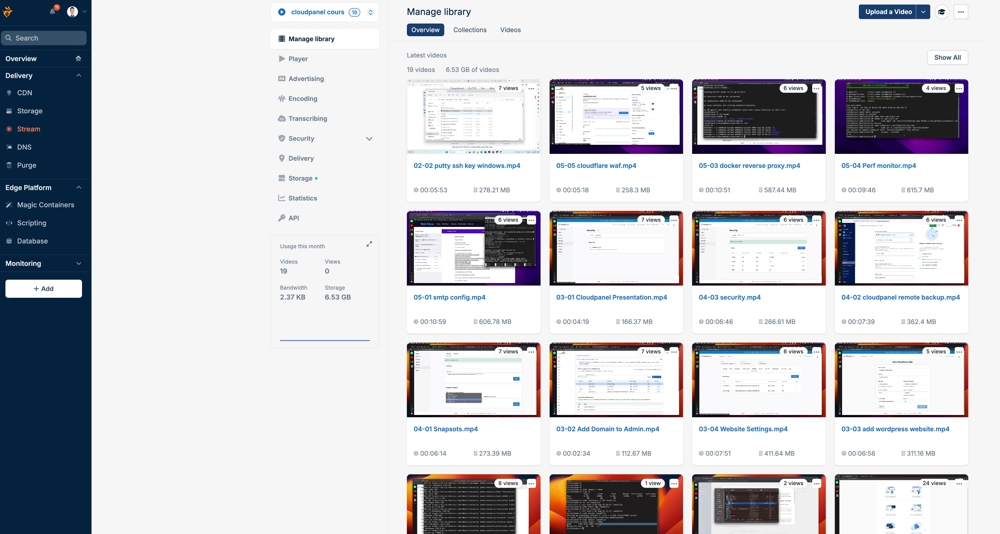

import Button from "@components/widgets/Button.astro";
import Notice from "@components/widgets/Notice.astro";
import ListCheck from "@components/widgets/ListCheck.astro";
import Accordion from "@components/widgets/Accordion.astro";
import Tabs from "@components/widgets/Tabs.astro";
import Tab from "@components/widgets/Tab.astro";

*Disclosure: this guide contains referral links. If you buy through them, I may earn a commission at no extra cost to you.*

If you're looking to host videos on your website, whether that's courses, tutorials, product demos, or marketing material, you've probably looked at YouTube and Vimeo as your two main options. YouTube is free but plasters ads over your content and doesn't let you control who watches. Vimeo gives you control but charges a premium for it, especially once your library grows.

I ran into this exact problem with [BitBuddies](https://bitbuddies.me/), where I host free courses like Dokploy and CloudPanel setup. I needed clean, ad-free video embeds in my course pages without paying Vimeo's fees. Bunny Stream turned out to be the answer, and I've been running all my course videos through it since.

This guide walks through the full setup: creating a library, uploading videos, embedding the player, customizing it, and locking things down with token authentication and DRM. I'll also cover the API and webhooks if you want to automate uploads, break down the real pricing (including the gotchas that surprise people), and share a troubleshooting section for the embed errors you'll eventually hit.

If you want a broader look at the Bunny.net platform beyond just video, check out my [Bunny.net review](/bunny-net-review/) (honest take after 1 year - cheaper than Cloudflare on bandwidth) where I cover CDN, storage, DNS, and the rest of the stack.

<Notice type="success" title="Try Bunny Stream free for 14 days">
  [Sign up at Bunny.net](https://go.bitdoze.com/bunny) with no credit card required. You get full access to Stream and every other service during the trial.
</Notice>

## Why not just use YouTube?

YouTube is free and the obvious choice for public videos. But it comes with tradeoffs that matter if you want to host videos on your own website:

- **Ads on your content**: Unless viewers pay for YouTube Premium, they see ads before or during your videos. On a course page, that means your students watch an ad for something unrelated before every lesson.
- **Recommendations pull viewers away**: YouTube's sidebar and end-screen suggestions actively try to send your viewers somewhere else. You're competing with cat videos for attention.
- **No real access control**: You can make videos unlisted, but anyone with the link can share it. There's no token authentication or DRM.
- **YouTube owns the relationship**: Your viewers are YouTube's users first, yours second. Analytics are limited, and you can't customize the player to match your brand.
- **SEO leakage**: Embedded YouTube videos send authority to youtube.com, not your domain.

YouTube makes sense for public marketing content where you want maximum reach - if that's your goal, you might want to [grow a YouTube channel with paid promotions](/youtube-promotions-subscribers/) instead. But for course content, membership sites, or anything where you want to control the experience, it falls short. If you still want YouTube embeds on your site for the reach, here's how to [add YouTube videos to your Astro blog](/add-youtube-videos-astro-blog/).

## Why not Vimeo?

Vimeo solves the ad and branding problems, but the pricing is where it gets painful. If you're evaluating a Vimeo alternative, here's roughly how the plans compare:

| Feature | Vimeo Starter | Vimeo Standard | Vimeo Advanced |
|---------|--------------|----------------|----------------|
| Price (per seat) | ~$12/mo | ~$33/mo | ~$65/mo |
| Storage | 100 GB | 5 TB | 5 TB |
| Bandwidth | Limited | Higher | Highest |
| Privacy controls | Basic | Yes | Yes |
| Player customization | Limited | Yes | Yes |

Those prices are per-user, billed annually. And once you hit bandwidth limits, you either upgrade or your videos stop loading. For a course platform with a growing library, the costs scale in a way that doesn't make much sense.

Keep in mind those plan numbers change often - check [vimeo.com/upgrade](https://vimeo.com/upgrade) for current pricing before you compare. The per-seat billing model is confirmed though, which is the part that hurts most as your team grows.

## What Bunny Stream gives you instead

Bunny Stream is pay-as-you-go. No monthly subscription tiers, no per-video limits, no bandwidth caps. You pay for storage and delivery, that's it. Here's what a Vimeo alternative needs to deliver, and what Bunny includes at no extra cost:



<ListCheck>
- **Free standard encoding**: Upload once and Bunny creates multiple resolutions (240p through 1080p). Configurable per library - set your target resolutions **before upload**
- **Built-in player**: Customizable, responsive, no third-party embed needed
- **MediaCage Basic DRM** (free): Dynamic encryption that stops casual downloads. Enterprise multi-DRM (Widevine + FairPlay) is a paid add-on
- **Token authentication**: Control exactly who can view each video with signed, expiring URLs
- **Hotlink protection**: Prevent unauthorized embedding on other domains
- **Adaptive bitrate streaming**: HLS delivery adjusts quality to each viewer's connection
- **TUS resumable uploads**: Large file uploads that survive connection interruptions
- **Webhook support**: Get notified when encoding finishes, videos get viewed, and more
- **AI content tagging**: Automatic categorization of your video library
- **Watermarking**: Add your logo or text overlay to videos
- **Geo-blocking v2**: Block or allow countries with continent/region presets and a coverage map
- **Multi-audio tracks**: Multiple language audio or commentary tracks (note: disabled under MediaCage Basic DRM)
- **VAST ad support**: Monetize with video ads if that's your model
- **Playback control API**: Programmatic play/pause/seek via player.js events for course UX
- **Statistics and watch-time heatmaps**: See exactly where viewers drop off
</ListCheck>

<Notice type="info" title="What's new in 2026">
  Bunny shipped a lot since this guide first went live. Highlights: **Bunny Stream Live** (RTMP ingest, scheduling, DVR - closed preview), **Premium Encoding** with Just-in-Time playback (~10-15 seconds to playable), **Smart Generate** (AI titles, chapters, moments from captions), **geo-blocking v2** with a coverage map, and the **Bunny CLI** for Stream management and migrations. I've updated this guide to cover all of it.
</Notice>

If you're also [localizing an Astro site](/astro-i18n-localization/), the multi-audio track support and player UI language options are worth knowing about - you can serve dubbed audio and localized player controls without running separate video copies.

## Setting up Bunny Stream step by step

Here's the full walkthrough from zero to embedded videos on your site.

### 1. Create a Bunny.net account

Head to [bunny.net](https://go.bitdoze.com/bunny) and sign up. No credit card needed for the 14-day trial. You'll land on the dashboard after confirming your email.

**Verify**: You should see the dashboard with the trial banner active. If you don't, check spam for the confirmation email.

### 2. Create a video library

In the Bunny dashboard, go to **Stream** in the left sidebar, then click **Add Video Library**.

You'll need to pick:

- **Library name**: Something descriptive. I use "bitbuddies-courses" for my course content.
- **Primary storage region**: Pick the one closest to where most of your viewers are. For a global audience, Frankfurt or New York are solid defaults.
- **Replication regions** (optional): Add more regions for faster worldwide delivery. The pricing works like this: your base region is $0.01/GB, the second region adds another $0.01/GB, and each additional region after that adds $0.005/GB. So with one replication region you're paying $0.02/GB effective; with two, $0.025/GB.

<Notice type="warning" title="Replication regions are a one-way door">
  Once you enable a replication region, it cannot be removed. You'll pay for that storage every month until you delete the entire library. Pick your regions carefully - start with just your primary and add replication only when you have the traffic to justify it.
</Notice>

Hit create and your library is ready.

**Verify**: The library appears in the Stream sidebar with the region label you picked.

### 3. Upload your videos

You have three options for getting videos into Bunny Stream:

<Notice type="warning" title="Configure encoding before you upload">
  Resolution settings, MP4 fallback, Keep Original Files, and Early-Play are all **pre-upload** decisions. They don't retro-apply to videos already in your library. If you change encoding settings later, only new uploads pick them up. Set these first, then upload.
</Notice>

<Tabs>
<Tab name="Dashboard upload">

The simplest approach. Go to your video library, click **Upload**, and drag your files in. Bunny handles everything from there.

The dashboard uses TUS resumable uploads under the hood, so if your connection drops halfway through a 2 GB file, it picks up where it left off. You'll see a progress bar and transcoding status for each video.

I use this for one-off uploads when I'm adding a new lesson to a course. Quick and painless.

</Tab>
<Tab name="API upload">

For automated workflows, Bunny's API lets you create video objects and upload via TUS protocol. Here's the basic flow:

```bash
# Step 1: Create a video object
curl -X POST "https://video.bunnycdn.com/library/{libraryId}/videos" \
  -H "AccessKey: {your-api-key}" \
  -H "Content-Type: application/json" \
  -d '{"title": "Lesson 1 - Getting Started"}'
```

This returns a video GUID. Then upload the file:

```bash
# Step 2: Upload the video file via PUT
curl -X PUT "https://video.bunnycdn.com/library/{libraryId}/videos/{videoId}" \
  -H "AccessKey: {your-api-key}" \
  -H "Content-Type: application/octet-stream" \
  --data-binary @lesson-1.mp4
```

For larger files, use the TUS protocol endpoint instead of the PUT method. Libraries like `tus-js-client` handle chunked uploads with automatic resumption.

</Tab>
<Tab name="Direct URL fetch">

If your videos are already hosted somewhere (S3, another CDN, a direct URL), Bunny can fetch them for you:

```bash
curl -X POST "https://video.bunnycdn.com/library/{libraryId}/videos/fetch" \
  -H "AccessKey: {your-api-key}" \
  -H "Content-Type: application/json" \
  -d '{"url": "https://example.com/video.mp4", "title": "Lesson 1"}'
```

This is handy when migrating from another platform. Point Bunny at your existing video URLs and it pulls them in, transcodes them, and replicates them across your storage regions.

</Tab>
</Tabs>

After upload, Bunny automatically transcodes each video into the resolutions you configured. You can watch the progress in the dashboard. Transcoding time depends on video length, resolution, and current queue demand. A 10-minute 1080p video often finishes in a couple of minutes on the free tier, but during busy periods the queue can back up. If you need guaranteed fast turnaround for time-sensitive content, Premium Encoding with Just-in-Time encoding gets you to playable in ~10-15 seconds (more on that in the pricing section).

If a video gets stuck with status 5 (Failed), the usual culprit is an unusual source codec. Re-export to H.264 MP4 and try again.

### 4. Embed videos on your site

Once a video is transcoded, click on it in the dashboard and you'll find the embed code. Here's the current official embed pattern:

```html
<iframe
  src="https://player.mediadelivery.net/embed/{video_library_id}/{video_id}"
  title="Video player"
  loading="lazy"
  style="display: block; width: 100%; height: auto; aspect-ratio: 16 / 9; border: 0;"
  allow="autoplay; encrypted-media; picture-in-picture; fullscreen"
  referrerpolicy="strict-origin-when-cross-origin"
  allowfullscreen>
</iframe>
```

The `aspect-ratio: 16 / 9` CSS handles responsive sizing in all current browsers. For portrait (9:16) or square (1:1) videos, just change the ratio - no player config needed.

<Notice type="info" title="Legacy browser fallback">
  If you need to support very old browsers without `aspect-ratio`, wrap the iframe in a `<div style="position:relative;padding-top:56.25%">` and absolutely position the iframe inside. But for 2026 audiences, `aspect-ratio` works everywhere.
</Notice>

If you're building your site on Astro and want to [deploy your static Astro site to Bunny.net](/deploy-astro-bunny-net/), you end up with both your site and video delivery on the same platform - one vendor, one bill. And if you need help making video embeds responsive in MDX, see my guide to [responsive video embeds in Astro MDX](/responsive-youtube-astrojs/).

<Notice type="warning" title="Embed 403? Check these four things">
  If your embed shows a 403 error or a blank player, work through these causes in order:

  1. **Referer stripped**: Your page sends `Referrer-Policy: no-referrer` or `same-origin`, so the iframe request has no Referer header. Bunny treats this as direct access and blocks it. Fix: add `referrerpolicy="strict-origin-when-cross-origin"` to the iframe.
  2. **Allowed domains mismatch**: Domain restrictions match against the iframe's `Referer` hostname. Make sure your domain is on the allowed list and that the hostname matches exactly (including `www.` or not).
  3. **CSP blocking**: If you use Content-Security-Policy, `frame-src` must include `https://player.mediadelivery.net`.
  4. **Token auth params**: If token authentication is enabled, the `token` and `expires` params must both be present and valid. An expired or missing token returns 403.
</Notice>

### 5. Customize the player

Go to your video library settings to configure the player appearance:

- **Player color**: Match your brand. I use the BitBuddies accent color so the player feels native to the site.
- **Controls**: Show or hide specific buttons (speed control, quality selector, PiP, fullscreen).
- **Captions**: Upload SRT/VTT files for subtitles. Multiple languages supported.
- **Thumbnail**: Bunny auto-generates one, or you upload your own.
- **Watermark**: Overlay your logo on the video. Position, size, and opacity are all adjustable.
- **Playback speed**: Enable speed controls so viewers can watch at 1.5x or 2x (course students love this).
- **Player UI language**: Localize the player controls and tooltips - useful if you're running courses in multiple languages.

You can also override settings per-embed using query parameters on the iframe URL. For example, `?autoplay=true&captions=es` forces autoplay and Spanish captions on that specific page without touching your library defaults.

For more control, the playback-control API (player.js) lets you programmatically play, pause, seek, and listen to events like `onPlay`, `onPause`, `onComplete` - handy for marking lessons as watched in a course platform.

You can also skip the built-in player entirely and use the raw HLS manifest URL with your own player (Video.js, Plyr, whatever you prefer). The HLS URL is available in each video's settings. Just note that MediaCage Basic DRM disables third-party players and direct file access - if DRM is on, you must use the Bunny embed.

### 6. Set up security

This is where Bunny Stream earns its keep over YouTube for course content.

<Accordion label="Token authentication" group="security">

Token auth ensures that only your website can generate valid playback URLs. Enable it in your library security settings, set a token key, and then sign your embed URLs server-side.

Here's how the signed URL works:

```javascript
const crypto = require('crypto');

// Token security key: library > Security > "Token authentication key" card
// (the field is labelled "API key" but it is NOT the library API key)
function signBunnyUrl(libraryId, videoId, tokenSecurityKey, expirationTime) {
  const expires = Math.floor(Date.now() / 1000) + expirationTime;
  const token = crypto
    .createHash('sha256')
    .update(tokenSecurityKey + videoId + String(expires))
    .digest('hex');
  return `https://player.mediadelivery.net/embed/${libraryId}/${videoId}?token=${token}&expires=${expires}`;
}
```

The URL expires after your set time window, so even if someone shares the link, it stops working. I set mine to expire after 4 hours, which gives students plenty of time to watch a lesson without the link becoming permanently shareable.

A few operator notes worth knowing:

- The token key lives on the library's **Security** page in a card labeled **"API key"** - but it is *not* the same as the library API key used for the video management API. This trips people up constantly.
- **Generate tokens server-side only**. Never ship the token security key to the browser. If it leaks, anyone can mint valid playback URLs.
- A 403 on the iframe almost always means an expired `expires` timestamp, a bad hash (wrong key, videoId, or expiration), or missing params. Check these first before looking at domain restrictions.
- There are ready-made server signing examples for Next.js, Nuxt, and SvelteKit in the [signed embeds docs](https://bunny.net/docs/stream/player/signed-embeds.md).
- Quick test from the CLI: `bunny stream videos embed <video-id> --expires 1h` generates a signed URL you can paste into a browser.

</Accordion>

<Accordion label="DRM protection" group="security">

Bunny's DRM comes in two tiers under the "MediaCage" brand. Know what each one does before you rely on it:

**MediaCage Basic DRM (free)** - a single toggle in the library's Security tab. It applies dynamic encryption to media files and protects against casual downloads (right-click save, simple browser extensions). The tradeoffs:

- **Embed-view only**: playback through the Bunny embed is enforced. Direct file access and third-party players are disabled while it's on.
- **No MP4 fallback** and **no Early-Play** support.
- **Single audio track only** (multi-audio is disabled).

**MediaCage Enterprise DRM (paid)** - real Widevine (Chrome, Android) and FairPlay (Safari, iOS) multi-DRM. This is what the big platforms use. Pricing:

- **$99/month base fee per video library** (charged whether or not licenses are issued)
- **Per-license fees**: $0.005/license up to 20k/mo, $0.004 up to 100k, $0.003 up to 500k, custom beyond that
- Multi-key licensing means one playback can bill multiple licenses (video + each audio track)
- Requires contacting Bunny sales and supplying an Apple FairPlay deployment package (FPS cert, private key, key password, ASK)

<Notice type="warning" title="What free DRM does NOT give you">
  MediaCage Basic stops casual piracy. It does **not** block screen recording or screenshots, and it does not use Widevine or FairPlay. If you need Hollywood-grade DRM, that's the $99/mo Enterprise tier with per-license fees. For most course creators selling content at $50-200, Basic DRM plus token auth is enough - the goal is stopping casual sharing, not defeating determined pirates.
</Notice>

Worth noting: no DRM is bulletproof. Someone can always point a camera at their screen. But Basic DRM stops the easy stuff, which is usually enough.

One more thing: disabling Enterprise DRM requires contacting support. It's not a self-service toggle. Factor that into your decision.

</Accordion>

<Accordion label="Hotlink protection and allowed domains" group="security">

Restrict which domains can embed your videos. In your library settings, add your allowed domains (e.g., `bitbuddies.me`, `www.bitbuddies.me`) and enable hotlink protection. Anyone trying to embed your video on an unauthorized domain sees nothing.

This prevents people from copying your embed code onto their own site and serving your content at your expense.

Note that domain matching is done against the iframe request's `Referer` hostname. If your page strips the referrer (via `Referrer-Policy: no-referrer` or `same-origin`), the request will be treated as direct access and blocked. Add `referrerpolicy="strict-origin-when-cross-origin"` to your iframes to avoid this.

</Accordion>

<Accordion label="Geo-blocking" group="security">

Block or allow specific countries from accessing your videos. The geo-blocking system got a big upgrade in late 2026 - it now includes continent/region presets and a coverage map so you can see exactly which countries your rules affect.

Useful for licensing restrictions or if your content is region-specific. You can set block lists or allow lists depending on whether you want a "deny all except" or "allow all except" approach.

</Accordion>

### Verify your setup

Before you call this done, run through these five checks:

<ListCheck>
- Embed loads and plays on your real domain (not localhost)
- Visiting the embed URL from an unauthorized domain (or with a stripped referrer) returns 403 - this proves hotlink protection works
- A signed token URL works, then returns 403 after the expiry window passes
- The storage breakdown page (click the (i) icon on a video) shows the resolutions you configured - and reveals the actual encoded storage size (more on why this matters below)
- A webhook fires with Status 3 (Finished) or 4 (Resolution finished) after upload
</ListCheck>

## Bunny Stream API and webhooks

If you're building a course platform or any app that manages video programmatically, the Bunny Stream API covers everything you need.

### Common API operations

```bash
# List all videos in a library
curl "https://video.bunnycdn.com/library/{libraryId}/videos?page=1&itemsPerPage=100" \
  -H "AccessKey: {your-api-key}"

# Get video details (including transcoding status)
curl "https://video.bunnycdn.com/library/{libraryId}/videos/{videoId}" \
  -H "AccessKey: {your-api-key}"

# Update video metadata
curl -X POST "https://video.bunnycdn.com/library/{libraryId}/videos/{videoId}" \
  -H "AccessKey: {your-api-key}" \
  -H "Content-Type: application/json" \
  -d '{"title": "Updated Title", "chapters": [{"title": "Intro", "start": 0, "end": 60}]}'

# Delete a video
curl -X DELETE "https://video.bunnycdn.com/library/{libraryId}/videos/{videoId}" \
  -H "AccessKey: {your-api-key}"
```

### Webhooks

Set up webhook URLs in your library settings to get notified about video lifecycle events. The webhook payload carries a numeric `Status` field (not event-name strings) and a JSON body with video metadata.

| Status | Meaning |
|--------|---------|
| 0 | Queued |
| 1 | Processing |
| 2 | Encoding |
| 3 | Finished (encoding done, fully available) |
| 4 | Resolution finished (first one - video is playable) |
| 5 | Failed |
| 6 | Presigned upload started |
| 7 | Presigned upload finished |
| 8 | Presigned upload failed |
| 9 | Captions generated |
| 10 | Title or description generated |
| 11 | Caption generation failed |
| 12 | Chapters generated |
| 13 | Moments generated |
| 32 | Video deleted |
| 33 | Smart generation failed (Reason: Title/Description/Chapters/Moments) |

The payload also includes `EventId` (a dedup key - stable across retries), `Timestamp` (event time, use this for ordering), `IsLiveStreamWebhook`, and optionally `Reason` on failures.

<Notice type="info" title="Webhook handler tip">
  Respond with a 2xx status immediately and process the payload asynchronously. Bunny's docs recommend this, and it prevents timeouts during retry storms.
</Notice>

Retry policy worth knowing: Bunny retries failed deliveries at 30 seconds, 2 minutes, 10 minutes, 30 minutes, 1 hour, and 2 hours (roughly 4 hours total). Any 2xx response acks the delivery. 4xx responses (except 408 and 429) are not retried. Each webhook is signed with the library's **Read-Only API key** and can be verified using the `v1` signature scheme.

This is useful if you want to automatically publish a course lesson once its video is ready (listen for Status 3), or trigger a notification to students. Handle Status 5 (Failed) and 33 (SmartGenerationFailed) with alerts, and dedup on `EventId` to guard against duplicate deliveries.

## Bunny Stream pricing: how much it actually costs

This is the part that sold me. Bunny Stream pricing breaks down into two components - storage and delivery - with everything else included.

| Component | Cost |
|-----------|------|
| Storage | $0.01/GB per month (default region, Frankfurt) |
| Storage replication | 2nd region: $0.01/GB · 3rd+: $0.005/GB (additive) |
| Delivery (Standard network) | $0.01/GB EU/NA · $0.03/GB Asia & Oceania · $0.045/GB South America · $0.06/GB Middle East & Africa |
| Delivery (Volume network) | From $0.005/GB (tiered: $0.005 to 500 TB, $0.004 to 1 PB, $0.002 to 2 PB) |
| Standard encoding | Free |
| Player | Free |
| Basic DRM | Free |
| Enterprise Multi-DRM | $99/mo per library + per-license fees |
| API access | Free |

**Prices checked 2026-11-12** against the [official Stream pricing docs](https://bunny.net/docs/stream/pricing.md) and the [Stream pricing calculator](https://bunny.net/pricing/stream).

A few things that trip people up:

<Notice type="info" title="Bunny bills encoded output, not your uploads">
  Storage is billed on what encoding generates, not the file size you uploaded. Each enabled resolution is stored separately, and MP4 fallback, Keep Original Files, preview animations, thumbnails, and captions all add more on top. A 50 GB source library with 4 resolutions + MP4 fallback can easily bill 2-4x that in storage. Check the per-video storage breakdown (the (i) icon or `Get video storage size info` API) and disable resolutions you don't need. If you've already uploaded, the `Cleanup unconfigured resolutions` API can reclaim space. Note: encoding settings only apply to videos uploaded after the change.
</Notice>

There's also a **$1/month platform minimum** that applies to Stream. If you're delivering less than 100 GB/month, you'll pay the dollar.

### Real-world cost examples

<Tabs>
<Tab name="Small course (my setup)">

What I run on BitBuddies:

| Item | Amount | Monthly cost |
|------|--------|-------------|
| Stored video | ~50 GB (source) | $0.50 |
| Storage replication | 1 region (New York) | $0.50 |
| Monthly delivery | ~100 GB (EU/NA) | $1.00 |
| **Total** | | **~$2.00/mo** |

Note: if Bunny's encoding generates 2-3 resolutions plus MP4 fallback, the actual stored volume could be 100-150 GB, pushing storage costs to $1.50-$2.25. Check your actual breakdown after the first month. The total is still in the low single digits.

For comparison, Vimeo Starter costs $12/month per seat with less storage and limited bandwidth.

</Tab>
<Tab name="Medium course platform">

A platform with a larger library and 2 replication regions:

| Item | Amount | Monthly cost |
|------|--------|-------------|
| Stored video | 500 GB (encoded) | $12.50 |
| Monthly delivery | 1 TB (EU/NA) | $10.00 |
| **Total** | | **~$22.50/mo** |

Note the storage figure: 500 GB at the effective $0.025/GB rate (base + 2 replication regions). The old rule of thumb of "$0.005/GB per extra region" only applies to the third region and beyond.

The same setup on Vimeo Standard would cost $33/month per seat, and you'd still hit bandwidth ceilings.

</Tab>
<Tab name="Large video library">

A production video platform, base region only (no replication):

| Item | Amount | Monthly cost |
|------|--------|-------------|
| Stored video | 5 TB (encoded) | $50.00 |
| Monthly delivery | 20 TB (Volume network) | $100.00 |
| **Total** | | **~$150/mo** |

Add replication regions and storage costs climb: with 2 replication regions that 5 TB bills at $125/mo instead of $50. At this scale, traditional cloud video (AWS MediaConvert + S3 + CloudFront) would cost significantly more. Transcoding alone on AWS runs about $0.02/minute.

</Tab>
</Tabs>

### Paid add-ons that affect the bill

Since April 2026, a few optional add-ons can show up on your invoice. Here's what they cost and when you'd need them:

- **Transcribe AI (captions)**: $0.10 per language per minute, charged when transcription runs. A 10-minute video in 2 languages = $2.00. Applies to all videos uploaded after enabling the library setting. Multi-language multiplies the cost.
- **Smart Generate**: AI titles, descriptions, chapters, and moments derived from the caption track. Requires Transcribe AI first (the caption track is the source). CLI: `bunny stream videos smart <video-id> --chapters --moments`.
- **Premium Encoding**: Billed per output-minute per codec - $0.15/min for 2160p/1440p, $0.05/min for 1080p/720p, $0.025/min for 480p and below. Ships Just-in-Time encoding (playable in ~10-15 seconds regardless of size), but requires the Bunny player and fast-start MP4/MOV source files. CLI: `bunny stream libraries update my-library --encoding-tier premium --jit --codecs x264,vp9`.
- **MediaCage Enterprise DRM**: $99/mo per library + per-license fees (covered in the security section above).

### Cost guardrails

A few things to set up before a video goes viral on your course page:

- Set a **monthly bandwidth limit** or overcharge protection on your account. Bunny has these controls in the billing settings - use them.
- **Transcription charges can appear via API** even if you don't have the dashboard toggle enabled. If your app calls the transcription endpoint, you're paying for it.
- Remember the **$1/month platform minimum**.
- Replication regions **cannot be removed** once enabled. Budget for the recurring cost.

## My setup on BitBuddies

Here's how I use Bunny Stream for [BitBuddies](https://bitbuddies.me/):

I have one video library called "bitbuddies-courses" with Frankfurt as the primary storage region and a second replication point in New York. Most of my students are in Europe and North America, so this covers the vast majority of viewers with low latency. The New York replication bills at the second-region rate ($0.01/GB), not the cheaper third-region rate - worth knowing when you model your costs.

Each course (like the [Dokploy Setup](https://bitbuddies.me/courses/dokploy-setup) and [CloudPanel Setup](https://bitbuddies.me/courses/cloudpanel-setup) courses) has its own collection within the library. When I record a new lesson, I upload it through the dashboard, wait a few minutes for transcoding, and drop the embed code into the course page.

I've enabled token authentication so the video URLs expire after a few hours. The courses are free, so I'm not trying to lock things down aggressively, but it prevents people from hot-linking the videos elsewhere and racking up my bandwidth bill.

The player matches the BitBuddies brand colors, and I have playback speed controls enabled because students watching setup tutorials often want to skip through the parts they already know.

Total monthly cost: in the low single digits. I spend more on coffee in a day. If you're building on Astro and want to see how courses fit into a modern site stack, check out these [best Astro.js online courses](/best-astrojs-online-courses/).

## When you should still use YouTube or Vimeo

Bunny Stream isn't the right pick for every situation. Be honest about your use case:

**Stick with YouTube when:**

- You want maximum organic discoverability (search, recommendations, algorithm)
- Your content is public and you benefit from YouTube's built-in audience
- You don't mind ads on your videos
- You need free hosting with unlimited storage

**Consider Vimeo when:**

- You need OTT (over-the-top) live streaming with monetization
- Your workflow depends on Vimeo's specific integrations (certain LMS platforms, marketing tools)
- You need Vimeo's built-in video creation and editing tools

**Use Bunny Stream when:**

- You're embedding videos on your own site and want a clean, branded experience
- You're building a course platform, membership site, or knowledge base
- Cost predictability matters and you want a straightforward Vimeo alternative without per-seat subscription pricing
- You need DRM, token auth, or hotlink protection
- You want API control over your video library

One honest aside: if you want hosting, payments, and email marketing handled for you rather than assembling Bunny + your own site + a payment processor, an [all-in-one course platform like Systeme.io](https://go.bitdoze.com/systeme) is the simpler path. This guide is for the DIY route where you own the whole stack.

## Frequently asked questions

<Accordion label="Can I migrate my existing videos from Vimeo to Bunny Stream?" group="faq" expanded="true">

Yes, and the process got much easier. Bunny now has official migration guides and CLI tooling:

- **Bunny CLI migration walkthroughs** exist for Vimeo, Mux, Cloudflare Stream, Wistia, and AWS S3. Each is a step-by-step guide using the `bunny` command-line tool.
- A dedicated **Vimeo2Bunny CLI** tool handles the Vimeo-specific quirks.
- The `bunny stream videos embed --expires 1h` command generates signed test URLs so you can verify playback as you migrate.

If you'd rather do it manually, use Bunny's URL fetch API to pull videos from direct download URLs (available on Vimeo paid plans), or download the files and re-upload through the dashboard. But start with the CLI migration docs first - they handle the edge cases.

</Accordion>

<Accordion label="Does Bunny Stream support live streaming?" group="faq">

It's getting there. **Bunny Stream Live** entered closed preview on 2026-08-13. Once approved, you get RTMP ingest and distribution, scheduling, countdown, DVR, and VOD - managed through a control-room dashboard and API. There's a signup banner inside the video library to request access.

VOD (pre-recorded content) remains the core product. If you're not approved for the live preview or need features it doesn't cover yet, pairing Bunny with an external live service and uploading recordings afterward still works fine. The preview looks promising but I wouldn't count on it for a production live event until it reaches general availability.

</Accordion>

<Accordion label="What video formats can I upload?" group="faq">

Bunny accepts most common formats: MP4, MKV, MOV, AVI, WEBM, and others. The recommended upload format is MP4 with H.264 encoding, as it gives the fastest transcoding times. But you can throw pretty much any format at it and Bunny figures it out.

</Accordion>

<Accordion label="How long does transcoding take?" group="faq">

Depends on the video length, resolution, and current queue demand. A 10-minute 1080p video usually transcodes in a couple of minutes on the free tier, but during busy periods the queue can back up. 4K content takes noticeably longer.

If you need guaranteed fast turnaround (live events, same-day course releases), Premium Encoding with Just-in-Time encoding gets videos playable in ~10-15 seconds regardless of length. It costs $0.025-$0.15 per output-minute depending on resolution.

</Accordion>

<Accordion label="Can I use my own video player instead of Bunny's?" group="faq">

Yes. Every video gets an HLS manifest URL that you can feed into any HLS-compatible player: Video.js, Plyr, hls.js, or whatever you prefer. The built-in player is convenient but entirely optional.

One caveat: if you enable MediaCage Basic DRM, third-party players and direct file access are disabled. You must use the Bunny embed while DRM is on. If you want a custom player, stick with Basic DRM off and rely on token auth + hotlink protection instead.

</Accordion>

<Accordion label="Is Bunny Stream good enough for paid courses?" group="faq">

For most course creators, yes. With token authentication and hotlink protection enabled, you have strong control over who watches. MediaCage Basic DRM (free) adds protection against casual downloads.

If you need real Widevine/FairPlay multi-DRM, that's the Enterprise tier at $99/month plus per-license fees. For most paid courses selling at typical price points, Basic DRM plus token auth is enough. No video platform is piracy-proof - screen recording always exists - but Bunny's protections are on par with what Vimeo and Wistia offer at higher price points.

</Accordion>

<Accordion label="How does Bunny Stream handle mobile playback?" group="faq">

The built-in player is responsive and works well on mobile browsers. HLS adaptive streaming automatically adjusts quality based on the viewer's connection speed, so mobile users on cellular data get a lower resolution that loads quickly, while wifi users get full quality. The playback speed control and PiP (picture-in-picture) both work on mobile too.

</Accordion>

<Accordion label="Can I generate captions, chapters, or titles with AI?" group="faq">

Yes, through a two-step pipeline:

1. **Transcribe AI** generates captions from the audio. Billed at $0.10 per language per minute. You can enable it library-wide (all new uploads) or trigger it per-video via API.
2. **Smart Generate** then uses the caption track to create titles, descriptions, chapters, and moments. Requires transcription first. CLI: `bunny stream videos smart <video-id> --chapters --moments`.

Note the billing chain: Smart Generate requires a caption track, so you always pay for transcription first. A 10-minute video with 2 caption languages costs $2.00 in transcription before Smart Generate runs.

</Accordion>

## Wrapping up

Bunny Stream fills a gap that YouTube and Vimeo leave open. YouTube is free but takes control away from you. Vimeo gives control back but charges a per-seat subscription that scales awkwardly. Bunny charges for what you use, includes features that cost extra elsewhere, and gets out of your way.

I've been running my [BitBuddies](https://bitbuddies.me/) course videos on it for a while now and I have no plans to switch. The setup took less than 30 minutes, the player looks clean on every device, and my monthly bill is pocket change.

The platform keeps evolving fast - live streaming in preview, Just-in-Time encoding, AI-powered chapters, and a proper CLI for management and migrations. This guide is current as of November 2026.

If you want to learn more about the full Bunny.net platform (CDN, storage, DNS, security, and more), I wrote a detailed [Bunny.net review](/bunny-net-review/) that covers everything. And if you're looking at storage options for your video files or other assets, check out my [Bunny Storage vs S3 vs Backblaze comparison](/bunny-storage-vs-s3-vs-backblaze/).

<Button text="Try Bunny Stream Free for 14 Days" link="https://go.bitdoze.com/bunny" variant="solid" color="blue" size="lg" />
