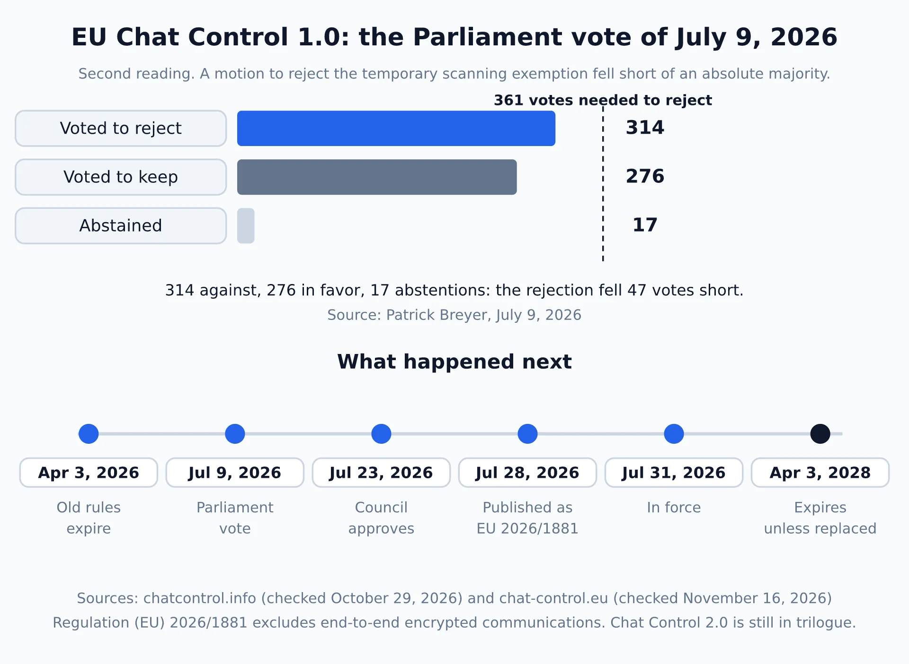
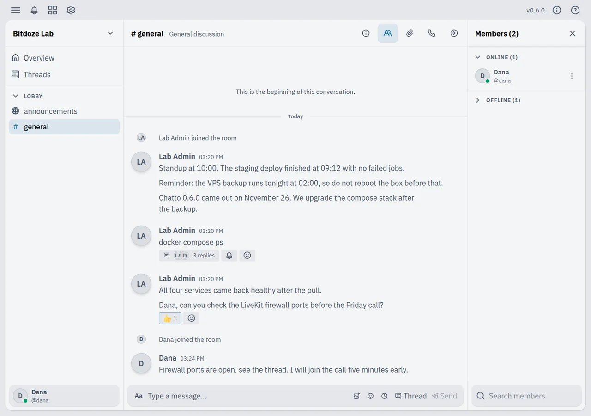
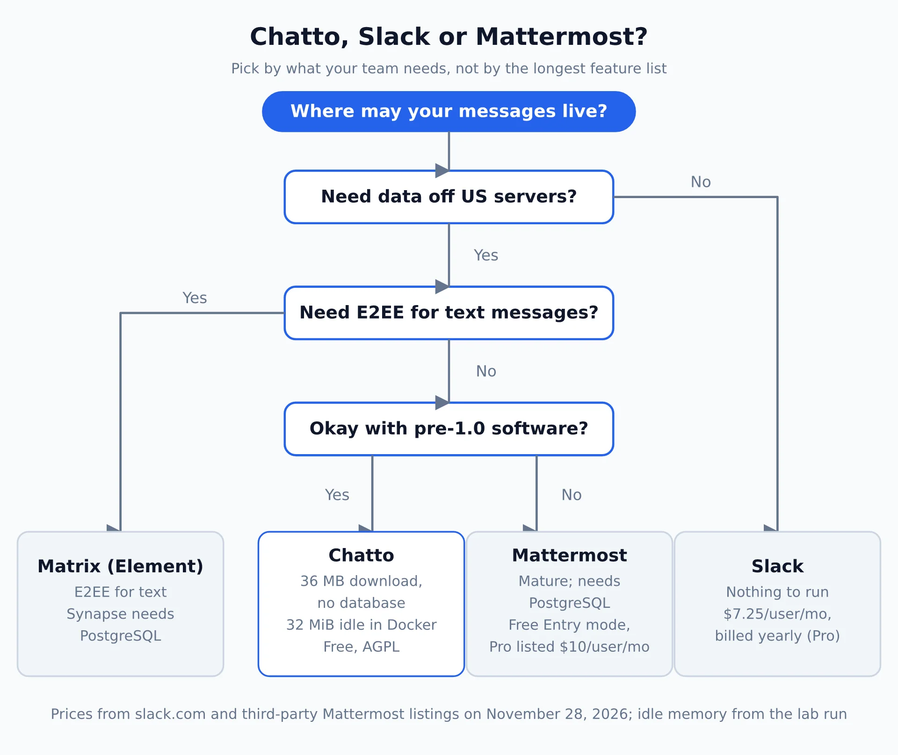
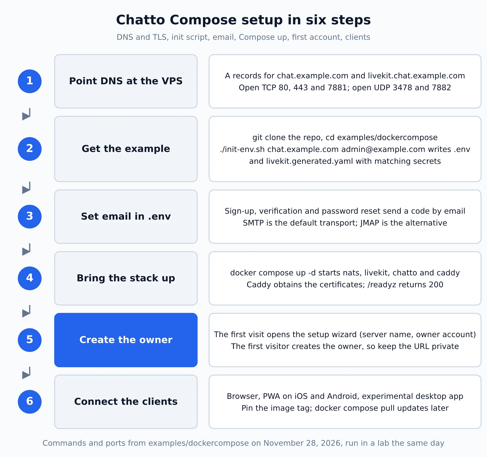
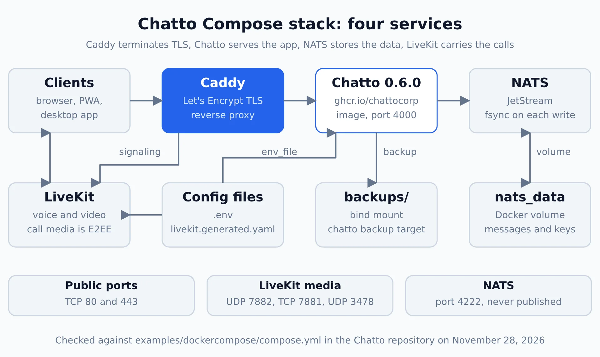
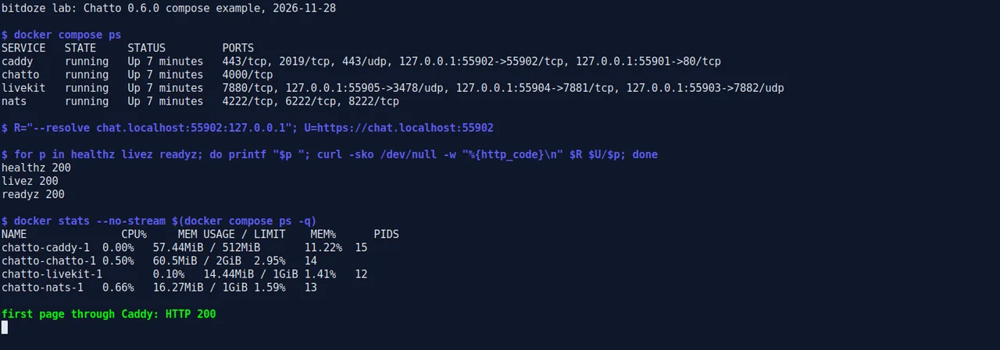
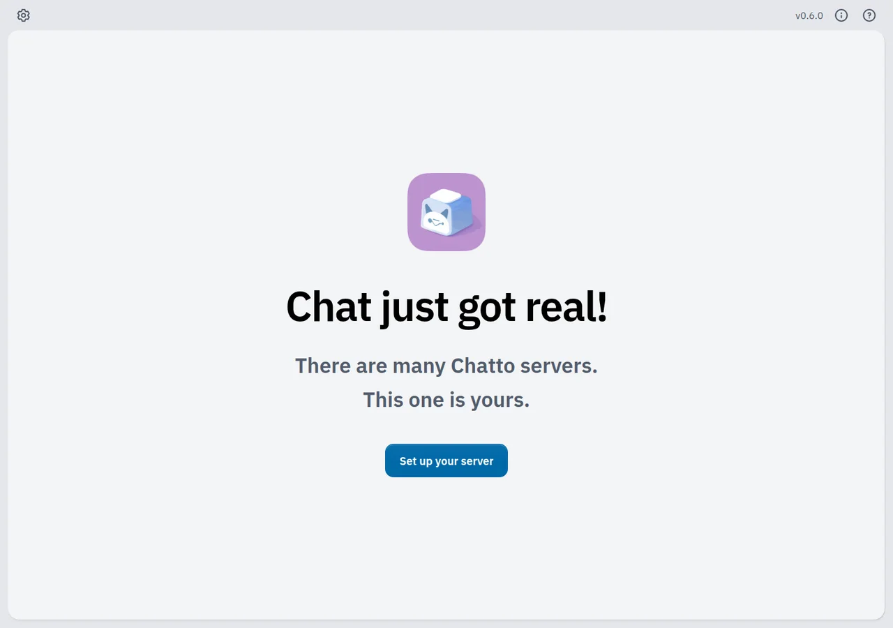
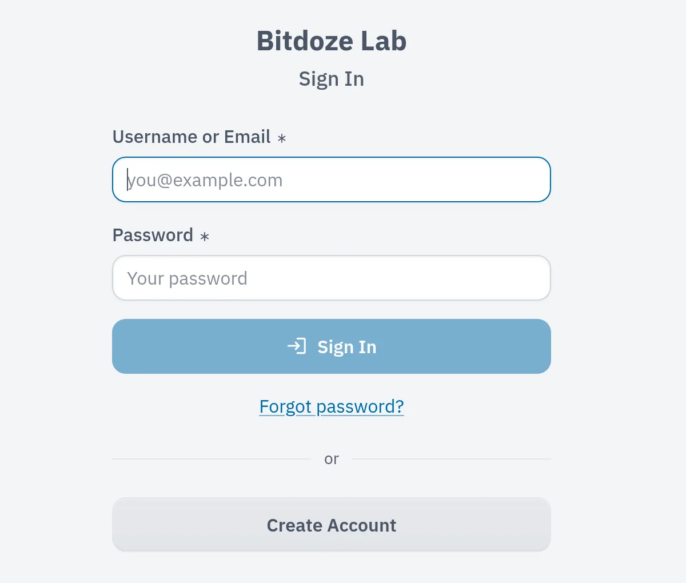
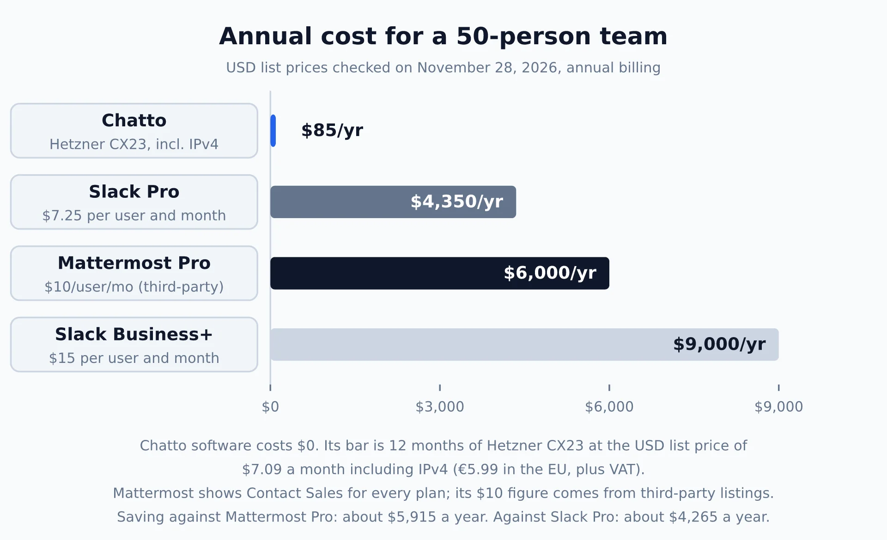
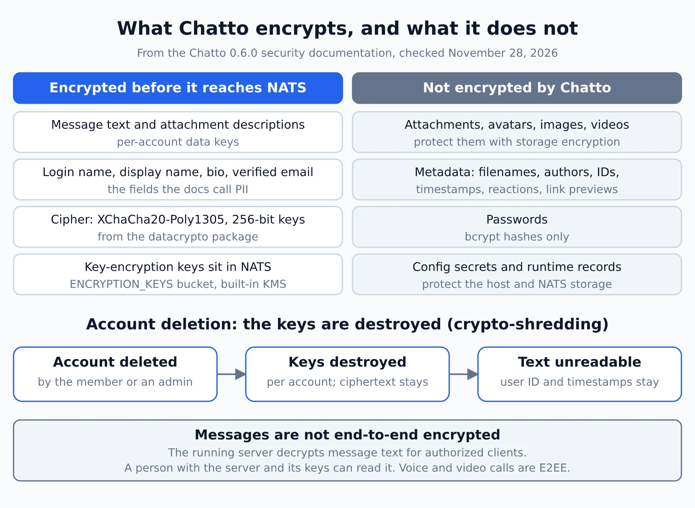

import Button from "@components/widgets/Button.astro";
import Notice from "@components/widgets/Notice.astro";
import ListCheck from "@components/widgets/ListCheck.astro";
import Accordion from "@components/widgets/Accordion.astro";
import Tabs from "@components/widgets/Tabs.astro";
import Tab from "@components/widgets/Tab.astro";


Chatto 0.6.0 is a free, open-source team chat server you can self-host without a database. A lab run on November 28, 2026 brought its four-container Compose stack up in 7 seconds; it idled at 105 MiB and answered `/readyz` with 200.

On July 9, 2026, the EU Parliament voted to greenlight Chat Control 1.0. The vote was 276 in favor, 314 against, with 17 abstentions. A majority of MEPs opposed it, but the motion to reject needed an absolute majority of 361 votes. It didn't get them.

In practice, US tech companies are once again allowed to scan private messages without a warrant. This affects direct messages on Instagram, Discord, Snapchat, Skype, Xbox, and emails through Gmail and iCloud. The exemption lasts until April 3, 2028, unless a permanent deal is reached first.

Patrick Breyer, former MEP and civil rights activist, put it bluntly: *"Our children are the real losers in this undemocratic process."* He's right. The EU Commission's own data shows mass scanning accounted for only 36% of abuse reports in 2024. The German Federal Criminal Police (BKA) reports that 48% of alerts aren't even criminally relevant. And 99% of Meta's reports are previously known material. ([Source](https://www.patrick-breyer.de/en/eu-parliament-greenlights-chat-control-1-0-breyer-our-children-lose-out/))

You can read the full legislative analysis on [Patrick Breyer's site](https://www.patrick-breyer.de/en/eu-parliament-greenlights-chat-control-1-0-breyer-our-children-lose-out/). The political fight over Chat Control 2.0, the permanent CSAM regulation, resumed on September 29, 2026 without a deal on private messages and is due back on December 8. But you don't have to wait for politicians to fix this.

<Notice type="warning" title="EU Chat Control 1.0 is now law">
  As of July 31, 2026, US tech companies can scan your unencrypted private messages on Instagram, Discord, Snapchat, Skype, Xbox, Gmail, and iCloud without a warrant. This temporary law runs until April 3, 2028. End-to-end encrypted services like WhatsApp and Signal are exempt *for now*, but Chat Control 2.0 is still being negotiated. Self-hosting your own chat on infrastructure you control is the single most practical step you can take right now.
</Notice>

The fastest way to opt out of mass surveillance is to stop using platforms that participate in it. If your team runs on Slack or Discord, your messages sit on US servers subject to scanning. A self-hosted chat server on a VPS you control fixes that in an afternoon.

Enter [Chatto](https://github.com/chattocorp/chatto).

## What did the July 9, 2026 Chat Control vote change?

The vote let providers of messaging and webmail services scan private messages again on a voluntary basis. The result is Regulation (EU) 2026/1881, in force since July 31, 2026 and valid until April 3, 2028.

The EU Parliament didn't pass a new surveillance law. It replaced a temporary derogation that had expired on April 3, 2026. The new text lets US tech companies scan private messages for child sexual abuse material (CSAM) if they choose to. The key word is *voluntarily*: these companies decided to run scanning, and the EU gave them legal cover to keep doing it.

The numbers tell a different story than the one politicians sell:

- **36%**: the share of abuse reports that came from mass scanning of private chats in 2024. The majority came from public posts and cloud storage, which were never affected by this law.
- **48%**: alerts from the German BKA that turned out to not be criminally relevant at all.
- **40%**: investigations triggered by chat control that ended up targeting minors themselves, not adult predators.
- **99%**: Meta's reports that consisted of previously known material, doing little to stop active abuse.
- **Zero**: evidence from the EU Commission that suspicionless scanning increased convictions or rescued children.

All five figures come from [Patrick Breyer's summary](https://www.patrick-breyer.de/en/eu-parliament-greenlights-chat-control-1-0-breyer-our-children-lose-out/) of the vote.



*The vote fell 47 short of the 361 needed to reject, and the regulation runs from July 31, 2026 to April 3, 2028.*

The regulation also excludes end-to-end encrypted communications, so WhatsApp and Signal chats are out of scope *by this vote*. Team chat tools such as Slack, Discord and Microsoft Teams do not use end-to-end encryption for text messages, so that exemption does not cover them. Discord has encrypted voice and video calls since March 2026, but not message text. ([Discord support](https://support.discord.com/hc/en-us/articles/25968222946071-End-to-End-Encryption-for-Audio-and-Video))

Chat Control 2.0, the permanent regulation, is still in trilogue. The sixth round on September 29, 2026 ended without a deal on private messages and reached provisional agreement only on scanning public content and on the EU Centre. ([Breyer, September 30, 2026](https://www.patrick-breyer.de/en/chat-control-2-0-trilogue-update-no-mass-scanning-deal-for-now-european-parliament-stands-firm-against-search-plans)) The next political trilogue is tentatively set for December 8, 2026. ([chat-control.eu](https://chat-control.eu/what-is-chat-control), checked November 16, 2026)

The practical response isn't to wait and see. It's to move your team's communication to infrastructure you own.

## What is Chatto?

Chatto is a self-hosted team chat application that Hendrik Mans open-sourced on July 8, 2026. GitHub measures the repository at 40.3% Go, 39.6% TypeScript and 9.0% Svelte, and the server, CLI and bundled frontend are licensed AGPL-3.0-or-later ([repository](https://github.com/chattocorp/chatto), November 28, 2026).

The pitch is simple: a single binary that serves its own web frontend, requires no database, and uses [NATS](https://nats.io) for persistence. It supports voice and video calls through LiveKit, encrypts data at rest with per-user keys, and includes zero third-party tracking or analytics.



*Chatto 0.6.0 in a lab on November 28, 2026: the general room with a reaction and a thread of three replies.*

Current release is 0.6.0, published on November 26, 2026, with about 3,000 GitHub stars. Each server is fully isolated, with no federation by design, which is a privacy feature rather than a gap. No data leaks between servers because there's no inter-server communication at all. The docs call the project work in progress: expect bugs, frequent upgrades and breaking API changes while the version stays at 0.x.

<Button text="View Chatto on GitHub" link="https://github.com/chattocorp/chatto" variant="solid" color="blue" size="md" icon="arrow-right" />

Features in 0.6.0:

- **No database required**: NATS JetStream handles all persistence
- **Single binary**: Linux (x86_64 and ARM64), macOS, Windows and FreeBSD, or a Docker image from `ghcr.io/chattocorp/chatto`
- **Voice/video calls**: powered by LiveKit, end-to-end encrypted, includes screen sharing
- **Encryption at rest**: per-user keys with crypto-shredding on account deletion
- **SSO**: OIDC, Google, GitHub, GitLab, Discord, or an AT Protocol handle such as a Bluesky account
- **Roles and permissions**: fine-grained, room groups as permission boundaries, and a 15-minute Shield Mode for protected roles
- **Multiple servers in one client**: the desktop app and the standalone frontend connect to several Chatto servers at once
- **PWA**: install on iOS and Android from the browser; Web Push works once the operator adds VAPID keys
- **ConnectRPC API, bot webhooks and an MCP endpoint**: for bots and integrations

Rooms, threads, replies, reactions, direct messages, notifications, file attachments and full-text search are all in 0.6.0. Uploads default to a 25 MB limit and live in NATS Object Store unless you point `[core.assets.s3]` at an S3-compatible bucket. Video uploads need `CHATTO_VIDEO_ENABLED=true` and `CHATTO_ASSET_PROCESSING_ENABLED=true` in `.env`. Search runs through an optional provider; `chatto init --with-search` turns it on for the binary path.


*A thread in the general room. The message menu offers reactions, Reply in thread, pin and delete.*

Official resources: [chatto.run](https://chatto.run) | [docs.chatto.run](https://docs.chatto.run) | [Community server](https://chat.chatto.run/)

## Chatto vs Slack and Mattermost

If you're evaluating Chatto as a self-hosted Slack alternative, here's how it stacks up against the main competitors.

### Feature comparison table

<Tabs>
<Tab name="Chatto vs Mattermost">
| Feature | Chatto | Mattermost |
|---------|--------|------------|
| Self-hosted | Yes (AGPL) | Yes (Enterprise Edition binary with free Entry mode; Team Edition under MIT) |
| Price | $0 | Entry free with limits; Professional listed at $10/user/mo |
| Database | None (NATS) | PostgreSQL required |
| Voice/video calls | Yes (LiveKit, E2EE) | Entry: 40-minute calls; Professional: group audio calls and screen sharing |
| SSO | OIDC, Google, GitHub, GitLab, Discord | Entry: yes; Team Edition: no |
| Deployment | Single binary or Docker | Binary or Docker with PostgreSQL |
| RAM usage (idle) | 32 MiB Chatto container (lab) | 1 to 2 GB minimum |
| Mobile | PWA; experimental desktop app | Native iOS + Android |
| Federation | No (by design) | Enterprise: federated channels with Teams and Matrix |
| License | AGPL-3.0-or-later | MIT (Team Edition); commercial (Enterprise Edition) |

Mattermost is removing SSO from the MIT-licensed Team Edition and now points small teams to Entry, a free mode of its Enterprise Edition binary. Entry includes SSO and calls but caps visible history at 10,000 messages and calls at 40 minutes. ([Editions and offerings](https://docs.mattermost.com/product-overview/editions-and-offerings), November 28, 2026) Mattermost's pricing page shows Contact Sales for every plan; third-party listings put Professional at $10 per user and month, billed yearly.

</Tab>
<Tab name="Chatto vs Slack">
| Feature | Chatto | Slack |
|---------|--------|-------|
| Self-hosted | Yes | No |
| Price | $0 | $7.25 to $15 per user/mo, billed yearly |
| Database | None (NATS) | N/A (SaaS) |
| Voice/video calls | Yes (LiveKit, E2EE) | Yes (not E2EE) |
| SSO | OIDC, Google, GitHub, GitLab, Discord | SAML SSO from Business+ up |
| Data location | Your server, your country | US by default; Enterprise Grid adds residency |
| Chat Control exposure | Scanning is your decision, not a vendor's | US provider; text is not end to end encrypted; scanning is voluntary until April 3, 2028 |
| Mobile | PWA; experimental desktop app | Native iOS + Android |
| License | AGPL-3.0-or-later | Proprietary |

Slack encrypts customer data at rest and in transit on its own servers, but it can read message text because messages are not end to end encrypted. ([Slack security page](https://slack.com/intl/en-gb/trust/security)) Under Regulation (EU) 2026/1881 a provider may scan such text voluntarily until April 3, 2028. There's no self-hosted option. If privacy matters, Slack is not a choice. It's a liability.

</Tab>
<Tab name="Chatto vs Matrix">
| Feature | Chatto | Matrix/Element |
|---------|--------|----------------|
| Self-hosted | Yes | Yes |
| Price | $0 | Free (Apache 2.0) |
| Database | None (NATS) | PostgreSQL required |
| Voice/video calls | Yes (LiveKit, E2EE) | Yes (Jitsi/Element Call) |
| E2EE messages | No (at rest only) | Yes (Olm/Megolm) |
| SSO | OIDC, Google, GitHub, GitLab, Discord | Yes |
| Deployment | Single binary | Synapse + PostgreSQL + reverse proxy |
| Federation | No (by design) | Yes (complex) |
| RAM usage (idle) | 32 MiB Chatto container (lab) | 512 MB to 2 GB for Synapse |
| License | AGPL-3.0-or-later | Apache 2.0 |

Matrix is the strongest open-source competitor on paper. It has E2EE for messages and federation, but Synapse is resource-hungry, federation adds operational complexity, and the UX is polarizing. If you want something that "just works" on a cheap VPS without a database, Chatto is simpler. If you need true E2EE between clients or federation across servers, Matrix is the better fit.

</Tab>
</Tabs>

### Which one should you pick?

Each block below stands alone, so you can compare the verdicts without scrolling back to the tables.



*Three questions narrow the choice: US servers, end to end encryption, and pre-1.0 software.*

### 1. Chatto (best for a small team that wants its own server)

**Verdict:** Free, database-free, and light: the Chatto container idled at 32 MiB.

- **Best for:** A small team with one administrator who wants calls, SSO and threads on a cheap VPS.
- **Strengths:** A 36 MB download or a four-service Compose stack, LiveKit calls with E2EE, crypto-shredding on account deletion.
- **Trade-offs:** Version 0.6.0 with breaking changes expected across 0.x releases, no native mobile app yet, no E2EE for text.
- **Pricing:** $0 for software; about $85 a year for a Hetzner CX23.

### 2. Slack (best for teams that will not run anything)

**Verdict:** No hosting work, at $7.25 per user and month on the annual Pro plan.

- **Best for:** Teams where nobody wants to run or update a server.
- **Strengths:** Native apps everywhere, huddles with screen sharing, SAML SSO from Business+.
- **Trade-offs:** No self-hosting, message text readable by Slack, US-hosted by default.
- **Pricing:** Pro $7.25, Business+ $15, Enterprise+ $45 per user and month, billed yearly.

### 3. Mattermost (best for teams that need a mature self-hosted stack)

**Verdict:** Mature and self-hosted, with a PostgreSQL server to run and a free tier that now has hard limits.

- **Best for:** Teams with an administrator who need playbooks, compliance export or a support contract.
- **Strengths:** Native mobile apps, SSO in Entry and every paid edition, HA clusters up to 50,000 concurrent users on Enterprise.
- **Trade-offs:** Entry caps visible history at 10,000 messages and calls at 40 minutes; Professional stops at 250 users.
- **Pricing:** Entry is free; Professional is listed at $10 per user and month by third parties, and shows Contact Sales on mattermost.com.

### Pricing comparison

Here's what a 50-person team pays a year:

| Solution | Annual cost (50 users) |
|----------|----------------------|
| **Chatto on Hetzner CX23** | ~€72/year incl. IPv4 (VPS only) |
| **Mattermost Entry** | $0 (10,000 visible messages, 40-minute calls) |
| **Mattermost Professional** | $6,000/year |
| **Slack Pro** | $4,350/year |
| **Slack Business+** | $9,000/year |

The Mattermost figure uses the Professional listing. Entry is free but shows only the last 10,000 messages, which a 50-person team passes quickly. Slack prices are the yearly billing rates; monthly billing costs more ($8.75 and $18).

<ListCheck>
**What you get for $0 with Chatto:**
- Unlimited users
- Voice and video calls via LiveKit (end-to-end encrypted)
- SSO (OIDC, Google, GitHub, Discord)
- Encryption at rest with per-user keys
- No database to manage
- Single binary deployment
- Screen sharing
- Fine-grained roles and permissions
</ListCheck>

## Self-hosting Chatto with the standalone binary

The standalone binary is the fastest way to try Chatto. Five minutes from download to running server. This path uses an embedded NATS instance, so there is no external dependency. On November 28, 2026 the 0.6.0 build answered its first request 0.5 seconds after `chatto run`.

**Step 1: download the binary**

Grab the latest release from GitHub. For Linux x86_64:

```bash
# Download the current release (check https://github.com/chattocorp/chatto/releases for newer versions)
wget https://github.com/chattocorp/chatto/releases/download/v0.6.0/chatto_Linux_x86_64.tar.gz
tar xzf chatto_Linux_x86_64.tar.gz
sudo mv chatto /usr/local/bin/chatto
```

The archive is 36 MB and unpacks a 101 MB binary named `chatto`, a `NOTICE` file and the AGPL license text. Compare the archive with `sha256sum` against `chatto_0.6.0_checksums.txt` on the release page. With Homebrew, `brew install chattocorp/tap/chatto` does the same on macOS and Linux.

For ARM64 servers (like Hetzner CAX instances):

```bash
wget https://github.com/chattocorp/chatto/releases/download/v0.6.0/chatto_Linux_arm64.tar.gz
tar xzf chatto_Linux_arm64.tar.gz
sudo mv chatto /usr/local/bin/chatto
```

**Step 2: initialize the configuration**

```bash
chatto init
```

This generates a `chatto.toml` configuration file in the current directory, 18 KB with random cookie, asset and NATS secrets. Edit it to set `webserver.url` to the public address, add your address to `owners.emails`, and fill in the SMTP section if the server must send mail. `chatto init --interactive` opens a full-screen wizard instead.

**Step 3: start the server**

```bash
chatto run
```

Chatto serves its web frontend on `http://localhost:4000`, and `/healthz`, `/livez` and `/readyz` return 200 once it is up. The listener binds every interface by default, so set `bind_address` to `127.0.0.1` when a reverse proxy on the same host terminates TLS. For production use with TLS, you can enable the built-in Let's Encrypt support in `chatto.toml` or put it behind a reverse proxy. Data lands in `./data`; set `nats.embedded.sync_interval` to `always` so JetStream fsyncs every write before acknowledging it.

**Step 4: run it as a systemd service (optional)**

For persistent operation, create `/etc/systemd/system/chatto.service` with this unit:

```ini
[Unit]
Description=Chatto
After=network-online.target
Wants=network-online.target

[Service]
Type=simple
User=chatto
Group=chatto
WorkingDirectory=/opt/chatto
ExecStart=/opt/chatto/chatto run -c chatto.toml
Restart=always
RestartSec=5
AmbientCapabilities=CAP_NET_BIND_SERVICE

[Install]
WantedBy=multi-user.target
```

Make sure the `chatto` user can read `chatto.toml` and write the data directory. `CAP_NET_BIND_SERVICE` lets Chatto bind ports below 1024 for its own TLS; drop the line when a reverse proxy handles TLS.

```bash
sudo systemctl daemon-reload
sudo systemctl enable --now chatto
```

<Notice type="info" title="When to use the binary vs Docker">
  The standalone binary is ideal for testing, personal use, or small teams with fewer than 10 users. It uses embedded NATS, which means everything runs in one process: simple, but no zero-downtime updates. The binary does not include LiveKit, so calls need a separate LiveKit server. For production deployments with multiple users, voice/video calls through LiveKit, and automatic TLS via Caddy, use the Docker Compose setup below.
</Notice>

If you haven't set up Docker yet, see our guide on [installing Docker on Ubuntu ARM](/install-docker-ubuntu-arm/).

## Self-hosting Chatto with Docker Compose

This is the recommended production setup. You get separate NATS for data persistence (survives container restarts), LiveKit for voice/video calls, and Caddy for automatic TLS.



*The six steps from an empty VPS to a signed-in team, with the ports and commands from the repository's Compose example.*

### Prerequisites

<ListCheck>
**What you need before starting:**
- A VPS with Docker and Compose v2 installed ([install Docker on Ubuntu ARM](/install-docker-ubuntu-arm/))
- A domain name with a DNS A record pointing to your VPS IP (e.g., `chat.example.com`)
- A `livekit.*` subdomain pointing to the same VPS (e.g., `livekit.chat.example.com`)
- SMTP or JMAP credentials for direct sign-up, email verification and password resets (the first owner account needs no email)
- (Optional) S3-compatible storage for file uploads
</ListCheck>

For VPS providers, check our [DigitalOcean vs Vultr vs Hetzner](/digitalocean-vs-vultr-vs-hetzner/) comparison. The [Hetzner Cloud review](/hetzner-cloud-review/) covers the CX23, which replaced the CX22 and costs €5.49 a month before IPv4.

Required ports:
- **TCP 80, 443**: Caddy's HTTP redirect, ACME challenge and HTTPS for both hostnames
- **TCP 7881**: LiveKit WebRTC media fallback when UDP is blocked
- **UDP 3478, 7882**: LiveKit's embedded TURN/STUN relay and direct WebRTC media

The `livekit.*` subdomain (e.g., `livekit.chat.example.com`) is only an example name. Caddy proxies it to LiveKit's WebSocket endpoint on port 7880, which browsers use for call signaling, so any hostname you control works once `CHATTO_LIVEKIT_URL` and the Caddy route match. LiveKit also needs DNS and outbound UDP for STUN-based public IP discovery.

### compose.yml walkthrough

Clone the Docker Compose example from the main Chatto repository:

```bash
git clone --depth 1 --filter=blob:none --sparse https://github.com/chattocorp/chatto.git chatto-source
git -C chatto-source sparse-checkout set examples/dockercompose
cp -R chatto-source/examples/dockercompose chatto
rm -rf chatto-source
cd chatto
```

The folder holds `compose.yml` (not `docker-compose.yml`), `init-env.sh`, `Caddyfile`, `livekit.yaml`, `nats-server.conf` and `.env.example`.

Run the initialization script to generate your `.env` file and LiveKit secrets:

```bash
chmod +x init-env.sh
./init-env.sh chat.example.com admin@example.com
```

Replace `chat.example.com` with your domain and `admin@example.com` with the email you will register with. The script writes `.env` and `livekit.generated.yaml` with matching NATS, Chatto, and LiveKit secrets, creates the `backups/` directory and sets both files to mode 600. The email goes into `CHATTO_OWNERS_EMAILS`; it does not create the account.

Open `.env` and configure your SMTP credentials:

```env
# Public hostname, used by Caddy and by Chatto for absolute URLs
PUBLIC_URL=chat.example.com
# Verified emails that receive the owner role after registration
CHATTO_OWNERS_EMAILS=admin@example.com

# NATS token, shared by the nats and chatto services (generated)
NATS_TOKEN=...
CHATTO_NATS_CLIENT_TOKEN=...
# Required since 0.6.0: the server refuses to start without it
CHATTO_WEBSERVER_URL=https://chat.example.com
CHATTO_WEBSERVER_PORT=4000

# SMTP, the default transport for direct sign-up, verification and password reset
CHATTO_SMTP_ENABLED=true
CHATTO_SMTP_HOST=smtp.sendgrid.net
CHATTO_SMTP_PORT=587
CHATTO_SMTP_TLS=mandatory
CHATTO_SMTP_USERNAME=apikey
CHATTO_SMTP_PASSWORD=your-api-key-here
CHATTO_SMTP_FROM=chat@example.com

# LiveKit settings (generated by init-env.sh)
CHATTO_LIVEKIT_URL=wss://livekit.chat.example.com
CHATTO_LIVEKIT_API_KEY=...
CHATTO_LIVEKIT_API_SECRET=...
```

The `compose.yml` defines four services:

```yaml
services:
  nats:
    image: nats:latest
    restart: unless-stopped
    command: ['--config', '/etc/nats/nats-server.conf', '--auth=${NATS_TOKEN}']
    volumes:
      - ./nats-server.conf:/etc/nats/nats-server.conf:ro
      - nats_data:/data

  livekit:
    image: livekit/livekit-server:latest
    restart: unless-stopped
    command: [--config, /etc/livekit.yaml]
    ports:
      - '7882:7882/udp' # WebRTC media (UDP, must be direct)
      - '7881:7881/tcp' # WebRTC media fallback when UDP is unavailable
      - '3478:3478/udp' # TURN/STUN relay for NAT traversal
    expose:
      - '7880' # WebSocket signaling (proxied through Caddy)
    volumes:
      - ${LIVEKIT_CONFIG_FILE:-./livekit.yaml}:/etc/livekit.yaml:ro

  chatto:
    image: ghcr.io/chattocorp/chatto:latest
    restart: unless-stopped
    env_file: .env
    environment:
      PUID: '${PUID:-1000}'
      PGID: '${PGID:-1000}'
    depends_on:
      - nats
    expose:
      - '4000'
    volumes:
      - ${CHATTO_BACKUP_DIR:-./backups}:/backups

  caddy:
    image: caddy:latest
    restart: unless-stopped
    ports:
      - '80:80'
      - '443:443'
    environment:
      PUBLIC_URL: '${PUBLIC_URL:-chat.example.com}'
    volumes:
      - ./Caddyfile:/etc/caddy/Caddyfile:ro
      - caddy_data:/data
      - caddy_config:/config

volumes:
  nats_data:
  caddy_data:
  caddy_config:
```

NATS reads `nats-server.conf` and fsyncs every JetStream write before acknowledging it. The Chatto container has no data volume of its own: messages and keys live in `nats_data`, and backups go to the `backups/` bind mount. Pin the image to a version such as `ghcr.io/chattocorp/chatto:0.6.0` to control when you upgrade, because `latest` follows each stable release.

The architecture flows like this:



*The four services of the Compose example and the ports they publish, as checked against the repository on November 28, 2026.*

<Notice type="warning" title="Edit your .env file before starting">
  Fill in your `CHATTO_SMTP_*` values in `.env` before you invite anyone. Direct sign-up, verification and password reset send a code by email, so registration answers `email delivery is not configured` until SMTP or JMAP works. The setup wizard and the first owner account do not need email. Check that both DNS records point at the VPS, because Caddy needs them for the Let's Encrypt certificates.
</Notice>

For more on configuring environment variables in Docker, see our guide on [environment variables in Docker](/docker-env-vars/).

### Starting and updating

Start the stack:

```bash
docker compose up -d
```

Verify everything is running:

```bash
docker compose ps
```

All four services should show as `running`. Check the health endpoint and the logs:

```bash
curl -fsS https://chat.example.com/readyz
docker compose logs --tail 20 chatto
```

The Chatto log ends its startup with `Server ready`. On November 28, 2026 `docker compose up -d` returned in 7 seconds and the first page came back 1 second later. Chatto's own log put `Server ready` 539 ms after start, and `docker stats --no-stream` showed 105 MiB for the whole stack at idle.



*`docker compose ps`, the three health endpoints and `docker stats --no-stream` on the lab stack, with its ports moved to a private range.*

### Create the owner account

Open `https://chat.example.com` before you share the address. The first visitor gets the setup wizard, and later visitors skip it.



*The first-run screen. The first visitor can create the owner account, so finish the wizard before anyone else finds the URL.*

The wizard asks for a server name and an optional description, then a username, display name and password for the owner account. Chatto then signs the owner in with Shield Mode on for 15 minutes and seeds a Lobby room group with `announcements` and `general` rooms. Email delivery is not needed for this step.



*The sign-in page once the owner exists. Set `CHATTO_AUTH_DIRECT_REGISTRATION=false` in `.env` to close public sign-up.*

### Backups and troubleshooting

Back up while Chatto is running. The command starts a temporary container, asks for a passphrase and writes a timestamped archive to `backups/`:

```bash
docker compose run --rm chatto backup --encrypt --include-keys
```

Copy the archive, the passphrase, `.env` and `livekit.generated.yaml` to another host. To restore, stop the Chatto service but keep NATS running:

```bash
docker compose stop chatto
docker compose run --rm chatto restore /backups/2026-11-28T13-28-06Z.tar.gz.age
docker compose up -d chatto
```

The restore command was not run for this article. Test it once before you rely on an archive.

The failures you are most likely to meet, with the fixes from the example's README:

- **Chatto can't connect to NATS**: `NATS_TOKEN` and `CHATTO_NATS_CLIENT_TOKEN` must match in `.env`.
- **Registration says email delivery is not configured**: set the `CHATTO_SMTP_*` values, or switch to JMAP with `CHATTO_EMAIL_TRANSPORT=jmap`.
- **Caddy not getting certificates**: both DNS records must point at the server, and ports 80 and 443 must be open.
- **Calls don't connect**: the LiveKit key and secret in `.env` must match the `keys:` block in `livekit.generated.yaml`, and `CHATTO_LIVEKIT_URL` must be the public `wss://` address.
- **LiveKit logs `could not resolve external IP`**: allow DNS and outbound UDP to the STUN servers, or set `rtc.use_external_ip: false` and `rtc.node_ip` on a host with a stable public IP.

To upgrade, run `docker compose pull` and `docker compose up -d` after reading the release notes. The FAQ below has the details and the rollback link.

## What does it cost to run Chatto?

Chatto itself is free, so the only cost is the VPS it runs on. A Hetzner CX23 with IPv4 is €5.99 a month, about $85 a year at Hetzner's USD list price.

Here's what VPS pricing looks like as of November 28, 2026:

| VPS Provider | Plan | RAM | vCPU | Monthly Cost |
|--------------|------|-----|------|--------------|
| Hetzner CX23 | x86 | 4 GB | 2 | €5.99 incl. IPv4 |
| Hetzner CAX11 | ARM64 | 4 GB | 2 | €6.49 incl. IPv4 |
| Contabo Cloud VPS 4 | x86 | 8 GB | 4 | €4.40 on a 24-month plan |
| DigitalOcean Basic | x86 | 2 GB | 1 | $12.00 |

Sources: [Hetzner's price data](https://www.hetzner.com/cloud/), [Contabo](https://www.contabo.com/en/vps/) and [DigitalOcean](https://www.digitalocean.com/pricing/droplets), all checked on November 28, 2026. Hetzner listed every CX and CAX plan as not available that day, and the CX22 at €3.99 that this article once recommended no longer exists. [VPS price increases in 2026](/vps-price-increases/) explains the hikes.

The developer's benchmarks, quoted in July 2026, put Chatto at tens of MB at idle and roughly 10 MB per additional connected user. A 1 GB VPS handles a small team. A 4 GB VPS (like the Hetzner CX23) is comfortable for 20 to 30 concurrent users with LiveKit calls running. A lab run on November 28, 2026 confirms the idle figure: 32 MiB for the Chatto container and 105 MiB for the whole stack, LiveKit and Caddy included.

Now compare annual costs for a 50-person team:

| Solution | Annual cost |
|----------|-------------|
| Chatto + Hetzner CX23 | ~€72/year incl. IPv4 |
| Mattermost Entry | $0 (10,000 visible messages, 40-minute calls) |
| Mattermost Professional | $6,000/year |
| Slack Pro | $4,350/year |
| Slack Business+ | $9,000/year |

<Notice type="success" title="Bottom line">
  A 50-person team pays about $85 a year for the VPS instead of $6,000 for Mattermost Professional licences, a saving of about $5,900. Add $10 a month for SMTP and a few dollars for S3 storage and the yearly bill stays under $250.
</Notice>



*Yearly list prices for 50 users in USD, checked on November 28, 2026. The Chatto bar is 12 months of Hetzner CX23.*

For more VPS pricing details, check the [Hetzner Cloud review](/hetzner-cloud-review/) and our [DigitalOcean vs Vultr vs Hetzner](/digitalocean-vs-vultr-vs-hetzner/) benchmarks.

## Is Chatto encrypted, and is it end to end?

Chatto encrypts message text and profile fields at rest with a per-account key and destroys that key when the account is deleted. Messages are not end to end encrypted; only voice and video calls are ([security documentation](https://docs.chatto.run/guides/operations/security/)).

"Privacy" is a marketing word until you explain the mechanism. Here's how Chatto protects your data.



*What Chatto 0.6.0 encrypts, what it leaves to the storage layer, and what crypto-shredding removes.*

**Encryption at rest.** Every user gets a unique encryption key. Message text, attachment descriptions and profile fields (login name, display name, bio, verified email) are encrypted with XChaCha20-Poly1305 before being written to NATS. Chatto wraps each account key with key-encryption keys that it keeps in a NATS bucket called `ENCRYPTION_KEYS`. If someone gains raw access to the NATS event stream without the keys, they can't read the messages. Attachments, avatars, filenames, authors and timestamps are not encrypted by Chatto, so the NATS or S3 storage under them needs its own protection.

**Crypto-shredding.** When a user deletes their account, their encryption keys are destroyed. The encrypted data remains on disk but is unreadable, while the user ID, timestamps and room memberships stay in the event history. This is a GDPR-friendly approach, since you can show the keys are gone. The docs add two caveats: key and file cleanup can fail and retry later, and an old backup that includes the keys makes deleted data readable again.

**No third-party tracking.** No Google Analytics, no Sentry breadcrumbs, no Mixpanel events. Chatto doesn't phone home, and self-hosted servers send no usage data to ChattoCorp. The only external connections are the ones you configure (SMTP, S3, OIDC providers).

**Server isolation.** Each Chatto server is fully independent. No federation means no data leaks between organizations. Your server knows nothing about other Chatto servers. This is a deliberate design choice, not a missing feature.

**Calls are E2EE.** Voice and video calls through LiveKit use end-to-end encryption. Chatto issues a short-lived LiveKit token and a call key to each participant. It destroys the key when the last participant leaves, so even your own server can't intercept call content.

**GDPR compliance.** Host Chatto on a European VPS (Hetzner is in Germany and Finland), and your data never leaves the EU. You are the data processor. You decide retention policies, access controls, and deletion schedules. Compare this to Slack or Discord, where data sits on US servers by default, subject to FISA warrants, National Security Letters, and now optional Chat Control scanning.

<Notice type="info" title="Messages are not end-to-end encrypted">
  Encryption at rest protects your data on disk, but Chatto messages are **not** end-to-end encrypted between clients the way Signal or WhatsApp messages are. The server can read message content in memory while processing it. This is the same model as Mattermost and Slack. If your threat model requires true E2EE for text messages (where even the server operator can't read them), Matrix with Olm/Megolm is a better fit. For most teams, encryption at rest plus server isolation is sufficient.
</Notice>

For another privacy-first self-hosted tool, see our guide to [install Plausible Analytics](/install-plausible-analytics/), cookie-free analytics you own.

## Honest caveats and limitations

Chatto went open-source in July 2026 and reached 0.6.0 on November 26, 2026. It is not finished, and you should know what you're signing up for.

**Pre-1.0 software.** The current version is 0.6.0, published on November 26, 2026. The docs warn that 0.x releases can bring breaking API changes without notice, and 0.6.0 itself made `webserver.url` mandatory. Read the upgrade notes before each `docker compose pull`.

**Small company.** ChattoCorp GmbH develops Chatto and funds it with its Chatto Cloud hosting. The repository does not accept outside contributions, and the project's public face is Hendrik Mans, who open-sourced it. AGPL keeps the code forkable, but the bus factor is real.

**No native mobile apps yet.** Chatto works as a PWA, installed from the browser on your phone, with Web Push when the operator enables it. It's not the same as a native app. The docs say an official iOS app is in development, and each release ships an experimental desktop app for Linux, macOS and Windows.

**No E2EE for text messages.** Calls are end-to-end encrypted via LiveKit. Messages are encrypted at rest but not between clients. This is the same model as Mattermost and Slack, but it's not Signal-level privacy.

**AGPL license.** If you modify the Chatto server and offer it as a service to others, you must release your modifications under AGPL. The license also forbids presenting a fork as an official Chatto product. For internal team use, this is a non-issue. For SaaS businesses planning to white-label it, talk to a lawyer.

**Limited moderation tooling.** 0.5.0 added privileged mode, which 0.6.0 renamed Shield Mode, and 0.6.0 added a Jobs page for background work. Neither set of release notes lists a report button for messages, so a public community moderates through roles and room membership for now.

**No Slack import.** The `chatto operator import` command reads Chatto's own CHIEF format, still a draft, and the docs state that it does not accept a Slack export directly. A move from Slack starts with an empty history.

**Chat Control 1.0 leaves encrypted chats and EU providers alone.** Regulation (EU) 2026/1881 excludes end-to-end encrypted communications, and Breyer notes that European messaging providers never adopted chat control. Chat Control 2.0 could still change the rules after the December 8, 2026 trilogue.

## Final verdict: should you self-host Chatto?

Yes, if the team can spare one VPS and one administrator who reads the release notes. Chatto 0.6.0 costs about $85 a year on Hetzner and idles at 32 MiB, against $6,000 a year for Mattermost Professional.

The EU has again allowed mass scanning of private messages on major US-owned platforms. The stats show this approach doesn't work: 99% of Meta's reports are known material, 48% of alerts aren't criminally relevant, and there's zero evidence it rescued children. But the law is the law, and it runs until April 3, 2028.

You have three options:

1. **Do nothing.** Keep using Slack/Discord and accept that your team's messages are subject to scanning.
2. **Switch to an E2EE messenger.** Signal and WhatsApp protect 1:1 chats, but they're not team chat tools. No channels, no roles, no file history.
3. **Self-host Chatto.** Run a lightweight, privacy-first chat server on a VPS for €6/month. Full control, no scanning, no tracking.

Chatto isn't perfect. It's pre-1.0, has no native mobile apps, no E2EE for text messages, and depends on one small company. Those are real limitations.

The math still holds. A 36 MB download needs no database and idled at 32 MiB in the lab, with voice and video calls, SSO and encryption at rest included. Software costs $0 and hosting costs €6 a month. For a team of 50 that is about $85 a year on Hetzner against $6,000 a year for Mattermost Professional.

If you already self-host other tools on your VPS, Chatto is a natural addition to the stack. You own the server, you own the data, and no parliament vote changes that.

<Button text="Get Started with Chatto →" link="https://github.com/chattocorp/chatto" variant="solid" color="green" size="lg" icon="arrow-right" />
<Button text="Read the Official Docs" link="https://docs.chatto.run" variant="outline" color="blue" size="md" />

Once Chatto is running, monitor it with [Uptime Kuma](/deploy-uptime-kuma/) so you know if it goes down. If you want a simpler deployment experience with a web UI, [Coolify as a self-hosted PaaS](/coolify-install-heroku-alternative/) can manage the Docker stack for you. Dokploy runs the same `compose.yml`; the steps are in [how to deploy a Docker Compose app in Dokploy](/dokploy-docker-compose-app/). To reach the VPS without exposing SSH while the two chat hostnames stay public, see the [Tailscale setup guide](/tailscale-setup-guide/).

## FAQ

<Accordion label="Is Chatto production-ready?" group="faq">
It depends on your risk tolerance. For small teams that accept pre-1.0 instability and the occasional breaking change, yes. The core chat works today, and Chatto's own FAQ calls it safe to use with regular backups and upgrades. For deployments where uptime is non-negotiable, wait for 1.0 or use Mattermost.
</Accordion>

<Accordion label="What happens if ChattoCorp stops maintaining Chatto?" group="faq">
The AGPL license means the code stays open and anyone can fork it. NATS is an independently maintained project, so the data layer does not disappear with Chatto. The bus factor is still a planning risk, because ChattoCorp GmbH is a small company. If you need vendor-backed SLAs and multi-year support, a commercial product like Mattermost is the safer pick.
</Accordion>

<Accordion label="How do I update Chatto when a new version is released?" group="faq">
NATS data lives in the `nats_data` volume, so the Chatto container can be replaced without losing messages. Read the upgrade notes first: 0.6.0 refused to start without `CHATTO_WEBSERVER_URL`.

```bash
# Pull the new images
docker compose pull

# Recreate the containers with the new images
docker compose up -d
```

Rooms, accounts and settings survive because they are stored in `nats_data`. A lab restart on November 28, 2026 brought `/readyz` back in about 5 seconds and both test accounts were still listed.

For the full procedure with rollback, see [how to update a container with Docker Compose](/updating-container-docker-compose/). Afterwards, [clean up old Docker images](/cleanup-all-docker-things/) to free disk space. To read everything in one place, [redirect Docker logs to a single file](/redirect-docker-logs-to-a-single-file/).
</Accordion>

<Accordion label="How much RAM does Chatto need?" group="faq">
On November 28, 2026 the Compose stack idled at about 105 MiB in total. The Chatto container took 32 MiB, Caddy 48 MiB, LiveKit 14 MiB and NATS 12 MiB. After two browser sessions the Chatto container reached 60 MiB, and 35 MiB right after a restart. A 2 GB VPS covers a small team with room for LiveKit calls.
</Accordion>

<Accordion label="Does Chatto need SMTP to create the first account?" group="faq">
No. The first visit opens a setup wizard that creates a local owner account without email delivery. SMTP or JMAP is required for direct email and password registration, because Chatto sends the registration code by email. Check the transport before you invite anyone, or registration answers `email delivery is not configured`.
</Accordion>

<Accordion label="Which ports does the Compose stack need open?" group="faq">
TCP 80 and 443 for Caddy, TCP 7881 for the LiveKit media fallback, and UDP 3478 and 7882 for the TURN relay and direct WebRTC media. NATS port 4222 stays on the private Compose network. Without calls you can delete the LiveKit service and close 7881, 3478 and 7882.
</Accordion>

<Accordion label="How do you back up a self-hosted Chatto server?" group="faq">
Run `docker compose run --rm chatto backup --encrypt --include-keys` while Chatto is running. It writes a timestamped archive to the `backups/` directory and asks for a passphrase. Without `--include-keys` the archive cannot decrypt restored messages. A lab backup of a fresh server on November 28, 2026 took 37 ms.
</Accordion>

<Accordion label="Can Chatto run behind an existing reverse proxy?" group="faq">
Yes. Route the Chatto hostname to `chatto:4000` and a second hostname to `livekit:7880`, both with public TLS certificates, then delete the `caddy` service and its volumes. If the proxy runs on the Docker host, publish both upstreams on `127.0.0.1`. Keep the LiveKit `ports` entries for the media.
</Accordion>
