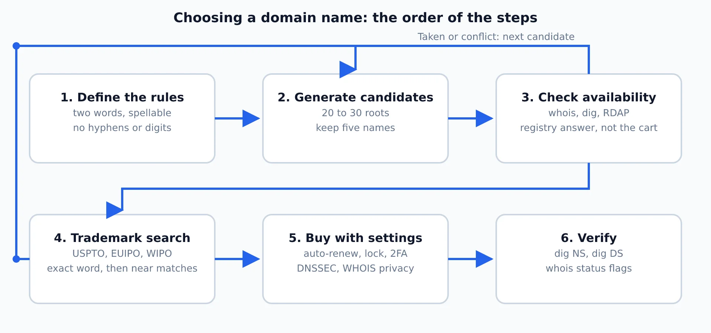
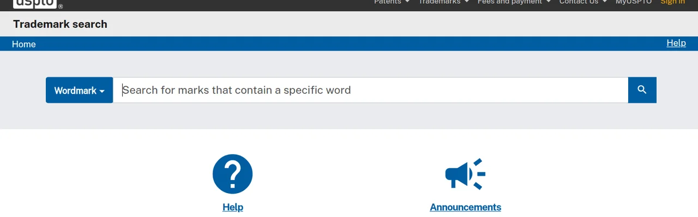
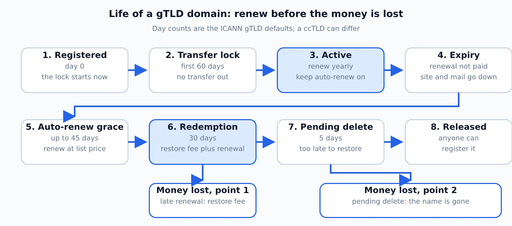
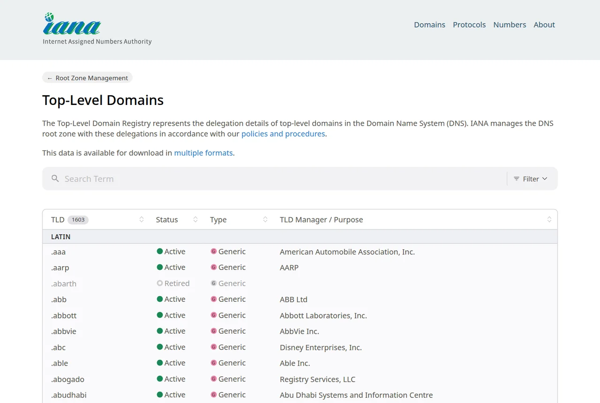

import YouTubeEmbed from "@components/widgets/YouTubeEmbed.astro";
import Notice from "@components/widgets/Notice.astro";
import Accordion from "@components/widgets/Accordion.astro";

To choose a domain name, write the rules first (two or three words, no hyphens, no digits, easy to say aloud), then check availability with `whois` and RDAP, search trademarks, and buy with auto-renew, registrar lock, 2FA and DNSSEC switched on. This guide runs those steps in order and fits in one evening.

The order matters more than the tips. Most people pick a name they like, then find out it is taken, trademarked, or renews at a multiple of the first-year price. A name that fails the availability or trademark check goes back to the candidate list before you spend anything.

<YouTubeEmbed
  url="https://www.youtube.com/embed/qusvga3va6g"
  label="How to Choose the Perfect Domain Name"
/>



*The whole flow on one picture. A name that fails step 3 or step 4 goes back to step 2, you do not argue with the registry or with a trademark office.*

## Decide what the name must do

Write down three things before you brainstorm: what the site is about, who it is for, and where people will hear the name. A name someone reads in a search result can be long. A name someone hears on a call has to be spelled correctly from sound alone.

The rules I use:

- Two or three words, no hyphens, no digits. `4travel.com` fails the moment you say "four, or the digit?".
- No word with two common spellings (`kit` or `kitt`), unless you register both.
- Say it out loud once. If you have to spell it, drop it.
- Skip slang and acronyms you have to explain.

On keywords: Google states that the words in a domain are one of many relevance signals, and its [exact match domain system](https://developers.google.com/search/docs/appearance/ranking-systems-guide) exists to stop sites from getting too much credit for matching a query word for word. A keyword helps a reader understand the site at a glance. It does not rank it.

<Notice type="info" title="Brand or keyword?">
Pick a brand when you will market the site by name. Pick one descriptive word only when it makes the name clearer, as in `logtower` versus `tower`. Do not stack words hoping for rankings.
</Notice>

## Generate candidates

Start with a list of 20 to 30 roots: the product word, the problem it solves, your own name, the place, two or three unrelated words that fit the mood. Then combine:

- Root plus a short suffix: `lab`, `hq`, `box`, `run`, `forge`.
- Two roots glued together, with one letter trimmed so it is easier to say.
- A coding agent is a cheap generator for this step. Give it the roots and the "no hyphens, spellable out loud" rules, and ask for 40 names in three styles. Most will be taken or unusable. That is normal.

Keep five names you would put on a business card. Do not fall for a single one yet.

## Check domain availability from the terminal

A registrar search box is fine for one name. The terminal is faster for a shortlist, and it shows you what the registry says rather than what the registrar wants to upsell.

`whois` gives you the raw record:

```bash
whois example.com | grep -iE 'Registrar:|Domain Status|Registry Expiry'
```

An unregistered name returns a line like `No match for domain "YOURNAME.COM"`. A registered one returns a registrar and at least one status flag.

`dig` answers a different question: is the name in DNS? It is quick and needs no API:

```bash
dig +short NS yourname.com
dig NS yourname.com | grep status:
```

No nameservers printed and `status: NXDOMAIN` usually means the name is not delegated. That is a hint, not proof. A registered name with no nameservers also returns NXDOMAIN, and a registry can publish it before the zone updates. Confirm with RDAP.

RDAP is the structured replacement for `whois`. The public bootstrap at `rdap.org` forwards your query to the right registry:

```bash
curl -s -H 'Accept: application/rdap+json' https://rdap.org/domain/yourname.com \
  | jq '{status, ns: [.nameservers[]?.ldhName], events: [.events[] | {eventAction, eventDate}]}'
```

When this guide was checked on 2026-11-23, `rdap.org` answered HTTP 403 to curl, with or without a browser User-Agent, presumably a bot filter. The registry endpoints work directly and are what the bootstrap would forward to anyway. For `.com`:

```bash
curl -s https://rdap.verisign.com/com/v1/domain/yourname.com \
  | jq '{status, ns: [.nameservers[]?.ldhName], events: [.events[] | {eventAction, eventDate}]}'
```

For Google Registry TLDs such as `.dev` and `.app`, use `https://pubapi.registry.google/rdap/domain/yourname.dev`. Other TLDs are listed in the [IANA RDAP bootstrap file](https://data.iana.org/rdap/dns.json).

Read the output like this:

- HTTP 404: the name is not registered at the registry. Verisign sends an empty body, so `curl -s` prints nothing; add `-o /dev/null -w '%{http_code}\n'` to see the code. Google Registry sends a `not found` description.
- HTTP 200 with a `status` array: taken. `pendingDelete` or `redemptionPeriod` means it may drop soon, but waiting is a gamble, not a plan.

Some people worry that a registrar search leaks your shortlist to someone who registers the name first. ICANN's security committee looked at this in [SAC 022](https://itp.cdn.icann.org/en/files/security-and-stability-advisory-committee-ssac-reports/sac-022-en.pdf) and found only anecdotal reports, no hard data. The defense costs nothing: search at the registrar you intend to buy from, and buy in the same session.

## Check trademarks before you pay

An available domain is not automatically yours to use. A trademark owner can take it through a [UDRP complaint](https://www.wipo.int/amc/en/domains/guide/) or a court, and you lose the name plus the site history. Search the name without the extension, in every market you plan to operate in:

- United States: [USPTO Trademark search](https://tmsearch.uspto.gov/) (TESS was retired, this is the current interface).
- European Union: [EUIPO eSearch](https://euipo.europa.eu/eSearch/).
- International, including WIPO-managed marks: [WIPO Global Brand Database](https://branddb.wipo.int/).



*The USPTO search page. The "contains a specific word" box is the one to use with the bare name, before the extension.*

Search for the exact word first, then near matches in your class of goods or services. A live registration in an unrelated class (a shoe brand when you sell monitoring tools) is a different risk from one in the same class. When in doubt, pick another of your five names. It costs nothing now.

<Notice type="warning" title="Registered does not mean yours">
A trademark conflict is the one mistake on this page that no registrar setting can undo. Spend ten minutes on the search.
</Notice>

## Buy with the right settings

Three registrars I would use, and what each one sells (checked 2026-11-23 against [Cloudflare's docs](https://developers.cloudflare.com/registrar/), [Porkbun's knowledge base](https://kb.porkbun.com/) and [Namecheap's knowledge base](https://www.namecheap.com/support/knowledgebase/)):

| Registrar | Price model | WHOIS privacy | DNSSEC | Notes |
|---|---|---|---|---|
| [Cloudflare Registrar](https://developers.cloudflare.com/registrar/) | At cost, no markup, same at renewal | Redacted by default where the registry allows | Yes, free, one click | Must use Cloudflare nameservers; auto-renew on by default |
| [Porkbun](https://porkbun.com/) | Slightly above wholesale; the renewal price is often higher than the first year | Free with every domain, except TLDs such as `.us` that do not allow it | Toggle in the domain's Details menu | DNS runs on Cloudflare; free URL forwarding and up to 20 free email forwards |
| [Namecheap](https://www.namecheap.com/) | First-year and renewal prices differ; promo codes are not applied at auto-renewal | Free Domain Privacy, or "Redacted for Privacy" on TLDs the service cannot cover | Toggle in Advanced DNS; not available for TLDs such as `.de`, `.eu` and `.nl` | Auto-renew needs a card or account funds; PayPal does not work for renewals |

My default is Cloudflare Registrar when the site's DNS is already there, Porkbun when I want the DNS somewhere else. Cloudflare sells at the registry price and renews at the registry price, which removes the promo-versus-renewal problem below.

The seven settings below decide whether you still own the domain in three years. The table shows where each one lives, taken from each registrar's own documentation.

| Setting | Cloudflare Registrar | Porkbun | Namecheap |
|---|---|---|---|
| Auto-renew | Domain management page, on by default; the first attempt runs about 30 days before expiry and later attempts follow | "Renew" column in Domain Management, on by default | Domain List, Manage, toggle for the domain; also tick "Use for auto-renewal" on the saved card; attempts start 30 days before expiry |
| Transfer lock | Manage, Configuration, Unlock or Lock | Green lock icon next to the domain in Domain Management | Domain List, Manage, Sharing & Transfer tab, "Domain Lock" in the Transfer Out section |
| 2FA | My Profile, Authentication: authenticator app or security key | "Settings / Billing", section "Security and sign-in", authenticator app | Profile, Security, Access, Two-Factor Authentication: authenticator app or U2F key, one method at a time |
| DNSSEC | Manage, Configuration, "Enable DNSSEC"; the DS record can take one to two days to reach the registry | "Details" menu, toggle "Porkbun DNSSEC" when the DNS is at Porkbun; "Registry DNSSEC" for DS records with external nameservers | Advanced DNS tab, DNSSEC toggle on BasicDNS or PremiumDNS; DS records on custom DNS; allow about 60 minutes |
| WHOIS privacy | Redacted by default where the registry permits | Free; "use privacy service" option on the domain | Free Domain Privacy; "Redacted for Privacy" on TLDs it cannot cover; a few TLDs such as `.fr` and `.ch` get neither |
| Auth code | Shown after Manage, Configuration, Unlock; "Regenerate" gives a new one | Details menu, "Get Authorization Code", after unlocking | Sharing & Transfer tab, Transfer Out section; emailed to the registrant address |

Whatever registrar you pick, set these before you leave the checkout:

1. **Auto-renew on.** Cloudflare turns it on by default; with the others, check the domain list after the purchase. Check the card on file each year too: Cloudflare's docs warn that a renewal can fail on a billing problem, and Namecheap skips auto-renewal when neither funds nor a valid card are available.
2. **Registrar lock on.** It sets `clientTransferProhibited` at the registry. ICANN lists a domain in "Lock" status as a valid reason to deny a transfer, and the registrar must give you an easy way to remove it. [ICANN's list of EPP status codes](https://www.icann.org/resources/pages/epp-status-codes-2014-06-16-en) explains each flag. Leave the lock on.
3. **2FA on the registrar account.** Use an authenticator app or a security key, not SMS. Anyone with the account can unlock the domain and fetch the transfer code.
4. **DNSSEC enabled.** DNSSEC signs your DNS answers so a resolver can reject forged ones. It is one toggle when the registrar also hosts the DNS, which is the default at Cloudflare and Porkbun and applies to Namecheap's BasicDNS and PremiumDNS.
5. **WHOIS privacy on.** Free at all three. Check it, do not assume it, and expect some country-code TLDs to refuse it.
6. **Verify the registrant email.** ICANN requires registrars to verify the registrant contact and to suspend or delete domains that are not verified in time ([ICANN verification page](https://www.icann.org/resources/pages/contact-verification-2013-05-03-en)). Cloudflare's docs add that an unverified email gets the nameservers replaced with parking servers until you verify. Click the link in the ICANN or registrar email the day you buy.
7. **Save the auth code path, not the code.** The EPP or auth code is what a new registrar needs to pull the domain in. ICANN says the registrar must hand it over within five calendar days of a request. Codes expire, so know where the button is.

## Verify after purchase

Three commands, a minute after the checkout:

```bash
dig +short NS yourname.com
dig +short DS yourname.com
whois yourname.com | grep -iE 'Domain Status|Registrar:|Registry Expiry'
```

What you want to see:

- The nameservers you chose. Empty output right after a purchase is normal for a few minutes. Retry once the registry publishes the name.
- `clientTransferProhibited` in the status line means the lock is on. `clientUpdateProhibited` and `clientDeleteProhibited` also block changes and deletion at the registry.
- A `DS` record once DNSSEC is on. Nothing here means DNSSEC is not signed at the registry yet.

If `whois` shows only an `ok` status, the lock is off. Turn it on before you close the tab.

## First hour after the purchase: DNS and email

The domain exists but answers nothing until it is delegated. You have one decision first, then the records.

**Keep the registrar DNS or use your own nameservers.** With Cloudflare Registrar there is no choice: the domain has to use Cloudflare nameservers. At the other two the domain can stay on the registrar's own DNS, which is fine for a small site. Switch nameservers only when the DNS has to live somewhere else, for example a [Dokploy](/dokploy-install/) or [Coolify](/coolify-install-heroku-alternative/) server that manages its own records. A nameserver change re-delegates the name and takes longer to settle than a record change; Porkbun's docs give a worst case of 48 hours. If Traefik issues certificates through the Cloudflare DNS challenge, the [Traefik wildcard certificate guide](/traefik-wildcard-certificate/) shows the setup.

The records a site needs:

| Record | Points at | Example |
|---|---|---|
| `A` (apex and `www`) | IPv4 of the server | `yourname.com` to `203.0.113.10` |
| `AAAA` (optional) | IPv6 of the server, only when the server listens on it | `yourname.com` to `2001:db8::10` |
| `CNAME` (subdomains) | Another hostname | `app` to `your-host.example` |
| `MX` | The mail provider, needed only when the domain receives mail | from the provider |
| `TXT` | SPF, DKIM and DMARC, plus ownership checks | see below |

Verify each one against a resolver you do not control, so a local cache cannot flatter you:

```bash
dig +short NS yourname.com
dig +short A yourname.com @1.1.1.1
dig +short AAAA yourname.com @1.1.1.1
dig +short www.yourname.com @1.1.1.1
```

Empty output right after the purchase means the registry zone has not updated yet. Give it a few minutes and run again. A resolver that already cached the NXDOMAIN answer keeps it for the negative cache time of the zone ([RFC 2308](https://www.rfc-editor.org/rfc/rfc2308)), so test with a second resolver before you conclude that a record is wrong. `status: SERVFAIL` on a name that just got DNSSEC means the `DS` record at the registry and the keys at the DNS provider do not match. Remove the `DS` record, confirm the site loads, then enable DNSSEC from the provider's own one-click flow.

Then the mail records, on the day the site goes live and not after the first "mail not delivered" report. The values come from whichever relay or mailbox provider sends for the domain. The [ZeptoMail SMTP relay guide](/how-to-setup-smtp-relay-email-on-zeptomail/) walks through SPF, DKIM and DMARC for one provider, [Postfix with an external SMTP server](/postfix-external-smtp/) covers the server side, and [EmDash email sending on Cloudflare](/emdash-send-email/) shows the records Cloudflare asks for. The shape of the three records is this:

| Record | Name | Value |
|---|---|---|
| SPF (TXT) | `yourname.com` | `"v=spf1 include:<the relay's host> -all"` |
| DKIM (TXT) | `<selector>._domainkey.yourname.com` | public key given by the provider |
| DMARC (TXT) | `_dmarc.yourname.com` | `"v=DMARC1; p=none; rua=mailto:mail@yourname.com"` |

Publish one SPF record per name. [RFC 7208](https://www.rfc-editor.org/rfc/rfc7208) says more than one makes the check return `permerror`, so merge providers into a single `include:` list. Start DMARC at `p=none` to collect reports, move to `p=quarantine` and then `p=reject` once the reports show only your own senders. Check all three from the terminal:

```bash
dig +short TXT yourname.com | grep spf
dig +short TXT _dmarc.yourname.com
dig +short TXT selector1._domainkey.yourname.com | cut -c1-60
```

The first two print one value each. The third prints the start of the key; an empty line means the selector name is wrong, so take it from the provider's page rather than from this example.

## Transfer a domain in or out

A transfer moves the registration between registrars. The nameservers carry over, so the site keeps resolving, and for most gTLDs the transfer adds one year to the registration.

<Notice type="info" title="ICANN is rewriting the transfer rules">
ICANN's Board adopted the Transfer Policy Review recommendations on 7 June 2026 and directed ICANN staff to implement them ([Board resolution 2026.06.07.04](https://icann.org/en/board-activities-and-meetings/materials/approved-resolutions-regular-meeting-of-the-icann-board-07-06-2026-en)). The 60-day rules in this section come from ICANN's published Transfer Policy and registrant FAQ. Registrars will roll changes out over time, so confirm the current lock rules in your registrar's transfer documentation before you plan a move.
</Notice>

The order that works:

1. **Check the 60-day limits first.** ICANN lets a registrar deny a transfer within 60 days of the initial registration or of a previous transfer. A change of registrant name, organization or email starts another 60-day lock, which registrars must enforce unless you opted out when you made the change (some registrars offer that). Cloudflare's docs add one more case: after renewing an expired domain, wait at least 45 days before moving it or the registry may not add the transfer year.
2. **Check the registrant email before you unlock.** The approval form goes to that address. If nobody reads it, change it first and tick the opt-out where the registrar has one (Cloudflare's "Do not apply 60 day transfer lock" box), otherwise the change starts a 60-day lock. Better to find out now than on the day of the move.
3. **Unlock the domain** at the losing registrar. The `clientTransferProhibited` flag disappears from RDAP.
4. **Request the auth code.** ICANN gives the registrar five calendar days. Cloudflare shows the code once the domain is unlocked, Porkbun under Details, "Get Authorization Code", and Namecheap emails it to the registrant address. Codes are usually valid for a limited time, so request one when you are ready to use it.
5. **Pay at the gaining registrar** and enter the code. Cloudflare will not accept the code until the zone is active on its side, so add the domain there first and wait for the "Active" status.
6. **Approve the transfer** when the losing registrar sends the approval email. Under the Transfer Policy, five calendar days of silence from the losing registrar count as approval. It must deny only in the cases ICANN lists, such as a UDRP proceeding, a court order or a 60-day change-of-registrant lock.

What the losing registrar may not do, per the [ICANN registrant FAQ](https://www.icann.org/resources/pages/name-holder-faqs-2017-10-10-en): refuse a transfer because the domain expired, or demand a renewal first, unless an earlier registration period is unpaid. What it may do: hold back a domain in `redemptionPeriod` until it is restored, and the restore carries the fee described in the lifecycle below.

Confirm the move with RDAP, not with a dashboard badge. The registry record carries the registrar as an IANA ID in the `registrar` entity, and the `events` array shows when it last changed:

```bash
curl -s https://rdap.verisign.com/com/v1/domain/yourname.com \
  | jq '{registrar: [.entities[] | select(.roles[] == "registrar") | .publicIds[]?.identifier],
         events: [.events[] | {eventAction, eventDate}]}'
```

A run on 2026-11-23 for a `.com` held at one registrar returned `"registrar": ["1068"]`, a `registration` event from 2010 and a `last changed` event from a recent edit. Match the number in the [IANA registrar ID registry](https://www.iana.org/assignments/registrar-ids/registrar-ids.xhtml), and check that `last changed` carries the day of the transfer. If the ID still shows the old registrar after the move, the transfer did not complete. Read the gaining registrar's transfer status page.

Transfers into Cloudflare have one extra step: the domain's zone must be Active at Cloudflare before it accepts the code (step 5). Transfers out of Cloudflare need only the unlock and the code, and Cloudflare auto-approves the request on the fifth day if you do not confirm it.

## Failure modes and how to undo them

**First-year promo, high renewal.** The common pattern: a cheap or nearly free first year, then a renewal several times higher. Porkbun's docs explain why: registries offer low first-year wholesale prices and rarely discount renewals ([Porkbun knowledge base](https://kb.porkbun.com/article/156-why-does-my-domain-name-price-increase-after-1-year)). Undo: none for the year you paid. Prevention: read the renewal price, not the banner. Moving registrars later does not change the registry fee, only the markup on top.

**The 60-day transfer lock.** Per the [ICANN registrant FAQ](https://www.icann.org/resources/pages/name-holder-faqs-2017-10-10-en), a registrar may deny a transfer within 60 days of initial registration or of a previous transfer, and a change of registrant name, organization or email starts another 60-day lock. ICANN's advice is to finish the transfer before you change contact data. Changing the registrant contact is the trap: fix the WHOIS data after a transfer, not before, or use the opt-out where the registrar has one. Undo: wait. This is why the registrar choice at purchase matters.

**A reseller that vanishes.** Some cheap sellers resell a big registrar's domains. The domain sits at the real registrar, but the reseller is the only door to it, and if the reseller closes or stops answering you may have no quick way in. Prevention: buy from an ICANN-accredited registrar directly, and look the name up in RDAP after the purchase to see which registrar holds it. Undo: none that is quick.

**Expiry and redemption.** An expired domain goes through an auto-renew grace period, then a redemption grace period, then pending delete. Day counts vary by registrar and TLD. The chart on ICANN's [gTLD lifecycle page](https://www.icann.org/en/contracted-parties/accredited-registrars/resources/gtld-lifecycle) shows up to 45 days of auto-renew grace, 30 days of redemption and 5 days of pending delete. Redemption needs a restore fee on top of the renewal, and ICANN says the name has to be restored before anyone can transfer it. Registrars add their own rules: Namecheap parks the nameservers on expiry (the site stops, and mail sent in the meantime is lost) and keeps most expired domains reactivatable for 30 days, but `.ch`, `.es`, `.fr`, `.li`, `.pe` and `.sg` domains need renewing 12 days before expiry. Undo: renew inside the grace period at the normal price. Past that, the fee.

**Typosquats.** If the name is easy to misspell, register the one or two common misspellings and redirect them, or drop the name.

**A shared registrar account.** The domain lives in the registrar account, not on your server. Cloudflare's docs warn that anyone with admin rights on the account can unlock domains and fetch transfer codes, so do not share that account with contractors or co-founders who left. Give each person who needs DNS access the smallest role that does the job, and keep the owner login for yourself. Undo: remove the extra users and rotate the password the day someone leaves.

**Losing the account.** Lock the account with 2FA, keep a backup code in your password manager, and use an email address you will still own in five years. The usual culprit is a work address from a job you left.

**The ignored registrant email.** ICANN requires registrars to verify the registrant contact, and a domain that is not verified in time can be suspended or deleted. The mail goes to the contact in the WHOIS record, which is often the one written at checkout and never read again. Undo: click the verification link. Cloudflare's docs say the nameservers come back automatically once you do. Prevention: use an address on a different domain that you own, checked by a person, because mail on the domain itself stops working when the domain is suspended.

## Watch the expiry date

The lifecycle below is the one for gTLDs. The two boxes at the bottom mark where money is lost: a renewal paid inside the auto-renew grace period costs the normal renewal, a restore from redemption costs the renewal plus a restore fee, and after pending delete the name is public again.



*The gTLD lifecycle with the ICANN default day counts. Renew anywhere in stages 3 to 5 and you pay one renewal. Renew in stage 6 and you pay the restore fee as well.*

Auto-renew is the first line. A weekly check is the second, because a renewal can fail on a billing problem (Cloudflare's docs say it makes several attempts but gives no guarantee). This script reads the `expiration` event from the Verisign RDAP server and prints the days left. It needs `curl`, `jq` and GNU `date`:

```bash
#!/usr/bin/env bash
# Prints the days left before each .com domain expires (Verisign RDAP).
set -euo pipefail
for d in "$@"; do
  exp=$(curl -fsS "https://rdap.verisign.com/com/v1/domain/$d" \
    | jq -r '.events[] | select(.eventAction == "expiration") | .eventDate' \
    | tr -d Z | tr T ' ')
  left=$(( ($(date -ud "$exp" +%s) - $(date -u +%s)) / 86400 ))
  echo "$d: ${left} days left (${exp} UTC)"
done
```

Save it as `/usr/local/bin/domain-expiry`, make it executable, and run it with the names you own:

```bash
chmod +x /usr/local/bin/domain-expiry
domain-expiry bitdoze.com example.com
```

Sample run on 2026-11-23:

```text
bitdoze.com: 97 days left (2027-03-01 10:11:10 UTC)
example.com: 262 days left (2027-08-13 04:00:00 UTC)
```

A name that is not registered makes `curl` exit with error 22 and the script stops, because of `set -e`, so a typo in the list is loud rather than silent. For a weekly check, add one cron line as the user who owns the script, and keep the output in a log you read:

```cron
# m h dom mon dow command
0 8 * * 1 /usr/local/bin/domain-expiry bitdoze.com example.com >> /home/you/domain-expiry.log 2>&1
```

Read the log, or wire the output into the monitoring you already run: an Uptime Kuma push monitor turns a failed check into an alert, [install Uptime Kuma](/install-uptime-kuma/) to set one up, and [Beszel and Uptime Kuma on Dokploy](/beszel-uptime-kuma/) covers installing both. The check only covers `.com`; for other TLDs use the registry's own RDAP server from the bootstrap file linked above, whose `events` array has the same shape.

## Which domain extension should you pick?

Take the `.com` when it is free at a fair price, and add a second extension only when it does a job. The [IANA root database](https://www.iana.org/domains/root/db) lists about 1,600 TLDs as of 2026-11-23, and six matter for most sites.



*The IANA root database. Type a string in the filter box to see who runs a TLD and whether it is a country code; the page listed 1,603 entries when this screenshot was taken.*

- **`.com`**: the default. People type it when they guess, and it is what a buyer expects. Take it when it is free or reasonably priced.
- **`.io`**: the tech and SaaS convention. The renewal costs several times a `.com`. IANA lists the code under the British Indian Ocean Territory, and the UK-Mauritius agreement on that territory leaves its long-term future open ([The Register](https://theregister.com/off-prem/2024/10/10/the-io-domain-isnt-going-anywhere-in-the-next-few-years/479311)). ICANN told the paper that a code dropped from ISO 3166-1 would start a five-year retirement process. Fine for a dev tool, risky for a ten-year brand.
- **`.ai`**: common for AI products. It is the country code of Anguilla, renews at a high price, and Cloudflare's docs list a 2-year minimum for transfers. Fine when the product is AI and the `.com` is gone.
- **`.dev` and `.app`**: Google Registry TLDs. Both are on the HSTS preload list (confirmed on hstspreload.org for both on 2026-11-23), so browsers refuse plain HTTP. That is a feature once TLS works and a dead site until it does. Get the certificate before you share the link.
- **`.co`**: reads like a typo of `.com`, and some visitors will type the `.com` anyway. Only with a matching `.com` redirect.
- **Country codes** (`.de`, `.ca`, `.co.uk`): the right choice when the audience is local. Some have residency or presence rules, and some block registrar features: Namecheap lists `.de`, `.eu` and `.nl` as unsupported for DNSSEC, and `.de`, `.ca`, `.uk` and `.us` as unsupported for its Domain Privacy. Check the registry before you plan around one.

Skip `.top`, `.xyz` and `.info` for anything that sends email. Spamhaus's [2022 annual domain report](https://info.spamhaus.com/hubfs/Domain%20Reports/2022_Annual_Spamhaus_Domain_Reputation_Update_.pdf) ranks `.info`, `.top` and `.xyz` 4th, 5th and 8th among TLDs by listed domains, and its [October 2024 to March 2025 update](https://www.spamhaus.org/resource-hub/domain-reputation/domain-reputation-update-oct-2024-mar-2025/) still calls `.top` a hotspot for abuse. A listing count is not a filter score, so treat it as a risk signal, not a rule.

Buy the `.com` first. Add a second extension only when it does a job: the `.ai` next to a `.com` for an AI product, or the local country code when you sell in that country. Each extra name is one more renewal, one more DNSSEC record and one more auth code to keep track of, and a pile of defensive extensions that all redirect to the `.com` costs money and protects little.

## What to do next

The domain is bought and verified. Point the records at wherever the site runs: [deploy the Astro site to Cloudflare](/deploy-astrojs-cloudflare/), [deploy Astro on a VPS with CloudPanel](/deploy-astro-on-vps/), [install WordPress with Docker Compose](/install-wordpress-docker/) on a VPS, or [connect the domain to Carrd](/carrd-add-domain/) for a one-pager. If the site is a Docker service, [install Dokploy](/dokploy-install/) or [Coolify](/coolify-install-heroku-alternative/) and attach the domain in the panel. Then set a calendar reminder a month before the renewal date, every year, for as long as you own the name.

## FAQ

<Accordion label="How long until a new domain resolves?" group="faq">
Registrar DNS usually answers within minutes: run `dig +short NS yourname.com` against a public resolver such as `1.1.1.1`. Switching to external nameservers is slower, and Porkbun's documentation gives a worst case of 48 hours. A resolver that cached the earlier NXDOMAIN answer keeps it for the negative cache time, so a second resolver is the tie-breaker. If nothing shows after an hour, read RDAP: an empty `ns` list means the registrar has not submitted nameservers.
</Accordion>

<Accordion label="Is .com still the best choice in 2026?" group="faq">
Yes, for anything that has to survive a change of plans. It is what people type when they guess, what a buyer expects, and its renewal is the baseline that `.io` and `.ai` exceed several times over. `.dev`, `.app` and `.ai` are fine when the site is a dev tool or an AI product and the `.com` is taken or overpriced. The rule I follow is `.com` first, one more extension only when it does a job.
</Accordion>

<Accordion label="Do I need WHOIS privacy on a personal domain?" group="faq">
Mostly handled already, but turn it on. Registries redact personal data for most gTLDs since GDPR, and Cloudflare redacts by default where the registry allows it. The registrar's privacy option is still free at Cloudflare, Porkbun and Namecheap, so there is no trade-off, and it matters most on TLDs where the registry publishes contacts. Some country-code TLDs do not allow privacy at all. At Porkbun and Namecheap, confirm the option is on for the domain in the dashboard.
</Accordion>

<Accordion label="What is a domain auth code?" group="faq">
The auth code, also called EPP code or transfer code, is the password the registry holds for a domain and that the gaining registrar must present to move it. ICANN gives the losing registrar five calendar days to provide it after a request. Cloudflare shows it once the domain is unlocked, Porkbun under Details, "Get Authorization Code", and Namecheap emails it to the registrant address. Codes expire, so request one when you are ready to use it.
</Accordion>

<Accordion label="Can I transfer a domain right after registering it?" group="faq">
No. ICANN lets a registrar deny a transfer within 60 days of the initial registration or of a previous transfer, so a name bought today can move after day 60. A change of the registrant name, organization or email starts another 60-day lock, which the registrar enforces unless you opted out when you made the change. The fix is to buy at the registrar you want to stay at and to change the registrant contact only when no transfer is planned.
</Accordion>

<Accordion label="What happens when a domain expires?" group="faq">
For a gTLD the name goes through an auto-renew grace period of up to 45 days, a 30-day redemption grace period and 5 days of pending delete, then anyone can register it. Registrars set their own limits inside that frame. Inside the grace period a renewal costs the normal price. In redemption the registrar charges a restore fee on top, and the name cannot be transferred until it is restored. The RDAP script above prints the days left, and one cron line runs it weekly, so the expiry never comes as a surprise.
</Accordion>

<Accordion label="Does a keyword domain help SEO?" group="faq">
Very little. Google says the words in a domain are one of many relevance signals, and its exact match domain system exists to keep sites from ranking on a word-for-word match with a query. A descriptive word helps people understand the site at a glance, which matters for clicks and for remembering the name. Stacking keywords buys neither rankings nor recall.
</Accordion>

<Accordion label="Should I buy several extensions for the same name?" group="faq">
Only the ones that do a job: the `.ai` next to the `.com` for an AI product, or the country code of the market you sell in. Every extra name is another renewal, another DNSSEC record and another auth code to keep track of. A name bought elsewhere needs the same lock and 2FA discipline as the main one. Redirect each extra name to the primary one and move on.
</Accordion>
