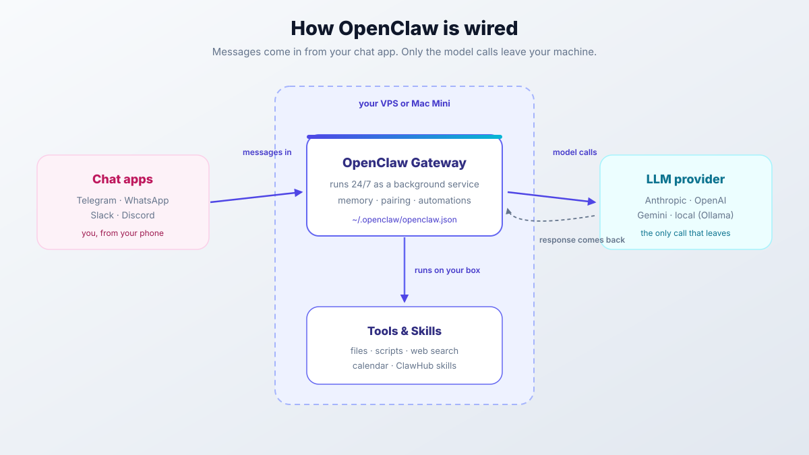
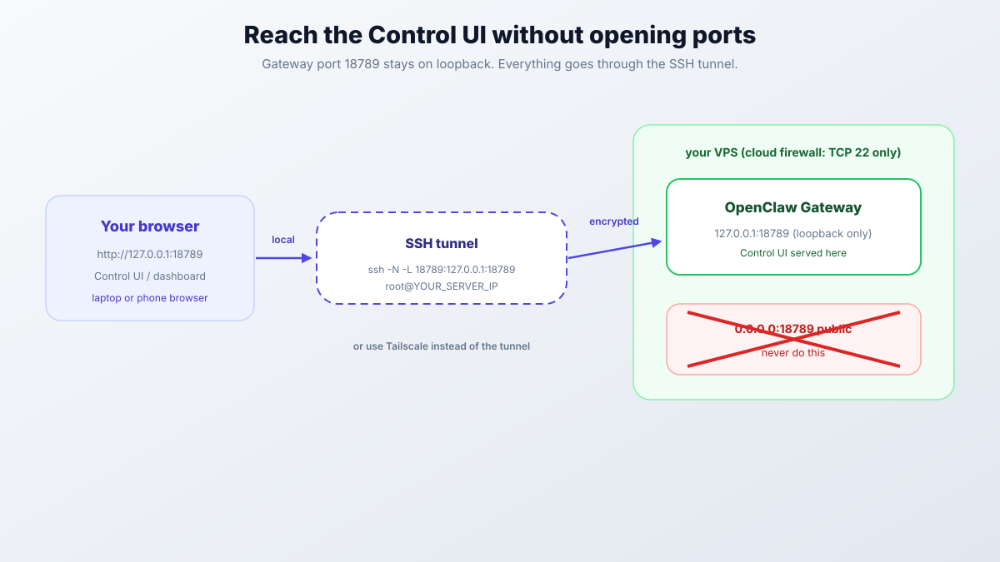

import YouTubeEmbed from "@components/widgets/YouTubeEmbed.astro";
import Button from "@components/widgets/Button.astro";
import Notice from "@components/widgets/Notice.astro";
import ListCheck from "@components/widgets/ListCheck.astro";
import Accordion from "@components/widgets/Accordion.astro";
import Tabs from "@components/widgets/Tabs.astro";
import Tab from "@components/widgets/Tab.astro";

I've been running OpenClaw on a Hetzner VPS since the start of 2026, hooked up to Slack first and Gemini CLI later. Getting it installed is easy. Getting it installed *correctly* (config file in the right place, pairing locked down, and a scheduler that survives a reboot) is where most guides (including older versions of this one) drift out of date. So here's the OpenClaw setup guide I wish I'd had when I started: a working install on a cheap VPS or a Mac Mini, a chat channel wired up, and the ops bits that keep it running.

<Notice type="warning" title="Name evolution: from Clawdbot to Moltbot to OpenClaw">
Yeah, this thing has had a bit of an identity crisis. Started as **Clawdbot**, became **Moltbot** after some trademark pressure, and now it's settled on **OpenClaw**. Install URL moved to `openclaw.ai` and all the commands are `openclaw` now. I might mention the old names here and there for context, but everything current points to OpenClaw.
</Notice>

OpenClaw is an open-source, self-hosted AI assistant that lives on a server 24/7 and talks to you through Telegram, WhatsApp, Slack, or Discord. Unlike ChatGPT or Claude where you go to their site, this comes to you. It remembers things across conversations, runs commands and scripts on your box, and pings you when something needs attention. Latest stable as of this update is v2026.10.6 (2026-10-22), with roughly 392k GitHub stars and a weekly-plus release cadence.

<YouTubeEmbed
  url="https://www.youtube.com/embed/9Txk3SpB6fg"
  label="I Built a 24/7 Personal AI Assistant (And It's Why Mac Minis are Sold Out!)"
/>

<Notice type="info" title="What changed since January 2026">
If you set OpenClaw up earlier this year, four things moved under you:

- **Node 22 is done.** The floor is now Node 24.22.1+ or 26.12.1+, and `openclaw update` refuses to run on older Node. The installer provisions Node itself, so you no longer need NodeSource.
- **Config file moved.** `~/.openclaw/config.json` is now `~/.openclaw/openclaw.json` (JSON5, hot-reloaded by the gateway).
- **Heartbeat is retired.** Automation jobs (`openclaw automations`) replaced it. `openclaw doctor --fix` migrates old HEARTBEAT.md monitors.
- **Docker is the official Hetzner path**, and `openclaw security audit` is now the check you run after every change.
</Notice>

<Notice type="info" title="What this guide covers">
<ListCheck>
<ul>
<li>Mac Mini vs VPS hosting and which one makes sense for you</li>
<li>Install on a Hetzner VPS: one-liner path and official Docker path</li>
<li>Verify checklist, updates, backups, and rollback</li>
<li>Telegram, WhatsApp, Slack, and Discord integration</li>
<li>LLM provider options (Anthropic, OpenAI, Gemini, local models) and what they cost</li>
<li>Memory system and the `openclaw.json` config file</li>
<li>Automation jobs (scheduled work, reminders, proactive monitoring)</li>
<li>Security hardening with `openclaw security audit`</li>
</ul>
</ListCheck>
</Notice>

If you're new to AI coding tools, our [AI programming beginners guide](/ai-programming-beginners-guide/) covers the basics. For running models on your own hardware, see [Ollama with Docker Compose](/ollama-docker-install/).

## What is OpenClaw? A 24/7 self-hosted AI assistant

Most AI tools wait for you to ask something. OpenClaw does stuff: it clears your inbox, schedules meetings, researches companies, follows up on tasks, and runs automations on your server.

The architecture is simple. Chat apps feed messages into a gateway that runs on your machine, the gateway calls whatever LLM you picked, and the model can invoke tools and skills on your box.



Everything stays on your machine except the AI calls. Your data isn't living on some company server somewhere. The gateway just runs in the background as a service. Messages come in from Telegram or Slack, get routed to the model, and the model can move files, run scripts, or browse the web through tools.

One more thing that changed this year: OpenClaw now has first-class clients. There's an iOS App Store app, an Android app on Google Play, a native Windows Hub, a macOS menu-bar app, and a browser Control UI. They pair as *nodes* to the gateway. Your phone becomes a remote control, not the server. More on that in the install section.

## OpenClaw on Mac Mini vs VPS: which one to choose

Kind of a funny situation: the OpenClaw community caused a minor run on Mac Mini M4s. People were buying them just to run this thing. Here's how to decide which route makes sense for you.

### Mac Mini M4 advantages

| Feature | Mac Mini | VPS |
|---------|----------|-----|
| iMessage support | Yes | No |
| Native macOS apps | Yes | No |
| Local model inference | Excellent (M4 chip) | Limited |
| Power consumption | ~10W idle | N/A (hosted) |
| Upfront cost | $599-1299 | $0 |
| Monthly cost | ~$3 electricity | $5-50 |
| Physical access required | Yes | No |

If you want iMessage, Mac Mini is your only choice. Support is real and documented (via the `imsg` private API path), but it's still Mac-only. The M4 chip also handles local models well if you're trying to avoid API bills. But you need solid home internet and power, with no outages.

For hardware picks, see [which Mac mini model you need for OpenClaw](/best-mac-mini-for-openclaw/).

### VPS advantages

For most people, a VPS is the better call:

<ListCheck>
<ul>
<li>No hardware to maintain or keep running</li>
<li>Redundant power and network</li>
<li>Can access from anywhere without port forwarding</li>
<li>Easier to set up and migrate</li>
<li>Lower entry cost: the entry CX tier is around €5.49/month after the 2026 price hikes</li>
</ul>
</ListCheck>

I'm using a Hetzner CX33 (4 vCPU, 8GB RAM). It handles OpenClaw comfortably with plenty of headroom for other services. Before you commit to any box, [benchmark a cloud server](/benchmark-cloud-servers/) so you know what disk and CPU you're getting.

<Notice type="success" title="Get started with Hetzner or Hostinger">
I default to [Hetzner Cloud](https://go.bitdoze.com/hetzner) for this kind of workload. [Signing up through our link gets you €20 credit](https://go.bitdoze.com/hetzner), which covers a few months of a small instance. If you want a budget KVM box with NVMe and less DIY, [Hostinger VPS](https://go.bitdoze.com/hostinger-vps) is the alternative I point people to.
</Notice>

_VPS prices jumped across the board in 2026. If you're rethinking a rented box, see [what changed and when a mini PC wins](/vps-price-increases/). If you're leaning toward owning hardware anyway, a mini PC like the [ASUS mini PC](https://go.bitdoze.com/asus-dc510) pays for itself against a mid-range VPS faster than it used to._

### When to choose Mac Mini

- You need iMessage as your primary channel
- You want to run local models (Llama, Mistral) to avoid API costs
- You prefer hardware you physically control
- You already have a Mac Mini sitting around

### When to choose VPS

- Telegram, WhatsApp, Slack, or Discord are your primary channels
- You don't want to deal with home networking
- You need 24/7 uptime without worrying about power outages
- You're okay paying for API calls

## Install OpenClaw on a Hetzner VPS

Takes about 20 minutes start to finish on any Ubuntu 24.04 VPS. I use Hetzner, but these steps work on pretty much any provider. Two supported paths: the one-liner installer (what most solo operators want) and the official Docker VM-runtime path.

<ListCheck>
<ul>
<li>Ubuntu 24.04 VPS, 1+ vCPU, 2-4 GB RAM minimum (8 GB gives headroom for other services)</li>
<li>SSH key pair (`ssh-keygen -t ed25519` if you don't have one)</li>
<li>No domain required: gateway access is SSH-tunnel based</li>
<li>An LLM API key or subscription (Anthropic, OpenAI, Gemini), or Ollama for local models</li>
</ul>
</ListCheck>

The installer provisions Node itself. You do **not** need NodeSource or a manual Node install.

### Create the server

1. Go to [Hetzner Cloud Console](https://console.hetzner.cloud/) (via [Hetzner Cloud](https://go.bitdoze.com/hetzner) if you're signing up fresh)
2. Create a new project named `openclaw`
3. Click **Create Server**
4. Select:
   - **Location**: Germany (cheapest) or your nearest region
   - **Image**: Ubuntu 24.04
   - **Type**: the entry CX tier (CX23 in the current lineup), around €5.49/mo after the 2026 price hikes. Confirm the exact lineup in the console; it moves.
   - **IPv4**: Keep enabled
5. Add your SSH key
6. Name it `openclaw` and create

Wait 30 seconds for the server to boot, then grab the IP address. In the Hetzner cloud firewall, allow **TCP 22 only**. Nothing else needs to be reachable, and that includes the gateway port.

### Install OpenClaw (one-liner path)

SSH into your server:

```bash
ssh root@YOUR_SERVER_IP
apt update && apt upgrade -y
```

Install OpenClaw and run the onboarding wizard:

```bash
curl -fsSL https://openclaw.ai/install.sh | bash
```

The wizard walks you through everything:
- Local vs Remote gateway selection
- Model authentication (API keys or OAuth)
- Channel setup (Telegram, WhatsApp, etc.)
- Background service installation

Use `curl -fsSL https://openclaw.ai/install.sh | bash -- --no-onboard` if you want the binaries without the wizard, then run `openclaw onboard --install-daemon` later.

Prefer npm? That path works too (npm 12+):

```bash
npm install -g openclaw@latest --allow-scripts=openclaw
openclaw onboard --install-daemon
```

<Notice type="warning" title="Node 22 is unsupported">
If you followed older guides and installed Node 22 from NodeSource, remove it and re-run the installer. The engine floor is `>=24.22.1 <25` or `>=26.12.1`. Node 26 is recommended; the Linux installer ships Node 24 LTS. If `openclaw update` refuses to run or you see a Node engine error, this is why: the October 2026 Node security releases (compromised TLS certificate keys) made 24.22.1/26.12.1 hard minimums.
</Notice>

### Install OpenClaw on a VPS with Docker (official path)

This is the path the official Hetzner docs point at now. It isolates state and gives you sane defaults.

```bash
apt-get update && apt-get install -y git curl ca-certificates
curl -fsSL https://get.docker.com | sh
```

Images come from `ghcr.io/openclaw/openclaw` (Docker Hub mirror at `openclaw/openclaw`). Tags include `latest`, `extended-stable`, and `slim` / `-browser` variants (the `-browser` image bakes in Chromium). State lives in env-configured directories (`OPENCLAW_CONFIG_DIR`, `OPENCLAW_WORKSPACE_DIR`, `OPENCLAW_AUTH_PROFILE_SECRET_DIR`), so you can put them on a persistent volume. The image entrypoint runs Doctor before starting and exits if state can't be repaired; if the container dies immediately, read the Doctor output in the logs first.

<Notice type="error" title="Never expose port 18789 to the internet">
The gateway's Control UI listens on port 18789. Host installs bind loopback by default; container images bind-exposed with auth required, but you still don't want that port public. Reach it through an SSH tunnel or Tailscale. The Hetzner cloud firewall should allow TCP 22 and nothing else.
</Notice>



```bash
# from your laptop, then open http://127.0.0.1:18789/
ssh -N -L 18789:127.0.0.1:18789 root@YOUR_SERVER_IP
```

If the tunnel fails with "administratively prohibited", add `AllowTcpForwarding local` to `/etc/ssh/sshd_config` on the VPS and restart sshd.

Failure modes on this path:
- **Docker build OOMs on a small box.** You don't need to build. Use the pre-built image. ≥6 GB RAM is only required if you build from source; pre-built images run fine on 2-4 GB.
- **Container exits right away.** Check Doctor output in `docker logs`. It refuses to start on unrepaired state.
- **Tunnel connects but the page won't load.** Make sure the gateway is running inside the container and you're hitting `127.0.0.1`, not the VPS's public IP.

### Verify your install

Don't declare victory at "the wizard finished". Run this checklist:

<ListCheck>
<ul>
<li>`openclaw doctor`: expect clean, or a list of fixes (run `openclaw doctor --fix` to apply safe ones)</li>
<li>`openclaw security audit`: expect no high-severity drift; every check has a severity and most have auto-fixes</li>
<li>`openclaw channels status --probe`: expect your channel to show connected</li>
<li>`openclaw status` and `openclaw health`: expect the gateway running and healthy</li>
<li>Send your first Telegram DM, then `openclaw pairing list` and `openclaw pairing approve telegram <CODE>` (codes expire after 1 hour)</li>
<li>`openclaw dashboard --no-open`: reprints the Control UI URL if you lost it</li>
</ul>
</ListCheck>

If `doctor` is clean, `security audit` has nothing high, and your test DM got a reply, the install is done.

### Updates, backups, and rollback

OpenClaw ships weekly or faster. Staying current is not optional hygiene. 75 GitHub security advisories landed on 2026-09-11 alone (30 of them high severity), and the October 2026 Node compromised-certificate issue is why the Node floor exists at all.

```bash
openclaw backup        # always before an upgrade
openclaw update        # stable channel
openclaw update --channel beta   # opt-in
```

Channels are `stable`, `beta`, and `dev` (`openclaw update --channel dev`). There's an automatic update check, and the docs keep a rollback-and-recovery runbook. Read it before you need it. Backups are local by default: `openclaw backup` writes verified state on the box, so copy the output somewhere off-box (S3-compatible storage is the obvious home) or it dies with the VPS.

### Control UI and mobile apps

The browser Control UI lives on gateway port 18789. Reach it through the SSH tunnel above, or over Tailscale. If you're phone-only, `/controlui` opens it as a Telegram Mini App. New devices that show up need approval: `openclaw devices list`, then `openclaw devices approve <requestId>`.

Official clients: iOS App Store app (iOS/iPadOS 26.2+), Android on Google Play (`ai.openclaw.app`) plus a signed APK on the GitHub releases page, a native Windows Hub app (signed installer, tray, chat, node mode) installed with `iwr -useb https://openclaw.ai/install.ps1 | iex`, and a macOS menu-bar app.

<Notice type="info" title="Your phone is a client, not the server">
The mobile apps pair as companion *nodes* with Talk mode, voice wake, camera/screen/location access, and `system.run`. The gateway still lives on the Mac, Linux, or Windows box. This is the "assistant in your pocket" setup without putting the brain on the phone.
</Notice>

## LLM provider options

OpenClaw works with several AI providers. Current docs recommend the strongest latest-generation model for tool-enabled agents, plus a cheap `utilityModel` for internal tasks like titles and recaps. Model references look like `anthropic/claude-sonnet-4-6` and `openai/gpt-5.5` (GPT-5.6 is referenced in the v2026.10.6 notes). Set defaults with `openclaw models set`, or switch per-session in chat with `/model <m>` (`-s` session, `-a` agent, `-g` global).

### Anthropic (Claude)

This is what I'd recommend for most people. Two ways to connect:

<Tabs>
<Tab name="API key">

1. Go to [console.anthropic.com](https://console.anthropic.com/)
2. Create an API key (starts with `sk-ant-`)
3. Paste it when the wizard asks

You pay per token. Straightforward, works everywhere.
</Tab>
<Tab name="Claude subscription (OAuth)">

If you have Claude Pro/Max, use your subscription instead of paying for API credits:

```bash
claude setup-token
```

This generates a token you paste into the wizard. Works with Claude Code CLI. Docs treat subscription credentials as a distinct auth profile, so you can keep both configured.
</Tab>
</Tabs>

### OpenAI

For GPT-5.5-era models:
1. Go to [platform.openai.com](https://platform.openai.com/)
2. Create an API key
3. Enter it during onboarding

If you have a ChatGPT Plus or Codex subscription, OAuth works the same way as Claude.

### Google Gemini

Gemini 3 Flash is fast and cheap, and the Gemini CLI OAuth flow is easy:

```bash
openclaw configure --section model
```

The wizard will prompt you to authenticate through Google. (Some older docs show `--section models`; if the flag is rejected, try the plural spelling.)

### Local models (Ollama)

If you want to avoid API costs entirely, OpenClaw works with Ollama. Install it on your server:

```bash
curl -fsSL https://ollama.ai/install.sh | sh
ollama pull llama3.2
```

Then point OpenClaw at the local endpoint in your config. A Mac Mini M4 is the better local-inference host; most VPS boxes will struggle with anything beyond small models. For hardware picks and tuning, see [running OpenClaw with local models via Ollama](/openclaw-ollama-local-models/).

### Cost comparison

Dollar-per-model tables age badly and provider pricing pages lie by omission, so here are honest bands instead:

| Route | Typical monthly cost |
|-------|---------------------|
| Anthropic Claude (API) | Low tens of USD for light personal use; $50-150+ for heavy agentic use |
| OpenAI GPT (API) | Same ballpark as Anthropic |
| Google Gemini 3 Flash (API) | Usually the cheapest frontier-lab API |
| Subscription OAuth (Claude Pro/Max, ChatGPT Plus) | Fixed $20-100/mo, no per-token bill |
| Local (Ollama) | $0 API cost (electricity and compute only) |

The real cost levers, in order of impact:

1. Route cheap internal calls (titles, recaps) to a small model with `utilityModel`. Set it once in `agents.defaults.utilityModel`.
2. Use subscription OAuth instead of API keys if you already pay for Claude or ChatGPT. See [VibeProxy](/vibeproxy-ai-subscriptions-guide/) if you want to route subscription access into other tools.
3. Use local embeddings for memory search: semantic memory works with zero extra API bill (details below).
4. Configure model fallbacks: put a cheap model behind the primary so a rate limit doesn't stop the assistant.

For model refs themselves, our roundup of the [best open source models for OpenClaw](/best-opensource-models-for-openclaw/) covers what runs well. Cheaper frontier-lab alternatives like [MiniMax](https://go.bitdoze.com/minimax) and [GLM](https://go.bitdoze.com/glm) price a fraction of Anthropic and OpenAI. The [nanobot setup guide](/nanobot-setup-guide/) covers running those providers end to end.

## Channel setup

Telegram, WhatsApp, Slack, and Discord are the main four, but OpenClaw now also supports Matrix, Microsoft Teams, Signal, Google Chat, SMS, X/Twitter, IRC, Nostr, Mattermost, Nextcloud Talk, plus regional options like Feishu/LINE/QQ/WeChat/Zalo. The [channels docs](https://docs.openclaw.ai/channels) have per-channel guides for all of them.

### Telegram bot setup (easiest)

1. Open Telegram and search for **@BotFather**
2. Send `/newbot`
3. Choose a name and username for your bot
4. Copy the bot token BotFather gives you
5. Search for **@userinfobot** and send any message to get your user ID
6. Feed both to OpenClaw:

```bash
openclaw channels add --channel telegram --token <bot-token>
```

That writes the channel block for you. The shape in `~/.openclaw/openclaw.json` looks like this (note the key is `botToken`, not `token`):

```json5
{
  channels: {
    telegram: {
      enabled: true,
      botToken: "123:abc",
      dmPolicy: "pairing",
      groups: { "*": { requireMention: true } },
    },
  },
}
```

<Notice type="warning" title="Lock down who can talk to the bot">
Default DM policy is `pairing`: unknown senders get a code instead of access, and you approve them with `openclaw pairing approve telegram <CODE>`. Pairing codes **expire after 1 hour**, so re-DM the bot to get a fresh one if you're slow. In groups, keep `requireMention: true` so the bot only reacts when tagged. Use `/whoami@bot` to confirm user IDs. Don't switch to open DMs unless you understand the blast radius: anyone who finds the bot can then drive an agent with shell access on your server.
</Notice>

To verify, send `/status` to the bot and expect a reply. If nothing comes back, `openclaw channels status --probe` and `openclaw logs --follow` will tell you which half is broken.

### WhatsApp

WhatsApp is a plugin now:

```bash
openclaw plugins install @openclaw/whatsapp
openclaw channels login --channel whatsapp
```

Scan the QR code from WhatsApp > Settings > Linked Devices. Your personal WhatsApp number becomes the bot's number. Messages you send to yourself go to OpenClaw. Use `--account` if you're running multiple accounts.

### Slack

For teams:
1. Create a Slack app at [api.slack.com/apps](https://api.slack.com/apps)
2. Add Bot Token Scopes: `chat:write`, `app_mentions:read`, `im:history`, `im:read`, `im:write`
3. Install to your workspace
4. Copy the Bot User OAuth Token
5. Paste into OpenClaw config

Check Slack's current manifest/scopes docs for the minimal set before you paste my list; scopes drift. I run OpenClaw in a dedicated Slack channel and mention @openclaw to interact.

### Discord

1. Create a Discord application at [discord.com/developers](https://discord.com/developers/applications)
2. Create a bot user and copy the token
3. Invite the bot to your server with appropriate permissions
4. Add the token to OpenClaw config

## Memory system

OpenClaw remembers stuff from previous chats. The memory setup has a few parts.

### How memory works

Short-term memory is the current conversation context. Long-term memory is facts about you in `~/.openclaw/workspace/MEMORY.md` and `~/.openclaw/workspace/USER.md`, plus daily notes in `memory/YYYY-MM-DD.md` (today and yesterday auto-load) and `DREAMS.md`. Semantic search finds relevant past conversations. Embedding providers now include **Local** (managed llama.cpp GGUF, ~0.3 GB, no API key), LM Studio, Ollama-compatible endpoints, Bedrock, DeepInfra, Gemini, GitHub Copilot, and Mistral.

That local embedding option matters: semantic memory can run with **zero extra API bill**. If you'd rather skip embeddings entirely, keyword-only mode is a config flag (`memory.search.provider: "none"`). There's also active memory, "dreaming" sweeps, and compaction running in the background.

### Making things stick

If OpenClaw keeps forgetting something, just tell it straight up:

> "Remember: I prefer meeting invites on Google Calendar, not Outlook."

It stores this in your memory files. You can also edit them directly:

```bash
nano ~/.openclaw/workspace/USER.md
```

Add your preferences, work context, project details, anything you want it to always know.

Workspace files live in `~/.openclaw/workspace/`. For the full list of configuration options, see the [AGENTS.default reference](https://docs.openclaw.ai/reference/AGENTS.default).

| File | Purpose |
|------|---------|
| `~/.openclaw/workspace/USER.md` | Your personal info and preferences |
| `~/.openclaw/workspace/SOUL.md` | Bot personality and behavior rules |
| `~/.openclaw/workspace/MEMORY.md` | Long-term memories it accumulates |
| `~/.openclaw/workspace/memory/YYYY-MM-DD.md` | Daily notes (today/yesterday auto-loaded) |
| `~/.openclaw/workspace/DREAMS.md` | Output of the dreaming/maintenance sweeps |
| `~/.openclaw/workspace/AGENTS.md` | Agent configuration for specialized tasks |

## Config files

<Notice type="info" title="config.json → openclaw.json">
The main config is now `~/.openclaw/openclaw.json` (not `config.json`, and not inside the workspace subfolder). It's JSON5 (comments and trailing commas are fine), and the gateway **hot-reloads** it, so many edits apply without a restart. If you're following a January-era tutorial, that's the first path you need to fix.
</Notice>

Key sections:

### Model configuration

```json5
{
  agents: {
    defaults: {
      model: {
        primary: "anthropic/claude-sonnet-4-6",
        fallbacks: ["google/gemini-3-flash"],
      },
      utilityModel: "google/gemini-3-flash",  // cheap internal tasks
    },
  },
}
```

Docs call the fallback key `fallbacks`. Older snippets showed `fallback`. If the key is rejected, try that spelling, but `fallbacks` is the one in the current models FAQ.

### Channel settings

```json5
{
  channels: {
    telegram: {
      enabled: true,
      botToken: "YOUR_BOT_TOKEN",
      dmPolicy: "pairing",
      groups: { "*": { requireMention: true } },
    },
  },
}
```

Use the built-in configure commands for the interactive route:

```bash
openclaw configure --section channels
openclaw configure --section model
```

Or edit `~/.openclaw/openclaw.json` directly and let hot reload pick it up. `openclaw gateway restart` is only needed when hot reload tells you it can't apply a change.

For MCP (Model Context Protocol) integration, see our [MCP introduction for beginners](/mcp-introduction-beginners/).

## Skills

Skills are basically reusable workflows OpenClaw can execute. They add capabilities beyond just chatting.

### Built-in skills

Some capabilities work immediately:
- File management (organize folders, find files)
- Web search: Brave API key is one option, but you can [add free DuckDuckGo web search to OpenClaw without API keys](/duckduckgo-openclaw-search/). Start there before paying for a search API.
- Calendar and email (with proper authentication)
- Running scripts and commands

### Adding skills

Browse community skills on [ClawHub](https://clawhub.ai). Install with:

```bash
openclaw skills search "calendar"
openclaw skills install @openclaw/demo
openclaw skills update --all
openclaw plugins install clawhub:<package>
```

The `clawhub:` prefix is required on plugins up to v2026.10.4. Registry pages show versions, changelogs, and **security scan summaries**. Read them. The ClawHub supply chain has already produced a real CVE (CVE-2026-25253), so treat skill install like `curl | bash`, because it is.

### Creating custom skills

Skills are defined in `~/.openclaw/workspace/skills/`. A skill is basically a prompt template with parameters:

```markdown
# Research Skill

Research {topic} and provide:
- 3 key findings
- Relevant sources
- Next steps
```

You can also ask OpenClaw to create skills for you:

> "Create a skill that checks my GitHub repos for new issues every morning."

### Custom skill folders

Load skills from a custom location:

```json
{
  "skills": {
    "paths": ["~/.openclaw/workspace/skills", "~/my-custom-skills"]
  }
}
```

### Coding tool skills (Claude Code, Codex, Gemini CLI)

One of OpenClaw's most useful skills lets it drive AI coding tools directly. With Claude Code, OpenAI Codex CLI, or Gemini CLI installed on your server, you can message OpenClaw from your phone:

> "Use Claude Code to create a FastAPI app with user authentication and deploy it to my server."

OpenClaw launches the coding CLI, passes your requirements as prompts, monitors the session, and reports back. Make sure the CLI is installed and authenticated:

```bash
claude --version && claude login   # Claude Code
gemini --version                   # Gemini CLI
codex --version                    # OpenAI Codex
```

Then tell OpenClaw what's available ("I have Claude Code installed. Use it when I ask you to build something"). It stores that in memory.

One hygiene note: exec approvals have had real advisories (the 2026-09-11 batch included approvals outliving their working directory). Don't leave blanket exec approvals sitting around; review them the same way you'd review sudo rules. If you juggle all three CLIs, [Agent Router](https://go.bitdoze.com/agentrouter) gives you unified access from one endpoint.

For more on these tools, see our [best AI coding tools](/ai-coding-tools/) comparison.

## OpenClaw automations: scheduled jobs and reminders

This is where it stops being a chatbot and starts automating things.

<Notice type="info" title="Heartbeat is retired">
The old heartbeat/HEARTBEAT.md monitor system is gone. Scheduled work is now first-class **automation jobs** with a built-in persisted scheduler (`openclaw automations ...`; `openclaw cron` is kept as an alias). If you set up heartbeat monitors in January, run `openclaw doctor --fix`: it migrates them. It was never the OS cron system, despite what some guides say.
</Notice>

### Reminders and one-shot jobs

Simple reminders work out of the box:

> "Remind me to check server logs every Monday at 9am."

> "In 3 hours, remind me to review the pull request."

When you need precision, skip the natural language and use the CLI:

```bash
openclaw automations create "2027-02-01T16:00:00Z" --name "Reminder" --session main \
  --system-event "Reminder: check the automations docs draft" --wake now --delete-after-run
openclaw automations list
openclaw automations runs <job-id>
```

`--delete-after-run` keeps one-shot jobs from piling up. Run history lives in `automations runs <job-id>`. Check it when a reminder didn't fire.

### Recurring schedules

Cron-style schedules still work in plain English:

> "Run a disk space check every day at midnight."

> "Every 6 hours, check if my website is responding and alert me if it's down."

These create automation jobs too. `openclaw cron list` works as an alias for `openclaw automations list`. Use the `/loop` chat shortcut for standing orders. Beyond the clock, jobs can also trigger from webhooks and Gmail PubSub. See the [automation docs](https://docs.openclaw.ai/automation/cron-jobs) for those.

### Proactive monitoring

Unlike ChatGPT or Claude web, OpenClaw messages you first:

> "Monitor my server's CPU usage. If it goes above 80% for more than 5 minutes, message me."

> "Watch my inbox for emails from [client]. When one arrives, summarize it and send to me immediately."

Express these as recurring automation jobs or `/loop` standing orders rather than the old heartbeat monitors.

### Example: daily standup assistant

> "Every weekday at 8:30am:
> 1. Check my calendar for today's meetings
> 2. Scan my email for urgent items
> 3. Look at my GitHub notifications
> 4. Send me a single message summarizing all of this"

One Telegram message covers what needs attention before you open your laptop.

## Running Agno and Python scripts with OpenClaw

[Agno](/agno-get-start/) is a Python framework for building AI agents. Pair it with [uv](/uv-get-start/) for fast package management and you can build scripts that OpenClaw runs for you. This is OS-level integration (OpenClaw shells out to your script), so it works regardless of which LLM you use.

OpenClaw handles the messaging side. Agno handles the complex AI work: multi-agent setups, RAG pipelines, tool use. You message OpenClaw on Telegram, it runs your Agno script, Agno does the research or analysis, and the results come back through OpenClaw.

Install uv on your server:

```bash
curl -LsSf https://astral.sh/uv/install.sh | sh
```

Create a scripts directory:

```bash
mkdir -p ~/openclaw-scripts
cd ~/openclaw-scripts
uv init
uv add agno openai duckduckgo-search
```

### Example: research agent script

```python
#!/usr/bin/env python3
# ~/openclaw-scripts/research_agent.py
# /// script
# requires-python = ">=3.11"
# dependencies = ["agno", "openai", "duckduckgo-search"]
# ///

import sys
from agno.agent import Agent
from agno.models.openai import OpenAIChat
from agno.tools.duckduckgo import DuckDuckGoTools

def research(topic: str) -> str:
    agent = Agent(
        model=OpenAIChat(id="gpt-4o"),
        tools=[DuckDuckGoTools()],
        instructions=[
            "You are a research assistant.",
            "Search the web for current information.",
            "Provide concise, factual summaries.",
        ],
        markdown=True,
    )

    response = agent.run(f"Research this topic and provide key findings: {topic}")
    return response.content

if __name__ == "__main__":
    topic = " ".join(sys.argv[1:]) if len(sys.argv) > 1 else "AI agents"
    print(research(topic))
```

```bash
chmod +x ~/openclaw-scripts/research_agent.py
```

Tell OpenClaw about it:

> "I have a Python script at ~/openclaw-scripts/research_agent.py that does web research. When I ask you to research something complex, run it with uv like this: `uv run ~/openclaw-scripts/research_agent.py [topic]`"

Then message "Research the latest developments in autonomous AI agents" and it runs the script, which spawns its own agent, and returns the results.

Scripts you might build:

<ListCheck>
<ul>
<li>A market research agent that searches news, analyzes sentiment, and summarizes findings</li>
<li>A code reviewer that reads a GitHub PR and provides feedback</li>
<li>A meeting-prep agent that researches attendees before a call</li>
<li>A competitor monitor that checks competitor websites and social media daily</li>
<li>A content repurposer that turns blog posts into social media threads</li>
</ul>
</ListCheck>

The pattern is always: write the script, store it in your scripts directory, tell OpenClaw how to run it, trigger via message or schedule. For multi-agent setups see the [Agno research squad guide](/agno-squad/), and for tool integrations see [Agno with MCP tools](/agno-mcp-tools-context7/).

## Commands reference

Full index lives at [docs.openclaw.ai/cli](https://docs.openclaw.ai/cli). The ones you'll use:

| Category | Command | Description |
|----------|---------|-------------|
| Gateway | `openclaw status` | Check if everything is running |
| Gateway | `openclaw gateway start` | Start the gateway in foreground |
| Gateway | `openclaw gateway restart` | Restart the background service |
| Gateway | `openclaw gateway stop` | Stop the service |
| Gateway | `openclaw logs --follow` | View live logs |
| Gateway | `openclaw health` | Run health checks |
| Ops | `openclaw doctor` | Diagnose common issues (`--fix` applies safe fixes) |
| Ops | `openclaw security audit` | Hardened-defaults drift check |
| Ops | `openclaw update` | Update OpenClaw (`--channel beta` / `--channel dev`) |
| Ops | `openclaw backup` | Verified backup before upgrades |
| Automations | `openclaw automations list` | Show scheduled jobs (`openclaw cron list` alias) |
| Automations | `openclaw automations runs <id>` | Run history for a job |
| Devices | `openclaw devices list` | Pending device approvals |
| Devices | `openclaw devices approve <id>` | Approve a paired client |
| UI | `openclaw dashboard --no-open` | Reprint the Control UI URL |
| Config | `openclaw configure` | Interactive config editor |
| Config | `openclaw onboard` | Re-run setup wizard |
| Config | `openclaw reset` | Reset to defaults |

Chat commands, sent in your messaging app:

| Command | Description |
|---------|-------------|
| `/new` | Start a fresh conversation (`/reset` works too) |
| `/model` | Switch AI models |
| `/compact` | Compress long conversations |
| `/status` | Bot status info |
| `/verbose on` | Show detailed responses |
| `/verbose off` | Hide internal messages |
| `/loop` | Standing order / recurring task |
| `stop` or `abort` | Cancel a running task |

## Practical uses

Stuff that works in practice:

### Morning briefings

> "Every weekday at 7am, check my calendar and email, then send me a summary of what needs attention today."

### Research tasks

> "Research the top 5 competitors to [company]. Give me a one-page summary with strengths and weaknesses."

### File management

> "Organize my Downloads folder. Put PDFs in Documents/PDFs, images in Pictures, and delete anything older than 30 days."

### Code assistance

> "Review the latest commit in my repo and flag any security concerns."

Or go further and [have your AI assistant deploy Docker apps with a single message](/ai-docker-deploy-skill/).

### Reminders and follow-ups

> "Remind me to follow up with [person] about [topic] in 3 days."

### What requires more setup

These work but need custom skills or integrations:
- Full email management with auto-responses
- Trading alerts and market monitoring
- Multi-platform social media posting
- CRM integration

See our [best AI coding tools](/ai-coding-tools/) article for tools that handle specific developer workflows.

## Troubleshooting

### Bot not responding

```bash
openclaw status --all
openclaw logs --follow
```

Usually one of these:
- Gateway crashed or isn't running
- API key expired or got rotated
- Channel token is wrong or expired
- Node too old: `openclaw update` refuses to run below 24.22.1/26.12.1

### Pairing code required (or expired)

Default security requires approving new senders:

```bash
openclaw pairing list telegram
openclaw pairing approve telegram <code>
```

Codes expire after 1 hour. If yours timed out, DM the bot again for a fresh one.

### Context too large

Long conversations hit token limits:

```
/compact
```

Or start fresh:

```
/new
```

### Docker container exits at startup

Read the Doctor output; `docker logs <container>` shows why. The entrypoint runs Doctor before the gateway and exits if state can't be repaired. Common causes: bad permissions on the config/workspace volume, or a half-migrated `openclaw.json`.

### SSH tunnel says "administratively prohibited"

Add `AllowTcpForwarding local` to `/etc/ssh/sshd_config` on the VPS, `systemctl restart ssh`, and reconnect the tunnel. And no, opening 18789 publicly is not the workaround.

### OOM on a small VPS

If you tried to build the Docker image on a 2 GB box, don't. Use the pre-built `ghcr.io/openclaw/openclaw` image. For the bare install, 2 GB is workable, 4 GB is comfortable.

### Port 18789 already in use

Something else grabbed the Control UI port. `ss -tlnp | grep 18789` shows who. Stop it or move the gateway port in config.

### SSH asks for a password when you have a key

```bash
ssh -i ~/.ssh/id_ed25519 root@YOUR_SERVER_IP
```

### Need to redo setup

```bash
openclaw reset
openclaw onboard --install-daemon
```

## OpenClaw security considerations

OpenClaw has shell access to your server. That's the feature and the risk. Start with the canonical check:

```bash
openclaw security audit
```

It's a catalog of check IDs with severities and auto-fixes. Run it after every config change and after every update. Then work through the rest.

**Gateway exposure.** Host installs bind loopback by default. Never open TCP 18789 publicly. Use the SSH tunnel or Tailscale (see the Docker install section above). Your cloud firewall should allow TCP 22 and nothing else.

**Pairing defaults.** The default DM policy is `pairing`: unknown senders get a code instead of bot access. Don't disable it unless you understand the implications. Group access stays behind `requireMention: true`.

**One trust boundary per gateway.** OpenClaw is not a multi-tenant boundary. Users who shouldn't see each other's data, or who might actively attack the agent, get separate gateways: separate OS users, separate hosts. Adding everyone to one `allowFrom` list is fine for your household, not for hostile tenants.

**Stay current.** 75 GitHub security advisories shipped on 2026-09-11 alone (30 high severity, including exec approvals outliving their working directory, WhatsApp login tool cross-turn reach, Matrix user-ID conflation, and config revision hashes exposing password verifiers). ClawHub had CVE-2026-25253. The October 2026 Node compromised-certificate incident is why the Node floor exists. Release cadence is weekly-plus, so `openclaw update` is part of operations now, not an occasional chore.

Ops hygiene:

<ListCheck>
<ul>
<li>Use `dmPolicy: "pairing"` and `allowFrom` to restrict who can message your bot</li>
<li>Create a separate email/GitHub account for the bot if it needs account access</li>
<li>Review the sandbox settings if running on a machine with sensitive data</li>
<li>Keep API keys out of memory files and conversations: they get persisted</li>
<li>Monitor API usage: runaway tasks can burn through credits</li>
<li>Know where the gateway's rate limiting and lockouts are configured</li>
<li>DNS-level filtering on the VPS (I like [NextDNS](https://go.bitdoze.com/nextdns)) cuts accidental exfil paths</li>
<li>Incident response: contain (`openclaw gateway stop`), rotate (tokens, API keys, bot tokens), audit (`openclaw security audit` + `openclaw logs`)</li>
</ul>
</ListCheck>

If something did get abused, treat it like any other compromised service: stop the gateway first, then rotate credentials, then read logs. Don't debug while it's still running.

<Button text="Read the full OpenClaw security guide" link="/openclaw-security-guide/" variant="outline" color="red" size="md" />

## What's next

Once you have OpenClaw running:

1. Customize the personality in `~/.openclaw/workspace/SOUL.md` to change how it communicates
2. Fill in `~/.openclaw/workspace/USER.md` with your work and preferences
3. Check the [AGENTS.default reference](https://docs.openclaw.ai/reference/AGENTS.default) for the full list of settings
4. Browse [ClawHub](https://clawhub.ai) for useful skills and read the security scan summaries before installing
5. Add web search: [free DuckDuckGo web search without API keys](/duckduckgo-openclaw-search/) is the right default. Use Brave or a paid agent search API like [TinyFish](https://go.bitdoze.com/tinyfish) only if you need more
6. Connect more tools: GitHub, Google Drive, calendar integrations
7. Install the mobile apps and pair them as nodes (see the Control UI section above)
8. Keep it updated with monthly `openclaw backup` + `openclaw update` at minimum (see Updates, backups, and rollback)

The [official docs](https://docs.openclaw.ai/) have detailed setup guides for specific integrations.

<Accordion label="Frequently asked questions" group="faq" expanded="true">

**Do I need technical skills to set up OpenClaw?**

Basic command line comfort helps. If you can SSH into a server and copy-paste commands, you can set it up. The wizard handles most complexity.

**Is OpenClaw a self-hosted AI assistant?**

Yes, that's the honest description. The gateway, memory files, skills, and logs all live on your machine. The only thing that leaves is the model call to whichever LLM provider you pick (unless you run a local model via Ollama, in which case nothing leaves). That data boundary is the main reason to self-host instead of using a hosted chat product.

**How much does it cost to run?**

VPS: ~€5.49/month for the entry CX tier at Hetzner after the 2026 hikes. API costs: order-of-magnitude $15-100/month depending on usage and model choice, or a fixed $20-100/month if you route a Claude/ChatGPT subscription through OAuth. Total: $20-110/month for most users. Two easy savings: set `utilityModel` to a cheap model for internal calls, and use local embeddings for memory search so semantic recall costs nothing.

**Can multiple people use one OpenClaw?**

Yes, within one trust boundary. Add multiple user IDs to `allowFrom` (or group allowlists) and each person gets their own conversation context. For teams, Slack or Discord work better than individual Telegram bots. If the users are hostile to each other, they need separate gateways; see the security section.

**Does it work on Windows?**

Yes, natively now. There's a signed Windows Hub installer (tray, chat, node mode): `iwr -useb https://openclaw.ai/install.ps1 | iex`. WSL2 still works fine if you prefer the Linux path.

**Can I run it on a Raspberry Pi?**

The docs have a dedicated Raspberry Pi page, so it's supported. Expect slower performance and memory pressure on larger conversations than a 4 GB+ Pi 4/5 can comfortably handle. A used mini PC is usually less painful.

**What's the difference between stable and beta?**

Stable gets tested features. Beta (and `dev`) get new stuff first but may have bugs. For anything you rely on, stick with stable. Channels switch with `openclaw update --channel beta` (or `--channel dev`).

</Accordion>

OpenClaw isn't magic. It's a tool for running AI assistants that fit into how you already work. Setup is a bit of work, no doubt. But having an assistant that's available 24/7 and does the work instead of just chatting about it has been worth the hassle for me.

Before exposing your instance to the internet or installing skills from ClawHub, read the [OpenClaw security guide covering CVE-2026-25253 and the 40+ fixes](/openclaw-security-guide/) shipped in recent releases.

If you want to explore what else is out there, check out [OpenClaw alternatives worth trying](/openclaw-alternatives/): NanoClaw, nanobot, memU, and bitdoze-bot. For a detailed walkthrough of nanobot with MiniMax M2.5 and GLM-5, see our [nanobot setup guide](/nanobot-setup-guide/). If you'd rather run models locally instead of paying for APIs, the [OpenClaw with Ollama guide](/openclaw-ollama-local-models/) covers hardware and configuration. Once OpenClaw is running, a proper UI helps: the [best OpenClaw dashboards and command centers](/best-openclaw-dashboards/) covers nine community-built options. For the wider map of AI tools on GitHub (Hermes, Pi, OpenCode, memory, gateways), see [top AI GitHub repos](/top-ai-github-repos/). And if you want a Grok Bot style app instead, with a roster of bots that each get their own computer, see our [open source Grok Bot alternatives](/best-open-source-grok-bot-alternatives/).

<Button text="Next: pick a dashboard" link="/best-openclaw-dashboards/" variant="solid" color="blue" size="md" />
