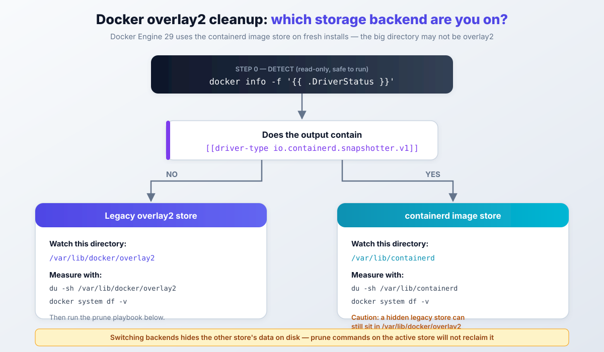
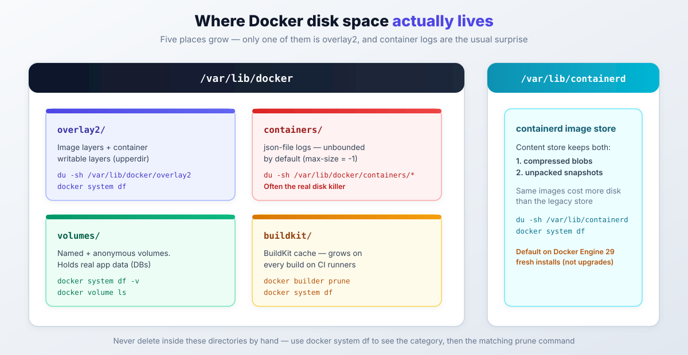

import Button from "@components/widgets/Button.astro";
import Notice from "@components/widgets/Notice.astro";
import ListCheck from "@components/widgets/ListCheck.astro";
import Accordion from "@components/widgets/Accordion.astro";
import Tabs from "@components/widgets/Tabs.astro";
import Tab from "@components/widgets/Tab.astro";
import YouTubeEmbed from "@components/widgets/YouTubeEmbed.astro";

<Notice type="warning" title="Do not delete overlay2 folders manually">
Never delete anything inside `/var/lib/docker/overlay2` or `/var/lib/containerd` by hand. Those hash-named folders are Docker's live metadata. Manual deletion corrupts images and breaks running containers. If you are asking "is it safe to delete /var/lib/docker/overlay2", the answer is no. Use the supported Docker cleanup commands in this guide, and only take "reset the Docker data dir" actions if you fully understand the blast radius.
</Notice>

docker overlay2 cleanup is what you need when `/var/lib/docker/overlay2` eats the disk and Docker starts failing writes. This guide shows how to reclaim disk space the safe way: the `docker system prune` family, container log limits, and one storage-backend checkpoint you should not skip. Since Docker Engine 29, fresh installs store images in `/var/lib/containerd` instead, so the directory filling your disk may not be overlay2 at all. Below is the full path: identify the backend, measure, prune, fix logs, diagnose leftovers, prevent the regrowth.

## Step 0: Which Storage Backend? (overlay2 vs containerd image store)

Before any cleanup, find out where Docker actually keeps its data. This is a read-only check:

```sh
docker info -f '{{ .DriverStatus }}'
```

Two possible outcomes:

- Output contains `[[driver-type io.containerd.snapshotter.v1]]` → you are on the **containerd image store**. Your data lives under `/var/lib/containerd`.
- Output shows a plain overlay2 driver status → you are on the **legacy overlay2 store**. Your data lives under `/var/lib/docker/overlay2`.



<Notice type="info" title="Docker Engine 29 changed the default storage">
Docker Engine 29.0 (October 2025) made the containerd image store the default on fresh installs. Upgraded daemons keep the legacy overlay2 graphdriver until you switch explicitly. Hosts with `userns-remap` are excluded from the new default. Latest as of writing: Engine v29.9.0 (2026-10-08), buildx v0.38.0 (2026-10-07).
</Notice>

If you are about to set up a new box and want the current defaults documented end to end, [install Docker and Docker Compose on Ubuntu ARM](https://www.bitdoze.com/install-docker-ubuntu-arm/) first, then come back here.

<Tabs>
<Tab name="Legacy overlay2 store">
```sh
# what to watch
du -sh /var/lib/docker/overlay2

# what Docker reports
docker system df
```

Most of this guide targets this store. The prune commands below work the same, but the directory names in overlay2 are what you will map later.
</Tab>
<Tab name="containerd image store">
```sh
# what to watch
du -sh /var/lib/containerd

# what Docker reports (still authoritative)
docker system df
```

`docker system df` remains the source of truth for categories. containerd keeps both compressed blobs and unpacked snapshots, so the same images cost more disk than on the legacy store. Docker's docs say "uses more disk space" without a multiplier, and I will not invent one.
</Tab>
</Tabs>

**Verify:** paste the real `docker info -f '{{ .DriverStatus }}'` output into your notes before you prune. You want a baseline of which store is active.

**Failure mode:** "I pruned overlay2 and nothing was reclaimed." On a containerd-store host you were looking at the inactive store. Active-store prune commands do not touch the other backend's data (see the hidden-store section below).

**Version context, short:** the old world is gone. AuFS and the legacy `overlay` driver were removed in Engine v24, devicemapper in v25, graphdriver plugins in v28 (official replacement advice: use the containerd image store). Engine v29 requires API v1.44 or newer. If your cleanup notes predate 2023, re-read them before running anything.

## What's Inside /var/lib/docker/overlay2

`overlay2` is Docker's copy-on-write filesystem for Linux. The directory holds:

- Layer directories: content-addressed folders with the actual filesystem diffs
- Container "upperdir" data: the writable layers where containers write files. This is usually what gets big
- Metadata and linkage: structures Docker uses to track which layers belong to which images

The folder names are random hashes, not readable identifiers. You cannot look at a folder name and know what image it belongs to. Use Docker commands instead of guessing from directory names. Docker deliberately keeps this layout undocumented.

On containerd-store hosts the equivalent internals live under `/var/lib/containerd` as a content store plus overlayfs snapshots. Same rule: measure with Docker commands and `du`, not by browsing hash folders.



That map is worth keeping in your head. The rest of this guide walks each box: measure it, clean it, then stop it from coming back.

## Why /var/lib/docker/overlay2 Grows So Large

The directory grows for a handful of predictable reasons:

1. Unused images and containers: stopped containers and old images still occupy space if you do not remove them.
2. Build cache: Docker caches layers to make builds faster. On a box that builds often, this cache is the top offender.
3. Large images and containers: some images ship big binaries or data files. Four copies of a 1.5 GB base image add up.
4. Inefficient image layers: images with too many layers or leftover build junk waste space. If you control the Dockerfile, [copy multiple files in one layer with a Docker COPY](https://www.bitdoze.com/copy-multiple-files-in-one-layer-using-a-dockerfile/) instead of stacking one `COPY` per file.
5. Unbounded container logs: this is the sneaky one. The json-file log driver grows without limit by default, and the files are **not** in overlay2. They live in `/var/lib/docker/containers/`. There is a dedicated section below.

On containerd-store hosts, add one more: blobs plus unpacked snapshots make the same image set cost more disk than the legacy store.

If you want to see which category is actually growing over time, [monitor server and Docker resources (CPU, memory, disk)](https://www.bitdoze.com/sever-monitoring/) rather than running `du` by hand every week.

**Ops note:** a full filesystem does not fail only Docker pulls. Database containers lose writes too, and some of those failures are silent until the app errors. Target 15-20% free space on any host that runs stateful containers.

## Check Docker Disk Usage First

Do this before touching anything. It is read-only.

```sh
docker system df
docker system df -v
```

`docker system df` shows space usage for images, containers, volumes, and build cache. The `-v` flag adds per-object detail. For monitoring scripts, add `--format json` (or a Go template) so you can parse it instead of scraping tables.

Then check the real filesystem:

```sh
df -h /var/lib/docker
du -sh /var/lib/docker/overlay2 /var/lib/docker/containers /var/lib/containerd 2>/dev/null
```

To see which overlay2 subdirectories are largest, just for investigation, never for deletion:

```sh
du -sh /var/lib/docker/overlay2/* 2>/dev/null | sort -hr | head -10
```

How to read the output:

- Large `overlay2` usage usually means container writes or build cache, not just unused images.
- Focus on the growing category in `docker system df -v` (images, containers, volumes, build cache), not on specific IDs.
- Save the `docker system df -v` output before cleanup. That is your baseline; you will compare against it after.

### Symptom → likely cause → first command

| Symptom | Likely cause | First command |
|---|---|---|
| overlay2 huge on a Docker 29 host | hidden legacy store after a backend switch | `docker info -f '{{ .DriverStatus }}'`, then assess or move the old store |
| `*-json.log` files huge | unlimited json-file logging | `du -sh /var/lib/docker/containers/* \| sort -hr \| head` |
| `docker system df` shows 0% reclaimable | active writable layers and in-use images | `docker ps -s`: scale the disk out, do not prune harder |
| prune ran, little reclaimed | named volumes; cache living in buildx | `docker system df -v`, then target the volumes and build cache rows |
| builder prune: unknown flag `--keep-storage` | old tutorials vs new buildx | `docker builder prune --help`, then use `--max-used-space` |

## Docker Overlay2 Cleanup: The Prune Playbook

This is the ordered, safest-first cleanup. Each command states what it removes. Run one, check `docker system df`, then decide if you need the next. That is slower than firing everything at once and much easier to explain when something you wanted disappears.

<YouTubeEmbed
  url="https://www.youtube.com/embed/29RUDkQI6pc"
  label="Docker Overlay2 Cleanup: Reclaim Disk Space Safely"
/>

### Quick Win: docker system prune (and -a)

Start with the read-only report again so the numbers are fresh:

```sh
docker system df -v
```

Remove stopped containers, unused networks, dangling images, and build cache:

```sh
docker system prune -f
```

What this does: clears objects nothing references. What it will not do: touch named volumes, and it keeps images that some container (even a stopped one) still points at.

If you also want to remove all images not used by any container, which is the more aggressive step:

```sh
docker system prune -a -f
```

**Failure mode:** `-a` removes images that a stopped-but-wanted container needs on its next start. Nothing is corrupted, but you pay the re-pull time at the worst moment. On hosts with containers you keep around for rollback, skip `-a` or run it inside a maintenance window.

For scheduled housekeeping on build boxes, filters keep the prune honest:

```sh
docker system prune -af --filter until=168h
```

`until=` accepts RFC3339 timestamps, dates, or Go durations like `10m` and `24h`. `label=` selects by label. Multiple filters across different keys are ANDed. A weekly cron with `until=168h` is a boring, reliable default for CI runners.

If you want the full teardown playbook for images, volumes, networks, and disks, see [how to clean all Docker images with disks and everything](https://www.bitdoze.com/cleanup-all-docker-things/).

**Verify:** `docker system df` after each command. On containerd-store hosts, note that older Engine 29 builds under-reported reclaimed space because they ignored unpacked image data (moby#52905, fixed in a later v29 patch). Confusing numbers there were a bug, not your mistake.

### Volumes: Anonymous vs Named (docker volume prune -a)

This is the part older guides get wrong, and it is why people search for "docker volume prune not reclaiming space".

Since Docker Engine 23.0 / API 1.42, `docker volume prune` removes **anonymous volumes only**. Named volumes need the `-a` flag:

```sh
docker volume prune -f        # anonymous volumes only
docker volume prune -a -f     # ALSO unused named volumes, check first!
```

Same caveat for `docker system prune --volumes`: the official warning says it removes "all anonymous volumes not used by at least one container". Named volumes survive.

Check before you delete anything:

```sh
docker volume ls
docker system df -v
```

<Notice type="warning" title="Named volumes hold real data">
`docker volume prune -a` deletes unused named volumes. Databases, uploads, and state live there. If a compose project is stopped and you prune named volumes, that data is gone. **Back up the volume or confirm it is throwaway before running `-a`.** This is the classic "we deleted prod data" story.
</Notice>

**Verify:** `docker volume ls` before, `docker system df` after. If the volumes row barely moved after `docker volume prune -f`, that is expected: your space is in named volumes, and only `-a` will reclaim them.

### Build Cache: docker builder prune with Capacity Caps

If you build images on the host, BuildKit cache is often the biggest single category. Prune it directly:

```sh
docker builder prune -f       # dangling cache
docker builder prune -af      # all unused cache
```

Newer buildx (v0.38.0 as of 2026-10) adds capacity caps, which are better than waiting for disk-full alarms:

```sh
docker builder prune -f --max-used-space 10gb    # LRU-evict down to 10 GB
docker builder prune -f --min-free-space 20gb    # keep 20 GB free on the filesystem
docker builder prune -f --reserved-space 5gb     # never evict the last 5 GB of cache
docker builder prune -f --filter until=168h      # cache older than 7 days
docker buildx prune -a --max-used-space 10gb     # also internal/frontend images
```

Sizes are human-readable and case-insensitive (`10gb`, `500MB`). Filters include `type=`, `type!=exec.cachemount` (keep cache mounts, usually what you want), `until=`, `description=`, and `parent=`. Multiple `--filter` flags are ANDed.

If you self-host CI, [self-host your Git and CI/CD with Forgejo and Woodpecker CI](https://www.bitdoze.com/forgejo-woodpecker-ci-cicd/) and put the `--max-used-space` prune in a weekly timer on the runner. That is where build cache goes feral.

**Failure mode:** `unknown flag: --keep-storage`. Older tutorials use it; the current buildx prune options table does not list it. Run `docker builder prune --help` on your host and use whatever capacity flag your version actually has (`--max-used-space` on recent buildx). Reclaiming nothing on a fresh box is normal, not a bug.

**Verify:**

```sh
docker builder prune --help | grep -E 'max-used|keep-storage'
```

Then re-run `docker system df` and compare the Build Cache row against your baseline.

## The Real Disk Killer: Docker Container Logs

Container logs are the disk problem that no overlay2 cleanup will fix. The default json-file log driver writes to `/var/lib/docker/containers/<id>/<id>-json.log` and grows **without limit** (`max-size` defaults to `-1`, `max-file` to `1`). A chatty app on a small VPS can fill the disk in days while `docker system df` looks almost clean.

Find the offenders:

```sh
du -sh /var/lib/docker/containers/* 2>/dev/null | sort -hr | head
docker ps -s
```

`docker ps -s` shows each container's writable layer size, which tells you whether the bloat is logs or app writes.

<Tabs>
<Tab name="Emergency (now)">
Truncate, do not delete. Deleting the file breaks the file handle and the space is not freed until the container restarts. Truncating is common practice in the field (it is not in the official docs, so test on your host first):

```sh
truncate -s 0 /var/lib/docker/containers/*/*-json.log
```

Reclaim happens immediately. The container keeps writing to the same handle.
</Tab>
<Tab name="Permanent (daemon.json)">
Set log rotation in `/etc/docker/daemon.json`. Values must be strings:

```json
{
  "log-driver": "json-file",
  "log-opts": {
    "max-size": "10m",
    "max-file": "3"
  }
}
```

Then restart Docker:

```sh
sudo systemctl restart docker
```

Each container keeps at most 3 files of 10 MB. Change the numbers to taste; just cap them at something.
</Tab>
</Tabs>

<Notice type="info" title="log-opts apply to new containers only">
Restarting the daemon applies the new log options to **newly created** containers only. Existing containers keep unlimited logging until you recreate them. For Compose apps, [update a container with Docker Compose](https://www.bitdoze.com/updating-container-docker-compose/) (`docker compose up -d --force-recreate`) so the new `log-opts` take effect.
</Notice>

If you would rather ship logs somewhere central than rotate them locally, [redirect Docker logs to a single file](https://www.bitdoze.com/redirect-docker-logs-to-a-single-file/) with a different log driver.

**Verify:**

```sh
du -sh /var/lib/docker/containers
docker inspect <container> --format '{{ json .HostConfig.LogConfig }}'
```

A new container should show `"max-size":"10m"` and `"max-file":"3"`.

**Failure mode:** you edited `daemon.json`, restarted Docker, and logs keep growing. The old containers were never recreated. Check `docker inspect` on one of them; if the log config is still empty, the file was not re-read for that container.

## Map overlay2 Directories to Docker Objects

Sometimes you need to know which container owns a giant writable layer. Use Docker's own output before any scripting:

```sh
docker ps -s
docker inspect -f '{{ .Name }} {{ .GraphDriver.Data.UpperDir }}' $(docker ps -aq)
```

`GraphDriver.Data.UpperDir` is the writable-layer path straight from `docker inspect`. That is a supported mapping, and it is the fastest way to match a huge directory to a container name.

For images versus layer directories, I have a helper script that visualizes `overlay2` disk usage:

```sh
curl -sSL https://utils.bitdoze.com/scripts/docker-overlay2-view.sh | bash
```

All scripts are at [utils.bitdoze.com](https://utils.bitdoze.com/).

<Notice type="warning" title="Guidance, not a delete list">
This mapping is best-effort. `overlay2` is an internal structure, and not every directory has a clean "this belongs to image X" relationship. The script covers the **legacy overlay2 store only**. On a containerd-store host `docker inspect` does not return overlay2 paths, so empty output there is expected, not broken. Use the output as guidance for what to investigate via Docker commands, never as a list of directories to delete.
</Notice>

## Why overlay2 Subfolders Don't Match Image IDs

You pruned everything and there are still hash directories that match no image. Normal. Here is why:

1. Container writable layers: running or stopped containers each have a writable layer in `overlay2`. If you have containers, you have overlay data.
2. Build cache: modern builds (BuildKit) create cache data. `docker system prune -a` does not always remove all of it. Target it with `docker builder prune`.
3. Shared or referenced layers: images share layers, and Docker will not remove anything still referenced. The directory name will not match what you see in `docker image ls`.
4. Init layers and internal metadata: the `*-init` directories and metadata structures are part of how Docker sets up containers.
5. Leaked or orphaned data (rare): power loss, daemon crashes, or storage corruption can leave leftovers. Check `docker system df -v` and the daemon logs before assuming this is your case.
6. Hidden legacy store after a backend switch: this one is new. If you moved to the containerd image store (or the reverse), the inactive store's data stays on disk but is invisible to the active store's prune commands. Prune reports nothing to reclaim while `df` shows a full disk. Detect it with `docker info -f '{{ .DriverStatus }}'` and compare against `du -sh /var/lib/docker/overlay2 /var/lib/containerd`.

Even if a directory looks unused, deleting overlay2 directories by hand can corrupt Docker's state. If you genuinely need a fresh start, do the controlled reset below with Docker stopped and your data backed up.

## Prevent /var/lib/docker/overlay2 From Filling Up Again

Cleanup is a one-time win. These five habits keep the disk healthy:

1. **Cap log size.** The `daemon.json` `log-opts` from the logs section are the highest-leverage change on any host that runs chatty containers.
2. **Schedule housekeeping on build boxes.** A weekly timer beats a disk-full alarm:

```sh
docker system prune -af --filter until=168h
docker builder prune -af --max-used-space 10gb
```

3. **Move Docker's data dir to a bigger volume.** Small root disks are the usual reason Docker fills the OS partition. In `/etc/docker/daemon.json`:

```json
{
  "data-root": "/mnt/volume/docker"
}
```

The flag is `--data-root` on the dockerd command line too (the old `-g`/`--graph` flags were removed in Engine v23). If the box needs the hardware, [add a new drive to Ubuntu LVM and mount it permanently](https://www.bitdoze.com/add-new-drive-lvm/) first. On Hetzner-style VPS boxes where the root disk is small and a separate volume is cheap, [Hetzner's cost-optimized cloud plans](https://www.bitdoze.com/hetzner-cloud-cost-optimized-plans/) pair well with this setup, and a [Hetzner Cloud VPS](https://go.bitdoze.com/hetzner) with a mounted volume solves the "Docker ate the OS disk" problem without moving data around later. A [Hostinger VPS with NVMe storage](https://go.bitdoze.com/hostinger-vps) is the alternative if you want one big local disk instead. Storage headroom is cheaper than downtime.

**Warning:** `data-root` does **not** migrate existing data. Plan a copy or move with the daemon stopped, then verify with `docker info | grep 'Docker Root Dir'` before you delete anything from the old path.

4. **Alert on filesystem usage.** Keep 15-20% free and get paged before 80%, not after writes fail. [Set up Beszel and Uptime Kuma for server monitoring and disk alerts](https://www.bitdoze.com/beszel-uptime-kuma/) if you want a self-hosted path.
5. **Stay patched.** Engine 29.x patches have included both the prune under-reporting fix and a BuildKit cache-poisoning fix (GHSA-p3rc-w3hc-pqvv, February 2026): a malicious cache image or remote cache can inject false build cache into your builds. That one hits anyone importing build cache, not just containerd-store users. Security fixes land in patch releases; run them.

<ListCheck>
<ul>
<li>json-file `log-opts` set with `max-size` and `max-file`</li>
<li>Weekly prune scheduled on build boxes and CI runners</li>
<li>`data-root` on a filesystem sized for your image churn</li>
<li>Disk usage alerts firing before 80%</li>
<li>15-20% free headroom on the Docker filesystem</li>
</ul>
</ListCheck>

<Notice type="warning" title="Switching to the containerd image store">
Enabling `"features": { "containerd-snapshotter": true }` in `daemon.json` switches the active store, but it does not clean up. Expect disk usage to grow for a while: containerd keeps compressed blobs and unpacked snapshots, and the legacy overlay2 data stays frozen on disk. `userns-remap` is not available with the containerd image store (moby#47377). Docker documents an experimental auto-migration (`containerd-migration` plus a snapshotter threshold), and Docker itself calls it unreliable. Prefer a fresh start on a host you can rebuild.
</Notice>

**Verify after any `data-root` change:**

```sh
systemctl status docker
docker info | grep 'Docker Root Dir'
```

**Failure mode:** a typo in `daemon.json` (a number where a string is required, a missing comma) keeps dockerd from starting. `journalctl -u docker` shows the parse error. Keep a copy of the last working file before editing.

## Last Resort: Controlled Docker Reset (Both Stores)

<Notice type="error" title="Last resort">
This is disruptive. Every image is re-pulled, every stopped container is effectively gone. Safer than deleting random hash directories, but only do it after backups and only when the prune playbook has nothing left to reclaim.
</Notice>

<Tabs>
<Tab name="Legacy overlay2 host">
1. Stop or remove containers you do not need.
2. Back up anything important: named volumes and bind-mounted data especially.
3. Stop the Docker daemon: `sudo systemctl stop docker`.
4. Move the data dir: `sudo mv /var/lib/docker /var/lib/docker.bak`.
5. Start Docker again: `sudo systemctl start docker`. It recreates `/var/lib/docker` empty.

Then re-pull images and restore only what you need. Once everything runs and you have reclaimed the space, delete `/var/lib/docker.bak` in a second, deliberate step. Not in the same command session.
</Tab>
<Tab name="containerd image store host">
1. Stop or remove containers you do not need.
2. Back up named volumes and bind-mounted data.
3. Stop the Docker daemon: `sudo systemctl stop docker` (and containerd if it runs as a separate unit you manage).
4. Move **both** data dirs: `sudo mv /var/lib/docker /var/lib/docker.bak` and `sudo mv /var/lib/containerd /var/lib/containerd.bak`.
5. Start Docker and confirm it is clean before touching the `.bak` directories.

If you move only `/var/lib/docker` on a containerd host, the reset appears to do nothing: the visible data was in `/var/lib/containerd` all along. If you previously switched backends, the inactive store's leftovers also live in whichever directory is not active. That is why both moves are in the steps.
</Tab>
</Tabs>

**Verify:** `df -h` before and after, `docker info` shows a fresh root dir, and a test container starts (`docker run --rm alpine echo ok`). Only then schedule the `.bak` cleanup.

## FAQ: Docker Overlay2 Cleanup Questions

<Accordion label="Is it safe to delete /var/lib/docker/overlay2 manually?" group="faq">
No. The hash directories are live layer and metadata structures. Deleting them corrupts Docker's graph and can break running containers and images even if the directory "looks" unused. Use `docker system prune`, `docker builder prune`, and the other supported commands in this guide. The only sanctioned bulk removal is a controlled reset of the whole data dir with the daemon stopped.
</Accordion>

<Accordion label="Why is docker volume prune not reclaiming space?" group="faq">
Because since Docker Engine 23.0 / API 1.42, `docker volume prune` removes anonymous volumes only. Your space is probably in named volumes (databases, uploads), which need `docker volume prune -a`. Check with `docker volume ls` and `docker system df -v` first. Named volumes hold real data, so back up before `-a`.
</Accordion>

<Accordion label="Why is /var/lib/docker/overlay2 so big on a Docker 29 server?" group="faq">
Two likely reasons. First, Engine 29 enables the containerd image store on fresh installs, so you may be looking at leftover legacy-store data that prune commands will never touch. Detect with `docker info -f '{{ .DriverStatus }}'`. Second, overlay2 holds container writable layers and build cache, which grow even when every image is in use. Read the category breakdown in `docker system df -v` before assuming unused images are the problem.
</Accordion>

<Accordion label="Do Docker container logs really take up disk space?" group="faq">
Yes. The json-file log driver defaults to unlimited size (`max-size` is `-1`) and the files live in `/var/lib/docker/containers/`, not in overlay2. Truncate them for an immediate fix (`truncate -s 0` on the `*-json.log` files, do not delete), then set `log-opts` with `max-size` and `max-file` in `/etc/docker/daemon.json` and recreate the containers so the rotation applies.
</Accordion>

<Accordion label="What's the fastest way to reclaim Docker disk space tonight?" group="faq">
In order: `docker system df -v` to see the biggest category, `docker system prune -f` for the safe win, `docker builder prune -af --max-used-space 10gb` if build cache is large, then check `du -sh /var/lib/docker/containers/*` for runaway logs and truncate them. Save the `docker system df -v` baseline first so you can prove what you reclaimed. For the deep-dive version, see [how to clean all Docker images with disks and everything](https://www.bitdoze.com/cleanup-all-docker-things/).
</Accordion>

## Summary

A growing `/var/lib/docker/overlay2` (or `/var/lib/containerd` on Engine 29 hosts) comes down to four things: unused objects, build cache, writable-layer writes, and unbounded container logs. Do the docker overlay2 cleanup in that order of blame: run `docker system df -v`, prune with the supported commands (remember named volumes need `docker volume prune -a`), cap your logs with `log-opts`, and schedule housekeeping instead of waiting for the disk-full alarm.

Do not delete anything inside those directories by hand. If you reach the point where prune has nothing left to give and the disk is still full, do the controlled reset with the daemon stopped and backups in place.

<Button text="All Docker cleanup commands" link="/cleanup-all-docker-things/" variant="solid" color="blue" />
