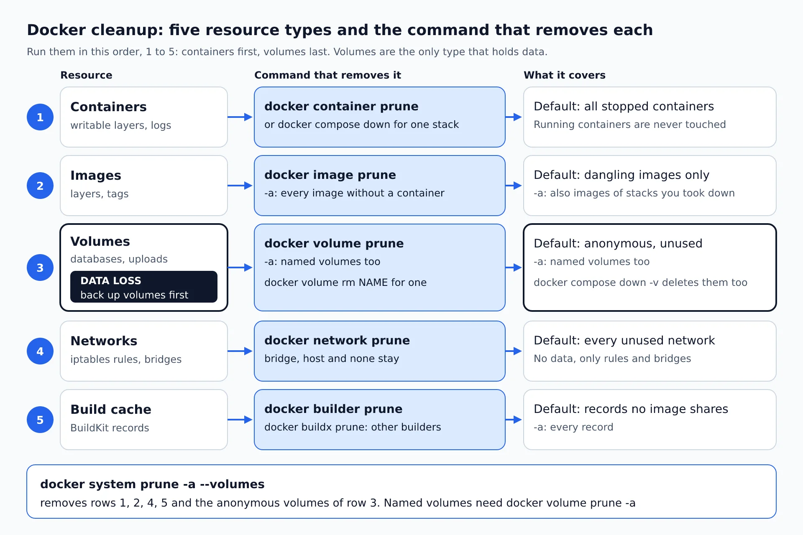

import Accordion from "@components/widgets/Accordion.astro";
import Notice from "@components/widgets/Notice.astro";

A safe Docker cleanup runs `docker system df` first, then removes containers, images, volumes, networks and build cache one type at a time, then runs `docker system df` again. On the throwaway daemon behind every output below, that order took all four `docker system df` rows to zero. Named volumes need `docker volume prune -a` on its own, because `docker system prune -a --volumes` leaves them alone.

My first Docker cleanup came after a failed update, and I ran it in the wrong order. The stack ran [Plausible](/install-plausible-analytics/) for several websites, on Docker and docker-compose. An update came up, and the new image wanted PostgreSQL 14 while the database was on 12. I changed the image configuration and the update failed, so I reverted the database to its previous state with the old image and restarted. The sites no longer showed up in the analytics. [Pulling the latest images again](/updating-container-docker-compose/) ended in two messages:

```text
ERROR: for plausible_plausible_events_db_1  Cannot create container for service plausible_events_db: open /var/lib/docker/volumes/plausible_event-data/_data: no such file or directory
```

```text
WARNING: Service "plausible_events_db" is using volume "/var/lib/clickhouse" from the previous container. Host mapping "plausible_event-data2" has no effect. Remove the existing containers (with `docker-compose rm plausible`)
```

The two volume names in them differ by a `2`, `plausible_event-data` and `plausible_event-data2`. The messages came from docker-compose v1, the Python binary with the hyphen, which Docker [no longer maintains](https://docs.docker.com/retired/). Compose v2 prints nothing for the same kind of mistake. I renamed a volume in the Compose file of a test stack while the old container still existed and ran `docker compose up -d`:

```text
 Container rf-dock-site-worker-1 Running
 Volume rf-dock-site_html2 Creating
 Volume rf-dock-site_html2 Created
 Container rf-dock-site-web-1 Recreate
 Container rf-dock-site-web-1 Recreated
 Container rf-dock-site-web-1 Starting
 Container rf-dock-site-web-1 Started
```

No error, no warning. The container now mounts a fresh volume with the image's default files in it, and the old volume still holds the data:

```bash
docker run --rm -v rf-dock-site_html:/old:ro alpine cat /old/index.html
```

```text
v1
```

Nothing was lost there, but from then on the old volume was unused, one `docker volume prune -a` away from gone. On the Plausible host I started with the images only, and the volumes caused the next problem. So I went for the drastic measure: remove everything the stack had left behind, volumes included, and install again from scratch. I ran the whole order on that daemon, Engine 29.10.1 with the containerd image store and Compose v5.8.0. It starts with two running stacks, one stopped container, five images, five volumes, six networks and 11 build cache records.



<Notice type="warning" title="Volumes hold the data you cannot rebuild">
`docker volume prune -a` and `docker compose down -v` delete named volumes for good, so the backup step below comes before the first removal. Images, networks and build cache come back with a pull or a build, and `docker compose up` recreates a container from its image.
</Notice>

## Start with `docker system df`

`docker system df` counts what the daemon holds before you delete anything:

```bash
docker system df
```

```text
TYPE            TOTAL     ACTIVE    SIZE      RECLAIMABLE
Images          5         2         143.9MB   35.31kB (0%)
Containers      4         3         122.9kB   8.192kB (6%)
Local Volumes   5         4         505B      5B (0%)
Build Cache     11        0         8.8MB     49.26kB
```

ACTIVE is what at least one container uses. RECLAIMABLE is what a prune could free. It is small here because the unused images and the largest cache records share their layers with images that are in use. The table has no names, so read the lists next:

```bash
docker ps -a
docker volume ls
docker network ls
```

```text
CONTAINER ID   IMAGE           COMMAND                  CREATED         STATUS                     PORTS     NAMES
70bdabf32fb2   alpine:latest   "sleep 3600"             6 seconds ago   Up 5 seconds                         rf-dock-db-data-1
36fd6c6cee54   alpine:latest   "sleep 3600"             6 seconds ago   Up 6 seconds                         rf-dock-site-worker-1
1583a2a5d377   nginx:alpine    "/docker-entrypoint.…"   6 seconds ago   Up 5 seconds               80/tcp    rf-dock-site-web-1
68a708564d3f   alpine:latest   "sh -c 'sleep 2'"        7 seconds ago   Exited (0) 4 seconds ago             rf-dock-stopped
DRIVER    VOLUME NAME
local     46aaf8854ddf74764a6b07e56a32e79f298bb3e10a113bea1811bdfb38213c29
local     ed079a0333ce882fb1a04a900edc6c1067c15c54669a214d31201837c417c325
local     rf-dock-db_data
local     rf-dock-old_data
local     rf-dock-site_html
NETWORK ID     NAME                 DRIVER    SCOPE
d98839a7c66a   bridge               bridge    local
186325726f01   host                 host      local
90fe3459b354   none                 null      local
e8fb04e48ade   rf-dock-db_default   bridge    local
227d7894f445   rf-dock-site_front   bridge    local
fb0087e476b0   rf-dock-unused       bridge    local
```

Four filters list the objects the default prunes go after:

```text
$ docker ps -q -a --filter status=exited
68a708564d3f
$ docker volume ls -q --filter label=com.docker.volume.anonymous
46aaf8854ddf74764a6b07e56a32e79f298bb3e10a113bea1811bdfb38213c29
ed079a0333ce882fb1a04a900edc6c1067c15c54669a214d31201837c417c325
$ docker network ls -q --filter dangling=true
fb0087e476b0
$ docker images -q --filter dangling=true
ca04d9cb5bfa
```

Anonymous volumes carry the label `com.docker.volume.anonymous` and named volumes carry no label, so the second list is exactly what `docker volume prune` deletes by default.

## Why do the classic one-liners fail?

Because each one assumes the step before it is finished. `docker rm` refuses running containers, and `docker rmi` refuses images a container uses and images with two tags.

`docker stop $(docker ps -a -q)` stops every container on the host by ID. It works. `-a` includes the containers that are already stopped, which prints their ID and moves on. `stop` sends SIGTERM, then SIGKILL after 10 seconds. A process that ignores SIGTERM, like the `sleep 3600` ones here, holds the command for the full timeout and ends with exit code 137.

```text
$ docker stop $(docker ps -a -q)
82736c14412c
e94c72b1efcb
54de3a31ae66
b6f91c1db70e
```

`docker rm $(docker ps -a -q)` is where the sequence breaks. It removes the stopped containers, refuses the running ones and exits with code 1:

```text
$ docker rm $(docker ps -a -q)
5650d42dc193
Error response from daemon: cannot remove container "f2628490d96d": container is running: stop the container before removing or force remove
Error response from daemon: cannot remove container "5d6a0e61fd99": container is running: stop the container before removing or force remove
Error response from daemon: cannot remove container "12bbc2ef3126": container is running: stop the container before removing or force remove
```

`docker rmi $(docker images -q)` fails for three reasons. The daemon refuses an image that a running container uses. `docker images -q` prints an image once per tag, so an image with two tags is in the list twice. And the list has no dangling images at all, the ones without a tag.

```text
$ docker rmi $(docker images -q)
Untagged: rf-dock-old:1
Deleted: sha256:f4e75d90f8cc50fd548a9652d91b099f1bb1ea5103b56cd2c8c148de1e10456b
Untagged: rf-dock-demo:1
Deleted: sha256:04bd2aca67ecb4463c1dfc74ba6a1e84a8445987fcd120617af07cae8315ab16
Error response from daemon: conflict: unable to delete c3ac91f4f4e5 (cannot be forced) - image is being used by running container bf32925199f4
Error response from daemon: conflict: unable to delete acbc1de7a6a5 (cannot be forced) - image is being used by running container 8c803e029aae
Error response from daemon: conflict: unable to delete acbc1de7a6a5 (cannot be forced) - image is being used by running container 8c803e029aae
```

The alpine image is in the list twice, once per tag, and the daemon refuses it both times. With the containers gone, the two tags still block it:

```text
Error response from daemon: conflict: unable to delete acbc1de7a6a5 (must be forced) - image is referenced in multiple repositories
```

The working forms are in the next section: `docker compose down` for one stack, then a prune per type. On a host where everything goes at once, `docker rm -f $(docker ps -aq)` is the one-liner. `-f` sends SIGKILL, and the selector matches every container on the daemon, including the ones a panel such as [Dokploy](/dokploy-update-docker-compose/) created. Run it a second time on the empty host and it stops with:

```text
docker: 'docker rm' requires at least 1 argument
```

The rest of the family is in the [Docker commands reference](/docker-commands/).

## How do I clean up Docker in a safe order?

Stop and remove the containers first, then prune images, volumes, networks and build cache, one command per type. Containers reference images and hold volumes, so nothing else can go first.

### Containers, one stack at a time

```bash
cd /work/rf-dock-site
docker compose down
```

```text
 Container rf-dock-site-web-1 Stopping
 Container rf-dock-site-worker-1 Stopping
 Container rf-dock-site-web-1 Stopped
 Container rf-dock-site-web-1 Removing
 Container rf-dock-site-web-1 Removed
 Container rf-dock-site-worker-1 Stopped
 Container rf-dock-site-worker-1 Removing
 Container rf-dock-site-worker-1 Removed
 Network rf-dock-site_front Removing
 Network rf-dock-site_front Removed
```

`down` stops the containers, removes them and removes the stack's network. No volume line appears. Named and anonymous volumes stay. The same command in the other stack's folder takes care of that one, and `docker ps -a` shows what is left:

```text
CONTAINER ID   IMAGE           COMMAND             CREATED          STATUS                      PORTS     NAMES
68a708564d3f   alpine:latest   "sh -c 'sleep 2'"   28 seconds ago   Exited (0) 26 seconds ago             rf-dock-stopped
```

The container started by hand is stopped, so `docker container prune` takes it:

```bash
docker container prune -f
```

```text
Deleted Containers:
68a708564d3f93db7e34e30d7cadb58589e97819e98614fa060bb0c7949cf4f8

Total reclaimed space: 8.192kB
```

The check is `docker ps -a`. The header alone means the daemon holds no container.

```text
CONTAINER ID   IMAGE     COMMAND   CREATED   STATUS    PORTS     NAMES
```

Removing beats stopping here. A stopped container with the [`always` restart policy](https://docs.docker.com/engine/containers/start-containers-automatically/#use-a-restart-policy) starts again the next time the daemon restarts, and then it holds its image again. A database that needs longer than 10 seconds to shut down gets `docker compose down -t 60`.

### How do I remove all Docker images?

`docker image prune -a -f` removes every image once no container remains. Without `-a` it takes the dangling ones only:

```bash
docker image prune -f
```

```text
Deleted Images:
untagged: sha256:ca04d9cb5bfa66fdf953dad064612f34759abad58658d280f336eff366a69ca7
deleted: sha256:ca04d9cb5bfa66fdf953dad064612f34759abad58658d280f336eff366a69ca7
deleted: sha256:d9637a424d913a45e41dfebacb39d625fcfbbdf6f0e749ebd7169fda80722fb8
deleted: sha256:ab8f5aaf79b6c6840e2607e5af92238cd76bf49d65cf3e1602ba5a507ce0666b

Total reclaimed space: 12.36kB
```

```bash
docker image prune -a -f
```

```text
Deleted Images:
untagged: alpine:3.24
untagged: alpine:latest
untagged: nginx:alpine
deleted: sha256:c3ac91f4f4e59656b9bc962e658ee89222949a211948fde92f1d1c24ff4ff8fe
untagged: rf-dock-demo:1
deleted: sha256:8d5ff81658fd197f3414dbd47ba6fadfb0101ebf1cc357a9ba79879313e84eed
deleted: sha256:1c49d323d1b1dabba22095ff85b423c29da72a81954d3843ff98caa7c927b0e5
deleted: sha256:1c7e70d05bd391650cb9565eeb7e5d10ffceca0ae4b685547661d4b27d237f0c
untagged: rf-dock-old:1
deleted: sha256:f84b518ef359b56a97430632606d0dec12265be0eab88a00cb97a058ea49ab9f
deleted: sha256:97c9fae71ef20b7659aed2d172f37bcba74b4eec8199fc3a646e5a7c7e7eff34
deleted: sha256:02b8b889ca0c43dd82ff848a37c98786eb5d612eeaf2e03f5879de79e5a95d93

Total reclaimed space: 126.1MB
```

`-a` also removes the images of stacks you took down on purpose. A [Compose rollback](/updating-container-docker-compose/) after this step starts with a new pull, because the default [`pull_policy`](https://docs.docker.com/reference/compose-file/container-spec/#pull_policy) is `missing`. `docker images` hides dangling images on this CLI, so `docker images -a` is the list that shows them. And after [auto-update tools such as Tugtainer](/tugtainer-docker-autoupdate/) put a new image on a container, the old image stays on disk until this command runs.

### Volumes last: `docker volume prune` in two steps

Back up a volume before the first removal, with a throwaway container that mounts it read only:

```bash
cd /work/rf-dock-site
mkdir -p bak
docker run --rm -v rf-dock-site_html:/data:ro -v "$PWD/bak:/backup" alpine tar czf /backup/html-vol.tgz -C /data .
tar tzf bak/html-vol.tgz
```

```text
./
./index.html
./50x.html
```

Copy the Compose file and the `.env` next to it into `bak` as well, and read [Docker Compose secrets](/docker-compose-secrets/) before the reinstall. For off-machine copies of `/var/lib/docker/volumes` there is [Pluton](/pluton-self-hosted-backup/).

After the containers are gone, the volumes part of `docker system df -v` shows `LINKS 0` on every line, the mark of an unused volume:

```text
VOLUME NAME                                                        LINKS     SIZE
rf-dock-db_data                                                    0         0B
46aaf8854ddf74764a6b07e56a32e79f298bb3e10a113bea1811bdfb38213c29   0         0B
rf-dock-old_data                                                   0         5B
rf-dock-site_html                                                  0         500B
ed079a0333ce882fb1a04a900edc6c1067c15c54669a214d31201837c417c325   0         0B
```

`docker volume prune` removes two of them, the ones with the 64 character names:

```bash
docker volume prune -f
```

```text
Deleted Volumes:
46aaf8854ddf74764a6b07e56a32e79f298bb3e10a113bea1811bdfb38213c29
ed079a0333ce882fb1a04a900edc6c1067c15c54669a214d31201837c417c325

Total reclaimed space: 0B
```

Those are anonymous volumes, created by a `VOLUME` line in an image or by a mount without a name. Since [Engine 23.0](https://docs.docker.com/engine/release-notes/23.0/) the default prune stops there. Volumes created before that version carry no anonymous label, so they count as named. The three named ones need `-a`:

```bash
docker volume ls
docker volume prune -a -f
```

```text
DRIVER    VOLUME NAME
local     rf-dock-db_data
local     rf-dock-old_data
local     rf-dock-site_html
```

```text
Deleted Volumes:
rf-dock-db_data
rf-dock-old_data
rf-dock-site_html

Total reclaimed space: 505B
```

This is the command that deletes a database. For anything short of a full reset, `docker volume rm` with one name at a time is the form I would use. To undo, create the volume again and untar into it:

```bash
docker volume create rf-dock-site_html
docker run --rm -v rf-dock-site_html:/data -v "$PWD/bak:/backup:ro" alpine tar xzf /backup/html-vol.tgz -C /data
docker run --rm -v rf-dock-site_html:/data:ro alpine cat /data/index.html
```

```text
rf-dock-site_html
v1
```

The restore above covers static files. A database volume needs a dump made with `pg_dump` before the prune, and this run did not test that path.

### Networks and build cache

```bash
docker network prune -f
```

```text
Deleted Networks:
rf-dock-unused
```

The prune never removes the three built-in networks, `bridge`, `host` and `none`, and networks hold no data. The build cache is next:

```bash
docker builder prune -a -f
```

```text
ID                                              RECLAIMABLE     SIZE            LAST ACCESSED
fqw2rvwswvzbvafcokwicwwy5                       true            12.4kB          31 seconds ago
64okqqt7k81l3jxym3q8kfmhz*                      true    4.096kB         30 seconds ago
...
Total:  8.8MB
```

Without `-a` the command keeps the cache records that an image still shares, 8.751MB of the 8.8MB here. `docker buildx prune` reaches the same cache and adds filters and space limits such as `--max-used-space`.

### Confirm with `docker system df`

```bash
docker system df
```

```text
TYPE            TOTAL     ACTIVE    SIZE      RECLAIMABLE
Images          0         0         0B        0B
Containers      0         0         0B        0B
Local Volumes   0         0         0B        0B
Build Cache     0         0         0B        0B
```

All four rows read zero.

## What does `docker system prune` remove?

Stopped containers, networks that no container uses, dangling images and the build cache. `-a` adds every image without a container, `--volumes` adds unused anonymous volumes, and named volumes stay.

`docker system prune` runs most of the steps above at once, and its warning lists what it will take:

```bash
docker system prune
```

```text
WARNING! This will remove:
  - all stopped containers
  - all networks not used by at least one container
  - all dangling images
  - unused build cache

Are you sure you want to continue? [y/N] y
...
Total reclaimed space: 82.23kB
```

That was the stopped container, the unused network, the dangling image and 8 of the 11 cache records. Tagged images and all five volumes stayed.

With `-a --volumes` the warning gains the anonymous volumes line and widens the image line:

```bash
docker system prune -a --volumes
```

```text
WARNING! This will remove:
  - all stopped containers
  - all networks not used by at least one container
  - all anonymous volumes not used by at least one container
  - all images without at least one container associated to them
  - all build cache

Are you sure you want to continue? [y/N] y
...
Total reclaimed space: 8.846MB
```

Read the third line: anonymous volumes. After the run, `docker volume ls` still lists four volumes:

```text
DRIVER    VOLUME NAME
local     a02a833d832151355e1e17d0cfb5e0d06c4b21dd6f9f89bb7db3a2797bcc4a36
local     rf-dock-db_data
local     rf-dock-old_data
local     rf-dock-site_html
```

`rf-dock-old_data` has no container and is still there. So a full cleanup in one go is two commands:

```bash
docker system prune -a --volumes -f
docker volume prune -a -f
```

`-f` skips the question. Without it, a run from a script or a closed stdin prints the warning and removes nothing.

`--filter until=24h` keeps everything younger than a day, containers, images, networks and cache records:

```bash
docker system prune -a -f --filter until=24h
```

```text
Total reclaimed space: 0B
```

Zero, because every object in the lab was minutes old. That is the form for a nightly timer. On the containerd image store, the default on fresh installs of Engine 29 and later, an image's age counts from its pull. So an image pulled today survives the filter even when its build date is months old. On the classic image store it counts from the build date.

The four forms, each run on a fresh copy of the lab state:

| Command | Removed in the lab | Left in the lab | Trade-off |
|---|---|---|---|
| `docker system prune` | 1 stopped container, 1 unused network, 1 dangling image, 8 of 11 cache records, 82.23kB | Running containers and their 2 images, 2 other tagged images, all 5 volumes | Frees little while the old images keep their tags |
| `docker system prune -a` | The same, plus 2 tagged images without a container and the rest of the cache, 8.846MB | Running containers and their 2 images, all 5 volumes | Bringing a stack back starts with a new pull |
| `docker system prune -a --volumes` | The same, plus 1 unused anonymous volume, 8.846MB | 3 named volumes, 1 anonymous volume in use | Named volumes need `docker volume prune -a` |
| `docker system prune -a -f --filter until=24h` | Nothing, 0B | Everything created or used in the last 24 hours | On the containerd image store an image is as young as its pull |

## Which command can delete which data

| Data | Where it lives | Deleted by | Kept by |
|---|---|---|---|
| Named volume | `/var/lib/docker/volumes/<name>/_data` | `docker volume prune -a`, `docker volume rm`, `docker compose down -v` | `docker system prune -a --volumes`, plain `docker volume prune`, `docker compose down` |
| Anonymous volume | `/var/lib/docker/volumes/<64 characters>/_data` | plain `docker volume prune`, `docker system prune --volumes`, `docker rm -v`, `docker compose down -v` | `docker system prune` without `--volumes`, `docker compose down` |
| Bind mount | The host folder you named | Only an `rm -rf` on the host | Every prune, and `rm -rf /var/lib/docker` |
| Writable layer of a container | The container's own snapshot | `docker rm`, `docker container prune`, `docker compose down`, `docker system prune` | `docker stop` |
| Build cache | `/var/lib/docker/buildkit` | `docker builder prune -a`, `docker buildx prune`, `docker system prune` | The other prune types |

`docker compose down` keeps both volume kinds. An anonymous volume has no stable name, so the next `up` does not mount it again and creates a new one. The lab had five volumes before a `down` and `up` pair and six after.

`down -v` is the one with no way back. The file was in the volume a moment before:

```bash
docker run --rm -v rf-dock-db_data:/d:ro alpine ls /d
docker compose down -v
```

```text
rows.txt
 Container rf-dock-db-data-1 Stopping
 Container rf-dock-db-data-1 Stopped
 Container rf-dock-db-data-1 Removing
 Container rf-dock-db-data-1 Removed
 Volume rf-dock-db_data Removing
 Network rf-dock-db_default Removing
 Volume rf-dock-db_data Removed
 Network rf-dock-db_default Removed
```

The tarball from the volume step is the only undo.

## Never delete /var/lib/docker while Docker runs

`rm -rf /var/lib/docker` appears in the Docker docs in the [uninstall procedure](https://docs.docker.com/engine/install/ubuntu/#uninstall-docker-engine), after the packages are gone. Under a running daemon it does something else. The lab daemon held three running containers when I ran it:

```bash
rm -rf /var/lib/docker
```

```text
rm: can't remove '/var/lib/docker/rootfs/overlayfs/7b7482a5ee449493e43b71678edc5d05a37fbe8c933f0e6d590aab2adc1d0835': Resource busy
rm: can't remove '/var/lib/docker/rootfs/overlayfs/637e23f32498a121aa8a9b38ffb7272398f564448abdbe3673408b19dbfea18c': Resource busy
rm: can't remove '/var/lib/docker/rootfs/overlayfs/c1586ea0cb4500d7a8a9a3741127908bb0af66beadfb78644f060b64b6490905': Resource busy
```

The command exits with an error and leaves a daemon that half exists. `docker ps` still lists the containers, with image IDs in place of names. `docker system df` fails:

```text
Error response from daemon: error getting build cache usage: error getting build cache usage: failed to get usage for vwh921yk5p3wnux8p1kb4z1c8: lstat /var/lib/docker/containerd/daemon/io.containerd.snapshotter.v1.overlayfs/snapshots/689/fs: no such file or directory
```

`docker volume inspect` still reports the mountpoint of a volume whose directory is gone:

```text
ls: /var/lib/docker/volumes/rf-dock-site_html/_data: No such file or directory
```

`docker exec` into a running container fails with `open /var/lib/docker/tmp/runc-process2931786969: no such file or directory`, and `docker run` fails with `blob not found`. The `rm` did not touch the bind mounted folder.

The directory holds more than images. The lab listing had `buildkit` for the build cache, `containerd` for the image store when dockerd starts containerd itself, `containers`, `image`, `network`, `volumes`, `rootfs` and a few state files. On a host installed from the Docker packages with the containerd image store, the image contents and container snapshots live in `/var/lib/containerd` and the rest in `/var/lib/docker` ([daemon docs](https://docs.docker.com/engine/daemon/#daemon-data-directory)). The command does not even remove the images there.

<Notice type="error" title="Stop the daemon before you delete its directory">
`rm -rf /var/lib/docker` under a running dockerd leaves containers you cannot exec into, images you cannot run and volumes that exist without their data. Stop `docker.socket`, `docker` and `containerd` first.
</Notice>

Two paths replace it.

For a clean reinstall, the prune path is enough: `docker compose down` for each stack, then `docker system prune -a --volumes -f` and `docker volume prune -a -f`. The result is the four zeros above, and the next `docker compose up` pulls the missing images.

For a true reset of the daemon, stop it first. The uninstall procedure removes the directories only after `apt purge` has removed the packages. The same order without the purge is:

```bash
sudo systemctl stop docker.socket docker containerd
sudo rm -rf /var/lib/docker /var/lib/containerd
sudo systemctl start containerd docker
```

I did not run these three lines, because the lab has no systemd. On a second daemon in the lab, started as a plain process, I ran the same order: remove the containers, stop dockerd, delete its data directory, start it again. It came back empty, with no error.

Each `docker compose down` takes its stack offline, so on a production host every `down` needs a downtime window. If `/var/lib/docker` stays large after the four zeros, the next read is [the overlay2 cleanup guide](/clean-docker-overlay2-dir/). To see the disk fill up before it runs out, [monitor server and Docker resources](/sever-monitoring/).

## FAQ

<Accordion label="Does docker system prune remove running containers?" group="faq">
No. It removes stopped containers only, plus the images and networks that no container uses. In the lab, three running containers survived `docker system prune -a --volumes`, with their images and volumes.
</Accordion>

<Accordion label="Why does docker volume prune leave volumes behind?" group="faq">
Since Engine 23.0 the default removes unused anonymous volumes only, the ones with a 64 character name. A named volume stays until `docker volume prune -a` or `docker volume rm` removes it, and volumes created before Engine 23 count as named.
</Accordion>

<Accordion label="Does docker system prune -a --volumes delete named volumes?" group="faq">
No. `--volumes` covers anonymous volumes without a container. After the run, `docker volume ls` in the lab still showed three named volumes, one with `LINKS 0`, so add `docker volume prune -a -f` for those.
</Accordion>

<Accordion label="Is there a dry run for docker system prune?" group="faq">
There is no flag for it. Without `-f` the command prints the `WARNING!` block and waits for the answer. For the exact objects, `docker ps -q -a --filter status=exited`, `docker volume ls -q --filter label=com.docker.volume.anonymous`, `docker network ls -q --filter dangling=true` and `docker images -q --filter dangling=true` list what each default prune deletes.
</Accordion>

<Accordion label="What does the --filter until=24h option keep?" group="faq">
Everything from the last 24 hours: containers, images, networks and cache records. On the containerd image store an image counts from its pull, so `docker images -a --filter until=24h` is empty right after a pull. On the classic image store it counts from the build date.
</Accordion>

<Accordion label="Docker builder prune or docker buildx prune: which one?" group="faq">
Both reach the cache of the default builder. Without `-a`, `docker builder prune` kept 8.751MB of 8.8MB in the lab, the records an image still shares, so `-a` empties it. `docker buildx prune` adds filters such as `until=24h`, the `--max-used-space` limit and `--builder` for another builder.
</Accordion>

<Accordion label="Does docker compose down delete volumes?" group="faq">
A plain `down` keeps named and anonymous volumes and removes the containers and the stack's networks only. `docker compose down -v` also deletes the named volumes declared in the Compose file and the anonymous volumes of its containers, with no undo.
</Accordion>

<Accordion label="What happens if I delete /var/lib/docker while dockerd runs?" group="faq">
It fails and leaves a broken daemon. In the lab `rm` reported `Resource busy` for every running container and deleted everything else, so `docker system df` returned an error and the volumes existed without their data. Stop `docker.socket`, `docker` and `containerd` first, or prune instead.
</Accordion>
