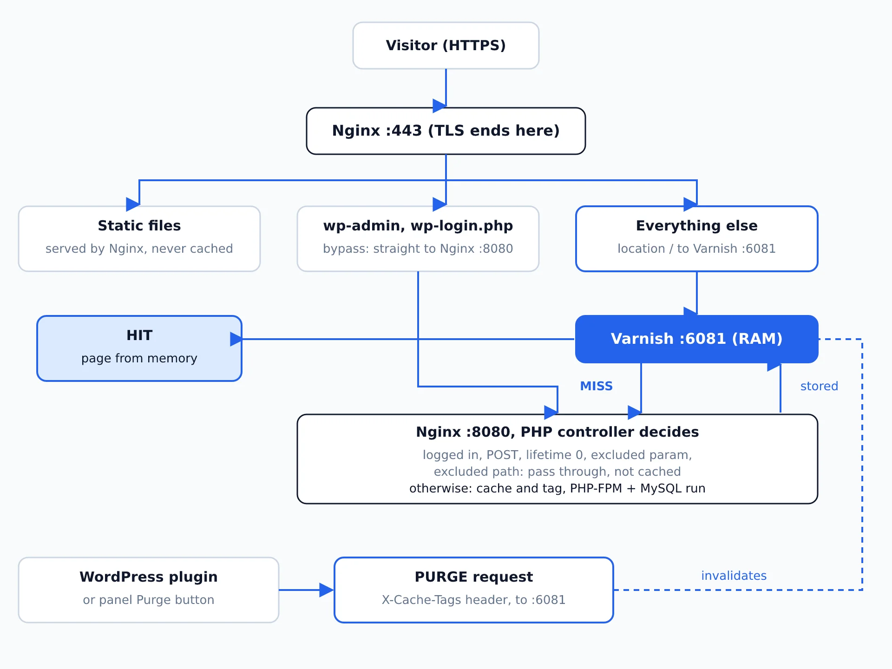
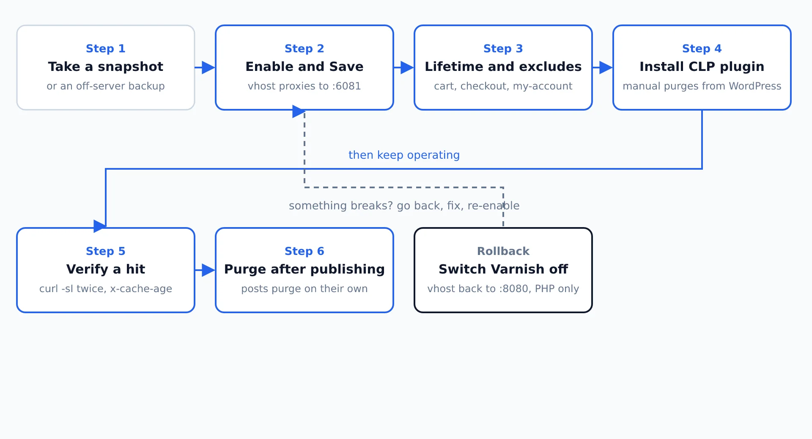
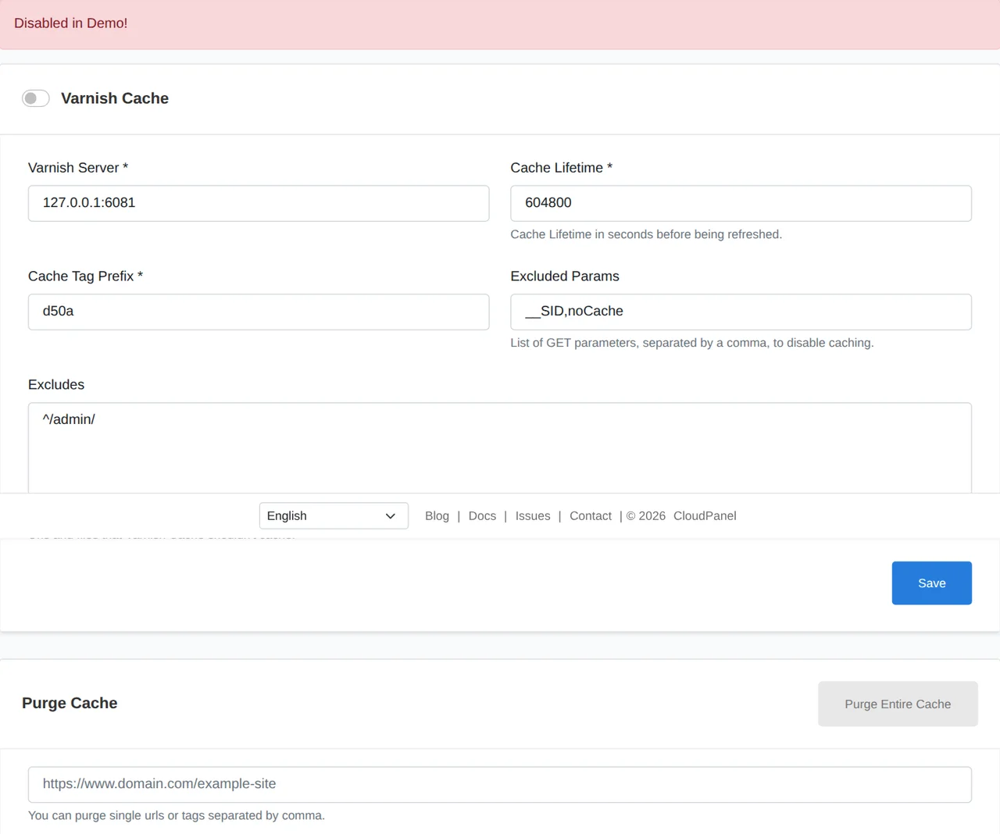

import Accordion from "@components/widgets/Accordion.astro";
import Button from "@components/widgets/Button.astro";
import Notice from "@components/widgets/Notice.astro";
import YouTubeEmbed from "../../components/widgets/YouTubeEmbed.astro";

To enable the CloudPanel Varnish cache, open the site in CloudPanel, switch on **Varnish Cache** and save. Add your WooCommerce paths to Excludes. Then run `curl -sI` twice and look for a growing `x-cache-age` header, which means Varnish answered from memory.

WordPress runs PHP and a database query on every page request. That is fine with two visitors and a problem with two hundred. A cache hit skips PHP-FPM and MySQL entirely, and CloudPanel ships Varnish as a per-site switch, so there is no VCL file to write.

The switch is the easy part. The parts that bite are the exclusions (a cached cart page), the cache size on a small VPS and proving a hit. This guide goes through them in the order you meet them.

<YouTubeEmbed
  url="https://www.youtube.com/embed/wq8g9oFJHmM"
  label="CloudPanel Varnish Cache Setup for WordPress"
/>

## Prerequisites

- **CloudPanel 2.1 or newer.** Varnish support arrived in 2.1, and the current release is 2.5.4 (July 2026). No panel yet? [Install CloudPanel](/install-cloudpanel-host-nodejs/) first. If the site was created before 2.1, run the migration script from the [CloudPanel docs](https://www.cloudpanel.io/docs/v2/frontend-area/varnish-cache/migration/) first. The toggle will not appear otherwise.
- **A site of type WordPress** (or a WordPress vhost based on the CloudPanel template). [Installing WordPress on CloudPanel](/install-wordpress-on-ubuntu-arm/) covers creating one. A heavily customized vhost can break the Varnish settings page, and the 2.4.0 changelog lists exactly that bug for custom v2-varnish templates.
- **A snapshot or backup.** Toggling a cache is low risk, editing the systemd unit is not. See [how to safely update CloudPanel](/safely-update-cloudpanel/) for the snapshot habit and [CloudPanel remote backups](/cloudpanel-remote-backups/) for the off-server copy.
- **RAM headroom.** CloudPanel itself needs 2 GB. Varnish starts with a 512 MB storage limit that counts cached objects only, so the process uses more than that once the cache has filled.

<Notice type="info" title="Affiliate Disclosure">
This guide contains referral links. If you buy through them, I may earn a commission at no extra cost to you.
</Notice>

If you are sizing a new box for this, a 4 GB VPS gives MySQL, PHP-FPM and the cache room to coexist. I use Hetzner for that class of server (see the [Hetzner Cloud review](/hetzner-cloud-review/)):

<Button
  text="Check Hetzner Cloud"
  link="https://go.bitdoze.com/hetzner"
  variant="solid"
  color="blue"
  size="md"
  external={true}
  icon="rocket-launch"
/>

_VPS prices rose across the board in 2026. If the budget is tight, [what changed and when a mini PC wins](/vps-price-increases/) covers the alternatives._

## How does the CloudPanel Varnish cache change the request path?

It adds one hop. Nginx still terminates TLS, then sends page requests to Varnish on `127.0.0.1:6081`, which answers from memory or asks Nginx again on port 8080.

With Varnish off, Nginx sends every non-static request straight to PHP-FPM. With Varnish on, the chain grows by one hop:

1. Nginx still terminates TLS on port 443. Varnish never sees HTTPS. It listens in plain HTTP on `127.0.0.1:6081`.
2. Nginx serves static files (CSS, JS, images, fonts) directly, and Varnish never stores them because Nginx delivers them faster.
3. Everything else goes through `location /` in the vhost, where the placeholder `{{varnish_proxy_pass}}` resolves to `proxy_pass http://127.0.0.1:6081;`.
4. Varnish returns a cached copy from memory, or forwards the miss to Nginx on port 8080, where PHP-FPM builds the page. Varnish stores the response and sends it back.

Two bypasses are built in and you do not configure them:

- The vhost has a `location ~/(wp-admin/|wp-login.php)` block that proxies straight to port 8080, so `/wp-admin/` and `wp-login.php` never enter Varnish.
- The PHP controller that CloudPanel prepends to WordPress with `auto_prepend_file` refuses to cache in three cases. The visitor is logged in, the request is a POST, or the cache lifetime is 0.

What is **not** detected: an anonymous visitor with something in the cart. The controller checks `is_user_logged_in()` and never looks at the WooCommerce session cookie. That visitor is logged out, so `/cart/` and `/checkout/` are cacheable pages unless you exclude them. This is the reason the next two sections matter more than the toggle.



_Diagram of a request with Varnish on. Two Nginx locations never reach Varnish, and the PHP controller decides on every miss whether the copy may be stored._

## Enable Varnish in CloudPanel

Open the site in CloudPanel (Frontend Area, click the domain), go to **Varnish Cache** and switch it on. The same page holds the cache lifetime, excluded GET parameters, excludes and the purge buttons.

The whole job in one picture. The dark box is the way out: if anything below looks wrong, the rollback is one switch.



_Operator flow from snapshot to purge. The dashed arrow is the rollback: switch Varnish off and the vhost goes back to port 8080._



_Capture of the public CloudPanel demo (demo.cloudpanel.io), where saving is disabled. On your own panel you fill the fields and press Save._

Save, then check that the vhost picked it up:

```bash
nginx -T 2>/dev/null | grep -E "proxy_pass http://127.0.0.1:(6081|8080)"
```

The command prints the `proxy_pass` lines of the site. Port `6081` is there when Varnish is on. With Varnish off, the same location reads `proxy_pass http://127.0.0.1:8080;`.

If the settings page shows a 403 or no Varnish section, the vhost is not one CloudPanel recognizes. Rebuild it from the stock WordPress template. For a site created before 2.1, run the migration script from the docs as root, with your own domain in place of `www.domain.com`:

```bash
curl -sSL https://raw.githubusercontent.com/cloudpanel-io/scripts/master/varnish/enable.php > /tmp/enable-varnish.php
php8.1 /tmp/enable-varnish.php www.domain.com 'WordPress'
```

The migration page also lists the replacement vhost to paste in. Back up the current vhost first.

### Varnish Cache settings reference

Everything on the page. The defaults for lifetime, Excluded Params and Excludes are what the public CloudPanel demo prefills for a generic PHP site; read your own fields before you rely on them.

| Setting | What it does | Default | Change it when |
|---|---|---|---|
| Varnish Server | Where Nginx sends `location /` and where the plugin and controller send purges | `127.0.0.1:6081` | Varnish runs on another host or port. With Varnish off, CloudPanel writes `127.0.0.1:8080` there instead |
| Cache Lifetime | Seconds a stored page may be served, sent to Varnish as `Cache-Control: public, max-age=<value>, s-maxage=<value>` | `604800` (7 days) | Editors publish content the controller does not purge, or widgets go stale. `0` turns caching off for every page |
| Cache Tag Prefix | The tag every cached page carries. Other tags start with it, as in `<prefix>-post-42` | generated per site | Practically never. Renaming it orphans every stored copy, so purge afterwards |
| Excluded Params | Comma-separated GET parameter names. A request carrying one is not cached | `__SID,noCache` | A plugin adds per-visitor query strings |
| Excludes | Paths that are not cached. `^` means "starts with", anything else is a substring match | `^/admin/` on the demo | Always for WooCommerce: add `^/cart/`, `^/checkout/`, `^/my-account/` |
| Purge Cache | Sends `PURGE` with an `X-Cache-Tags` header to port 6081. The docs describe entering a single URL or tags separated by a comma | n/a | After a content import, a theme or plugin change, or when a page looks stale |
| Purge Entire Cache | Purges the prefix tag, which every page carries, so the whole site cache goes | n/a | After editing Excludes or the lifetime, and when you do not know which page is stale |

## Set the cache exclusions

In the **Excludes** field, add the WooCommerce and account paths. Entries that start with `^` match from the start of the URI; everything else matches anywhere in the URI.

```
^/wp-admin/
wp-login.php
^/cart/
^/checkout/
^/my-account/
```

The first two are belt and braces, because the vhost already bypasses them. The other three are the ones that protect logged-out shoppers. If your shop uses translated or custom slugs (`/basket/`, `/my-account/orders/`), add those too.

<Notice type="warning" title="Excludes are substring matches">
An entry without `^` matches anywhere in the URL. Adding `cart` would also exclude a blog post about shopping carts. Keep the slashes and use the `^` prefix where the path is fixed.
</Notice>

**Excluded Params** takes GET parameter names. A request that carries one of them is not cached. Leave it empty unless a plugin adds per-visitor query strings.

Excludes apply to new requests only. A cart page cached before the exclude stays in memory until its lifetime ends or you purge.

### Two more WooCommerce checks

An independent load test of a WooCommerce store on CloudPanel ([Andrei Brindas, October 2026](https://andreibrindas.com/cloudpanel-varnish-woocommerce-cart-queue/)) found two problems that the Excludes list does not cover. I did not reproduce either, so test your own store.

- **Store API cart.** The controller has no REST rule, so `/wp-json/wc/store/v1/cart` was stored for 7 days and served to every visitor. Add `^/wp-json/wc/store/` to Excludes and `rest_route` to Excluded Params, then purge.
- **Cart queue.** Excluded pages get no `Cache-Control` header from the controller, and CloudPanel's default VCL then marks the answer uncacheable with a TTL of 0. Simultaneous cart requests wait for each other. The article's fix edits `/etc/varnish/default.vcl`, which every site on the server shares and a package update can replace.

### What is cached and what is not

The rules below come from the vhost template and the controller source. Where neither says anything, the VCL decides, and CloudPanel's `default.vcl` is not public, so test that row yourself with the `curl -sI` command from the next sections.

| Request | Cached? | Where the rule lives |
|---|---|---|
| Anonymous page view (GET) | Yes, for the lifetime | Controller |
| Posts and pages | Yes, tagged `<prefix>-post-<id>`. Editing one purges its tag | Controller |
| `/wp-admin/`, `wp-login.php` | Never, they skip Varnish | Nginx location for `wp-admin/` and `wp-login.php`, to port 8080 |
| Logged-in users | No, `is_user_logged_in()` stops it | Controller |
| POST requests | No, a non-empty `$_POST` stops it | Controller |
| WooCommerce cart, checkout, my-account for a logged-out visitor | Yes, unless excluded. The controller never reads the WooCommerce session cookie | Controller (no rule), fix in Excludes |
| Query strings | Yes, unless the parameter is in Excluded Params. `noCache=1` and `__SID` are excluded by default | Controller |
| Static assets (CSS, JS, images, fonts) | Never, Nginx serves them | Nginx static `location` |
| Search results (`/?s=`) | No rule blocks them. Add `?s=` to Excludes if you do not want them stored | Controller (no rule) |
| REST API (`/wp-json/`) | Yes. The controller has no REST rule, so cacheable routes are stored. On WooCommerce sites exclude `^/wp-json/wc/store/` | Controller (no rule), fix in Excludes |
| Feeds (`/feed/`) | Verify on your site | n/a |
| 404 pages | Verify on your site | n/a |

## Install the CLP Varnish Cache plugin

The [CLP Varnish Cache](https://wordpress.org/plugins/clp-varnish-cache/) plugin is the WordPress side of the setup. As of November 2026 it is at version 1.1.1, tested up to WordPress 6.9.12, and needs WordPress 6.0 and PHP 7.1 or newer.

In WordPress go to **Plugins**, **Add New**, search for "CLP Varnish Cache", install and activate. Its settings page sits under **Settings**, **CLP Varnish Cache** and in the admin bar.

What it does:

- Purges a single URL, a cache tag, or the entire cache from inside WordPress.
- Purges the site when a plugin or theme is activated, deactivated or switched, and after a plugin, theme or core upgrade finishes.

What it does not have to do: purging after you publish. The PHP controller on the server already does that. On a post update it purges the tag for that post ID, and when a product category changes it purges everything. The plugin is your manual button and the safety net for plugin changes.

## Cache tags: how purging picks its targets

A cache tag is a label attached to a stored page. A purge names one or more tags, and Varnish drops every copy that carries them. The CloudPanel controller adds two kinds:

- The **Cache Tag Prefix** goes on every cached page. Purging it empties the site, which is what **Purge Entire Cache** does.
- `<prefix>-post-<id>` goes on a page for every post in the WordPress query. A single post, a page and an archive listing that post all carry it. Read them with `curl -sI https://example.com/ | grep -i x-cache-tags`.

The controller purges on its own in three cases:

| Event | What gets purged | Where in the controller |
|---|---|---|
| A post or page is saved (REST, WordPress 6.0 and newer) | The tag for the `id` in the JSON body | `php://input` decode |
| A post is saved (classic editor, `post_ID` in the form) | `<prefix>-post-<post_ID>` | `$_POST['post_ID']` |
| A WooCommerce product category is updated | The prefix tag, so the whole site | `$_POST['taxonomy'] == 'product_cat'` |

Menus, widgets, theme settings and options are not in that list. Saving a menu changes every page and purges nothing. Hit **Purge Entire Cache** or the plugin's purge button after those.

To purge one tag from the panel, use **Purge Cache** and enter the tag, for example `<prefix>-post-42`, where the docs describe entering a URL or tags separated by a comma. From the server the same request is one curl line, as root, with the prefix read from the `x-cache-tags` header of any page:

```bash
curl -v -X PURGE -H 'X-Cache-Tags: yourprefix-post-42' 127.0.0.1:6081
```

## Verify a cache hit and a miss

Run from your laptop, replace the domain:

```bash
curl -sI https://example.com/ | grep -i -E 'x-cache|age|via'
```

A page that can be cached returns headers from the controller. The docs name `x-cache-age` (seconds since the copy was stored) and `x-cache-lifetime`, plus `x-cache-tags`. Run the command twice in a row:

| Request | `x-cache-age` | Meaning |
|---|---|---|
| First | 0 or missing | Miss, Varnish asked Nginx and stored the page |
| Second | small number, grows on later calls | Hit, served from memory |

Two things that trip people up:

- `X-Varnish` does not show up. The CloudPanel vhost hides it with `proxy_hide_header X-Varnish`. Grep for `x-cache` instead.
- If the first command prints nothing at all, the page is not being cached. You are logged in (admin bar in the same browser, or a cookie in the curl cookie jar), the request matched an exclude, or Varnish is off. Try a plain post page and a private window.

Measure the difference with timing:

```bash
curl -o /dev/null -s -w '%{http_code} %{time_total}\n' https://example.com/
curl -o /dev/null -s -w '%{http_code} %{time_total}\n' https://example.com/
```

The first call pays for PHP, the second should be clearly faster. Repeat each a few times before drawing conclusions; a single sample is noise.

On the server, as root:

```bash
varnishstat
```

Watch `MAIN.cache_hit` and `MAIN.cache_miss` while you reload the site. Both counters climbing means misses are being converted into hits. `MAIN.n_lru_nuked` above zero means the cache is full and Varnish is evicting objects. Raise the malloc.

```bash
varnishlog -g request -q 'ReqURL ~ "/cart/"'
```

This prints each request whose URL contains `/cart/`. Load the cart page in a browser while it runs. A `Hit` record on a cart URL means the exclude is wrong. `VCL_call MISS` or `VCL_call PASS` is what you want: Nginx built the page and Varnish did not keep it.

### Varnish command toolbox

All run as root on the server. The counters and query syntax are standard Varnish tools, I did not execute them on a CloudPanel install for this guide.

| Command | What it shows here |
|---|---|
| `varnishstat` | Live counters. Watch `MAIN.cache_hit` and `MAIN.cache_miss` climb together, and `MAIN.n_lru_nuked` stay at 0 |
| `varnishstat -1 -f SMA.s0.g_bytes -f SMA.s0.g_space` | Cache use and headroom in bytes, printed once. The storage counters live in the `SMA.s0` group, not under `MAIN` |
| `varnishlog -g request` | Every request grouped as one transaction, with `VCL_call HIT`, `MISS` or `PASS` lines and the request and response headers |
| `varnishtop -i ReqURL` | The most requested URLs, so you see which pages are worth having in memory |
| `varnishhist` | A histogram of request time. Hits sit at the left edge, misses form a second hump further right |
| `varnishadm ban.list` | The active bans. Run it before and after a purge to see whether Varnish recorded one |

## Cache lifetime and purge after publish

**Cache Lifetime** on the Varnish Cache page sets how long a page stays cached. CloudPanel's docs show the controller sending `Cache-Control: public, max-age=604800` for a 7-day lifetime. Read the value in the panel, that number is the one in effect.

Longer means fewer PHP requests and a bigger cache. Shorter means fresher pages for anything the controller does not purge on its own (content pulled from another source, a widget that changes with time, a feed).

| Site type | Recommended Cache Lifetime | Seconds | Why |
|---|---|---|---|
| Static (company site, landing pages) | 7 days | `604800` | The default. Content changes rarely and the controller purges edited pages |
| Blog | 7 days with the plugin, 1 day without | `604800` or `86400` | Posts purge themselves; menus and the homepage may not |
| News, several posts a day | 1 day | `86400` | Archives and the homepage stay close to fresh even when an editor skips the purge |
| Shop (WooCommerce) | 7 days with the cart excludes | `604800` | Product edits purge their own tag, category edits purge everything |

When a page looks stale after publishing, the fastest fix is **Purge Entire Cache** on the Varnish Cache page, or the plugin's purge button for the single URL.

## Varnish behind Cloudflare or another CDN

With a CDN in front, two caches sit on the path: Cloudflare's edge and Varnish on your server. They store different things by default.

| Layer | Stores | Purged by |
|---|---|---|
| Cloudflare | Static files by extension. HTML and JSON are not cached unless you add a cache rule | The Cloudflare dashboard or API |
| Varnish (CloudPanel) | Rendered HTML for the cache lifetime | The panel, the plugin, the controller on post save |
| Browser | Static files, because the vhost sets `expires max` on them | When the filename changes |

The default split is the one I would keep. Cloudflare does not cache HTML, so every page request reaches Varnish and a purge in CloudPanel takes effect at once. Cache HTML at Cloudflare too and a **Purge Entire Cache** in the panel leaves the edge copies stale until they expire.

Read both headers on one page to see who answered:

```bash
curl -sI https://example.com/ | grep -i -E 'cf-cache-status|x-cache-age'
```

| `cf-cache-status` | `x-cache-age` | Meaning |
|---|---|---|
| `DYNAMIC` | grows between two calls | Cloudflare passed the HTML through, Varnish served the hit. This is the setup you want |
| `MISS` or `EXPIRED`, then `HIT` | absent | Cloudflare cached the HTML (a cache rule is on). Varnish is bypassed for the edge TTL and panel purges do not reach it |
| `DYNAMIC` | absent | Nobody cached. Check the Excludes, the login state and that Varnish is on |

Edge rewriting in Cloudflare (Rocket Loader, email address obfuscation) happens on the way out and does not change what Varnish stores. For the full chain, with Redis and page rules, read [how Cloudflare, Varnish and Redis fit together](/speed-up-wordpress-with-cloudflare-varnish-and-redis/).

## How much memory does Varnish need on a small VPS?

CloudPanel starts Varnish with a 512 MB malloc. Raise it only when `SMA.s0.g_space` runs low or `MAIN.n_lru_nuked` is above zero.

Varnish keeps cached pages in a memory segment called malloc. CloudPanel's docs say to raise it when the server hosts many sites or sites with many pages.

Check what is used before you change anything:

```bash
free -h
varnishstat -1 -f SMA.s0.g_bytes -f SMA.s0.g_space
```

`SMA.s0.g_bytes` is what the cache holds now and `SMA.s0.g_space` is the headroom. `s0` is the name Varnish gives the first storage, here the `-s malloc,512m` one. When `g_space` runs low, raise the limit. On a 2 GB box I would not go past 1 GB, because MySQL and PHP-FPM need the rest.

Find where the unit really lives, then add an override instead of editing the packaged file:

```bash
systemctl cat varnish
```

The ExecStart line contains `-s malloc,512m`. CloudPanel's docs edit `/lib/systemd/system/varnish.service` directly. A package update can replace that file, so I use a drop-in, the same pattern the [Varnish operations guide](https://docs.varnish-software.com/book/operations/configuring-varnish) shows:

```bash
systemctl edit varnish
```

Paste the whole ExecStart with the new size (keep every other flag from your `systemctl cat` output):

```ini
[Service]
ExecStart=
ExecStart=/usr/sbin/varnishd -a :6081 -f /etc/varnish/default.vcl -P %t/%N/varnishd.pid -p feature=+http2 -p http_resp_hdr_len=40000 -s malloc,1024m
```

The empty `ExecStart=` line must come first, it clears the old value. Then apply it:

```bash
systemctl daemon-reload
systemctl restart varnish
systemctl status varnish
```

<Notice type="warning" title="A malloc over free RAM can stop Varnish">
If the new size does not fit in RAM, `varnishd` can fail to start, or the kernel can kill it later. Either way, every page on every site with Varnish enabled then returns 502, because Nginx still proxies to port 6081. Lower the value, or toggle Varnish off for the site in CloudPanel until the service is back.
</Notice>

The VCL itself is `/etc/varnish/default.vcl`. After a change there, `varnishreload` applies it without dropping the cache.

The controller writes purge requests to `/home/<siteUser>/logs/varnish-cache/purge.log`, and only in developer mode (see failure modes).

## Failure modes

### A cart or logged-in page gets served from cache

Symptom: visitors see another customer's cart, or a page with someone else's name in the header.

Cause: the path is not excluded, or you purged before adding the exclude. Fix: add the entry with the `^` prefix, purge, then confirm with `varnishlog -g request -q 'ReqURL ~ "/cart/"'`.

### Stale homepage after publishing

Publishing purges the tag of the post you edited. A page built from another query does not carry that tag: a menu, a widget listing, or HTML a page builder or optimization plugin stored on its own. That page stays stale until the lifetime ends.

Fix: purge the entire cache from the plugin after publishing, or shorten the lifetime. Check which tags the homepage carries with the `curl -sI` command and read `x-cache-tags`.

### Varnish fails to start after a malloc change

`systemctl status varnish` shows the service dead and every site returns 502. Run `journalctl -u varnish -n 50` to read the reason, lower the value, then `systemctl restart varnish`.

### Varnish on with HTTPS

Varnish does not do TLS in this setup. Nginx does, so HTTPS keeps working after you enable it, as long as the vhost still proxies to `http://127.0.0.1:6081`. Problems appear when:

- A custom vhost block uses `proxy_pass https://127.0.0.1:6081`. Change it to `http`.
- You point a CDN or load balancer at port 6081 to "skip Nginx". That bypasses TLS termination. Point it at 443 like everyone else. If a CDN sits in front, read [how Cloudflare, Varnish and Redis fit together](/speed-up-wordpress-with-cloudflare-varnish-and-redis/).
- A custom vhost drops the `proxy_set_header` lines of the stock template (`Host`, `X-Forwarded-Host`, `X-Real-IP`, `X-Forwarded-For`). Keep them.

### A purge does not take effect

Two components send purges, and they fail differently.

- **The plugin** sends `PURGE` to the Varnish Server address from its settings. When Varnish does not answer 200, it prints `Varnish Cache Purge Failed, Error Message: HTTP Status Code: <code>`. Code 0 usually means the request never left WordPress, for example a security plugin blocking the loopback call.
- **The controller** purges when you save a post, and it logs only in developer mode:

1. Open `/home/<siteUser>/.varnish-cache/controller.php` as the site user and set `define('VARNISH_DEVELOPER_MODE', true);`.
2. Follow the log: `tail -f ~/logs/varnish-cache/purge.log`.
3. Save a post. Each entry is one purge with its tags. No new entry means the controller queued nothing. An entry with a page that stays stale means the tag did not match, so compare it with `x-cache-tags` from curl.

To see purges arrive at Varnish from either source, run `varnishlog -g request -q 'ReqMethod eq "PURGE"'` as root. Turn developer mode off afterwards, because the log grows.

## Rollback

Open the site in CloudPanel, **Varnish Cache**, switch it off, Save. CloudPanel rewrites the vhost so `proxy_pass` points at `127.0.0.1:8080` again and every request goes straight to PHP-FPM.

Verify:

```bash
curl -sI https://example.com/ | grep -i x-cache
```

No `x-cache` headers means the page came from Nginx and PHP, not Varnish. The varnish service keeps running on the server and keeps its memory, which is fine for one site. If you disable it everywhere and want the memory back:

```bash
systemctl stop varnish
systemctl disable varnish
```

That frees the malloc. Re-enable the service before you switch Varnish on for any site again, because Nginx proxies to port 6081 and returns 502 when nothing listens there.

## Varnish and the PageSpeed module

CloudPanel also ships the Google PageSpeed module for Nginx as a per-site switch, in the site's **Settings** under **PageSpeed**. It rewrites pages on the way out according to its filter rules, and CloudPanel's docs link to the module documentation for editing them.

Both can be on. CloudPanel's docs describe each feature on its own and do not cover the combination, and where PageSpeed sits in the request path decides whether it works on cache hits. So enable Varnish first and confirm hits. Then turn PageSpeed on and confirm the page still renders and the hit rate did not drop. Debugging two output rewriters at the same time is a bad evening.

## CloudPanel WordPress speed: what to expect

CloudPanel advertises pages loading up to 250 times faster with Varnish. That is the vendor's ceiling for a cache hit against an uncached PHP request. Your number depends on the theme and plugins you skip. Measure it with the two `curl` timing commands above and you have a figure for your site, not a marketing one.

What you can count on regardless: a hit skips PHP-FPM and MySQL entirely, so the CPU those requests used is free for the cache misses, the admin and cron. On a small VPS that can decide whether a traffic spike takes the server down. If you are still choosing a server type, [ARM vs x86 VPS benchmarks for WordPress](/arm-vs-x86-vps-server-benchmarks/) compares both.

Before you open the site to that traffic, run through [how to secure CloudPanel](/secure-cloudpanel/) and add [two-factor authentication for WordPress](/secure-wordpress-2fa/), because `wp-login.php` always reaches PHP. The Varnish cache makes the fast path faster. It says nothing about who is allowed to hit `/xmlrpc.php`.

## FAQ

<Accordion label="Is wp-admin cached by CloudPanel Varnish?" group="faq">
No. The vhost sends `location ~/(wp-admin/|wp-login.php)` straight to Nginx on port 8080, and the controller refuses to store pages for anyone logged in. You never see the admin bar on a cached page.
</Accordion>

<Accordion label="How do I tell Varnish is working?" group="faq">
Run `curl -sI https://example.com/ | grep -i x-cache-age` twice. The first answer shows `0` or no header (miss), the second shows a growing number of seconds (hit). On the server `varnishstat` lists `MAIN.cache_hit` next to `MAIN.cache_miss`. `X-Varnish` is hidden by the vhost, so grepping for it prints nothing even when the cache works.
</Accordion>

<Accordion label="Are WooCommerce carts safe with Varnish on?" group="faq">
Only with the excludes in place. The controller checks `is_user_logged_in()`, POST requests and the Excludes list, and never reads the WooCommerce session cookie, so a logged-out visitor's `/cart/` and `/checkout/` are cacheable pages. Add `^/cart/`, `^/checkout/`, `^/my-account/` and `^/wp-json/wc/store/` to Excludes, then press **Purge Entire Cache**, because old copies stay in memory until purged.
</Accordion>

<Accordion label="How much RAM should I give Varnish?" group="faq">
The service starts at `-s malloc,512m`. Check use with `varnishstat -1 -f SMA.s0.g_bytes -f SMA.s0.g_space` and raise it only when `SMA.s0.g_space` runs low or `MAIN.n_lru_nuked` is above zero. On a 2 GB server I would stay at or under 1 GB, and on a 4 GB server 1 to 2 GB leaves MySQL and PHP-FPM their share. Raise it in a `systemctl edit varnish` drop-in, not in the packaged unit.
</Accordion>

<Accordion label="What happens to contact forms and POST requests?" group="faq">
They are not cached. The controller returns "not cacheable" whenever `$_POST` is not empty, and Nginx forwards them to port 8080 where PHP-FPM runs the form handler. The form's own GET page is cached and shows the same blank form to everyone, which is what a contact form should do.
</Accordion>

<Accordion label="Does the CloudPanel Varnish cache work with Cloudflare?" group="faq">
Yes. Cloudflare does not cache HTML unless you add a cache rule, so page requests pass through with `cf-cache-status: DYNAMIC` and Varnish answers with a growing `x-cache-age`. Leave it that way: caching HTML at the edge too means a panel purge does not reach those copies.
</Accordion>

<Accordion label="How do I purge the cache after publishing?" group="faq">
Usually nothing to do. Saving a post makes the controller send a `PURGE` with `X-Cache-Tags: <prefix>-post-<id>` to `127.0.0.1:6081`, and every page carrying that tag is dropped. Menus, widgets and the homepage are not covered, so press **Purge Entire Cache** on the Varnish Cache page or use the plugin's purge button when those look stale. For one page, purge its tag with `curl -v -X PURGE -H 'X-Cache-Tags: <prefix>-post-<id>' 127.0.0.1:6081`.
</Accordion>

<Accordion label="Why is PHP load still high after enabling Varnish?" group="faq">
Most misses come from requests that never get stored. Crawlers walking thousands of distinct URLs are one source, and [CrowdSec](/crowdsec-secure-server/) can block abusive bots. Logged-in users, POST requests and pages matched by an exclude are the others. Run `varnishlog -g request` and `varnishtop -i ReqURL` to see which URLs end in `VCL_call MISS` or `PASS`, then shorten that list with Excludes or Excluded Params. A second cause is a lifetime of `0`, which disables caching for every page, so read the value in the panel.
</Accordion>
