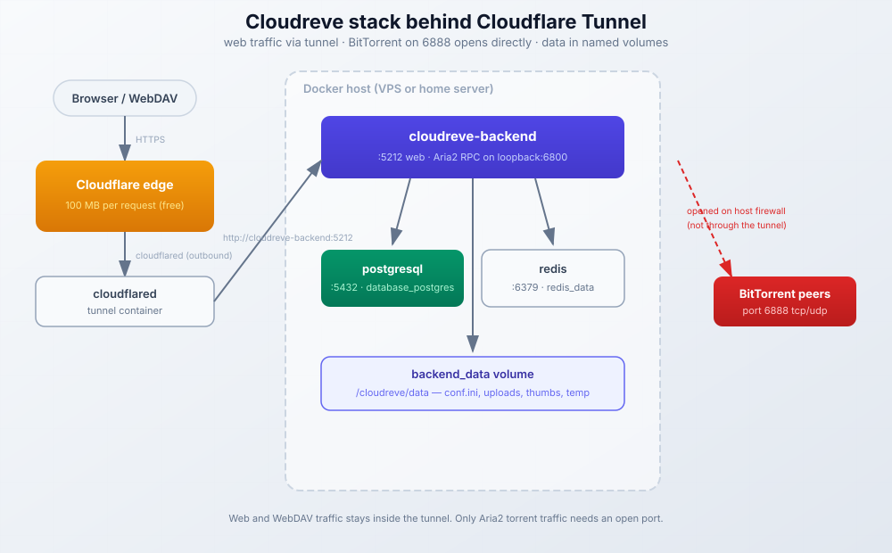

import Button from "../../components/widgets/Button.astro";
import { Picture } from "astro:assets";
import YouTubeEmbed from "../../components/widgets/YouTubeEmbed.astro";
import Tabs from "../../components/widgets/Tabs.astro";
import Tab from "../../components/widgets/Tab.astro";
import Notice from "../../components/widgets/Notice.astro";
import Accordion from "../../components/widgets/Accordion.astro";
import ListCheck from "../../components/widgets/ListCheck.astro";
import imag1 from "../../assets/images/24/01/cloudflare-tunel-setup.png";

Cloudreve is an open-source file management system for self-hosted cloud storage. It works like Google Drive or Dropbox, except you run it on your own hardware and keep all the data.

The project supports local storage, S3-compatible backends, and OneDrive. You get drag-and-drop uploads, file previews in the browser, WebDAV access for mounting as a network drive, and Aria2 integration for downloading files directly to your server.

This guide covers deploying Cloudreve with Docker Compose and Dockge and exposing it through Cloudflare Tunnels, using PostgreSQL and Redis for better performance than the default SQLite setup. I'll also show you how to configure remote downloads with Aria2, plus the gotchas that matter in 2026: the 100 MB Cloudflare upload limit, chunked uploads, backups, and upgrades to 4.19.

<Notice type="warning" title="Updated for Cloudreve 4.19 - check your version">
If you deployed Cloudreve from the January 2026 version of this guide, upgrade now. Release 4.13.0 (2026-02-05) fixed CVE-2026-25726, a weak random number generator used for sensitive fields. Databases first initialized on 4.10.0 or later were not vulnerable, but running anything older than 4.13.0 in production is a bad idea. Upgrading invalidates all sessions and existing signed download links (`?sign=...`), so tell your users before you pull the trigger.
</Notice>

| Version | Released | What changed |
|---------|----------|--------------|
| 4.13.0 | 2026-02-05 | CVE-2026-25726 fix; sessions and signed links invalidated on upgrade |
| 4.14.0 | 2026-02-14 | Full-text search and AI semantic search (Tika + Meilisearch), F2 rename |
| 4.16.1 - 4.18.0 | 2026-06/07 | More security fixes, recycle bin, `__` as env separator, parallel chunk upload fixes |
| 4.19.1 | 2026-09-18 | Current release; parallel chunk upload changes, WOPI/email fixes |

## Cloudreve features

Cloudreve comes in two editions: Community (free and open source) and Pro (paid license). The Community edition covers most home server use cases for self-hosted cloud storage.

<Tabs>
  <Tab name="Community Edition">
    The free version includes:

    - **Multiple storage backends** - Local disk, S3-compatible services (Cloudflare R2, MinIO, Backblaze B2), OneDrive, SharePoint, and Chinese providers like Qiniu, Alibaba OSS, Tencent COS
    - **File sharing** - Generate share links with passwords and expiration dates
    - **WebDAV** - Mount your storage as a network drive on Windows, macOS, or Linux
    - **Browser previews** - View documents, images, videos, audio, ePub files, and code without downloading
    - **User management** - Create multiple users with different storage quotas and permissions
    - **Remote downloads** - Aria2 and qBittorrent integration for downloading from URLs, magnets, and torrents
    - **Full-text and AI semantic search** - Content search via Apache Tika and Meilisearch (4.14+), covered later in this guide
    - **File compression** - Create and extract ZIP archives in the browser
    - **Thumbnails** - Automatic thumbnail generation for images, videos, and Office documents
    - **OIDC authentication** - Single sign-on with Google, GitHub, or your own identity provider
  </Tab>
  <Tab name="Pro Edition">
    The Pro license adds features for larger deployments:

    - **Slave nodes** - Distribute storage and downloads across multiple servers
    - **Load balancing** - Spread traffic across storage backends
    - **Office document collaboration** - Real-time editing with WOPI integration (like Collabora or OnlyOffice)
    - **Desktop sync client** - Windows 10 1903+ client with placeholder files; WebDAV remains the free path
    - **Custom payment providers** - Sell storage to users with your own payment gateway
    - **File encryption** - Encrypt files at rest on storage backends

    Pro licenses are purchased from [cloudreve.org](https://cloudreve.org). Pricing depends on deployment size.
  </Tab>
</Tabs>

For a home server or small team, the Community edition has everything you need.

## Prerequisites

You'll need:

<ListCheck>
  <ul>
    <li>A VPS or home server with Linux. I recommend <a href="https://go.bitdoze.com/hetzner">Hetzner</a> or <a href="https://go.bitdoze.com/hostinger-vps">Hostinger</a> for VPS hosting. For local setups see <a href="https://www.bitdoze.com/best-mini-pc-home-server/">Mini PC as Home Server</a> or grab an <a href="https://go.bitdoze.com/asus-dc510">ASUS mini PC</a>. My <a href="https://www.bitdoze.com/hetzner-cloud-review/">Hetzner Cloud review after the 2026 price hikes</a> covers what changed.</li>
    <li>Docker Engine with Compose v2 and Dockge running on your server. See my <a href="https://www.bitdoze.com/dockge-install/">Dockge installation guide</a> for setup instructions. Budget around 2 GB RAM for the stack; the image is ~572 MB because it bundles ffmpeg, LibreOffice, and vips.</li>
    <li>A domain on Cloudflare and a tunnel if you want external access. The Dockge article covers the tunnel setup too. Lock down everything except what you need - here's <a href="https://www.bitdoze.com/bsi-security-report-docker-ufw/">how I secured my Docker server after the BSI report</a>.</li>
  </ul>
</ListCheck>

_VPS prices jumped across the board in 2026 - if you're rethinking a rented box, see [what changed and when a mini PC wins](https://www.bitdoze.com/vps-price-increases/)._

<Button link="https://go.bitdoze.com/do" text="DigitalOcean $100 Free" />
<Button link="https://go.bitdoze.com/vultr" text="Vultr $100 Free" />
<Button link="https://go.bitdoze.com/hetzner" text="Hetzner €20 Free" />
<Button link="https://go.bitdoze.com/hostinger-vps" text="Hostinger VPS" />

> Traefik works as an alternative to Cloudflare Tunnels. I wrote a separate guide: [How to Use Traefik as A Reverse Proxy in Docker](https://www.bitdoze.com/traefik-proxy-docker/).

## Deploy Cloudreve with Docker Compose

This Cloudreve Docker Compose setup runs three containers: Cloudreve for the web interface and file handling, PostgreSQL for storing metadata and user data, and Redis for caching. PostgreSQL handles more users and larger file libraries better than SQLite.

### 1. Create the environment file

Keep credentials and configuration in a separate `.env` file. Dockge loads this automatically when you deploy the stack.

```bash
# .env file for Cloudreve

# PostgreSQL database credentials
POSTGRES_USER=cloudreve
POSTGRES_DB=cloudreve
POSTGRES_HOST_AUTH_METHOD=trust

# Cloudreve database connection
CR_DB_TYPE=postgres
CR_DB_HOST=postgresql
CR_DB_USER=cloudreve
CR_DB_NAME=cloudreve
CR_DB_PORT=5432

# Redis connection
CR_REDIS_SERVER=redis:6379
```

The `trust` authentication method works here because PostgreSQL only accepts connections from other containers in the same Docker network. Nothing outside can reach it directly. If that makes you uneasy, switch to `scram-sha-256` and set `POSTGRES_PASSWORD` instead.

<Notice type="info" title="Env var patterns worth knowing">
`CR_CONF_<Section>.<Key>` overrides config file values (used below for database and Redis settings). `CR_SETTING_DEFAULT_<setting>` seeds settings stored in the database. From 4.18.0, `__` also works as a separator (`CR_CONF_System__Listen`) on platforms that mangle dots in env names. For anything beyond demo use, read [Docker Compose secrets: what works and secure alternatives](https://www.bitdoze.com/docker-compose-secrets/).
</Notice>

### 2. Create the Docker Compose file

Here's the full stack with Cloudreve, PostgreSQL, and Redis. Pin the image tags so a random `docker compose pull` doesn't surprise you: `cloudreve/cloudreve:v4` tracks the 4.x line (the official compose repo uses this tag), and `redis:8-alpine` keeps Redis reproducible. If you want a hard pin, use `cloudreve/cloudreve:4.19.1` instead. Arch-specific tags (`-amd64`, `-arm64`) exist too. This configuration includes port 6888 for BitTorrent downloads (explained in the remote download section below):

```yaml
services:
  cloudreve:
    image: cloudreve/cloudreve:v4
    container_name: cloudreve-backend
    depends_on:
      - postgresql
      - redis
    restart: unless-stopped
    ports:
      - 5212:5212
      - 6888:6888
      - 6888:6888/udp
    environment:
      - CR_CONF_Database.Type=${CR_DB_TYPE}
      - CR_CONF_Database.Host=${CR_DB_HOST}
      - CR_CONF_Database.User=${CR_DB_USER}
      - CR_CONF_Database.Name=${CR_DB_NAME}
      - CR_CONF_Database.Port=${CR_DB_PORT}
      - CR_CONF_Redis.Server=${CR_REDIS_SERVER}
      - CR_CONF_System.ProxyHeader=X-Forwarded-For
    volumes:
      - backend_data:/cloudreve/data

  postgresql:
    image: postgres:17
    container_name: cloudreve-db
    restart: unless-stopped
    environment:
      - POSTGRES_USER=${POSTGRES_USER}
      - POSTGRES_DB=${POSTGRES_DB}
      - POSTGRES_HOST_AUTH_METHOD=${POSTGRES_HOST_AUTH_METHOD}
    volumes:
      - database_postgres:/var/lib/postgresql/data

  redis:
    image: redis:8-alpine
    container_name: cloudreve-redis
    restart: unless-stopped
    volumes:
      - redis_data:/data

volumes:
  backend_data:
  database_postgres:
  redis_data:
```

<Notice type="info" title="About port 6888">
Port 6888 (TCP and UDP) is used by Aria2 for BitTorrent peer connections. If you don't plan to use torrent downloads, you can remove these port mappings. The web interface only needs port 5212.
</Notice>

<Notice type="warning" title="Don't bump Postgres casually">
The stack pins `postgres:17` on purpose. Jumping to `postgres:18` does not migrate the data volume - you'd need a `pg_dump`/restore or `pg_upgrade`. Leave it alone unless you enjoy that kind of evening.
</Notice>

`CR_CONF_System.ProxyHeader=X-Forwarded-For` makes event logs record real client IPs instead of the tunnel container's address. That line is only safe because the only thing sending traffic is cloudflared. Don't set it if untrusted clients can hit port 5212 directly.

### Understanding the Docker volumes

Docker volumes store data outside the container filesystem. When you restart or update a container, the volume keeps your files safe.

This stack uses three named volumes:

| Volume | Location inside container | What it stores |
|--------|--------------------------|----------------|
| `backend_data` | `/cloudreve/data` | File blobs under `data/uploads`, plus `conf.ini`, avatars, thumbnails, and temp files |
| `database_postgres` | `/var/lib/postgresql/data` | PostgreSQL database files containing user accounts, file metadata, and share links |
| `redis_data` | `/data` | Redis cache data for session storage and performance |

In v4, files you see in the web UI map to immutable blobs on disk (content-hash named) plus database rows. Unused blobs get garbage-collected by the queue scheduler. Named volumes like `backend_data` are managed by Docker and stored in `/var/lib/docker/volumes/` on your host. You don't need to create folders manually.

**Using a custom storage location**

If you prefer storing files in a specific location on your host (for example, a separate drive for media), replace the named volume with a bind mount:

```yaml
volumes:
  - /mnt/storage/cloudreve:/cloudreve/data
```

This maps `/mnt/storage/cloudreve` on your host directly to `/cloudreve/data` inside the container. Create the folder and set permissions before starting the stack:

```bash
sudo mkdir -p /mnt/storage/cloudreve
sudo chown -R 1000:1000 /mnt/storage/cloudreve
```

**Adding external storage directories**

To use an existing directory like `/media/storage/downloads` with Cloudreve, you need to mount it into the container. Add it to the volumes section:

```yaml
services:
  cloudreve:
    image: cloudreve/cloudreve:v4
    container_name: cloudreve-backend
    volumes:
      - backend_data:/cloudreve/data
      - /media/storage/downloads:/cloudreve/downloads
```

This makes your `/media/storage/downloads` folder available inside the container at `/cloudreve/downloads`. You can add multiple directories:

```yaml
volumes:
  - backend_data:/cloudreve/data
  - /media/storage/downloads:/cloudreve/downloads
  - /media/storage/media:/cloudreve/media
  - /media/storage/backups:/cloudreve/backups
```

<Notice type="warning" title="Storage policies required">
Mounting a directory doesn't automatically make files visible in Cloudreve. You need to create a storage policy pointing to that path. See the "Configure storage policies" section below for setup instructions.
</Notice>

After adding volumes, restart the stack:

```bash
docker compose down && docker compose up -d
```

### 3. Deploy with Dockge

Dockge gives you a web interface for managing Docker Compose stacks. Here's the deployment process:

1. Open Dockge in your browser (usually `http://your-server-ip:5001`)
2. Click the **+ Compose** button in the top right
3. Enter `cloudreve` as the stack name
4. Paste the Docker Compose content into the editor
5. Click the **Environment Variables** section below the editor
6. Add each variable from the `.env` file:
   - `POSTGRES_USER` = `cloudreve`
   - `POSTGRES_DB` = `cloudreve`
   - `POSTGRES_HOST_AUTH_METHOD` = `trust`
   - `CR_DB_TYPE` = `postgres`
   - `CR_DB_HOST` = `postgresql`
   - `CR_DB_USER` = `cloudreve`
   - `CR_DB_NAME` = `cloudreve`
   - `CR_DB_PORT` = `5432`
   - `CR_REDIS_SERVER` = `redis:6379`
7. Click **Save**
8. Click **Start** to deploy the stack

Dockge stores stack files in `/opt/stacks/cloudreve/` by default. You'll find `compose.yaml` there if you need to edit it later.

After clicking Start, Dockge shows real-time logs from all three containers. Wait until you see Cloudreve's startup message indicating it's ready to accept connections.

<Tabs>
  <Tab name="Dockge UI">
    The visual approach works well for most users: create a stack named `cloudreve`, paste the compose content, add the environment variables in the UI, save and start. Dockge writes the `.env` file for you from those variables.
  </Tab>
  <Tab name="Command Line">
    If you prefer working directly on the server:

    ```bash
    mkdir -p /opt/stacks/cloudreve
    cd /opt/stacks/cloudreve
    ```

    Create `compose.yaml` with the Docker Compose content above and `.env` with your environment variables, then:

    ```bash
    docker compose up -d
    docker compose logs -f
    ```
  </Tab>
</Tabs>

### 4. Verify the containers are running

This is the first checkpoint. Don't move on until all of these pass:

<ListCheck>
  <ul>
    <li><code>docker ps --format "table \{\{.Names\}\}\t\{\{.Status\}\}\t\{\{.Ports\}\}"</code> shows <code>cloudreve-backend</code>, <code>cloudreve-db</code>, and <code>cloudreve-redis</code> all as "Up"</li>
    <li><code>curl -I http://localhost:5212</code> returns <code>200</code> or <code>302</code> (anything else means the app isn't listening yet)</li>
    <li><code>docker logs cloudreve-backend</code> shows the startup line with the listen address, no database connection errors</li>
  </ul>
</ListCheck>

If a container keeps restarting, `docker logs cloudreve-backend` is the first place to look. PostgreSQL usually just needs a few extra seconds on first boot; a `docker compose down && docker compose up -d` after 30 seconds fixes most first-run races.

## Configure Cloudflare Tunnels for Cloudreve

Cloudflare Tunnels are the cleanest way to self-host Cloudreve without opening ports on your router. The tunnel runs as a container on your server and creates an outbound connection to Cloudflare's network, so nothing inbound touches your home connection.



If you followed my Dockge guide, you already have a tunnel running. Add a new hostname for Cloudreve:

1. Log into the Cloudflare One dashboard (the old "Zero Trust" branding is gone)
2. Go to **Networks > Tunnels**
3. Click your tunnel name, then **Configure**
4. Under **Public Hostname**, click **Add a public hostname**
5. Fill in the details:
   - **Subdomain**: `cloudreve` (or pick something else)
   - **Domain**: Select your domain from the dropdown
   - **Service Type**: HTTP
   - **URL**: `cloudreve-backend:5212`

<Picture formats={["webp"]} fallbackFormat="webp" src={imag1} alt="Cloudflare One dashboard showing the Cloudreve tunnel public hostname pointing to cloudreve-backend:5212" />

Using `cloudreve-backend:5212` works if your tunnel container shares a Docker network with Cloudreve. If they're on separate networks, use your server's local IP instead (like `192.168.1.50:5212`).

Save the hostname. Give it a minute to propagate, then try accessing `https://cloudreve.yourdomain.com`. If the page loads, the tunnel is doing its job.

> CloudPanel also works as a reverse proxy. See [Setup CloudPanel as Reverse Proxy with Docker and Dockge](https://www.bitdoze.com/cloudpanel-setup-dockge/) for that approach.

If you'd rather not depend on Cloudflare at all, look at [Pangolin, a self-hosted alternative to Cloudflare Tunnels](https://www.bitdoze.com/pangolin-cloudflare-tunnels-alternative/).

## Initial Cloudreve setup

### Create your admin account

Open Cloudreve in your browser. Use either your Cloudflare Tunnel URL (`https://cloudreve.yourdomain.com`) or the local address (`http://your-server-ip:5212`).

1. Click **Sign up** on the login page
2. Enter an email address and password
3. Click **Sign up** again to create the account
4. Log in with those credentials

The first account you create becomes the administrator. Cloudreve v4 dropped the old default admin credentials in favor of this signup flow, so don't leave a fresh instance sitting on a public URL before you register.

### Configure site URLs

v4 keeps a list of Site URLs instead of the old primary/secondary pair. Tell Cloudreve about every address people will use:

1. Click your avatar in the top right
2. Select **Dashboard** to open the admin panel
3. Go to **Settings > Site Information**
4. Add both URLs to the Site URLs list:
   - Your local address, like `http://192.168.1.50:5212`
   - Your public address, like `https://cloudreve.yourdomain.com`
5. Click **Save**

Share links and signed download links get their hostname from this list. When the list is wrong or incomplete, links come out pointing at the wrong host, or at `http://` when you're on `https://`.

<Notice type="warning" title="Wrong hostname in download links?">
After fixing the Site URLs list, go to **Filesystem > Clear Blob URL Cache**. Cloudreve caches generated blob URLs, so old links keep the stale hostname until you clear it. Two other things break signed links: an HTTP-vs-HTTPS mismatch between what's configured and what users hit, and server clock skew. Keep time sync on (`timedate status` should show NTP active).
</Notice>

### Configure storage policies

Storage policies control where files go and what limits apply. Each policy points to a specific storage location.

**Edit the default policy:**

1. In the Dashboard, go to **Storage Policies**
2. Click the default policy to edit it
3. Set maximum upload size, allowed file extensions, and storage quota
4. Enable **chunked upload** and set the chunk size below 100 MB (I'd use 25-50 MB). This is what makes large uploads work behind Cloudflare, covered in detail below
5. Optionally enable **Pre-allocate disk space** on Linux/macOS to reduce chunk fragmentation. Note that from 4.19.0, parallel chunk uploads are force-disabled when this is off
6. Save your changes

The default policy stores files under `data/uploads` inside the container (mapped to the `backend_data` volume or your bind mount).

<Notice type="warning" title="Set chunk size below 100 MB if you use Cloudflare">
Cloudflare's free plan caps a single HTTP request at 100 MB. Without chunked upload, anything bigger fails. See the "Uploading large files through Cloudflare Tunnel" section below for the full picture.
</Notice>

**Create a policy for external directories:**

If you mounted an external directory like `/media/storage/downloads` into the container, create a new storage policy to use it:

1. Go to **Dashboard > Storage Policies**
2. Click **New Storage Policy**
3. Select **Local** as the storage type
4. Configure the policy:
   - **Name**: Give it a descriptive name like "Downloads Storage"
   - **Storage Path**: Enter the container path, e.g., `/cloudreve/downloads` (this must match where you mounted the directory in your compose file)
   - **Max Size**: Set the maximum file size for uploads
   - **Allowed Extensions**: Leave empty for all types, or specify extensions
5. Save the policy

<Notice type="info" title="Path must match your mount">
The storage path in Cloudreve must match the container path from your volume mount. If you mounted `-v /media/storage/downloads:/cloudreve/downloads`, use `/cloudreve/downloads` as the storage path.
</Notice>

Local disk is the default, but the same screen lets you point a policy at S3-compatible backends like Cloudflare R2, Backblaze B2, or [Bunny.net storage](https://go.bitdoze.com/bunny). If you're shopping for that off-site bucket, my comparison of the [cheapest cloud storage backends: Bunny vs S3 vs Backblaze](https://www.bitdoze.com/bunny-storage-vs-s3-vs-backblaze/) walks through the pricing.

**Assign the policy to users:**

Storage policies are assigned through user groups:

1. Go to **Dashboard > User Groups**
2. Edit the group you want to use the new storage
3. Under **Storage Policy**, select your new policy
4. Save the group

Users in that group will now upload to and see files from the external directory.

**About existing files:**

Cloudreve tracks files through its database. If you have existing files in `/media/storage/downloads`, they won't appear in the web interface automatically.

Use the built-in import feature to add existing files without copying them:

1. Go to **Dashboard > Files > Import**
2. Select the storage policy, source path, target user, and destination folder
3. Enable recursive import for subdirectories
4. Click Import

See the "Using existing files on disk" section below for full details.

### Add more users

To let other people use your Cloudreve:

1. Go to **Dashboard > Users**
2. Click **New User**
3. Enter their email and set a password
4. Choose a user group (controls permissions)
5. Set their storage quota
6. Save the user

Each user gets their own file space and can create their own share links. The user group is the lever that ties everything together: it sets the storage policy, the quota, and whether remote downloads are allowed.

## How users and file storage work

Cloudreve file storage doesn't use per-user folders on disk. Instead, it uses a database to track which files belong to which user.

### Where files are stored on disk

All user files go to the same storage location defined by the storage policy. In v4 the default blob directory is `data/uploads` (that's `/cloudreve/data/uploads` in this Docker setup). Uploaded content becomes immutable blobs named by content hash:

```
/cloudreve/data/
├── uploads/        # file blobs (content-hash names)
├── thumb/          # generated thumbnails
├── temp/           # in-flight uploads and downloads
└── conf.ini        # config file
```

The exact subfolder layout inside `uploads` can vary by version and policy, so don't build automation that walks it. Think of it as a blob store that Cloudreve owns. The Files / File Blobs / Physical Files model is what the admin docs describe: users see Files, the database records which blobs back them, and the blobs are the physical bytes. Unused blobs are garbage-collected by the queue scheduler.

### User file separation

Users only see their own files in the web interface. The database tracks ownership:

| What users see | What's on disk |
|----------------|----------------|
| `/Documents/report.pdf` | A hashed blob under `data/uploads` |
| `/Photos/vacation.jpg` | A different hashed blob under `data/uploads` |

Two users can have files with the same name in the same virtual path. They're stored separately on disk with different hashes.

### Accessing files outside Cloudreve

You can't easily browse user files by navigating the storage folder. To access files:

- **WebDAV**: Mount the storage as a network drive. Each user authenticates and sees only their files.
- **Share links**: Create a share link in the web interface.
- **API**: Use Cloudreve's API to list and download files programmatically.
- **Direct download**: From the web interface, right-click a file and copy the download link.

### Using existing files on disk

Cloudreve tracks files through its database. Files placed directly in the storage folder won't appear in the interface until you import them.

**Import existing folders:**

Cloudreve has a built-in import feature that adds existing files to a user's library without copying them:

1. Go to **Dashboard > Files > Import**
2. Configure the import:
   - **Storage policy**: Select the policy where your files are located
   - **Source folder path**: Enter the path on disk
   - **Target user and folder**: Who owns the imported files and where they appear
   - **Recursively import**: Enable to include subdirectories
   - **Extract media information**: Enable to pull metadata from videos and images
3. Click **Import**

<Notice type="warning" title="Import ownership">
After import, Cloudreve manages the physical files. Don't modify or delete them outside Cloudreve. Importing the same file twice will skip duplicates. Files count against the user's storage quota even though no data is copied.
</Notice>

This is the fastest way to add large existing collections. The files stay in place on disk, and Cloudreve creates database entries pointing to them. Menu locations drift between versions; if you don't see **Files > Import**, check under the storage policy's own actions.

## Uploading large files through Cloudflare Tunnel

This is the failure almost everyone hits with this exact stack, so it gets its own section.

<Notice type="warning" title="Cloudflare free plan: 100 MB per request">
Cloudflare's free plan caps a single HTTP request at 100 MB. Upload a 200 MB video through the tunnel without chunked upload and you'll get a `413 Request Entity Too Large`. Business lifts the cap to around 200 MB and Enterprise to around 500 MB, but the numbers move - check Cloudflare's current limits page before relying on them. cloudflared itself adds no body limit; the constraint is the edge.
</Notice>

The fix is to let Cloudreve split uploads into chunks on the client side. Each chunk is its own HTTP request, so nothing trips the 100 MB cap. Cloudreve reassembles the blob on the server.

**Enable chunked upload:**

1. Go to **Dashboard > Storage Policies**
2. Edit the policy your users upload to
3. Enable chunked upload and set the chunk size to something under 100 MB. 25-50 MB is a good range: small enough to clear the limit with room, large enough to avoid thousands of requests
4. Save the policy

**Verify it works:** upload a file bigger than 100 MB through `https://cloudreve.yourdomain.com`. It should complete with no `413`. If it still fails, open the browser dev tools network tab and look at which request dies - if it's a single giant POST, the policy change didn't apply to the user's group.

<ListCheck>
  <ul>
    <li>Chunked upload enabled on the storage policy</li>
    <li>Chunk size set below 100 MB (25-50 MB recommended)</li>
    <li>Policy assigned to the user group your test account uses</li>
    <li>Test upload of a file larger than 100 MB completes</li>
  </ul>
</ListCheck>

**Alternatives if you don't want chunked upload:**

- **WebDAV**: Mount the drive and copy files over the WebDAV endpoint. Same 100 MB request limit applies through the tunnel, but many WebDAV clients chunk on their own.
- **Upload on the LAN**: Use the local URL (`http://server-ip:5212`) for big transfers. No Cloudflare in the path, no limit.
- **S3-compatible policy**: Point a storage policy at Cloudflare R2 or Backblaze B2 so clients upload to the bucket instead of through your tunnel.

If you also front Cloudreve with nginx somewhere, nginx's own `client_max_body_size` (default 1 MB!) is a separate limit. Set it above your chunk size or the proxy will reject chunks first.

## Full-text search with Meilisearch (optional addon)

From 4.14.0, the Community edition can search inside file contents. It's a two-container addon: Apache Tika extracts text (port 9998) and Meilisearch indexes it (port 7700). Skip this if you only browse by folder and filename.

The official compose repo ships an override file, so you don't have to hand-roll the services. Add a master key to your `.env`:

```bash
# in /opt/stacks/cloudreve/.env
MEILI_MASTER_KEY=$(openssl rand -hex 32)
```

Then either grab `docker-compose.fts.yml` from [cloudreve/docker-compose](https://github.com/cloudreve/docker-compose) or define `meilisearch` and `tika` services yourself, and start with both files:

```bash
docker compose -f docker-compose.yml -f docker-compose.fts.yml up -d
```

The official override wires `getmeili/meilisearch:v1.37` and `apache/tika:latest` and seeds the right `CR_SETTING_DEFAULT_fts_*` variables.

Once the containers are up, configure the backend in the admin panel:

1. **Dashboard > Filesystem > Full-text Search**
2. Set Meilisearch endpoint to `http://meilisearch:7700` and paste the master key
3. Set Tika endpoint to `http://tika:9998`
4. Save

<Notice type="info" title="Existing files need a manual re-index">
Enabling search does not retroactively index what's already uploaded. Click **Rebuild Index** and expect it to run for a while on big libraries. Do it off-peak. AI semantic search is the follow-on feature on top of this stack; see the [AI semantic search docs](https://docs.cloudreve.org/en/usage/search/ai-semantic-search).
</Notice>

Cost note: that's two more containers on the box. Meilisearch RAM grows with the index size, so a few hundred GB of documents can add up. On a 2 GB VPS, measure before you leave it enabled.

## Remote downloads with Aria2

Cloudreve includes Aria2 in the official Docker image, so remote download tasks from URLs, magnet links, and torrents go straight to your storage. The files appear in your Cloudreve file browser once the download completes. The image is ~572 MB partly because it bundles Aria2 alongside ffmpeg, LibreOffice, and vips for thumbnails and metadata.

### Why port 6888 matters

Aria2 uses port 6888 for BitTorrent peer connections. When downloading torrents, other peers need to reach your server on this port to share file pieces. Without it:

- Magnet links might not find enough peers
- Download speeds will be slower
- Some torrents won't start at all

The compose file maps both TCP and UDP on port 6888:

```yaml
ports:
  - 5212:5212      # Web interface
  - 6888:6888      # Aria2 BitTorrent TCP
  - 6888:6888/udp  # Aria2 BitTorrent UDP
```

<Notice type="warning" title="Firewall configuration">
If you're running on a VPS, open port 6888 in your firewall. On Ubuntu with UFW:

```bash
sudo ufw allow 6888/tcp
sudo ufw allow 6888/udp
```

For home servers behind a router, forward port 6888 to your server's local IP. This is one of the few ports this stack needs open - keep everything else closed.
</Notice>

### Enable remote downloads

The built-in Aria2 runs automatically with the Cloudreve container. You just need to enable it in the admin settings:

1. Go to **Dashboard > Nodes**
2. Click on the default node (or create one)
3. Check **Remote Download** in the Enabled Features section
4. Configure the downloader:
   - **Downloader Type**: Aria2
   - **RPC Server Address**: `http://localhost:6800`
   - **RPC Authorization Token**: Leave empty (the built-in Aria2 has no token by default)
   - **Temporary Download Directory**: Leave empty to use the default (`/cloudreve/data/temp`)
5. Save the node settings

The bundled Aria2 starts with `--enable-rpc` on loopback port 6800 and no secret. That's fine inside the container because nothing else can reach that port. Don't publish 6800 to the host.

### Enable for user groups

By default, remote downloads are disabled for users. Enable it for your user group:

1. Go to **Dashboard > User Groups**
2. Edit the group you want to allow downloads for
3. Check **Remote Download** in the permissions section
4. Save the group

### Creating download tasks

Once enabled, users can create remote download tasks from the web interface:

1. Click the **+** button in the file browser
2. Select **Remote Download**
3. Paste a URL, magnet link, or upload a .torrent file
4. Choose the destination folder
5. Click **Create**

The download runs in the background. Progress shows in the remote download panel. When complete, files appear in your chosen folder.

### Aria2 configuration options

You can pass additional options to Aria2 through the node settings. In the **Downloader Task Parameters** field, add JSON:

```json
{
  "max-download-limit": "10M",
  "max-concurrent-downloads": 3,
  "bt-tracker": [
    "udp://tracker.opentrackr.org:1337/announce",
    "udp://tracker.openbittorrent.com:6969/announce"
  ],
  "seed-ratio": 1.0,
  "seed-time": 60
}
```

This limits download speed to 10MB/s, allows 3 concurrent downloads, adds tracker servers for better peer discovery, and stops seeding after reaching a 1:1 ratio or 60 minutes.

<Accordion label="Using qBittorrent instead of Aria2" group="downloads">
If you prefer qBittorrent for torrent downloads, run it as a separate container and point Cloudreve to its Web UI. qBittorrent handles torrents better than Aria2 for long-running seeds, but it can't download regular HTTP/FTP URLs. Cloudreve supports qBittorrent 4.4 or newer, magnet and torrent links only, and the download path must be a filesystem location Cloudreve can also see.

Add qBittorrent to your compose file:

```yaml
  qbittorrent:
    image: linuxserver/qbittorrent:latest
    container_name: qbittorrent
    environment:
      - PUID=1000
      - PGID=1000
      - WEBUI_PORT=8080
    volumes:
      - qbit_config:/config
      - backend_data:/downloads
    ports:
      - 8080:8080
      - 6881:6881
      - 6881:6881/udp
    restart: unless-stopped
```

Then configure the node to use qBittorrent:
- **Downloader Type**: qBittorrent
- **Web UI Address**: `http://qbittorrent:8080`
- **Username/Password**: Set these in qBittorrent's WebUI settings on first run. Modern qBittorrent no longer ships the old `adminadmin` default; it generates a temporary password in the container logs, so check `docker logs qbittorrent` and change it immediately.

The shared `backend_data` volume lets qBittorrent download directly to Cloudreve's storage.
</Accordion>

## Backup and upgrade Cloudreve

Treat this like any other database-backed service. The database holds user accounts, share links, and references to every blob. The `backend_data` volume holds the blobs and `conf.ini`. Lose either one and you're in trouble.

**What to back up:**

<ListCheck>
  <ul>
    <li>PostgreSQL dump - the critical piece. Users, shares, file metadata all live here</li>
    <li><code>backend_data</code> volume - file blobs plus config. Skip only if every storage policy points at S3/R2/B2 off-box</li>
    <li>Release notes between your current version and the new one - read them before every upgrade</li>
  </ul>
</ListCheck>

**Database dump:**

```bash
docker exec cloudreve-db pg_dump -U cloudreve cloudreve | gzip > cloudreve-db-$(date +%F).sql.gz
```

**Volume copy** (named volume path on the host):

```bash
sudo rsync -a /var/lib/docker/volumes/cloudreve_backend_data/ /backups/cloudreve-backend_data/
```

If you use a bind mount, back up that directory instead. For automated versioned backups of the volume, [Zerobyte: self-hosted Restic backup automation](https://www.bitdoze.com/zerobyte-restic-gui/) is a good fit. For getting the DB dump off the box, I follow the same pattern as [off-box database backups to Cloudflare R2](https://www.bitdoze.com/dokploy-backups-cloudflare-r2/): same idea, different service.

Run both weekly and always before an upgrade. A cron line is enough:

```bash
0 3 * * 0 docker exec cloudreve-db pg_dump -U cloudreve cloudreve | gzip > /backups/cloudreve-db-$(date +\%F).sql.gz
```

**Upgrading:**

<Notice type="warning" title="Always pg_dump before upgrading">
The 4.13.0 upgrade invalidated every session and every signed `?sign=` download link in existence. That's not a bug, that's the fix for a crypto problem. You don't want to discover it without a backup and a message ready for your users.
</Notice>

```bash
cd /opt/stacks/cloudreve
docker exec cloudreve-db pg_dump -U cloudreve cloudreve | gzip > db-backup-$(date +%F).sql.gz
docker compose pull && docker compose down && docker compose up -d
```

After the restart, log in and smoke test: browse files, open a share link, upload something small. If you pinned `v4`, you track 4.x automatically. If you pinned `4.19.1`, you decide when to move.

Don't bump `postgres:17` to `18` in the same breath as a Cloudreve upgrade. Different problem, different weekend.

## Working with Cloudreve

The web interface handles most file operations:

- **Uploading** - Drag files onto the page or click the upload button. Large files upload in chunks and resume if interrupted.
- **Folders** - Create folders to organize files. Right-click for options.
- **Sharing** - Right-click a file or folder, select Share, and configure the link. Set a password or expiration if needed.
- **Previews** - Click files to preview them. Cloudreve handles images, videos, audio, PDFs, and code files.
- **Photo editing** - Right-click an image and open it with Photopea for quick edits without leaving the browser.
- **Recycle bin** - 4.18.0 added a one-click empty recycle bin. Deleted blobs get garbage-collected automatically by the queue scheduler.

For desktop integration, enable WebDAV in your user settings and mount the drive on your computer. Windows, macOS, and Linux all support WebDAV natively. There is a desktop sync client now, but it's Pro-only and Windows 10 1903+; WebDAV stays the free path for everyone else.

## Troubleshooting

<Accordion label="Containers fail to start" group="faq">
Pull up the logs:

```bash
docker logs cloudreve-backend
docker logs cloudreve-db
```

Common problems: PostgreSQL isn't ready when Cloudreve tries to connect (just restart the stack), environment variables are misspelled, or port 5212 is already in use by something else.
</Accordion>

<Accordion label="Can't reach Cloudreve through Cloudflare Tunnel" group="faq">
First confirm it works locally:

```bash
curl http://localhost:5212
```

If that works but the tunnel doesn't:

- Check the tunnel container is running: `docker ps | grep cloudflared`
- Verify the hostname configuration in the Cloudflare One dashboard (Networks > Tunnels)
- Make sure the URL in the hostname config matches your container name or IP
</Accordion>

<Accordion label="Database connection errors" group="faq">
If logs show PostgreSQL connection failures:

1. Check that `cloudreve-db` container is running
2. Verify environment variables match between the `.env` file and compose.yaml
3. Restart the whole stack: `docker compose down && docker compose up -d`
</Accordion>

<Accordion label="Permission errors on bind mounts" group="faq">
If you're using a bind mount instead of named volumes and see permission errors:

```bash
# Check what user ID Cloudreve runs as
docker exec cloudreve-backend id

# Set ownership on your host folder
sudo chown -R 1000:1000 /mnt/storage/cloudreve
```

Adjust the user ID based on what the container actually uses. If you want the container to run as a dedicated non-root user, see [add a non-root user to a Docker container](https://www.bitdoze.com/add-users-to-docker-container/).
</Accordion>

<Accordion label="Upload fails with 413 / large uploads fail" group="faq">
`413 Request Entity Too Large` behind Cloudflare means you hit the 100 MB request cap. Enable chunked upload on the storage policy with a chunk size under 100 MB (see the "Uploading large files through Cloudflare Tunnel" section). If nginx is also in the path, raise `client_max_body_size` above your chunk size.
</Accordion>

<Accordion label="Download links point to the wrong hostname" group="faq">
Your Site URLs list is missing an entry, or Cloudreve is serving cached blob URLs. Fix the list under **Settings > Site Information**, then run **Filesystem > Clear Blob URL Cache**. Also check that users hit the same scheme you configured - switching between `http://` and `https://` breaks signed links. Server clock skew breaks them too; keep NTP on.
</Accordion>

<Accordion label="UI broken after upgrade / stale assets" group="faq">
`/sw.js`, `/index.html`, and `/manifest.json` must not be cached. Behind Cloudflare, `.js` files are cacheable by default, which is how the Service Worker pins an old UI after a version bump. Add a Cache Rule on the zone to bypass cache for `/sw.js` (or for the whole Cloudreve hostname), then hard-refresh.
</Accordion>

<Accordion label="Event logs show proxy IPs instead of real clients" group="faq">
Add `CR_CONF_System.ProxyHeader=X-Forwarded-For` to the cloudreve service environment in compose and restart the stack. Only do this when all traffic comes through a trusted proxy like cloudflared - if port 5212 is reachable directly, clients can spoof the header.
</Accordion>

<Accordion label="Torrent downloads are slow or won't start" group="faq">
BitTorrent needs port 6888 reachable from the internet:

1. Check the port is mapped in your compose file
2. Open port 6888 in your server's firewall
3. If behind NAT, forward port 6888 to your server
4. Add more trackers in the Aria2 configuration to find peers

You can test if the port is open:

```bash
# From another machine
nc -zv your-server-ip 6888
```
</Accordion>

<Accordion label="Remote download files not appearing" group="faq">
After a download completes, Cloudreve moves files from the temp directory to your storage. If files don't appear:

1. Check the remote download panel for errors
2. Verify Cloudreve has write permissions to the storage directory
3. Look at the logs: `docker logs cloudreve-backend | grep -i download`

The temp directory and storage directory must be accessible to the Cloudreve process.
</Accordion>

## Wrapping up

Cloudreve gives you a self-hosted cloud storage system that runs on your own hardware. Combined with Cloudflare Tunnels, you can reach your files from anywhere without exposing your home network directly to the internet.

The PostgreSQL and Redis setup handles growth better than SQLite. Add Aria2 remote downloads to grab files from anywhere and have them waiting in your cloud storage. For a home server or small team, the free Community edition covers everything most people need.

This guide now covers the 4.19.x line: pinned image tags, chunked uploads for the Cloudflare 100 MB limit, full-text search, and a backup/upgrade routine. If you deployed from the original January 2026 version, upgrade today - CVE-2026-25726 is not something to leave sitting on a public tunnel.

Related guides you might find useful:

- [Deploy Filebrowser with Docker](https://www.bitdoze.com/deploy-filebrowser-docker/) - Lighter alternative if you just need file browsing
- [Best 100+ Docker Containers for Home Server](https://www.bitdoze.com/docker-containers-home-server/) - More applications for your home lab
- [How To Monitor Server and Docker Resources](https://www.bitdoze.com/sever-monitoring/) - Track CPU, memory, and disk usage

_Updated for Cloudreve 4.19._
