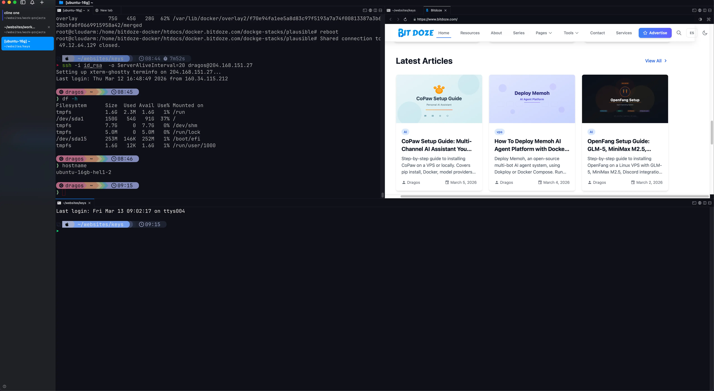
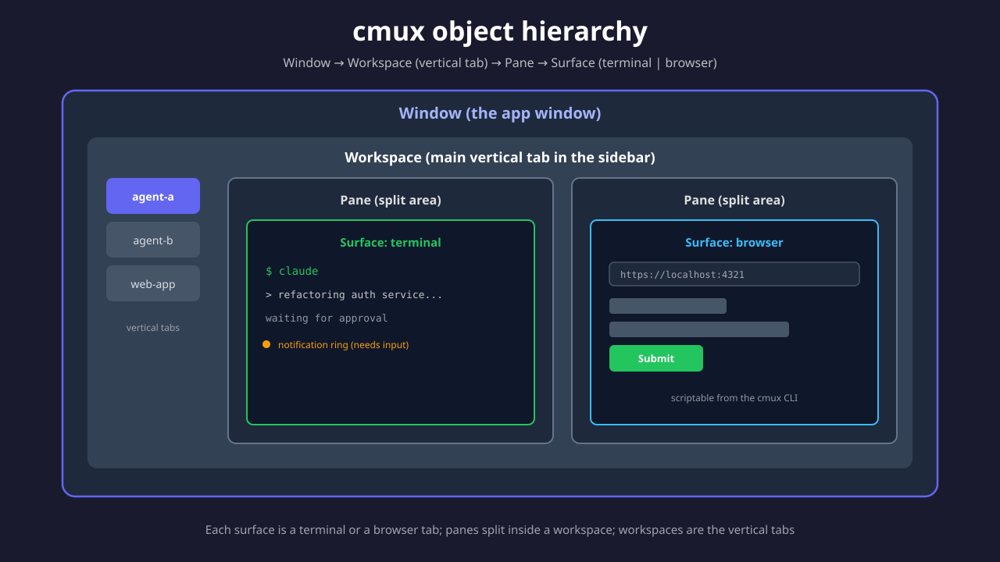
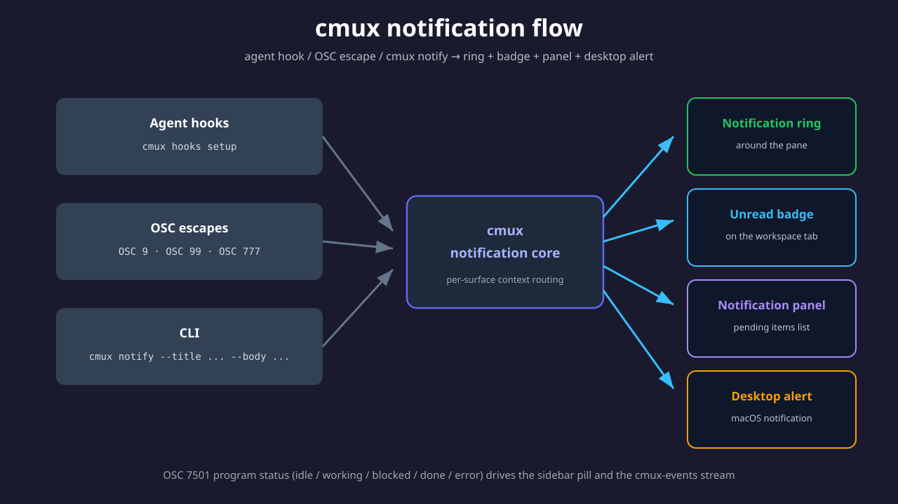

import Notice from "@components/widgets/Notice.astro";
import Accordion from "@components/widgets/Accordion.astro";
import ListCheck from "@components/widgets/ListCheck.astro";
import Tabs from "@components/widgets/Tabs.astro";
import Tab from "@components/widgets/Tab.astro";
import Button from "@components/widgets/Button.astro";

If your day looks like three coding agents, a dev server, and a browser you keep alt-tabbing to, the **cmux terminal** is built for exactly that mess. It is a native macOS terminal for AI coding agents that keeps every session visible, pings you when one needs input, and exposes a CLI to automate the whole workspace.

A lot of AI tooling wants to replace your workflow. cmux stays closer to "here are the primitives, now build your own setup." That framing is why this guide exists.

By the end you will know how to install and verify cmux on macOS, how the agent workflow fits together (workspaces, notifications, browser automation, session resume), and where cmux vs tmux and Ghostty make sense. If you are still picking which agents to run, my [AI coding tools and agents compared](/ai-coding-tools/) guide is the companion read.

- Install cmux on macOS and confirm the CLI and socket respond
- Wire Claude Code, Codex, or OpenCode into notifications and session resume
- Get a straight cmux vs tmux verdict instead of marketing copy

<Notice type="info" title="What cmux is, in one sentence">
cmux is a native macOS terminal app built on `libghostty`, with workspaces, panes, notifications, browser automation, and a CLI/socket API for controlling the whole thing.
</Notice>

## What cmux actually is



cmux is **not** a Ghostty fork. It uses `libghostty` for terminal rendering the same way an app might use WebKit for web content, so you get Ghostty-style rendering and config compatibility inside a different app. It is built with Swift and AppKit, and it reads `~/.config/ghostty/config` for themes, fonts, and colors, so an existing Ghostty setup carries over. My [Ghostty Terminal setup guide](/ghostty-terminal/) covers that config file in detail.

The idea is simple:

- Open several coding agents in parallel
- Keep them separated by workspace, pane, or browser surface
- Get a clear visual signal when one needs input
- Automate the terminal and browser from scripts or hooks

That maps onto a small object model: **Window → Workspace → Pane → Surface**. More on that below, because it is the part that makes multi-agent work bearable.

One licensing note before you get excited about self-hosting anything: the core app is **GPL-3.0-or-later**, but some server-side pieces (`web/`, the `workers/` directories, `cmux-tui/relays/cloudflare-do/`) are **BUSL-1.1** and need a commercial license from Manaflow for production use, including self-hosting. For the local macOS workflow in this guide it does not matter. The [LICENSE](https://github.com/manaflow-ai/cmux/blob/main/LICENSE) has the exact split.

## Why cmux is getting attention for AI coding agents

Nobody needs "yet another terminal." The interesting part is how cmux handles multi-agent work without forcing you into a closed orchestration product.

From the official README, docs, and changelog (checked November 2026), the cmux terminal gives you:

- A native macOS app built with Swift and AppKit (macOS 14+, Apple Silicon or Intel)
- A Ghostty-powered terminal that reads your existing Ghostty config for themes, fonts, and colors
- Vertical tabs and split panes for juggling multiple workspaces
- Notification rings, unread badges, a notification panel, and macOS desktop notifications
- A built-in browser with a scriptable command surface
- A CLI and Unix socket API for sending text, reading screens, opening panes, moving surfaces, and more
- Agent session resume via hooks (15+ agents) and a one-shot `cmux hooks setup`
- SSH workspaces (`cmux ssh`) and remote tmux attach via `cmux ssh-tmux` (beta)
- Skills, reusable workflows any agent in cmux can run (public collection in `manaflow-ai/cmux-skills`)
- Claude Code Teams and subagent panes (`cmux claude-teams`), so subagents become native splits instead of hidden processes
- OSC 7501 program status plus a sidebar metadata CLI (`set-status`, `set-progress`, `log`) for agent and CI hooks

On credibility: the repo had 28,794 stars and 2,673 forks as of 2026-11-16, roughly ten months after creation. Mitchell Hashimoto (Ghostty, HashiCorp) has publicly praised it. The honest caveat: 7,084 open issues at the same date. Very active project, heavy backlog, both things are true.

And the cost line that matters for this guide: **everything described here runs on the Free tier ($0)**. Paid plans only matter when you want agents on remote VMs.

## What the cmux terminal can do

### Run multiple AI coding agents without losing track

cmux uses four layers so work stays separated. The window is the app window. A workspace is the main vertical tab in the sidebar. A pane is a split area inside a workspace. A surface is the actual terminal or browser tab inside a pane.



That model sounds heavier than a normal terminal at first. In practice it is how cmux shows multiple agents, multiple splits, and browser tabs without collapsing into a pile of tabs. Workspace groups keep related projects together, and global session search (⌘⌥F) finds open Claude Code or Codex sessions by the text of their conversations.

<Notice type="info" title="Affiliate Disclosure">
Some links in this article are affiliate links. They cost you nothing extra and help support the site.
</Notice>

If you run several model CLIs and want one router in front of them, look at [Agent Router for routing between Claude Code, Codex, and Gemini CLI](https://go.bitdoze.com/agentrouter). If you want the multiplexer-only approach without a GUI, my [Herdr agent multiplexer review](/herdr-agent-multiplexer/) covers an alternative worth knowing.

### Know which agent needs attention

This is where cmux gets the details right.

Instead of a generic desktop alert, cmux can show:

- a notification ring around the pane
- an unread badge on the workspace
- a notification panel with pending items
- a desktop notification on macOS

It supports standard terminal notification escape sequences (OSC 9, OSC 99, OSC 777) and it exposes `cmux notify` for scripts and hooks.



Newer builds add OSC 7501 program status: a program reports idle, working, blocked, done, or error, and cmux shows it as a sidebar pill and on the `cmux-events` stream. Try it from any cmux terminal:

```bash
printf '\e]7501;state=working\e\\'
```

That means you can wire Claude Code, Codex, OpenCode, or your own shell scripts into the same notification flow. If you use Codex, see how to [run the Codex app with any model](/codex-app-any-model/). For OpenCode users, my [OpenCode vs Pi agent comparison](/opencode-vs-pi-agent/) helps pick which agent to put in the pane.

### Automate the built-in browser from the CLI

The browser surface is what separates cmux from Ghostty and tmux. A browser surface sits beside the terminal in the same pane, and you drive it from the command line:

```bash
cmux browser open https://localhost:4321
cmux browser snapshot --interactive
cmux browser fill "#email" --text "me@example.com"
cmux browser click "button[type='submit']" --snapshot-after
cmux browser wait --text "Welcome" --timeout-ms 10000
```

Note the `--text` flag on `fill` (the positional form still works, but the docs use flags) and `--snapshot-after` on `click`. The snapshot-after flag is the verification step: it dumps the page state after the action so you can see what actually happened. When something breaks:

```bash
cmux browser console list
cmux browser screenshot --out /tmp/cmux-failure.png
```

The browser surface also imports cookies, history, and sessions from Chrome, Firefox, Arc, and 20+ other browsers, so panes start authenticated instead of logged out. The automation surface (wait, eval, get, find, console, screenshot, dialog handling, tab management) was ported from `vercel-labs/agent-browser`. If you are building web apps with an agent, this is pretty compelling. The browser stops being a separate thing you alt-tab to.

### Control everything from the cmux CLI

The CLI plus a Unix socket is a programmable control plane for the app. This is the "Zen of cmux" framing: primitives, not a prescriptive workflow.

You can create workspaces and windows, split panes, create terminal or browser surfaces, send text or keys into a terminal, read visible screen or scrollback, move and reorder tabs, and set sidebar status, progress, and logs. Two things worth knowing:

- cmux sets `CMUX_WORKSPACE_ID` and `CMUX_SURFACE_ID` in every terminal it opens, so scripts know where they live
- `~/.config/cmux/cmux.json` controls cmux itself (sidebar, tabs, splits, custom commands) and applies live without a restart; `~/.config/ghostty/config` still controls terminal rendering

```bash
cmux set-status build "compiling" --icon hammer --color "#ff9500" --priority 80
cmux set-progress 0.5 --label "Building..."
cmux log --level success -- "All 42 tests passed"
```

<Notice type="info" title="Socket access modes">
The control socket lives at `/tmp/cmux.sock` (release) and its default access mode is **cmux processes only**. Scripts outside cmux terminals cannot connect unless you set `CMUX_SOCKET_MODE=allowAll` in the environment. See "Common setup problems and fixes" for the full failure-mode table.
</Notice>

## Essential cmux commands to know first

The full help is broad. These are the commands I would learn first.

| Task | Command |
|------|---------|
| Open a new workspace | `cmux new-workspace` |
| Split the current layout | `cmux new-split right` or `cmux new-split down` |
| Add a new terminal/browser surface | `cmux new-surface --type terminal` or `cmux new-surface --type browser` |
| Inspect the current layout | `cmux tree --all` |
| Send input to a terminal | `cmux send "npm run dev"` |
| Read terminal output | `cmux read-screen --scrollback --lines 200` |
| Fire a notification | `cmux notify --title "Build Complete" --body "All tests passed"` |
| Open a browser page | `cmux browser open https://localhost:4321` |
| Snapshot the browser state | `cmux browser snapshot --interactive` |
| Set up agent hooks and resume | `cmux hooks setup` |
| Open a remote workspace over SSH | `cmux ssh user@remote` |
| List/attach remote tmux sessions (beta) | `cmux ssh-tmux user@remote list` |
| Show resume state for a surface | `cmux surface resume show` |
| List socket methods and access mode | `cmux capabilities --json` |

Two details to keep scripts clean: `cmux tree` is an alias of `surface ls`, and `cmux new-surface` is a legacy facade. In new scripts prefer the `surface` command group.

```bash
# Keep the app current
brew upgrade --cask cmux

# One-shot agent hook setup (run after installing agent CLIs)
cmux hooks setup
cmux hooks setup codex      # or per-agent
```

If you are comfortable with terminal scripting, `send`, `send-key`, `read-screen`, `notify`, and `browser snapshot` are where cmux gets interesting fast.

## cmux vs tmux vs Ghostty

The cmux vs tmux question is really about where you work, and the cmux vs ghostty question is about what you want the terminal to own. Here is the practical split.

| Tool | Best for | What it does well | What to watch for |
|------|----------|-------------------|-------------------|
| **Ghostty** | Fast everyday terminal use | Native feel, GPU rendering, simple config, built-in multiplexing | Less opinionated around agent workflows |
| **tmux** | Portable sessions and remote work | Detach/attach on any OS, SSH-friendly, huge ecosystem | More setup, more keybindings, no built-in browser or GUI notifications |
| **cmux** | Local multi-agent development on macOS | Workspaces, pane notifications, browser automation, CLI control, agent session resume | macOS-only terminal app; arbitrary process state is not checkpointed; remote tmux attach is beta |

My take: if you mostly want a better terminal, start with the [Ghostty Terminal setup guide](/ghostty-terminal/). If you live on remote servers and want detach/attach from any OS, tmux still earns its keep, and my [tmux basics for beginners](/tmux-basics/) post covers that workflow. If your day is turning into "three Claude sessions, one Codex session, a dev server, and a browser you want to script," cmux starts to make a lot of sense.

One platform note: tmux runs everywhere and my [WezTerm Mac setup guide](/install-wezterm-mac/) covers a cross-platform GPU terminal, while the cmux terminal app is macOS 14+ only. Two more angles on the multiplexer problem: the [Rex terminal multiplexer](/superlogical-rex/) is Ghostty creator Mitchell Hashimoto's own take, and my [terminal multiplexer comparison for 2026](/best-terminal-multiplexers/) covers the wider field.

## Install cmux on macOS

### Prerequisites

What must already exist before you start:

<ListCheck>
<ul>
<li>macOS 14.0 or later</li>
<li>Apple Silicon or Intel Mac</li>
<li>Homebrew, if you want the cask install path</li>
<li>An agent CLI (Claude Code, Codex, OpenCode, ...) if you want hooks and session resume</li>
</ul>
</ListCheck>

The iOS companion app exists, but it is a beta with early access tied to the Pro plan. Nothing in this guide needs it.

### Install the app (Homebrew or DMG)

<Tabs>
<Tab name="Homebrew">
```bash
brew tap manaflow-ai/cmux
brew install --cask cmux
```

Later, update with `brew upgrade --cask cmux`. Shell completions for zsh, bash, and fish ship with the cask.
</Tab>
<Tab name="DMG">
Download the DMG from [cmux.com](https://cmux.com/), drag it into Applications, and let it auto-update via Sparkle. If your shell does not pick up completions, run `eval "$(cmux completion zsh)"` (or the bash/fish equivalent) from your shell config.
</Tab>
</Tabs>

<Notice type="warning" title="Gatekeeper on first launch">
macOS may warn that the app is from an unidentified developer. The README says to click Open. Download from cmux.com or the Homebrew tap only.
</Notice>

### Add the cmux CLI to your PATH

Inside cmux terminals the CLI works automatically because cmux sets `CMUX_WORKSPACE_ID` and `CMUX_SURFACE_ID` for you. For use outside the app, there are two ways to link it.

<Tabs>
<Tab name="Command palette (recommended)">
Open the command palette (⌘⇧P) inside cmux and run **"Shell Command: Install 'cmux' in PATH"**. It links into `/usr/local/bin` and prompts for an admin password if needed.
</Tab>
<Tab name="Manual symlink (fallback)">
```bash
sudo ln -sf "/Applications/cmux.app/Contents/Resources/bin/cmux" /usr/local/bin/cmux
```
</Tab>
</Tabs>

After either method, these should work from any shell:

```bash
cmux list-workspaces
cmux current-workspace
cmux notify --title "Build Complete" --body "Your build finished"
```

### Verify your install

Do this before wiring anything else. It takes 30 seconds and catches most setup problems early.

<ListCheck>
<ul>
<li><code>cmux ping</code> returns without error, so the app is running and the socket responds</li>
<li><code>cmux identify</code> shows the focused window, workspace, pane, and surface</li>
<li><code>cmux list-workspaces --json</code> prints structured output</li>
<li><code>cmux capabilities --json</code> lists the socket methods and the current access mode</li>
<li>Visual check: sidebar on the left, one workspace open, Ghostty-powered terminal ready</li>
</ul>
</ListCheck>

If `cmux ping` fails, the app is not running or the CLI is not on PATH. If it returns an access error, read the next section.

### Common setup problems and fixes

<Notice type="warning" title="The #1 support question: socket access mode">
If `cmux` commands work inside cmux terminals but fail from your own shell or scripts, the socket access mode is the cause, not your script.
</Notice>

| Problem | What is going on | Fix |
|---------|------------------|-----|
| CLI works inside cmux, fails outside | Socket `/tmp/cmux.sock` defaults to `cmuxOnly` access | Run scripts from a cmux terminal, or set `CMUX_SOCKET_MODE=allowAll` in the environment (env-only). Keep `off` or `cmuxOnly` on shared machines. Related vars: `CMUX_SOCKET_PATH`, `CMUX_SOCKET_ENABLE` |
| Socket script broke after an update | JSON protocol changed; legacy `{"command": "..."}` payloads are rejected | Send `{"id", "method", "params"}` shaped requests |
| macOS says "app from an unidentified developer" | Gatekeeper on first launch | Click Open, and only install from cmux.com or the Homebrew tap |
| `cmux hooks setup` did nothing | It ran before the agent CLI was installed, so nothing was on PATH | Install the agent first, then re-run `cmux hooks setup` |
| Something behaves oddly after an update | Nightly builds ship fast; version drift is real | Check `cmux version` against the official changelog |

## cmux pricing: is cmux free?

Yes, the part most readers care about is free. The macOS terminal, local agents running with your own API keys, browser panes, the socket API, skills, and local session history are free forever. Paid tiers buy Cloud VMs (persistent Linux sandboxes for agents), the iOS app, bigger VM pools, and enterprise controls.

| Plan | Price | What it adds |
|------|-------|--------------|
| **Free** | $0 | Full macOS terminal, local agents with your own keys, browser panes, socket API, skills, local session history |
| **Plus** | $15/mo | 1 saved Cloud VM (2-8 vCPU, 4-16 GiB RAM, 16-128 GiB disk) |
| **Pro** | $50/mo ($40/mo yearly) | Up to 5 Cloud VMs sharing 20 vCPU / 40 GB RAM, unlimited workspaces, iOS app, email support |
| **Max** | $200/mo ($160/mo yearly) | 5 Cloud VMs sharing 80 vCPU / 160 GB RAM; unlocks up to 64 GB / 32 vCPU VMs |
| **Team** | $60/user/mo | Pro features per seat, centralized billing, priority support |
| **Enterprise** | Custom | Self-hosted/air-gapped Cloud execution, SSO/SAML, audit logs, SOC 2 + SLA |

Cloud VMs draw from a single shared vCPU/RAM pool per plan, and paused VMs do not consume the pool. The Plus plan is listed on the pricing page as of November 2026. Full details live on [cmux.com/pricing](https://cmux.com/pricing).

<Notice type="success" title="The bitdoze cost line">
Everything in this guide runs on the Free tier at $0 per month. Pay only if you want agents running on remote VMs instead of your Mac.
</Notice>

License recap for the cost-conscious: the core app is GPL-3.0-or-later (free to use locally), while the server-side pieces are BUSL-1.1 and need a commercial license for production self-hosting. For a solo operator running agents on a Mac, the Free tier is enough.

## Session restore and agent resume

This is the biggest behavioral change since I first wrote about cmux in March 2026, and it fixes the old "restart loses your work" caveat.

On relaunch, cmux restores layout, metadata, scrollback, and browser history. For supported agents it goes further: hooks capture native resume tokens, so agent sessions come back where you left them. The docs list 15+ agents with resume support, including Claude Code (`claude --resume <id>`), Codex, OpenCode, Gemini, Amp, Cursor CLI, Copilot, Pi, and more. The [Session Restore docs](https://cmux.com/docs/session-restore) keep the current matrix.

```bash
cmux hooks setup                # install all agent integrations found on PATH
cmux surface resume show        # inspect resume state for the current surface
cmux restore-session            # restore a previous session
```

If you want the old behavior, opt out in `~/.config/cmux/cmux.json`:

```json
{
  "terminal": {
    "autoResumeAgentSessions": false
  }
}
```

<Notice type="info" title="Resume security">
Sensitive environment keys (tokens, passwords, API keys) are stripped before a resume binding is stored, and only "trusted" bindings auto-run on restore. Worth knowing before you point this at a machine with production credentials in env vars.
</Notice>

Two limits to keep in mind. First, cmux does not checkpoint arbitrary process memory: tmux, vim, and plain shells reopen as normal terminals. Second, the homepage claims state survives a full computer restart; the docs word it more conservatively (restore on relaunch, agent resume when hooks captured a token). I would trust the docs wording until you have verified a full reboot yourself.

## Example workflow: Claude Code + browser + notifications

Here is the kind of setup cmux seems designed for. Keep the layout boring:

<ListCheck>
<ul>
<li>One workspace for the main coding agent</li>
<li>One split for logs or tests</li>
<li>One browser surface for the app you are building</li>
<li>Notifications wired into agent hooks</li>
</ul>
</ListCheck>

**Wire the hooks first.** You used to hand-write a Claude Code hook script that called `cmux notify` on stop events. Now one command does it, after the agent CLI is installed so its binary is on PATH:

```bash
cmux hooks setup
```

**Then script the loop** when you want it repeatable:

```bash
# Workspace for the project
cmux new-workspace --cwd ~/projects/my-app

# Split for logs
cmux new-split down

# Open the app in a browser surface
cmux browser open https://localhost:4321
cmux browser fill "#email" --text "me@example.com"
cmux browser click "button[type='submit']" --snapshot-after
cmux browser wait --text "Welcome" --timeout-ms 10000

# Notify yourself when the task is done
cmux notify --title "Claude Code" --body "Agent finished the refactor"
```

The `--snapshot-after` and `wait` steps are the verify part of the loop: if `wait` times out, something broke. Grab evidence before you debug:

```bash
cmux browser console list
cmux browser screenshot --out /tmp/cmux-failure.png
```

That is a small amount of wiring, but it is exactly the sort of thing that turns an app from "interesting demo" into "actually useful on a Tuesday." If you want a cleaner prompt inside those terminals, the [Starship + Ghostty terminal guide](/starship-ghostty-terminal/) is a good companion.

## What changed in cmux in 2026

cmux went from early 0.2x builds to 0.65.2.2 (changelog, 2026-10-27) in about eight months. The short list of what landed since March:

- Agent session resume and `cmux hooks setup` (15+ agents with native resume tokens)
- SSH workspaces (`cmux ssh`, browser panes route through the remote network) and `cmux ssh-tmux` list/attach (beta)
- Skills, reusable agent workflows with a public collection in `manaflow-ai/cmux-skills`
- Cloud VMs and the pricing tiers; an iOS companion app in beta (early access tied to Pro)
- OSC 7501 program status (idle/working/blocked/done/error) in the sidebar
- Global session search (⌘⌥F) and keyboard navigation (⌃⌘E sidebar, ⌃⌘1-9 panes, ⌘⇧B last prompt pane)
- Browser automation expansion: wait, eval, get, find, console, screenshot, dialogs, cookies, plus import from 20+ browsers
- Sidebar metadata CLI with linked PR status for agent and CI hooks

Honest caveat: 7,084 open issues on the repo as of 2026-11-16. The pace is fast and the backlog is real. Pin your expectations to the changelog, not the issue tracker.

## What I like about cmux

It does not try to hide the terminal. A lot of agent tools rush to build a whole new environment around the LLM. cmux still feels like a terminal person made it.

The browser being part of the same workspace is a bigger deal than it looks on paper. When terminal, browser, and notifications all live together, the workflow feels tighter.

The project is honest about being a set of primitives. The [Zen of cmux](https://cmux.com/blog/zen-of-cmux) post says it directly: cmux is not prescriptive, and the workflow is yours to shape. I like that framing, and after a year of "AI operating system" pitches it still reads as the right call.

## What to keep in mind before switching

cmux is promising, but it is not magic.

- The terminal app is **macOS-only** (macOS 14+). The iOS companion is Pro-gated beta, and Linux exists only as paid Cloud VMs.
- Agent sessions resume via hooks; **arbitrary process state is still not checkpointed**. tmux, vim, and plain shells reopen as normal terminals.
- Remote tmux attach (`cmux ssh-tmux`) is **beta**. For portable detach/attach on any OS, tmux on the remote host is still the simpler tool.
- Server-side pieces are **BUSL-1.1**. Fine for local use, matters if you plan to self-host the infra.
- The project moves fast with ~7k open issues. Test upgrades before you depend on a specific behavior.
- If you do not need browser automation or agent notifications, **Ghostty alone may be enough**.

None of that is a knock against cmux. It means you should use it for the job it is clearly trying to solve.

## FAQ

<Accordion label="Is cmux just Ghostty with tabs?" group="faq" expanded="true">
No. cmux uses `libghostty` for rendering, but it is a separate native macOS app focused on workspaces, notifications, browser surfaces, and automation for agent workflows.
</Accordion>

<Accordion label="Is cmux free?" group="faq">
Yes for the local workflow: the macOS terminal, local agents with your own API keys, browser panes, and the CLI/socket API are free forever. Paid plans (from $15/mo) buy Cloud VMs, the iOS app, and enterprise controls. The pricing section above has the full table.
</Accordion>

<Accordion label="Do you still need tmux if you use cmux?" group="faq">
For portable detach/attach on remote machines and non-Mac hosts, yes, tmux still solves that problem better. cmux can open SSH workspaces and attach remote tmux sessions (beta), but tmux remains the safer cross-platform default for pure remote session management.
</Accordion>

<Accordion label="Does cmux restore sessions?" group="faq">
Layout, metadata, scrollback, and browser history restore on relaunch. Agent sessions (Claude Code, Codex, OpenCode, and 15+ others) resume when hooks captured a native resume token. Arbitrary processes like tmux or vim reopen as normal terminals; their memory is not checkpointed.
</Accordion>

<Accordion label="Which agents work with cmux?" group="faq">
Any agent that runs in a terminal works. The official roster includes Claude Code, Codex, OpenCode, Gemini CLI, Amp, Cursor CLI, Copilot, Aider, Goose, Cline, Kiro, Pi, and more, with 15+ offering native resume support. For agents to fill those panes, [OpenCode](https://go.bitdoze.com/opencode-go) runs low-cost coding models, and [Factory Droid CLI agents](https://go.bitdoze.com/droid-cli) cover planning-to-coding tasks across the software lifecycle.
</Accordion>

<Accordion label="Does cmux work over SSH?" group="faq">
Yes. `cmux ssh user@remote` opens a workspace for a remote machine, browser panes route through the remote network so `localhost` works, and `cmux ssh-tmux` lists and attaches remote tmux sessions (beta). For pure cross-platform detach/attach, tmux on the remote host is still the simpler tool.
</Accordion>

## Final thoughts

cmux feels like a tool built by someone who got tired of juggling AI agents in generic terminals and decided to fix the problem properly. I would not recommend it to every terminal user. But if your local workflow already includes multiple agent sessions, app previews, and constant context switching, it is one of the sharper options right now.

The operator version: install it, confirm `cmux ping`, run `cmux hooks setup`, and pay nothing until you want agents on remote VMs. The docs take it from there.

<Button text="Get started with cmux" link="https://cmux.com/docs/getting-started" variant="solid" color="blue" size="md" icon="arrow-right" />
