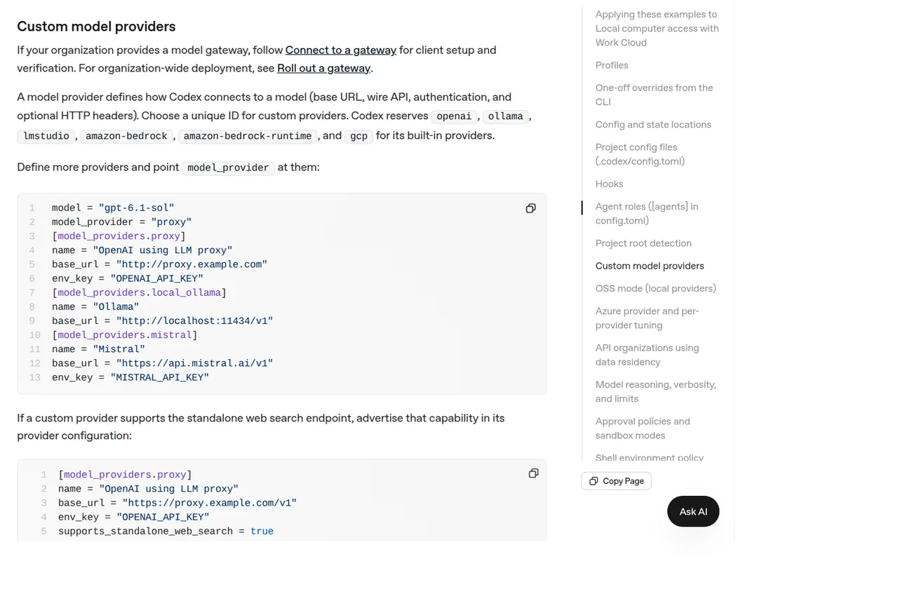
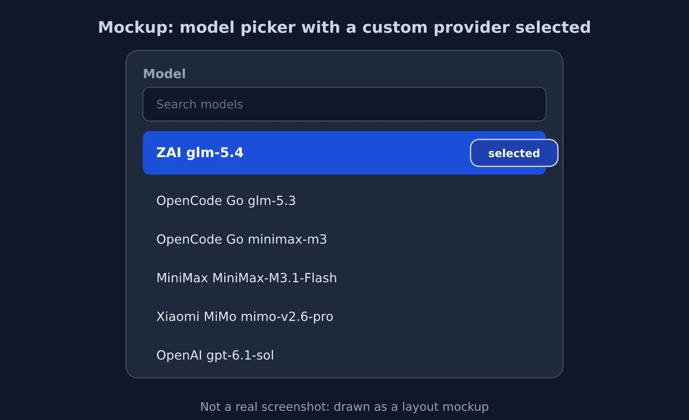
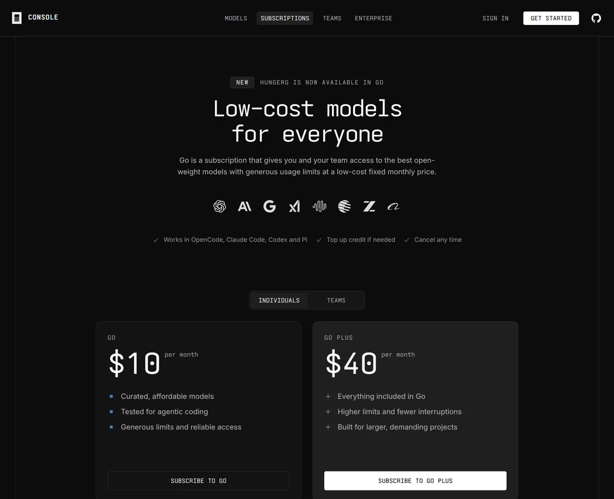
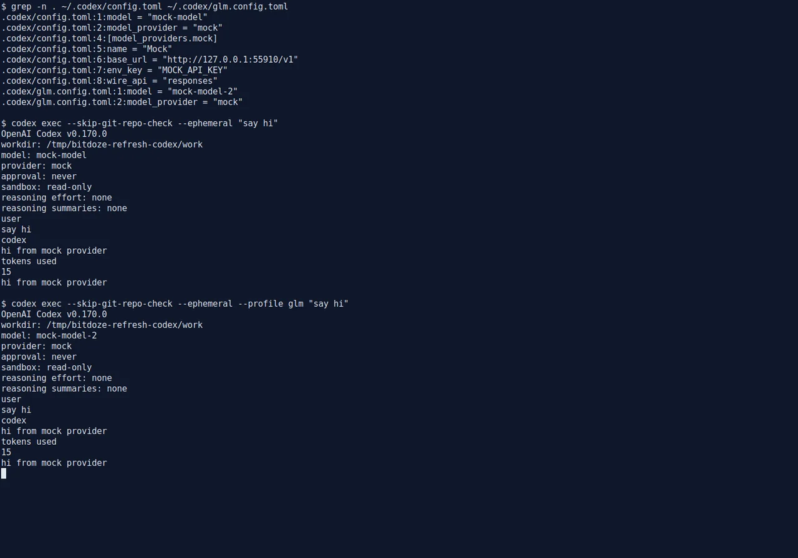
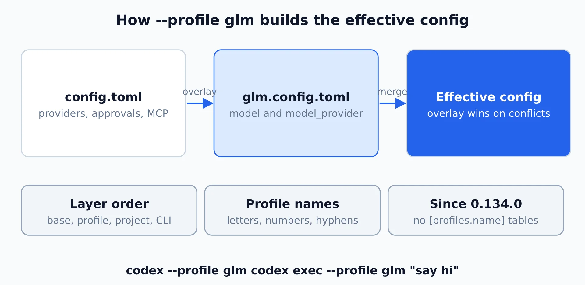
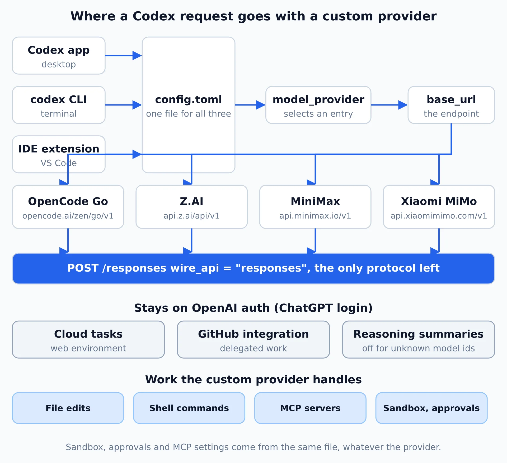
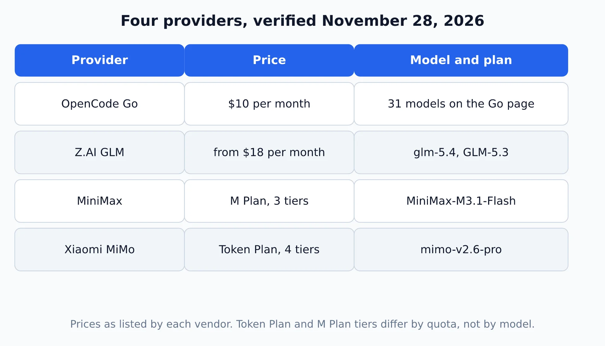

import Button from "@components/widgets/Button.astro";
import Notice from "@components/widgets/Notice.astro";
import ListCheck from "@components/widgets/ListCheck.astro";
import Accordion from "@components/widgets/Accordion.astro";
import Tabs from "@components/widgets/Tabs.astro";
import Tab from "@components/widgets/Tab.astro";

*Disclosure: this guide contains referral links. If you buy through them, I may earn a commission at no extra cost to you.*

The Codex app, CLI and IDE extension read one file, `~/.codex/config.toml`. A `[model_providers.<id>]` table with `wire_api = "responses"` and a `model_provider` line points them at GLM, MiniMax, MiMo or OpenCode Go ($10 a month, 31 models).

The Codex app is the best coding agent interface I have used so far. Worktrees, automations, the in-app browser, the review flow. Nothing else I run feels this polished. The problem is what happens on Thursday afternoon when my ChatGPT plan hits its weekly limit and the app politely tells me to wait until Monday.

Codex does not care where the model comes from, and any endpoint that speaks the OpenAI Responses API works. So when my OpenAI quota runs dry, I switch to GLM, MiniMax, MiMo, or my [OpenCode Go subscription](/opencode-go-plan/) and keep working in the same app.

Below are the exact configs for all four. Copy, paste your API key, done.

## How does Codex connect to other models?

Codex reads `~/.codex/config.toml`. The [advanced config docs](https://developers.openai.com/codex/config-advanced) add a `model_providers` table there, where each entry names a base URL and the environment variable for the API key, and `model_provider` picks one:

```toml
model = "some-model"
model_provider = "my-provider"

[model_providers.my-provider]
name = "My Provider"
base_url = "https://api.example.com/v1"
env_key = "MY_API_KEY"
wire_api = "responses"
```



*The Custom model providers section of the official docs, captured on November 28, 2026.*

Three things to know before you start:

<ListCheck>

- `wire_api = "responses"` is the only protocol Codex accepts. OpenAI removed the `chat` value (Chat Completions) in February 2026, so the provider needs a `/responses` endpoint. All four below answered one on November 28, 2026.
- `env_key` names an environment variable, not the API key itself. The key stays out of the config file.
- You cannot name a custom provider after a built-in one. Codex refuses to start with a reserved id and tells you to rename it.

</ListCheck>

The reserved ids, from the same docs:

```text
openai
ollama
lmstudio
amazon-bedrock
amazon-bedrock-runtime
gcp
```



*Mockup of the model picker, not a real screenshot: the desktop app cannot be captured on this machine.*

The Codex app picks up whatever default `model` and `model_provider` you set in `config.toml`. The CLI does too, and it adds profiles for fast switching.

<Notice type="warning" title="One config quirk">
Codex reads model capabilities (context window, reasoning levels, reasoning summaries) from its own catalog. A model id it has never seen prints `Model metadata for X not found` and falls back to defaults. Z.AI, MiniMax and MiMo each publish a catalog file for their models, linked in their sections below. Xiaomi's Codex guide switches reasoning summaries back on with `model_supports_reasoning_summaries = true`.
</Notice>

## Option 1: OpenCode Go (31 models, one key)

This is the setup I use most. [OpenCode Go](/opencode-go-plan/) is a $10/month subscription. On November 28, 2026, the [Go page](https://opencode.ai/console/go) listed 31 models behind one endpoint: GLM-5.3, MiniMax M3, MiMo V2.6 Pro, Kimi K3, DeepSeek V4 Pro, Qwen 3.7 Plus and more.

**Verdict:** One `$10/month` key reaches 31 models through `https://opencode.ai/zen/go/v1`, including GLM-5.3, MiniMax M3.1 Flash and MiMo V2.6 Pro from the three vendors below.

- **Best for:** a first custom provider, since one account covers GLM, MiniMax and MiMo models.
- **Trade-offs:** OpenCode counts each model's limit over a 5-hour and a monthly window. On Go, GLM-5.3 allows 2,640 requests per 5 hours and $200 of usage a month, Kimi K3 98 and $15. After that the free models keep working.
- **Price:** $10/month for Go, $40/month for Go Plus.

<Button text="Try OpenCode Go ($10/month)" link="https://go.bitdoze.com/opencode-go" variant="solid" color="green" size="md" icon="arrow-right" />



*The Go and Go Plus plans on the OpenCode Console page, captured on November 28, 2026.*

Add this to `~/.codex/config.toml`:

```toml
model = "glm-5.3"
model_provider = "opencode-go"

[model_providers.opencode-go]
name = "OpenCode Go"
base_url = "https://opencode.ai/zen/go/v1"
env_key = "OPENCODE_API_KEY"
wire_api = "responses"
```

Then export your key:

```bash
export OPENCODE_API_KEY="your-go-key"
```

Swap `model` for any model in the Go lineup: `minimax-m3`, `mimo-v2.6-pro`, `deepseek-v4-pro`, `qwen3.7-plus`, `kimi-k3`, and so on. The [models endpoint](https://opencode.ai/inference/go/v1/models) returns the current ids, and the full model list and usage limits are in my [OpenCode Go review](/opencode-go-plan/). If you compare it with ClinePass first, the [OpenCode Go vs ClinePass breakdown](/opencode-go-vs-clinepass-cheap-models/) has the numbers.

## Option 2: Z.AI GLM (GLM Coding Plan from $18/month)

Z.AI's [GLM-5.4](https://docs.z.ai/guides/llm/glm-5.4) is the flagship in every GLM Coding Plan tier, next to GLM-5.3 and GLM-5.3-Flash (November 28, 2026). The plan starts at $18/month, and Codex needs its Responses endpoint, `https://api.z.ai/api/v1`. The `api/coding/paas/v4` URL serves Chat Completions clients, and the [Z.AI Codex guide](https://docs.z.ai/devpack/tool/codex) says the same.

On Terminal-Bench 2.1 the earlier GLM-5.2 scored 81.0, 4 points below Claude Opus 4.8 at 85.0, and 62.1 on SWE-bench Pro (Z.AI's [GLM-5.2 post](https://z.ai/blog/glm-5.2)). I covered GLM 5.2 in depth in the [open source Claude alternatives roundup](/best-open-source-llms-claude-alternative/).

**Verdict:** `glm-5.4` on Z.AI's own plan, through the Responses endpoint its [Codex guide](https://docs.z.ai/devpack/tool/codex) prescribes with `wire_api = "responses"`.

- **Best for:** heavy GLM use, because the Coding Plan sells higher call limits than the standard API and all its tiers include the same three GLM models.
- **Trade-offs:** the plan only works inside the tools on Z.AI's supported list, and Codex needs `https://api.z.ai/api/v1` rather than the chat URL.
- **Price:** from $18/month for Lite, or $12.60 a month paid yearly. Quarterly billing takes 20% off and yearly billing 30% off.

Add this to `~/.codex/config.toml`:

<Button text="Get GLM Coding Plan (Up to 20% Back)" link="https://go.bitdoze.com/glm" variant="solid" color="blue" size="md" icon="arrow-right" />

```toml
model = "glm-5.4"
model_provider = "zai"

[model_providers.zai]
name = "Z.AI GLM"
base_url = "https://api.z.ai/api/v1"
env_key = "ZAI_API_KEY"
wire_api = "responses"
```

```bash
export ZAI_API_KEY="your-zai-key"
```

<Notice type="info" title="GLM referral offer">
Sign up through [go.bitdoze.com/glm](https://go.bitdoze.com/glm). On November 28, 2026, the subscribe page it opens showed a referral offer of "Up to 20% back, no limits and never expires" on top of the plan prices.
</Notice>

## Option 3: MiniMax (M Plan from $220 a year)

The [MiniMax Codex guide](https://platform.minimax.io/docs/m-plan/codex) uses `MiniMax-M3.1-Flash` on `https://api.minimax.io/v1` with `wire_api = "responses"`, and the id keeps its capital M letters. MiniMax M3 was the model I pointed Codex at for long refactoring sessions where token count matters more than squeezing out the last benchmark point.

**Verdict:** `MiniMax-M3.1-Flash` through `https://api.minimax.io/v1`, the model and endpoint in MiniMax's own Codex guide.

- **Best for:** always-on agent work on a flat subscription. The M Plan resets every 5 hours and every week, and its Go, Explore and Build tiers carry 1x, 3x and 7.5x the base quota.
- **Trade-offs:** M3.1 Flash is the only text model on the plan, and video and image generation draw from the same quota.
- **Price:** on the yearly tab (2 months free) Go costs $220 a year, Explore $550 and Build $1,320, against list prices of $264, $660 and $1,584.

<Button text="Get the MiniMax M Plan" link="https://go.bitdoze.com/minimax" variant="solid" color="purple" size="md" icon="arrow-right" />

Add this to `~/.codex/config.toml`:

```toml
model = "MiniMax-M3.1-Flash"
model_provider = "minimax"
model_context_window = 524288

[model_providers.minimax]
name = "MiniMax"
base_url = "https://api.minimax.io/v1"
env_key = "MINIMAX_API_KEY"
wire_api = "responses"
```

```bash
export MINIMAX_API_KEY="your-minimax-key"
```

If you are outside the international region and use the mainland China endpoint, swap the base URL for `https://api.minimaxi.com/v1`. Both answered the `/v1/responses` probe on November 28, 2026.

## Option 4: Xiaomi MiMo (Token Plan from $6 a month)

Xiaomi retired the V2.5 ids on October 21, 2026, so the config uses `mimo-v2.6-pro`. The [MiMo Codex guide](https://mimo.mi.com/docs/en-US/integration/codex-configuration) sets `model_context_window = 1048576` and gives Token Plan keys (`tp-...`) a different base URL from pay-as-you-go keys (`sk-...`). MiMo is the model I reach for when I hand Codex a task and walk away for the afternoon.

**Verdict:** `mimo-v2.6-pro` with a 1,048,576 token context window, the values in Xiaomi's Codex guide.

- **Best for:** long agent runs that need the 1M context window.
- **Trade-offs:** the V2.5 ids stopped working on October 21, 2026. Token Plan keys need `https://token-plan-cn.xiaomimimo.com/v1`, pay-as-you-go keys `https://api.xiaomimimo.com/v1`.
- **Price:** Token Plan Lite lists at $6 a month, with 12% off on annual billing. Pay-as-you-go `mimo-v2.6-pro` lists $0.435 per million input tokens (cache miss) and $0.87 per million output tokens.

<Button text="Get the MiMo Token Plan (10% Off)" link="https://go.bitdoze.com/mimo" variant="solid" color="green" size="md" icon="arrow-right" />

Add this to `~/.codex/config.toml`:

```toml
model = "mimo-v2.6-pro"
model_provider = "mimo"
model_context_window = 1048576

[model_providers.mimo]
name = "Xiaomi MiMo"
base_url = "https://token-plan-cn.xiaomimimo.com/v1"
env_key = "MIMO_API_KEY"
wire_api = "responses"
```

```bash
export MIMO_API_KEY="your-mimo-key"
```

<Notice type="info" title="MiMo referral offer">
Sign up through [go.bitdoze.com/mimo](https://go.bitdoze.com/mimo). On November 28, 2026, the Token Plan page it opens billed credits at 0.8x between 16:00 and 24:00 UTC, so a night run uses 20% less of the quota. Its referral banner lists 10% off for the invited friend.
</Notice>

For a pay-as-you-go key, use `https://api.xiaomimimo.com/v1` instead.

## How do you switch providers without editing config.toml?

Give each provider its own file in `~/.codex/` and start Codex with `codex --profile <name>`. For a single run, `--config model_provider='"zai"'` sets the provider without a file.



*codex-cli 0.170.0 against a local mock provider on November 28, 2026: the `--profile glm` run switches the model, the provider table from the base config stays.*

You can also keep all four providers in one `config.toml` and edit the two top-level lines (`model` and `model_provider`) each time you switch. That works, but it gets old fast.

Two better options:

<Tabs>
<Tab name="CLI flags">
Override the provider for a single run:

```bash
codex --config model_provider='"zai"' --config model='"glm-5.4"'
```

Good for quick tests, too verbose for daily use.
</Tab>
<Tab name="Profiles">
Create one profile file per provider. For example `~/.codex/glm.config.toml`:

```toml
model = "glm-5.4"
model_provider = "zai"
```

And `~/.codex/minimax.config.toml`:

```toml
model = "MiniMax-M3.1-Flash"
model_provider = "minimax"
```

Then launch with:

```bash
codex --profile glm
codex --profile minimax
```

The profile file overlays your base config, so the `[model_providers]` tables you already defined stay available. The order is base user config, then profile, then project config, then `-c` flags. Profile names can hold letters, numbers, `-` and `_`. Note that since Codex 0.134.0, profiles live in separate files, not under `[profiles.name]` in the main config.
</Tab>
</Tabs>



*The base config plus the `glm` profile overlay, and the rules that apply to profile files.*

My setup keeps OpenCode Go as the default in `config.toml`. I also keep a `glm` profile for the days I want GLM through Z.AI directly with the bigger coding plan limits.

## What does a broken custom provider setup look like?

Four errors showed up in a lab run with codex-cli 0.170.0 on November 28, 2026. The table maps each message to its cause and fix.

| Error text | Cause | Fix |
|------------|-------|-----|
| `` `wire_api = "chat"` is no longer supported `` | Config copied from an older guide | Set `wire_api = "responses"` and use a provider with a `/responses` endpoint |
| `Missing environment variable: MINIMAX_API_KEY` | The variable named in `env_key` is unset in the shell that starts Codex | Export it, then start Codex again |
| `model_providers contains reserved built-in provider IDs` | A custom provider named `ollama` or `openai` | Rename the id, keep `name` as the display label |
| `Ignored unsupported project-local config keys` | The provider was set in `.codex/config.toml` inside the repo | Move `model_provider` and `model_providers` to `~/.codex/config.toml` |

If you would rather keep the agent in a container before it touches a repo, the [Docker and Podman guide for AI CLI tools](/docker-podman-ai-cli-tools-safe-environment/) covers that part.

## Which Codex features still need the OpenAI account?

Cloud tasks, the GitHub code review integration and anything under ChatGPT settings. Local work, from file edits and terminal commands to MCP servers, goes to the custom provider instead.



*App, CLI and IDE extension share one `config.toml`. The provider picks the endpoint. Cloud tasks stay on OpenAI auth. The MiMo entry is the pay-as-you-go endpoint; Token Plan keys use `token-plan-cn.xiaomimimo.com`.*

- Cloud tasks start after a ChatGPT sign-in on the web, in the desktop app or on mobile ([OpenAI's cloud docs](https://learn.chatgpt.com/docs/cloud))
- The GitHub code review integration is configured in the Codex settings on chatgpt.com, behind the same login ([OpenAI's GitHub docs](https://learn.chatgpt.com/docs/third-party/github))

In practice this has not bothered me. I use the app locally, and local is exactly where custom providers work.

## Which model provider should Codex use?

OpenCode Go for a first setup: $10 a month buys one key for 31 models (vendor pages, November 28, 2026). Move to a direct GLM Coding Plan or MiMo Token Plan when you want a quota that belongs to one vendor.

| Provider | Cost | Best for |
|----------|------|----------|
| OpenCode Go | $10/month; Go Plus $40/month | One key for 31 models |
| Z.AI GLM | from $18/month; yearly billing 30% off | Heavy GLM use on a dedicated plan |
| MiniMax | M Plan from $220/year on the yearly tab | A flat subscription for M3.1 Flash |
| Xiaomi MiMo | Token Plan Lite at $6/month; pay-as-you-go $0.435 in and $0.87 out per M tokens | A 1M token context window |



*Prices, current model ids and plan shapes as each vendor listed them on November 28, 2026.*

If you want the longer comparison with benchmarks and per-token pricing, the [best open source LLMs roundup](/best-open-source-llms-claude-alternative/) covers GLM 5.2, MiniMax, MiMo, and three others side by side. For per-token prices on the same models, see [the cheapest models for Hermes Agent](/best-cheap-models-hermes-agent/).

## Wrapping up

The Codex app is not an OpenAI-only tool. Eight lines of TOML and an API key get you GLM, MiniMax, MiMo, or the whole OpenCode Go lineup inside the same interface you already use. My ChatGPT plan still does the heavy thinking early in the week. After that, the open source models take over, and honestly, for most coding tasks I cannot tell the difference.

<Button text="Try OpenCode Go ($10/month)" link="https://go.bitdoze.com/opencode-go" variant="solid" color="green" size="md" icon="arrow-right" />

## Related articles

- [OpenCode Go plan review: limits and models](/opencode-go-plan/): the subscription I use as my Codex fallback
- [Best Open Source LLMs to Replace Opus 4.7 or GPT-5.5](/best-open-source-llms-claude-alternative/): benchmarks and pricing for GLM 5.2, MiniMax, MiMo, and more
- [Best Cheap Models for AI Coding Agents](/best-cheap-models-hermes-agent/): per-token pricing breakdown
- [GitHub Copilot Alternatives After the June 2026 Pricing Change](/github-copilot-alternatives-2026/): more ways to cut AI coding costs

## FAQ

<Accordion label="Does this work with the Codex app or just the CLI?" group="faq">
Both. The app, the CLI, and the IDE extension all read the same `~/.codex/config.toml`. Set `model` and `model_provider` there and the app uses your custom provider. Profiles (`--profile`) are a CLI feature, so for the app you set the default in the main config.
</Accordion>

<Accordion label="Will my ChatGPT subscription still work after adding custom providers?" group="faq">
Yes. Adding `[model_providers]` entries does not touch your OpenAI login. Switch back anytime by setting `model_provider` to `openai` or removing the line.
</Accordion>

<Accordion label="Can I put these providers in a project .codex/config.toml?" group="faq">
No. Codex ignores `model_provider` and `model_providers` in project-local config files and prints `Ignored unsupported project-local config keys` when it sees them. Provider definitions belong in your user-level `~/.codex/config.toml`.
</Accordion>

<Accordion label="Is one OpenCode Go key enough, or do I need direct provider accounts?" group="faq">
Go covers GLM-5.3, MiniMax M3 and MiMo V2.6 Pro. OpenCode counts each model's limit over 5-hour and monthly windows, so GLM-5.3 on Go stops at 2,640 requests per 5 hours and $200 a month. A direct plan makes sense when those windows cut sessions short, for example the GLM Coding Plan from $18/month.
</Accordion>

<Accordion label="Why does Codex refuse wire_api = chat?" group="faq">
OpenAI removed the Chat Completions wire protocol from Codex in February 2026 and now accepts `wire_api = "responses"` only. The error reads `` `wire_api = "chat"` is no longer supported ``. Z.AI, MiniMax, MiMo and OpenCode Go all answer on a `/responses` endpoint.
</Accordion>

<Accordion label="How do I check that a provider works before opening the app?" group="faq">
Run one turn from the CLI: `codex exec --skip-git-repo-check "say hi"`. It prints the `model:` and `provider:` lines from the config before it sends the first request. On November 28, 2026, that run against a local mock provider returned one `POST /v1/responses` and 15 tokens.
</Accordion>

<Accordion label="What is the difference between --profile and --config?" group="faq">
`--config model='"glm-5.4"'` overrides one value for a single run. `--profile glm` layers `~/.codex/glm.config.toml` over the base config and can set many values at once. Use the first for a quick test, the second for daily switching.
</Accordion>
