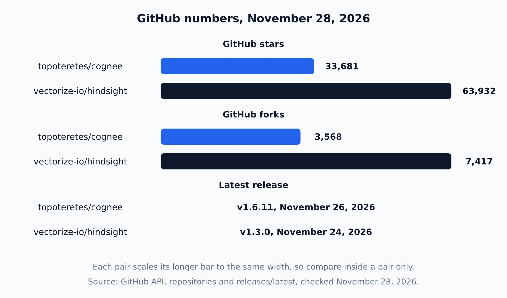
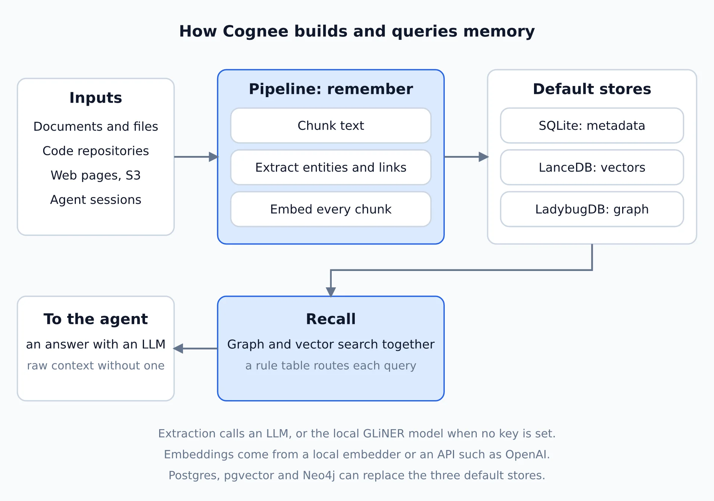
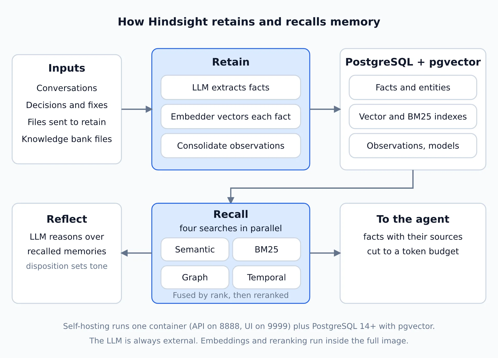
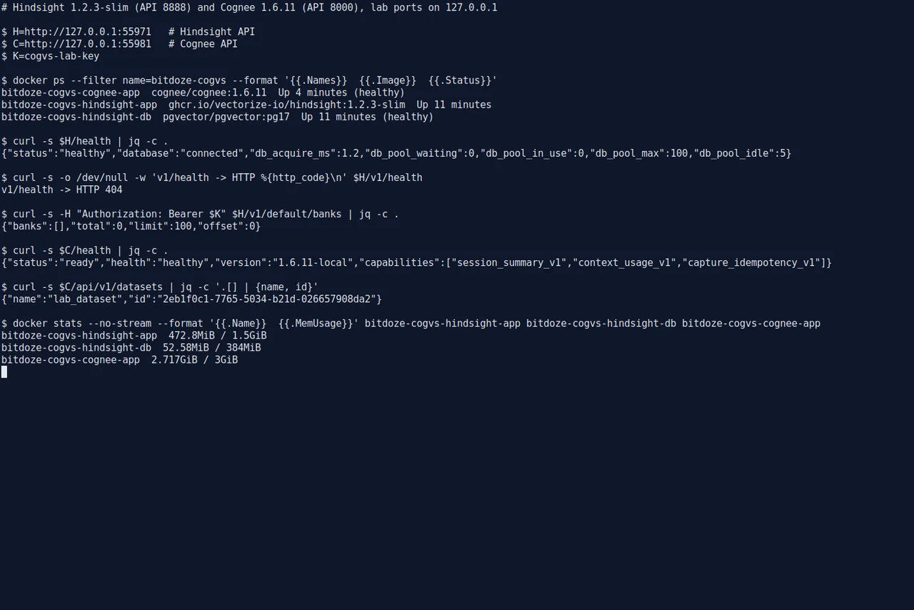
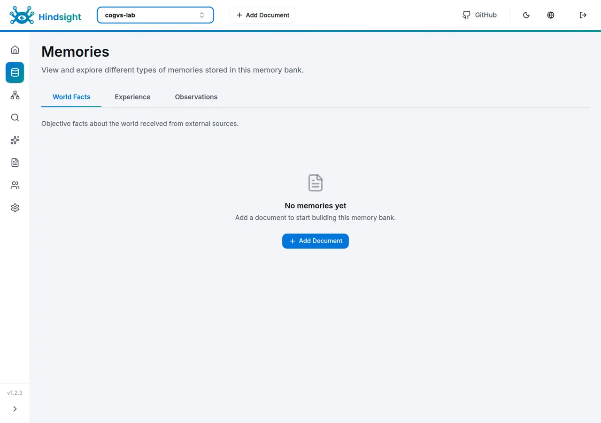
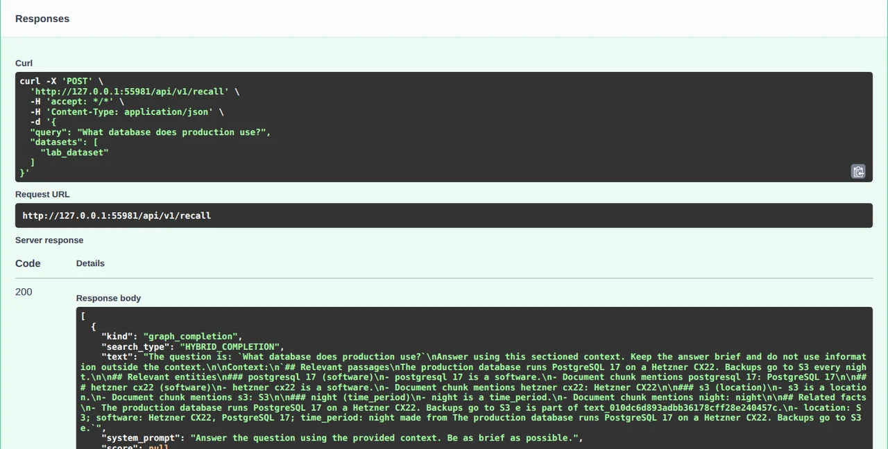
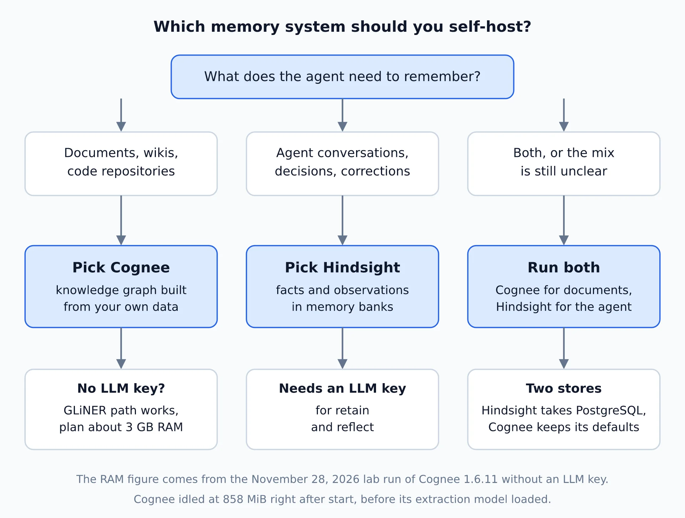

import Tabs from "../../components/widgets/Tabs.astro";
import Tab from "../../components/widgets/Tab.astro";
import Notice from "../../components/widgets/Notice.astro";
import Accordion from "../../components/widgets/Accordion.astro";

Cognee turns documents into a knowledge graph that an agent can query. Hindsight turns what an agent hears and does into facts, observations and mental models it can recall. Pick Cognee for document memory, Hindsight for agent memory, or both when one agent needs each.

I've been running both Cognee and Hindsight for a few months now. They solve related problems but take very different approaches, and picking the wrong one for your use case will waste weeks of integration work.

Both are open source. Both go beyond basic RAG. Both give AI agents persistent, structured memory. That's where the similarities end.

The lab numbers come from running both stacks in Docker on November 28, 2026.

## Quick comparison

| | Cognee | Hindsight |
|---|---|---|
| **Architecture** | Knowledge graph + vector search | Multi-strategy hybrid (semantic + BM25 + graph + temporal) |
| **Primary strength** | Data ingestion and knowledge extraction from documents | Agent interaction memory with multi-strategy retrieval |
| **Memory type** | Institutional (knowledge from your data) | Personalization + institutional |
| **Data sources** | Files, web pages, S3 objects, code repos, GitHub, Notion, Google Drive | Conversations and files through retain, plus knowledge banks for documents |
| **Benchmark (LongMemEval)** | No published score (BEAM 0.79 at 100K tokens, self-reported) | 94.6% on LongMemEval-S (vendor-reported) |
| **SDKs** | Python, TypeScript, Rust | Python, TypeScript, Go, CLI |
| **Protocol** | REST API and MCP server | REST API and MCP server on every bank |
| **Storage** | SQLite + LanceDB + LadybugDB (Postgres, pgvector and Neo4j optional) | PostgreSQL 14+ with pgvector |
| **License** | Apache-2.0 | MIT |
| **Web UI** | Local UI from `cognee-cli -ui`; hosted app in Cognee Cloud | Built-in Control Plane on port 9999 |
| **GitHub stars** | 33,681 (November 28, 2026) | 63,932 (November 28, 2026) |
| **Latest release** | v1.6.11 (November 26, 2026) | v1.3.0 (November 24, 2026) |
| **Idle memory in the lab** | 858 MiB after start | 480 MiB app + 70 MiB Postgres |



*GitHub stars, forks and latest releases for both projects, read from the GitHub API on November 28, 2026.*

## How each one works

### Cognee: turn your data into a knowledge graph

Cognee is a pipeline. You feed it data from various sources, it extracts entities and relationships, builds a knowledge graph, and layers vector embeddings on top. When you query it, the graph traversal and vector search work together.



*Cognee reads inputs in three steps, stores metadata, vectors and graph separately, and answers from graph plus vector search.*

The core loop:

1. **Ingest:** Read files (PDF, Office, images, audio), S3 objects, web pages and repository URLs
2. **Process:** Chunk text, extract entities, resolve relationships
3. **Store:** SQLite for metadata, LanceDB for vectors, LadybugDB for the knowledge graph (Postgres, pgvector and Neo4j are options)
4. **Query:** Hybrid graph traversal + vector similarity

The API is straightforward:

```python
import cognee

await cognee.remember("The production database runs PostgreSQL 17")
results = await cognee.recall("What database does production use?")
```

Cognee's new API uses `remember`, `recall`, `forget`, and `improve` operations. The `remember` call stores data in the knowledge graph, `recall` queries it, and `improve` lets the agent learn from feedback.

Since v1.6.0 Cognee also runs without an LLM key. A local GLiNER model extracts the entities and a local embedding model builds the vectors. Without an LLM, `recall` returns the assembled prompt context instead of a generated answer, and the LLM-dependent `improve` stages skip themselves.

Where Cognee shines: taking a corpus of documents, meeting transcripts, or code repositories and turning them into structured, queryable knowledge. If your agent needs to answer questions grounded in company docs, Cognee's pipeline handles the extraction and graph construction.

### Hindsight: learn from agent interactions

Hindsight takes a different approach. Instead of ingesting external data sources, it captures and structures what agents learn during operation, conversations, decisions, corrections, and outcomes.



*Hindsight stores facts, entities and observations in one PostgreSQL with pgvector, then recalls with four parallel searches.*

It organizes memory into four categories:

- **World facts** - Things that are true ("The project uses PostgreSQL 17")
- **Experiences** - Things that happened ("Last deployment broke because of a migration issue")
- **Observations** - Beliefs consolidated from many facts, each keeping its evidence and history ("User was a React enthusiast, has now switched to Vue")
- **Mental models** - Patterns formed by reflecting on facts and experiences ("This user prefers concise responses")

When you store a memory with `retain`, Hindsight runs an LLM to extract entities, relationships, and temporal data. When you search with `recall`, it runs four retrieval strategies in parallel:

1. Semantic search (vector similarity)
2. Keyword matching (BM25)
3. Graph traversal (entity and relationship links)
4. Temporal filtering (time ranges)

Results get merged with reciprocal rank fusion and reranked. Vectorize credits this multi-strategy retrieval for Hindsight's 94.6% on LongMemEval-S, a vendor-reported score covered below.

```python
from hindsight_client import Hindsight

client = Hindsight(base_url="http://localhost:8888")

client.retain(bank_id="my-project", content="Alice prefers concise responses")
results = client.recall(bank_id="my-project", query="How should I talk to Alice?")
```

The `reflect` operation goes deeper. It pulls together related memories and generates new observations. An AI project manager could reflect on risks, a sales agent could reflect on outreach patterns, a support agent could reflect on gaps in documentation.

Hindsight also accepts files. `retain` takes PDF, DOCX, PPTX, XLSX, images and audio, and a knowledge bank keeps documents as they are, with no LLM in the loop. A search there returns the passage with its page or timestamp.

## Architecture differences

<Tabs>
  <Tab name="Storage">
    **Cognee** uses three storage layers by default: SQLite for metadata, LanceDB for vectors, and LadybugDB for the knowledge graph (the engine that replaced Kuzu; `kuzu` still works as its alias). You can swap these for PostgreSQL + pgvector plus Neo4j or FalkorDB for graphs. This flexibility is useful but means more moving parts.

    **Hindsight** uses a single PostgreSQL instance with pgvector. One database handles vectors, metadata, entity graphs, and temporal indexes. Simpler to deploy, simpler to back up, simpler to scale.
  </Tab>
  <Tab name="Retrieval">
    **Cognee** combines graph traversal with vector similarity. The knowledge graph structure enables multi-hop queries, following entity relationships across connected data points. Good for "What documents mention the same project as this meeting transcript?"

    **Hindsight** runs four retrieval strategies in parallel and fuses results. Semantic search handles conceptual matches, BM25 catches exact terms, graph traversal follows entity links, and temporal filtering understands time expressions like "last week" or "before the migration." No single strategy handles every query type, so the parallel approach covers blind spots.
  </Tab>
  <Tab name="Data ingestion">
    **Cognee** reads PDF, Office and text files, images (through a vision model), audio (through transcription), S3 objects, web pages and repository URLs. Its source connectors cover GitHub, Linear, Notion, Google Drive, Dropbox, Gmail and Google Calendar. If you need to ingest from external sources, Cognee is built for it.

    **Hindsight** starts from what the agent says and does: conversations, decisions, corrections, and outcomes sent through the retain API. It also takes files on retain and keeps documents in knowledge banks, and community connectors sync Notion, Obsidian, Google Drive and S3 into it. Document ingestion is an add-on there, not the core job.
  </Tab>
</Tabs>

## Which one has more integrations?

Hindsight has the larger list: 53 official and 12 community integrations on its hub on November 28, 2026, against 30 integration guides in Cognee's docs. Both ship an MCP server, so any MCP client reaches either one (see [What Is MCP](/mcp-introduction-beginners/) for the protocol).

### Cognee integrations

Cognee started as a Python library and now ships a TypeScript SDK (`@cognee/cognee-ts`, Node bindings over the Rust `cognee-rs` engine) and a Rust SDK. Go and other languages use the REST API or the MCP server.

Available integrations:
- **MCP server:** Exposes `remember`, `recall` and `forget` to Cursor, Claude Code, Codex and other MCP clients
- **Claude Code and Codex plugins:** Hook into the session lifecycle for automatic memory capture
- **Agent frameworks:** LangGraph, CrewAI, Google ADK, Strands and Haystack
- **Agent plugins:** OpenClaw (`@cognee/cognee-openclaw`), Hermes Agent and Pi
- **No-code:** n8n, Dify and Slack
- **REST API:** Full-featured API for any language, with a Swagger page at `/docs`

### Hindsight integrations

Hindsight ships SDKs for Python, TypeScript, and Go, plus a CLI. The MCP-first design means any MCP-compatible agent works without an SDK.

Available integrations:
- **Coding agents:** One plugin covers Claude Code, Codex, Cursor, opencode, GitHub Copilot, Cline, Kilo and more, with a per-repo bank built from git history and past sessions
- **Editors:** Zed, Roo Code, Continue, Aider and OpenHands have their own guides, most of them over the MCP server
- **OpenClaw:** Official integration, plus the community HindClaw add-on for server-side access control
- **Hermes Agent:** Memory backend for the Hermes multi-agent framework ([setup guide](/hermes-agent-setup-guide/))
- **Agno:** Direct integration for structured long-term memory (the [Agno getting started guide](/agno-get-start/) covers its built-in memory)
- **n8n, Zapier, Dify, Flowise:** Nodes for no-code workflows
- **LangChain/LangGraph:** Memory Tools, Graph Nodes, BaseStore adapter
- **LlamaIndex:** BaseToolSpec and BaseMemory support
- **OpenAI Agents SDK, Google ADK, CrewAI, Pydantic AI, AutoGen, AG2, Strands:** FunctionTool wrappers and memory classes
- **Vercel AI SDK:** Memory for AI SDK and AI Chatbot applications
- **LiteLLM:** Proxy callbacks for zero-code-change memory, plus `hindsight-litellm` wrappers for the OpenAI and Anthropic SDKs
- **Pipecat and Vapi:** Memory for voice pipelines

The gap shows in the SDK count: Hindsight ships Python, TypeScript and Go clients plus a CLI, Cognee ships Python, TypeScript and Rust. Hindsight's coding-agent plugin also covers 22 agents in one install.

Neither project's integration list named Mastra on November 28, 2026. A [Mastra agent](/build-ai-agent-mastra/) keeps its working memory in `@mastra/memory`, so Hindsight or Cognee memory reaches it through the REST API or the MCP server, called from a tool.

## What do the benchmarks show?

Vectorize's own table puts Hindsight at 94.6% on LongMemEval-S, against 74.0% for the next best system. Cognee publishes no LongMemEval score; it reports 0.79 on its own BEAM evaluation at 100K tokens.

The vendor lists 92.0% on LoCoMo and 86.6% on PersonaMem for the same setup. It says research collaborators at Virginia Tech's Sanghani Center and The Washington Post reproduced the Hindsight result, and that the other scores are self-reported by their vendors. LongMemEval tests memory across conversational AI scenarios, including:

- Recalling facts from past conversations
- Understanding temporal relationships
- Handling multi-hop reasoning across memories
- Maintaining consistency over long interaction histories

Cognee doesn't have a published LongMemEval score. This doesn't mean it's worse at everything, it means the benchmark tests are focused on conversational memory, which is Hindsight's strength. Cognee's knowledge graph approach excels at different tasks, like extracting structured information from documents and reasoning across connected data points.

Cognee's README reports 0.79 on its BEAM evaluation at 100K tokens and 0.67 at 10M tokens. BEAM scores conversational memory with an LLM judge over synthetic long conversations, and the README warns against comparing those two settings with other systems.

The benchmark matters if your use case is agent interaction memory. If your use case is document knowledge extraction, the benchmark is less relevant.

## How much RAM do Cognee and Hindsight need?

Hindsight's slim image idled at 480 MiB with its web UI, next to a Postgres container under 70 MiB. Cognee 1.6.11 peaked at 2.92 GiB while building a graph without an LLM key, and idled at 858 MiB right after start.

Both tools work well with Docker Compose. I have guides for each:

- [How to Self-Host Cognee](/cognee-self-host/): Full setup with Dokploy or Docker Compose, PostgreSQL, pgvector, and MCP integration
- [Deploy Hindsight on Docker](/hindsight-docker-deploy/): Complete deployment with PostgreSQL, pgvector, and authentication

<Notice type="info" title="You can run both">
Cognee and Hindsight aren't mutually exclusive. Use Cognee to build a knowledge layer from your document corpus and organizational data. Use Hindsight to give your agents memory of their runtime interactions and user-specific context. They complement each other.
</Notice>

### Lab numbers from November 28, 2026

Both stacks ran side by side in Docker on one host, each in its own Compose project with a memory limit. The lab skipped every call that needs an LLM or embedder key.

| Measurement | Hindsight 1.2.3-slim | Cognee 1.6.11 |
|---|---|---|
| Image | `ghcr.io/vectorize-io/hindsight:1.2.3-slim` | `cognee/cognee:1.6.11` from Docker Hub |
| Extra container | `pgvector/pgvector:pg17` | None, SQLite, LanceDB and LadybugDB live inside |
| API ready | 15 s after container start | 45 s after container start |
| Memory at idle | 473 to 481 MiB (API and UI), 52 to 70 MiB for Postgres | 858 MiB right after start |
| Memory limit in the lab | 1.5 GiB | 3 GiB |
| Health endpoint | `/health` returns `"status":"healthy"` and `"database":"connected"` | `/health` returns `"version":"1.6.11-local"` |
| List call | `GET /v1/default/banks` returns `{"banks":[],"total":0}` | `GET /api/v1/datasets` returns `[]` on a fresh install |
| Needs a model key | Always, for retain and reflect | Optional, for generated answers |



*Health and list calls against both lab stacks: Hindsight on port 55971, Cognee on port 55981, both bound to 127.0.0.1.*

Cognee's keyless path worked end to end. A one-sentence `POST /api/v1/remember` call returned `status: completed` in 38.9 s and built the graph with GLiNER and a local embedder. `POST /api/v1/recall` answered in 2.5 s with `HYBRID_COMPLETION` and the passages, entities and related facts an LLM would have received, since no LLM was there to write an answer. The small model mislabels a node now and then: the lab graph called "Hetzner CX22" software and "S3" a location. The first run downloads the 750 MB GLiNER model and peaks at 2.92 GiB. With a 1.5 GiB limit the first `remember` call ended with a SIGKILLed worker and a dropped connection, so the container got 3 GiB for the retry.

Hindsight answered everything that needs no model. `GET /v1/default/banks` listed an empty bank set with the Bearer token, and the Control Plane created an empty bank from its dialog. `retain`, `recall` and `reflect` stayed untested because each one calls the configured LLM. On 1.2.3, `/v1/health` answers 404 and `/health` is the probe to use.

### The web UI each one ships

Hindsight's Control Plane runs inside the same container on port 9999 and asks for the access key from `HINDSIGHT_CP_ACCESS_KEY` at login. The bank page separates World Facts, Experience and Observations, and the bank home counts memories, documents and links.



*Hindsight Control Plane 1.2.3: an empty memory bank with its three memory views, created from the UI without an LLM call.*

Cognee's API image serves only a Swagger page at `/docs`, where the `recall` call runs through "Try it out" and returned HTTP 200 in the lab. The full local UI starts with `cognee-cli -ui` or `cognee.start_ui()`, and Cognee Cloud hosts the same interface.



*Cognee 1.6.11: the recall call answered from the Swagger page with the context an LLM would have received, entities included.*

## When to use Cognee

- **Verdict:** A knowledge extraction engine that turns a document corpus into a knowledge graph plus vectors.
- **Best for:** Wikis, PDFs, transcripts and code repositories that an agent must answer from.
- **Trade-offs:** Three stores to back up by default, and a single-writer graph file that suits one machine.
- **Price:** Free to self-host under Apache-2.0. Cognee Cloud bills per million tokens with a starting credit.

Pick Cognee when:

- **Your primary need is knowledge extraction from existing data.** Thousands of PDFs, Slack threads, meeting transcripts, or code repositories that need to become structured, queryable knowledge.
- **You work with multimodal data.** Cognee processes images through vision models and audio through transcription, integrating extracted knowledge into the same graph.
- **Your stack is Python-first.** The Python SDK stays the shortest path, and the TypeScript and Rust SDKs cover Node and Rust agents.
- **You want a local-first knowledge graph.** SQLite + LanceDB + LadybugDB run entirely on the host with no database server to operate.
- **Reducing hallucinations is your top priority.** The knowledge graph provides traceable paths from query to source.

## When to use Hindsight

- **Verdict:** An interaction memory system that extracts facts from what an agent hears and does.
- **Best for:** User preferences, decisions and corrections that an agent must recall across sessions.
- **Trade-offs:** Every `retain` and `reflect` call needs an LLM, and the LLM always sits outside the container.
- **Price:** Free to self-host under MIT. Hindsight Cloud bills per use from a prepaid balance.

Pick Hindsight when:

- **Your agent needs to learn from its own interactions.** User preferences, past decisions, corrections, and contextual history across sessions.
- **You need multi-strategy retrieval.** Some queries need semantic similarity, others need exact keywords, others need temporal reasoning. Running all four in parallel covers each method's blind spots.
- **Your stack is multi-language.** Python, TypeScript, and Go SDKs, plus MCP protocol support.
- **You want MCP-native integration.** Plug-and-play memory with any MCP-compatible agent.
- **Temporal reasoning matters.** Questions like "What changed since last deployment?" or "What did the user say about pricing before the Q3 review?"
- **You want a web UI.** Hindsight's Control Plane gives you a browser interface for managing memory banks and testing queries. Cognee's local UI starts from its CLI or one Python call.

## Can you use both together?

Yes. They solve different problems:

- **Cognee** builds knowledge from your existing data (documents, transcripts, code)
- **Hindsight** captures knowledge from agent runtime (conversations, decisions, outcomes)

A practical setup: Cognee ingests your company documentation and builds a knowledge graph. Hindsight remembers what your agent learns while helping users. The agent queries Cognee when it needs institutional knowledge and Hindsight when it needs to remember user preferences or past interactions.

Hindsight needs PostgreSQL with pgvector. Cognee can use the same server for metadata and vectors. Its Postgres graph store is a demo feature in the open-source build, so a default Cognee keeps its own LadybugDB file.

## Cost comparison

Both are free to self-host. The main costs are:

- **Infrastructure:** A 4 GB VPS runs Hindsight's slim image and Cognee with an API key. Cognee's keyless path peaked at 2.92 GiB in the lab, so give that setup a container of its own with a 3 GB limit.
- **LLM API usage:** Both need an LLM for extraction and reasoning. Cognee uses it for entity extraction during ingestion. Hindsight uses it for fact extraction during retain operations and for reflect. Costs scale with how much data you process.
- **Embedding API usage:** Both generate vector embeddings. Similar cost profile since both use the same embedding models (OpenAI, Cohere, etc.).

Using local models with Ollama can reduce API costs to nearly zero for both tools, at the expense of slower processing and potentially lower extraction quality.

The hosted options bill per use with no monthly fee. Cognee Cloud charges per million tokens, with a starting credit on each new workspace. Hindsight Cloud charges per token for retain and recall and per call for reflect and mental model refreshes, from a prepaid balance.

## Which memory system should you self-host?

Documents in, grounded answers out: Cognee. An agent that must remember users and its own decisions needs Hindsight, and a VPS that sees both workloads can run the two side by side.



*Pick by what goes in, then check the LLM key and the RAM each path needs.*

Start with the input. A document corpus points at Cognee, a stream of conversations and tool calls points at Hindsight, and an agent that reads docs and serves users needs both. Then check the model budget: Cognee runs its keyless path on about 3 GB of RAM, while Hindsight needs an LLM key before its first `retain`.

## The bottom line

Cognee is a knowledge extraction engine. Point it at your data, it builds a graph you can query. Hindsight is an interaction memory system. Let your agent use it, and it gets smarter over time.

If your agent forgets things users told it, pick Hindsight. If your agent can't answer questions about your documentation, pick Cognee. If both problems sound familiar, run both.

Memory tools sit next to assistants and frameworks in the [top AI GitHub repos](/top-ai-github-repos/) catalog.

## FAQ

<Accordion label="Is Cognee or Hindsight better for agent memory?" group="faq">

Hindsight, when memory means what an agent learned from conversations. Vectorize's table puts it at 94.6% on LongMemEval-S against 74.0% for the next best system. Cognee publishes no LongMemEval score and targets document knowledge instead.

</Accordion>

<Accordion label="Does Cognee need an OpenAI key?" group="faq">

No, since v1.6.0. Without a key, a local GLiNER model extracts entities and a local embedder builds the vectors. In the November 28, 2026 lab that path took 38.9 s for one sentence and peaked at 2.92 GiB of RAM. With a key, OpenAI is the default provider for both the LLM and the embeddings.

</Accordion>

<Accordion label="Does Hindsight work without an LLM key?" group="faq">

No. `retain` calls the LLM to extract facts, entities and time ranges, and `reflect` reasons with it. Without a key the lab could only reach `/health`, list banks and create an empty bank from the UI. Knowledge banks are the one part that uses no LLM.

</Accordion>

<Accordion label="Which ports do Cognee and Hindsight use?" group="faq">

Cognee's API listens on 8000, its local UI on 3000 and its MCP server on 8001. Hindsight's API listens on 8888 and its Control Plane on 9999. Bind both to `127.0.0.1` behind a reverse proxy on a VPS.

</Accordion>

<Accordion label="Which health endpoint should you probe?" group="faq">

Cognee answers `/health` and `/health/detailed`, the second one listing each store and the LLM provider. Hindsight 1.2.3 answers `/health` with `"database":"connected"` and returns 404 on `/v1/health`. A `200` from either means the container is up, not that the LLM key works.

</Accordion>

<Accordion label="Can Cognee and Hindsight share one server?" group="faq">

Yes. In the lab Hindsight's container used 480 MiB and its Postgres 70 MiB, and Cognee idled at 858 MiB before its extraction model loaded. Give each stack its own Compose project and a `mem_limit`, because Cognee's keyless path climbs to 2.92 GiB.

</Accordion>

<Accordion label="Which license do Cognee and Hindsight use?" group="faq">

Cognee is Apache-2.0 and Hindsight is MIT, both free to self-host. Cognee's production Postgres graph store is a licensed product, and the open-source build ships it as a demo. Hindsight Cloud and Cognee Cloud are the paid hosted versions.

</Accordion>

<Accordion label="Do Cognee or Hindsight integrate with Mastra?" group="faq">

Neither project's integration list named Mastra on November 28, 2026. A Mastra agent keeps working memory in `@mastra/memory` ([build guide](/build-ai-agent-mastra/)). Hindsight or Cognee memory reaches it through the REST API or the MCP server, called from a tool.

</Accordion>
