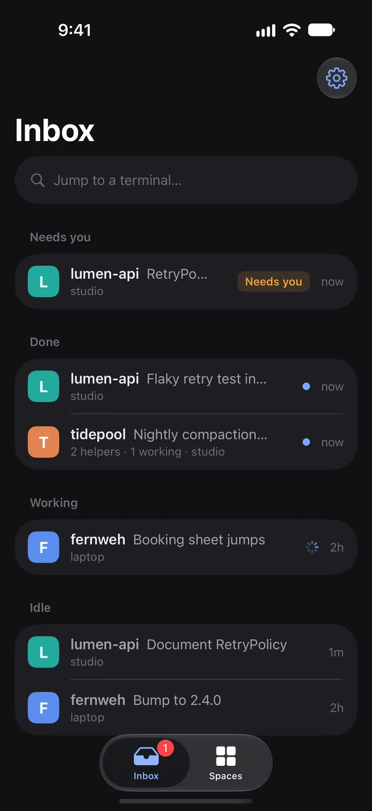
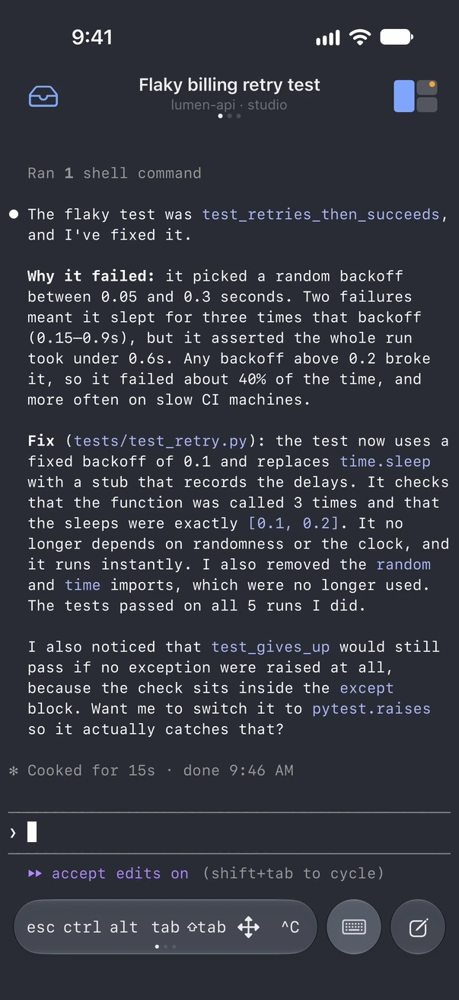
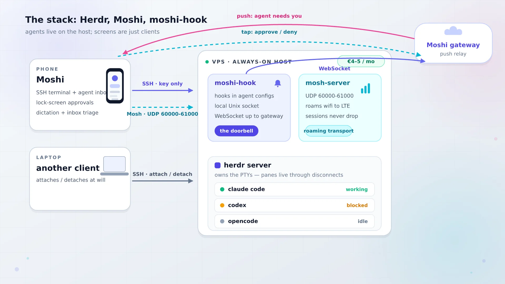
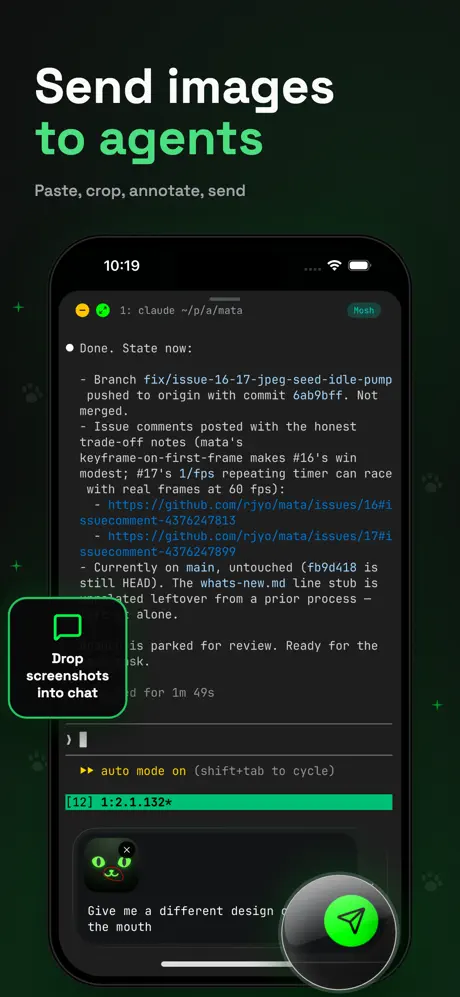
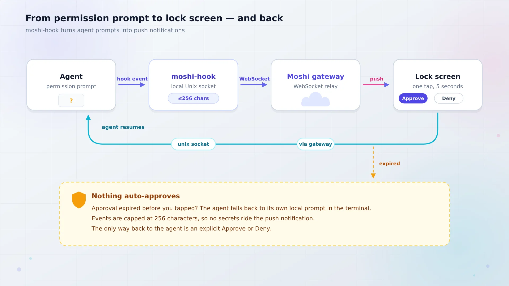

import Button from "@components/widgets/Button.astro";
import Notice from "@components/widgets/Notice.astro";
import ListCheck from "@components/widgets/ListCheck.astro";
import Accordion from "@components/widgets/Accordion.astro";
import Tabs from "@components/widgets/Tabs.astro";
import Tab from "@components/widgets/Tab.astro";
import YouTubeEmbed from "@components/widgets/YouTubeEmbed.astro";

*Disclosure: this guide contains referral links. If you buy through them, I may earn a commission at no extra cost to you.*

Run your AI coding agents on a €4-5/month VPS and steer them from your phone with either the **free official Herdr Mobile app** (iOS/Android over SSH/Tailscale to `herdr-core`) or **Moshi + `moshi-hook v0.4.62`** (Mosh UDP roaming, lock-screen Approve/Deny pushes, and support for both Herdr TUI and `herdr-core`).

Coding agents do not work like normal interactive shells. You kick off a refactor, walk away for twenty minutes, and then the whole run stalls on a 5-second permission prompt. Running agents on a machine that never sleeps turns every laptop, tablet, and phone you own into a disposable window onto the same live session.

One major change since I wrote this guide in September 2026: **Herdr now ships its own official mobile app** for iPhone, iPad, and Android. That gives you two genuinely strong mobile paths depending on which Herdr runtime you run. Here is how they compare and exact setup steps for both.

<Notice type="info" title="Claude Code does not install on your phone">
Your agent CLIs, git repos, and credentials stay on your VPS or home server. Your phone is just a terminal window and a doorbell. Everything in both setups below follows from that split.
</Notice>

## Official Herdr Mobile vs Moshi: which phone app should you use?

Use **Herdr Mobile** if you run `herdr-core` / Herdr Desktop and want a completely free, zero-account, direct-SSH phone client; use **Moshi + `moshi-hook v0.4.62`** if you run Herdr TUI (or both TUI and Core), roam on flaky mobile data (Mosh UDP), or want lock-screen Approve/Deny push buttons and native Chat View.

| Feature | Official Herdr Mobile | Moshi + `moshi-hook v0.4.62` |
|---|---|---|
| Price | **Free** (App Store + Google Play) | Free SSH tier; Pro `$7.99/mo` or `$69.99/yr` (3 devices) |
| Supported Herdr backend | **`herdr-core` (`hc`) only** (no Herdr TUI) | **Both** Herdr TUI (`v0.9.5`) and `herdr-core` (`hc`) |
| Transport | Direct SSH / Tailscale SSH | SSH, Mosh (UDP roaming), Eternal Terminal, Tailscale |
| Lock-screen Approve/Deny push | In-app banner while open | Yes (native push + Live Activities via `moshi-hook`) |
| Native Chat View + diffs | Real terminal + compose + photo/voice | Real terminal + Tier-A Chat View (Claude/Codex/Hermes/Antigravity/OMP) + diffs |
| Git worktree from phone | Mirror desktop spaces | Create worktrees directly from a Herdr space (`v0.4.60+`) |
| Account / relay | None (direct SSH) | Push relay for `moshi-hook` (256-char cap; no code uploaded) |





## Path 1: Free official Herdr Mobile + `herdr-core` on a VPS

Install `herdr-core` (`hc v0.1.21`) on your Linux VPS, enable systemd lingering so agents survive logout, and connect directly from the free Herdr Mobile app over Tailscale SSH.

```bash
# On your Ubuntu/Debian VPS
curl -fsSL https://releases.herdr.dev/core/install.sh | sh
sudo loginctl enable-linger $USER

# Start an agent in the background
hc run --bg --name api claude
hc ls
```

Then install **Herdr** from the [App Store](https://apps.apple.com/app/id6828898364) or [Google Play](https://play.google.com/store/apps/details?id=dev.herdr.app), add your VPS (it auto-discovers hosts from your SSH config and Tailscale devices), and tap into the Inbox:

- Swipe right on an agent to pin or mark read; swipe left to send `Esc`.
- Open **compose** to type long replies, paste screenshots, attach photos, or use on-device dictation.
- Watching from your phone never resizes panes open in [Herdr Desktop](/herdr-app-layouts-mods/) back at your desk.

## Path 2: Moshi + Herdr TUI (or Core) with lock-screen push approvals

Choose this path if you want Mosh UDP resilience across LTE drops, lock-screen Approve/Deny buttons via `moshi-hook`, or you live on **Herdr TUI (`v0.9.5`, 52K+ stars, Apache-2.0)**.





### Step 1: Prepare your VPS (Herdr TUI + Mosh + UTF-8)

Provision a small 2 vCPU / 4 GB VPS on [Hetzner Cloud](https://go.bitdoze.com/hetzner) or [Hostinger VPS](https://go.bitdoze.com/hostinger-vps) (see [secure VPS setup for AI coding agents](/vps-ai-coding-setup/) and [2026 VPS pricing shifts](/vps-price-increases/)).

```bash
# Install Herdr TUI and expose it on default non-interactive SSH PATH
curl -fsSL https://herdr.dev/install.sh | sh
sudo ln -sf ~/.local/bin/herdr /usr/local/bin/herdr
herdr --version

# Install Mosh + fix minimal-image UTF-8 locale
sudo apt update && sudo apt install -y mosh tmux
sudo locale-gen en_US.UTF-8 && sudo update-locale LANG=en_US.UTF-8

# Firewall (skip UDP/SSH public opens if using Tailscale only)
sudo ufw allow OpenSSH
sudo ufw allow 60000:61000/udp
```

Verify from your laptop: `ssh you@vps 'command -v herdr'` must print `/usr/local/bin/herdr`, otherwise Moshi's non-interactive probe will not show the Herdr tab.

### Step 2: Pair `moshi-hook` and enable systemd lingering

On your phone, open **Moshi > Settings > Hooks** and copy your pairing token.

<Tabs>
<Tab name="Linux VPS">

```bash
curl -fsSL https://getmoshi.app/install.sh | sh
moshi-hook pair --token <YOUR_TOKEN>
moshi-hook install
sudo loginctl enable-linger $USER
moshi-hook serve
```

</Tab>
<Tab name="macOS host">

```bash
brew tap rjyo/moshi
brew install rjyo/moshi/moshi-hook
brew trust --formula rjyo/moshi/moshi-hook
brew services start rjyo/moshi/moshi-hook
moshi-hook pair --token <YOUR_TOKEN>
moshi-hook install
```

</Tab>
</Tabs>

Since `moshi-hook v0.4.34`, the daemon auto-updates itself every 6 hours (pause with `moshi-hook set auto-update ask`). As of `v0.4.62` (November 2026), it hooks Claude Code, Codex, OpenCode, Hermes, Antigravity, and OMP, surfaces both Herdr TUI sessions and `herdr-core` spaces, and caps push payloads at 256 characters so secrets never leak to notifications.



### Step 3: Start agents and wire lifecycle integrations

```bash
herdr
# Inside panes, start claude, codex, opencode, or pi
herdr integration install claude
herdr integration install codex
herdr session list --json
```

Pair Claude Code with a cheap second brain like [OpenCode](/opencode-setup-guide/) ([OpenCode Go](https://go.bitdoze.com/opencode-go)) or [Pi Agent](/pi-coding-agent-setup-guide/) in adjacent tabs. Remember on phone glass: use tabs rather than tiny split panes.

<YouTubeEmbed url="https://youtube.com/embed/o1Zfr4CMt-U" label="Testing Moshi: SSH Client for Coding Agents" />

## Common pitfalls and quick fixes

<ListCheck>
<ul>
<li><strong>Moshi does not show the Herdr tab:</strong> Run <code>sudo ln -sf ~/.local/bin/herdr /usr/local/bin/herdr</code> and make sure a Herdr server is running.</li>
<li><strong><code>moshi-hook</code> dies on SSH logout:</strong> Run <code>sudo loginctl enable-linger $USER</code> and verify with <code>moshi-hook status</code>.</li>
<li><strong><code>moshi-hook</code> says <code>herdr: not found</code>:</strong> Add <code>Environment="MOSHI_HERDR_PATH=/usr/local/bin/herdr"</code> via <code>systemctl --user edit moshi-hook.service</code>.</li>
<li><strong>Herdr Mobile shows no agents:</strong> Confirm you launched agents inside <code>herdr-core</code> (<code>hc</code>), not <code>herdr</code> TUI, and that they emit OSC 7501 (or run updated agent CLIs directly without nested tmux).</li>
<li><strong>Detach vs stop:</strong> <code>Ctrl+B q</code> detaches safely; <code>herdr server stop</code> kills every running pane process.</li>
</ul>
</ListCheck>

## Security posture: keep everything on your tailnet

Moshi's docs put it right: a phone client is a window and a doorbell, not a sandbox. Your code, git credentials, and LLM logins stay on the VPS. Harden the host with key-only SSH, biometric key lock on the phone, and Tailscale (or [self-hosted Headscale](/headscale-self-hosted-tailscale-setup/)) so you never expose public SSH or Mosh UDP ports at all. See [hardening a server with UFW](/bsi-security-report-docker-ufw/) before putting production keys on a VPS.

## Frequently asked questions

<Accordion label="Can I run Claude Code or Codex directly on my phone?" group="faq" expanded="true">
No. The agent CLI runs on your VPS or home server; your phone connects as a terminal client and approval doorbell via Herdr Mobile or Moshi.
</Accordion>

<Accordion label="Does the official Herdr Mobile app work with Herdr TUI?" group="faq">
No. Herdr Mobile connects exclusively to `herdr-core` (`hc`), the runtime under Herdr Desktop. If you use Herdr TUI (`v0.9.5`), use Moshi, ColliePWA, Heeler, or SSH/Mosh instead.
</Accordion>

<Accordion label="Should I pay for Moshi Pro if Herdr Mobile is free?" group="faq">
Start with free **Herdr Mobile** if you already use `herdr-core` over Tailscale and do not need Mosh UDP roaming or lock-screen Approve/Deny buttons. Pay for **Moshi Pro** ($7.99/mo or $69.99/yr) if you switch networks constantly on LTE, want Tier-A Chat View + lock-screen approvals, or run Herdr TUI and tmux alongside `herdr-core`.
</Accordion>

<Accordion label="What happens when my VPS reboots?" group="faq">
Running pane processes stop on reboot. In Herdr TUI, layout restores and `herdr integration install` lets you resume agent conversations by session ID. In `herdr-core v0.1.21`, setting `restore_screen = true` in `config.toml` preserves each terminal's last screen above a fresh shell.
</Accordion>

## Next steps

Pick **Herdr Core + free Herdr Mobile** for the simplest zero-cost official phone workflow, or **Herdr + Moshi Pro** for Mosh UDP roaming and lock-screen push approvals.

If you want phone approvals for T3 Code or Orca instead, [Orca vs T3 Code](/orca-vs-t3-code/) explains how each one connects to a phone.

<Button text="Secure your VPS first" link="/vps-ai-coding-setup/" variant="solid" color="blue" icon="arrow-right" />
<Button text="Compare all Herdr clients" link="/best-herdr-clients/" variant="outline" color="gray" />

Continue the series: [Herdr review (TUI + Desktop)](/herdr-agent-multiplexer/), [Herdr Desktop layouts & mods](/herdr-app-layouts-mods/), [best Herdr plugins](/best-herdr-plugins/), and [best terminal multiplexers](/best-terminal-multiplexers/).
