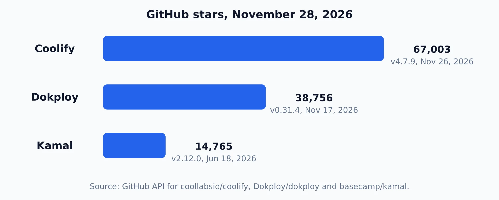
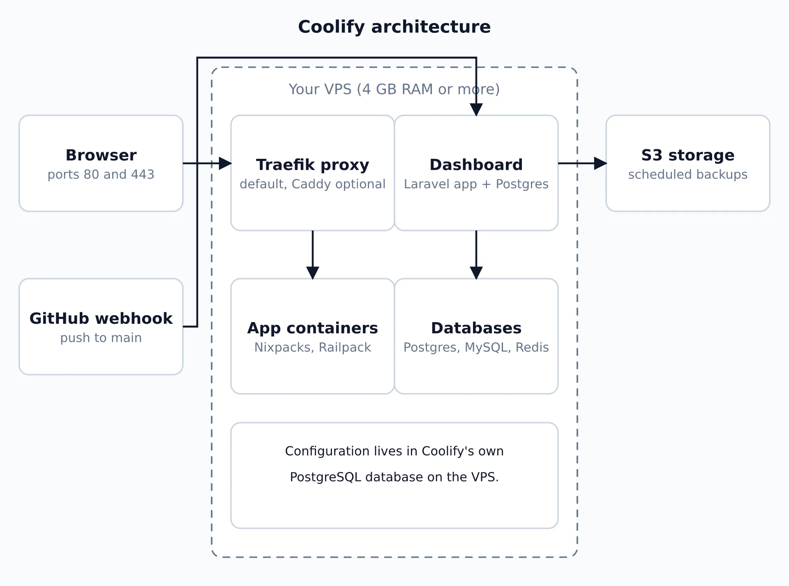
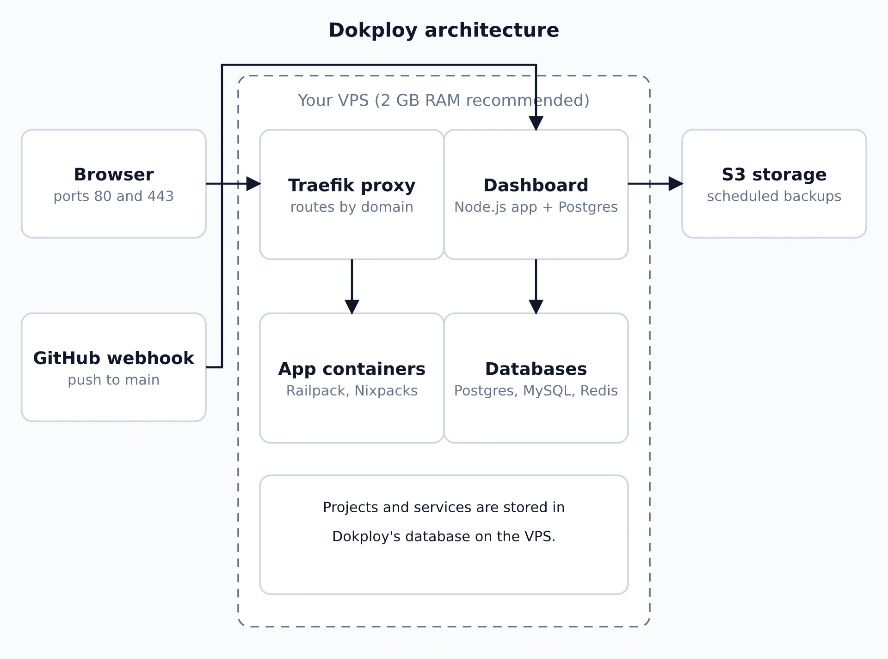
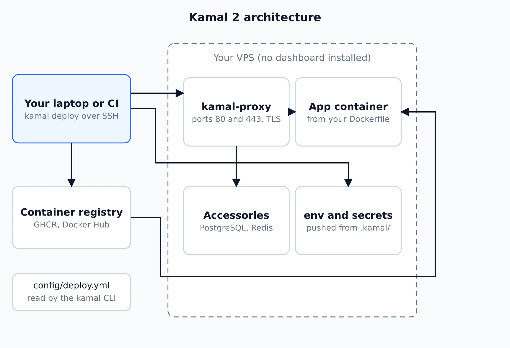
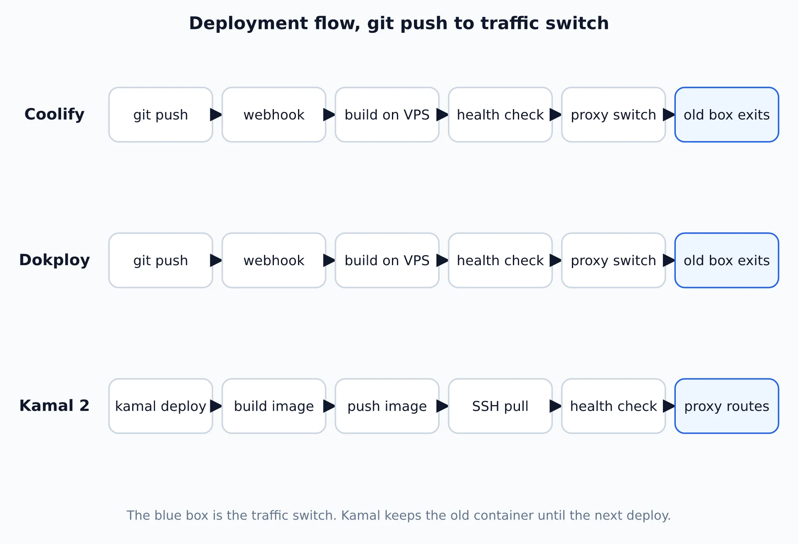
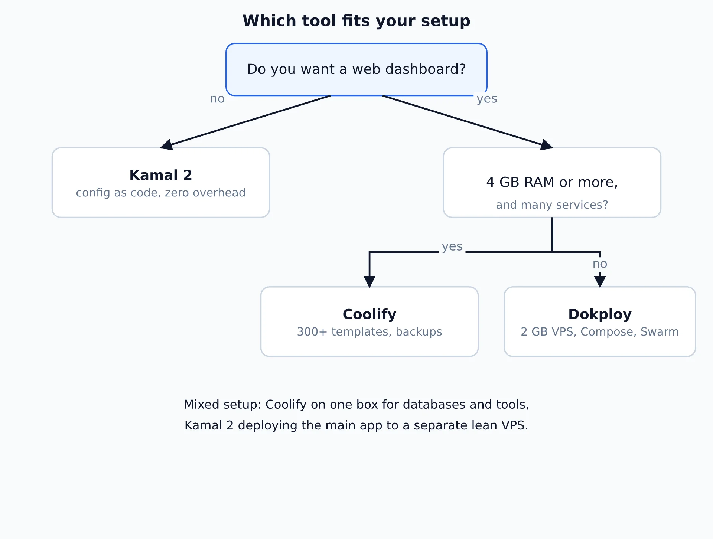

import Accordion from "@components/widgets/Accordion.astro";
import Notice from "@components/widgets/Notice.astro";
import Tabs from "@components/widgets/Tabs.astro";
import Tab from "@components/widgets/Tab.astro";

Pick Coolify for an all-in-one hub on a 4 GB VPS, Dokploy for a 2 GB VPS, or Kamal 2 when you want a CLI and zero dashboard RAM. All three deploy Docker containers behind Traefik or kamal-proxy on a VPS from EUR 5.49 a month.

I've been paying managed PaaS bills for years. Heroku's pricing got worse after the free tier died. Vercel starts free but the bandwidth charges sneak up on you once real traffic hits. At some point I did the math. A $6/month Hetzner VPS could run everything I was paying $40-60/month for across Heroku and Vercel combined.

The problem was never the server cost. It was the overhead of managing raw Linux boxes. Writing Nginx configs, setting up systemd services, handling SSL renewals, doing zero-downtime deployments by hand. That's the stuff that eats your weekends.

That's why self-hosted PaaS tools exist. They give you the convenience of a managed platform on your own hardware. Right now, three tools dominate this space: **Coolify**, **Dokploy**, and **Kamal 2**. I've deployed production apps to all three over the past year, and they each solve the same problem in different ways.

This article is the comparison I wish I had when I started. If you already know which tool interests you, we have dedicated guides for [installing Coolify](/coolify-install-heroku-alternative/) and [installing Dokploy](/dokploy-install/). If your problem is managing several VPSes you already own rather than deploying apps onto one, look at [ServerOS](/serveros-panel-review/) instead. It is a different tool for that job. For the wider field, see the [best self-hosted panels](/best-self-hosted-panels/) roundup.

## Quick comparison

The table's repository numbers, proxy defaults and template counts come from the GitHub API and each project's docs, checked on November 28, 2026.

| | Coolify | Dokploy | Kamal 2 |
| :--- | :--- | :--- | :--- |
| **Interface** | Web dashboard | Web dashboard | CLI only |
| **Idle RAM usage** | ~1.5 to 2 GB | ~400-500 MB | 0 MB on server |
| **Reverse proxy** | Traefik (default), Caddy optional | Traefik | Kamal Proxy |
| **SSL certificates** | Automatic | Automatic | Automatic |
| **One-click templates** | 300+ apps/databases | ~30 templates | None |
| **Multi-server** | One app on several servers, load balancer not included | Docker Swarm built-in | SSH to multiple hosts |
| **Database management** | Full (backup, restore, UI) | Basic (backup to S3) | Manual |
| **Minimum VPS** | 4 GB RAM | 2 GB RAM | 512 MB RAM |
| **License** | Apache 2.0 | Core open source, Enterprise features licensed | MIT |
| **Best for** | All-in-one self-hosting hub | Lightweight VPS deployments | CLI-native devs, Rails teams |



*GitHub stars and latest release per project, from the GitHub API on November 28, 2026.*

## Coolify: the full-featured dashboard

Coolify is a web dashboard that builds your Git repository on your own VPS and routes traffic to the containers through Traefik. It idles at 1.5 to 2 GB of RAM and offers 300+ one-click services.

- **Verdict:** 300+ one-click services and scheduled database backups, at the cost of 1.5 to 2 GB of idle RAM.
- **Best for:** a 4 GB VPS that runs apps, databases and self-hosted tools from one dashboard.
- **Trade-offs:** Docker Swarm support is deprecated and v5 removes it; proxy errors take time to debug.
- **Price:** Apache 2.0 licensed, free. You pay for the VPS only.

I wrote a [full Coolify v5 review](/coolify-v5-self-hosted-paas-review/) recently, so I won't repeat everything. The short version follows.

The **template library** holds 300+ one-click services, per the docs: databases, Redis, monitoring tools, wiki software, you name it. I run [Plausible Analytics](/install-plausible-analytics/), PostgreSQL, and Redis all deployed through Coolify templates, and it took maybe 10 minutes total. Adding a new database is two clicks.

**Git-push deployments** run on a webhook. Push to main, Coolify builds and deploys. It supports preview deployments for pull requests too, which is useful if you want to test branches on a real server before merging.



*What runs on the VPS with Coolify and where the configuration lives.*

**Backups are built in.** You can schedule PostgreSQL and MySQL backups directly from the UI and push them to S3-compatible storage. I use Cloudflare R2 for this, and Coolify handles the scheduling and rotation.

### Where Coolify struggles

The biggest problem is **resource consumption**. Coolify runs a Laravel backend, a PostgreSQL database, Redis, queue workers, and a reverse proxy container (Traefik by default since v4, Caddy optional). All of that idles at roughly 1.5 to 2 GB of RAM before you deploy a single app. If you put Coolify on a 2 GB VPS, you'll get OOM-killed the moment you try to run anything meaningful alongside it.

<Notice type="warning" title="Don't cheap out on the VPS">
I tried running Coolify on a 2 GB Hetzner CX22 once. It worked for about a week, then a build triggered during a traffic spike and the whole server froze. You need 4 GB minimum, more like 8 GB if you plan to run several apps and databases. Check our [Hetzner Cloud review](/hetzner-cloud-review/) for VPS recommendations.
</Notice>

The other annoyance is that **proxy debugging can be painful**. The [Coolify docs](https://coolify.io/docs/core/networking/proxy/overview) say Traefik is the default and the proxy the core team runs in production, while Caddy has thinner documentation. When routing breaks, the error messages aren't always helpful. I've spent more time than I'd like restarting Coolify's proxy container and waiting for it to regenerate configs.

With enough RAM, one Coolify dashboard covers builds, Traefik routing, SSL and scheduled backups for every app on the server. The [install process](/coolify-install-heroku-alternative/) takes about 10 minutes.

## Dokploy: the lightweight middle ground

Dokploy is a web dashboard that runs Docker Compose and Traefik on your own VPS and idles at 400-500 MB of RAM. Its docs recommend a server with at least 2 GB of RAM and 30 GB of disk.

- **Verdict:** Git and Docker Compose deploys at 400-500 MB idle, with Docker Swarm built in.
- **Best for:** a 2 GB VPS, existing `docker-compose.yml` files, multi-node Swarm.
- **Trade-offs:** about 30 templates; SSO, custom roles and audit logs need an Enterprise plan or license key.
- **Price:** the core is free and open source; Enterprise features are paid.



*What runs on the VPS with Dokploy. Configuration lives in its own database.*

I covered the [full Dokploy installation](/dokploy-install/) in a separate guide. The short version: run a single curl command, wait two minutes, and you have a working PaaS on your server.

### What Dokploy does well

**Resource efficiency.** Dokploy idles around 400-500 MB of RAM, so a cheap 2 GB VPS still has room for a couple of Node.js apps and a PostgreSQL database. For side projects and small SaaS apps, this matters a lot.

**Docker Swarm is built in.** If you outgrow a single server, Dokploy lets you add worker nodes and distribute containers across them using Docker Swarm. Coolify can push one application to several standalone servers, but you bring your own load balancer. Its experimental Swarm support is [deprecated and slated for removal in v5](https://coolify.io/docs/core/infrastructure/scaling/docker-swarm). For multi-node scaling without Kubernetes, Dokploy is the only one of the three with an orchestrator built in.

**Docker Compose support is native.** You can paste a full `docker-compose.yml` file into Dokploy and it runs it as-is. I've covered this in detail in [how to deploy Docker Compose apps in Dokploy](/dokploy-docker-compose-app/). If you already have compose files for your self-hosted tools, you paste them in and keep going.

Dokploy also handles [automated backups to Cloudflare R2](/dokploy-backups-cloudflare-r2/) and supports [deploying Python apps with Railpack and uv](/dokploy-python-railpack-uv/), which is nice if you're running FastHTML or Flask apps. You can also [update Docker Compose stacks](/dokploy-update-docker-compose/) directly from the UI.

### Where Dokploy falls short

The **template library is small**, about 30 templates against 300+ in Coolify. To deploy something like Outline or Activepieces with a single click, you might need to write your own compose file. That's not hard, but Coolify's catalog saves you the work.

**Licensing is mixed.** The core deployment features are free and open source. Team features such as SSO, custom roles and audit logs need an [Enterprise plan or license key](https://docs.dokploy.com/docs/core/enterprise/license-keys), per the Dokploy docs. For most users this doesn't matter, but it's worth knowing if you plan to build commercial tooling on top of it.

The **community is smaller.** Coolify has about 67,000 GitHub stars. Dokploy sits near 38,800, and you'll find fewer tutorials and troubleshooting threads for it. When something breaks, you're more likely to be reading source code than finding a Stack Overflow answer.

## Kamal 2: the zero-overhead CLI tool

Kamal 2 comes from the team behind Ruby on Rails (37signals, the Basecamp/HEY people) and has no web dashboard at all. Nothing runs on your server except your containers and kamal-proxy.

- **Verdict:** zero dashboard RAM and the whole deployment in `config/deploy.yml`, paid for with no UI and manual database backups.
- **Best for:** one app on a small VPS, run from the terminal or CI.
- **Trade-offs:** you write the Dockerfile, run a container registry and script your own `pg_dump` jobs.
- **Price:** MIT licensed gem, free. You pay for the VPS only.

Kamal is a Ruby gem you run from your laptop or your CI pipeline. It connects to your server over SSH, pulls your Docker image, starts the new container, runs health checks, and swaps traffic with zero downtime. The kamal-proxy container image is about 43 MB compressed according to [Docker Hub](https://hub.docker.com/r/basecamp/kamal-proxy).



*Kamal 2 puts no dashboard on the VPS. The proxy and your containers are all that runs there.*

### What makes Kamal interesting

**Zero server overhead.** Your VPS resources go entirely to your applications. No dashboard eating 500 MB or 2 GB of RAM. A single app on a cheap $4 VPS gets the whole machine.

**Everything is a file in your repo.** Your deployment config lives in `config/deploy.yml`, your environment variables in `.kamal/secrets`, and your Docker setup in a standard `Dockerfile`. There's nothing to click, nothing stored in a remote database. `git log` shows you the full history of every infrastructure change you've ever made. Kamal rejects unrecognized keys, so `kamal config` doubles as a syntax check before you touch a server.

**Zero-downtime deploys work out of the box.** Kamal starts the new container and waits for the health check to pass. By default that means the proxy hitting `/up` once a second. Then it tells kamal-proxy to route traffic to the new version. The old container stays around for a rollback; five old versions are kept by default. Rollbacks are one command: `kamal rollback`.

<Tabs>
<Tab name="deploy.yml example">
A basic Kamal deployment config looks like this:

```yaml
service: my-app
image: ghcr.io/myuser/my-app

servers:
  web:
    - 49.12.100.50
  workers:
    hosts:
      - 49.12.100.50
    cmd: bin/jobs

proxy:
  ssl: true
  host: myapp.com

registry:
  server: ghcr.io
  username: myuser
  password:
    - KAMAL_REGISTRY_PASSWORD

env:
  secret:
    - DATABASE_URL
    - REDIS_URL

accessories:
  db:
    image: postgres:16
    host: 49.12.100.50
    port: "127.0.0.1:5432:5432"
    env:
      secret:
        - POSTGRES_PASSWORD
    directories:
      - data:/var/lib/postgresql/data
```
</Tab>
<Tab name="Common commands">
Kamal's CLI is straightforward:

```bash
# First-time server setup
kamal setup

# Deploy latest changes
kamal deploy

# Roll back to previous version
kamal rollback

# Open a Rails console on the server
kamal app exec --interactive "bin/rails console"

# View live logs
kamal app logs -f

# Deploy to a specific server
kamal deploy --hosts=49.12.100.50
```
</Tab>
</Tabs>

### Where Kamal gets annoying

**No visual interface at all.** Want to check if your app is running? SSH in, or run `kamal app details`. Want to view logs? `kamal app logs`. Want to check database status? You're on your own. If you manage 10 services and want to glance at everything in one screen, Kamal doesn't help you.

**Database management is manual.** Kamal can spin up databases as "accessories" (see the config above), but it has no backup, browse or restore for them. You need to set up `pg_dump` cron jobs yourself. Both Coolify and Dokploy handle this for you.

**It's Ruby-centric.** While Kamal can deploy any Docker container, the documentation and community are heavily focused on Rails. If you're a Python or Node.js developer, the examples and conventions might feel unfamiliar.

**The learning curve is real.** If you've never used Docker registries, written Dockerfiles, or configured health check endpoints, Kamal will feel steep. Coolify and Dokploy abstract most of this away.

## Deployment workflows compared

Here's what the actual deployment experience looks like with each tool:



*Coolify and Dokploy build on the server after a webhook. Kamal builds where you run the command.*

<Tabs>
<Tab name="Coolify">
1. Push code to GitHub
2. Coolify detects the push via webhook
3. Builds using Nixpacks, Railpack, or your Dockerfile
4. Starts new container, runs health checks
5. Swaps traffic via the Traefik reverse proxy (Caddy if you picked it)
6. Old container is removed

Everything happens automatically. You watch it in the Coolify dashboard or ignore it entirely.
</Tab>
<Tab name="Dokploy">
1. Push code to GitHub
2. Dokploy detects the push via webhook
3. Builds using Nixpacks, Railpack, or your Dockerfile
4. Starts new container, runs health checks
5. Swaps traffic via Traefik reverse proxy
6. Old container is removed

Same automatic flow. Dokploy builds on the same server as its 400-500 MB dashboard. Coolify's dashboard takes 1.5 to 2 GB.
</Tab>
<Tab name="Kamal 2">
1. Push code to GitHub
2. From your terminal (or CI), run `kamal deploy`
3. Kamal builds the Docker image locally or in CI
4. Pushes to your container registry (GHCR, Docker Hub, etc.)
5. SSHs into your server, pulls the image
6. Starts new container, health check passes
7. kamal-proxy routes traffic to the new container
8. Old container runs for a grace period, then stops

You trigger it manually or wire it into GitHub Actions. It's more explicit but also more controllable.
</Tab>
</Tabs>

The build pack matters more than the panel. Both panels build with Nixpacks or Railpack when a repository has no Dockerfile, and the choice between those two is covered in [Railpack vs Nixpacks](/nixpacks-vs-railpack/).

## Which self-hosted PaaS should you pick?

Pick Coolify with 4 GB of RAM or more and many services to run. Pick Dokploy on a 2 GB VPS or when you have Docker Compose files, and Kamal 2 when you want the config in git and no dashboard on the server.

After a year of using all three, here's how I decide:



*The two questions that settle it for most setups.*

<Accordion label="Pick Coolify when..." group="pick" expanded="true">

- You have a VPS with 4+ GB RAM and want to manage apps, databases, and self-hosted services from one place
- You value one-click templates and don't want to write Docker Compose files for common tools
- You want built-in database backups, monitoring, and webhook-triggered deployments
- You're coming from Heroku or Vercel and want the closest self-hosted equivalent

Read the [full Coolify v5 review](/coolify-v5-self-hosted-paas-review/) or jump to the [Coolify install guide](/coolify-install-heroku-alternative/).

</Accordion>

<Accordion label="Pick Dokploy when..." group="pick">

- You're on a cheap VPS (2 GB RAM) and can't afford Coolify's resource overhead
- You already have Docker Compose files and want a UI to manage them
- You need multi-node scaling via Docker Swarm without the complexity of Kubernetes
- You want a PaaS experience but value efficiency over a massive template library

Follow our [Dokploy install guide](/dokploy-install/) or learn about [deploying Docker Compose apps](/dokploy-docker-compose-app/) and [setting up backups](/dokploy-backups-cloudflare-r2/).

</Accordion>

<Accordion label="Pick Kamal 2 when..." group="pick">

- You want zero overhead on the server and maximum control over deployments
- You prefer infrastructure-as-code with everything version-controlled in your repo
- You're comfortable with the terminal and don't need a web dashboard
- You're deploying a single app (or a small number of apps) and want the simplest possible server setup
- You're already in the Ruby/Rails ecosystem

Kamal is not the only way to drive Docker from a config file. [Komodo](/komodo-docker-install/) does config-driven deploys behind a web panel, if you want the middle ground.

</Accordion>

<Notice type="info" title="You can also mix and match">
I run Coolify on one 8 GB server for managing databases and self-hosted tools (wiki, analytics, monitoring). For my main production web app, I use Kamal 2 deploying to a separate lean VPS. There's no rule that says you have to pick only one tool.
</Notice>

## How much does self-hosting cost per month?

Self-hosting any of the three runs on a Hetzner VPS from EUR 5.49 a month (November 28, 2026), against $30-50/mo for the same app stack on Heroku in May 2026. The self-hosted core of each tool is free, so the VPS is the only bill.

| Setup | Managed PaaS cost | Self-hosted cost |
| :--- | :--- | :--- |
| 1 web app + PostgreSQL + Redis | Heroku: $30-50/mo | Coolify on 4 GB VPS: $7/mo |
| 1 web app + 1 database | Vercel + Neon: $20-40/mo | Dokploy on 2 GB VPS: $4-5/mo |
| 1 web app, minimal infra | Railway: $10-20/mo | Kamal on 1 GB VPS: $3-4/mo |
| 5 apps + databases + monitoring | Multi-platform: $100+/mo | Coolify on 8 GB VPS: $15/mo |

These are rough numbers. Self-hosting runs 5-10x cheaper for equivalent workloads, and the tradeoff is your time managing the server. Coolify and Dokploy remove the Nginx, systemd and certificate work. With Kamal you write the Dockerfile, and the proxy still sets itself up.

The EUR 5.99 tier is the next step on Hetzner's [cloud pricing page](https://www.hetzner.com/cloud/), also before VAT. The managed PaaS column shows what those setups cost on managed platforms in May 2026. Current list prices for Heroku, Vercel, Railway and Neon depend on usage, so check each pricing page before you compare. Our [Hetzner cost-optimized plans](/hetzner-cloud-cost-optimized-plans/) guide has the full table.

## FAQ

<Accordion label="Can I migrate from one tool to another?" group="faq" expanded="true">
Yes, because all three tools use standard Docker containers. Your applications are packaged as Docker images regardless of which tool deploys them. To migrate from Dokploy to Coolify (or vice versa), you set up the new tool on the same or different server, point it at your Git repository, and deploy. You export and reimport databases by hand with `pg_dump` and `pg_restore`.
</Accordion>

<Accordion label="Can I run multiple apps on one server?" group="faq">
Yes, all three tools support this. Coolify and Dokploy use their Traefik reverse proxies to route traffic based on domain names. Kamal 2 uses kamal-proxy to do the same thing. The limiting factor is your server's RAM and CPU, not the tools themselves.
</Accordion>

<Accordion label="Which tool handles automatic database backups?" group="faq">
Coolify and Dokploy both have built-in backup scheduling. You can push backups to S3-compatible storage like Cloudflare R2, Backblaze B2, or AWS S3. Kamal 2 doesn't handle backups at all, so you need your own cron jobs with `pg_dump` or similar tools.
</Accordion>

<Accordion label="Do any of these work on ARM servers?" group="faq">
Yes. All three work on ARM64 servers, including Hetzner's ARM instances and Oracle Cloud's free ARM VMs. Coolify and Dokploy run their dashboards on ARM without issues. Kamal deploys Docker images, so as long as your image supports ARM (multi-arch builds), it works fine.
</Accordion>

<Accordion label="What about Kubernetes?" group="faq">
None of these tools use Kubernetes. They're all Docker-based, which keeps them simple and resource-efficient. If you need Kubernetes-level orchestration, look at tools like Rancher or k3s instead. For most small-to-medium deployments, Docker with one of these tools is more than enough.
</Accordion>

<Accordion label="Is there vendor lock-in?" group="faq">
No. All three tools rely on standard Docker containers and Git repositories. If you stop using any of them, your application code stays in your repo and your containers continue running until you manually stop them. There is nothing proprietary about the deployment artifacts.
</Accordion>
