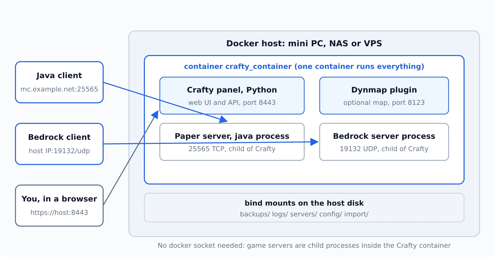
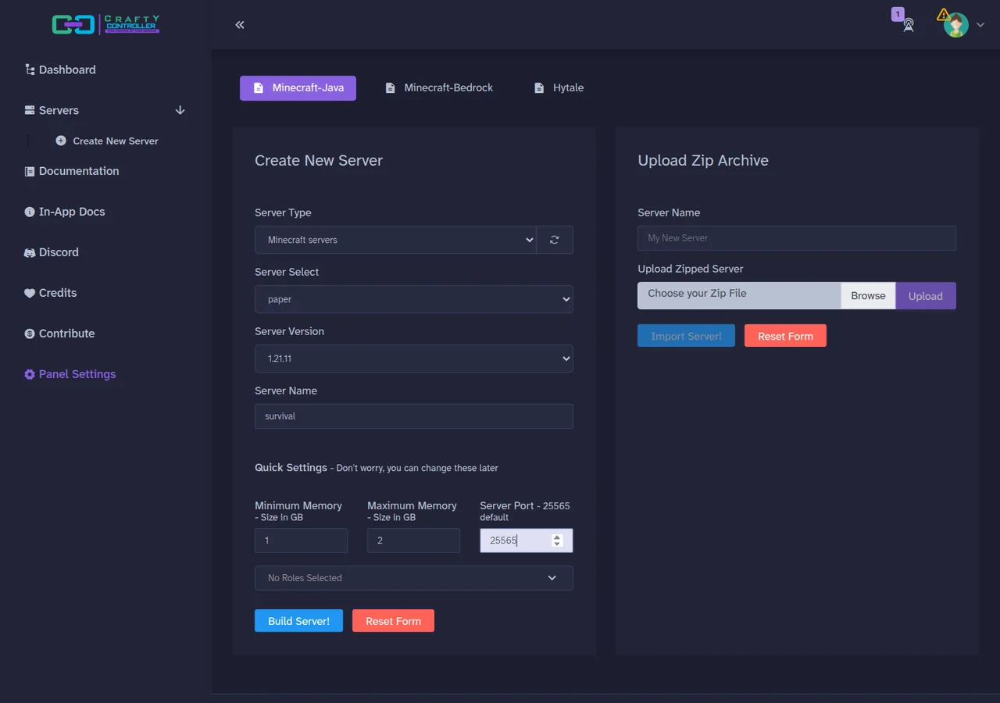
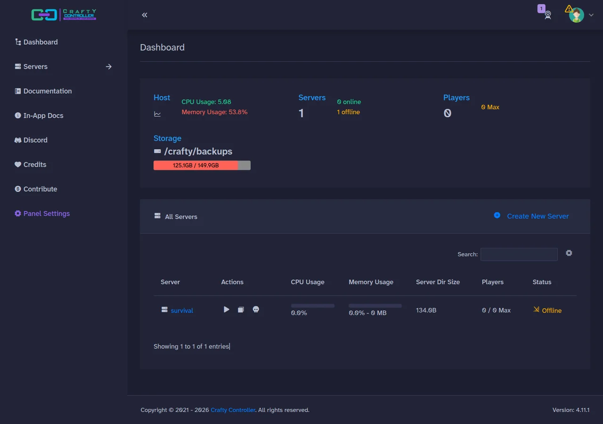
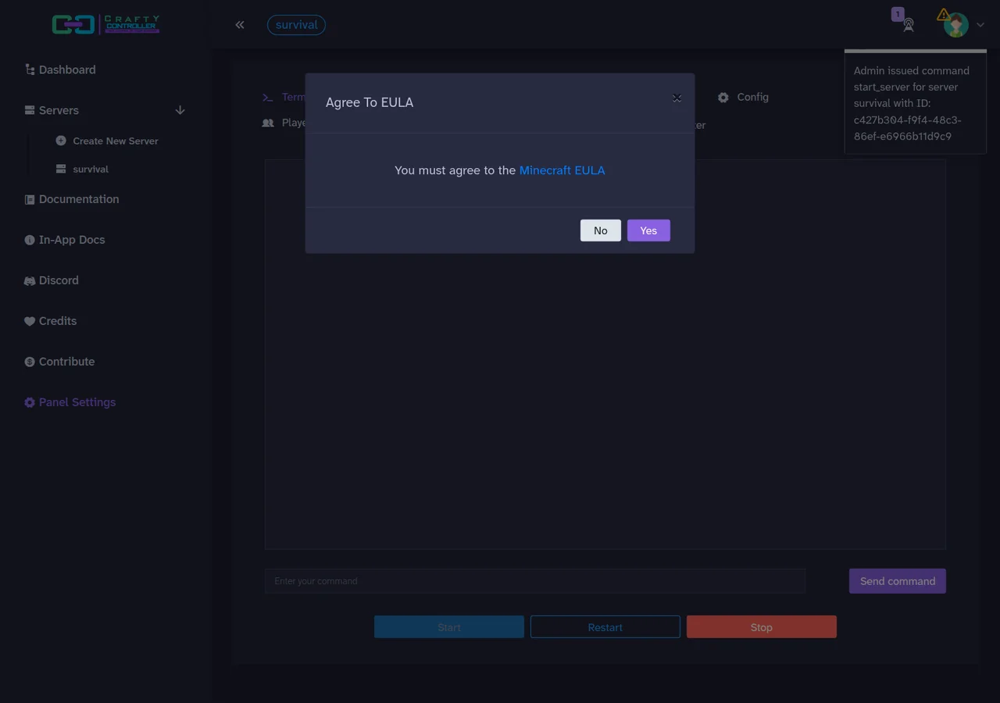
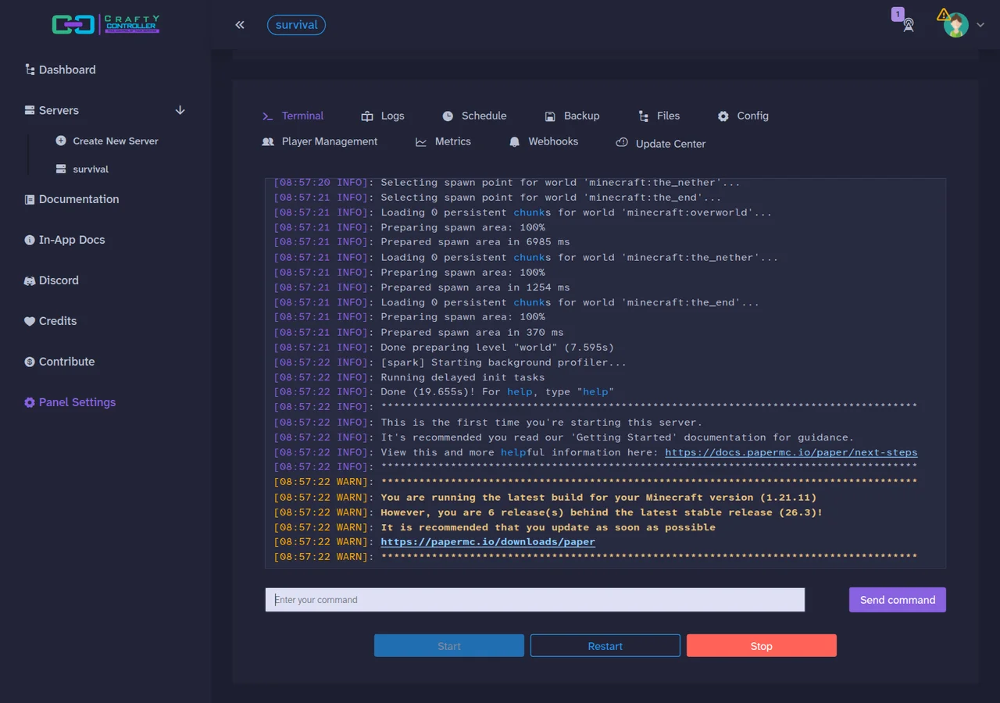
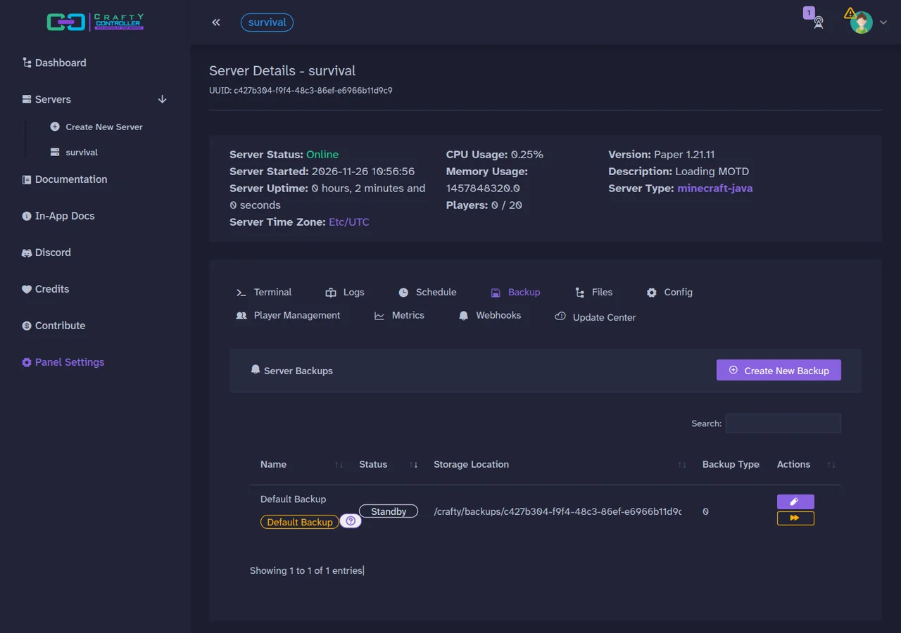
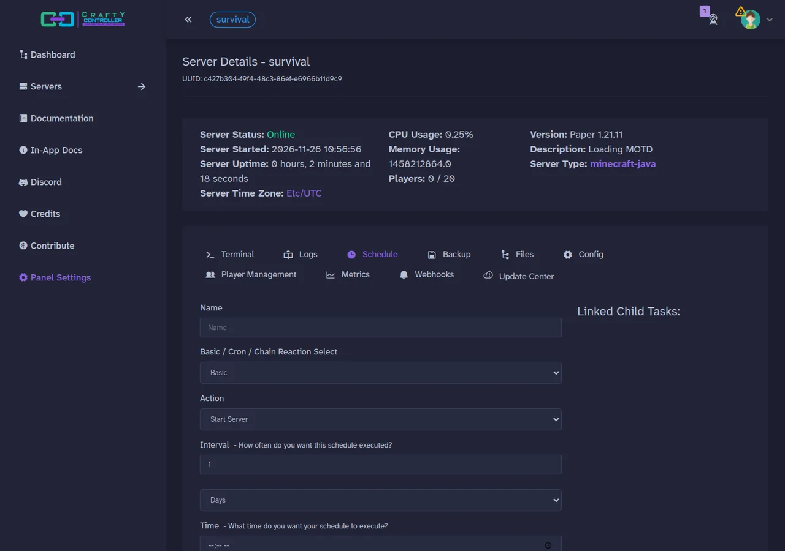

import Accordion from "@components/widgets/Accordion.astro";
import ListCheck from "@components/widgets/ListCheck.astro";
import Notice from "@components/widgets/Notice.astro";
import Tabs from "@components/widgets/Tabs.astro";
import Tab from "@components/widgets/Tab.astro";

Crafty Controller is a free, self-hosted web panel for running Minecraft servers (Java, Bedrock, and now Hytale) with user roles, schedules, backups, and webhooks. One Docker container holds the panel and every game server. This guide installs Crafty Controller 4.11.1 with Docker Compose on Linux and walks you through creating a Paper server end to end. I ran every step below in a throwaway container while writing this.

## What is Crafty Controller?

Crafty is a Python-based control panel for Minecraft servers. It launches each server as a child process inside the container and gives you a web UI for the console, files, players, backups, and automation. Think of it as a lighter alternative to [Pterodactyl](/pterodactyl-docker-install/) with one container, no separate daemon, and no external database.

What it supports, checked against the [GitLab repo](https://gitlab.com/crafty-controller/crafty-4) (258 stars, 280 forks on November 26, 2026), the [changelog](https://gitlab.com/crafty-controller/crafty-4/-/raw/master/CHANGELOG.md) and the docs (v4.11.1, released November 18, 2026):

<ListCheck>
<ul>
<li>**Minecraft Java** servers: Vanilla, Paper, Purpur, Fabric, Folia, Forge, and NeoForge, plus Velocity and BungeeCord proxies. The creation wizard downloads the jar for you.</li>
<li>**Minecraft Bedrock** dedicated servers, with their own wizard tab.</li>
<li>**Hytale** servers, added in 4.9.0 (January 24, 2026).</li>
<li>**SteamCMD games** as an experimental alpha since 4.10.0 (March 2, 2026), amd64 images only. Crafty is still a Minecraft panel first. If you need 100+ game types, look at Pterodactyl or read my [Pterodactyl vs Pelican](/pterodactyl-vs-pelican/) comparison.</li>
<li>Per-server terminal, file manager, config editor, player management, and metrics.</li>
<li>A [task scheduler](https://docs.craftycontrol.com/pages/user-guide/task-scheduler) with cron and chained tasks, plus a backup manager with retention.</li>
<li>[Webhooks](https://docs.craftycontrol.com/pages/user-guide/webhooks) for Discord, Slack, Mattermost, and Teams.</li>
<li>User accounts with roles, MFA (TOTP and [passkeys](https://docs.craftycontrol.com/pages/user-guide/user-authentication/passkey-configuration/)), a [public status page](https://docs.craftycontrol.com/pages/getting-started/public-status-page) at `/status`, and a REST API (v2).</li>
</ul>
</ListCheck>



*Crafty runs every game server as a child process inside the Crafty container itself, so there is nothing to mount from the Docker daemon.*

That architecture choice matters for security. Unlike Pterodactyl's Wings or most Docker management panels, Crafty runs without `/var/run/docker.sock` mounted. Its official compose file omits the socket mount, and I confirmed in `app/classes/shared/server.py` inside the 4.11.1 image that Crafty launches game servers via `subprocess.Popen`. A compromised panel therefore has no path to the host Docker daemon, limiting the blast radius to the container and its bind mounts.

## Who is Crafty Controller for?

Crafty fits families and homelabbers running a handful of Minecraft servers rather than hosting companies reselling game slots. It pairs well with a low-power home server or NAS (see my picks for the [best mini PC for a home server](/best-mini-pc-home-server/) and [best NAS for Docker homelabs](/best-nas-homelab-docker-proxmox/)). It is also a regular recommendation in my [Docker containers for a home server](/docker-containers-home-server/) guide.

It also works on a VPS if you want friends to connect without exposing your home IP. A 2 vCPU/4 GB VPS is a reasonable starting point for Crafty plus one or two small Paper servers.

## Prerequisites

<ListCheck>
<ul>
<li>A Linux host with Docker and the Compose plugin installed. The official images are published for amd64 and arm64, so a Raspberry Pi or ARM VPS works.</li>
<li>RAM: on my test box a fresh container with no servers idled at about 80 to 110 MiB in `docker stats`. Budget 1-2 GB per small vanilla or Paper server on top of that (my rule of thumb), more for modded.</li>
<li>Disk: about 2.7 GB for the image on disk, a fresh Paper server is roughly 300-500 MB after world generation, plus your backups.</li>
<li>Firewall: Docker publishes ports around UFW, so read [why Docker bypasses your firewall](/docker-bypasses-firewall/) before exposing 8443 and the server range on a VPS.</li>
</ul>
</ListCheck>

<Notice type="warning" title="Do not run this on Docker for Windows or WSL2">
The [Crafty docs](https://docs.craftycontrol.com/pages/getting-started/installation/docker/) warn against running this image on Docker for Windows. On Docker Desktop or WSL2 under Windows 11, a known volume permission bug creates a 90% chance that stopping or restarting a server corrupts world chunks beyond repair. Run the container on Linux only, or use the native portable build from the [Crafty releases page](https://gitlab.com/crafty-controller/crafty-4/-/releases) on Windows.
</Notice>

## Is Crafty Controller free?

Yes. Crafty is free and open source under the [GPL-3.0 license](https://gitlab.com/crafty-controller/crafty-4/-/raw/master/LICENSE), matching the LICENSE file shipped in the repo and container image. Its contribute page accepts optional Ko-fi and Patreon donations (with early-access subscriber perks), and the docs list a commercial support email. You only pay for your own hardware or VPS.

## Install Crafty Controller with Docker Compose

Pick Docker Compose or a plain `docker run`. Both start the same container with the same ports and bind mounts. I use Compose because the file is easy to keep in git and edit.

<Tabs>
<Tab name="Docker Compose">

Create a directory and the compose file:

```bash
mkdir -p ~/crafty && cd ~/crafty
vim docker-compose.yml
```

```yaml
services:
  crafty:
    container_name: crafty_container
    image: registry.gitlab.com/crafty-controller/crafty-4:4.11.1
    restart: always
    environment:
      - TZ=Etc/UTC
    ports:
      - "8443:8443" # HTTPS panel
      - "8123:8123" # Dynmap (optional)
      - "19132:19132/udp" # Bedrock
      - "25500-25600:25500-25600" # Minecraft Java servers
    volumes:
      - ./backups:/crafty/backups
      - ./logs:/crafty/logs
      - ./servers:/crafty/servers
      - ./config:/crafty/app/config
      - ./import:/crafty/import
```

Start it and follow the logs:

```bash
docker compose up -d
docker logs crafty_container -f
```

</Tab>
<Tab name="docker run">

The same container as one command. I ran this exact command with the 4.11.1 image and the panel answered on 8443:

```bash
mkdir -p ~/crafty && cd ~/crafty
docker run \
  --name crafty_container \
  --detach \
  --restart always \
  -p 8443:8443 \
  -p 8123:8123 \
  -p 19132:19132/udp \
  -p 25500-25600:25500-25600 \
  -e TZ=Etc/UTC \
  -v "$(pwd)/backups:/crafty/backups" \
  -v "$(pwd)/logs:/crafty/logs" \
  -v "$(pwd)/servers:/crafty/servers" \
  -v "$(pwd)/config:/crafty/app/config" \
  -v "$(pwd)/import:/crafty/import" \
  registry.gitlab.com/crafty-controller/crafty-4:4.11.1
docker logs crafty_container -f
```

</Tab>
</Tabs>

<Notice type="success" title="What you should see">
Wait for `Crafty has fully started and is now ready for use!` in the logs. On my test box that took about 20 to 30 seconds from `docker run`, because the first boot generates a key pair and a self-signed TLS certificate.
</Notice>

Notes on this file:

- **Pinned version.** I pin `4.11.1` instead of `latest` so upgrades are deliberate. The same image exists on Docker Hub as `arcadiatechnology/crafty-4:4.11.1` if the GitLab registry is slow for you; both registries are listed in the [Docker install docs](https://docs.craftycontrol.com/pages/getting-started/installation/docker/). The image is about 660-680 MB compressed on Docker Hub (678 MB for amd64, 663 MB for arm64) and 2.67 GB on disk after you pull it. It is large because it bundles multiple JDKs. Running `ls /usr/lib/jvm` shows Java 8, 11, 17, 21, and 25 inside the image, with 25 set as default.
- **The 25500-25600 range.** Each Minecraft server inside Crafty needs its own TCP port. This range gives you 100 of them. The docs warn that much larger ranges can stall Docker's networking, so do not widen it much. If you only ever run two servers, `"25565-25566:25565-25566"` is fine too, as long as your Crafty servers stay inside the published range.
- **19132/udp** is the default Bedrock port. Skip it if you only run Java servers.
- **Hytale.** The compose example in the repo README also publishes `5520-5550/udp` for Hytale servers. Add that line only if you plan to run one.
- **8123** is for the Dynmap plugin's web map. Optional.
- **Volume layout.** `servers/` holds server directories, `config/` stores `config/db/crafty.sqlite` and credentials, `backups/` saves automated archives, and `import/` accepts zip files of existing servers.

## First login and the default password

Open `https://YOUR_HOST_IP:8443` in a browser. It must be `https`, and your browser will warn about the self-signed certificate. That is expected; the [access docs](https://docs.craftycontrol.com/pages/getting-started/access/) say to proceed anyway.


*The login screen, with a field for an authenticator code when MFA is enabled and a Forgot Password button.*

The default admin credentials are random per install, generated on first boot and stored in the config volume:

```bash
cat ~/crafty/config/default-creds.txt
```

```json
{
    "username": "admin",
    "password": "<64 random characters>",
    "info": "This is NOT where you change your password. This file is only a means to give you a default password."
}
```

On a fresh 4.11.1 container, this file holds a 64-character password with `600` permissions. If `cat` returns permission denied on the host, read it through Docker instead using `docker exec crafty_container cat /crafty/app/config/default-creds.txt`.

Log in as `admin` with that generated string, click your username in the top right to open your profile, and change the password right away. Enable TOTP while you are there because Crafty exposes console and file control over game server processes.

You can also preset your own admin credentials before first boot. The docs say to rename `default.json.example` to `default.json`; the 4.11.1 Docker image has no `.example` file, so in Docker I create `config/default.json` myself before the first start:

```bash
mkdir -p ~/crafty/config
echo '{"username": "myadmin", "password": "a-long-password-here"}' > ~/crafty/config/default.json
```

The password needs at least 8 characters, or Crafty ignores it and falls back to the generated one per `app/classes/shared/main_models.py`. On 4.11.1, logging in with the preset username and password worked cleanly, while `admin` with the sample password failed. One catch is that the first-start wrapper only copies default configs into an empty `config/` folder. Pre-creating `default.json` left my test run without `logging.json`, `motd_format.json`, and `credits.json`. Crafty still booted and allowed logins, though keeping the generated password and changing it in the UI is cleaner.

<Notice type="info" title="Locked out?">
Hit **Forgot Password** on the login screen. Per the [Crafty FAQ](https://docs.craftycontrol.com/pages/user-guide/faq), this activates an anti-lockout account for one hour, and its credentials are printed to the Crafty terminal, which in Docker means `docker logs crafty_container`. Reset the real password, log out of the anti-lockout account, and log back in normally.
</Notice>

## Create a Paper Minecraft server

From the dashboard, click **Create New Server**. The wizard has three tabs at the top: Minecraft-Java, Minecraft-Bedrock, and Hytale.



*The creation wizard. Pick a type, a version, name it, and set memory and port.*

For a Paper server:

1. **Server Type:** Minecraft servers (the proxies entry is for Velocity and BungeeCord).
2. **Server Select:** paper. Fabric, Forge, NeoForge, Purpur, Folia, and vanilla are in the same dropdown.
3. **Server Version:** pick the version your players run. I chose 1.21.11 for this test. The version list comes from Crafty's jar index, which the panel refreshes every 12 hours, so you see current releases.
4. **Server Name:** anything, for example `survival`.
5. **Memory:** minimum 1 GB, maximum 2 GB for a small survival world. Modded servers want 4-8 GB max.
6. **Server port:** 25565 for the first server. It must sit inside your published range.

Click **Build Server**. Crafty downloads the Paper jar and sets everything up; the dashboard shows the server as importing for a few seconds.



*The dashboard with the server created. Host CPU and memory stats are always visible at the top.*

Open the server page and hit **Start**. On first boot you get the EULA dialog:



*Crafty asks you to agree to the Minecraft EULA on first start instead of silently accepting it.*

Click Yes and watch the terminal. Paper downloads the vanilla jar, applies patches, remaps, and generates the world. In my test the whole process from clicking Start to `Done (19.655s)!` took about half a minute on a small server.



*A live Paper server in the Crafty terminal. You can type commands in the input at the bottom.*

Each server view gives you tabs for Terminal, Logs, Schedule, Backup, Files, Config, Player Management, Metrics, and Webhooks. There is also an Update Center that pulls newer server builds in one click.

## Connect from a Minecraft client

In the Minecraft Java client, go to Multiplayer, click Add Server, and enter `YOUR_HOST_IP:25565`. On a home network, forward port 25565 TCP (plus 19132 UDP for Minecraft Bedrock) on your router to the host. You can also connect privately over a mesh VPN like Tailscale, covered in [Netbird vs Headscale vs Tailscale](/netbird-vs-headscale-vs-tailscale/).

Two port rules trip people up:

- Each server needs a **unique** port inside the 25500-25600 range you published. The second server goes on 25566, the third on 25567, and so on.
- Players always connect to the **host IP and the host-side port**, never the container IP. If you remapped the range in compose (`"35500-35600:25500-25600"`), players use the left-hand number while Crafty still shows the internal one.

## Backups, schedules, and users

### Backups

The Backup tab manages per-server schedules, as detailed in the [backup manager docs](https://docs.craftycontrol.com/pages/user-guide/backup-manager). Its default backup job runs before any server update and cannot be removed. You can add custom jobs with separate storage paths, retention limits (**Max Backups**, where 0 means unlimited), and file exclusions. Each job can also shut down the server during copies and run pre- or post-backup commands.

Keep two warnings from the docs in mind. Crafty copies files live on disk, so shutting the server down during backups prevents data corruption from mid-copy world writes. Compression is optional and carries chunk corruption risks according to the docs, making shutdown-during-backup with compression disabled the safest default. Since archives land in `backups/` and Crafty has no panel self-backup, include all panel volume mounts in your host backup job.



*The backup manager. Each server gets a default backup config you can extend.*

### Schedules

The Schedule tab automates anything: start, stop, restart, backup, or arbitrary console commands. Three modes:

- **Basic:** pick an action, an interval, and a time of day.
- **Cron:** a raw cron string for full control. The [scheduler docs](https://docs.craftycontrol.com/pages/user-guide/task-scheduler) warn that Crafty offsets the day-of-week index by one, making `0` Monday instead of Sunday. Day abbreviations like MON-FRI still work fine.
- **Chain reaction:** runs after a parent schedule finishes, with a delay offset. The classic chain is broadcast a warning, wait two minutes, then restart.



*Creating a schedule. Actions cover server lifecycle, backups, and custom commands.*

A good baseline schedule runs a nightly backup at 4 AM followed by a chained server restart five minutes later.

### Users and roles

Panel Settings manages user accounts with per-server roles. Permissions split granularly across console access, file management, backups, schedules, and player actions. That lets you grant a friend console access to one world without exposing the host panel. Superusers retain global access across all settings.

Webhooks per server push events such as server start, stop, and crash to Discord, Slack, Mattermost, or Teams. Each webhook has a test button and a message template that supports Jinja2 variables like `server_name` and `event_type`, as described in the [webhook docs](https://docs.craftycontrol.com/pages/user-guide/webhooks).

## Running multiple servers and port planning

Crafty can run many servers from one panel; the limits are RAM and port bookkeeping. The table below is my estimate, not a benchmark:

| Servers | RAM for panel + servers (estimate) | Ports used |
|---|---|---|
| 1-2 small Paper | 4 GB total | 25565, 25566 |
| 3-4 mixed | 8 GB total | 25565-25568 |
| Modded network | 16 GB+ | plan one port per server plus proxy |

If you go the network route, run a Velocity proxy on 25565 and keep the backend servers on higher ports. Players only ever need the proxy port open.

Minecraft Bedrock and Java can run side by side because Bedrock defaults to `19132/udp` while Java servers use TCP ports.

## Put Crafty behind a reverse proxy

The panel uses websockets (WSS), so a naive reverse proxy config breaks the terminal live view. The [official proxy examples](https://docs.craftycontrol.com/pages/getting-started/proxies) cover nginx, Apache, Nginx Proxy Manager, SWAG, and Traefik. This is the nginx location block from the docs and from `config_examples/nginx.conf.example` in the image, in a minimal server block:

```nginx
server {
    listen 443 ssl;
    server_name panel.example.com;

    ssl_certificate /path/to/fullchain.pem;
    ssl_certificate_key /path/to/privkey.pem;

    location / {
        proxy_http_version 1.1;
        proxy_redirect off;

        proxy_set_header Upgrade $http_upgrade;
        proxy_set_header Connection $http_connection;
        proxy_set_header X-Forwarded-Proto https;
        proxy_set_header X-Forwarded-For $proxy_add_x_forwarded_for;
        proxy_set_header Host $http_host;

        proxy_pass https://localhost:8443;

        proxy_buffering off;
        client_max_body_size 0;
        proxy_connect_timeout 3600s;
        proxy_read_timeout 3600s;
        proxy_send_timeout 3600s;
        send_timeout 3600s;
    }
}
```

Note the upstream is `https`, not `http`, because Crafty only serves TLS. The `Upgrade` and `Connection` headers are required; the docs say Crafty does not function properly without them. `client_max_body_size 0` removes nginx's default upload cap, which matters when you upload server zips through the panel. The docs also note that some ad blockers block WSS connections, so test in a clean browser profile if the terminal stays blank.

I run [Traefik as my reverse proxy in Docker](/traefik-proxy-docker/). The Crafty docs' Traefik example sets `--serversTransport.insecureSkipVerify=true` (the panel certificate is self-signed), points the service at port 8443 with `loadbalancer.server.scheme=https`, and adds an `X-Forwarded-Proto` header middleware. I did not test the Traefik setup myself.

Only the panel goes through the proxy. Minecraft traffic is raw TCP/UDP and connects directly to the host ports; there is nothing to proxy unless you run a Minecraft-aware proxy like Velocity.

## Updating Crafty

The image carries no state, so updates are a pull and recreate. Take a backup of your volume mounts first, as the [Docker docs](https://docs.craftycontrol.com/pages/getting-started/installation/docker/) say:

```bash
cd ~/crafty
# edit docker-compose.yml to the new version tag
docker compose pull
docker compose up -d
```

If you used `docker run`, stop and remove the container with `docker stop crafty_container` and `docker rm crafty_container`, pull the new tag, and run the launch command again. Your worlds stay intact in the bind mounts.

Crafty runs database migrations automatically on boot. Read the [GitLab release notes](https://gitlab.com/crafty-controller/crafty-4/-/releases) before major version bumps and follow any staff upgrade guidance for breaking changes. Never track the `latest` tag on a panel managing your worlds.

## Where Crafty falls short

- **No Docker on Windows, period.** The native Windows portable install exists, but the container path is Linux-only by upstream's own warning.
- **Not a game panel.** SteamCMD support is an experimental alpha as of 4.11.1, and only on amd64 images. If your main goal is CS2, Valheim, ARK, or Rust, [Pterodactyl](/pterodactyl-docker-install/) or Pelican handle those through eggs.
- **Single host.** Crafty runs servers as local child processes, so one instance manages the machine it runs on. There is no equivalent of Pterodactyl's Wings nodes.
- **No HA.** It is one Python process with a SQLite database (`config/db/crafty.sqlite`). Fine for a homelab, not for a hosting business.
- **No built-in panel backup.** You back up the volumes yourself, which is normal for Docker but worth saying out loud.
- **Bedrock is a separate flow.** It has its own wizard tab that downloads the latest Bedrock server. Importing an existing Bedrock server goes through the zip import, and I did not test that path.

None of these limits hurt its intended audience. For a homelab running a few Minecraft servers, Crafty is the lowest-friction panel I have used, putting everything in one reproducible compose stack without a Docker socket mount.

## FAQ

<Accordion label="What are the default Crafty Controller login credentials?" group="faq">
The username is `admin` and the password is a random 64-character string generated on first boot, stored in `config/default-creds.txt` inside your config volume. Run `cat ~/crafty/config/default-creds.txt` on the host to read it, or `docker exec crafty_container cat /crafty/app/config/default-creds.txt` if the file permissions block you, and change the password from the profile page right after logging in.
</Accordion>

<Accordion label="How do I reset a forgotten Crafty Controller password?" group="faq">
Click **Forgot Password** on the login screen. This activates a temporary anti-lockout account for one hour, and its credentials are printed to the Crafty logs. Run `docker logs crafty_container` to read them, log in with the temporary account, reset the real password, then log out and back in.
</Accordion>

<Accordion label="Why does my Minecraft server say the port is already in use?" group="faq">
Every server needs a unique TCP port inside the range you published in compose (25500-25600 by default). If server one is on 25565, create the next one on 25566. You can check which ports are taken on the host with `ss -ltn | grep 255`.
</Accordion>

<Accordion label="Does Crafty Controller need the Docker socket mounted?" group="faq">
No. The official compose and `docker run` examples have no socket mount, and Crafty runs game servers as child processes inside its own container. That is a real security advantage over panels that mount `/var/run/docker.sock`, since a compromised panel has no socket to control other containers on the host.
</Accordion>

<Accordion label="Can I import an existing Minecraft server into Crafty?" group="faq">
Yes. Zip the existing server folder and place it in the `import/` volume, or upload it through the creation wizard. Next, select Import on the server creation screen and point it to the root directory and server jar. For Forge and NeoForge, the [Crafty FAQ](https://docs.craftycontrol.com/pages/user-guide/faq) recommends creating a fresh server with the builder instead. If you import one anyway, update the launch command to use the `@libraries/.../unix_args.txt` format documented in that FAQ.
</Accordion>

<Accordion label="How much RAM does Crafty Controller use?" group="faq">
A fresh container with no servers idled at about 80 to 110 MiB in `docker stats` on my test box. With one Paper 1.21.11 server online and zero players, the container used about 1.5 GB total, with the server capped at 2 GB heap. Plan for 1-2 GB per small vanilla or Paper server on top of the panel (my rule of thumb), and 4-8 GB for modded.
</Accordion>

<Accordion label="Can I run Crafty Controller on a Raspberry Pi or ARM server?" group="faq">
Yes. The Docker Hub image has both amd64 and arm64 manifests, and the [Docker install docs](https://docs.craftycontrol.com/pages/getting-started/installation/docker/) say the Arcadia images support both out of the box. The launcher script in the image prints that SteamCMD is only available on amd64, so SteamCMD features are disabled on ARM. A Pi 5 or an ARM VPS should handle a couple of small Minecraft servers; I have not tested ARM myself.
</Accordion>

<Accordion label="How do I update Crafty Controller running in Docker?" group="faq">
Edit the version tag in `docker-compose.yml`, then run `docker compose pull && docker compose up -d`. Migrations run on boot. Back up your volume mounts before updating, and check the GitLab release notes for breaking changes before a major version jump.
</Accordion>
