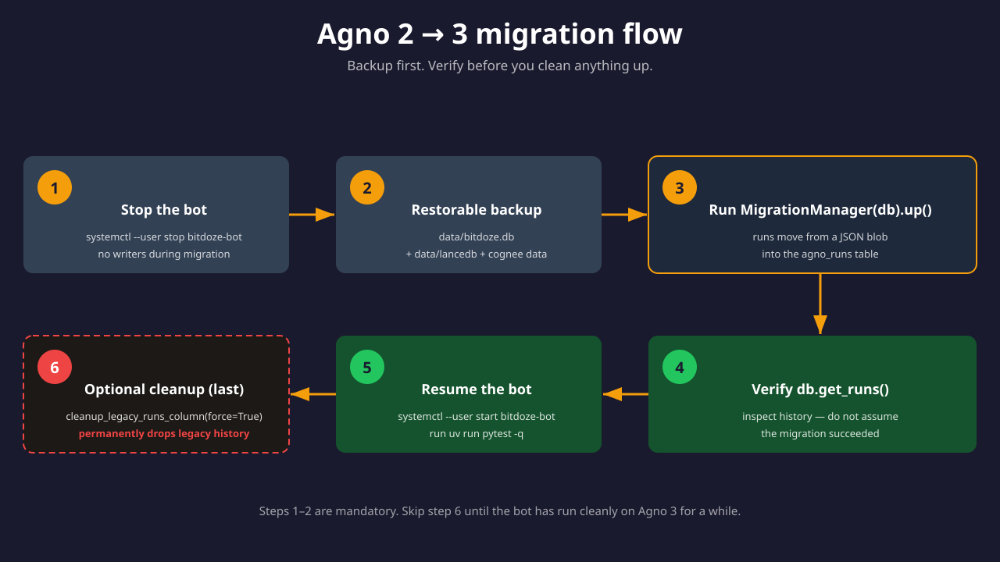

import Notice from "@components/widgets/Notice.astro";
import Button from "@components/widgets/Button.astro";
import ListCheck from "@components/widgets/ListCheck.astro";
import Accordion from "@components/widgets/Accordion.astro";
import YouTubeEmbed from "@components/widgets/YouTubeEmbed.astro";
import Tabs from "@components/widgets/Tabs.astro";
import Tab from "@components/widgets/Tab.astro";

This guide walks through building a self-hosted Discord AI bot with [Agno](https://github.com/agno-agi/agno). It streams replies, remembers conversations, searches a knowledge base you control, and can hand work to specialized agents and multi-agent teams. If you are new to Agno, read the [Agno getting started guide](/agno-get-start/) first, then come back here.

One version note up front, because it will bite you otherwise: the repo currently targets **Agno 2.5.10** via its `uv.lock`, while PyPI ships Agno 3.1.10. Agno 3.0 is a breaking release that requires a database migration, so do not casually upgrade dependencies. The upgrade path is covered in [Upgrading to Agno 3](#upgrading-to-agno-3).

<Notice type="warning" title="Agno version pin">
The bot targets Agno 2.5.10. Agno 3.0+ (released 2026-08-24) is breaking and needs a DB migration. `uv sync` installs the locked 2.5.10 and is safe. `uv lock --upgrade` or `uv sync -U` jumps to 3.x and will break the bot until you migrate. Check what you are running with `uv pip show agno`.
</Notice>

<Button text="View on GitHub" link="https://github.com/bitdoze/bitdoze_bot" variant="solid" color="purple" size="md" icon="github" />

<YouTubeEmbed
  url="https://www.youtube.com/embed/yoWGFO7tvpc"
  label="Stop Using OpenClaw! Use Agno a Lightweight AI Agent Alternative Instead"
/>

## What this bot does

- Responds when you `@mention` it in Discord
- Streams responses, so the message updates as content generates
- Stores memories and learns your preferences over time
- Searches a knowledge base backed by LanceDb or PgVector
- Runs scheduled jobs via cron plus a 30-minute heartbeat
- Delegates complex work to agent teams, including a parallel fan-out pool
- Gates tools by role, channel, and user, with an audit log


Under the hood there are five moving parts. The `discord_bot.py` runtime handles streaming edits, routing prefixes, and access control. Agno agents and teams do the actual thinking; the default setup ships a `main` agent, a `research` agent, a `delivery-team`, and a `general-subagents` pool for parallel chunks of work. State lives in three stores: SQLite or PostgreSQL for conversations and memory, LanceDb or PgVector for document search, and optional Cognee or Hindsight for long-term semantic memory. Cron and heartbeat keep the bot useful while idle, and run telemetry plus a watchdog tell you when something is stuck. Tool permissions decide which of these capabilities run where.

## Prerequisites

<ListCheck>
<ul>
<li>Python 3.12+ and <a href="/uv-get-start/">UV Python package manager</a></li>
<li>A Discord application with a bot token</li>
<li>An OpenAI-compatible API key (OpenRouter works well)</li>
<li>Optional: GitHub token for the GitHub tools</li>
<li>Optional: Docker for PgVector and Cognee</li>
<li>~1 GB RAM VPS if you want it running 24/7</li>
</ul>
</ListCheck>

Cost floor before you start: a small VPS runs about $4-6/month (I host mine on a [Hetzner Cloud VPS](https://go.bitdoze.com/hetzner); a [Hostinger VPS](https://go.bitdoze.com/hostinger-vps) is the budget alternative). Model calls can hit a free tier, and the only non-free default dependency is the `text-embedding-3-small` embedder, which is cheap. LanceDb itself is local and free.

## Quick start

```bash
git clone https://github.com/bitdoze/bitdoze_bot.git
cd bitdoze_bot
uv sync
python scripts/setup_bot.py
```

The setup wizard asks for your Discord token, API keys, and optional settings. It writes `~/.bitdoze-bot/` with `config.yaml`, `.env`, and the data directories.

<Notice type="info" title="What uv sync pins">
The repo ships a `uv.lock`, so `uv sync` is reproducible: it installs Agno 2.5.10 plus the exact dependency set the bot was built against. That is the behavior you want. If you later run `uv lock --upgrade` or `uv sync -U`, you will pull Agno 3.x and need the migration in the upgrade section below.
</Notice>

**Verify the install:**

```bash
uv run pytest -q
uv run main.py
```

Tests should pass, and on first run you should see the bot come online in Discord. Check that `logs/bitdoze-bot.log` and `logs/run-telemetry.jsonl` are being written. If neither log grows, the process died early and the traceback is in your terminal.

## Discord bot setup

1. Go to [discord.com/developers](https://discord.com/developers) and create an application.
2. Add a bot to the application and copy the token.
3. Enable **Message Content Intent** in the bot's privileged gateway intents. This is required, the bot cannot read `@mention` text without it.
4. Invite the bot to your server. Minimum permissions: Send Messages, Embed Links, Read Message History, Attach Files.
5. Put the token in `~/.bitdoze-bot/.env` as `DISCORD_BOT_TOKEN` (or let the wizard do it).

<Notice type="warning" title="Message Content Intent is the number one failure">
If the bot comes online but ignores every message, the intent is off in the developer portal. Re-check the toggle, restart the bot, and try again. A 403 on the invite link means missing permissions, not a code problem.
</Notice>

**Verify:** `@mention` the bot in a channel it can read. You should get a streamed reply.

## Project structure

```text
bitdoze-bot/
  main.py
  config.example.yaml
  docker-compose.yml
  bitdoze_bot/
    agents.py                     # agent + team construction from config
    cognee.py / cognee_tools.py   # long-term memory client and tools
    config.py                     # config schema
    cron.py                       # CRON.yaml scheduler
    discord_bot.py                # discord.py runtime, streaming, routing
    discord_runtime_utils.py
    discord_tool_fallback.py      # parser-level denied-tool guard
    discovery_tools.py            # self-improvement / learned knowledge
    heartbeat.py                  # 30-minute heartbeat loop
    logging_setup.py              # rotating file logs
    run_monitor.py                # run telemetry + watchdog
    setup_wizard.py
    tool_permissions.py           # allow/deny rules + audit log
    utils.py
  scripts/
    setup_bot.py                  # interactive setup wizard
    generate_soul.py              # SOUL.md personality generator
    setup_knowledge.py            # ingest workspace/knowledge/
  tests/
```

The load-bearing modules are `agents.py` (how YAML becomes Agno objects), `cognee.py` (memory), `run_monitor.py` (telemetry), and `tool_permissions.py` (gates). The `scripts/` helpers are the day-two tools: setup once, then re-run `setup_knowledge.py` whenever you change documents.

## Configuration

Config lives in `~/.bitdoze-bot/config.yaml`. Every key below exists in the repo's `config.example.yaml`.

### Environment variables

```env
DISCORD_BOT_TOKEN=your_discord_token
OPENAI_API_KEY=your_api_key            # works for OpenRouter too
GITHUB_ACCESS_TOKEN=optional_github_token
GLM_API_KEY=optional_zai_key
MEMORY_DB_URL=optional_postgres_url    # memory backend: postgres
PGVECTOR_DB_URL=optional_pgvector_url  # knowledge backend: pgvector
COGNEE_API_TOKEN=optional_cognee_token
```

Secrets stay in `.env`, never in YAML. The bot reads env var *names* from config (`api_key_env`, `token_env`) and resolves values at runtime.

### Basic config

```yaml
model:
  provider: openai_like        # Agno's OpenAILike; Agno 3 also has a native openrouter provider
  id: <pick-a-currently-free-model>   # browse https://openrouter.ai/models?max_price=0
  base_url: https://openrouter.ai/api/v1
  api_key_env: OPENAI_API_KEY
  structured_outputs: false

discord:
  token_env: DISCORD_BOT_TOKEN

runtime:
  streaming_enabled: true
  streaming_edit_interval: 1.5
  agent_timeout: 600

memory:
  backend: sqlite              # sqlite | postgres
  db_file: data/bitdoze.db     # sqlite path
  # db_url_env: MEMORY_DB_URL  # postgres: falls back to PGVECTOR_DB_URL
  mode: automatic
  enable_session_summaries: true

learning:
  enabled: true
  mode: always
  stores:
    user_profile: true
    user_memory: true
    learned_knowledge: agentic   # the bot decides when to store insights
```

Memory is SQLite by default. Flip `backend: postgres` and set `MEMORY_DB_URL` (or `PGVECTOR_DB_URL`) when you already run PostgreSQL and want one datastore to back up. On Agno 3 the user-memory flag is renamed to `update_memory_on_run`, which is one of the small config-mapping changes the migration involves.

<Notice type="warning" title="Free model IDs rotate">
Free models on OpenRouter come and go. As of 2026-10-24 only 17 `:free` models remain of 469 total. If every message returns 401/404 `model_not_found`, your model ID is gone. Pick another from the free list and keep `structured_outputs: false` for free tiers. Free is a demo tier: plan on a paid model for anything you rely on.
</Notice>

<Button text="Browse free OpenRouter models" link="https://openrouter.ai/models?max_price=0" variant="outline" color="blue" size="md" />

### Streaming

Set `runtime.streaming_enabled: true` and the bot edits its Discord message as content arrives, at `streaming_edit_interval` seconds. Team runs fall back to non-streaming, which is expected. `runtime.slow_run_threshold_seconds: 45` makes the bot post a "still working" message on long runs so people do not assume it died.

### Knowledge base

The knowledge base is vector search over documents in `workspace/knowledge/`. Pick the backend that matches your infra.

<Tabs>
<Tab name="LanceDb (default)">
Zero setup. Embeddings and vectors live on disk at `data/lancedb`.

```yaml
knowledge:
  enabled: true
  backend: lancedb
  embedder: text-embedding-3-small
  lance_uri: data/lancedb
  table_name: bitdoze_knowledge
  learnings_table_name: bitdoze_learnings
```

Back up `data/lancedb` with the rest of `~/.bitdoze-bot/`. Rebuilding it means re-embedding your documents, which costs money and time.
</Tab>
<Tab name="PgVector (PostgreSQL)">
Use this when you already run PostgreSQL, for example the [deploy PgVector with Docker](/deploy-pgvector-pgadmin-docker/) setup.

```yaml
knowledge:
  enabled: true
  backend: pgvector
  embedder: text-embedding-3-small
  db_url_env: PGVECTOR_DB_URL
  table_name: bitdoze_knowledge
  learnings_table_name: bitdoze_learnings
```

`learnings_table_name` holds learned knowledge, and it is searchable through the same KB as your documents.
</Tab>
</Tabs>

After adding documents, ingest them:

```bash
python scripts/setup_knowledge.py
```

**Verify:** ask the bot something only your documents answer. **Failure mode:** if it answers from general knowledge instead, the KB is empty. Re-run `setup_knowledge.py` and check `data/lancedb` exists.

### Cognee memory (optional)

Cognee adds semantic long-term memory: the bot can sync conversations and recall relevant context on its own.

```yaml
memory:
  cognee:
    enabled: true
    base_url: http://localhost:8000
    auth_token_env: COGNEE_API_TOKEN
    auto_sync_conversations: true
    auto_recall_enabled: true
    auto_recall_limit: 5
    auto_recall_timeout_seconds: 10
    cognify_cooldown_seconds: 60
```

Recall has both a cap and a timeout, so memory lookups cannot blow up response latency. Start Cognee with `docker compose up -d` (see the Docker section below).

<Notice type="info" title="Alternative: Hindsight">
For a more capable memory system, [Hindsight with Docker](/hindsight-docker-deploy/) has a direct Agno integration (`hindsight-agno` 0.4.20 on PyPI as of 2026-10-24). It replaces Cognee with vector-based memory that includes entity extraction, mental models, and four parallel search strategies. If you are choosing between the two, the [Cognee vs Hindsight: which agent memory system to self-host](/cognee-vs-hindsight/) comparison lays out the tradeoffs.
</Notice>

### Agents and routing

```yaml
agents:
  default: main
  workspace_dir: workspace/agents
  definitions:
    - name: main
      tools: [web_search, hackernews, website, github, youtube, file, shell, discord, discoveries, cognee]
    - name: research
      tools: [web_search, hackernews, website, github, youtube, shell, cognee]
      skills: [web-research]
  aliases:
    engineer: software-engineer
    worker: general-subagent
  routing:
    rules:
      - agent: delivery-team
        starts_with: ["team:"]
      - agent: research
        contains: ["research:"]
      - agent: main
        channel_ids: [123456789012345678]
        user_ids: [111111111111111111]
```

Routing rules match on `contains` and `starts_with`, and they can also gate on `channel_ids`, `user_ids`, and `guild_ids`. Aliases let people type `agent:engineer` instead of `agent:software-engineer`. The `discovery` tools are what make the self-improvement loop work: combined with `learned_knowledge: agentic`, the bot saves its own learnings and searches them later.

### Teams

```yaml
teams:
  definitions:
    - name: delivery-team
      members: [architect, software-engineer]
      respond_directly: true
      determine_input_for_members: true
      delegate_to_all_members: false
      add_team_history_to_members: true
      num_team_history_runs: 5
    - name: general-subagents
      members: [general-subagent, general-subagent-2, general-subagent-3]
      delegate_to_all_members: true
```

`delivery-team` is the classic pair: an architect plans, a software engineer implements, and the team answers directly. `general-subagents` is a broadcast pool for parallel independent chunks of work, useful when you can split a task into three pieces that do not need each other's output.

<Notice type="warning" title="Team modes and a config footgun">
Do not set both `delegate_to_all_members: true` and `respond_directly: true` unless you want broadcast behavior. The bot warns when it sees this. On Agno 3 prefer `mode:` over the legacy toggles: `mode: route` replaces `respond_directly: true`, and `mode: broadcast` replaces `delegate_to_all_members: true`. The legacy flags still exist in Agno 3's constructor, but `determine_input_for_members` and `add_team_history_to_members` are undocumented there and the bot's config layer will need a mapping when it upgrades. For multi-agent patterns beyond this repo, see how to [build an AI research squad with Agno](/agno-squad/).
</Notice>

Agno 3 preferred form:

```yaml
teams:
  definitions:
    - name: delivery-team
      members: [architect, software-engineer]
      mode: route
```

### Runtime and monitoring

These keys decide multi-user behavior and how much you spend.

```yaml
runtime:
  max_concurrent_runs: 4
  slow_run_threshold_seconds: 45
  session_id_strategy: channel_user   # channel | user | channel_user

monitoring:
  run_telemetry: true
  telemetry_path: logs/run-telemetry.jsonl
  watchdog_enabled: true
  watchdog_threshold_seconds: 300

tool_fallback:
  denied_tools: [shell, discord]

logging:
  level: INFO
  file: logs/bitdoze-bot.log
  max_bytes: 10485760
  backup_count: 5

context:
  scope_workspace_context_by_tenant: true
  main_session_scope: dm_only
```

`session_id_strategy` and `max_concurrent_runs` are your token-spend dials. `channel_user` keeps each user's conversations separate per channel; `user` merges everything a user says into one session. The watchdog reports runs stuck longer than `watchdog_threshold_seconds`. Rotating file logs (10MB x 5) capture tool-audit detail that `journalctl` misses. `scope_workspace_context_by_tenant` isolates workspace context files (`USER.md`, `MEMORY.md`, `AGENTS.md`, `SOUL.md`) per guild plus user, which is the multi-server isolation story. `main_session_scope: dm_only` keeps the main agent's session out of public channels.

### Tool permissions and access control

Three layers decide what runs where, and you want all three:

```yaml
tool_permissions:
  enabled: true
  default_effect: deny
  rules:
    - effect: allow
      tools: [shell]
      role_ids: [123456789012345678]
      channel_ids: [987654321098765432]
  audit:
    enabled: true
    path: logs/tool-audit.jsonl

discord:
  token_env: DISCORD_BOT_TOKEN
  access_control:
    allowed_user_ids: [111111111111111111]
    allowed_role_ids: [123456789012345678]

tool_fallback:
  denied_tools: [shell, discord]
```

The story for "block shell in public, allow it in a private channel" is: a `tool_permissions` allow rule scoped to `channel_ids`, plus `discord.access_control` so only your roles can talk to the bot at all, plus routing gates for agent selection. `tool_fallback.denied_tools` is the parser-level backstop if a tool call slips through generated code.

**Failure mode:** with `default_effect: deny` and a missing allow rule, the bot silently refuses tools. Check `logs/tool-audit.jsonl` before you debug the agent.

## Add new agents

Create a folder in `workspace/agents/<name>/` with two files.

**agent.yaml**

```yaml
name: product-manager
enabled: true
model:
  id: z-ai/glm-5.3-flash
  base_url: https://openrouter.ai/api/v1
  api_key_env: OPENAI_API_KEY
tools: []
skills: []
```

**AGENTS.md**

```md
# Product Manager Agent

Focus on scope, priorities, and delivery risk.
```

Wire it into a team in `config.yaml`:

```yaml
teams:
  definitions:
    - name: delivery-team
      members: [architect, software-engineer, product-manager]
```

The example uses [GLM models from Z.ai](https://go.bitdoze.com/glm) on OpenRouter, which is the route I would keep: the model IDs are verified against OpenRouter's catalog (`z-ai/glm-5.3-flash`, `z-ai/glm-5.3`, and the rest of the 5.x family as of 2026-10-24). If you prefer the direct z.ai coding endpoint (`https://api.z.ai/api/coding/paas/v4`) with `GLM_API_KEY`, verify it serves `glm-5.x` on your account before you commit to it; the OpenRouter IDs are the safe default.

If you want managed web search and fetch for your agent's tools instead of hand-rolling scrapers, [TinyFish web search and fetch APIs](https://go.bitdoze.com/tinyfish) cover that. And if you would rather extend an agent with external tool servers, you can [add MCP tools to an Agno agent](/agno-mcp-tools-context7/) the same way.

## Use in Discord

Normal mention:

```text
@YourBot help me design a migration plan
```

Force a specific agent or team:

```text
@YourBot agent:research find papers on distributed systems
@YourBot agent:delivery-team Build and validate this feature
@YourBot team: implement the API with tests
```

Fan out parallel work and use aliases:

```text
@YourBot agent:general-subagents summarize these three reports independently
@YourBot agent:engineer refactor the config loader
```

**Verify:** send one mention per routing path (default, `agent:research`, `team:`, `agent:general-subagents`) and confirm each lands in the right agent. Wrong agent answers usually mean a routing rule match you did not intend; check `contains`/`starts_with` patterns first.

## Heartbeat and cron

**workspace/CRON.yaml**

```yaml
enabled: true
timezone: Europe/Bucharest
channel_id: 123456789012345678
jobs:
  - name: daily-status
    cron: "0 9 * * *"
    agent: main
    message: "Send a daily status update."
    session_scope: isolated
```

The heartbeat runs every 30 minutes against `workspace/HEARTBEAT.md`. If it returns exactly `HEARTBEAT_OK`, the message is suppressed. There is a dedicated low-context `heartbeat` agent with memory and learning disabled for this, which exists to keep idle spend down.

<Notice type="warning" title="Idle spend and silent heartbeats">
Heartbeat and cron runs are real token spend even when nobody is chatting. `session_scope: isolated` keeps them out of main sessions so they do not pollute context. If the heartbeat never fires: confirm `workspace/HEARTBEAT.md` exists, and remember the quiet ack must be the exact string `HEARTBEAT_OK`.
</Notice>

## Docker (PgVector + Cognee)

The compose file starts PostgreSQL with pgvector on port 5532 and a Cognee API on `127.0.0.1:8000`.

```bash
docker compose up -d
curl http://127.0.0.1:8000/health
```

The `curl` should return a healthy response from your Cognee image. Treat that endpoint as verify-on-your-instance: image APIs change, and this bot's `cognee.py` client expects a specific REST shape.

<Notice type="warning" title="Pin your image tags">
Do not run `cognee/cognee:latest` in anything you care about. Pin a version tag in `docker-compose.yml` (Cognee 1.6.5 exists as of 2026-10-24), and use `docker compose pull` for deliberate updates only. `:latest` removes your rollback path. Cognee data lives in `~/.bitdoze-bot/data/cognee` and must be part of your backups alongside `data/bitdoze.db` and `data/lancedb`.
</Notice>

**Rollback:** `docker compose down` stops the stack. Add `-v` only if you intend to delete the named volumes, because that deletes your vectors and Cognee data.

For a fuller Cognee deployment with backups and upgrades spelled out, see how to [self-host Cognee with Docker Compose](/cognee-self-host/).

## Production (systemd)

`~/.config/systemd/user/bitdoze-bot.service` (the repo also ships `bitdoze-bot.service`):

```ini
[Unit]
Description=Bitdoze Bot
After=network.target

[Service]
WorkingDirectory=/home/you/.bitdoze-bot
ExecStart=/home/you/.local/bin/uv run main.py
Restart=always
RestartSec=5
Environment=PYTHONUNBUFFERED=1
EnvironmentFile=/home/you/.bitdoze-bot/.env

[Install]
WantedBy=default.target
```

```bash
systemctl --user daemon-reload
systemctl --user enable --now bitdoze-bot
loginctl enable-linger $USER
journalctl --user -u bitdoze-bot -f
```

`loginctl enable-linger` matters: without it the user unit dies when you log out. Any small Linux VPS in the $4-6/month class works for this.

**Verify:** `systemctl --user status bitdoze-bot` shows active, `journalctl --user -u bitdoze-bot -f` shows the bot online, and a restart test (`systemctl --user restart bitdoze-bot`) brings it back. **Rollback:** `systemctl --user disable --now bitdoze-bot`.

## Upgrading to Agno 3

Agno v3.0.0 (2026-08-24) is a breaking release. Runs move from a JSON blob inside sessions into their own `agno_runs` table, and new tables `agno_jobs` and `agno_tool_results` appear. Write amplification drops from O(N^2) to O(N), which is the reason for the migration. PyPI is at 3.1.10 (2026-10-23) at the time of writing. The bot itself targets Agno 2.5.10 and has not been verified end-to-end on 3.x, so treat this as an upgrade guide, not a compatibility claim.



<Notice type="warning" title="Backup first, clean up last">
Stop all writers, and take a restorable backup of `data/bitdoze.db` (plus `data/lancedb` and `~/.bitdoze-bot/data/cognee`) before you run the migration. `cleanup_legacy_runs_column(force=True)` permanently drops legacy history. It is optional, and it is last. Agno's own v3 docs insist on the same order: backup, migrate, verify, only then clean.
</Notice>

Run the migration with the same DB config the app uses:

```python
# migrate_to_v3.py: run with the bot STOPPED, after a restorable backup
import asyncio
from agno.db.sqlite import SqliteDb            # or PostgresDb
from agno.db.migrations.manager import MigrationManager

db = SqliteDb(db_file="data/bitdoze.db")
asyncio.run(MigrationManager(db).up())
print(db.get_runs(limit=5))                    # inspect, don't assume completion
```

SQLite and PostgreSQL are both covered. A "v3 learning re-key" runs as part of the migration and is non-transactional (read/copy/delete), which is another reason the backup comes first.

### Gotchas after the migration

- Several agent params are renamed. `enable_user_memories` becomes `update_memory_on_run`, `search_session_history` becomes `search_past_sessions`, `num_history_sessions` becomes `num_past_sessions_to_search`, `num_past_session_runs` becomes `num_past_session_runs_in_search`, and `reasoning=True` is replaced by `reasoning_mode`. The repo's `config.example.yaml` still uses the old names, which is itself proof of the 2.x codebase. Old names pass silently and memory features just stop working.
- LanceDb dropped `use_tantivy`. Passing it raises `TypeError`. The repo still lists `tantivy` in `pyproject.toml`; on 3.x that dependency is dead weight and any explicit `use_tantivy=True` breaks immediately. Pre-v3 vector tables queried with `user_id` raise `ValueError` and need a vector-DB migration.
- Workspace credential refusals are on by default. v3 agents refuse to read `.env*`, `*.pem`, `*.key`, `id_rsa*`, `.ssh/`, `.aws/`, `.kube/`, `credentials.json`, `*.tfvars`, and similar. For a Discord bot with `file`/`shell` tools this is a feature. Re-allow specific paths with `Workspace(..., allow_paths=[...])` if you genuinely need them.
- For teams, prefer `mode: route` / `mode: broadcast` over the legacy toggles (see the Teams section above).
- MCP tools are opt-in as of v3.1.0. If you add MCP tool servers later, default/lifecycle tools no longer load automatically.
- Filesystem migrations are separate. AgentOS Filesystem in v3.1.0 uses one-shot scripts (`migrate_filesystem_sqlite.py` / `migrate_filesystem_postgres.py`), not `MigrationManager`.

**Failure modes to expect:** `TypeError` on `use_tantivy`, `ValueError` on old vector tables, and silent memory breakage from renamed params. Source of truth for the rest is Agno's v3 migration and changelog pages; the v3 perks that matter here are `offload_tool_results=True` (tool results over 16,000 chars move to AgentFS with a handle, which tames the GitHub and website tools) and per-run rows that make `run_monitor.py`-style observability easier.

**Verify:** `uv run pytest -q` passes, `db.get_runs(limit=5)` returns real history, then start the bot and confirm streaming, memory recall, and knowledge search each work in a live Discord mention.

## Troubleshooting

First-run checklist:

<ListCheck>
<ul>
<li>Bot shows online in Discord</li>
<li>A mention gets a streamed reply</li>
<li><code>logs/bitdoze-bot.log</code> and <code>logs/run-telemetry.jsonl</code> grow</li>
<li><code>uv pip show agno</code> reports 2.5.10</li>
<li><code>uv run pytest -q</code> passes</li>
</ul>
</ListCheck>

| Symptom | Cause | Fix |
|---|---|---|
| Bot ignores mentions | Message Content Intent is off | Enable the privileged intent in the dev portal, restart the bot |
| 401/404 `model_not_found` on every message | Free model ID rotated off OpenRouter | Pick another `:free` model, keep `structured_outputs: false` |
| Unexpected Agno version after `uv sync` | You ran `uv lock --upgrade` or `uv sync -U` | Check `uv pip show agno`; re-lock to 2.5.10 or follow the Agno 3 migration |
| Knowledge base returns generic answers | Documents not ingested | Re-run `python scripts/setup_knowledge.py` |
| Heartbeat silent | `workspace/HEARTBEAT.md` missing, or ack not exact | Create the file, return exactly `HEARTBEAT_OK` |
| Tools silently refused | `default_effect: deny` with no allow rule | Read `logs/tool-audit.jsonl`, add the missing allow rule |
| Bot offline after reboot | Linger not enabled or unit not enabled | `loginctl enable-linger $USER`, `systemctl --user enable bitdoze-bot` |
| Invite link fails with 403 | Missing permissions | Re-invite with Send Messages, Embed Links, Read Message History, Attach Files |

## FAQ

<Accordion label="Does this bot work with Agno 3?" group="faq" expanded="true">
Not as-is. The repo targets Agno 2.5.10 via `uv.lock`, and Agno 3.0+ requires a database migration plus config and code changes. The [Upgrading to Agno 3](#upgrading-to-agno-3) section is the migration path. The legacy team flags still exist in 3.x's constructor, but renamed agent params and the LanceDb `use_tantivy` removal mean the bot's own glue has not been verified end-to-end on 3.x.
</Accordion>

<Accordion label="Which free model should I use?" group="faq">
Whatever `openrouter.ai/models?max_price=0` lists today. The free list is small (17 `:free` models of 469 total as of 2026-10-24) and it rotates, so hardcoding a free ID is a maintenance burden. For anything you rely on, use a paid model; the cost per token on the small models is low enough that this is a rounding error against the VPS.
</Accordion>

<Accordion label="SQLite or PostgreSQL for memory?" group="faq">
SQLite is the right default for a single-server bot: fewer moving parts, one file to back up. Switch to PostgreSQL (`memory.backend: postgres`) when you already run PgVector for the knowledge base and want one database engine to operate. Do not run prod on SQLite and then wonder about concurrent writes; if you have multiple bot instances, you need Postgres.
</Accordion>

<Accordion label="What does it cost to run 24/7?" group="faq">
A small VPS is the floor: about $4-6/month order of magnitude. Model usage can be free-tier, and the only non-free default dependency is `text-embedding-3-small` for the knowledge base. The real ongoing cost is idle spend: heartbeat every 30 minutes and cron jobs run on tokens even when nobody chats. The dedicated heartbeat agent, `session_scope: isolated`, and `session_id_strategy` are the dials that keep that in check.
</Accordion>

## Related

- [Top AI GitHub repos: Agno, Mastra, OpenClaw, and more](/top-ai-github-repos/)
- [Build Your Own AI Agent with Mastra](/build-ai-agent-mastra/), the TypeScript path if Python is not your stack
- [run a 24/7 AI assistant on a VPS with OpenClaw](/clawdbot-setup-guide/), the assistant comparison if you want a packaged bot instead of building one

<Notice type="success" title="Ready to run">
Clone the repo, run the setup wizard, and work through the first-run checklist in the Troubleshooting section before you invite anyone else to the server. When you move to Agno 3, take the backup first and follow the upgrade guide above.
</Notice>
