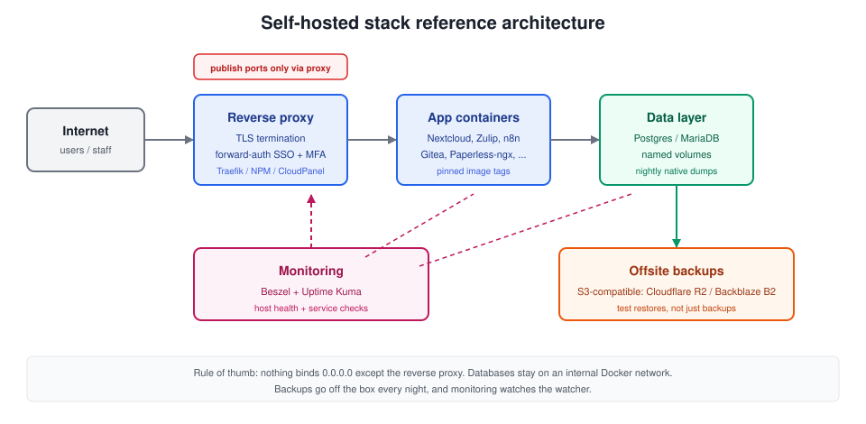
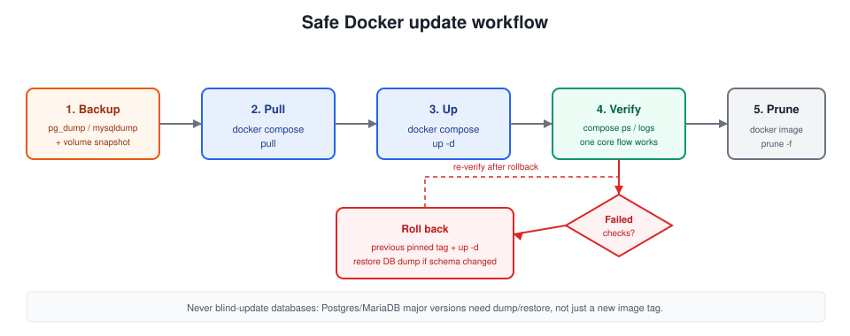

import Button from "@components/widgets/Button.astro";
import Notice from "@components/widgets/Notice.astro";
import ListCheck from "@components/widgets/ListCheck.astro";
import Accordion from "@components/widgets/Accordion.astro";
import Tabs from "@components/widgets/Tabs.astro";
import Tab from "@components/widgets/Tab.astro";

Businesses of all sizes are turning to self-hosted solutions to keep control over their data, cut costs, and customize their software stack. Docker containers make that practical: one compose file and one VPS and you can have a file share, a help desk, and a CRM running before lunch. This guide covers where to host Docker containers for business, 26 self-hosted apps worth deploying in 2026, and the operator work that keeps them alive (firewalling, updates, backups, sizing).

This is not a list of abandoned GitHub projects. Every pick below except Dockge shipped a release in the four months before this update, and several shipped in the last week before it. I checked versions and licenses against GitHub releases and LICENSE files.

<Notice type="info" title="Updated October 2026">Versions and licenses verified against GitHub releases and LICENSE files on 2026-10-13. License terms on this list moved in the last year, so read the license section before you build on anything.</Notice>

## Where Docker containers for business can be hosted

You have two real paths: rent a VPS, or run your own hardware. Both work. The difference is who carries the pager when the power goes out, and how fast you can add resources.

If you want to skip most of the sysadmin layer, a PaaS panel on top of Docker (Coolify, Dokploy, Kamal 2) turns deploys into a web UI task instead of SSH work. I compare them in [Coolify vs Dokploy vs Kamal 2](/coolify-vs-dokploy-vs-kamal-2/).

> In case you are interested to monitor server resources like CPU, memory, disk space you can check: [How To Monitor Server and Docker Resources](/sever-monitoring/)

Cost order of magnitude: a small EU VPS class box runs the "small" stack further down for roughly EUR 5-10 per month. Provider pricing moved a lot in 2025-2026, so read [what changed and when a mini PC wins](/vps-price-increases/) before you sign anything.



### VPS server with Hetzner, Hostinger, DigitalOcean, etc.

Virtual Private Servers are the default for a reason. [Hetzner](https://go.bitdoze.com/hetzner), [Hostinger](https://go.bitdoze.com/hostinger-vps), [DigitalOcean](https://go.bitdoze.com/do), and [Vultr](https://go.bitdoze.com/vultr) all sell reliable VMs at reasonable prices. Here's what you get with a VPS:

- **Scalability**: Easily upgrade resources as your business grows
- **High availability**: Benefit from enterprise-grade infrastructure and redundancy
- **Managed options**: Providers handle the hypervisor, network, and hardware replacement
- **Global reach**: Choose from data centers worldwide to reduce latency for your users
- **Cost-effective**: Pay only for the resources you use, with flexible pricing plans

_VPS prices jumped across the board in 2026 — if you're rethinking a rented box, see [what changed and when a mini PC wins](/vps-price-increases/)._

One honest line so you do not overbuild: skip managed Kubernetes for this workload. Twenty self-hosted business apps do not need an orchestrator. A single VPS with Docker Compose is the sane default; orchestration adds failure modes you only want once you genuinely need multi-node scheduling. When selecting a provider, weigh pricing, performance, data center locations, and support. All four above have usable interfaces and docs to get you to a running Docker host.

### Home server

For businesses that need tighter control over their hardware, or that want the data physically in the office, a home server works well for Docker containers. Two main options:

#### Mini PC

Mini PCs have become the default home server: compact, quiet, and powerful enough to run a serious container stack. An N100 or N305 class box runs everything in the "small" resource table below without breaking a sweat. Advantages:

- **Low power consumption**: Ideal for 24/7 operation without significant energy costs
- **Quiet operation**: Many models are fanless or have low-noise cooling systems
- **Customizable**: Pick RAM and NVMe size for your actual workload
- **Cost-effective**: Often cheaper than a year of VPS billing

For a compact machine that works as an office server or a home lab box, something like the [ASUS DC510 mini PC](https://go.bitdoze.com/asus-dc510) is the right shape of hardware. For a full rundown of models, see [the best mini PCs for home servers](/best-mini-pc-home-server/).

#### NAS

Network Attached Storage (NAS) devices are the other common option: lots of disk, low power, and a web UI. Many modern NAS units run Docker containers, which makes them tempting all-in-one boxes for a small business. Benefits:

- **Built-in storage**: Large storage capacity with RAID support for data redundancy
- **Easy management**: User-friendly interfaces for managing both storage and containers
- **Power efficiency**: Designed for 24/7 operation with low power consumption
- **Backup solutions**: Often include built-in backup software and cloud integration

One caveat before you commit: container runtimes on Synology and QNAP lag behind plain Docker Engine, and CPU/RAM on NAS boxes is limited. For anything beyond a file server and a couple of light containers, the cleaner split is a mini PC for compute plus the NAS as storage. If you are building that kind of homelab, see [the best NAS for Docker and Proxmox homelabs](/best-nas-homelab-docker-proxmox/).

## Best 20+ Docker containers for a business

Here is the shortlist. The table is for skimming; each app gets its own section below with what it does and who it fits.

> If you are interested to see some free cool open source self hosted apps you can check [toolhunt.net self hosted section](https://toolhunt.net/sh/).

| Category | Application | Complexity | Resource Usage | License | Main benefit |
|----------|-------------|------------|----------------|---------|-------------|
| Collaboration | Nextcloud | Medium | High | AGPL-3.0 | Complete office suite replacement |
| Communication | Zulip | Easy | Medium | Apache-2.0 | Organized team discussions |
| Support | Zammad | Medium | Medium | AGPL-3.0 | Customer service automation |
| Support | Chatwoot | Medium | Medium | MIT | Live chat and omnichannel inbox |
| Remote Work | Kasm Workspaces | High | High | Proprietary | Secure remote applications |
| Monitoring | Uptime Kuma | Easy | Low | MIT | Service availability tracking |
| Monitoring | Beszel | Easy | Low | MIT | Resource monitoring |
| Database | Baserow / NocoDB | Easy | Medium | MIT / Sustainable Use | No-code database solutions |
| Finance | Firefly III | Easy | Low | AGPL-3.0 | Financial management |
| Document Management | Paperless-ngx | Medium | Medium | GPL-3.0 | Digital document organization |
| Document Management | Stirling PDF | Easy | Low | MIT | PDF toolkit |
| Signing | DocuSeal | Easy | Low | AGPL-3.0 | Document signing |
| Automation | n8n / Activepieces | Medium | Medium | Sustainable Use / MIT | Workflow automation |
| Analytics | Plausible | Easy | Low | AGPL-3.0 | Privacy-focused analytics |
| Marketing | Mautic / Listmonk | Medium | Medium | GPL-3.0 / AGPL-3.0 | Marketing automation |
| Container Management | Dokploy / Portainer | Medium | Low | Apache-2.0 / Zlib | Docker administration |
| AI Integration | Flowise AI | Medium | High | Apache-2.0 | Custom AI solutions |
| Version Control | Gitea | Easy | Low | MIT | Code repository management |
| Knowledge Base | Docmost | Easy | Low | AGPL-3.0 | Team documentation |
| Passwords | Vaultwarden | Easy | Low | AGPL-3.0 | Team password manager |
| Scheduling | Cal.com | Easy | Medium | AGPL-3.0 | Appointment booking |
| Backup | Duplicati | Easy | Low | LGPL-2.1 | Data protection |
| Business Management | ERPNext / Twenty CRM | High | High | GPL-3.0 / AGPL-3.0 | Complete business solution |
| Feedback | Formbricks | Easy | Low | AGPL-3.0 | User feedback collection |
| Billing | Invoice Ninja | Easy | Low | Elastic v2 (verify) | Invoice management |
| Time Tracking | Kimai | Easy | Low | MIT | Time management |

I read the licenses above from each project's LICENSE file on 2026-10-13. A few (Invoice Ninja in particular) are flagged "verify", so re-check the file before any commercial use.

### Open source vs fair-code: a license reality check

"Open source" is not one thing anymore, and a couple of the biggest names on this list changed terms recently. For internal business use, almost everything here is fine. The terms bite when you resell the software itself as a service.

- **Permissive (MIT / Apache-2.0)**: Baserow, Activepieces, Gitea, Beszel, Uptime Kuma, Dockge, Zulip, Stirling PDF. Do what you want, keep the notice.
- **Sustainable Use License**: n8n and NocoDB. Free to run your business on; you cannot offer the software as a paid service to others. Same fair-code family, different wording.
- **AGPL-3.0**: Plausible, Zammad, Docmost, Twenty, Formbricks, Listmonk, Vaultwarden, Cal.com, DocuSeal. Fine for internal use. If you modify the code and offer it over a network, you owe the source back.
- **Proprietary or hybrid**: Kasm Workspaces (proprietary with a free tier), Portainer CE (Zlib, with a paid Business edition), Dokploy (Apache-2.0 core with source-available proprietary modules).

<Notice type="warning" title="NocoDB license changed in January 2026">NocoDB's LICENSE.md was rewritten on 2026-01-29. The core moved to the Sustainable Use License and is no longer AGPL-3.0. Internal business use is fine; reselling it as a service is not.</Notice>

If license purity matters, prefer Baserow over NocoDB and Activepieces over n8n. The feature trade-offs are smaller than the marketing suggests.

### Nextcloud

[Nextcloud](https://nextcloud.com/) is an open-source file sharing and collaboration platform that works as a central hub for your business data.

**Features:**
- File sharing and synchronization across devices
- Collaborative document editing
- Calendar and contact management
- Video conferencing and chat
- Task management and project planning

**How it helps small businesses:**
Nextcloud is a self-hosted alternative to Dropbox or Google Drive. You keep full control over your data while getting similar features. It handles file sync, document editing, calendars, and video calls in one place. The current release line is Nextcloud v35 (2026-09-24), marketed as Hub 26. For Docker, use the official **Nextcloud AIO** image instead of hand-rolling compose plus a database plus a PHP runtime: AIO wires the pieces together and handles updates. Fine at 2 GB for a small team, comfortable at 4 GB.

### Zulip

[Zulip](https://zulip.com/) is an open-source team chat application that combines the best features of real-time and asynchronous communication.

**Features:**
- Topic-based threading for organized discussions
- Powerful search functionality
- Integrations with various tools and services
- Mobile apps for iOS and Android
- Customizable notifications

**How it helps small businesses:**
Zulip's topic-based threading keeps conversations organized, which matters more as your team grows. Instead of messages getting buried in a chat stream, discussions stay grouped by topic. Makes it easier to catch up after being away.

### Zammad

[Zammad](https://zammad.com/) is an open-source help desk and customer support system that can help businesses manage customer inquiries efficiently.

**Features:**
- Multi-channel support (email, chat, social media)
- Ticket management and automation
- Knowledge base for self-service support
- Customizable workflows and integrations
- Reporting and analytics

**How it helps small businesses:**
Zammad centralizes customer support so your team isn't juggling separate tools for email, chat, and social media. The automation cuts down response times, and the knowledge base lets customers find answers on their own. For a small team, that's a big deal. It speaks SAML/OIDC, so you can put it behind your own login.

### Kasm Workspaces

[Kasm Workspaces](https://www.kasmweb.com/) is a Docker container streaming platform that delivers browser-based access to desktops, applications, and web services.

**Features:**
- Secure remote access to applications and desktops
- Customizable workspaces for different user roles
- Integration with existing authentication systems
- Usage analytics and monitoring
- Support for GPU-accelerated applications

**How it helps small businesses:**
Kasm Workspaces lets employees access applications from any device through a browser. Everything runs inside containers, so sensitive data never leaves your server. It's a practical way to set up remote work without buying everyone new hardware. Current release is 1.19.0. The free tier has a concurrent-session limit (verify the current number on kasmweb.com/pricing before you plan around it), and the resource cost is real: several GB of base overhead plus per-session memory.

### Uptime Kuma

[Uptime Kuma](https://uptime.kuma.pet/) is a self-hosted monitoring tool that helps businesses keep track of their websites and services' availability.

**Features:**
- Real-time monitoring of websites and services
- Multiple notification channels (email, SMS, chat apps)
- Status page generation
- Supports various monitoring methods (HTTP, TCP, Ping, etc.)
- User-friendly interface with customizable dashboard

**How it helps small businesses:**
If your website goes down and you don't know about it, you're losing money and trust. Uptime Kuma checks your sites and services continuously and pings you through email, SMS, or chat when something breaks. You can also set up a public status page so customers know what's going on during outages. It is on the 2.x stable line (2.5.6 as of 2026-10-09). Heads up if you are migrating from 1.x: the 2.x setup flow changed, so treat it as a fresh install and re-create checks rather than assuming a straight upgrade. More detail in the [Uptime Kuma vs Gatus comparison](/uptime-kuma-vs-gatus/) if you are picking a first monitor.

### Baserow or NocoDB

[Baserow](https://baserow.io/) and [NocoDB](https://nocodb.com/) are self-hosted alternatives to Airtable, providing flexible database and spreadsheet functionality. For a longer list, see [best Airtable self-hosted alternatives](/self-hosted-airtable-alternatives/).

**Features:**
- Spreadsheet-like interface for database management
- Views: Grid, Gallery, Kanban, Form, and more
- API access for integration with other tools
- User roles and permissions
- Automation and workflow capabilities

**How it helps small businesses:**
Both tools let you manage data through a familiar spreadsheet interface without needing a database admin. You can build custom views for inventory tracking, project management, or CRM. Non-technical team members can use them right away since they look and feel like a regular spreadsheet. I list Baserow first now: its core is MIT, while NocoDB moved to the Sustainable Use License in January 2026. NocoDB is still excellent software and fine for internal use; it uses calendar version tags now (example: `nocodb/nocodb:2026.09.1`), which is convenient for pinning. Grist and Teable are two more entries in this category if neither of these clicks.

### Firefly III

[Firefly III](https://www.firefly-iii.org/) is a personal finance manager that can be adapted for small business use, helping to track income, expenses, and budgets.

**Features:**
- Multi-currency support
- Budgeting and financial goal setting
- Bill management and recurring transactions
- Detailed reports and charts
- Import data from various sources

**How it helps small businesses:**
For sole proprietors or small partnerships, Firefly III handles financial tracking without the cost of commercial accounting software. You get clear visibility into cash flow, can set budgets, and track expenses over time. The v6.7.x line is current.

### Paperless-ngx

[Paperless-ngx](https://docs.paperless-ngx.com/) is a document management system that helps businesses go paperless by digitizing and organizing documents.

**Features:**
- OCR (Optical Character Recognition) for searchable PDFs
- Automatic tagging and categorization of documents
- Full-text search capabilities
- Mobile-friendly web interface
- Integration with scanners and email

**How it helps small businesses:**
Paperless-ngx scans and OCRs your documents so you can search through them instead of digging through filing cabinets. The automatic tagging saves time on organization, and everything is accessible remotely. Helpful for audits and compliance too. Current line is v3.3.x. Plan for OCR: it spikes CPU, and on a 1 vCPU box a big import batch crawls.

### n8n or Activepieces

[n8n](https://n8n.io/) and [Activepieces](https://www.activepieces.com/) are workflow automation tools that allow businesses to connect various applications and automate repetitive tasks.

**Features:**
- Visual workflow builder
- Wide range of integrations with popular services
- Ability to create custom nodes/actions
- Scheduling and trigger-based automation
- Self-hosted for data privacy

**How it helps small businesses:**
Workflow automation saves a surprising amount of time for small teams. You can connect your apps to automate lead generation, sync data between systems, post to social media, or send follow-up emails. Less time on repetitive tasks means more time on work that matters. A few notes for 2026: n8n is on the 2.x line (2.42.7 as of 2026-10-12). If you are upgrading from 1.x, read the release notes and re-test your workflows on a copy before you touch production. n8n runs under the Sustainable Use License; Activepieces is MIT core with commercial enterprise packages, so pick Activepieces if your license policy demands permissive. Windmill is a third option for teams who prefer writing scripts over wiring nodes. Full setup path in [how to self-host n8n with Docker, Traefik, and Dokploy](/n8n-self-host-workflow-automation/).

### Plausible

[Plausible](https://plausible.io/) is a lightweight, open-source website analytics platform that prioritizes user privacy.

**Features:**
- Simple, intuitive dashboard
- GDPR compliant and cookie-free
- Lightweight script for minimal impact on site performance
- Custom event tracking
- Email reports and API access

**How it helps small businesses:**
If you want website analytics without the privacy headaches of Google Analytics, Plausible is worth a look. It's cookie-free and GDPR compliant out of the box. The script is tiny, so it won't slow your site down. The dashboard shows you what matters without drowning you in data. Plausible Community Edition is on v3.x (3.2.1). If you want something even lighter, Umami covers the basics.

### Mautic or Listmonk

[Mautic](https://www.mautic.org/) and [Listmonk](https://listmonk.app/) are open-source marketing automation and email marketing platforms that can help businesses manage their marketing campaigns.

**Features:**
- Email campaign management
- Landing page and form builders
- Lead scoring and segmentation
- Marketing automation workflows
- Integration with CRM systems

**How it helps small businesses:**
These tools give you email marketing and automation without paying for Mailchimp or HubSpot. You can run targeted campaigns, score leads, and segment your audience. For small businesses competing against bigger players, having these capabilities at no licensing cost makes a real difference. Reach for Listmonk when you want a fast newsletter tool (v6.2.x); reach for Mautic (v7.2.x) when you want the full automation/CRM-style pipeline. Budget for deliverability work either way: sending reputation is the part nobody warns you about.

### Dokploy, Portainer, or Dockge

[Dokploy](https://dokploy.com/), [Portainer](https://www.portainer.io/), and [Dockge](https://dockge.kuma.pet/) are Docker management platforms that simplify deploying and managing containers.

**Features:**
- User-friendly web interface for container management
- Container templating and stack deployment
- Resource monitoring and logging
- Role-based access control
- Support for Docker Swarm or Kubernetes (varies by tool)

**How it helps small businesses:**
If you don't have a dedicated IT person, these management tools make Docker much less intimidating. You get a web interface for deploying and managing containers instead of working purely from the command line. My default in 2026 is Dokploy: v0.30.x, very active, Apache-2.0 core, and it handles reverse proxy plus TLS out of the box. See the [Dokploy install guide](/dokploy-install/). Portainer CE (2.45.x) is the long-standing generalist; the Zlib license is permissive for internal use, and the Business edition is the upsell.

<Notice type="warning" title="Dockge has slowed down">Dockge's last release is 1.5.0 from 2025-03-30, over 18 months ago as of this update. It still works and I still have the [Dockge installation](/dockge-install/) guide up, but I would not start a new business stack on it. For alternatives, see the [best Portainer alternatives in 2026](/portainer-alternatives/) and [Arcane vs Dockhand: which Docker manager to choose](/arcane-vs-dockhand/).</Notice>

### Flowise AI

[Flowise AI](https://flowiseai.com/) is an open-source tool for building customized AI agents and chatbots using a visual interface.

**Features:**
- Drag-and-drop interface for creating AI workflows
- Integration with various AI models and APIs
- Customizable chatbot interfaces
- API endpoints for integration with other applications
- Support for multiple languages

**How it helps small businesses:**
Flowise AI lets you build chatbots and AI agents without writing much code. You can set up customer service bots, automate repetitive tasks, or add AI features to your products using the drag-and-drop interface. The v3.x line is current, and it is one of the heavier picks here once you load models or run long chains.

For a detailed guide on setting up Flowise AI, visit our [Flowise AI installation tutorial](/flowiseai-install/).

### Gitea

[Gitea](https://about.gitea.com/) is a lightweight, self-hosted Git service that provides version control and collaboration features similar to GitHub or GitLab.

**Features:**
- Git repository management
- Issue tracking and project management
- Pull request and code review functionality
- Wiki for documentation
- Integration with CI/CD tools

**How it helps small businesses:**
For teams doing software development, Gitea is a free alternative to GitHub or GitLab that you run on your own server. Your code and intellectual property stay on your hardware. It has the standard features you'd expect: pull requests, issue tracking, wiki, and CI/CD integration. The v28.x line is current and still runs happily in under 512 MB.

### Docmost

[Docmost](https://docmost.com/) is an open-source document collaboration platform that combines the features of a wiki and a document editor.

**Features:**
- Real-time collaborative editing
- Version history and document comparison
- Markdown and WYSIWYG editing modes
- Nested document structure
- Full-text search capabilities

**How it helps small businesses:**
Docmost works well as an internal knowledge base and team wiki. You can write documentation together in real-time, keep project plans organized, and search through everything with full-text search. One expectation to set: it is still pre-1.0 (v0.96.x), so read the changelog before you upgrade and keep a database dump handy.

For installation instructions, check out our [Docmost Docker installation guide](/docmost-docker-install/).

### Duplicati

[Duplicati](https://duplicati.com/) is an open-source backup solution that supports various storage backends, including cloud storage services.

**Features:**
- Encrypted and compressed backups
- Incremental backups to save space and bandwidth
- Scheduling and retention policies
- Support for multiple storage providers
- Web-based interface for easy management

**How it helps small businesses:**
Losing data can kill a small business. Duplicati handles encrypted, incremental backups to whatever storage you prefer, cloud or local. You set up a schedule and retention policy, and it runs in the background. It spent years in beta; v2.4.0.1 finally shipped as a stable release on 2026-10-07. If you prefer backups you can script and audit from the CLI, use restic or Borg instead and skip the web UI.

### ERPNext or Twenty CRM

[ERPNext](https://erpnext.com/) and [Twenty CRM](https://twenty.com/) are open-source business management solutions that cover various aspects of business operations.

**Features:**
- Customer Relationship Management (CRM)
- Inventory and warehouse management
- Human Resources and payroll
- Accounting and financial management
- Project management and time tracking

**How it helps small businesses:**
These tools combine CRM, inventory, HR, accounting, and project management into one platform. Instead of paying for separate SaaS subscriptions, you run everything on your own server and customize it to fit how your business works. Pick deliberately: ERPNext is a full ERP (Frappe stack with MariaDB, Redis, and background workers, roughly 2-4 GB of RAM on its own), while Twenty at v2.46 is now the mature default if you only need CRM. Do not drop ERPNext on the same 4 GB box as everything else.

### Formbricks

[Formbricks](https://formbricks.com/) is an open-source survey and feedback collection tool that helps businesses gather insights from their customers and users.

**Features:**
- Customizable survey templates
- In-app survey targeting
- Response analysis and reporting
- Integration with various platforms and tools
- GDPR-compliant data collection

**How it helps small businesses:**
Knowing what your customers think is half the battle. Formbricks lets you collect feedback through in-app surveys and analyze the responses. You can embed surveys at specific points in your product to get contextual feedback, not just generic opinions.

### Beszel

[Beszel](https://github.com/henrygd/beszel) is a lightweight server monitoring tool that helps businesses keep track of their server resources and performance.

**Features:**
- Real-time monitoring of CPU, memory, and disk usage
- Network traffic analysis
- Customizable alerts and notifications
- Historical data and trend analysis
- API for integration with other tools and services

**How it helps small businesses:**
Beszel is the "is the box okay?" dashboard: CPU, memory, disk, and network, with historical graphs and alerts. It is tiny (MIT, v0.21.0, roughly 26k stars), so it earns its RAM on any VPS. Pair it with Uptime Kuma: Beszel watches the host, Uptime Kuma watches the services. That exact pairing is documented step by step in [Beszel & Uptime Kuma monitoring stack on Dokploy](/beszel-uptime-kuma/).

### Invoice Ninja

[Invoice Ninja](https://invoiceninja.com/) is an open-source invoicing and billing solution that can help small businesses manage their finances more effectively.

**Features:**
- Customizable invoice templates
- Automated recurring invoices and payments
- Time tracking and project management
- Integration with multiple payment gateways
- Client portal for easy invoice access

**How it helps small businesses:**
Invoice Ninja automates the boring parts of billing: recurring invoices, payment reminders, and tracking. Clients get their own portal to view invoices and pay directly. Supporting multiple payment gateways means fewer excuses for late payments. The v5.13.x line is current. One thing to check before you deploy it for anything beyond internal use: the license has historically been Elastic License v2, not a standard OSI license, so read the LICENSE file.

### Kimai

[Kimai](https://www.kimai.org/) is an open-source time tracking application that can help businesses monitor employee work hours and project durations.

**Features:**
- User-friendly interface for time entry
- Project and task management
- Detailed reporting and export options
- User roles and permissions
- Integration with invoicing systems

**How it helps small businesses:**
Tracking time properly matters for billing clients and understanding where your team's hours actually go. Kimai gives you flexible time tracking with reports you can export. The data helps with client billing accuracy and spotting projects that are eating more time than they should.

Five more picks added in the October 2026 refresh to fill obvious gaps: team passwords, scheduling, document signing, live chat, and PDF work.

### Vaultwarden

[Vaultwarden](https://github.com/dani-garcia/vaultwarden) is a lightweight Bitwarden-compatible server, written in Rust, that gives a team shared passwords without a per-seat SaaS bill.

**Features:**
- Bitwarden browser extensions and mobile apps work against it
- Shared collections and organizations for teams
- TOTP/2FA support and emergency access
- Small memory footprint, runs fine on a 1 GB box
- Encrypted vaults end to end

**How it helps small businesses:**
Shared passwords in a spreadsheet is how credentials leak. Vaultwarden gives everyone a proper password manager with shared collections, and the official Bitwarden clients just point at your server. It is arguably the most obvious omission from the original list.

### Cal.com

[Cal.com](https://cal.com/) is an open-source scheduling and appointment booking platform, the self-hosted alternative to Calendly.

**Features:**
- Booking pages with availability rules and buffers
- Calendar integrations (Google, Outlook, CalDAV)
- Workflows for reminders and follow-ups
- Team round-robin and collective scheduling
- API and webhooks for custom integrations

**How it helps small businesses:**
Any business that books calls (sales, consulting, support) needs scheduling. Cal.com runs on your domain, keeps customer data on your server, and removes the per-seat fee as you add people. If you only need one booking link, the hosted free tier is fine; self-hosting pays off once the team grows.

### DocuSeal

[DocuSeal](https://www.docuseal.co/) is an open-source document signing tool for getting PDFs and forms signed without paying per envelope.

**Features:**
- PDF template builder with signature, date, and text fields
- Multi-signer workflows with email notifications
- Audit trail for each document
- Embeddable forms for your own website
- REST API for automation

**How it helps small businesses:**
Contracts, NDAs, and onboarding forms need signatures, and per-document pricing adds up fast. DocuSeal covers the common cases on your own server. If you want the slightly more common alternative, Documenso fills the same slot.

### Chatwoot

[Chatwoot](https://www.chatwoot.com/) is an open-source customer engagement platform for live chat and omnichannel conversations.

**Features:**
- Live chat widget for your website
- Shared inbox for email, social, and chat
- Canned responses, labels, and assignment rules
- Contact profiles and conversation history
- Help center and API

**How it helps small businesses:**
Zammad handles tickets; Chatwoot handles the conversations that should not become tickets. A live chat widget on your site catches people who would otherwise bounce, and the shared inbox keeps the whole team from answering the same message twice.

### Stirling PDF

[Stirling PDF](https://www.stirlingpdf.com/) is a self-hosted PDF toolkit for the boring document work every office does: merge, split, convert, redact, OCR.

**Features:**
- Merge, split, rotate, and reorder PDFs
- Convert to and from Office formats and images
- OCR for scanned documents
- Redaction and page-level editing
- Batch processing, no per-file upload to a third party

**How it helps small businesses:**
Instead of uploading client PDFs to random "free PDF tools" websites, run the toolkit yourself. It is small, stateless in practice, and covers the daily merge/convert/redact work. Full setup in the [self-hosted Stirling PDF guide](/stirling-pdf-self-host-manipulation/).

## Security considerations for self-hosted containers

When you run self-hosted business tools on the public internet, the checklist is short but non-negotiable:

- **Reverse proxy with TLS**: one place to terminate HTTPS and route apps. [Traefik](/traefik-proxy-docker/) or Nginx Proxy Manager are the common picks; [CloudPanel as a reverse proxy for Docker](/cloudpanel-setup-dockge/) is a lighter pattern if you already use it.
- **Backups with tested restores**: not just a backup job, a restore you have actually run. See the update section below.
- **Updates with a plan**: pin versions, update on purpose, never blind-update databases.
- **Network segregation**: one Docker network per stack, databases with no published ports. For a cheap extra layer, a DNS firewall like [NextDNS](https://go.bitdoze.com/nextdns) blocks malware and tracking domains network-wide.
- **Access control and MFA**: for anything with user accounts, put SSO in front of it.
- **Monitoring and logging**: know when something is down before your customers do.

### The Docker firewall gotcha: Docker bypasses UFW

<Notice type="error" title="Docker publishes ports past UFW">A container with `-p 8080:8080` is reachable from the internet no matter what your UFW rules say. Docker writes its own iptables/nftables rules for published ports, and they take effect regardless of your host firewall policy.</Notice>

This is the single most common way a self-hosted database admin panel ends up on Shodan. You set up UFW, allow 22/80/443, feel safe, then discover the Postgres admin UI you started "just for a minute" is public.

If your reverse proxy runs on the same host (the normal setup), bind everything else to localhost:

```yaml
services:
  app:
    ports:
      - "127.0.0.1:8080:8080"   # only reachable from the host
```

Databases should not publish ports at all. Put them on the same Docker network as the app and let service names resolve. Only the proxy publishes 80 and 443.

Verify what is actually exposed:

```bash
ss -tlnp | grep docker
# anything bound to 0.0.0.0 or a public IP is internet-facing
```

After a fix, re-create the containers (`docker compose up -d`) and scan from outside, not from the host itself. For the full story of a real Hetzner abuse report and the hardening pass that followed, see [how Docker bypasses UFW and how I secured my Docker server](/bsi-security-report-docker-ufw/).

<Accordion label="I already published ports, what now?" group="firewall-fixes">
1. List what Docker actually exposes: `ss -tlnp` and `docker ps` from the host.
2. For each service that should not be public, change the mapping to `127.0.0.1:PORT:PORT` in the compose file.
3. `docker compose up -d` so containers are re-created with the new binding.
4. For databases, remove the `ports:` block entirely and keep them on the internal network.
5. Re-scan from outside your server. If you filter at the host level, remember published ports need DOCKER-USER chain rules to be affected by firewall policy.
</Accordion>

### Add MFA and SSO with Authentik or Authelia

Half of the apps in this list ship with a username and password prompt and nothing else. On the public internet, that is a liability.

Put an SSO layer in front: Authentik or Authelia both do forward-auth with Traefik or Nginx Proxy Manager, so the app never sees an unauthenticated request. You get MFA on every service behind the proxy, even the ones that never implemented it.

Apps with native SAML or OIDC support should use it directly instead of forward-auth: Nextcloud, Zammad, and Gitea all support federation. You end up with one place to add or remove people (important when someone leaves), one MFA policy, and far fewer "is this app's login form phishable?" questions.

### Pin image versions and update safely

Never run `:latest` in business use. When upstream publishes a breaking change, you find out at the worst time. Pin tags (or digests) and upgrade on your schedule.

```yaml
# starter stack pattern: pin versions, limit memory, rotate logs, add healthchecks
services:
  app:
    image: example/app:3.2.1        # pin; avoid :latest
    restart: unless-stopped
    mem_limit: 1g
    logging:
      driver: json-file
      options:
        max-size: "10m"
        max-file: "3"
    healthcheck:
      test: ["CMD", "wget", "-qO-", "http://localhost:3000/healthz"]
      interval: 30s
      timeout: 5s
      retries: 3
```

The logging block is not optional on a small VPS. The default json-file driver never rotates, and a chatty app is the classic "disk full at 3am" failure. Set `max-size` and `max-file` on every service.

## How to update Docker containers safely

Use Compose v2 syntax: `docker compose` with a space, not the legacy `docker-compose` binary.

The update loop that does not wake you at night:

```bash
# 0. backup first: DB dump + volume snapshot (see the next section)
docker compose pull
docker compose up -d
docker compose ps                 # everything "running"/"healthy"?
docker compose logs -f --tail=100 # scan for stack traces
docker image prune -f
```

Never blind-update databases. A Postgres or MariaDB major version bump is a migration, not a tag change: take a dump, read the upstream upgrade notes, and be ready to restore. Application containers are cheap to roll back; databases are not.

After every update, walk this checklist:

<ListCheck><ul>
<li>All containers report <code>running</code> or <code>healthy</code> in <code>docker compose ps</code></li>
<li>Login works with a real account (not just a 200 on the homepage)</li>
<li>One core flow works: an invoice is created, a ticket is answered, a backup job runs</li>
<li>No new stack traces in <code>docker compose logs</code></li>
<li>Monitoring is green again (Beszel and Uptime Kuma)</li>
<li>Old images pruned so the disk stays boring</li>
</ul></ListCheck>



### Back Up First — and Test the Restore

A backup is a hypothesis. A restore is a fact. Aim for 3-2-1: three copies, two media, one offsite. For a small business stack that usually means:

- Nightly database dumps (`pg_dump` for Postgres, `mysqldump`/`mariadb-dump` for MariaDB). File-level copies of a running database are not enough; the data directory is not crash-consistent while the DB is writing.
- Volume snapshots for uploads and user data.
- Encrypted, incremental copies to S3-compatible storage: Cloudflare R2 or Backblaze B2, order of magnitude a few dollars per month for a small business's data.

Duplicati (v2.4.0.1 stable, after years in beta) gives you a web UI for this; restic or Borg give you scripts. If you deploy with Dokploy, the panel can push [back up Dokploy to Cloudflare R2](/dokploy-backups-cloudflare-r2/) on a schedule.

<Notice type="info" title="Test restores, not backups">A green backup job means nothing. Once a quarter, restore a dump into a scratch container and open the app. The day you need it is the wrong day to find out your dumps were empty.</Notice>

<Accordion label="Port already in use / container won't start" group="update-failures">
Another compose project already publishes the port, or a stale container still holds it. Run `ss -tlnp` and `docker ps` to see who owns it. Fix: stop the other project, change the host port mapping, or use a unique `COMPOSE_PROJECT_NAME` per stack so projects stop colliding over default names.
</Accordion>

<Accordion label="Database major version changed: dump/restore required" group="update-failures">
You bumped `postgres:15` to `postgres:17` and the container crash-loops on the data directory. Minor updates are usually fine; majors are not. Fix: roll back to the old tag first, take a dump with the old version, then start the new major with an empty data directory and restore the dump into it.
</Accordion>

<Accordion label="Container unhealthy after update / stale volumes" group="update-failures">
The new version changed a config format or the volume layout. Check the upstream changelog for migration notes. Fix: restore the previous pinned image tag and your pre-update dump; if the app writes a version file in the volume, the old image usually refuses to start on a downgraded volume too, which is why the dump matters more than the volume snapshot for databases.
</Accordion>

<Accordion label="Out of memory on a small VPS" group="update-failures">
The OOM killer reaps the biggest container, usually a database or a Java/Node app, and the restart loop eats the rest. Check `dmesg | grep -i oom` and your `mem_limit` values. Fix: set `mem_limit` and swap on the host, move heavy apps (ERPNext, Kasm, Nextcloud at scale) to a bigger box, and never plan steady RAM above roughly 70% of what the machine has.
</Accordion>

## Minimum resource requirements by usage scale

| Scale | Users | CPU | RAM | Storage | Recommended VPS |
|-------|--------|-----|-----|---------|----------------|
| Small | 1-10 | 2 cores | 4GB | 50GB | Basic VPS |
| Medium | 10-50 | 4 cores | 8GB | 100GB | Standard VPS |
| Large | 50+ | 8+ cores | 16GB+ | 200GB+ | Performance VPS |

Treat that as a rule of thumb, not a shopping list. The OS, Docker, logs, and monitoring want their share: expect roughly 40-50% overhead headroom and do not plan for steady RAM above about 70% of the box.

### Per-app resource reality

Not everything fits the "small" box. Honest numbers for the heavy hitters:

| App | Realistic RAM | Notes |
|-----|---------------|-------|
| ERPNext | 2-4 GB alone | Full Frappe stack: MariaDB + Redis + workers. Do not co-locate. |
| Nextcloud | 2 GB small team, 4 GB comfortable | Use AIO; PHP + DB tuning is where it goes wrong. |
| Kasm Workspaces | Several GB base + per session | GPU only for accelerated workloads. |
| Flowise AI | 1-2 GB+ | Depends on what you chain together. |
| n8n / Activepieces | 0.5-1 GB | More in queue mode or with heavy workflows. |
| Paperless-ngx | 1-2 GB | OCR batches spike CPU; 1 vCPU gets slow. |
| Uptime Kuma, Beszel, Dockge, Listmonk, Kimai, Firefly III, Docmost, Vaultwarden, Stirling PDF | Under 0.5-1 GB each | Genuinely small. |

On architecture: most of these images are multi-arch now, but check before you buy an ARM VPS. The big batteries-included stacks (ERPNext, Kasm) are safest on x86. If you want the data behind that statement rather than my caution, see [ARM vs x86 VPS benchmarks](/arm-vs-x86-vps-server-benchmarks/).

## Getting started with Docker containers

Essential tools for managing your container infrastructure:

1. **Docker Engine + Compose v2** for container orchestration
2. **Reverse proxy** (Traefik or Nginx Proxy Manager) with TLS
3. **Backup solution** (Duplicati, restic, or Borg) pointed at S3-compatible storage
4. **Monitoring** (Beszel + Uptime Kuma, or Prometheus/Grafana if you already know them)
5. **Container management** (Dokploy or Portainer)

There are two sane paths. Pick one and stay consistent.

<Tabs>
<Tab name="Path 1: Docker Compose by hand">
1. Provision the VPS and point DNS at it. 4 GB RAM covers the small stack.
2. Install Docker Engine and the compose plugin. Confirm with `docker compose version`.
3. Create `/opt/stacks/your-app/docker-compose.yml` per app: pinned image tags, `mem_limit`, log rotation, healthchecks.
4. Put Traefik (or Nginx Proxy Manager) in front, terminate TLS there, and bind app ports to `127.0.0.1` only.
5. Set up backups and monitoring before you add the second app, not after.

This is the maximum-control path, and the one I default to for a single VPS.
</Tab>
<Tab name="Path 2: Dokploy / management panel">
1. Provision the VPS and install Dokploy (or Portainer, or a lighter panel).
2. Deploy from the panel: paste a compose file or use a template.
3. Let the panel handle reverse proxy and TLS issuance.
4. Point the panel's backup feature at S3-compatible storage and verify a restore once.
5. Keep the panel itself updated; it is now part of your attack surface.

Faster to productivity, one more moving part to maintain. Details in the [Dokploy install guide](/dokploy-install/). If you want to compare panels first, start with [best self-hosted server panels](/best-self-hosted-panels/).
</Tab>
</Tabs>

Basic deployment checklist:

<ListCheck><ul>
<li>Server sized with headroom (steady RAM under ~70%)</li>
<li>Docker Engine + Compose v2 installed</li>
<li>Reverse proxy live with TLS certificates issued</li>
<li>App ports bound to localhost; databases unpublished</li>
<li>Backups written offsite AND a restore tested</li>
<li>Monitoring green (host + service checks)</li>
<li>Update procedure and rollback notes documented somewhere your team can find</li>
</ul></ListCheck>

<Button text="Dokploy install guide" link="/dokploy-install/" variant="solid" color="blue" size="md" icon="arrow-right" />

## Conclusion: start small with self-hosted business apps

Self-hosted Docker containers give small businesses a practical way to run the software they use every day without renting a SaaS tool for every problem. The stack in this article covers most of what an office uses: collaboration and docs (Nextcloud, Zulip, Docmost), customer support and service quality (Zammad, Chatwoot, Uptime Kuma), process automation and data (ERPNext or Twenty, Baserow, n8n), and marketing and analytics (Mautic, Listmonk, Plausible). Self-hosting also keeps data on hardware you control, which helps with regulatory compliance as long as you do the work (TLS, MFA, updates), and it replaces per-seat subscriptions with one server and some operator time.

One more thing, because nobody says it in vendor docs: self-hosting is a maintenance contract, not a purchase. Updates, monitoring, and tested restores are the real cost. The money side is small; one Hetzner-class VPS plus S3-compatible backups is roughly EUR 10 per month all-in for the small stack. The time side is what you are signing up for.

When deciding which containers to deploy, start with three that solve a problem you have this month, not twenty you might need next year. Pick a VPS or mini PC sized with headroom, put a reverse proxy and backups in front, then expand as the business grows. After that, the update loop and the quarterly restore test in the sections above are what keep the stack boring.
