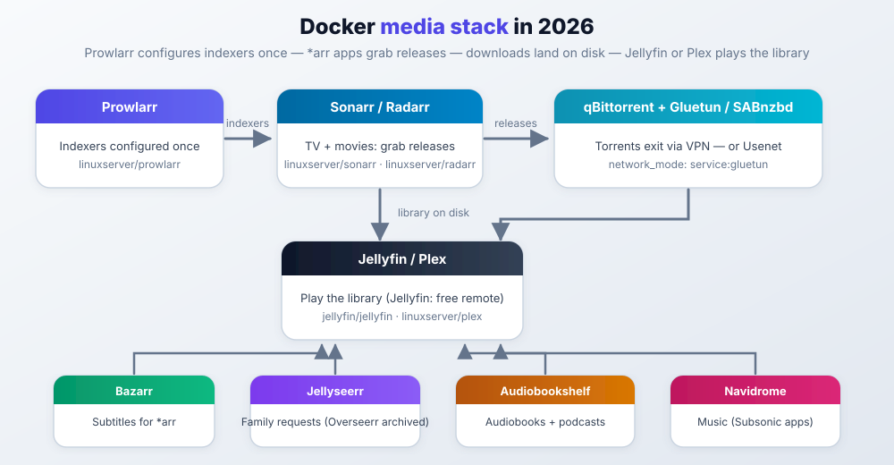

import Notice from "@components/widgets/Notice.astro";
import Accordion from "@components/widgets/Accordion.astro";
import ListCheck from "@components/widgets/ListCheck.astro";
import Button from "@components/widgets/Button.astro";

[Docker](https://www.docker.com/) packs an app with its runtime so it runs the same on a mini PC, VPS, or rack, which is why it became the default way to ship home server apps in 2026. This page is a catalog of the **best Docker containers for a home server** in 2026, not an "install everything" checklist. If you are still weighing whether a box at home is worth it, start with [why you need a home server in 2026](/why-need-home-server/).

## How to use this page

1. **Pick a goal** in the table below (media, files, lab control plane, …).
2. **Install the short starter stack** if you are new.
3. **Open one category** you care about. Each section starts with a **quick-pick table**, then short notes on the important tools.
4. Skip the rest until you need it.

Version data checked **October 2026** (release feeds re-pulled October 14, 2026). Where a project died or got archived this year, the section says so instead of quietly listing a zombie.

<Notice type="info" title="Don't install 125 containers">
Run 8 to 15 that match what you use. A quiet lab beats a noisy one.
</Notice>

### Pick a goal

| I want… | Go here | Typical first picks |
| --- | --- | --- |
| Free media streaming + downloads | [Media](#media-management-containers) | Jellyfin, Prowlarr, Sonarr/Radarr, qBittorrent, Gluetun |
| Google Photos replacement | [Photography](#photography-and-image-management-containers) | Immich |
| Dropbox / Google Drive replacement | [Files](#file-sharing-and-sync-containers) | Nextcloud or Seafile, Filebrowser Quantum |
| Ad blocking + remote access | [Network](#network-management-containers) | AdGuard or Pi-hole, Tailscale, Caddy |
| Know when things break | [Monitoring](#monitoring-and-analytics-containers) | Uptime Kuma, Dozzle, Beszel |
| Deploy apps like Vercel at home | [Development](#development-containers) | Coolify or Dokploy |
| Passwords + simple SSO | [Security](#security-and-privacy-containers) | Vaultwarden, Pocket ID or Authelia |
| Local AI chat | [AI](#ai-applications-containers) | Ollama + OpenWebUI |
| Budget / recipes / bookmarks | [Productivity](#productivity-containers), [Finance](#personal-finance-containers) | Mealie, Actual Budget, Karakeep |

Running this for a business instead of a house? The use-case math is different (SSO, backups, blast radius). See [Docker containers for business](/docker-containers-business/).

### What changed in 2026 (short)

- **Plex remote streaming needs a paid pass** (local still free). The Lifetime Pass price for new buyers went up again in July 2026 (check plex.tv for the current number). If you do not want to pay, **Jellyfin** is the switch.
- **Filebrowser Quantum** is the active file-manager fork (original is maintenance-only).
- **Watchtower (`containrrr`) is archived** (December 2025). Use the maintained fork and migrate if you are still on the old image.
- **Original Overseerr is archived** (2026). **Jellyseerr** is the request UI for both Plex and Jellyfin now.
- **Coolify / Dokploy**, **Gluetun**, **Dozzle**, and **Pocket ID** are common defaults now.

More detail is in [What's changed in 2026](#whats-changed-in-2026) at the end.

### No hardware yet?

The containers below run fine on almost anything, but if you are building a box from scratch these pieces cover the usual homelab needs:

| Piece | Pick | Why |
| --- | --- | --- |
| Mini PC | [GMKtec N150](/go/gmktec-n150/) | ~$130, 16GB RAM, 2.5GbE, 10-25W idle. Runs a starter stack for pocket change |
| Mini PC (branded) | [ASUS ExpertCenter DC510 mini PC](https://go.bitdoze.com/asus-dc510) | Compact name-brand box if you want a standard warranty and a support channel |
| NAS | [UGREEN NASync DXP4800 Plus](/go/ugreen-dxp4800-plus/) | 4 bays + 2 NVMe, 10GbE, Pentium 8505. Docker and VMs onboard |
| UPS | [CyberPower CP1500PFCLCD](/go/cyberpower-cp1500pfclcd/) | Pure sine wave, 1500VA/1000W. A brownout won't corrupt your volumes |

<Notice type="warning" title="Affiliate Disclosure">
This article contains affiliate links. If you buy through them, I may earn a commission at no extra cost to you.
</Notice>

For more options, see the [best mini PCs for a home server](/best-mini-pc-home-server/) guide. Storage-focused? See the [best NAS for Docker and Proxmox homelabs](/best-nas-homelab-docker-proxmox/).

Don't want hardware at home? The same compose files run on a [Hetzner Cloud VPS](https://go.bitdoze.com/hetzner). A 2 vCPU / 4 GB box covers the starter stack. The heavy items are transcoding and Immich, not the dashboard.

---

## Starter stack (do this first)

This starter stack is the set of **essential Docker containers** most home servers need. If you are starting from zero, this set covers streaming, downloads, files, dashboard, DNS, management, and basic monitoring.

| # | Container | Role | Why | Details |
| --- | --- | --- | --- | --- |
| 1 | Dockge | Manage Compose stacks | Easier than raw CLI | [Network](#network-management-containers) |
| 2 | AdGuard Home or Pi-hole | DNS + ads | Whole network: [block ads and malware with AdGuard Home](/block-ads-malware-dns-protection/) | [Network](#network-management-containers) |
| 3 | Homepage or Glance | Dashboard | One URL for everything | [Dashboards](#personal-dashboard-containers) |
| 4 | Filebrowser Quantum | Web files | Quick upload without full cloud | [Files](#file-sharing-and-sync-containers) |
| 5 | Jellyfin | Media | Free remote; no Plex tax | [Media](#media-management-containers) |
| 6 | qBittorrent + optional Gluetun | Downloads | VPN only the downloader | [Media](#media-management-containers) |
| 7 | CrowdSec | IPS | Blocks noisy attackers | [Security](#security-and-privacy-containers) |
| 8 | Uptime Kuma + Dozzle + Beszel | Ops | Up? Why down? Logs? | [Monitoring](#monitoring-and-analytics-containers) |

**Order that works:** Dockge → DNS → dashboard → files → media → downloads → CrowdSec → monitoring.

**Verify habit:** after every stack, `docker compose ps` should show the service `Up`, and you add one check in Uptime Kuma. If it is not green there, the stack is not done. A service that only works on your laptop shell is not running.

### Minimal compose example

Three services to get Docker muscle memory. Add the rest as separate stacks in Dockge.

```yaml
services:
  adguardhome:
    image: adguard/adguardhome
    container_name: adguardhome
    ports:
      - "53:53/tcp"
      - "53:53/udp"
      - "3000:3000/tcp"
    volumes:
      - ./adguard/work:/opt/adguardhome/work
      - ./adguard/conf:/opt/adguardhome/conf
    restart: unless-stopped

  homepage:
    image: ghcr.io/gethomepage/homepage:latest
    container_name: homepage
    environment:
      - TZ=America/New_York
    volumes:
      - ./homepage-config:/app/config
      - /var/run/docker.sock:/var/run/docker.sock:ro
    ports:
      - "3001:3000"
    restart: unless-stopped

  dockge:
    image: louislam/dockge:1
    container_name: dockge
    volumes:
      - /var/run/docker.sock:/var/run/docker.sock
      - ./dockge-data:/app/data
      - ./dockge-stacks:/opt/stacks
    ports:
      - "5001:5001"
    restart: unless-stopped
```

<ListCheck>
<ul>
<li>Static IP (or DHCP reservation) on the server</li>
<li>Compose files + env samples in Git</li>
<li>Data on SSD; media libraries can live on HDDs</li>
<li>No public ports without a reverse proxy + auth</li>
<li>After each stack: `docker compose ps` green + one Uptime Kuma check</li>
</ul>
</ListCheck>

<Accordion label="Hardware, OS, and Docker install (expand if you need it)" group="setup">

**Hardware (rough guide)**

| Component | Minimum | Comfortable | Heavy (4K + AI) |
| --- | --- | --- | --- |
| CPU | Quad-core 2.0 GHz | Quad-core 2.5 GHz+ | 6+ cores, Quick Sync / GPU |
| RAM | 8 GB | 16 to 32 GB | 64 GB+ |
| Storage | 128 GB SSD | 512 GB NVMe + HDD | 1 TB NVMe + multi-HDD |
| Network | 1 GbE | 2.5 GbE | 10 GbE |

Transcoding and Immich/Nextcloud are the usual RAM/CPU hogs. If transcoding is the main job, see the [best mini PC for Plex and Jellyfin](/best-mini-pc-plex-jellyfin/). Mini PC picks: [Best mini PC for home servers](https://www.bitdoze.com/best-mini-pc-home-server/).

**OS options:** Ubuntu Server or Debian for plain Docker; Unraid / TrueNAS Scale if storage is the point; [Proxmox](/best-mini-pc-proxmox/) if you want VMs + containers.

**Install Docker (Debian/Ubuntu-style):**

```bash
curl -fsSL https://get.docker.com -o get-docker.sh
sudo sh get-docker.sh
sudo usermod -aG docker $USER
# log out/in, then:
docker run hello-world
```

Compose V2 is the `docker compose` plugin (no separate `docker-compose` binary required). The top-level `version:` key in compose files is optional now.

More ops notes: [Monitor server and Docker resources](https://www.bitdoze.com/sever-monitoring/). More apps: [toolhunt.net self-hosted](https://toolhunt.net/sh/).

</Accordion>

---

## Full catalog

The **best self-hosted apps** in each category, with quick picks first. Use the jump table, then skim each section's **quick picks** before the writeups.

| Category | Start here | Also see |
| --- | --- | --- |
| [Media](#media-management-containers) | Jellyfin, *arr, qBittorrent, Gluetun | Audiobookshelf, Jellyseerr, Navidrome |
| [Files](#file-sharing-and-sync-containers) | Nextcloud / Seafile, Filebrowser Quantum | Syncthing, RustFS |
| [AI](#ai-applications-containers) | Ollama + OpenWebUI | LiteLLM, Flowise |
| [Home automation](#home-automation-containers) | n8n, Home Assistant | Node-RED |
| [Network](#network-management-containers) | AdGuard, Tailscale, Caddy, Dockge | Traefik, Komodo, WireGuard Easy |
| [Monitoring](#monitoring-and-analytics-containers) | Uptime Kuma, Dozzle, Beszel | Scrutiny, Netdata |
| [Notifications](#notification-containers) | ntfy | Gotify, Apprise |
| [Security](#security-and-privacy-containers) | Vaultwarden, CrowdSec, Pocket ID | Authelia, Authentik |
| [Productivity](#productivity-containers) | Stirling PDF, Mealie, Bookstack | Karakeep, Memos |
| [Development](#development-containers) | Coolify or Dokploy, Gitea | Watchtower (fork), Code-Server |
| [Backup](#backup-and-recovery-containers) | Backrest or Kopia | Duplicati, Restic |
| [Finance](#personal-finance-containers) | Actual Budget or Firefly III | Wallos |
| [Photos](#photography-and-image-management-containers) | Immich | PhotoPrism |
| [Dashboards](#personal-dashboard-containers) | Homepage or Glance | Homer |
| [Databases](#database-containers) | PostgreSQL, Valkey | MariaDB |
| [Airtable-style](#self-hosted-database-solutions-airtable-alternatives) | NocoDB or Grist | Baserow |
| [Specialty](#specialty-tools) | RSS, games, chat, VoIP, analytics | RustDesk, Dawarich, Matomo |

### Media management containers

Stream your own library. Most people start here.

**How the stack fits together**



#### Quick picks

| Need | Pick | Image |
| --- | --- | --- |
| Free media server | **Jellyfin** ⭐ | `jellyfin/jellyfin` |
| Polished apps, will pay for remote | Plex | `linuxserver/plex` |
| TV automation | Sonarr | `linuxserver/sonarr` |
| Movies | Radarr | `linuxserver/radarr` |
| Indexers (once for all *arr) | **Prowlarr** ⭐ | `linuxserver/prowlarr` |
| Torrents | **qBittorrent** ⭐ | `linuxserver/qbittorrent` |
| VPN only downloads | **Gluetun** ⭐ | `qmcgaw/gluetun` |
| Family requests | **Jellyseerr** ⭐ | `fallenbagel/jellyseerr` (Overseerr archived 2026) |
| Audiobooks / podcasts | **Audiobookshelf** ⭐ | `advplyr/audiobookshelf` |
| Music streaming (Subsonic apps) | **Navidrome** ⭐ | `deluan/navidrome` |

#### Media servers

**Jellyfin ⭐** - [jellyfin.org](https://jellyfin.org/)
Free, open source, no account. After the Plex paywall this is the usual recommendation for remote streaming. Image: `jellyfin/jellyfin`. Guide: [self-host Jellyfin](/self-host-jellyfin/).

**Plex ⭐** - [plex.tv](https://www.plex.tv/)
Still the smoothest clients. **Remote streaming is paid** since April 2025 (Plex Pass or Remote Watch Pass). Local on LAN stays free. The Lifetime Pass for new buyers went up again in July 2026 (check plex.tv for the current price); existing lifetime holders keep theirs. Image: `linuxserver/plex`.

| | Plex | Jellyfin | Emby |
| --- | --- | --- | --- |
| Remote | Paid | Free | Free / premium extras |
| Open source | No | Yes | Partial |
| Best if | Nicest apps + budget for Pass | Free remote + control | Already on Emby |

Emby image: `emby/embyserver`.

#### *arr automation and downloads

**Prowlarr ⭐** - Configure indexers once; syncs to Sonarr/Radarr. Prefer this over Jackett for new installs. `linuxserver/prowlarr`

**Sonarr ⭐** / **Radarr ⭐** - TV and movies. `linuxserver/sonarr`, `linuxserver/radarr`

**qBittorrent ⭐** - Default torrent client for *arr. Route it through Gluetun. `linuxserver/qbittorrent`

**Gluetun ⭐** - VPN client container (40+ providers). Use `network_mode: "service:gluetun"` so only downloads leave via VPN. `qmcgaw/gluetun` (repo moved to the passteque org; the Docker Hub image name is unchanged)

**Bazarr ⭐** - Subtitles for Sonarr/Radarr. `linuxserver/bazarr`

**Jellyseerr ⭐** - Request UI for family. This is the default for **both Plex and Jellyfin**: the original Overseerr (`sct/overseerr`) was archived in 2026 and the `linuxserver/overseerr` image has been stale since February 2026. New installs should use Jellyseerr, and existing Overseerr setups should plan a migration. Image: `fallenbagel/jellyseerr`.

**Audiobookshelf ⭐** - Audiobooks + podcasts with apps and progress sync. `advplyr/audiobookshelf`

**Navidrome ⭐** - Subsonic-compatible music server. Light on resources, works with the usual Subsonic mobile apps, and is the missing half of a self-hosted media setup if your library is mostly music. Image: `deluan/navidrome`.

#### Also useful (media)

| Tool | Role | Image |
| --- | --- | --- |
| SABnzbd | Usenet downloader | `linuxserver/sabnzbd` |
| FlareSolverr | Cloudflare bypass for some indexers | `ghcr.io/flaresolverr/flaresolverr` |
| Jackett | Older indexer proxy; use Prowlarr if new | `linuxserver/jackett` |
| Transmission | Lighter torrent client | `linuxserver/transmission` |
| Pinchflat | Auto-archive YouTube channels (yt-dlp) | `ghcr.io/pinchflat/pinchflat` |
| MeTube | Paste URL → download | `alexta69/metube` |

### File sharing and sync containers

Replace Dropbox/Google Drive, or just get a web UI on your disks.

#### Quick picks

| Need | Pick | Image |
| --- | --- | --- |
| Full personal cloud | **Nextcloud** ⭐ | `nextcloud` |
| Fast sync, big libraries | **Seafile** ⭐ | `seafileltd/seafile-mc` |
| P2P device sync, no "cloud" server | **Syncthing** ⭐ | `syncthing/syncthing` |
| Simple web file manager | **Filebrowser Quantum** ⭐ | `gtsteffaniak/filebrowser` |
| S3-compatible storage | **RustFS** ⭐ | `rustfs/rustfs` |

**Nextcloud ⭐** - Kitchen-sink cloud: files, calendar, contacts, office. Huge app ecosystem; can feel heavy on big libraries. `nextcloud`

**Seafile ⭐** - Usually much faster than Nextcloud. Tradeoff: proprietary block storage on disk. `seafileltd/seafile-mc`

**Syncthing ⭐** - Peer-to-peer encrypted sync, no central account. Current stable is v2.x (a major rewrite: SQLite config, better performance); the image name is unchanged, but pre-2025 guides describing the old config layout are out of date. `syncthing/syncthing`

**Filebrowser Quantum ⭐** - Active fork of classic Filebrowser (original is maintenance-only). Multi-source, OIDC/2FA, now on 2.x stable. New installs: use Quantum. Image: `gtsteffaniak/filebrowser`. Older notes: [Deploy Filebrowser](https://www.bitdoze.com/deploy-filebrowser-docker/).

**RustFS ⭐** - S3-compatible object storage (MinIO-style). Guide: [Self-host RustFS](https://www.bitdoze.com/rustfs-self-host/). `rustfs/rustfs`

| Also | Role | Image |
| --- | --- | --- |
| ownCloud | Classic file cloud | `owncloud/server` |
| PairDrop | AirDrop-style local share | `lscr.io/linuxserver/pairdrop` |
| SFTPGo | SFTP/WebDAV with web admin | `drakkan/sftpgo` |

| | Nextcloud | Seafile | Syncthing | Filebrowser Quantum |
| --- | --- | --- | --- | --- |
| Style | Full cloud suite | Fast sync | P2P only | Web file manager |
| Mobile apps | Yes | Yes | Yes | No |
| Best for | Features | Speed | Simplicity | Quick server browsing |

### AI applications containers

Local models need RAM (16 GB+ is realistic; a GPU helps a lot). If you are buying hardware for this, see the [best mini PC for local LLMs](/best-mini-pc-local-llm/).

#### Quick picks

| Need | Pick | Image |
| --- | --- | --- |
| ChatGPT-style on your hardware | **Ollama + OpenWebUI** ⭐ | `ollama/ollama` + `ghcr.io/open-webui/open-webui:main` |
| Multi-provider chat + agents | LibreChat | `ghcr.io/danny-avila/librechat` |
| Visual LLM workflows | Flowise or Langflow | `flowiseai/flowise` / `langflowai/langflow` |
| One API for many providers | LiteLLM | `ghcr.io/berriai/litellm` |
| LLM tracing / cost visibility | Langfuse | `langfuse/langfuse` |

**Ollama + OpenWebUI ⭐** - Default local AI stack. Guide: [Ollama with Docker](https://www.bitdoze.com/ollama-docker-install/).

**Flowise ⭐** - Drag-and-drop LLM apps. [Install Flowise](https://www.bitdoze.com/flowiseai-install/).
**Langflow** - Multi-agent / RAG builder. [Install Langflow](https://www.bitdoze.com/langflow-docker-install/).
**LiteLLM** - OpenAI-compatible proxy over 100+ providers. [Install LiteLLM](https://www.bitdoze.com/litellm-docker-install/).
**Langfuse** - Observability for LLM apps. [Install Langfuse](https://www.bitdoze.com/langfuse-docker-install/).

### Home automation containers

| Need | Pick | Image |
| --- | --- | --- |
| Zapier-style workflows | **n8n** ⭐ | `n8nio/n8n` |
| Smart home devices | **Home Assistant** ⭐ | `homeassistant/home-assistant` |
| Hardware / IoT flows | **Node-RED** ⭐ | `nodered/node-red` |

**n8n ⭐** - Visual automation, hundreds of integrations, owns your data. Guide: [Self-host n8n](https://www.bitdoze.com/n8n-self-host-workflow-automation/).
**Home Assistant ⭐** - Device hub + automations, local-first. Hardware picks: [best Home Assistant hardware](/best-home-assistant-hardware/).
**Node-RED ⭐** - Flow programming for sensors and APIs.

Use HA for devices, n8n for web-service glue. They work fine side by side.

### Network management containers

DNS, remote access, reverse proxy, Docker UI.

#### Quick picks

| Need | Pick | Image |
| --- | --- | --- |
| Network-wide ads | **AdGuard Home** ⭐ (or Pi-hole) | `adguard/adguardhome` / `pihole/pihole` |
| Remote access (family) | **Tailscale** ⭐ | `tailscale/tailscale` |
| Self-hosted mesh | NetBird | `netbirdio/netbird` |
| Easy reverse proxy UI | **Nginx Proxy Manager** ⭐ | `jc21/nginx-proxy-manager` |
| Simplest auto-HTTPS | **Caddy** | `caddy` |
| Label-driven proxy | Traefik | `traefik` |
| Compose UI | **Dockge** ⭐ | `louislam/dockge` |
| Phone-to-home VPN UI | **WireGuard Easy** ⭐ | `ghcr.io/wg-easy/wg-easy` |
| Public app without opening ports | Cloudflare Tunnel | `cloudflare/cloudflared` |
| Public app without ports, self-hosted | **Pangolin** ⭐ | see `fosrl/pangolin` docs |

**DNS:** AdGuard is often easier for new installs; Pi-hole has more guides. Prefer a [cloud DNS firewall like NextDNS](https://go.bitdoze.com/nextdns) if you would rather outsource the filtering entirely. One caution: Pi-hole v6 (since February 2025) dropped the old lighttpd setup. Most pre-2025 Pi-hole guides are outdated.
**Remote:** Tailscale for most people; Headscale if you want the control plane self-hosted ([guide](https://www.bitdoze.com/headscale-self-hosted-tailscale-setup/)). NetBird when you want OSS end-to-end. Side-by-side: [NetBird vs Headscale vs Tailscale](/netbird-vs-headscale-vs-tailscale/).
**Proxy:** Caddy for simple Caddyfiles; NPM for click-ops; Traefik if you like Docker labels ([Traefik reverse proxy in Docker](/traefik-proxy-docker/)).
**Docker UI:** Dockge for Compose ([install](https://www.bitdoze.com/dockge-install/)); Portainer is fine but compare [Portainer alternatives](https://www.bitdoze.com/portainer-alternatives/) (Komodo multi-host, etc.). Dockge development is slow-moving; Komodo is the active pick if you want multi-host management.

| VPN-ish tool | Job |
| --- | --- |
| Tailscale / NetBird | Mesh: *you* reach the lab |
| WireGuard Easy | Classic VPN + QR peers |
| Gluetun | *Containers* exit via commercial VPN |
| Cloudflare Tunnel | Publish one HTTP service without port forwards |
| Pangolin | Same idea, self-hosted (tunnel + identity-aware access) |

**Pangolin ⭐** - Self-hosted tunneled reverse proxy with identity-aware access. The usual pick when you want Cloudflare-Tunnel-style publishing without handing the traffic to a third party. Deploy guide: [Pangolin: self-hosted Cloudflare Tunnels alternative](/pangolin-cloudflare-tunnels-alternative/).

Unbound (`mvance/unbound`) pairs with Pi-hole as a recursive resolver if you want that.

### Monitoring and analytics containers

| Need | Pick | Image |
| --- | --- | --- |
| Is it up? | **Uptime Kuma** ⭐ | `louislam/uptime-kuma` |
| Live Docker logs | **Dozzle** ⭐ | `amir20/dozzle` |
| Light host metrics | **Beszel** | `henrygd/beszel` |
| Deep metrics | Netdata | `netdata/netdata` |
| Disk S.M.A.R.T. | Scrutiny | `linuxserver/scrutiny` |
| New devices on LAN | NetAlertX | see project docs |
| YAML uptime (GitOps) | Gatus | `twinproduction/gatus` |

If you only install one: **Uptime Kuma** ([install Uptime Kuma](/install-uptime-kuma/)). Add **Dozzle** when debugging. Guide: [Beszel & Uptime Kuma](https://www.bitdoze.com/beszel-uptime-kuma/).

<Notice type="warning" title="Uptime Kuma v1 to v2">
v2 has been the stable line since October 2025. Back up the data directory before you upgrade from v1. There are breaking changes, and upstream has a migration guide. Do not bump the image on a box you cannot restore.
</Notice>

Prefer config-as-code? Read the [Uptime Kuma vs Gatus comparison](/uptime-kuma-vs-gatus/) before you pick.

### Notification containers

| Tool | Role | Image |
| --- | --- | --- |
| **ntfy** ⭐ | HTTP push + mobile apps | `binwiederhier/ntfy` |
| Gotify | Simple push server | `gotify/server` |
| Apprise | Fan-out to 100+ notifiers | `caronc/apprise` |

Point Uptime Kuma / *arr / scripts at ntfy and stop configuring Discord webhooks in twelve places.

### Security and privacy containers

Passwords, IPS, SSO, private search.

#### Quick picks

| Need | Pick | Image |
| --- | --- | --- |
| Password manager | **Vaultwarden** ⭐ | `vaultwarden/server` |
| Block attackers | **CrowdSec** ⭐ | `crowdsecurity/crowdsec` |
| Simple passkey SSO | **Pocket ID** ⭐ | `pocket-id/pocket-id` |
| Lightweight SSO + 2FA | Authelia | `authelia/authelia` |
| Full IdP (LDAP/SAML) | Authentik | `ghcr.io/goauthentik/server` |
| Private search | **SearXNG** ⭐ | `searxng/searxng` |

**Vaultwarden ⭐** - Bitwarden-compatible, much lighter than official server.
**CrowdSec ⭐** - Prefer over Fail2Ban for new installs (shared threat intel). Guide: [secure a server with CrowdSec](/crowdsec-secure-server/). Fail2Ban still works: `crazymax/fail2ban`.
**SSO ladder:** Pocket ID (passkeys only) → Authelia (YAML) → Authentik (heavy).
**SearXNG ⭐** - Metasearch without tracking. Guide: [Self-host SearXNG](https://www.bitdoze.com/searxng-self-host-privacy-search/).

WireGuard image `linuxserver/wireguard` if you want raw peers; prefer [WireGuard Easy](#network-management-containers) for a UI. OpenVPN: `kylemanna/openvpn` (legacy setups).

### Productivity containers

| Need | Pick | Image |
| --- | --- | --- |
| Wiki | Bookstack or Docmost | `linuxserver/bookstack` / `docmost/docmost` |
| Notes (clients + E2E) | Joplin server | `joplin/server` |
| Light timeline notes | Memos | `neosmemo/memos` |
| Recipes | **Mealie** ⭐ | `ghcr.io/mealie-recipes/mealie` |
| Bookmarks + archive | **Karakeep** ⭐ | `karakeep-app/karakeep` |
| Minimal bookmarks | Linkding | `sissbruecker/linkding` |
| PDF toolkit | **Stirling PDF** ⭐ | `frooodle/s-pdf` |
| Dev Swiss-army tools | IT-Tools | `corentinth/it-tools` |
| Newsletter | Notifuse | see [guide](https://www.bitdoze.com/notifuse-self-host-newsletter/) |
| E-signatures | Documenso | `documenso/documenso` |
| Home inventory | Homebox | `ghcr.io/sysadminsmedia/homebox` |
| Kanban | Kanboard / Wekan | `kanboard/kanboard` / `wekanteam/wekan` |

**Stirling PDF ⭐** - Merge, OCR, compress, etc. [Self-host Stirling PDF](https://www.bitdoze.com/stirling-pdf-self-host-manipulation/).
**Mealie ⭐** - Import recipes from URLs, meal plans, shopping lists. Tandoor is the nutrition-focused alternative (`vabene1111/recipes`).
**Karakeep ⭐** (ex-Hoarder) - Bookmark + full-page archive + AI tags.
**Docmost** - Collaborative knowledge base. [Install Docmost](https://www.bitdoze.com/docmost-docker-install/).

### Development containers

Git, browser IDE, PaaS panels, auto-updates.

| Need | Pick | Image / notes |
| --- | --- | --- |
| Self-hosted PaaS | **Coolify** ⭐ or **Dokploy** ⭐ | Coolify install script / `dokploy/dokploy` |
| Git hosting | Gitea or Forgejo | `gitea/gitea` / `codeberg.org/forgejo/forgejo` |
| VS Code in browser | Code-Server | `linuxserver/code-server` |
| Auto-update images | Watchtower (maintained fork) | `nicholas-fedor/watchtower` (confirm exact image name in the fork README). Original `containrrr/watchtower` is archived |
| Classic CI | Jenkins | `jenkins/jenkins` |

**Coolify ⭐** - Full panel, many one-click apps. [Install](https://www.bitdoze.com/coolify-install-heroku-alternative/) · [Coolify PaaS review](https://www.bitdoze.com/coolify-v5-self-hosted-paas-review/) · [vs Dokploy vs Kamal 2](https://www.bitdoze.com/coolify-vs-dokploy-vs-kamal-2/).
**Dokploy ⭐** - Compose-friendly PaaS. [Install Dokploy](https://www.bitdoze.com/dokploy-install/).
**Watchtower** - Auto-updates images on a schedule. **The original `containrrr/watchtower` was archived in December 2025**. Do not build a new stack on it. Use the maintained `nicholas-fedor/watchtower` fork (active as of October 2026) and migrate if you are still running the old image; check the fork README for the exact image path before you paste an `image:` line. Whatever you use: exclude databases and pin critical tags. If you want a different design, [Tugtainer: self-hosted Docker auto-updater](/tugtainer-docker-autoupdate/) covers the same job.

### Database containers

| DB | Use when | Image |
| --- | --- | --- |
| **PostgreSQL** ⭐ | Most modern apps | `postgres` |
| **MariaDB** ⭐ | MySQL-compatible apps | `mariadb` |
| **Valkey** ⭐ | Redis-compatible cache (open-source default post-license change) | `valkey/valkey` |

Worth knowing: one PostgreSQL instance can cover several of these categories at once. See [what Postgres can replace](/what-postgres-replaces/) before deploying a separate cache or search container. If you want several app databases in one service: [multiple Postgres databases in one Docker Compose service](/multiple-postgres-databases-docker/).

**Pin the major tag** (`postgres:18`). Postgres major upgrades do not auto-migrate the data directory. `pg_upgrade` is a manual step, not a tag bump. PG 18 is the current stable line; PG 14 goes EOL on 2026-11-12.

### Backup and recovery containers

| Need | Pick | Image |
| --- | --- | --- |
| Restic with web UI | **Backrest** ⭐ | `garethgeorge/backrest` |
| Fast encrypted backup + UI | **Kopia** ⭐ | `kopia/kopia` |
| Simple multi-cloud UI | Duplicati | `linuxserver/duplicati` |
| CLI power user | Restic | `restic/restic` |

Back up volumes and compose files. Test a restore once.

### Personal finance containers

| Need | Pick | Image |
| --- | --- | --- |
| Envelope budgeting (YNAB-style) | **Actual Budget** ⭐ | `actualbudget/actual-server` |
| Full double-entry books | **Firefly III** ⭐ | `fireflyiii/core` |
| Subscription tracker | Wallos | `ellite/wallos` |

GnuCash / HomeBank exist as desktop-oriented options if you prefer that style.

### Photography and image management containers

| Need | Pick | Image |
| --- | --- | --- |
| Google Photos replacement | **Immich** ⭐ | `ghcr.io/immich-app/immich-server` |
| AI photo library (alternative) | PhotoPrism | `photoprism/photoprism` |

**Immich ⭐** is the usual choice now: stable since v2.0 (October 2025), now on v3.x with mobile backup, faces, map, and active releases. No longer a beta you have to justify. Follow upstream compose carefully when upgrading.

### E-book management containers

| Tool | Role | Image |
| --- | --- | --- |
| Calibre-web | E-book library web UI | `linuxserver/calibre-web` |
| Komga | Comics / manga | `gotson/komga` |
| Kavita | Multi-format reading server | `jvmilazz0/kavita` |

### Self-hosted database solutions (Airtable alternatives)

| Tool | Role | Image |
| --- | --- | --- |
| **NocoDB** ⭐ | Spreadsheet UI on SQL | `nocodb/nocodb` |
| **Baserow** ⭐ | Airtable-like | `baserow/baserow` |
| **Grist** ⭐ | Spreadsheet + Python formulas | `gristlabs/grist` |
| Teable | Fast real-time grid | `teableio/teable` |

More: [Self-hosted Airtable alternatives](https://www.bitdoze.com/self-hosted-airtable-alternatives/).

### Personal dashboard containers

| Tool | Style | Image |
| --- | --- | --- |
| **Homepage** ⭐ | Widget-heavy, Docker labels | `ghcr.io/gethomepage/homepage` |
| **Glance** ⭐ | Minimal, clean YAML | `glanceapp/glance` |
| Heimdall | Tile launcher | `linuxserver/heimdall` |
| Homer | Static links, tiny | `b4bz/homer` |
| Organizr | Tabbed media shell | `organizr/organizr` |

### Specialty tools

Less common but useful niches. Skim the tables; expand only what you need.

#### Remote desktop, location, analytics

| Tool | Role | Image |
| --- | --- | --- |
| **RustDesk** ⭐ | TeamViewer alternative (self-host relay) | `rustdesk/rustdesk-server` |
| **Dawarich** ⭐ | Google Timeline replacement | `freika/dawarich` |
| **Matomo** ⭐ | Self-hosted web analytics | `matomo` |
| GoAccess | Access-log analyzer | `allinurl/goaccess` |
| Metabase | BI dashboards over DBs | `metabase/metabase` |
| Postiz | Social media scheduling | check Postiz docs |

RustDesk is interactive desktop control. Tailscale only gets you on the network.

#### Documents, web hosting, RSS, games, chat

| Tool | Role | Image |
| --- | --- | --- |
| **Paperless-ngx** ⭐ | Document OCR archive | `ghcr.io/paperless-ngx/paperless-ngx` |
| WordPress | Full CMS | `wordpress` |
| Ghost | Publishing / newsletters (Ghost 6 line) | `ghost` |
| FreshRSS / Miniflux | RSS readers | `linuxserver/freshrss` / `miniflux/miniflux` |
| Minecraft / Valheim | Game servers | `itzg/minecraft-server` / `lloesche/valheim-server` |
| Pterodactyl | Multi-game panel | `ghcr.io/pterodactyl/panel` |
| RomM | Self-hosted ROM manager/player (EmulationStation + web) | `rommapp/romm` |
| Mattermost | Slack-like chat | `mattermost/mattermost-team-edition` |
| Jitsi Meet | Video calls | `jitsi/web` |
| Matrix Synapse | Federated chat homeserver | `matrixdotorg/synapse` |
| Rocket.Chat | Team chat | `rocket.chat` |

#### Time, weather, VoIP, passwords (extra)

| Tool | Role | Image |
| --- | --- | --- |
| Kimai / TimeTagger | Time tracking | `kimai/kimai2` / `almarklein/timetagger` |
| Weewx | Weather station software | `felddy/weewx` |
| FreePBX / Asterisk | VoIP | `tiredofit/freepbx` / `andrius/asterisk` |
| Passbolt | Team password manager | `passbolt/passbolt` |

Vaultwarden (above) is still the default personal password pick.

<Accordion label="Best practices and troubleshooting (expand when something breaks)" group="ops">

**Organization**
- Name stacks clearly (`media-sonarr`, not `app2`)
- One compose stack per concern
- Shared networks per group; compose files in Git

**Resources**
- Memory limits on Immich, Nextcloud, DBs, LLMs
- Hardware encode for media when you can
- `docker stats` after adding services

**Security**
- Trusted images only; be careful with the Docker socket
- Secrets: [Compose secrets](https://www.bitdoze.com/docker-compose-secrets/), not committed passwords
- Reverse proxy + SSO before anything public
- CrowdSec (or Fail2Ban) on the edge

**Updates**
- Watchtower (the maintained fork) only for low-risk apps; **never** auto-update databases
- Pin DB majors (`postgres:18`). Major upgrades need `pg_upgrade`, not a tag bump. If Postgres refuses to start after a bump with a data-directory version mismatch, the fix is `pg_upgrade` or a restore from backup, not a restart. More detail: [how to update a container with Docker Compose](/updating-container-docker-compose/)
- Scheduled backups (Backrest / Kopia / Duplicati) and one test restore
- Dozzle + Uptime Kuma for overnight deaths

**Quick fixes**
- Ports: `docker ps` · Networks: `docker network ls`
- Conflicts: rename containers, fix bind mounts
- RAM: `docker stats`, then limits or more hardware
- Stack won't start after an image bump? `git checkout` the previous compose pin and `docker compose up -d` again

</Accordion>

## Conclusions

### Cheat sheet

| Area | Default pick |
| --- | --- |
| Media | Jellyfin + Prowlarr + Sonarr/Radarr + qBittorrent (+ Gluetun) |
| Music | Navidrome |
| Files | Nextcloud or Seafile + Filebrowser Quantum |
| DNS / remote | AdGuard + Tailscale |
| Proxy | Caddy or Nginx Proxy Manager |
| Docker UI | Dockge ([Portainer alternatives](https://www.bitdoze.com/portainer-alternatives/)) |
| Ops | Uptime Kuma + Dozzle + Beszel |
| Security | Vaultwarden + CrowdSec + Pocket ID/Authelia |
| PaaS | Coolify or Dokploy |
| Backup | Backrest or Kopia |
| Photos | Immich |
| Budget | Actual Budget or Firefly III |

### What's changed in 2026

- **Plex remote streaming is paywalled** (since April 2025). The Lifetime Pass price for new buyers rose again in July 2026. Local free; Jellyfin is the no-pay switch.
- **Watchtower (`containrrr`) is archived** (December 2025). The maintained fork is the default; migrate off the old image.
- **Original Overseerr is archived** (2026). Jellyseerr is the request UI for both Plex and Jellyfin.
- **Coolify** and **Dokploy** are the main self-hosted PaaS options.
- **Filebrowser Quantum** replaced the maintenance-only original (now 2.x stable).
- **Pocket ID**, **Gluetun**, **Dozzle**, **Karakeep**, **Dawarich**, **Actual Budget** are common new defaults.
- Immich for photos (stable since v2.0, no longer beta), Valkey instead of Redis, Tailscale for family access still hold.

### Getting started

1. Starter stack above (Dockge → DNS → dashboard → files → media)
2. Uptime Kuma + Dozzle
3. Vaultwarden + Tailscale
4. Backups before the data matters

Don't install 125 containers on day one. Pick one goal from the table at the top, finish that stack, then expand. More apps: [toolhunt.net self-hosted](https://toolhunt.net/sh/). For AI-specific GitHub projects (Ollama, OpenClaw, n8n, Langfuse, and friends), see [top AI GitHub repos](/top-ai-github-repos/).

<Button text="Start with the starter stack" link="#starter-stack-do-this-first" variant="solid" color="blue" size="md" />
