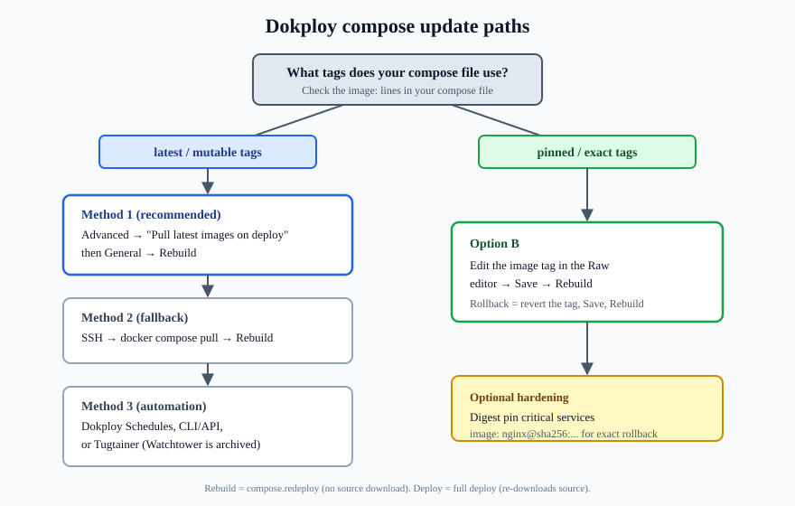
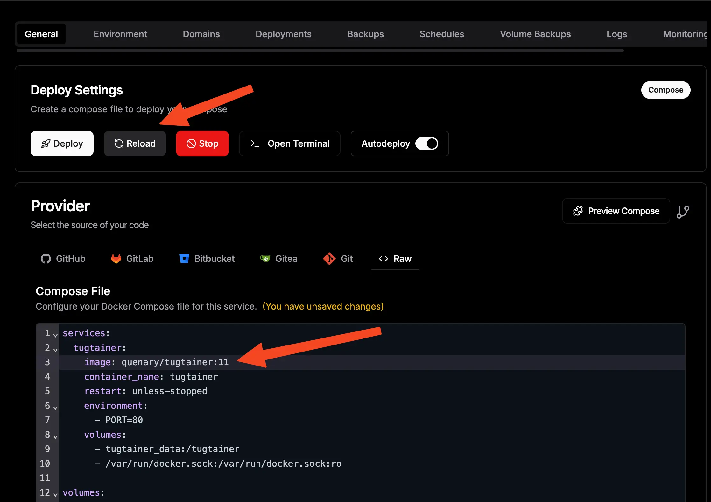
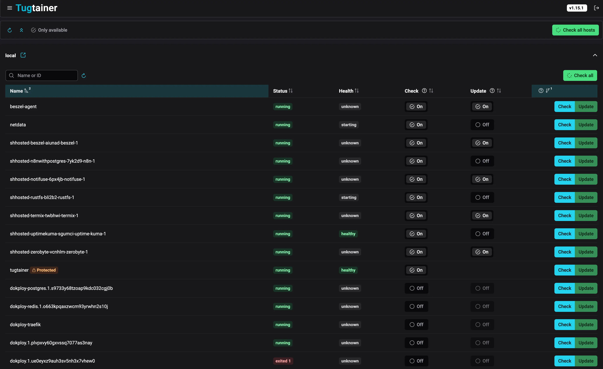

import Button from "@components/widgets/Button.astro";
import Notice from "@components/widgets/Notice.astro";
import ListCheck from "@components/widgets/ListCheck.astro";
import Accordion from "@components/widgets/Accordion.astro";
import Tabs from "@components/widgets/Tabs.astro";
import Tab from "@components/widgets/Tab.astro";

Updating Docker Compose stacks in Dokploy used to mean SSH-ing into the server and running `docker compose pull` by hand. Not anymore. Current Dokploy v0.30.x releases ship a native "Pull latest images on deploy" toggle, so a Rebuild fetches the newest image for every `latest` tag in the stack. This guide covers the full update workflow for Dokploy: the native toggle, the SSH fallback, automation with the Dokploy CLI, Schedules, or Tugtainer, plus pinned-version stacks, cleanup, and rollback. If you read the older version of this article: the button that used to be labeled **Reload** is now **Rebuild**.

New to Dokploy? Start with the [Dokploy installation guide](https://www.bitdoze.com/dokploy-install/). For deploying your first app, see [How To Deploy A Docker Compose App in Dokploy](https://www.bitdoze.com/dokploy-docker-compose-app/).

## Why update your Docker Compose stacks?

Old container images sit on your VPS with known vulnerabilities. Updating a Docker Compose stack in Dokploy on a regular cadence buys you:

<ListCheck>
<ul>
<li>**Security patches** - CVE fixes for discovered vulnerabilities</li>
<li>**Bug fixes** - Issues the maintainers finally resolved</li>
<li>**New features** - Capabilities added since your last deployment</li>
<li>**Compatibility** - Keeping up with API changes and dependencies</li>
</ul>
</ListCheck>

The same logic applies to the panel itself. Dokploy fixed serious issues in v0.29.13 (command-injection and cross-org IDOR fixes, 2026-07-21) and v0.30.0 (compose `serviceName` command injection, plus a Traefik bump from v3.6.7 to v3.6.25). If your panel is months behind, update tooling is the least of your problems.

<Notice type="warning" title="Backup before updates">
Have backups ready before you start. The [Dokploy backups guide](https://www.bitdoze.com/dokploy-backups-cloudflare-r2/) shows how to push volume backups to Cloudflare R2. One caveat: Dokploy Volume Backups only cover **named volumes**. Bind-mounted data is your responsibility.
</Notice>

## Prerequisites

Before any of the methods below work, you need:

<ListCheck>
<ul>
<li>A running Dokploy panel on a current v0.30.x release (that is where the pull-latest toggle lives)</li>
<li>A Linux VPS sized for Docker - I run Dokploy on a [Hetzner Cloud](https://go.bitdoze.com/hetzner) CX22 (around €4-5/mo), and a budget [Hostinger VPS](https://go.bitdoze.com/hostinger-vps) works fine for a couple of stacks. 2 GB RAM is the practical floor; 4 GB if you run several apps</li>
<li>SSH access to that VPS (only needed for the fallback method)</li>
<li>At least one app already deployed as a Docker Compose project in Dokploy</li>
<li>Backups in place for anything with state (databases, uploads)</li>
</ul>
</ListCheck>

No Dokploy yet? Follow the [Dokploy installation guide](https://www.bitdoze.com/dokploy-install/) first.

<Notice type="info" title="Where compose files live">
Dokploy stores compose projects under `/etc/dokploy/compose/<app-name>/code`. The app name is your cleaned project name plus a **6-character** random suffix, for example `myapp-a1b2c3`. Older articles show 7 characters; the suffix has been 6 for a while now.
</Notice>

## Option A: Updating stacks with the latest tag

When your compose file uses mutable tags like `image: nginx:latest`, you need an explicit pull step to get new images. Plain `docker compose up -d` does **not** re-pull an image it already has locally, so a redeploy with no pull will happily keep running last year's build. There are three ways to get fresh images into a `latest`-tag stack, and since v0.30.x the first one is the default choice.



### Method 1: Pull latest images on deploy (native, recommended)

Dokploy added a first-class pull option in PR #5410 (merged 2026-09-09, shipped in the v0.30.x series). You enable it once per compose project and every deploy fetches the newest image for each tag.

**Step 1: Enable the toggle**

1. Open your compose project in the Dokploy UI
2. Go to the **Advanced** tab
3. Find the **Run Command** card
4. Flip **Pull latest images on deploy** on

The UI text is worth quoting because it contains the main caveat:

> Adds `--pull always` to the default command so every deploy fetches the newest image for each tag. Has no effect when a custom command is set.

{/* TODO: screenshot pending  */}

**Step 2: Rebuild (or Deploy)**

Go back to the **General** tab and click **Rebuild**. That is the button this article used to call Reload.

| Button | What it does | Use it when |
|---|---|---|
| **Deploy** | Full deployment. Re-downloads the source (git clone or raw write) and runs the compose command | The git repo or raw source changed |
| **Rebuild** | Calls `compose.redeploy`. Skips the source download and re-runs the compose command | Only images need updating (this is the one you want) |

{/* TODO: screenshot pending  */}

**Step 3: What runs**

With the toggle on, the effective command looks like this:

```bash
docker compose -p <appName> -f <compose-file> up -d --build --remove-orphans --pull always
```

Docker Compose pulls every image first (because of `--pull always`), then recreates only the services whose image or config changed. Services you did not touch stay up.

**Verify it worked:**

1. The v0.30 **Docker dashboard** (left sidebar, Docker) has an **Events** tab that streams pull and start events in real time. Open it while you hit Rebuild and you should see `pull` events for each updated service
2. Or check the service **Logs** in Dokploy and look for the new version string at startup
3. Or over SSH: `cd /etc/dokploy/compose/myapp-a1b2c3/code && docker compose images`

If nothing changed, the tag probably never moved upstream, or the toggle is being ignored (next point).

<Notice type="warning" title="Custom command? The toggle is ignored">
If you set a custom Run Command for the project, "Pull latest images on deploy" has **no effect**. The toggle only modifies the default command. Either remove the custom command and use the default, or add `--pull always` to your own command yourself.
</Notice>

Also note that the default command includes `--build`. If any service in your compose file has a `build:` section, every Rebuild rebuilds that image from source. That is behavior, not a bug, but it can surprise you on slower VPSs.

**Rollback note:** with `latest` tags there is no previous tag to revert to. Before a risky major upgrade of a critical service, either digest-pin it (`image: nginx@sha256:...`) or switch it to a pinned version (Option B) so you have something to roll back to.

### Method 2: SSH and docker compose pull (fallback)

Sometimes you want a one-off pull, or you run a custom command and the toggle is not available to you. Then do it by hand.

**Step 1: SSH into your server**

```bash
ssh user@your-vps-ip
```

**Step 2: Find the compose project directory**

```bash
cd /etc/dokploy/compose/myapp-a1b2c3/code
```

**Step 3: Pull and recreate**

```bash
docker compose -p myapp-a1b2c3 pull
docker compose -p myapp-a1b2c3 up -d --remove-orphans
```

Or just hit **Rebuild** in the Dokploy UI after the pull; it runs the same recreate against the images now sitting in the local Docker cache.

<Notice type="info" title="Match the project name with -p">
Dokploy generates a `COMPOSE_PROJECT_NAME` in the project's `.env` file. Passing `-p myapp-a1b2c3` keeps your manual commands pointed at the same project Dokploy manages. Running plain `docker compose pull` from inside the `code` directory also works, because compose derives the project name from the folder and `.env`.
</Notice>

Why is the explicit `pull` needed at all? `docker compose up -d` only pulls images that are missing locally. Everything already cached stays cached. That is the whole reason Method 1 exists: `--pull always` forces the pull that `up -d` skips.

**Verify it worked:**

```bash
docker compose -p myapp-a1b2c3 images
docker compose -p myapp-a1b2c3 ps
```

The image IDs should differ from before the pull, and `ps` should show the containers healthy. The service **Logs** in the Dokploy UI should print the new version string at startup.



<Notice type="warning" title="Private registry images? Manual pulls may 401">
Dokploy injects registry credentials at deploy time through a temporary Docker config, so a bare SSH shell may not have the same auth context. If `docker compose pull` fails with `401 unauthorized` on a private image, either enable the Method 1 toggle and let Dokploy pull, or run `docker login` on the host first. This behavior is inferred from Dokploy's deploy source rather than live-tested, so verify it on your setup before relying on it.
</Notice>

### Method 3: Automate Docker Compose updates

Manual updates do not scale past a handful of stacks. Before picking an auto-updater, one reality check:

<Notice type="warning" title="Watchtower is archived">
`containrrr/watchtower` is archived and the README says "This project is no longer maintained" (24.6k stars, last push Dec 2025). Do not start new deployments on it. If you only need update notifications, [Diun](https://github.com/crazy-max/diun) is active and does exactly that. For actual auto-updates, use one of the options below.
</Notice>

There are three sane automation paths inside or alongside Dokploy, and the right one depends on where you want the trigger to run. If you want broader container management beyond updates, [compare Arcane and Dockhand](https://www.bitdoze.com/arcane-vs-dockhand/).

#### Dokploy Schedules (server job)

Dokploy has a built-in cron system: **Schedules**. Create a **Server Job** (runs bash directly on the host) with a schedule like `0 4 * * *`:

```bash
#!/bin/bash
cd /etc/dokploy/compose/myapp-a1b2c3/code
docker compose pull && docker compose up -d --remove-orphans
docker image prune -af
```

That updates the stack nightly at 04:00 and reclaims the old images in the same run. Zero extra tools, and the job lives in the same panel as everything else.

<Notice type="info" title="Server Job vs Compose Job">
Schedules offers several job types. **Server Jobs** run on the host and can do pulls and updates. **Compose Jobs** run inside a service container via `docker exec` - that is the wrong tool for image pulls. Pick Server Job for anything that touches `docker compose` or `docker image`.
</Notice>

#### Dokploy CLI / API

Dokploy v0.29.0 (2026-04-17) shipped a CLI auto-generated from the OpenAPI spec, with 449 commands (npm package `@dokploy/cli`). It is the clean way to script updates without SSH keys on the VPS.

```bash
npm install -g @dokploy/cli

# auth once, or use DOKPLOY_URL / DOKPLOY_API_KEY env vars
dokploy auth -u https://panel.example.com -t YOUR_API_KEY

# trigger an update from anywhere
dokploy compose redeploy --composeId abc123
```

The compose API also exposes `compose.deploy`, `compose.stop`, and `compose.start`, so a cron job on your laptop or in CI can drive the whole lifecycle. Pair `dokploy compose redeploy` with the pull-latest toggle from Method 1, otherwise redeploy will not fetch new images.

API keys live in the Dokploy UI (Settings, API). Treat them like root credentials: full panel access, so keep them in a secrets manager or env file and rotate on leak. If you want to go further and have an [AI assistant deploy Docker apps for you](https://www.bitdoze.com/ai-docker-deploy-skill/), the CLI is the surface to script against.

#### Tugtainer (cross-host, notifications, Swarm)

[Tugtainer](https://www.bitdoze.com/tugtainer-docker-autoupdate/) is the self-hosted Watchtower alternative I recommend: a web UI that watches containers and runs the updates. As of v1.44.1 (2026-10-05) it goes well beyond simple image bumps.

**What Tugtainer gives you:**

<ListCheck>
<ul>
<li>**Web interface** - Manage updates from a browser instead of SSH sessions</li>
<li>**Scheduled checks** - Polls registries for new images on your cadence</li>
<li>**Smart ordering** - Updates containers in dependency order</li>
<li>**Notifications** - Discord, Telegram, Slack, or email when updates land or fail</li>
<li>**Multi-server** - One interface across multiple hosts</li>
<li>**Healthcheck monitoring** - Auto-restarts and alerts when a container goes unhealthy</li>
<li>**Image pruning** - Automatic or manual cleanup of old images</li>
<li>**Docker Swarm support** - Auto-detects managers and does rolling updates (README-sourced; test before trusting it in a real swarm)</li>
<li>**Per-container control** - Check-only mode or full auto-update, plus hooks and custom labels</li>
</ul>
</ListCheck>



Set it up once and it handles the rest. It beats SSH-ing in every time an update drops.

Compared with the native toggle: the toggle is free and per-stack, and it only pulls at deploy time. Tugtainer is fleet-wide, runs on a schedule, and tells you what it did. Use the toggle for a handful of stacks; use Tugtainer when you want a control panel for updates across hosts.

<Button link="https://www.bitdoze.com/tugtainer-docker-autoupdate/" text="Tugtainer setup guide" />

## Option B: Updating stacks with pinned versions

If you pin exact versions (`image: postgres:16-alpine` instead of `latest`), the workflow is different. There is nothing newer to pull until you change the tag yourself. That is the point.

**Step 1: Edit the image tag in Dokploy**

1. Open the project in the Dokploy UI
2. Click the **General** tab
3. Find the **Raw** section with the compose file
4. Change the version tag

For example, change:

```yaml
image: flowiseai/flowise:1.0.0
```

to:

```yaml
image: flowiseai/flowise:1.1.0
```

**Step 2: Save**, then **Step 3: Rebuild** (or Deploy). Dokploy pulls the new tag and recreates the container.

{/* TODO: screenshot pending  */}

**Verify it worked:** the service **Logs** should print the new version at startup, and `docker compose images` over SSH should show the new tag's image ID. The Raw editor should display the version you just saved.

**Rollback:** revert the tag in the Raw editor, Save, Rebuild. Keep the previous tag one line away - a git commit, or just a comment line above the image. For tighter control, digest-pin instead of tag-pin:

```yaml
image: nginx@sha256:3f1b2c4d5e6f7a8b9c0d1e2f3a4b5c6d7e8f9a0b1c2d3e4f5a6b7c8d9e0f1a2b
```

A digest never moves under you, so "roll back" means pointing at the previous digest you saved.

<Notice type="info" title="Why pin versions?">
Pinned versions decide exactly what runs in production. You choose when to upgrade and you know what changed between deploys. `latest` tags can surprise you with breaking changes on a random Tuesday. For anything with data, I default to pinned tags and reserve `latest` for throwaway services. Digest pinning goes one step further: the tag cannot be mutated upstream behind your back.
</Notice>

The pull-latest toggle is irrelevant for immutable pinned tags (there is nothing newer to pull) but harmless if you leave it on. The `--build` part of the default command still applies: compose files with `build:` sections get rebuilt on every Rebuild either way.

<Notice type="warning" title="Absolute bind paths get cleaned on deploy">
Named volumes and relative binds like `../files` survive container recreates. Absolute host bind paths are a different story: per the official Dokploy docs, they get cleaned during deployments. If you bind-mount something like `/var/lib/mydata`, verify the path still holds your data after a Rebuild before you trust the workflow. This is exactly why backups come first.
</Notice>

## After the update: verify and clean up

An update is not done when the Rebuild button finishes. Two things left: confirm the new version is serving, and get rid of the old images.

**Verify checklist:**

<ListCheck>
<ul>
<li>The image ID changed (`docker compose images` or the Docker dashboard)</li>
<li>The Docker dashboard **Events** stream shows the pull for each updated service</li>
<li>Containers are healthy (`docker compose ps`, or the service status in Dokploy)</li>
<li>The app itself serves the new version - hit a version endpoint or the UI and check</li>
</ul>
</ListCheck>

Then clean up. Every update leaves dangling old images behind, and on a small VPS that fills the disk within months. A 40 GB disk with weekly updates and no pruning is a time bomb, not a plan.

<Notice type="warning" title="Disk fills silently on small VPSs">
Docker will happily eat a disk with orphaned images and build cache. You will not get a warning until writes start failing. Prune on a schedule or enable the built-in cleanup.
</Notice>

<Tabs>
<Tab name="Docker Cleanup setting">
The zero-effort option. In **Settings / Server**, enable **Docker Cleanup**. Dokploy then removes unused images automatically on its own schedule. Best when you want it handled and do not want to think about pruning.
</Tab>
<Tab name="Docker dashboard">
v0.30.0 added a Docker dashboard at `/dashboard/docker` with three tabs: **Images** (size and age per image, spots what is prunable), **Disk Usage** (reclaimable space broken down by images, volumes, and build cache), and **Events** (live pull/start/stop stream - handy for verifying the update landed). Use this when you want to see what is eating the disk before deleting anything.
</Tab>
<Tab name="Manual prune">
For cron or a Dokploy Schedules Server Job:

```bash
docker image prune -af
```

That removes all dangling and unused images. If you need to go deeper (volumes, build cache), see how to [reclaim disk space from old Docker images](https://www.bitdoze.com/clean-docker-overlay2-dir/) before running anything irreversible. `docker image prune -af` does not touch volumes, but `docker system prune -a --volumes` absolutely does.
</Tab>
</Tabs>

Updates also change what your server is running, which is exactly when you want monitoring. [Monitor your Dokploy server with Beszel and Uptime Kuma](https://www.bitdoze.com/beszel-uptime-kuma/) so a bad update wakes you up instead of your users.

## Best practices for updating stacks

### Test before production

Never push updates straight to production without checking them first:

1. **Use a staging environment** - Mirror your production setup somewhere safe
2. **Read the changelogs** - Know what you are getting into, especially for major versions
3. **Verify compatibility** - Make sure your config and env vars still work with the new image

### When to update

<ListCheck>
<ul>
<li>**Security patches** - Apply as soon as you have tested them. Do not sit on CVEs</li>
<li>**Feature updates** - Schedule them in your maintenance window</li>
<li>**Major versions** - Plan these carefully. Read the migration notes, take a backup, and have the rollback tag ready before you start</li>
</ul>
</ListCheck>

### Rolling back

When an update breaks something:

1. **Revert the change** - For pinned versions, put the previous tag or digest back in the Raw editor. For `latest` stacks, re-pull the old image by digest if you saved one, or restore from backup
2. **Click Rebuild** in Dokploy to recreate the containers on the old image
3. **Check the Logs** to see what went wrong before you try again

One caveat: Dokploy's one-click Rollback feature is for **applications only**. There is no `compose.rollback` endpoint. Compose rollbacks are manual, which is another reason pinned tags (or digests) beat `latest` for anything you care about. If the update corrupted data rather than just the container, restore from the [Dokploy backups with Cloudflare R2](https://www.bitdoze.com/dokploy-backups-cloudflare-r2/) you took beforehand.

<Notice type="info" title="Keep Dokploy itself updated">
Your update tooling is only as safe as the panel running it. v0.29.13 and v0.29.14 backported dozens of security fixes (command injection, IDOR), and v0.30.0 fixed a compose `serviceName` injection and moved Traefik from v3.6.7 to v3.6.25. Update the panel on the same cadence as your stacks.
</Notice>

<Notice type="warning" title="Isolated Deployments is deprecated">
v0.30.0 deprecated the Isolated Deployments setting (still present in compose advanced settings). The replacement is per-service network attach: services join `dokploy-network` by default and you attach or detach networks per service, applied on the next deploy. If you enabled isolation from the open-source templates, it still works today, but plan the migration.
</Notice>

## Frequently asked questions

<Accordion label="Does Rebuild pull new images without the toggle?" group="faq" expanded="true">
No. Rebuild runs `up -d --build --remove-orphans` against whatever images are already in the local Docker cache, and `up -d` does not re-pull tags it already has. Without the "Pull latest images on deploy" toggle (or a manual `docker compose pull` first), you will keep running the old image. That is the whole reason the toggle exists.
</Accordion>

<Accordion label="What's the difference between Deploy and Rebuild in Dokploy?" group="faq">
Deploy is a full deployment: it re-downloads the source (git clone or raw file write) and then runs the compose command. Rebuild calls `compose.redeploy` and skips the source download, re-running only the compose command. For image-only updates, Rebuild is faster and sufficient. For source changes, use Deploy.
</Accordion>

<Accordion label="Can I auto-update Docker Compose services in Dokploy?" group="faq">
Yes. Three options: Dokploy Schedules with a Server Job running a pull-and-up script on a cron; the Dokploy CLI (`dokploy compose redeploy`) from a cron on your laptop or CI; or Tugtainer for fleet-wide updates with notifications and a web UI. The pull-latest toggle alone only pulls at deploy time - it is not a scheduler.
</Accordion>

<Accordion label="Is Watchtower still maintained in 2026?" group="faq">
No. `containrrr/watchtower` is archived and its README states the project is no longer maintained. Do not deploy it for new setups. Tugtainer is the closest self-hosted replacement for auto-updates; Diun is the active option if you only need notifications when new images appear.
</Accordion>

<Accordion label="How do I roll back a Docker Compose stack in Dokploy?" group="faq">
Revert the image tag or digest in the Raw editor and hit Rebuild. There is no one-click rollback for compose projects - that feature is application-only. Keep the previous tag in git or a comment, and take [volume backups](https://www.bitdoze.com/dokploy-backups-cloudflare-r2/) before risky updates in case data is affected, not just the container.
</Accordion>

## Final thoughts

Updating Docker Compose stacks in Dokploy in 2026 comes down to one decision per stack:

- **`latest` tags**: flip on "Pull latest images on deploy" once and Rebuild when you want fresh images. That is the whole workflow
- **SSH + `docker compose pull`**: keep it in your back pocket for one-offs and custom commands
- **Automation**: Dokploy Schedules for a single host with no extra tools, the Dokploy CLI for cron from a laptop or CI, Tugtainer when you want notifications and multi-host control. Never Watchtower
- **Pinned versions**: when stability matters, edit the tag (or digest) yourself and roll back by reverting one line

Dokploy shipped a lot in 2026: the pull toggle, the CLI, and the Docker dashboard all landed in the v0.29/v0.30 line. This article is current as of 2026-10-24 against Dokploy v0.30.10. Keep backups in front of every update, prune the images you are no longer using, and watch the server after a deploy. If you are still choosing a panel, [see how Dokploy compares in our best self-hosted server panels guide](https://www.bitdoze.com/best-self-hosted-panels/), or [compare Coolify, Dokploy, and Kamal](https://www.bitdoze.com/coolify-vs-dokploy-vs-kamal-2/) if the shortlist is still open.

## Related guides

<Button link="https://www.bitdoze.com/dokploy-install/" text="Dokploy installation" />

<Button link="https://www.bitdoze.com/dokploy-docker-compose-app/" text="Deploy Docker Compose apps" />

<Button link="https://www.bitdoze.com/dokploy-backups-cloudflare-r2/" text="Configure backups" />

<Button link="https://www.bitdoze.com/tugtainer-docker-autoupdate/" text="Tugtainer auto-updater" />
