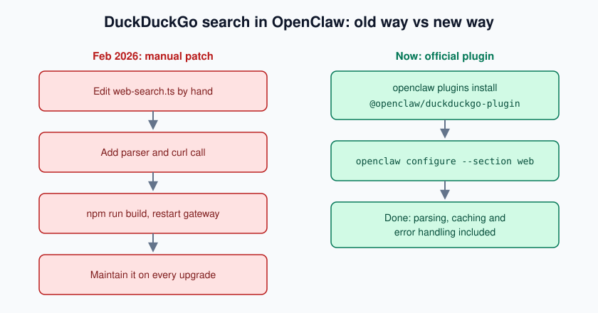
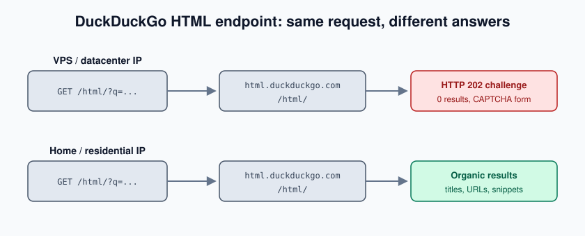

import Notice from "@components/widgets/Notice.astro";
import ListCheck from "@components/widgets/ListCheck.astro";
import Accordion from "@components/widgets/Accordion.astro";
import Tabs from "@components/widgets/Tabs.astro";
import Tab from "@components/widgets/Tab.astro";
import Button from "@components/widgets/Button.astro";

OpenClaw now ships an official, experimental DuckDuckGo search plugin. Adding DuckDuckGo search to OpenClaw takes two commands and gets you free web search without API keys, signups, or billing dashboards. If you hand-patched `web-search.ts` (including the method the first version of this article documented), remove that patch and install the plugin instead. The DIY code path is gone since OpenClaw moved web search to a plugin architecture in March 2026.

One honest caveat before you start: DuckDuckGo's HTML endpoint serves bot-challenge pages to datacenter IPs, which is where most OpenClaw instances run. Key-free does not mean reliable on a VPS. This guide covers install, configuration, verification, the bot-detection reality, and what to use instead when you need search that does not flake (SearXNG if you self-host, Brave or Tavily if you pay).

<Notice type="info" title="What You'll Need">
<ListCheck>
<ul>
<li>OpenClaw 2026.3.x or newer (current stable: 2026.10.8; the plugin architecture landed in 2026.3)</li>
<li>Node.js 24.16+ or 26.1+ if you are installing OpenClaw itself (24.22.1+ / 26.12.1+ recommended)</li>
<li>Terminal access to the box that runs your gateway</li>
<li>No API key. DuckDuckGo needs no account.</li>
</ul>
</ListCheck>
</Notice>

If you're new to OpenClaw, start with the [OpenClaw Setup Guide](/clawdbot-setup-guide/) first.

## What changed: DuckDuckGo is now an official OpenClaw plugin

The first version of this article (February 2026) documented a manual patch: edit `~/.openclaw/openclawd/src/agents/tools/web-search.ts` by hand, add a provider entry, write an HTML parser, shell out to curl, rebuild the source tree. It worked, and it was 11 steps of TypeScript you had to maintain yourself.

On 2026-03-23 OpenClaw merged an official bundled DuckDuckGo plugin (PR #52629) and marked it experimental the same day. Web search now lives in the plugin architecture (`extensions/<provider>/` in the repo, shipped as npm packages). There is no source checkout, no `npm run build`, and no hand-edited TypeScript. The npm package is `@openclaw/duckduckgo-plugin`, versioned in lockstep with OpenClaw (2026.10.8 as of 2026-10-27).



Under the hood the plugin differs from the old DIY patch in ways that matter: GET requests with query parameters instead of a POST form body, an honest User-Agent (`openclaw-duckduckgo/<version>`) instead of a spoofed browser string, `region` and `safeSearch` support, and a built-in result cache (15 minutes by default).

<Notice type="warning" title="Experimental">
The official docs classify DuckDuckGo as "experimental, unofficial". It scrapes DuckDuckGo's HTML endpoint, so if DuckDuckGo changes their page markup the parser breaks until the plugin ships a fix. That is the trade-off for key-free search.
</Notice>

## How to add DuckDuckGo search to OpenClaw (2 commands)

Three steps, two of them commands. Run them from a shell on the box that runs your gateway.

**1. Install the plugin:**

```bash
openclaw plugins install @openclaw/duckduckgo-plugin
```

**2. Restart the gateway:**

```bash
openclaw gateway restart
```

The docs say a running gateway picks up a new plugin automatically. The restart is the safe path if you want the behavior deterministic right now.

**3. Select DuckDuckGo as the search provider:**

```bash
openclaw configure --section web
```

Choose "duckduckgo" from the provider list.

That's it. You don't need an API key or an account, and there's no build step. Plugin versions track OpenClaw releases, so `@openclaw/duckduckgo-plugin@2026.10.8` matches OpenClaw 2026.10.8.

<Button text="OpenClaw Plugin Docs" link="https://docs.openclaw.ai/tools/duckduckgo-search" variant="outline" color="blue" size="sm" icon="arrow-right" />

Now confirm it works before you rely on it.

### Configure the DuckDuckGo search provider

The config file lives at `~/.openclaw/openclaw.json`. If you're coming from the old guide: the path changed from `~/.openclaw/config.json`, and the format is JSON5 (comments and trailing commas are allowed). `OPENCLAW_CONFIG_PATH` overrides the location if it's set in the gateway environment.

<Tabs>
<Tab name="Config file (JSON5)">

```json5
{
  tools: { web: { search: { provider: "duckduckgo" } } },
  plugins: {
    entries: {
      duckduckgo: {
        config: {
          webSearch: {
            region: "us-en",        // optional: us-en, uk-en, de-de, ...
            safeSearch: "moderate", // strict | moderate | off
          },
        },
      },
    },
  },
}
```

Both plugin-level settings are optional. `region` defaults to DuckDuckGo's own guess; `safeSearch` defaults to `moderate`.

</Tab>
<Tab name="CLI one-liners">

```bash
# What is configured right now?
openclaw config get tools.web.search.provider

# Select DuckDuckGo
openclaw config set tools.web.search.provider "duckduckgo"

# Optional plugin-level defaults
openclaw config set plugins.entries.duckduckgo.config.webSearch.region "us-en"
openclaw config set plugins.entries.duckduckgo.config.webSearch.safeSearch "moderate"

# Remove a setting again
openclaw config unset plugins.entries.duckduckgo.config.webSearch.region
```

Same result as editing the file. Use whichever you'll remember.

</Tab>
</Tabs>

There is also a Control UI at `http://127.0.0.1:18789` (Settings → Search) if you prefer clicking over typing.

One behavior worth knowing up front: OpenClaw's provider auto-detect only considers providers with usable credentials, so DuckDuckGo is never auto-selected. You must set `provider: "duckduckgo"` explicitly, as above.

### Per-query parameters: count, region, safeSearch

Each `web_search` call accepts parameters that override the plugin-level config:

| Param | Type | Default | Notes |
|---|---|---|---|
| `query` | string | required | The search query |
| `count` | number | 5 | 1 to 10 results |
| `region` | string | plugin config | DuckDuckGo `kl` code: `us-en`, `uk-en`, `de-de`, and so on |
| `safeSearch` | string | `moderate` | `strict`, `moderate`, or `off` (maps to DuckDuckGo's `kp` parameter) |

Region codes map to DuckDuckGo's [`kl` parameter](https://duckduckgo.com/params). The list changes over time, so check that page instead of hard-coding one from a blog post.

Two defaults you'll want on your radar: results are cached in-process for 15 minutes (the cache key includes provider, query, count, region, and safeSearch), and the request timeout is 20 seconds. Repeated identical queries inside the cache window do not hit DuckDuckGo again.

## Verify your OpenClaw web search setup

Don't assume the install worked. Check it.

<ListCheck>
<ul>
<li>Run <code>openclaw plugins list</code> and confirm <code>@openclaw/duckduckgo-plugin</code> shows as installed.</li>
<li>Run <code>openclaw config get tools.web.search.provider</code> and confirm it returns <code>"duckduckgo"</code>.</li>
<li>Open Control UI → Settings → Search and hit <strong>Test search</strong>. It runs a real query and shows latency or the error.</li>
<li>Ask your bot something that needs current info ("what's the latest Node.js release?"). The <code>web_search</code> payload should show <code>provider: "duckduckgo"</code>, a <code>tookMs</code> value, and an <code>externalContent</code> stamp.</li>
</ul>
</ListCheck>

Success looks like results with titles, URLs, and snippets inside a couple of seconds. If step 3 or 4 fails, jump to the troubleshooting section below. The error message tells you which failure mode you hit.

<Notice type="info" title="Tip">
Once searches matter to your workflow, watch them over time instead of poking at one-off tests. The <a href="/best-openclaw-dashboards/">best OpenClaw dashboards</a> cover monitoring sessions, searches, and costs.
</Notice>

## The catch: DuckDuckGo bot detection on VPS IPs

"Free forever" has fine print. DuckDuckGo's HTML endpoint (`https://html.duckduckgo.com/html/`, and the `lite.duckduckgo.com/lite/` variant) answers datacenter IPs with a bot-challenge page instead of search results. You don't get a block with a clear error code. What comes back is a normal-looking page: HTTP 202, a CAPTCHA widget ("Select all squares containing a duck"), and `id="challenge-form"` in the markup. Zero organic results.

That's exactly where most OpenClaw instances run: a VPS in Hetzner, OVH, or some other provider's rack.

<Notice type="warning" title="Key-free ≠ reliable on a VPS">
Treat DuckDuckGo search as best-effort on any datacenter IP. Expect intermittent failures under load. For anything that must work every time, use SearXNG (self-hosted) or an API-backed provider (Brave, Tavily) instead. Details in the options section below.
</Notice>

<Notice type="error" title="What the failure looks like">
The official plugin detects the challenge-page signature and throws <code>DuckDuckGo returned a bot-detection challenge.</code> instead of silently returning garbage. Check your own VPS with one request:

```bash
curl -s "https://html.duckduckgo.com/html/?q=openclaw" | grep -c "challenge-form"
# 0 = you got a real results page; 1 or more = you got a bot challenge
```
</Notice>

Tests from datacenter IPs on 2026-10-28 hit this challenge page. Re-run the check from your own VPS before deciding how much you can rely on it. This moves around.



### How to reduce bot-detection failures

If you want to keep DuckDuckGo as your provider anyway, a few things help:

1. **Lean on the cache.** Results are cached for 15 minutes per query. Repeated identical searches don't touch DuckDuckGo again inside that window. Fewer unique queries means fewer challenges.
2. **Keep `count` realistic.** Asking for 10 results on every call multiplies parsing surface for no real gain. 5 is the default for a reason.
3. **Run from a residential IP.** A home box or Mac mini gets challenged far less than a VPS. If OpenClaw at home is an option for you, see the [best Mac mini for OpenClaw](/best-mac-mini-for-openclaw/) for the right model.
4. **Keep the honest User-Agent.** Since 2026-10-07 (commit #164726) the plugin deliberately sends `openclaw-duckduckgo/<version>` instead of impersonating a browser. Do not "fix" this with a spoofed Chrome UA. The old rotate-user-agents advice from the previous version of this guide is now a fingerprint-mismatch risk, not a mitigation.
5. **Or stop scraping.** If searches need to work every time, move to the next section: SearXNG for self-hosted key-free search, Brave or Tavily for API-backed search.

## Free web search without API keys: all your OpenClaw options

DuckDuckGo is not the only way to get web search into OpenClaw without a credit card. Here's the honest comparison:

| Provider | API key | Cost | Reliability | Freshness filters | Best for |
|---|---|---|---|---|---|
| DuckDuckGo plugin | None | Free | Medium: HTML scraping, bot challenges on datacenter IPs | No | Personal use, testing |
| SearXNG | None | Free (self-hosted; ~€6/mo VPS) | High: native JSON API, no scraping | Depends on the instance | Reliable self-hosted free |
| Brave Search | Required | ~1,000 free queries/month in renewing credit (per the OpenClaw docs) | High: official API | Yes: `freshness`, `date_after`/`date_before` | Production |
| Ollama Web Search | None via local Ollama, or `OLLAMA_API_KEY` | Free self-hosted / hosted pricing | High | No | Fully self-hosted stacks |
| Tavily | `TAVILY_API_KEY` | Free tier (commonly cited at 1,000 credits/month, unverified) | High: official API | See Tavily docs | Agents that also need page extraction |

My default recommendation: personal use and testing → DuckDuckGo plugin (two commands, zero cost). Serious self-hosted free → SearXNG. Production, or anything that must not fail → Brave or Tavily.

### SearXNG: the reliable self-hosted free option

This is the option I'd pick for a VPS. SearXNG is a self-hosted metasearch engine, and OpenClaw's bundled SearXNG plugin talks to its native JSON API. It does not scrape, so bot challenges are not part of the deal, and there is no API key to manage. The catch is that you run SearXNG yourself, which is one more container, but a small one.

Requirements: `json` in `search.formats` of your SearXNG instance's `settings.yml`, and OpenClaw 2026.6.9+ (that's the plugin's minimum host version).

Quick start if SearXNG already runs on the box:

```bash
export SEARXNG_BASE_URL="http://localhost:8888"   # instance needs format "json" enabled
openclaw configure --section web                   # choose "searxng"
```

Or pin it in `~/.openclaw/openclaw.json`:

```json5
{
  plugins: {
    entries: {
      searxng: {
        config: {
          webSearch: {
            baseUrl: "http://localhost:8888",
            categories: "general",
            language: "en",
          },
        },
      },
    },
  },
  tools: { web: { search: { provider: "searxng" } } },
}
```

You can also set `SEARXNG_BASE_URL` in the gateway environment instead of the config. The plugin validates base URLs (SSRF guard), so stick to your own instance's address.

SearXNG is light. 1 vCPU and 2 GB RAM covers the search instance itself. On Hetzner the cost-optimized [CX23 tier](https://go.bitdoze.com/hetzner) (2 vCPU, 4 GB at €5.49/month plus €0.50 for the IPv4 address, October 2026 prices) is more than enough for SearXNG plus OpenClaw itself. Those plans have been out of stock at times, so check the [Hetzner Cloud pricing tables](/hetzner-cloud-cost-optimized-plans/) for availability before you order.

<Button text="Self-Host SearXNG with Docker" link="/searxng-self-host-privacy-search/" variant="solid" color="green" size="md" icon="arrow-right" />

The full walkthrough, including the `settings.yml` change for JSON output and backup notes, is in the [self-host SearXNG with Docker](/searxng-self-host-privacy-search/) guide.

### Brave Search: the production pick

Brave Search is the API-backed default. You get an official API instead of scraping: freshness filters (`freshness`, `date_after`/`date_before` in `llm-context` mode), country and language targeting, and no bot-detection risk.

Pricing moved to a prepaid-credits model. Per the OpenClaw docs each plan includes $5/month in renewing free credit, and the Search plan costs $5 per 1,000 requests, so the credit covers roughly 1,000 queries/month. Brave's marketing page quotes a higher monthly figure; check your Brave dashboard before you budget around any number. Legacy accounts on the original 2,000 queries/month free plan are still honored.

Switching to (or back to) Brave:

```json5
{
  plugins: { entries: { brave: { config: { webSearch: { apiKey: "YOUR_BRAVE_API_KEY" } } } } },
  tools: { web: { search: { provider: "brave" } } },
}
```

Or skip the config file and export `BRAVE_API_KEY` in the gateway environment. Note that `apiKey` no longer lives under `tools.web.search`. The old path from earlier guides (including the previous version of this one) is wrong now.

If you run the MiniMax/GLM stack, the same provider setup applies in the [NanoBot setup guide with Brave Search](/nanobot-setup-guide/).

### Ollama web search and Tavily

Two more bundled options worth knowing about:

- **Ollama Web Search** is key-free through your own Ollama instance (sign in with `ollama signin`), or hosted via `OLLAMA_API_KEY` with `plugins.entries.ollama.config.webSearch.baseUrl: "https://ollama.com"`. If you're already [running OpenClaw with Ollama](/openclaw-ollama-local-models/) for local models, this gets you key-free search in the same stack. No Ollama yet? [Ollama with Docker Compose and Open WebUI](/ollama-docker-install/) is the quickest install path.
- **Tavily** ships as `@openclaw/tavily-plugin` with `TAVILY_API_KEY`. It provides `tavily_search` and `tavily_extract` (grabbing page contents after a search is genuinely useful for agents), with a 30-second search timeout. Free-tier credits are commonly cited at 1,000/month, though I haven't verified the current number.

Exa, Parallel, and Firecrawl are bundled providers too, and `x_search` (X posts) and `web_fetch` exist as separate tools on top of `web_search`. [Perplexity](https://go.bitdoze.com/perplexity) is another bundled provider if you'd rather have AI-synthesized answers with citations than raw links. If you'd rather pay for a dedicated search API for agents, [TinyFish](https://go.bitdoze.com/tinyfish) offers web search and fetch APIs behind one key.

## Migrating from the old manual web-search.ts patch

<Notice type="info" title="Coming from the old guide?">
If you followed the first version of this article (or any DIY <code>web-search.ts</code> patch), that code path no longer exists. Web search moved to the plugin architecture. Here's how to get clean.
</Notice>

1. **Revert or delete your manual edits.** The file `~/.openclaw/openclawd/src/agents/tools/web-search.ts` doesn't exist anymore. If you cloned or forked the source tree to patch it, `git pull` or reinstall OpenClaw so you're back on a clean tree.
2. **Install the official plugin** with `openclaw plugins install @openclaw/duckduckgo-plugin` (see the install section above).
3. **Set the provider** to `"duckduckgo"` in `~/.openclaw/openclaw.json`. Remember the config file moved from `~/.openclaw/config.json`. If your settings "stopped applying" around the time you updated OpenClaw, this is why.
4. **Verify** with the checklist above.

Rollback is trivial: set `tools.web.search.provider` back to `"brave"` (or whatever you used before). The DuckDuckGo plugin can stay installed and unused.

One historical note: there was a community fork (`jokelord/openclaw-local-model-tool-calling-patch`) with DuckDuckGo pre-implemented. It last saw a push on 2026-02-06, before the official plugin existed. Don't use it.

## Troubleshooting OpenClaw DuckDuckGo search

### "DuckDuckGo returned a bot-detection challenge"

This is the number one expected error on datacenter IPs. DuckDuckGo served a CAPTCHA page instead of results, and the plugin's signature detection caught it. The mitigations above (cache, lower frequency, residential IP) reduce how often you see it; they don't eliminate it. The failure is intermittent. A query that fails now can succeed in five minutes.

### Empty or missing results

Three usual causes:

1. **HTML structure drift.** DuckDuckGo changed their markup and the parser (still marked experimental) doesn't match anymore. Check `openclaw plugins list` for plugin status and update the plugin.
2. **Stale cache.** An empty result set can sit in the 15-minute cache. Wait it out or restart the gateway to clear the in-process cache.
3. **`count` above what's available.** Asking for 10 results on a query with 4 real hits returns fewer than 10. That's not a bug.

### DuckDuckGo is never auto-selected

This trips people up. OpenClaw's provider auto-detection only considers providers with usable credentials, so a key-free provider is never auto-picked. Installing the plugin is not enough. You must set `tools.web.search.provider` to `"duckduckgo"` explicitly:

```bash
openclaw config get tools.web.search.provider   # if this is not "duckduckgo", that's your problem
openclaw config set tools.web.search.provider "duckduckgo"
```

### Config not applied / plugin not found

Check these in order:

- **Wrong config path.** The file is `~/.openclaw/openclaw.json` now, not `~/.openclaw/config.json`. If `OPENCLAW_CONFIG_PATH` is set in the gateway environment, that's the file being read.
- **JSON5 syntax error.** Comments and trailing commas are fine, but everything else must parse. A broken config file makes OpenClaw fall back to defaults silently.
- **Version too old.** The plugin needs OpenClaw 2026.3.x or newer for the extension architecture. `openclaw --version` tells you where you stand.
- **Restart pending.** If the plugin shows as installed but search still errors, `openclaw gateway restart` and test again.

## Frequently asked questions

<Accordion label="Is DuckDuckGo search free to use with OpenClaw?" group="faq" expanded="false">
Yes. No API key or account, and nothing to pay. The plugin scrapes DuckDuckGo's public HTML endpoint, so the cost is reliability instead of money: on a datacenter IP you will hit bot-challenge pages some of the time. On a residential IP it's usually fine for personal use.
</Accordion>

<Accordion label="Can I use both Brave and DuckDuckGo?" group="faq" expanded="false">
Yes. Both plugins can stay installed. Switch between them any time by changing `tools.web.search.provider` to `"brave"` or `"duckduckgo"`. Keep in mind that provider auto-detect never selects DuckDuckGo on its own, so "both" really means "switch explicitly when you want the other one".
</Accordion>

<Accordion label="Is this against DuckDuckGo's Terms of Service?" group="faq" expanded="false">
The plugin is official on OpenClaw's side and marked experimental. It queries DuckDuckGo's publicly accessible HTML endpoint, the same one a browser without JavaScript hits. For heavy or commercial use, OpenClaw's own docs recommend an API-backed provider like Brave Search instead. That's good advice.
</Accordion>

<Accordion label="How do I switch back to Brave?" group="faq" expanded="false">
Set the provider and give Brave its key. The key goes in plugin config now, not under `tools.web.search`:

```json5
{
  plugins: { entries: { brave: { config: { webSearch: { apiKey: "YOUR_BRAVE_API_KEY" } } } } },
  tools: { web: { search: { provider: "brave" } } },
}
```

Or export `BRAVE_API_KEY` in the gateway environment and just set `tools.web.search.provider` to `"brave"`.
</Accordion>

<Accordion label="Will this work with future OpenClaw versions?" group="faq" expanded="false">
The plugin is versioned in lockstep with OpenClaw, so update it alongside the gateway: `openclaw plugins install @openclaw/duckduckgo-plugin@latest`. If DuckDuckGo changes their HTML and results go empty, the fix lands in the plugin (check the repo's `extensions/duckduckgo` changelog), not in code you maintain yourself. That's the whole point of moving off the manual patch.
</Accordion>

DuckDuckGo OpenClaw search is free and useful. Two commands and you're done. The ladder stays simple: the DuckDuckGo plugin for personal use and testing, SearXNG on your own box for reliable key-free search, Brave or Tavily for anything that must not fail. Before you expose a gateway anywhere, harden it: the [OpenClaw security guide](/openclaw-security-guide/) covers CVE-2026-25253 and the rest of the checklist.

If you're exploring the wider ecosystem, have a look at [OpenClaw alternatives](/openclaw-alternatives/), the [NanoClaw deploy guide](/nanoclaw-deploy-guide/) (container-isolated Claude agents), the [NullClaw deploy guide](/nullclaw-deploy-guide/) (678 KB Zig binary with 22+ providers), and the [best OpenClaw dashboards](/best-openclaw-dashboards/) if you want a UI for monitoring sessions and costs. For a fully self-hosted stack, pair [running OpenClaw with Ollama](/openclaw-ollama-local-models/) with SearXNG and skip every API key.

<Button text="OpenClaw Setup Guide" link="/clawdbot-setup-guide/" variant="solid" color="blue" size="md" icon="arrow-right" />
