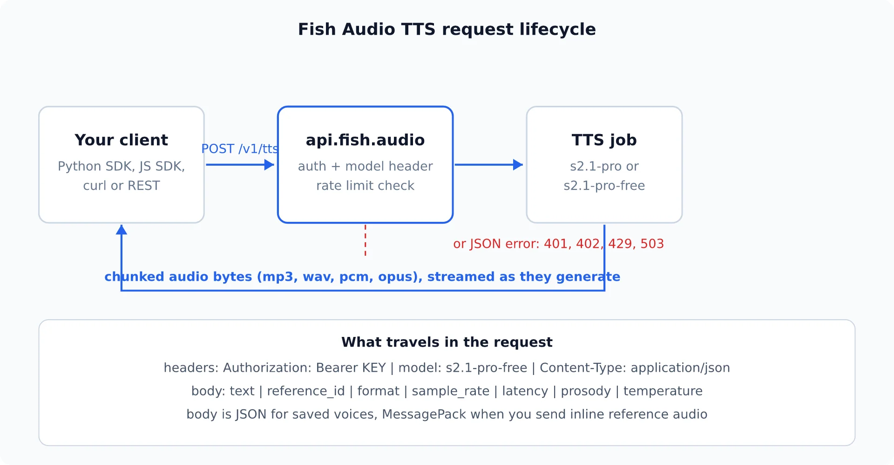
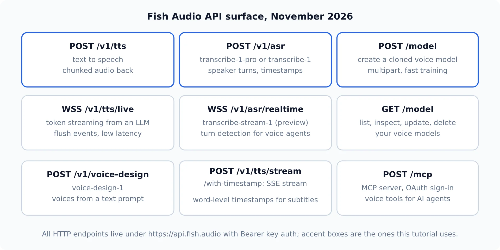
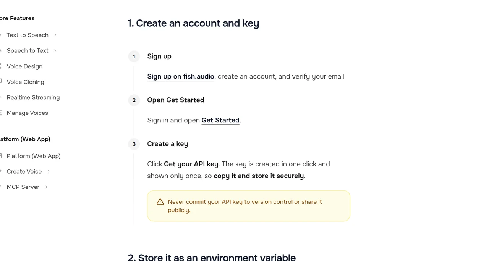
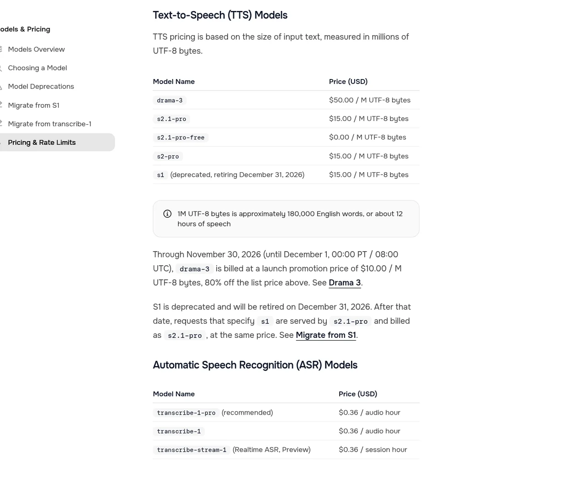
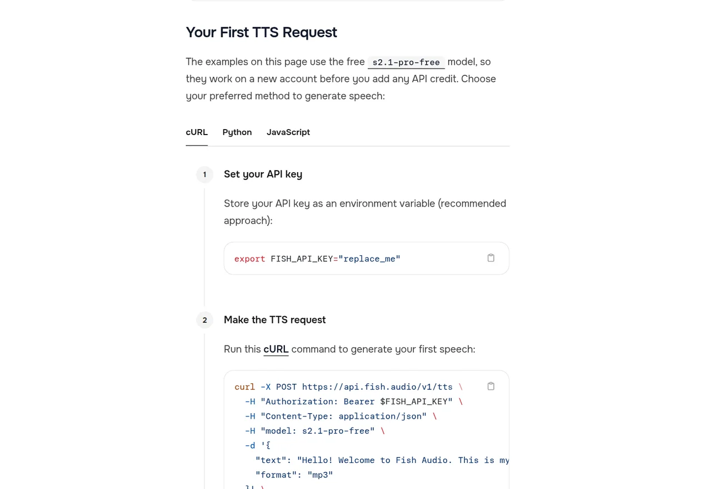

import Button from "@components/widgets/Button.astro";
import Notice from "@components/widgets/Notice.astro";
import Accordion from "@components/widgets/Accordion.astro";
import Tabs from "@components/widgets/Tabs.astro";
import Tab from "@components/widgets/Tab.astro";
import ListCheck from "@components/widgets/ListCheck.astro";

*Disclosure: this guide contains referral links. If you buy through them, I may earn a commission at no extra cost to you.*

The Fish Audio API is a REST and WebSocket service at `api.fish.audio` that turns text into speech, clones voices, and transcribes audio. Its production model S2.1 Pro also runs as `s2.1-pro-free` at $0 per byte, so new accounts can make real API calls before adding billing credit.

I use Fish Audio for voiceovers and TTS across several projects and covered the web app in a full [Fish Audio review](/fish-audio-review/). This guide covers the developer workflow, including authentication, TTS requests, streaming, emotion tags, voice cloning, transcription, and pricing math. The examples follow the official [quickstart](https://docs.fish.audio/developer-guide/getting-started/quickstart) and [Python SDK README](https://github.com/fishaudio/fish-audio-python), cleaned up for copy-paste use. Every snippet reflects docs checked on November 26, 2026, with unverified behavior explicitly noted.

<Button text="Try Fish Audio Free" link="https://go.bitdoze.com/fish-audio" variant="solid" color="blue" size="md" icon="arrow-right" />

## How the Fish Audio API works

Every request goes to `https://api.fish.audio` with an `Authorization: Bearer <key>` header and a `model` header picking the engine. TTS requests send JSON (or MessagePack for inline reference audio) and receive chunked audio bytes in mp3, wav, pcm, or opus. Because the audio streams in chunks, playback can start before generation finishes.



*The TTS request lifecycle: one POST in, chunked audio bytes out, JSON errors on failure.*

The API surface covers more than TTS. There is a speech-to-text endpoint, a realtime transcription WebSocket, voice model management, and voice design from a text prompt. This tutorial uses POST /v1/tts, POST /v1/asr, POST /model, and the TTS WebSocket.



*The API surface as of November 2026.*

## Getting a Fish Audio API key

You create keys in the web app, with no separate developer signup. Sign up at fish.audio, verify your email, then open the Get Started page at `fish.audio/app/developers/get-started/`. Click "Get your API key" and the key is generated in one click. The same key works for the REST API, the Python SDK, and the JavaScript SDK. Existing keys live on the API Keys page at `fish.audio/app/api-keys`.

<Notice type="warning" title="The key is shown only once">
Copy it immediately. If you lose it, you create a new one from the API Keys page. Never commit it to git.
</Notice>



*The official key creation steps from docs.fish.audio.*

Store it as an environment variable, which is what every SDK and example in the docs expects:

```bash
export FISH_API_KEY="your_api_key_here"
```

If a key does leak, Fish Audio documents a [revoke endpoint for exposed keys](https://docs.fish.audio/api-reference/endpoint/apikey/revoke-api-keys) that needs no sign-in, so secret scanners can kill keys found in public repos. Revocation is permanent and the key returns 401 immediately.

## Is the Fish Audio API free?

Yes, for development. The `s2.1-pro-free` model costs $0 per million UTF-8 bytes and hits the exact same endpoint as paid S2.1 Pro, so nothing changes when you upgrade. Because new accounts start with zero credit, every initial example below targets `s2.1-pro-free`.

The terms come from Fish Audio's [S2.1 Pro free API announcement](https://fish.audio/blog/s2-1-pro-free-api/), which I read on November 26, 2026:

- Unlimited use under a Fair Use Policy. Fish Audio can throttle usage that looks like abuse rather than development.
- No SLA, no uptime or latency guarantee, best effort only.
- Requests may be used to improve model quality.
- Some commercial scenarios may have restrictions, and products generating more than $1M ARR should contact Fish Audio before using the free tier.

<Notice type="info" title="The free window has an end date">
On November 26, 2026 the announcement said free access was available through November 30, 2026, with advance notice of any change. The same post shows the window was extended several times before (to August 31, then to November 30). Check the [pricing page](https://docs.fish.audio/developer-guide/models-pricing/pricing-and-rate-limits) before you build on it, because after the stated date a `s2.1-pro-free` request may start costing money or failing.
</Notice>



*Official pricing page captured November 26, 2026, showing s2.1-pro-free at $0, s2.1-pro at $15 per million UTF-8 bytes, and ASR at $0.36 per audio hour. The drama-3 launch promo runs through November 30, 2026.*

For scale, one million UTF-8 bytes is roughly 180,000 English words or about 12 hours of speech. For comparison, ElevenLabs' [pricing page](https://elevenlabs.io/pricing) lists 10k credits per month on its free plan, and I compared quality and cost head to head in [Fish Audio vs ElevenLabs](/fish-audio-vs-elevenlabs/). It is perfect for prototypes, internal tools, and small products. It is not where you run a workload that needs contractual latency guarantees.

## Your first TTS call in Python and curl

Install the official Python SDK with `pip install fish-audio-sdk`, then generate a clip with the free model:

<Tabs>
<Tab name="Python">

```python
from fishaudio import FishAudio
from fishaudio.utils import save

client = FishAudio()  # reads FISH_API_KEY

audio = client.tts.convert(
    text="Hello! Welcome to Fish Audio.",
    model="s2.1-pro-free",
)
save(audio, "welcome.mp3")
```

</Tab>
<Tab name="curl">

```bash
curl -X POST https://api.fish.audio/v1/tts \
  -H "Authorization: Bearer $FISH_API_KEY" \
  -H "Content-Type: application/json" \
  -H "model: s2.1-pro-free" \
  -d '{
    "text": "Hello! Welcome to Fish Audio.",
    "format": "mp3"
  }' \
  --output welcome.mp3
```

</Tab>
</Tabs>

Play the file with `mpg123 welcome.mp3` on Linux or `afplay welcome.mp3` on macOS. That is the whole loop.

<Notice type="info" title="The model header falls back silently">
Per the [text-to-speech reference](https://docs.fish.audio/api-reference/endpoint/openapi-v1/text-to-speech), omitting or mistyping the `model` header runs your request on the paid `s2.1-pro` engine. Per the [quickstart](https://docs.fish.audio/developer-guide/getting-started/quickstart), paid models return `402` until you add API credit. The Python SDK carries the same default, so pass `model` explicitly on every call. The ASR endpoint has the same fallback behavior, covered in the transcription section.
</Notice>

Other valid TTS engines are `s2-pro`, deprecated `s1`, and `drama-3`. `drama-3` is the most expressive model at $50 per million bytes, discounted 80% to $10 through November 30, 2026. Skip `s1` for new code since it retires December 31, 2026 and routes to `s2.1-pro`.



*The official quickstart with cURL, Python and JavaScript variants of the first request.*

Useful request body fields, from the OpenAPI schema:

| Field | Default | What it does |
| --- | --- | --- |
| `text` | required | The text to speak |
| `reference_id` | null | Voice model id, string or array for multi-speaker |
| `format` | `mp3` | `wav`, `pcm`, `mp3`, or `opus` |
| `sample_rate` | format default | 44100 Hz for most formats, 48000 Hz for opus |
| `mp3_bitrate` | `128` | 64, 128, or 192 kbps |
| `latency` | `normal` | `normal` best quality, `balanced` reduced latency, `low` lowest latency |
| `prosody` | null | Speed (0.5 to 2.0) and volume in dB, e.g. `{"speed": 1.2}` |
| `temperature` | 0.7 | Higher is more expressive, lower more consistent |
| `chunk_length` | 300 | Text segment size for processing |
| `normalize` | true | Spells out numbers, dates and units before synthesis |

For multi-speaker dialogue on the S2 family, pass `reference_id` as an array and tag the text with speaker markers:

```python
audio = client.tts.convert(
    text="<|speaker:0|>Good morning!<|speaker:1|>Morning! How are you?",
    reference_id=["voice-id-alice", "voice-id-bob"],
    model="s2.1-pro-free",
)
```

## Streaming playback for low latency

Two streaming modes exist. HTTP streaming is enabled by default because the server sends chunked response bytes that you can write or play immediately.

<Tabs>
<Tab name="Python">

```python
from fishaudio import FishAudio

client = FishAudio()

with open("out.mp3", "wb") as f:
    for chunk in client.tts.stream(
        text="Streaming keeps latency low.",
        model="s2.1-pro-free",
    ):
        f.write(chunk)  # or send to a speaker as it arrives
```

</Tab>
<Tab name="curl">

```bash
curl --request POST https://api.fish.audio/v1/tts \
  --header "Authorization: Bearer $FISH_API_KEY" \
  --header "Content-Type: application/json" \
  --header "model: s2.1-pro-free" \
  --no-buffer \
  --data '{ "text": "Streaming keeps latency low.", "format": "mp3" }' \
  --output out.mp3
```

</Tab>
</Tabs>

The second mode is a WebSocket for text that is still being produced, typically LLM tokens. The Python SDK handles the protocol with `tts.stream_websocket`, which takes an iterable of strings and events, as shown in the [SDK WebSocket guide](https://docs.fish.audio/developer-guide/sdk-guide/python/websocket):

```python
from fishaudio import FishAudio
from fishaudio.types import TextEvent, FlushEvent

client = FishAudio()

def script():
    yield TextEvent(text="First sentence. ")
    yield "Second sentence. "
    yield FlushEvent()  # force generation of everything buffered
    yield "Third sentence."

for chunk in client.tts.stream_websocket(
    script(),
    reference_id="YOUR_VOICE_ID",
    model="s2.1-pro-free",
):
    pass  # play or forward each chunk
```

A `FlushEvent` forces generation of buffered text immediately, which is how you control turn boundaries in a voice agent. On latency, the REST schema defaults to `latency: normal`, while the SDK guide says `balanced` is the SDK default for streaming and gives the lowest time to first audio. Set it explicitly if it matters to you. Fish Audio's [free-tier announcement](https://fish.audio/blog/s2-1-pro-free-api/) quotes about 70 ms time to first audio for S2.1 Pro on a single request, and the models overview lists 100 ms for s2-pro. Both are vendor numbers that I have not measured myself.

If you wire this into an agent framework, I wrote a walkthrough for [adding Fish Audio TTS to Mastra](/mastra-fish-audio-tts/), and the streaming examples there build on exactly these primitives.

## Emotion tags and reference voices

S2 models read natural-language cues in square brackets inside your text. This is one of the few things Fish Audio does that most TTS APIs do not.

```text
[happy] What a beautiful day!
[sad][whispering] I miss you so much.
[very excited] This is absolutely amazing!
```

The [emotion reference](https://docs.fish.audio/api-reference/emotion-reference) documents 24 basic emotions (`[happy]`, `[sad]`, `[angry]`, `[calm]`, `[sarcastic]`) plus 25 advanced ones. It also includes 6 tone markers like `[whispering]` and `[emphasis]`, human sounds (`[laughing]`, `[sighing]`, `[clear throat]`), and pauses (`[break]`, `[long-break]`). Place sentence-level cues at the start of sentences, and combine intensity modifiers such as `[slightly sad]` or `[extremely angry]`. Brackets accept free-form cues like `[warm and tired]` across 13 supported languages, including English, Spanish, Japanese, Chinese, and Arabic.

Emotion tags count toward your text length, so budget for them in bytes. The MCP server docs state that tags are billed per byte, and the REST API likely meters them the same way since it bills per input UTF-8 byte.

Watch out for one migration difference. The retired `s1` model used parentheses like `(happy)`, whereas all current models expect square brackets. Old tutorials showing parenthesis tags target `s1`.

For voices, pass `reference_id` with a voice model id. Every voice in the public library at fish.audio has one, visible in the voice page URL, for example `fish.audio/m/ca3007f96ae7499ab87d27ea3599956a`:

```python
audio = client.tts.convert(
    text="This is a custom voice from the Fish Audio library.",
    reference_id="ca3007f96ae7499ab87d27ea3599956a",
    model="s2.1-pro-free",
)
```

The library has a very large number of community voices, which means the quality range is huge. Test before committing one to production.

## Cloning a voice through the API

Voice cloning is a multipart POST to `/model` (note: not under `/v1`). You upload one or more audio samples and get back a voice model id, as described in the [create model reference](https://docs.fish.audio/api-reference/endpoint/model/create-model):

<Tabs>
<Tab name="Python">

```python
from fishaudio import FishAudio

client = FishAudio()

with open("sample.wav", "rb") as f:
    voice = client.voices.create(
        title="My Voice",
        voices=[f.read()],
        description="Cloned from a studio sample",
        visibility="private",
    )

print(voice.id, voice.state)
```

</Tab>
<Tab name="curl">

```bash
curl --request POST https://api.fish.audio/model \
  --header "Authorization: Bearer $FISH_API_KEY" \
  --form type=tts \
  --form title="My Voice" \
  --form "description=Cloned from a studio sample" \
  --form visibility=private \
  --form train_mode=fast \
  --form voices=@sample.wav
```

</Tab>
</Tabs>

Samples can be wav, mp3, m4a, or opus. Aim for at least 10 seconds of clean, single-speaker audio per clip; a minute or two improves fidelity. The `enhance_audio_quality` option is on by default and denoises the input, so leave it on unless your recording is already studio grade. With the default `train_mode=fast`, the `state` field moves from `created` to `trained` (or `failed`). Then use the id exactly like a library voice:

```python
audio = client.tts.convert(
    text="Now I speak in my cloned voice.",
    reference_id=voice.id,
    model="s2.1-pro-free",
)
```

You can also run one-shot cloning by passing `references=[ReferenceAudio(audio=..., text=...)]` (from `fishaudio.types`) directly in the TTS request. The SDK handles MessagePack encoding for you, whereas raw `curl` requires manual MessagePack packing, making `POST /model` plus cleanup simpler for one-off CLI scripts. See my [Fish Audio voice cloning guide](/fish-audio-clone-voice/) for the full cloning and web UI workflow.

## Transcribing audio with the ASR endpoint

[`POST /v1/asr`](https://docs.fish.audio/api-reference/endpoint/openapi-v1/speech-to-text) transcribes one audio file per request. Both models cost $0.36 per audio hour, and errors are not billed. Send the file as multipart form data and pick the model with the `model` header:

```bash
curl --request POST https://api.fish.audio/v1/asr \
  --header "Authorization: Bearer $FISH_API_KEY" \
  --header "model: transcribe-1-pro" \
  --form audio=@conversation.wav \
  --form ignore_timestamps=false
```

That header is strict. Send `model: transcribe-1-pro` in exact lowercase as documented. Any typo or omission silently routes and bills your call under the older `transcribe-1` engine for short clips without speaker diarization.

`ignore_timestamps` defaults to `true`, so you only get word-level `segments` and `speaker_turns` when you set it to `false`, as above. The response is JSON with `text`, `duration` in seconds (including silence), `segments`, and `speaker_turns` for multi-speaker recordings. On `transcribe-1-pro`, speaker changes are also marked inline in `text` with `<|speaker:0|>` tags, and cues like `[laughter]` stay in the transcript unless you pass `tag_audio_events=false`. `transcribe-1-pro` takes recordings up to 60 minutes in wav, mp3, AAC/m4a, flac, ogg, webm, and mov (for video files it uses the first audio track).

Watch for one production timeout trap as recordings get longer. Default SDK timeouts can expire mid-file, so the docs recommend `RequestOptions(timeout=900)` in Python and `setGlobalDispatcher` from `undici` in Node to override fetch's 5-minute limit.

At $0.36 per hour, pricing rivals the transcription providers in my [OpenAI Whisper alternatives](/openai-whisper-alternatives/) roundup, though [AssemblyAI](/assemblyai-review/) still offers deeper batch features. For simpler local output, see my [Python text-to-speech script with uv](/uv-text-to-speech-script/).

## Errors, rate limits, and what it costs

Error responses are JSON with `status` and `message`. The important codes:

| Status | Meaning | What to do |
| --- | --- | --- |
| 400 | Bad `reference_id` or parameters | Read the `message`, fix the request |
| 401 | Missing or invalid API key | Check `FISH_API_KEY` |
| 402 | No credit for a paid model | Use `s2.1-pro-free` or top up |
| 413 | Request too large | Compress long audio to mp3/opus |
| 429 | At your concurrency limit | Retry with exponential backoff |
| 503 | Service overloaded | Retry with backoff |

Rate limits count concurrent requests rather than requests per second, shared across every API key on the account. On the [pricing and rate limits page](https://docs.fish.audio/developer-guide/models-pricing/pricing-and-rate-limits), Starter (under $100 paid) gets 5 concurrent requests, $100+ gets 15, and $1,000+ gets 50. HTTP 429 responses omit a `Retry-After` header, so implement exponential backoff yourself. On Starter, a 4-second voice-agent reply yields about 75 requests per minute, while 60-second audiobook chunks drop to roughly 5 requests per minute.

The full cost table as of November 26, 2026:

| Model | Price |
| --- | --- |
| `s2.1-pro` / `s2-pro` TTS | $15.00 per million UTF-8 bytes |
| `s2.1-pro-free` TTS | $0.00, no SLA, fair use applies |
| `drama-3` TTS | $50.00 per million bytes |
| `transcribe-1` / `transcribe-1-pro` | $0.36 per audio hour |
| `transcribe-stream-1` realtime ASR | $0.36 per session hour (preview) |
| `voice-design-1` | $0.01 per successful request |

There are no subscription fees or monthly minimums for API access; it is pure pay-as-you-go on prepaid credit.

## The MCP server shortcut

If your client supports MCP, you can skip writing code for exploratory work. Fish Audio runs a streamable HTTP [MCP server](https://docs.fish.audio/overview/mcp) at `https://api.fish.audio/mcp` with OAuth sign-in, and it exposes voice search, cloning, TTS, transcription, and image and video generation as tools. In Claude Code it is one command:

```bash
claude mcp add --transport http fish-audio https://api.fish.audio/mcp
```

Run `/mcp` inside Claude Code to authenticate, then trigger voice discovery or `intro.md` reads directly from prompts. MCP calls deduct web-app credits (1 credit per UTF-8 byte of TTS input, audio tags included) instead of developer API balance. Plan limits apply per tool, requiring Plus or higher for video and capping free image generation, making MCP best suited for quick prototyping.

## Production notes

A few things I would bake in before shipping this:

<ListCheck>
<ul>
<li><strong>Cache generations.</strong> Hash the request body (text, voice, settings), store the audio on disk or object storage, and you skip the latency and the bill on repeats. Output at temperature 0.7 varies between runs, so a cache also keeps the take you approved.</li>
<li><strong>Retry only what is retryable.</strong> 429 and 5xx get exponential backoff with jitter. 400, 401, and 402 never succeed on retry, so fix the request. Errors are not billed.</li>
<li><strong>Keep connections warm.</strong> Reuse HTTP keep-alive connections when you generate back to back, so TLS setup does not eat into a sub-second generation.</li>
<li><strong>Decide when the free model is enough.</strong> Prototypes, internal tools, and low-traffic bots are fine on `s2.1-pro-free`. Move to paid `s2.1-pro` when you need the TTFA guarantee or a DPA, or when you approach the $1M ARR mark the free tier asks you to talk about.</li>
<li><strong>Do not split long transcriptions.</strong> Speaker labels are only consistent within one response, so send a whole conversation in a single `/v1/asr` call.</li>
</ul>
</ListCheck>

If you would rather self-host, the open-weights sibling project [fish-speech](https://github.com/fishaudio/fish-speech) runs on your own GPU. Its README puts the code and Drama 3 weights under the Fish Audio Community License, while S2-Pro weights use the Fish Audio Research License. Read both licenses carefully before commercial deployment, or compare permissive engines in [best open-source TTS engines](/best-open-source-tts/).

<Button text="Get Started with Fish Audio" link="https://go.bitdoze.com/fish-audio" variant="solid" color="blue" size="md" icon="arrow-right" />

## FAQ

<Accordion label="Is the Fish Audio API free?" group="faq">
Yes for development. The `s2.1-pro-free` model costs $0 per million UTF-8 bytes under a Fair Use Policy, and it is the same model as `s2.1-pro`. The trade-offs are no SLA, no latency guarantee, requests that may be used to improve model quality, and a request to contact Fish Audio above $1M ARR. On November 26, 2026 the announced free window ran through November 30, 2026, so check the pricing page for what applies today.
</Accordion>

<Accordion label="Where do I find my Fish Audio API key?" group="faq">
Sign in at fish.audio and open the Get Started page at `fish.audio/app/developers/get-started/`. Click "Get your API key" and it is created in one click. The key is displayed only once, so copy it immediately; existing keys are managed at `fish.audio/app/api-keys`.
</Accordion>

<Accordion label="How much does the Fish Audio API cost?" group="faq">
Paid TTS on `s2.1-pro` or `s2-pro` costs $15 per million UTF-8 bytes of input text, roughly 180,000 English words or 12 hours of speech. `drama-3` is $50 per million bytes at list price. Transcription costs $0.36 per audio hour for both `transcribe-1` and `transcribe-1-pro`. There are no monthly minimums, it is prepaid pay-as-you-go.
</Accordion>

<Accordion label="What are the Fish Audio API rate limits?" group="faq">
Limits are concurrent requests, not per-second rates: 5 on the Starter tier (under $100 paid), 15 at $100 and above, and 50 at $1,000 and above. All API keys on the account share the same pool, and 429 responses carry no `Retry-After` header, so implement exponential backoff yourself.
</Accordion>

<Accordion label="Can I use Fish Audio API output commercially?" group="faq">
Paid usage is the safe path. For `s2.1-pro-free`, the announcement says some commercial scenarios may have restrictions and that products above $1M ARR should contact Fish Audio first. Free requests may also be used to improve their models, so do not send sensitive text through the free tier. Read the current terms on the pricing page before shipping.
</Accordion>

<Accordion label="How do I clone a voice with the Fish Audio API?" group="faq">
POST multipart form data to `https://api.fish.audio/model` with `type=tts`, a `title`, and one or more audio files as `voices`. Wav, mp3, m4a, and opus work, with at least 10 seconds of clean single-speaker audio recommended. The response contains the voice id, which you then pass as `reference_id` in TTS requests.
</Accordion>

<Accordion label="Does the Fish Audio API support streaming?" group="faq">
Yes, two ways. Every TTS response is already chunked over HTTP, so `--no-buffer` in curl or `tts.stream()` in Python plays audio as it generates. For token-level input from an LLM, the `stream_websocket()` method in the Python SDK runs a WebSocket session with flush events for turn control.
</Accordion>

<Accordion label="What languages does the Fish Audio API support?" group="faq">
S2.1 Pro supports 83 languages with one model, with no per-language endpoints or pricing. The emotion reference lists 13 languages for emotion markers, including English, Spanish, Japanese, Chinese, and Arabic. The `language` body field only steers text normalization, not the voice itself.
</Accordion>
