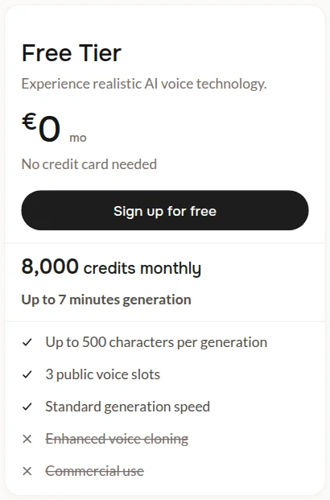
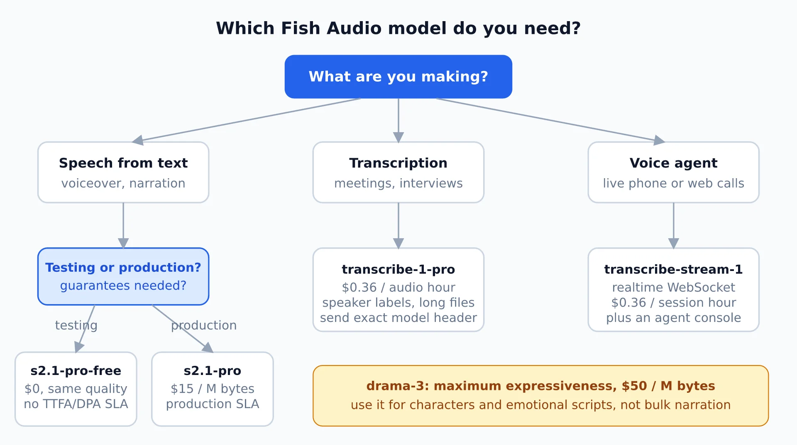
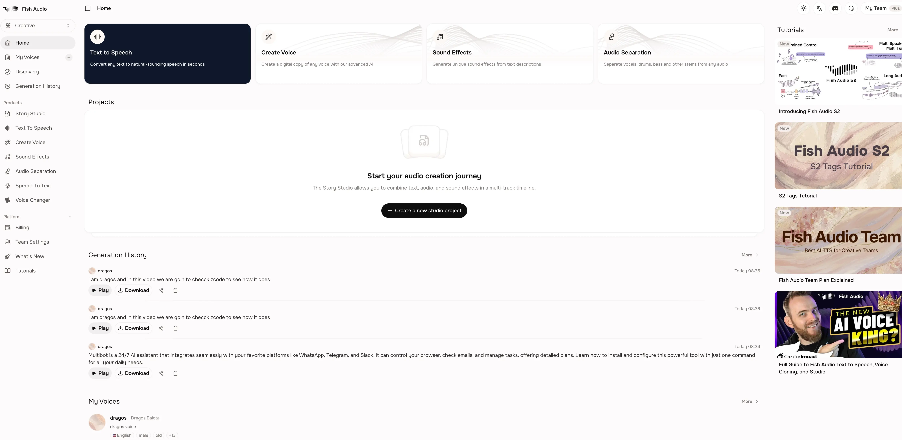
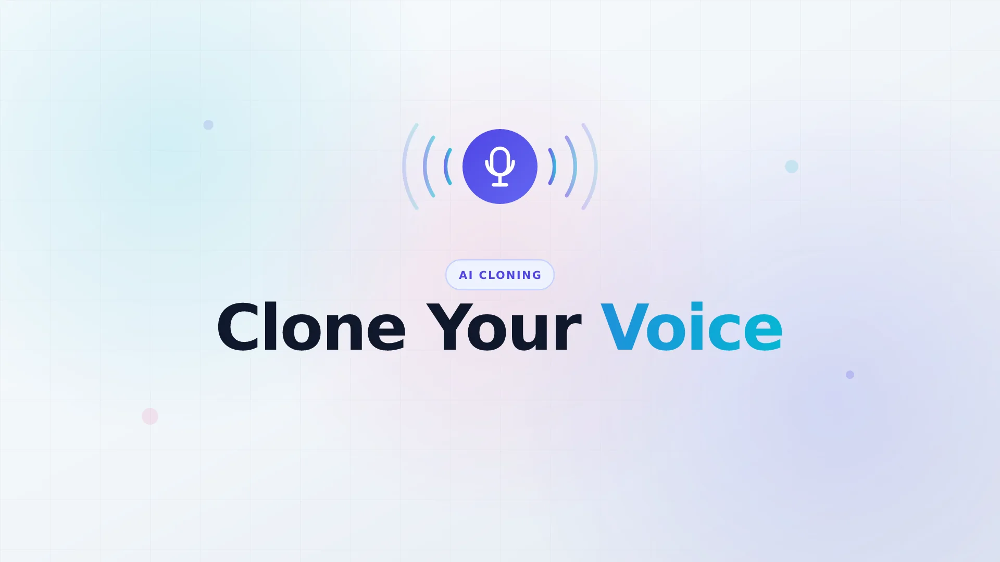

import Button from "@components/widgets/Button.astro";
import Notice from "@components/widgets/Notice.astro";
import ListCheck from "@components/widgets/ListCheck.astro";
import Accordion from "@components/widgets/Accordion.astro";

*Disclosure: this guide contains referral links. If you buy through them, I may earn a commission at no extra cost to you.*

Fish Audio is a voice AI platform that does text-to-speech, voice cloning, speech-to-text, and lip-sync video in one dashboard. The free tier gives you 8,000 credits a month, and developers get the same S2.1 Pro model free through the API with no hard cap. I clone my voice in it from about 15 seconds of audio and use it on YouTube. Here is the honest version: what works, what is rough, and who should skip it.

<Button text="Try Fish Audio Free" link="https://go.bitdoze.com/fish-audio" variant="solid" color="blue" size="md" icon="arrow-right" />

## Is Fish Audio free?

Yes, in two different ways, and the difference matters:

- **The web app free tier** gives you 8,000 credits every month, no credit card needed (see the [Fish Audio plan page](https://fish.audio/plan/)). One minute of generated speech costs roughly 600 credits, so that is about 7 minutes of audio per month, in chunks of up to 500 characters. You get 3 public voice slots and standard generation speed. No commercial use, no enhanced voice cloning.
- **The free API model** is separate from the web credits. Set `model: "s2.1-pro-free"` in your API calls and you get the same S2.1 Pro model at $0, under fair-use limits, per the [models overview](https://docs.fish.audio/developer-guide/models-pricing/models-overview). No TTFA (time to first audio) or DPA guarantees, which is the trade. For testing, prototyping, and smaller projects it is hard to argue with.

*The free tier as listed on the Fish Audio plan page: 8,000 monthly credits, capped at 500 characters per generation, personal use only.*

Credits reset each month and unused minutes do not roll over. If you only need a few minutes of narration a month, you may never have to pay anything.

<Notice type="warning" title="Free web tier is personal use only">
Read that twice before you monetize a YouTube video narrated on the free plan. Commercial use starts at the Plus tier.
</Notice>

## The models: S2.1 Pro, drama-3, and what happened to S1

Fish Audio runs three current TTS models plus one on the way out:

| Model | Price | Best for | Notes |
|-------|-------|----------|-------|
| `s2.1-pro` | $15 / million UTF-8 bytes | Production TTS | TTFA and DPA guarantees, 83 languages |
| `s2.1-pro-free` | $0 | Development and small projects | Same model, no guarantees, fair-use limits |
| `drama-3` | $50 / million UTF-8 bytes | Characters and emotional scripts | Maximum expressiveness, newest flagship |
| `s1` | retired Dec 31, 2026 | nothing new | Deprecated; requests get served by s2.1-pro after the date |

One million UTF-8 bytes is roughly 180,000 English words or about 12 hours of speech, so $15 of s2.1-pro goes a long way.

<Notice type="info" title="Dates that will change this section">
The [drama-3 docs](https://docs.fish.audio/features/text-to-speech/drama-3) list a launch price of $10 per million bytes (80% off) through November 30, 2026, ending December 1 at 08:00 UTC. After that it is $50. The `s1` model retires on December 31, 2026 and requests are then served by s2.1-pro.
</Notice>

*Pick the model by the job: free tier for testing, s2.1-pro when you need guarantees, drama-3 when the script needs acting.*

The emotion control syntax changed with the S2 generation. The old S1 used parenthesis tags like `(excited)` from a fixed list. S2.1 Pro and S2 Pro use natural language in **brackets**: `[whispers sweetly]`, `[laughing nervously]`, or whatever description fits. It is not limited to a fixed set, which makes it far more flexible and a little less predictable. Most TTS tools give you a flat monotone output unless you fight with SSML. Here you write what you want and the delivery changes. It makes a real difference when you narrate a 10-minute video and need the tone to shift.

S2 Pro is the one to know if you want to run things yourself. The [S2 Pro model card](https://huggingface.co/fishaudio/s2-pro) publishes the weights, fine-tuning code and an SGLang-based inference engine, but under the [Fish Audio Research License](https://huggingface.co/fishaudio/s2-pro/blob/main/LICENSE.md): research and non-commercial use is free, commercial use needs a separate written license. That is open weights, not open source in the usual sense. The drama-3 weights are also on [Hugging Face](https://huggingface.co/fishaudio/drama-3), under the Fish Audio Community License. I compared the main open weights in [the open-source TTS engines roundup](/best-open-source-tts/).

<YouTubeEmbed
  url="https://www.youtube.com/embed/1qnuGqTKGL0"
  label="Clone Your Voice with Fish Audio and Mastra"
/>

## What Fish Audio does well

**Voice cloning is fast.** I recorded about 15 seconds of myself reading a paragraph, uploaded it, and had a working clone in under two minutes. For comparison, ElevenLabs [documents](https://elevenlabs.io/docs/creative-platform/voices/voice-cloning/instant-voice-cloning) a 10-second minimum for Instant Voice Cloning and recommends 1 to 2 minutes of clean audio, and its Starter plan already includes instant cloning. So the gap is shorter sample requirements, not a paywall. The S2.1 Pro model supports 83 languages, though clone quality varies by language.

**Multilingual support is strong.** I tested it with mixed English and Romanian content and the pronunciation was clean, without the robotic accent bleed you get from some other tools. S2.1 Pro lists [83 languages](https://docs.fish.audio/developer-guide/models-pricing/models-overview), while the Fish Audio landing page still says 30+. ElevenLabs now lists 90+ languages for Eleven v4 and 70+ for v3 on its [API pricing page](https://elevenlabs.io/pricing/api), so language count is no longer a reason to pick Fish. Test your own language in both.

**The community voice library is large.** The [voice library](https://fish.audio/voice-library) advertises over 2,000,000 voices, so you will probably find something close to what you need without cloning anything. You can search by language, style, and use case. Some of the community voices are surprisingly good.

**The API pricing is simple.** Pay as you go, no subscription required for API access. TTS is billed per million UTF-8 bytes of input text, transcription is $0.36 per audio hour, and errors are not billed. Rate limits work on concurrency, not QPS: 5 concurrent requests until you have prepaid $100 total, then 15, then 50 at $1,000. The full walkthrough is in my [Fish Audio API tutorial](/fish-audio-api/).

## Where it falls short

**The web app can be slow.** Generating long audio through the browser interface takes a while. The API is faster, but if you are a non-technical user who just wants to paste text and get audio, the web experience could be better.

**Emotion tags have a learning curve.** The bracket syntax accepts free-form descriptions, but placement matters more than the words. I had to experiment for about an hour before I got results I was happy with. A few example scripts with before/after audio would help.

**Voice library quality varies.** Two million voices is a lot, and not all of them are good. The search and filtering could be improved. I spent more time than I wanted browsing through mediocre voices before finding ones I liked.

**No desktop app.** It is web-only or API. If you want a native app for offline work, you are out of luck. There is a mobile app on Google Play, but I have not tested it.

## Fish Creative: image, video, and lip-sync

Fish Audio is no longer just a voice tool. It now has a suite called **Fish Creative** in the same dashboard and account, with image generation, video generation, lip-sync, and sound effects on top of TTS and voice cloning. The [Fish Creative tutorial](https://fish.audio/blog/fish-creative-tutorial) on the Fish Audio blog covers the full set, and I wrote a longer walkthrough in [Fish Audio image and video generation](/fish-audio-image-video-generation/).

I tested the video and lip-sync side. Here is what it looks like in practice: you generate a voice (or upload your own audio), pick or generate an image of a character, and Fish Creative syncs the mouth movements to the audio. The result is a talking-head video that you can export and use directly. No After Effects, no separate lip-sync tool, no manual alignment.

<YouTubeEmbed
  url="https://www.youtube.com/embed/ZNOvMVMoaAU"
  label="Fish Audio Just Added AI Video & Lip-Sync!"
/>

The lip-sync works with any audio source: your cloned voice, a community voice, or uploaded audio. You can also generate images from text prompts right inside the platform and use those as the base for lip-sync videos. The workflow is: write a script, generate the voice, generate or upload an image, hit lip-sync, export.

I keep coming back to the same thing: this used to take three or four separate tools. HeyGen for the avatar, ElevenLabs for the voice, some image tool for the face, and a video editor to stitch it together. Now it is one tab.

The image generation is decent, not Midjourney quality, but good enough for character portraits and talking-head frames. The video generation handles the lip and jaw movement well. Hair, eyes, and background stay stable. Where it gets weird is extreme head turns or wide-open expressions, the same problem every lip-sync tool has right now.

## What shipped recently

Fish Audio ships updates fast. Here are the additions worth knowing about as of November 26, 2026:

**Drama-3, the new flagship.** Billed as their most emotive model, built for multi-character scenes with up to 16 speaker tags per text ([model card](https://huggingface.co/fishaudio/drama-3)). At $50 per million bytes it costs over 3x s2.1-pro, so it is a character-and-acting model, not a bulk narration model. The launch price is $10 through November 30, 2026.

**Transcribe 1 Pro (speech-to-text).** Their ASR got a Pro tier aimed at interviews, meetings, and podcasts. It marks speakers inline (`<|speaker:0|>`, `<|speaker:1|>`), keeps emotion cues like `[laughter]` in the transcript, auto-detects the language, handles recordings up to 60 minutes, and can return word-level timestamps. Same price as the standard model: $0.36 per audio hour. One footgun: the selection happens through an HTTP header, `model: transcribe-1-pro` on `POST /v1/asr`. If the header is missing or not an exact match, you get transcribe-1 instead and no error tells you. I sent the same audio to it and to AssemblyAI, so the [OpenAI Whisper alternatives test](/openai-whisper-alternatives/) has measured numbers, and my [AssemblyAI review](/assemblyai-review/) covers the other side of that test. There is also a realtime WebSocket model, `transcribe-stream-1`, billed per session hour for live voice agents.

**Pronunciation dictionaries.** If a name or acronym keeps coming out wrong, you no longer have to paste phoneme tags into every script. Build a dictionary once in the web app (or inline in the API request), publish it, and reference it by ID in TTS calls. English rules use CMU Arpabet, Chinese uses tone-number pinyin, Japanese uses romaji with pitch marks. Up to 3 dictionaries per request, 5,000 rules each.

**The MCP server does images and video now.** Fish Audio's [MCP server](https://docs.fish.audio/overview/mcp) (`https://api.fish.audio/mcp`) is not audio-only anymore. An agent connected through Claude, Cursor, or Codex can search voices, run TTS, transcribe files, and generate or edit images and videos. It signs in with OAuth and bills like the web app (plan credits, not the developer API balance), and the agent asks you to approve an image or video estimate before it generates. Video needs a Plus plan or higher.

**Voice Design.** Describe a voice in plain words (age, accent, tone, pacing) and it generates candidates, no sample audio needed. The [API version](https://docs.fish.audio/developer-guide/models-pricing/pricing-and-rate-limits) (`voice-design-1`) bills at $0.01 per successful request.

**Asset Library and Avatars.** Your uploads and generated files now sit in a central Asset Library, and you can save a character as an Avatar inside Image & Video instead of re-uploading the same face every time you lip-sync.

One more thing sitting in the docs: a full **voice-agent platform**, build an agent in a console with a prompt, voice, knowledge base, and tools, then deploy it as a web widget or on a real phone number with inbound calls, outbound dials, and warm call transfers. I have not tested it end to end yet, but it is a much bigger product than the TTS tool I originally signed up for. If you want to wire the TTS into your own agent, see [Add voice cloning TTS to Mastra with Fish Audio](/mastra-fish-audio-tts/).

## Fish Audio pricing: the real numbers

Two separate pricing systems live side by side, and most confusion comes from mixing them up.

**Web app subscriptions** (per the official plan page, annual billing is cheaper):

| Plan | Monthly | What you get |
|------|---------|--------------|
| Free | $0 | 8,000 credits/mo (about 7 minutes), 500 chars per generation, 3 public voice slots, personal use only |
| Plus | $15/mo ($11/mo annual) | 250,000 credits/mo (about 200 minutes), 15,000 chars per generation, unlimited public + 10 private voice slots, commercial use, Voice Design |
| Pro | $100/mo ($75/mo annual) | 2,000,000 credits/mo (about 1,620 minutes), 30,000 chars per generation, 3 team seats, 5 professional voice slots |

Credit math: one minute of generated audio costs roughly 600 to 625 credits. Credits reset monthly and do not roll over. The Pro tier has a 7-day money-back guarantee.

**API pricing** is pay as you go with no subscription: s2.1-pro at $15 per million UTF-8 bytes, drama-3 at $50, transcription at $0.36 per audio hour, voice design at $0.01 per request. You prepay balance and it does not expire monthly the way subscription credits do.

Which one do you pick? If you only generate audio in the browser, the subscription is the unit. If you build on the API, ignore subscriptions entirely and start with the free model; my [API tutorial](/fish-audio-api/) has the first request running in five minutes.

## Troubleshooting: when Fish Audio is not working

The fixes for the problems people actually hit:

**Generation fails or never finishes in the web app.** Long text is the usual cause. The free tier caps at 500 characters per generation, and even paid tiers cap at 15,000 to 30,000. Split the script into paragraphs and batch them. If a generation hangs, refresh and check the Asset Library before retrying; finished files sometimes land there without the UI updating.

**The API returns 429.** You hit the concurrency limit, not a rate-per-minute limit. The Starter tier allows 5 concurrent requests and there is no Retry-After header, so retry with exponential backoff. If you need more concurrency, prepaying balance unlocks the next tier immediately; you do not have to spend it first.

**Transcription comes back without speaker labels.** You are on transcribe-1, not transcribe-1-pro. The header `model: transcribe-1-pro` must match exactly; a missing or mistyped header silently falls back to the base model.

**Emotion tags do nothing.** Check which model you are calling. Bracket syntax like `[whispers]` works on s2.1-pro and s2-pro. If your integration still passes `s1`, you get the old parenthesis behavior, and s1 retires on December 31, 2026.

**The cloned voice sounds off in another language.** Clones carry accent and prosody from the source audio. Record the sample in the language you care about most, or pick a community voice native to that language instead.

**Webhook or MCP jobs do not run.** Image and video generation through MCP requires a paid plan, and the agent quotes the credit cost first. Confirm the pricing prompt instead of assuming the job started.

## Fish Audio vs ElevenLabs

This is the comparison most people want. I have used both, and ElevenLabs has changed a lot, so the old "Fish is cheaper and has more languages" line no longer holds. Here is the list-price picture on November 26, 2026:

| Feature | Fish Audio | ElevenLabs |
|---------|-----------|------------|
| Voice cloning audio needed | about 15 seconds (my test) | 10 second minimum, 1 to 2 minutes recommended |
| Cheapest plan with cloning | Plus $15/mo (free tier has no commercial use) | Starter $6/mo ($5 yearly), instant cloning; Creator $22/mo adds professional cloning |
| Languages | 83 (S2.1 Pro) | 90+ (v4), 70+ (v3), 32 (Flash/Turbo) |
| Emotion control | Free-form bracket tags | v4 and v3 audio tags |
| Community voices | 2 million+ | Large library |
| English voice quality | Very good | Best in class |
| API TTS pricing | $15 per million UTF-8 bytes (s2.1-pro) | $40 to $80 per million characters ($0.04 to $0.08 per 1K) |
| Speech-to-text | transcribe-1 / transcribe-1-pro at $0.36 per hour | Scribe v2 at $0.20 per hour |
| Free tier | 8,000 credits/mo + free API model | 10k credits/mo |

Sources: [Fish Audio plans](https://fish.audio/plan/) and [API pricing](https://docs.fish.audio/developer-guide/models-pricing/pricing-and-rate-limits), [ElevenLabs pricing](https://elevenlabs.io/pricing) and [API pricing](https://elevenlabs.io/pricing/api). For English text Fish bills about one byte per character, so the per-million figures compare directly.

ElevenLabs still has the edge on raw English voice quality and now matches or beats Fish on language count and entry price for cloning. Where Fish still wins is API cost per character, the free S2.1 Pro API model, and free-form bracket control. If you only produce English content and budget is not a concern, ElevenLabs is hard to beat. The full head-to-head with audio samples is in [Fish Audio vs ElevenLabs](/fish-audio-vs-elevenlabs/), and I also compared it against MiniMax in [Fish Audio vs MiniMax](/fish-audio-vs-minimax/).

<Notice type="info" title="Voice data and licences">
Both services take a licence over what you upload. The [ElevenLabs terms of use](https://elevenlabs.io/terms-of-use) grant it a perpetual, irrevocable, royalty-free, sublicensable licence to your input, and say it will not commercialize your voice on a standalone basis without your permission. The [Fish Audio terms](https://fish.audio/terms/) also describe the licence on user submissions as royalty-free, perpetual, sublicensable and irrevocable, state that your ownership is not affected, and note that public submissions may remain after you delete your account. Read the licence grant in each before cloning your voice.
</Notice>

## Who should use Fish Audio

<ListCheck>
<ul>
<li>**Content creators** producing videos, podcasts, or audiobooks in multiple languages. Bracket tags make narration less robotic, and Fish Creative covers talking-head and lip-sync video in the same account.</li>
<li>**Developers** building apps that need TTS. The free S2.1 Pro API is generous, and Python SDK and REST endpoints are both available. Start with the [API tutorial](/fish-audio-api/).</li>
<li>**Teams** that need a consistent brand voice. Clone one voice and reuse it, for example with the [clone voice walkthrough](/fish-audio-clone-voice/).</li>
<li>**Anyone testing AI voice tools.** The free tier is enough for a real feel before you spend money.</li>
</ul>
</ListCheck>

## Who should look elsewhere

If you only produce English content and want the absolute highest voice fidelity, ElevenLabs is still the benchmark. If you need a desktop app for offline work, Fish Audio does not have one. If you want a tool that works perfectly out of the box with no experimentation, the emotion tag system will frustrate you at first. And if you need guaranteed latency for a production voice agent, the free API model has no TTFA guarantee; budget for s2.1-pro.

## Final thoughts

I came for cheaper cloning and stayed for bracket tags and the free API. ElevenLabs has closed part of the gap since I first wrote this, so the case for Fish now rests on API price, the free model, and emotion control rather than languages or cloning cost. Clone quality is good enough for YouTube. The web app is still slower than it should be, library search is messy, and tags take practice.

The direction is clear though: drama-3 at the top end, a realtime transcription model for agents, open weights at the bottom. Fish Audio is turning into a voice platform with a TTS feature attached. If you are already paying for it, test the creative tools before you pay for a separate lip-sync service, and test the free API model before you pay for any TTS at all.

<Button text="Try Fish Audio Free" link="https://go.bitdoze.com/fish-audio" variant="solid" color="blue" size="md" icon="arrow-right" />

## FAQ

<Accordion label="Is Fish Audio free to use?" group="faq">
Yes, in two ways. The web free tier gives you 8,000 credits per month (about 7 minutes of speech, capped at 500 characters per generation) for personal use only. Separately, the API model `s2.1-pro-free` costs $0 with fair-use limits and no latency guarantees. Commercial use requires the Plus plan at $15/month or API usage on a paid model.
</Accordion>

<Accordion label="Is Fish Audio safe and legit?" group="faq">
Fish Audio says it has 8M+ users and raised a $52M seed round ([announcement](https://fish.audio/blog/fish-audio-52m-seed-funding)), which makes it a real company, not a throwaway site. Its [terms](https://fish.audio/terms/) grant Fish a perpetual licence over user submissions while stating you keep ownership, so read them before uploading sensitive audio, and remember that public voices are visible to everyone. For commercial use, use a paid plan.
</Accordion>

<Accordion label="Is the Fish Audio API free?" group="faq">
The `s2.1-pro-free` model costs $0 per million bytes and uses the same endpoint as the paid API. You still need an account and API key. Paid models bill pay-as-you-go: s2.1-pro at $15 and drama-3 at $50 (launch price $10 through November 30, 2026) per million UTF-8 bytes, roughly 180,000 English words per million bytes. Rate limits are concurrency-based: 5 parallel requests until you have prepaid $100 total.
</Accordion>

<Accordion label="Is Fish Audio open source?" group="faq">
Not in the strict sense. The S2 Pro and drama-3 weights are published on Hugging Face, but under the Fish Audio Research License (S2 Pro) and the Fish Audio Community License (drama-3). Research and non-commercial use is free, and commercial use needs a license from Fish. S2.1 Pro is hosted only. If self-hosting under a permissive licence matters, the [open-source TTS comparison](/best-open-source-tts/) covers the alternatives.
</Accordion>

<Accordion label="Why is Fish Audio not working?" group="faq">
The three common causes: your text exceeds the per-generation cap (500 characters on free, split it up), you hit the API concurrency limit and need exponential backoff on 429 responses, or you expected speaker labels but the `model: transcribe-1-pro` header was missing or mistyped and you got the base model instead. Long generations can also appear to hang while the file lands in the Asset Library.
</Accordion>

<Accordion label="How does voice cloning work?" group="faq">
Fish Audio analyzes a short audio clip, about 15 seconds in my case, to capture tone, pitch, speaking style, and rhythm, then generates speech in your voice from any text. The S2.1 Pro model supports 83 languages. Cloning quality is best when the sample is clean, single-speaker, and recorded in the language you care about most.
</Accordion>

<Accordion label="Fish Audio vs ElevenLabs: which should I pick?" group="faq">
For English narration where quality matters most, ElevenLabs. For API cost per character, a free API model, and free-form emotion tags, Fish Audio. Language count and cloning price no longer separate them: ElevenLabs lists 90+ languages for v4 and includes instant cloning from its $6 Starter plan. Test your own script in both free tiers before paying.
</Accordion>
